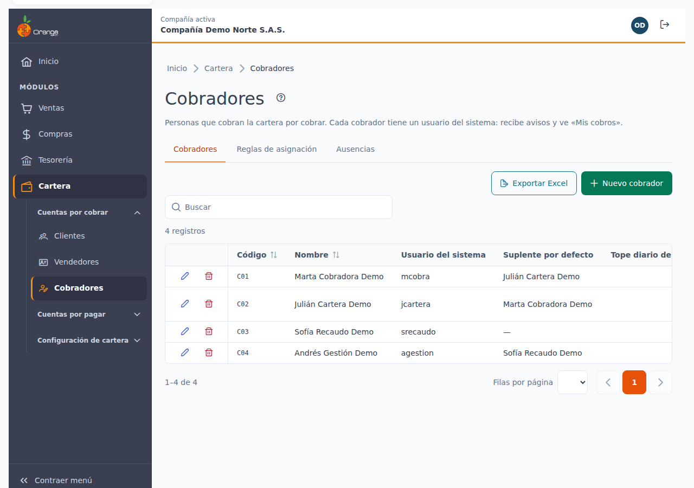
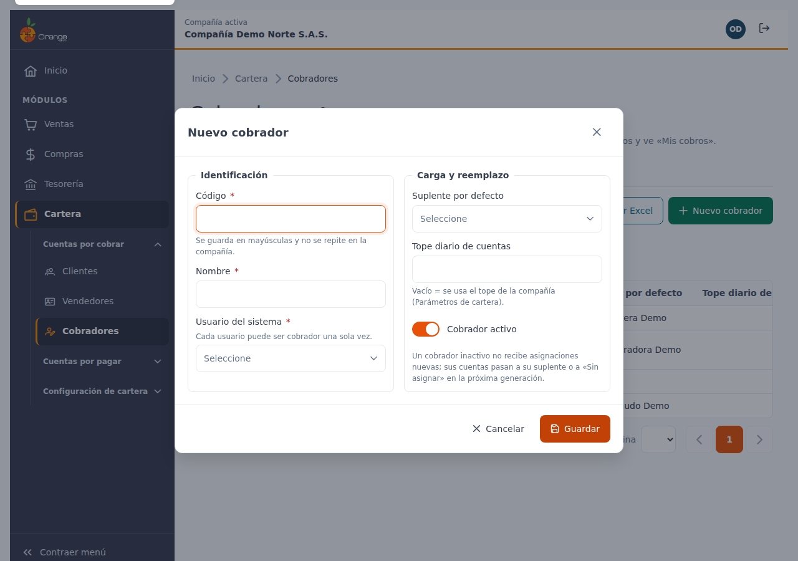
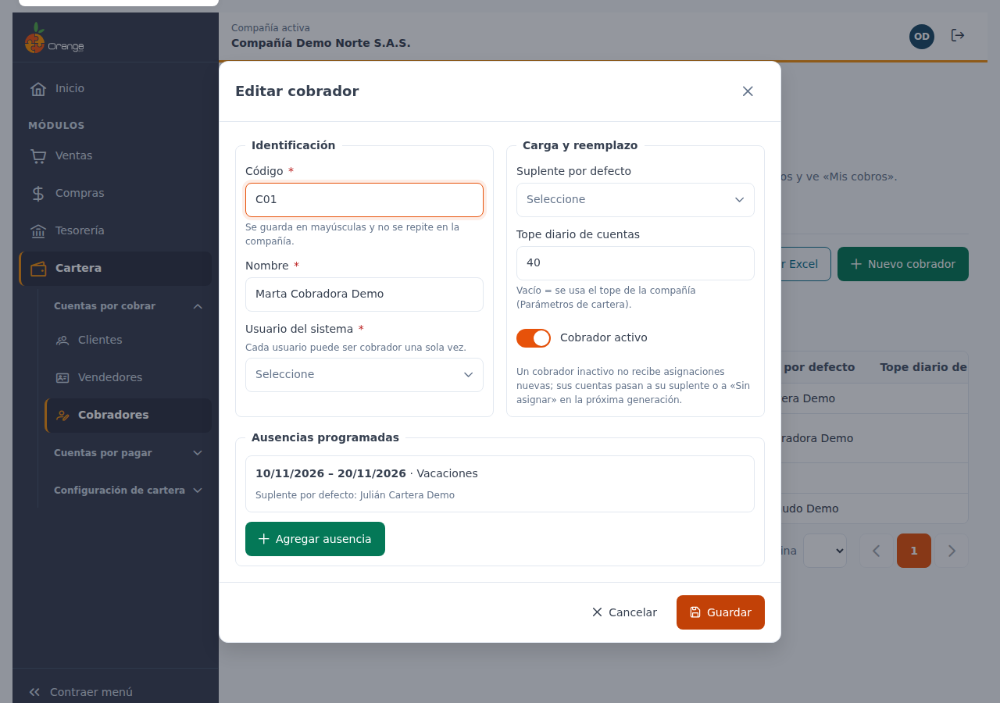
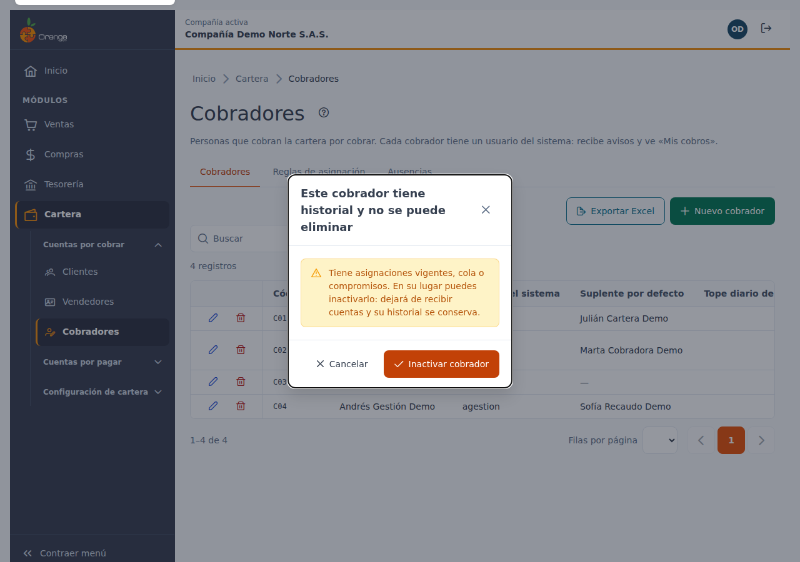
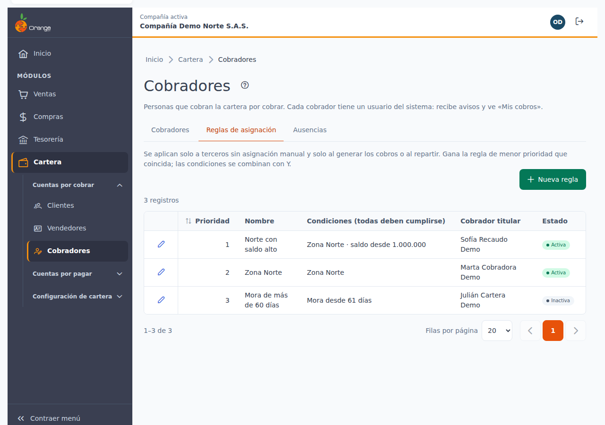
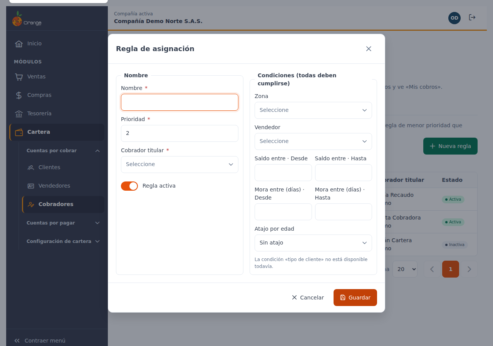
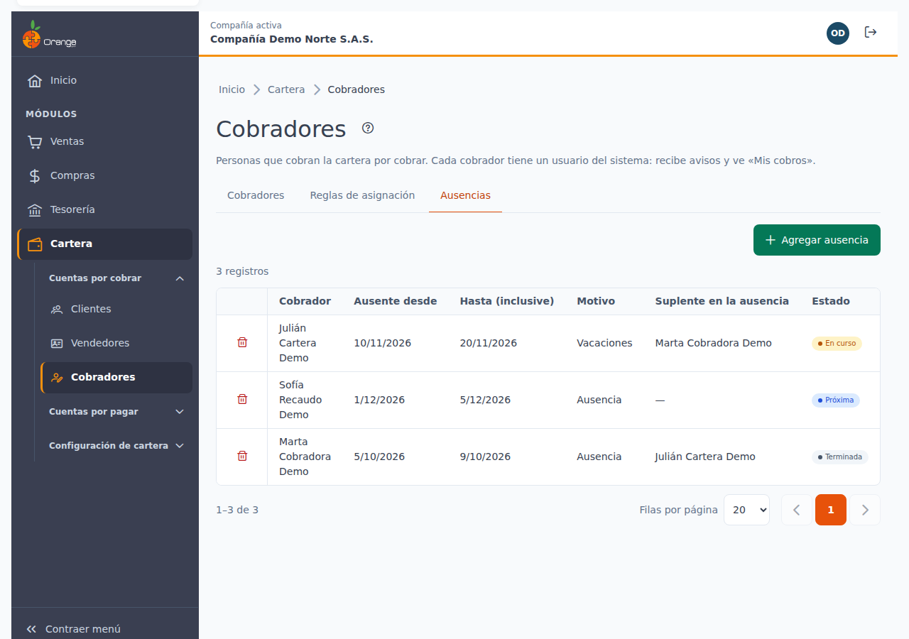

[Regresar a Cartera](readme.md)

---

# 👥 Cobradores

---

> ⚠️ Esta pantalla requiere que el administrador haya habilitado las tablas y los permisos de la **fase 2** de Seguimiento de Cartera. Si no los ve, consulte con su administrador.

## 📋 Descripción

Un **cobrador** es la persona de la compañía que hace la gestión de cobro de los clientes. Cada cobrador tiene un **usuario del sistema** (así recibe sus avisos y ve sus cobros), un **suplente por defecto** para cuando no esté, y un **tope diario** de cuentas si quiere limitar cuántas cuentas le llegan en un día.

En esta pantalla usted **consulta, crea, edita, inactiva y elimina** cobradores, define las **reglas de asignación** que reparten los clientes entre ellos y registra sus **ausencias**.

> 💡 Los cobradores solo gestionan **cuentas por cobrar** (clientes). Los proveedores no se asignan a cobradores.

> 💡 Por ahora no hay importación desde Excel: son pocos registros. Sí puede **exportar** la lista a Excel.

---

## 🎯 Acceso

1. En el menú principal, haga clic en **Cartera**.
2. En **Maestros**, en el grupo **Cuentas por cobrar**, haga clic en **Cobradores**.

---

## 🖥️ Pantalla principal

La pantalla tiene tres pestañas: **Cobradores**, **Reglas de asignación** y **Ausencias**.

| Elemento | Para qué sirve |
|----------|----------------|
| **?** (junto al título) | Abre esta ayuda en un panel lateral. |
| **Nuevo cobrador** | Crea un cobrador. |
| **Exportar Excel** | Descarga la lista de cobradores. |
| **Buscar por código o nombre** | Filtra la lista mientras escribe. |
| **Editar** / **Eliminar** | Están en la primera columna de cada fila, con el nombre del cobrador en la etiqueta del botón. |

### Columnas de la lista

| Columna | Qué muestra |
|---------|-------------|
| **Código** y **Nombre** | Identificación del cobrador. |
| **Usuario** | El usuario del sistema al que está ligado. |
| **Suplente por defecto** | El cobrador que lo reemplaza cuando está ausente. |
| **Tope diario** | Cuántas cuentas puede recibir en un día. Si está vacío, aplica el tope de la compañía. |
| **Cuentas (titular)** | Clientes de los que es titular. |
| **En apoyo** | Clientes en los que apoya a otro titular. |
| **Saldo titular** | Saldo de las cuentas de las que es titular. |
| **Estado** | **Activo** o **Inactivo**. Si está ausente hoy, lo dice con el texto **Ausente hoy**. |

Un cobrador **inactivo** no recibe asignaciones nuevas.

### Qué ve cada permiso

| Permiso (opción 348) | Qué puede hacer |
|----------------------|-----------------|
| **Consultar** | Ver la lista, las reglas y las ausencias. |
| **Crear** | Crear cobradores, reglas y ausencias. |
| **Actualizar** | Editar cobradores y reglas, e inactivar cobradores. |
| **Eliminar** | Eliminar reglas, ausencias y cobradores sin uso. |
| **Exportar** | Ver **Exportar Excel**. |

Sin el permiso correspondiente, el botón no aparece. Si cambia otro usuario un cobrador mientras usted lo tiene abierto, la lista se actualiza sola o le avisa que hay cambios.

---

## ➕ Crear un cobrador

1. Haga clic en **Nuevo cobrador**.
2. Complete los campos y haga clic en **Guardar**.

El diálogo está dividido en dos bloques:

| Bloque | Campo | Reglas |
|--------|-------|--------|
| **Identificación** | **Código** | Obligatorio. Se guarda en **mayúsculas** y no puede repetirse en la compañía. |
| | **Nombre** | Obligatorio. |
| | **Usuario del sistema** | Obligatorio. Elija el usuario de la compañía. Un mismo usuario no puede ser cobrador activo dos veces. |
| **Carga y reemplazo** | **Suplente por defecto** | Otro cobrador que lo reemplaza cuando está ausente. Es opcional. |
| | **Tope diario de cuentas** | Opcional. Déjelo vacío para usar el tope de la compañía. Si escribe un valor, tiene prioridad sobre el de la compañía. |
| | **Cobrador activo** | Apagado, el cobrador no recibe asignaciones nuevas. |

Los mensajes de error aparecen debajo del campo y lo que escribió se conserva:

| Mensaje | Qué hacer |
|---------|-----------|
| **Escribe el código del cobrador.** | Complete el código. |
| **Escribe el nombre del cobrador.** | Complete el nombre. |
| **Elige el usuario del sistema.** | Elija el usuario. |
| **Revisa N campos del cobrador.** | Corrija los campos marcados. |

---

## ✏️ Editar, inactivar y eliminar

1. Haga clic en **Editar** de la fila.
2. Cambie lo que necesite y haga clic en **Guardar**.

En edición aparece la banda **Ausencias programadas**, donde puede agregar una ausencia sin salir del cobrador.

### Inactivar en lugar de eliminar

Un cobrador que tiene **cuentas asignadas**, **historial de cola** o **compromisos de pago** no se puede eliminar. Si intenta hacerlo, el diálogo le explica por qué y le ofrece **Inactivar cobrador**.

Al inactivarlo:

- Sus cuentas no cambian de inmediato.
- En la **próxima generación** de cobros, sus cuentas pasan a su suplente o, si no hay, a **Sin asignar**.

Solo puede eliminar un cobrador que no tenga ningún uso.

---

## ⚖️ Reglas de asignación

La pestaña **Reglas de asignación** reparte los clientes entre los cobradores según sus características. Una regla dice: *los clientes que cumplan estas condiciones van al cobrador tal*.

| Campo | Qué significa |
|-------|---------------|
| **Prioridad** | Número de la regla. Si dos reglas coinciden con un cliente, **gana la de número más bajo**. Cada número es único en la compañía. |
| **Nombre** | Para reconocer la regla. |
| **Condiciones** | Zona, vendedor, rango de saldo, rango de mora (días) o atajo por edad. Se cumplen **todas** a la vez. Debe elegir al menos una. |
| **Cobrador titular** | El cobrador al que van los clientes que cumplen la regla. |
| **Regla activa** | Apagada, la regla no se aplica. |

El **atajo por edad** toma los tramos de la cartera: **Vencido de 1 a 30 días**, **Vencido de 31 a 60 días** o **Más de 60 días**.

> ℹ️ La regla **no** aplica por tipo de cliente: esa condición no está disponible.

### Cuándo se aplican las reglas

- Solo a clientes **sin asignación manual**. Una asignación hecha a mano siempre gana.
- Solo **cuando se genera** la cola de cobros (ver [Generación de cobros](movimientos/generacion.md)) o cuando se **reparte** la cartera sin cobrador.
- No cambian clientes de forma retroactiva ni en vivo.

---

## 🏖️ Ausencias y suplentes

La pestaña **Ausencias** registra cuándo un cobrador no estará disponible.

| Campo | Qué escribir |
|-------|--------------|
| **Cobrador** | Quién estará ausente. |
| **Ausente desde** y **Hasta (inclusive)** | Fechas de la ausencia. El último día cuenta. |
| **Motivo** | **Ausencia** o **Vacaciones**. |
| **Suplente en la ausencia** | Opcional. Si lo deja vacío, se usa su suplente por defecto. |

La tabla muestra el estado de cada ausencia: **En curso**, **Próxima** o **Terminada**.

Una ausencia **no cambia las asignaciones**. Al generar la cola de cobros, las cuentas del titular ausente pasan así:

1. A su **suplente** (el de la ausencia o el suplente por defecto).
2. Si el suplente también está ausente o inactivo, al **primer cobrador de apoyo** disponible, con menos carga.
3. Si nadie puede, a **Sin asignar**.

Cuando el titular regresa, recupera sus cuentas en la siguiente generación.

---

## 🛡️ Permisos y avisos

- Sin el permiso **Actualizar** de la opción 349 (Cola de cobro), un usuario solo ve sus propias cuentas y las que tiene en apoyo.
- Cada cambio queda en la **bitácora** con quién lo hizo.

---

## ❓ Preguntas frecuentes

**¿Por qué no puedo eliminar un cobrador?**
Porque tiene cuentas, historial o compromisos. Inactívelo: así conserva su historial.

**¿Por qué un cliente sigue con un cobrador inactivo?**
Las asignaciones no cambian de inmediato. Cambian en la próxima generación de cobros.

**¿Qué pasa si dos cobradores tienen la misma regla?**
Gana la regla de prioridad más baja (el número más pequeño).

**¿Por qué una regla no se aplica a un cliente?**
Porque el cliente tiene una asignación manual, o porque no cumple todas las condiciones de la regla, o porque la regla está inactiva.

**¿Puedo importar cobradores desde Excel?**
No. Son pocos registros: créelos en la pantalla y expórtelos cuando lo necesite.

---

## 🛠️ Errores comunes

| Mensaje | Qué hacer |
|---------|-----------|
| **Escribe el código del cobrador.** / **Escribe el nombre del cobrador.** / **Elige el usuario del sistema.** | Complete el campo marcado. |
| **Revisa N campos del cobrador.** | Corrija los campos marcados. |
| **Elige al menos una condición.** | Agregue zona, vendedor, rango de saldo, rango de mora o atajo. |
| **No se pudo cargar la información** | Pulse **Reintentar**. |
| **No tiene permiso para ver esta información** | Pida a su administrador el permiso de la opción 348. |

---

## 🧷 Relacionado

- [Parámetros de cartera](parametros.md): el tope diario de la compañía y el modo de reparto por defecto.
- [Seguimiento de Cartera](movimientos/seguimiento.md): donde se ve el cobrador de cada cliente y se reasigna.
- [Cola de cobro](movimientos/cola.md)
- [Generación de cobros](movimientos/generacion.md)
- [Maestros de Cartera por tipo](maestros.md)
