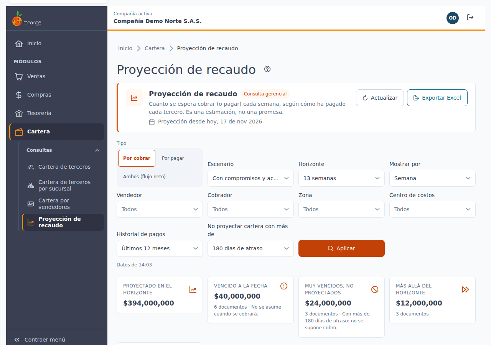
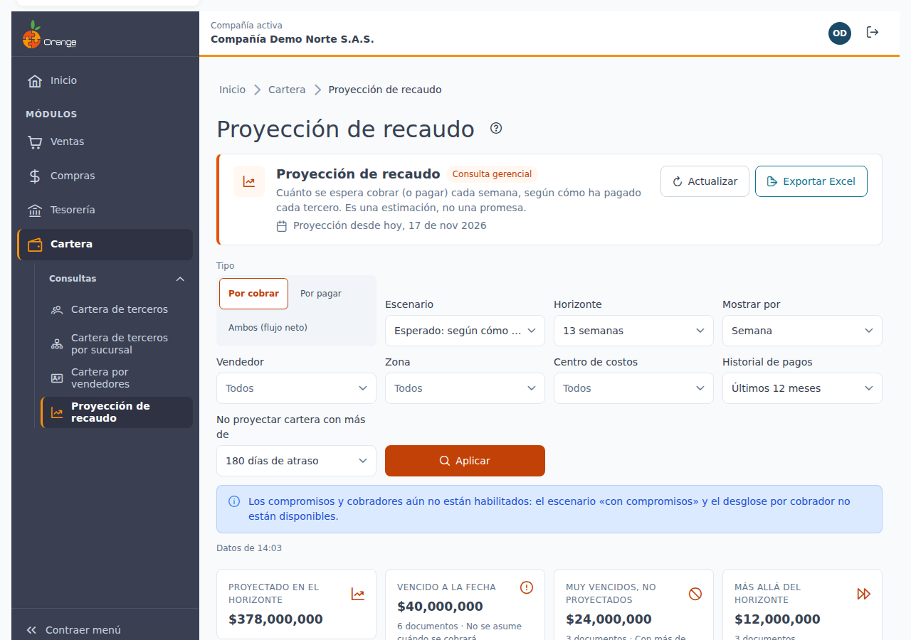
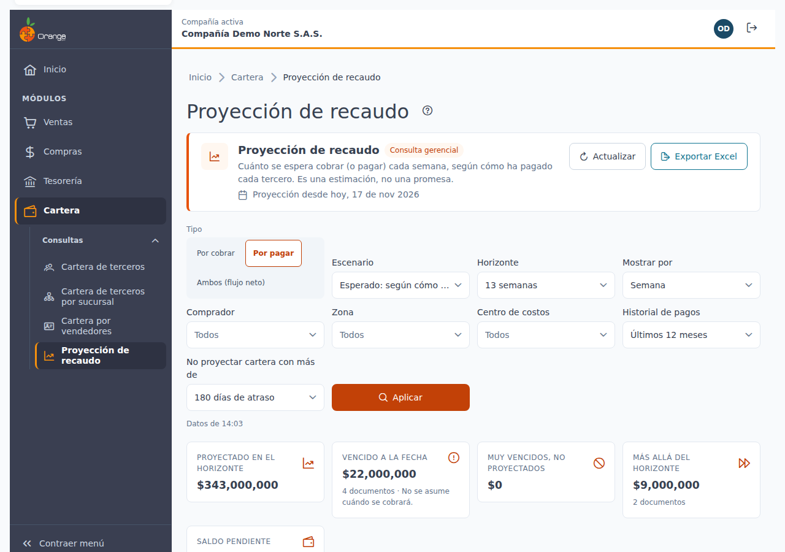
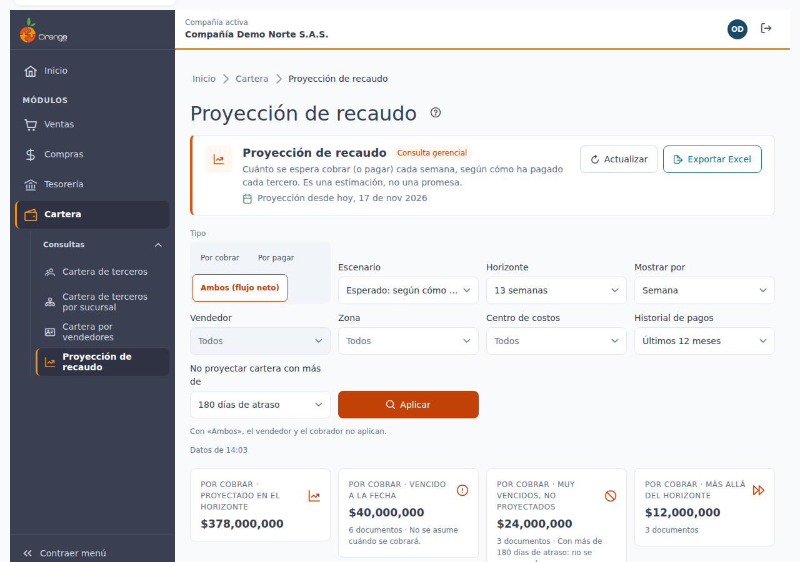
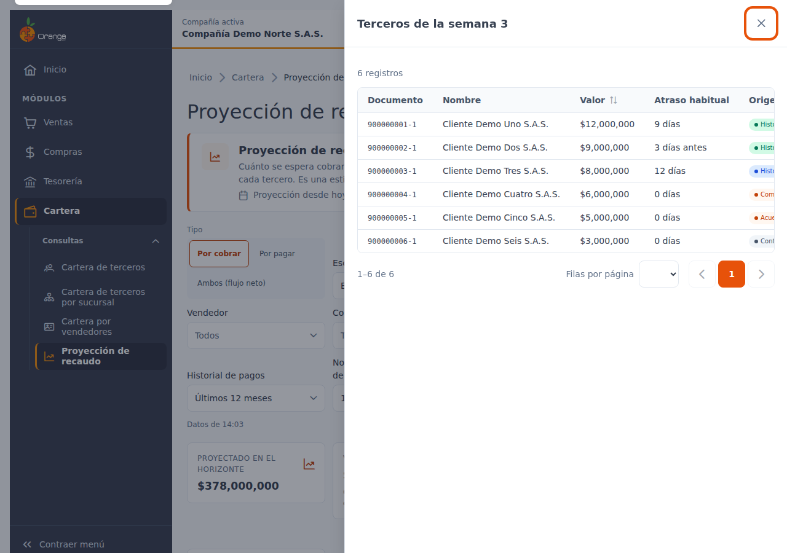
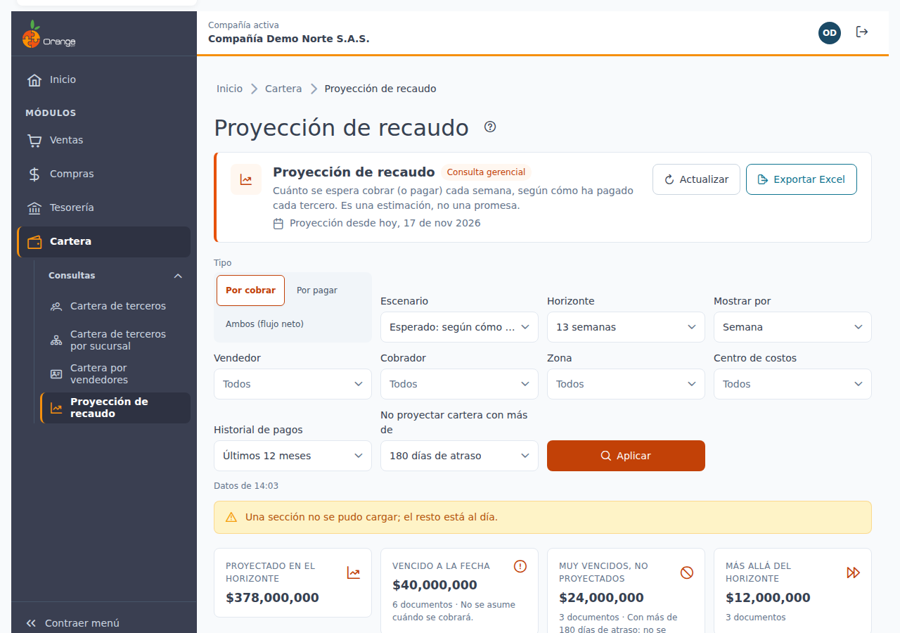
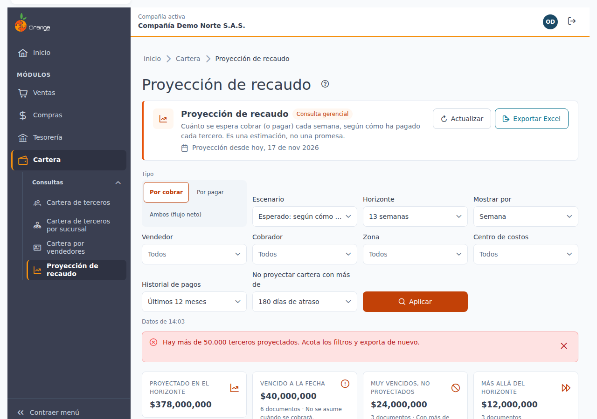
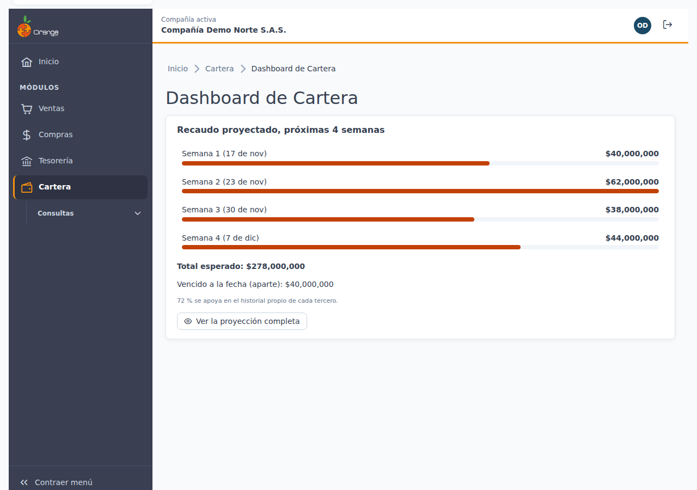
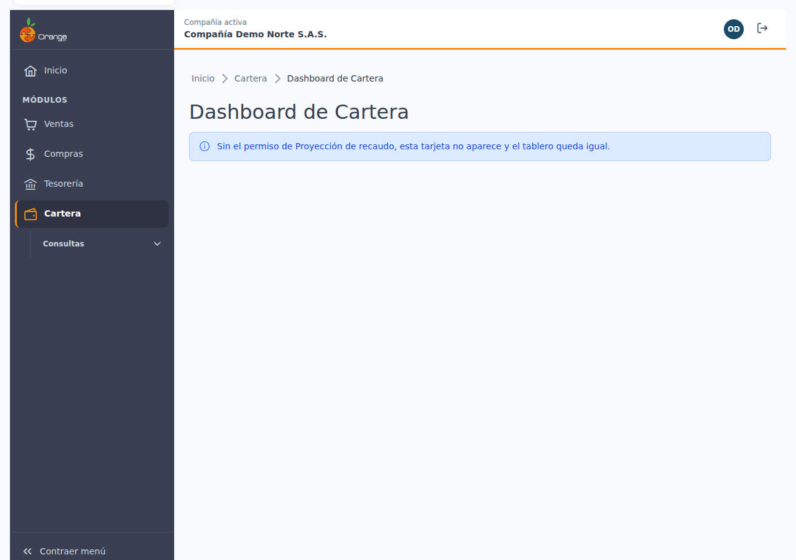
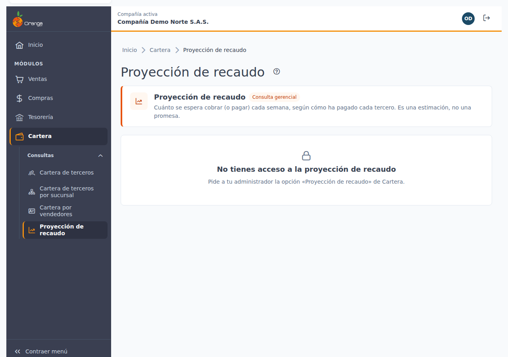

[Regresar a Cartera](../readme.md)

---

# 🔮 Proyección de recaudo

---

> ⚠️ **Es una estimación, no una promesa.** La proyección dice cuánto **podría** entrar y en qué semanas, con base en las fechas de vencimiento y en cómo ha pagado cada cliente. No garantiza ningún pago.
>
> ℹ️ Esta pantalla **no** modifica documentos, saldos ni gestiones: solo consulta.

## 📋 Descripción

La **proyección de recaudo** responde a una pregunta que el resto de la cartera no responde: **¿cuándo va a entrar la plata?**

Los reportes muestran cuánto está vencido y cuánto está por vencer. La proyección reparte esos saldos en **semanas** (o meses) y muestra, para cada una, cuánto debería entrar. Así puede planear la caja.

La proyección también puede mostrar los **pagos** que la compañía tiene que hacer a sus proveedores (lado **Por pagar**) y el **flujo neto**, que es el recaudo menos los pagos.

---

## 🎯 Acceso

1. En el menú principal, haga clic en **Cartera**.
2. En **Consultas**, haga clic en **Proyección de recaudo**.

---

## 🖥️ Pantalla principal

| Elemento | Para qué sirve |
|----------|----------------|
| **Tipo** | **Por cobrar** (defecto), **Por pagar** o **Ambos (flujo neto)**. Ver *Por cobrar, por pagar o ambos*. |
| **Escenario** | **Contractual**, **Esperado** o **Con compromisos y acuerdos de pago**. Ver *Los tres escenarios*. |
| **Horizonte** | 8 a 13 semanas. Por defecto, 13 semanas (un trimestre). |
| **Mostrar por** | **Semana** o **Mes**. |
| **Historial de pagos** | Cuántos meses hacia atrás se miran para saber cómo paga cada cliente: 6, 12 o 24 meses. Por defecto, 12. |
| **No proyectar cartera con más de** | El límite de atraso: 90, 180 o 365 días. Por defecto, 180. |
| **Filtros** | Vendedor, cobrador, zona, centro de costos y edad. Pulse **Aplicar** para verlos. |
| **Actualizar** | Vuelve a calcular la proyección, sin usar la última consulta. |
| **Exportar Excel** | Descarga lo que está viendo. |

En la parte de arriba aparece **Proyección desde hoy** con la fecha, y la hora de los datos.

### Las tarjetas de resumen

| Tarjeta | Qué significa |
|---------|---------------|
| **Proyectado en el horizonte** | Lo que se espera recibir dentro de las semanas elegidas. |
| **Vencido a la fecha** | Lo que ya está vencido. No se ubica en ninguna semana, porque no se sabe cuándo se pagará. |
| **Muy vencidos, no proyectados** | Lo que tiene más atraso que el límite. No se supone que se pague. |
| **Más allá del horizonte** | Lo que vence después de las semanas elegidas. |
| **Saldo pendiente** | Todo el saldo que se consideró. |
| **Saldo a favor (no se proyecta)** | Lo que los clientes tienen a favor de la compañía. Se informa aparte. |

Las cifras de saldo y de vencido son **las mismas** que las del [Dashboard de Cartera](../dashboard.md) y de los reportes a la misma fecha.

### Qué ve cada permiso

| Permiso (opción 357) | Qué puede hacer |
|----------------------|-----------------|
| **Consultar** | Ver la proyección, el desglose, los terceros de cada semana, la precisión y el hábito de pago. |
| **Exportar** | Ver **Exportar Excel**. |

Esta pantalla es solo para consultar: no tiene botones para crear, cambiar ni eliminar nada.

---

## 🧭 Los tres escenarios

Un mismo saldo puede tener tres fechas posibles. La pantalla muestra una por una, para que vea la diferencia.

### 1. Contractual

Cada documento se ubica en la semana de su **fecha de vencimiento**. Es lo que dice el contrato.

*Ejemplo ficticio:* un documento de $1.000.000 vence en la semana 2. En el escenario contractual, los $1.000.000 aparecen en la semana 2.

Los documentos **ya vencidos** no se ubican en el tiempo: aparecen en **Vencido a la fecha**, porque el contrato ya no dice cuándo deberían pagarse.

### 2. Esperado

Es el escenario **por defecto**. Ajusta la fecha de vencimiento con el **atraso habitual** del cliente: cuántos días, en promedio, tarda en pagar después del vencimiento.

*Ejemplo ficticio:* el mismo documento de $1.000.000 vence en la semana 2, pero el cliente suele pagar **20 días** después. En el escenario esperado, los $1.000.000 aparecen en la semana 4.

Si el documento ya está vencido y el cliente suele pagar tarde, el valor cae en la **semana 1**: se espera cobrarlo pronto.

Los documentos con más atraso que el **límite de atraso** no se proyectan. Aparecen en **Muy vencidos, no proyectados**, porque no se supone que se pague cartera tan vieja.

### 3. Con compromisos y acuerdos de pago

Parte del escenario esperado y **reemplaza** lo que ya se acordó con el cliente:

1. Las **cuotas de un acuerdo de pago** pendientes o incumplidas, en la semana de su fecha.
2. Los **compromisos de pago** pendientes, en la semana de su fecha prometida.
3. Lo demás, con el escenario esperado.

*Ejemplo ficticio:* el mismo cliente de $1.000.000 prometió pagar $600.000 en la semana 3. En este escenario, los $600.000 aparecen en la semana 3 y solo los $400.000 restantes siguen en el esperado. Así no se cuenta dos veces el mismo dinero.

> ℹ️ Este escenario depende de los **compromisos** y los **acuerdos** de la cobranza. Si la compañía no los tiene habilitados, aparece **No disponible** y el escenario no se calcula.

### Cuando no hay compromisos

Si la compañía no usa compromisos o acuerdos, o si el escenario no tiene datos, el sistema usa el escenario esperado y lo dice en un aviso.

---

## 📅 Por semana o por mes

- **Semana**: el calendario va de lunes a domingo. La **semana 1** es la semana en curso, desde hoy: suele ser parcial.
- **Mes**: los meses del calendario que cubren el horizonte. El primero también puede ser parcial.

Lo que vence después del horizonte se muestra en **Más allá del horizonte**.

---

## 📊 Por cobrar, por pagar o ambos

| Tipo | Qué muestra |
|------|-------------|
| **Por cobrar** | El recaudo esperado de los clientes. Es el defecto. Incluye el cobrador. |
| **Por pagar** | Los pagos que la compañía tiene que hacer a sus proveedores, según cuándo vencen. El hábito de pago se mide con los pagos reales a cada proveedor. No hay compromisos ni acuerdos del lado de pagar. |
| **Ambos (flujo neto)** | Las dos series juntas, y el **flujo neto** de cada semana: recaudo menos pagos, con el acumulado. |

Con **Ambos**, los filtros de vendedor y de cobrador se desactivan, porque los vendedores y los compradores son distintos.

> ℹ️ Los **pagos programados** (por ejemplo, un pago en bloque con archivo bancario) todavía no se incluyen en la proyección de pagos.

---

## 🧾 De dónde sale el atraso de cada tercero

El **atraso habitual** de un tercero es cuántos días, en promedio, tarda en pagar después del vencimiento. Se calcula con los **pagos recibidos** de los últimos meses (según el **Historial de pagos** elegido):

- Por cada pago, se mira cuántos días pasaron entre el **vencimiento** del documento y la **fecha del recibo**.
- Los días se ponderan por el **valor** pagado: un pago grande pesa más que uno pequeño.
- Si un pago fue antes del vencimiento, cuenta como días negativos.

*Ejemplo ficticio:* un cliente pagó $800.000 con 10 días de atraso y $200.000 con 40 días de atraso. El promedio ponderado es (800.000 × 10 + 200.000 × 40) ÷ 1.000.000 = **16 días**.

### Cuándo dice «sin historial suficiente»

El historial propio de un cliente se usa solo si tiene **al menos 5 pagos** en el periodo. Si tiene menos, la pantalla dice **Sin historial suficiente** y usa el **historial de la empresa** (el promedio de todos sus clientes).

Si la compañía tiene muy pocos pagos en todo el periodo, el atraso es **0 días** y la pantalla lo avisa: en ese caso, el esperado es igual al contractual.

### Hábito de pago de cada tercero

En la sección **Hábito de pago de cada tercero** puede ver, por cliente, el **número de pagos**, el **atraso promedio** y **qué historial se usa**: el suyo, el de la empresa, o **Sin historial suficiente**. Puede filtrar por documento o nombre (mínimo 2 letras) y mostrar solo los clientes con historial suficiente.

---

## 🔍 Confianza: ¿en qué se basa?

Cada proyección dice en qué se basa, en porcentajes del valor esperado:

| Base | Qué significa |
|------|---------------|
| **Historial propio del tercero** | Su propio hábito de pago. Es la base más confiable. |
| **Historial de la empresa** | El promedio de la compañía, para clientes sin historial suficiente. |
| **Compromisos y acuerdos** | Lo que el cliente ya acordó pagar. |
| **Solo el contrato (sin historial)** | La fecha de vencimiento sin ajuste. |

Si menos del **50 %** del valor esperado está respaldado por el historial propio del cliente, aparece una advertencia de **confianza baja**: la proyección depende mucho de la fecha de vencimiento y del promedio de la empresa.

---

## 🧩 Desglose

Puede **partir** la proyección por **vendedor**, **cobrador**, **zona** o **edad actual**. Cada grupo muestra su valor proyectado. Se muestran los ocho grupos más grandes; el resto va en **Otros**, y lo que no tiene cobrador en **Sin asignar**.

Cada gráfico tiene su **tabla equivalente**, para leerlo sin colores.

---

## 👥 Terceros de la semana

Haga clic en una semana (o en **Ver terceros**) para ver qué clientes tienen dinero proyectado en ella. Cada fila muestra:

| Columna | Qué muestra |
|---------|-------------|
| **Documento** y **Nombre** | Del cliente. |
| **Valor** | Lo proyectado en esa semana. |
| **Atraso habitual** | Los días que se usaron. Por ejemplo, **20 días** o **10 días antes**. |
| **Origen** | **Contrato**, **Historial propio**, **Historial de la empresa**, **Compromiso** o **Acuerdo de pago**. |

---

## 🎯 Qué tan bien acierta el modelo

La pantalla **mide su propia precisión**: toma semanas pasadas, calcula lo que se habría proyectado en ese momento, y lo compara con lo que **sí** entró.

Puede elegir cuántas **semanas a revisar** (de 4 a 13). Para cada escenario se muestran dos medidas, en lenguaje llano:

- **Error promedio**: en promedio, cuánto se equivoca la proyección frente a lo que entró. Un **10 %** significa que, en promedio, la proyección se separó un 10 % de lo recaudado. **Más bajo, mejor.**
- **Tendencia**: si la proyección tiende a quedarse **corta** o a pasarse. Un valor negativo significa que la proyección fue **más baja** que lo recaudado; uno positivo, que fue **más alta**. Cero significa que, en total, acertó.

*Ejemplo ficticio:* en tres semanas, la proyección sumó $2.700.000 y entró $3.000.000. La tendencia es (2.700.000 − 3.000.000) ÷ 3.000.000 = **−10 %**: el modelo se quedó corto, porque proyectó menos de lo que entró.

Si una de las medidas no se puede calcular, la pantalla lo indica con texto y muestra las demás. Las proyecciones siguen apareciendo.

> ℹ️ El escenario **con compromisos** no tiene medición de precisión, porque no se puede reconstruir qué compromisos existían en cada semana pasada.

---

## ⚠️ Qué no hace este modelo

La proyección tiene límites que la pantalla también muestra:

- **No considera la estacionalidad** ni los festivos.
- **No incluye ventas futuras** ni anticipos.
- **No estima impagos**: solo deja fuera lo que tiene más atraso que el límite.
- Supone que cada cliente **repite su hábito** de pago reciente.
- Ubica los pagos por la **fecha del recibo**, no por la fecha de consignación.

Estas limitaciones aparecen en la pantalla, con texto, en la sección **Qué no hace este modelo**.

---

## 📤 Exportar

1. Elija los filtros y pulse **Aplicar**.
2. Haga clic en **Exportar Excel**.

El archivo tiene una hoja de **Resumen** (totales por escenario), **Semanal** (con los tres escenarios y el acumulado), **Desglose**, **Terceros**, **Precisión**, **Supuestos** (los parámetros usados, la fecha base y las advertencias) y **Filtros**. Lleva encabezado con empresa, reporte, filtros, fecha, hora y usuario.

No incluye los mensajes de las gestiones.

- Si la lista de terceros supera **50.000 filas**, el sistema no genera el archivo y pide acotar los filtros.

Mientras se genera, aparece **Generando el Excel…**.

---

## 🧩 Widget en el Dashboard de Cartera

El [Dashboard de Cartera](../dashboard.md) muestra la tarjeta **Recaudo proyectado, próximas 4 semanas**, con las barras de cada semana y el total esperado. Muestra también el vencido a la fecha, aparte.

Con **Ver la proyección completa** pasa a esta pantalla. La tarjeta solo aparece si su perfil puede ver el dashboard **y** tiene el permiso de **Consultar** de esta opción. Si no lo tiene, el dashboard se ve como antes.

---

## 🔐 Permisos

| Permiso | Qué permite |
|---------|-------------|
| **Consultar** de la opción 357 | Ver la pantalla, el desglose, los terceros, la precisión y el hábito de pago, y la tarjeta del dashboard. |
| **Exportar** de la opción 357 | Exportar a Excel. |

Si no ve la **Proyección de recaudo** en el menú, pida a su administrador el permiso de la opción 357. Si el permiso no está, la pantalla dice **No tiene permiso para ver esta información**.

---

## ❓ Preguntas frecuentes

**¿La proyección garantiza que el dinero va a entrar en esas semanas?**
No. Es una estimación basada en las fechas de vencimiento y en cómo ha pagado cada cliente. Use los tres escenarios para planear con cuidado.

**¿Por qué un documento no aparece en ninguna semana?**
Porque ya está vencido (aparece en **Vencido a la fecha**) o porque tiene más atraso que el límite (aparece en **Muy vencidos, no proyectados**).

**¿Por qué dice «Sin historial suficiente»?**
Porque el cliente tiene menos de 5 pagos en el periodo. Se usa el historial de la empresa.

**¿Por qué cambian las cifras si cambio el escenario?**
Porque cada escenario coloca el mismo saldo en semanas distintas. El total del saldo no cambia.

**¿Cambian las cifras si otro usuario registra un pago?**
Sí, al volver a calcular (**Aplicar** o **Actualizar**). La pantalla no se actualiza sola.

**¿Por qué una medida de precisión dice que no está disponible?**
Porque no hay suficientes semanas pasadas con datos para calcularla.

**¿Puedo cambiar la fecha base?**
No. La proyección siempre parte de hoy. Para ver el pasado, use los reportes de cartera.

**¿Por qué no veo los compromisos en el escenario?**
Porque la compañía no tiene habilitados los compromisos de pago. El escenario aparece como **No disponible**.

---

## 🛠️ Errores comunes

| Mensaje | Qué hacer |
|---------|-----------|
| **No se pudo calcular la proyección** | Pulse **Reintentar**. Los filtros se conservan. |
| **No hay cartera con saldo para proyectar** | Cambie los filtros o la fecha de corte. |
| **No se pudieron cargar los terceros.** | Pulse **Reintentar**. |
| **No tiene permiso para ver esta información** | Pida a su administrador el permiso de la opción 357. |

---

## 🧷 Relacionado

- [Dashboard de Cartera](../dashboard.md): la tarjeta de la proyección y los indicadores de cobro.
- [Cartera de terceros](../reportes/terceros.md): el saldo y el vencido a una fecha.
- [Seguimiento de Cartera](../movimientos/seguimiento.md): donde se registran los compromisos.
- [Casos de cobro](../movimientos/casos.md): los acuerdos de pago que alimentan el escenario con compromisos.
