[Regresar a Cartera](readme.md)

---

# 📈 Dashboard de Cartera

---

## 📋 Descripción

El **Dashboard de Cartera** es la vista de gerencia de la cartera de la compañía, en una sola pantalla con cinco secciones:

- **Resumen**: cuánto se debe y cuánto está vencido, con su comparación contra una fecha anterior; qué hay que mirar hoy; el saldo por dimensión (cliente, vendedor, ciudad, zona, cobrador, centro de costos o tramo de edad) y cuánto del saldo concentran pocos clientes.
- **Comparativos**: cómo cambió cada dimensión frente a la fecha de comparación, y el puente de cartera entre dos cortes.
- **Análisis financiero**: los indicadores de plazo de cobro y de pago (días de venta pendientes, efectividad de cobranza, rotación, morosidad).
- **Edades**: cómo se reparte el atraso en días (campana de Gauss) y cómo han evolucionado la cartera y sus razones en los últimos meses.
- **Cobro**: cubrimiento y efectividad de la gestión, el recorrido de la gestión desde el vencido hasta lo recaudado, compromisos de pago, cobradores y promesas de la semana.

Es una pantalla de **solo lectura**: no cambia documentos, saldos, gestiones ni compromisos.

> 📘 El uso de tablas, búsquedas y orden es igual en todas las pantallas: ver [Manejo general de la información](../Generales/manejo-general-informacion.md).

> 💡 Las cifras de saldo, vencido y edades son **las mismas** que las de los reportes de [Cartera de terceros](reportes/terceros.md), [Cartera por sucursal](reportes/sucursales.md) y [Cartera por vendedores](reportes/vendedores.md) a la misma fecha de corte.

> ℹ️ Las cifras son de la **fecha de corte** que elija. Cada sección muestra también la hora en que se consultaron los datos.

---

## 🎯 Acceso

1. En el menú principal, haga clic en **Cartera**.
2. Si su perfil tiene el dashboard, el tablero es la **pantalla de inicio** del módulo.

> 🔐 **Quién lo ve:** el dashboard está en el **menú gerencial** de la compañía. Lo ven los perfiles que tienen **Consultar** en la opción **Reportes gerenciales de Cartera** (324) y en los grupos de menú gerencial que la contienen. Si no lo ve en el menú, su perfil no tiene ese permiso: consulte con su administrador. En ese caso, la pantalla de inicio de Cartera es la de bienvenida y no muestra cifras.

---

## 🖥️ Pantalla principal

| Elemento | Para qué sirve |
|----------|----------------|
| **?** (junto al título) | Abre esta ayuda en un panel lateral. |
| **Datos de hh:mm** | Hora de la consulta. **Actualizar** vuelve a calcular las cifras con los filtros aplicados. |
| **Exportar Excel** | Descarga lo que está viendo. Ver *Exportar*. |
| **Tipo de cartera** | **Por cobrar**, **Por pagar** o **Ambos**. Ver *Por cobrar, por pagar o ambos*. |
| **Filtros** | Fecha de corte, periodo de seguimiento, comparación, vendedor, cobrador, zona, ciudad y centro de costos. Pulse **Aplicar** para verlos. |
| **Indicadores** | Saldo, Vencido, Por vencer, % vencido, Días de cartera y A favor. |
| **Pestañas** | Resumen, Comparativos, Análisis financiero, Edades y Cobro. Ver *Pestañas*. |

### Pestañas

Las cinco pestañas usan **los mismos filtros**. Al cambiar de pestaña no se pierden el tipo de cartera, la fecha de corte, la comparación, el periodo ni los filtros (incluidas las fichas de filtro).

- **Solo se cargan los datos de la pestaña que está abierta.** Las demás se cargan cuando las abre.
- Cada bloque de la pestaña carga por su cuenta. Si cambia un filtro mientras un bloque carga, la consulta anterior se cancela y el bloque vuelve a cargar.
- La pestaña abierta queda en la dirección de la página: si recarga, vuelve a la misma pestaña con los mismos filtros.
- Si un bloque falla, muestra su error con **Reintentar**. Los demás bloques siguen funcionando, y aparece el aviso **Una sección no se pudo cargar; el resto está al día.**

### Qué ve cada permiso

| Permiso | Qué puede ver o hacer |
|---------|----------------------|
| **Consultar** del dashboard y de su grupo gerencial | Todo el tablero y sus cinco pestañas. |
| **Exportar** del dashboard | Ver **Exportar Excel**. |
| **Consultar** de **Seguimiento de Cartera** | En el panel de un tercero, los **compromisos de pago** y las **últimas gestiones**, y el enlace **Abrir en Seguimiento**. En la lista de vencido sin gestión, el enlace a Seguimiento. |
| **Consultar** de **Prejurídico** | En la lista de vencido sin gestión, el enlace **Abrir en Prejurídico**. |
| **Consultar** del **Panel de Cobro** | En la lista de vencido sin gestión, el enlace **Abrir en Panel de Cobro**. |
| **Consultar** de la **Proyección de cartera** | En Cobro, el bloque **Recaudo vs proyección**. Sin este permiso dice **No disponible**. |

Sin el permiso de un enlace, el botón no aparece. Sin el de **Seguimiento de Cartera**, el resto del panel del tercero funciona y explica que esas secciones no están disponibles.

---

## 🔁 Por cobrar, por pagar o ambos

Elija el **Tipo de cartera**:

| Opción | Qué muestra |
|--------|-------------|
| **Por cobrar** | Lo que los clientes deben a la compañía. Es la opción por defecto. Incluye el cobrador, el cupo y el seguimiento. |
| **Por pagar** | Lo que la compañía debe a sus proveedores. Muestra el comprador en lugar del vendedor. No incluye el cobrador, el cupo ni el seguimiento. Si los documentos de su compañía no traen comprador, la dimensión dice **No disponible** con el motivo. |
| **Ambos** | Los dos lados juntos: cada indicador aparece para cada lado, más la **posición neta** y el **% en mora (global)**. |

Cuando cambia el tipo, los filtros que no aplican a ese lado se quitan.

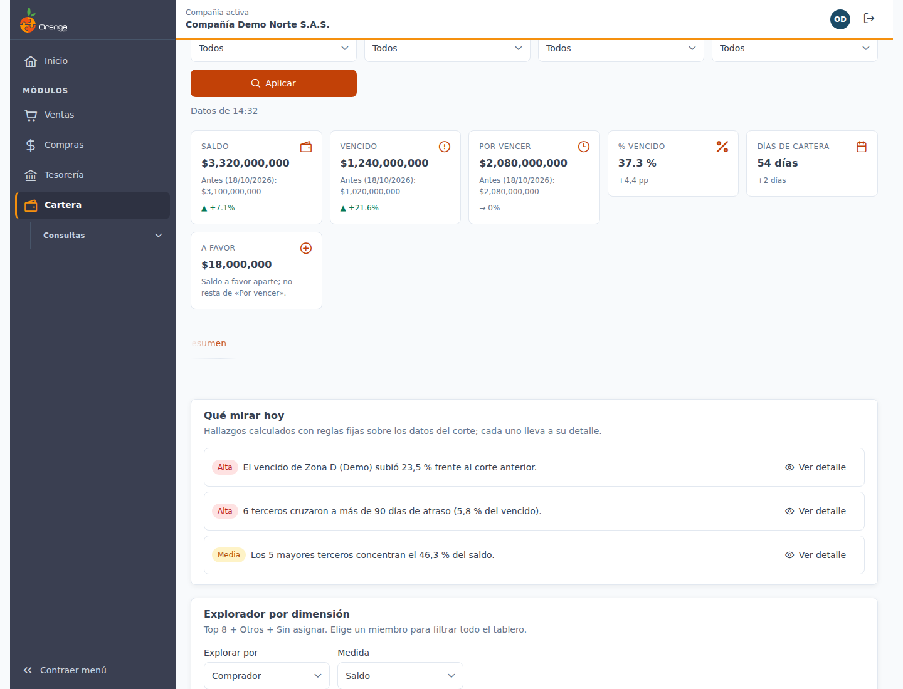

---

## 📊 Indicadores (Resumen)

| Indicador | Qué significa |
|-----------|---------------|
| **Saldo** | Lo que se debe a la fecha de corte. |
| **Vencido** | La parte del saldo cuyos documentos ya superaron su plazo. |
| **Por vencer** | La parte del saldo cuyos documentos todavía no vencen. **Nunca es negativo**: si hay saldo a favor, no resta de este indicador. |
| **A favor** | Lo que los terceros tienen a favor de la compañía. Se muestra aparte, con su explicación. |
| **% vencido** | Vencido dividido entre saldo. |
| **Días de cartera** | Antigüedad promedio de la cartera, ponderada por el saldo. Ver *Cómo se calculan los días de cartera*. |
| **Posición neta** | Solo en **Ambos**: lo que se debe por cobrar menos lo que se debe por pagar. |
| **% en mora (global)** | Solo en **Ambos**: vencido de los dos lados dividido entre el saldo de los dos lados. |

### Comparar con una fecha anterior

En **Comparar con** elija:

- **Periodo anterior**: la misma cantidad de días que el periodo de seguimiento, antes de la fecha de corte.
- **Mes anterior**: el último día del mes anterior a la fecha de corte.
- **Año anterior**: el mismo día del año anterior.
- **Sin comparar**: no muestra la comparación.

Cada indicador muestra su valor, el valor anterior (por ejemplo, **Antes (18 oct 2026): $2.390.000.000**) y la **variación**, en importe o en puntos. Para **vencido** y **% vencido**, un aumento es malo.

Si no hay datos de la fecha anterior, el indicador dice **Sin datos**.

### Cómo se calculan los días de cartera

Los **días de cartera** son la antigüedad promedio del saldo: cada documento pesa según cuánto debe.

**Ejemplo ficticio:** hay dos documentos con saldo:

| Documento | Saldo | Días desde su fecha |
|-----------|------:|--------------------:|
| A | $1.000.000 | 30 |
| B | $3.000.000 | 10 |

Cálculo: (1.000.000 × 30 + 3.000.000 × 10) ÷ 4.000.000 = **15 días**.

No es la rotación de cartera frente a las ventas: el indicador solo mide cuánto tiempo lleva pendiente el saldo.

---

## 🔎 Explorador por dimensión (Resumen)

El explorador reparte el saldo según la dimensión que elija en **Explorar por**:

**Cliente** (o **Proveedor** en Por pagar) · **Vendedor** (o **Comprador**) · **Ciudad** · **Zona** · **Cobrador** · **Centro de costos** · **Tramo de edad**.

- En **Medida** elija **Saldo**, **Vencido**, **% vencido**, **Días de atraso ponderado** o **Terceros**.
- El gráfico muestra los **ocho miembros** principales, luego **Otros** (el resto) y **Sin asignar** (lo que no tiene esa dimensión asignada). La suma de las barras es el saldo del indicador.
- **Días de atraso ponderado** es el atraso promedio del saldo de cada miembro, dando más peso a los saldos más grandes.
- Con **Ver como tabla** ve los mismos números en una tabla.
- **Haga clic en un miembro** para filtrar todo el tablero. Aparece una ficha de filtro que se quita con su botón **Quitar filtro**.
- Con **Ciudad**, el recorrido es **ciudad → cliente → documentos**: elija una ciudad, luego un cliente, y su panel abre los documentos.

Con **Ambos** el explorador muestra una barra por cada lado. En **Por pagar** la dimensión de vendedor se llama **Comprador**.

---

## 📐 Pareto 80/20 y concentración (Resumen)

El Pareto muestra cuántos miembros explican la mayor parte del saldo positivo de la dimensión que eligió en el explorador.

- Los miembros se ordenan del mayor saldo al menor, con su **% del total** y su **% acumulado**.
- La línea del **80 %** marca el punto en el que los primeros miembros suman el 80 % del saldo: **«Línea del 80 %: k de n miembros ya suman p»**. Se marca también con el texto **◄ Aquí se cruza el 80 %**.
- **Top 5** y **Top 10** dicen qué parte del saldo tienen los cinco y los diez mayores.
- **Concentración (HHI)** va de 0 a 1: **0** es una cartera muy repartida y **1** es toda la cartera en un solo miembro.
- Los miembros con saldo a favor no entran al Pareto; el aviso dice cuántos son.

---

## 📶 Comparativos

La pestaña **Comparativos** tiene dos partes.

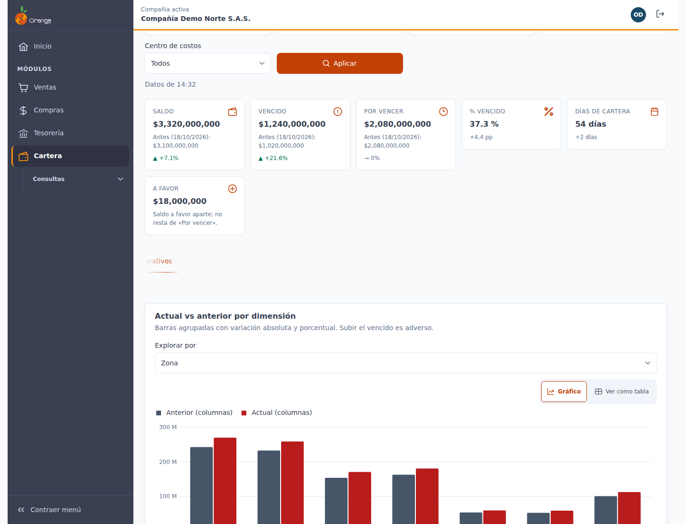

### Actual vs anterior por dimensión

- Barras agrupadas: **Actual** y **Anterior**, para cada miembro de la dimensión del explorador.
- Cada miembro muestra la **variación** en importe y en porcentaje, y el texto **Adverso** o **Favorable**. Subir el vencido es **adverso**.
- Si no hay datos de la fecha de comparación, dice **Sin datos del corte anterior**.
- Con **Ambos** se compara **Por cobrar** con **Por pagar**, lado a lado.

### Puente de cartera

El puente explica cómo llegó el saldo del corte anterior al saldo de hoy:

**Saldo inicial + Facturado − Recaudado − Notas ± Ajustes (residual) = Saldo final**

- **Facturado**: documentos nuevos del periodo.
- **Recaudado**: pagos aplicados en el periodo.
- **Notas**: notas crédito y débito aplicadas.
- **Ajustes (residual)**: lo que no explican los otros movimientos.
- **Cuadra con el saldo del corte**: los componentes suman exactamente el saldo final.
- **Revisar**: aparece cuando los ajustes superan el 5 % del movimiento. Conviene revisarlos antes de usar la cifra.

Si el puente **no cuadra** con el saldo del corte, **no se publica**: aparece **No disponible: el puente no cuadra con el saldo del corte, por eso no se publica.** No es un cero. En ese caso, use los reportes de Cartera para revisar los movimientos.

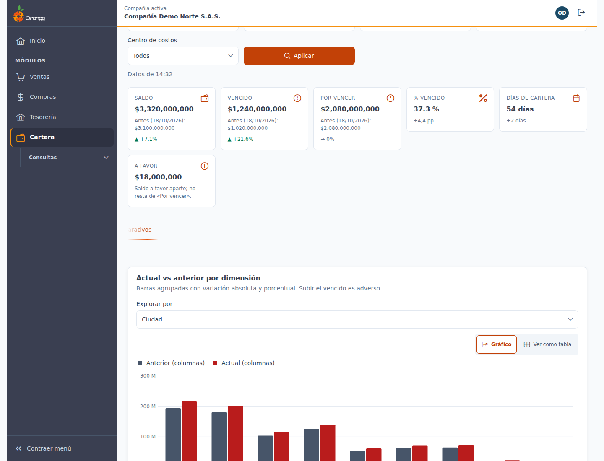

---

## 💰 Análisis financiero

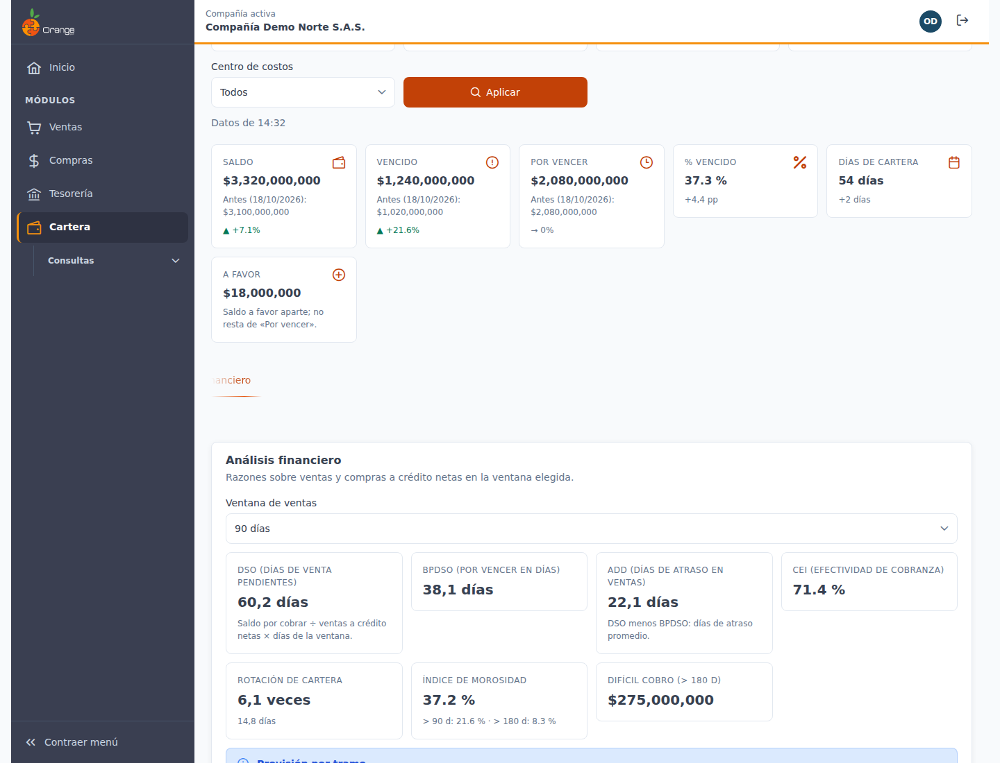

Esta pestaña mide la salud del crédito. Las razones que usan ventas o compras se calculan sobre las **ventas a crédito netas** del periodo (menos devoluciones y notas).

**Ventana de ventas**: elija **30**, **60**, **90** o **365** días. Por defecto son **90** días. Las razones usan el saldo al corte y los días de esa ventana.

| Indicador | Cómo se lee | Fórmula en palabras |
|-----------|-------------|---------------------|
| **DSO** (días de venta pendientes) | Cuántos días de venta a crédito tiene la compañía pendientes de cobro. Más bajo, mejor. | Saldo por cobrar ÷ ventas a crédito × días de la ventana. |
| **BPDSO** (por vencer en días) | Los mismos días, pero solo con lo que todavía no vence. | Lo que no vence ÷ ventas a crédito × días de la ventana. |
| **ADD** (días de atraso en ventas) | Días de atraso promedio de la cartera frente a las ventas. | DSO menos BPDSO. Puede ser negativo solo si hay saldo a favor. |
| **CEI** (efectividad de cobranza) | Qué parte de lo que debía cobrarse en la ventana se cobró. **100 %** significa que se cobró todo lo exigible. | (Saldo al inicio de la ventana + ventas − saldo al corte) ÷ (saldo al inicio + ventas − lo que todavía no vence al corte) × 100. |
| **DPO** (días de pago a proveedores) | Cuántos días de compra a crédito tarda la compañía en pagar. Solo en **Por pagar** o **Ambos**. | Saldo por pagar ÷ compras a crédito × días de la ventana. |
| **Rotación de cartera** | Cuántas veces al periodo se renueva la cartera. | Ventas a crédito ÷ saldo promedio. Se muestra también en días: días de la ventana ÷ rotación. |
| **Índice de morosidad** | Qué parte del saldo está vencido. | Vencido ÷ saldo positivo. |
| **> 90 días y > 180 días** | Qué parte del saldo tiene más de 90 o más de 180 días de atraso. | Saldo con ese atraso ÷ saldo positivo. |
| **Difícil cobro (> 180 d)** | El valor del saldo con más de 180 días de atraso. | Suma del saldo con más de 180 días de atraso. |
| **Posición neta** | Solo en **Ambos**: cuánto más se debe a la compañía que lo que ella debe. | Saldo por cobrar − saldo por pagar. |

**Ejemplo ficticio de DSO:** saldo por cobrar $20.000.000, ventas a crédito de la ventana $100.000.000 y ventana de 90 días. DSO = 20.000.000 ÷ 100.000.000 × 90 = **18 días**.

Cada indicador muestra su fórmula y su ayuda. Si la compañía no tiene la base de ventas a crédito en la ventana, los indicadores de venta y compra dicen **No disponible**, con el motivo, y **nunca muestran cero**. La morosidad y el difícil cobro sí se calculan, porque solo usan la cartera.

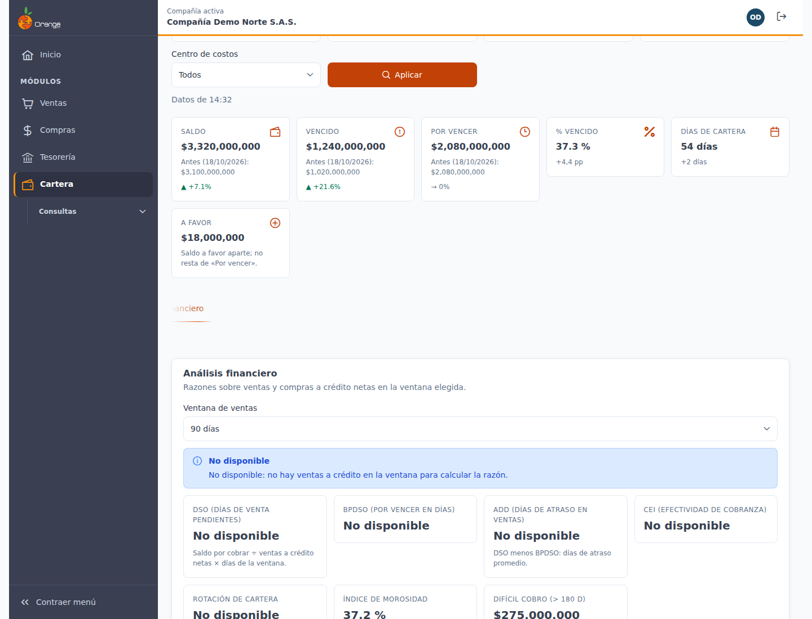

### Provisión por tramo

La provisión por tramo es **por validar con el contador**. Esta pantalla no calcula ni publica una provisión: solo muestra el aviso. La cifra se habilitará cuando el contador la valide.

---

## 📶 Edades (aging y campana de Gauss)

En esta pestaña están la campana y la evolución. El aging por tramos de atraso también está en **Resumen**, como antes: **Sin vencer**, **1-30**, **31-60**, **61-90**, **91-180** y **+180** días, por defecto. Los tramos son los de la compañía (en **Edades de cartera**).

### Campana de Gauss: cómo se reparte el atraso

- Cada barra es un rango de días de atraso y muestra **cuánto saldo** hay en él. Los números **negativos** son saldo que todavía no vence.
- **Ancho de barra**: 7, 15 o 30 días. Cambia el detalle, no el total.
- **Mostrar**: **Superpuestos** (los dos lados en la misma gráfica, cuando está en **Ambos**) o **Por lado**.
- **Rango**: amplía el rango visible de días para ver las colas. Las barras de los extremos agrupan lo que queda fuera del rango.
- La **curva normal** es una forma de referencia: muestra cómo se vería una distribución normal con la misma media y desviación. **La cartera real no es normal**: úsela como guía, no como medida exacta.

**Cómo leer los estadísticos:**

| Dato | Qué significa |
|------|---------------|
| **Media (μ)** | Atraso promedio en días, dando más peso a los saldos más grandes. |
| **Desviación (σ)** | Qué tan dispersos están los atrasos alrededor de la media. Más alto, más disperso. |
| **Mediana** | El atraso que deja la mitad del saldo a cada lado. |
| **Percentil 75 y 90** | El atraso por debajo del cual está el 75 % o el 90 % del saldo. |
| **Asimetría** | Qué tan inclinada está la distribución (ver abajo). |
| **% saldo > 90 d** y **> 180 d** | Qué parte del saldo tiene más de 90 o más de 180 días de atraso. |

**Asimetría:**

- Cerca de **0**: la distribución es aproximadamente simétrica.
- **Positiva** (sesgo a la derecha): hay pocos saldos muy antiguos que jalan la media hacia arriba. Compare la **media** con la **mediana**: si la media es mayor, la diferencia viene de esos saldos antiguos.
- **Negativa** (sesgo a la izquierda): la cola larga está del lado de los saldos que todavía no vencen.

El tablero dice en texto **«aprox. simétrica»** o **«sesgo a la derecha»** (o izquierda) y repite que la curva normal es referencial.

**Filtrar por rango:** haga clic en una barra (o use el teclado y **Enter** o **Espacio**) para elegir un rango. Aparece la ficha **Atraso de X a Y días**, y todo el tablero se filtra por ese rango. Para quitarlo use su botón de quitar. El gráfico no se reduce: se resalta el rango elegido.

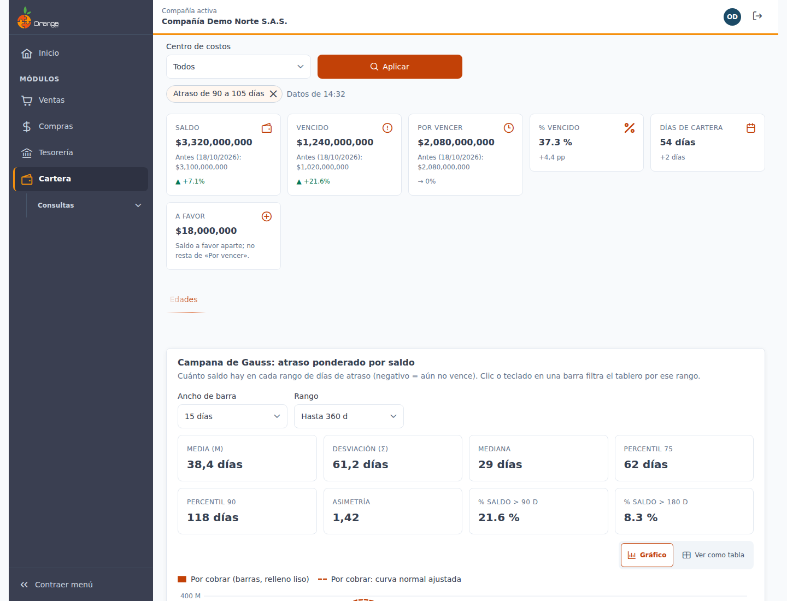

Con **Tabla** puede ver los mismos números en una tabla (**Ver como tabla**).

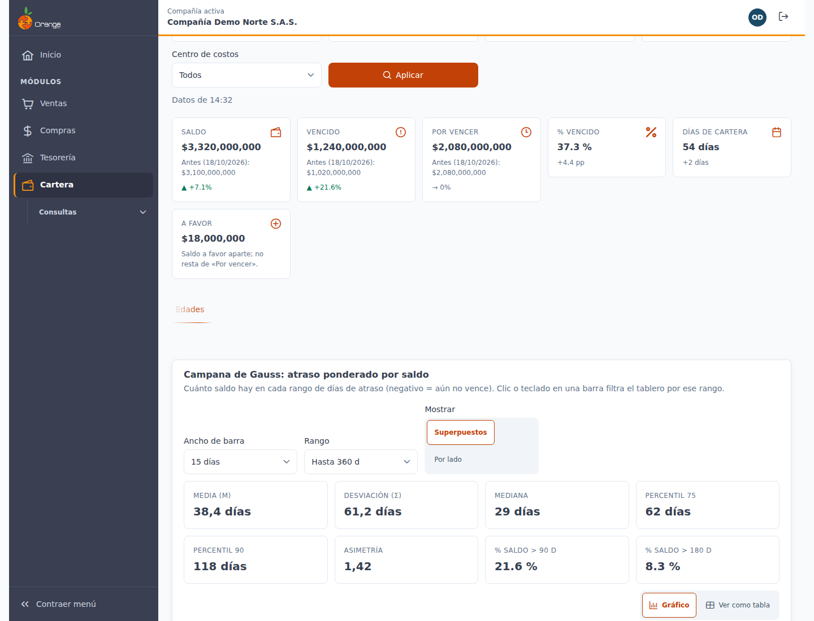

### Evolución de 12 meses

La línea de tiempo muestra los **últimos 12 cierres mensuales** (fin de cada mes) hasta la fecha de corte. Elija qué ver: **Saldo**, **% vencido**, **Días de cartera**, **DSO / DPO** o **Por cobrar vs por pagar**.

- Cada punto es el cierre de un mes.
- **Elija un punto** para ver el corte elegido.
- Si faltan meses, la línea **no los completa**: se pintan solo los puntos que existen. Aparece **Histórico parcial: hay n de 12 cortes mensuales**.
- Los filtros de **Vendedor**, **Zona** y **Cobrador** **no se aplican** a la evolución, porque el histórico no guarda esos datos; el tablero lo avisa. Sí se aplican el tipo de cartera y el centro de costos.
- DSO y DPO del histórico se muestran **No disponible** cuando no hay base de ventas.

Si la compañía todavía no tiene cierres mensuales guardados, la evolución dice **Sin histórico (pendiente de generar anclas)**. Las líneas se llenan cuando se generen los cierres mensuales. Mientras tanto, la pestaña no muestra líneas ni cifras inventadas.

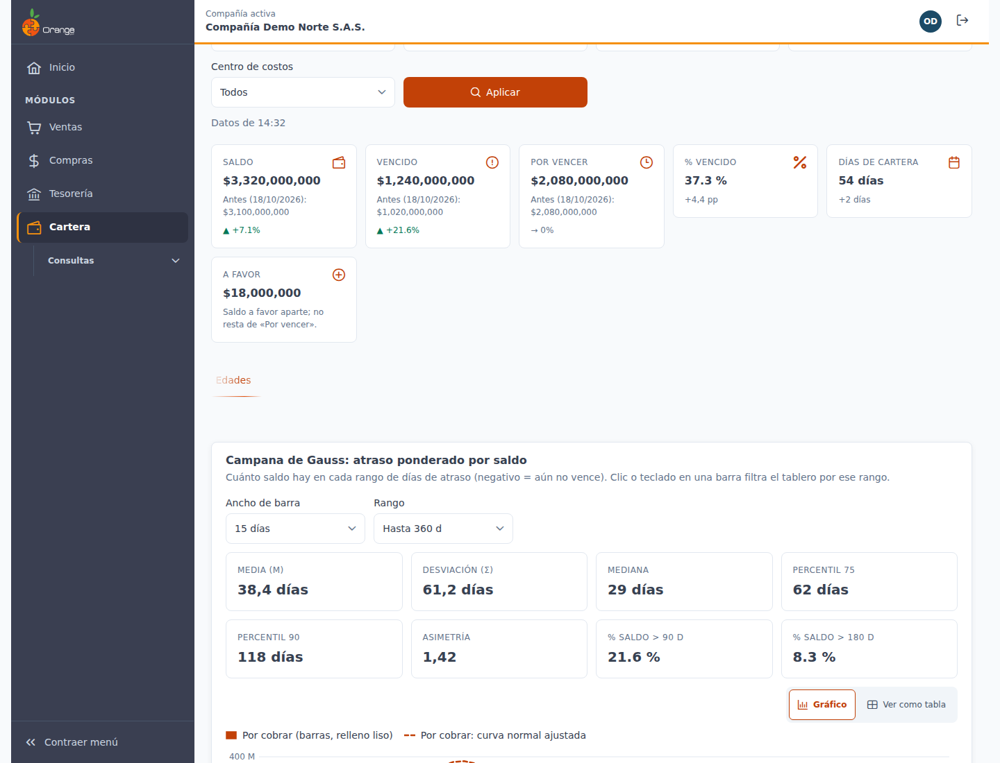

---

## 🎯 Cobro

Esta pestaña muestra cómo se gestiona la cartera vencida. Usa el **periodo de seguimiento** que elija (7, 15, 30, 60 o 90 días; por defecto 30) y termina en la fecha de corte.

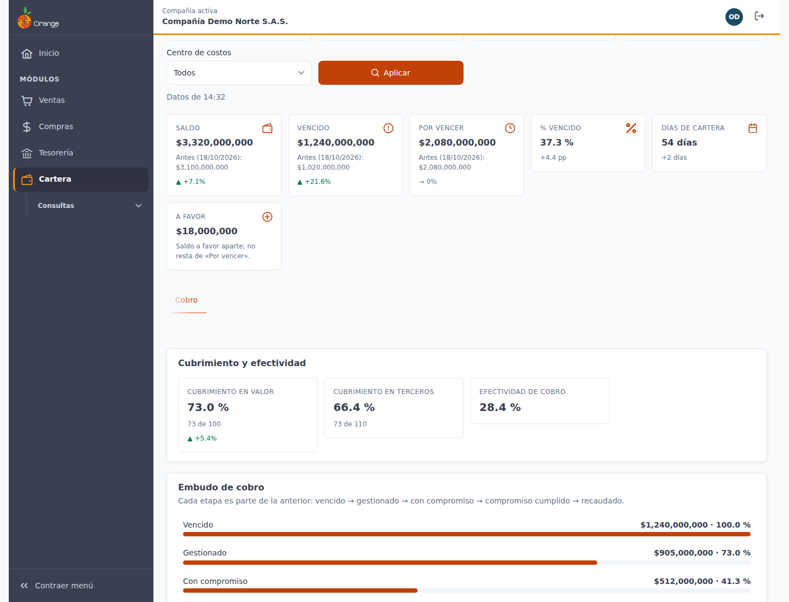

### Cubrimiento y efectividad

Se conservan con las mismas cifras de siempre:

**Cubrimiento en valor:** de la cartera vencida, qué parte corresponde a clientes que tuvieron al menos una gestión en el periodo.

*Ejemplo ficticio:* el vencido total es $10.000.000 y el vencido de los clientes gestionados es $6.000.000. Cubrimiento = 6.000.000 ÷ 10.000.000 = **60 %**.

**Cubrimiento en terceros:** lo mismo, pero contando clientes en vez de pesos. Si 20 clientes tienen vencido y 12 fueron gestionados, el cubrimiento es **60 %**.

**Efectividad de cobro:** de lo que tenían vencido los clientes gestionados al inicio del periodo, cuánto pagaron después de la primera gestión. Cada cliente cuenta hasta el monto de su vencido inicial: un pago por deuda nueva no mejora la cifra.

*Ejemplo ficticio:*

| Cliente | Vencido al inicio del periodo | Pagado después de la primera gestión |
|---------|------------------------------:|-------------------------------------:|
| A | $4.000.000 | $3.000.000 |
| B | $6.000.000 | $0 |

Efectividad = (3.000.000 + 0) ÷ (4.000.000 + 6.000.000) = **30 %**.

Cada indicador muestra también su variación frente al periodo anterior (en puntos).

### Embudo de cobro

El embudo sigue la cartera vencida en cinco etapas. **Cada etapa es parte de la anterior**, y cada una muestra su valor y su porcentaje frente al vencido:

1. **Vencido**: el vencido al corte.
2. **Gestionado**: el vencido de clientes con al menos una gestión en el periodo.
3. **Con compromiso**: el vencido de esos clientes que hicieron un compromiso de pago en el periodo.
4. **Compromiso cumplido**: el vencido de esos clientes cuyo compromiso se cumplió.
5. **Recaudado**: lo cobrado a esos clientes, sin pasar del vencido que tenían al inicio.

Las etapas 3 y 4 necesitan la **fase 2 del seguimiento de cartera**. Sin ella dicen **No disponible**; las demás etapas siguen calculándose.

### Gestiones por día y por canal

- **Gestiones por día**: cuántas gestiones se hicieron cada día del periodo.
- **Canal** y **Resultado**: cuántas gestiones hubo por cada canal y cada resultado. Solo existen para las gestiones registradas con la estructura de la fase 2. Las gestiones anteriores aparecen como **Sin estructura (legado)**, y el tablero dice qué parte son.
- Los textos de las gestiones **no se muestran** en esta pantalla.

Sin la fase 2 solo aparece la serie por día; canal y resultado dicen **No disponible**.

### Compromisos de pago

Cuatro cifras, en cantidad y en valor:

- **Cumplidos**: el cliente pagó lo prometido. Si pagó más, se cuenta lo prometido.
- **Incumplidos**: el compromiso venció sin el pago.
- **Vigentes**: compromisos pendientes cuya fecha todavía no llega.
- **Vencidos sin cerrar**: compromisos pendientes cuya fecha ya pasó y nadie los cerró.

Los compromisos cancelados no cuentan.

### Días hasta la primera gestión

Para cada cliente con vencido, cuántos días pasaron desde el vencimiento de su documento vencido más antiguo hasta su primera gestión. Se muestran el **promedio** y la **mediana**, y cuántos clientes **sin gestión** quedaron fuera del promedio. Las gestiones hechas antes del vencimiento no cuentan como primera gestión.

### Vencido sin gestión

Lista de clientes con vencido y sin gestión en los últimos **7, 15, 30 o 60 días** (por defecto **15**), ordenada del mayor vencido al menor, con:

- Cliente, vencido, mora máxima y cobrador.
- Última gestión (fecha). Si nunca hubo, dice **Sin gestión**.
- El porcentaje del vencido que está en esta situación.

Con los permisos correspondientes aparecen los botones **Abrir en Seguimiento**, **Abrir en Prejurídico** y **Abrir en Panel de Cobro**. Sin permiso, el botón no aparece. La lista no muestra los mensajes de las gestiones.

### Ranking de cobradores

Compara a los cobradores por **Efectividad**, **Cubrimiento**, **Vencido** o **Recaudado** (elija en **Ordenar por**). Muestra cifras y su base; no es una evaluación de personas.

- El vencido de cada cliente se cuenta una sola vez, en su cobrador titular.
- Los clientes sin cobrador aparecen en **Sin asignar**, fuera del ranking.
- Si el cobrador tiene menos de 5 clientes gestionados, aparece **Muestra baja**: sus cifras no son representativas.
- Sin la fase 2, dice **No disponible (sin asignación de cobradores)**.

### Recaudo vs proyección

Compara las últimas **8 semanas** del recaudo real con lo que proyectaba la **Proyección de cartera** (escenario base). Requiere el permiso de la proyección; sin él dice **No disponible: requiere permiso de consulta de la Proyección de cartera**.

### Promesas de la semana

Los compromisos pendientes con fecha en la semana de la fecha de corte (lunes a domingo): cuántos son, su valor total y la lista con cliente, valor, fecha y cobrador.

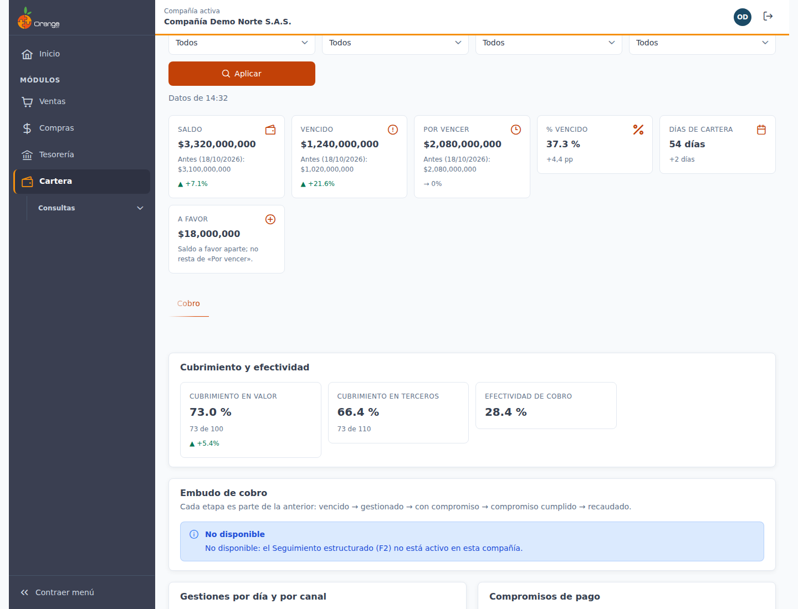

---

## ⚠️ Clientes sobre cupo

Esta tarjeta muestra cuántos clientes están en **alerta** (a partir del porcentaje de alerta de la compañía) o **sobre el cupo** de crédito. Para cada grupo indica cuántos clientes son, cuánto saldo tienen y cuánto exceden el cupo.

- Solo aparece en **Por cobrar** (en **Ambos**, solo los clientes).
- Muestra el top 5 por exceso, con el uso de su cupo en texto.
- Con **Ver en Seguimiento** pasa a la pantalla de seguimiento filtrada por sobrecupo (requiere ese permiso).
- No responde al filtro de tramo.

Los umbrales se configuran en [Parámetros de cartera](parametros.md).

---

## 🚦 Qué mirar hoy

En **Resumen**, arriba, aparecen **de 3 a 5 hallazgos** calculados con reglas fijas sobre los datos del corte. Cada uno tiene su severidad (**Alta** o **Media**, con texto) y el botón **Ver detalle**, que aplica el filtro o lleva a la pestaña correspondiente.

| Hallazgo | Cuándo aparece |
|----------|----------------|
| **Variación adversa** | El vencido de un vendedor, zona o ciudad subió frente a la fecha de comparación de forma relevante. |
| **Cruce a más de 90 días** | Clientes que pasaron de 90 días de atraso desde el corte anterior. |
| **Concentración** | Pocos clientes concentran una parte alta del saldo. |
| **Compromisos bajos** | Pocos compromisos cerrados se cumplieron (con una base mínima de compromisos cerrados). |
| **Vencido sin gestión** | Una parte alta del vencido lleva más de 15 días sin gestión. |

Cada regla se omite si no hay base para calcularla (por ejemplo, sin la fase 2). Si ninguna regla se cumple, aparece **Sin hallazgos por encima de los umbrales. Buen día.** Los umbrales los fija la configuración del sistema y no se cambian desde esta pantalla.

---

## 🔎 Filtros

| Filtro | Qué hace |
|--------|----------|
| **Fecha de corte** | Día con el que se calculan todas las cifras. Por defecto es hoy. No puede ser posterior a hoy. |
| **Periodo de seguimiento** | 7, 15, 30, 60 o 90 días para cubrimiento, efectividad y embudo. |
| **Comparar con** | Ver la sección *Comparar con una fecha anterior*. |
| **Vendedor** (o **Comprador** en **Por pagar**) | Limita las cifras a sus documentos. |
| **Cobrador** | Solo en **Por cobrar** con la fase 2. Limita las cifras a los clientes de esos cobradores. |
| **Zona** | Limita las cifras a los clientes de esa zona. |
| **Ciudad** | Limita las cifras a los clientes de esa ciudad. |
| **Centro de costos** | Limita las cifras a esos centros. |

Los filtros se aplican con el botón **Aplicar**. Los clics en el explorador, en la campana (rango) o en un miembro se aplican al instante como fichas de filtro. Con **Limpiar filtros** se quitan todos.

Si cambió un filtro y no pulsó **Aplicar**, las cifras siguen siendo las anteriores: el aviso dice **Hay filtros sin aplicar. Pulsa «Aplicar» para actualizar el tablero.**

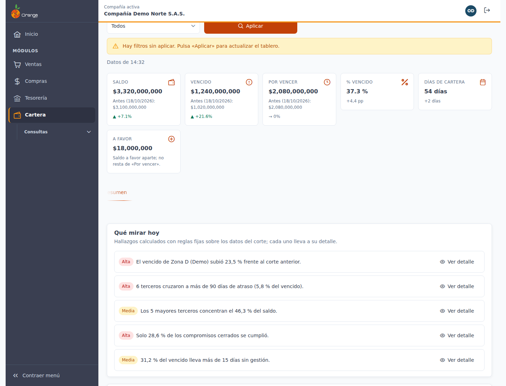

---

## 📤 Exportar

1. Elija los filtros y pulse **Aplicar**.
2. Haga clic en **Exportar Excel**.

El archivo incluye lo que usted ve, con los mismos filtros, en hojas separadas: el resumen con los indicadores y la comparación, el aging, la tabla de terceros completa del filtro, el cupo, el seguimiento, el explorador, el Pareto, la campana, la evolución, el análisis financiero, el cobro y **Qué mirar hoy**. Lleva encabezado con empresa, reporte, filtros, fecha y hora, y usuario.

- Los números salen como valores, para sumar en la hoja.
- **No incluye los mensajes** de las gestiones.
- Si una hoja depende de la fase 2 y su compañía no la tiene, aparece con la nota **No disponible**.
- Si la tabla de terceros supera **50.000 filas**, el sistema no genera el archivo y le pide acotar los filtros.

Mientras se genera, el botón aparece deshabilitado con el aviso **Generando el Excel…**.

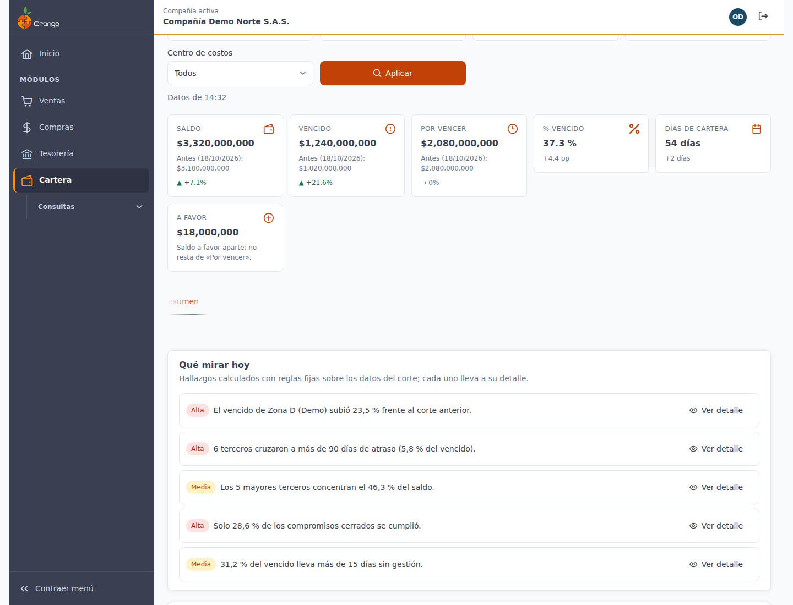

---

## 🔁 Cambios de otros usuarios

El tablero **no se actualiza solo**. Si otro usuario registra un pago o una gestión, o cambia los datos de la cartera, las cifras cambian cuando usted pulsa **Aplicar** o **Actualizar**.

---

## 🛠️ Errores comunes y estados

| Mensaje | Qué hacer |
|---------|-----------|
| **Consultando la cartera…** | El bloque está cargando. Los demás siguen disponibles. |
| **No hay cartera para estos filtros** | Cambie el corte, el lado o los filtros. |
| **No se pudo cargar el tablero** | Pulse **Reintentar**. Los filtros se conservan. |
| **No se pudo cargar esta sección.** | Pulse **Reintentar** en esa sección. El resto del tablero sigue. |
| **La fuente de datos está ocupada.** | Espere un momento y pulse **Reintentar**. |
| **Sin acceso** | Su perfil no tiene permiso para ese bloque. Consulte con su administrador. |
| **No se pudieron cargar los documentos.** | Pulse **Reintentar** en el panel del tercero. |
| **Filtros sin aplicar** | Pulse **Aplicar** para ver las cifras con los nuevos filtros. |
| **No disponible** | La información necesaria no existe para esa medida (por ejemplo, la fase 2, las ventas a crédito o el permiso de la proyección). Ver el motivo que aparece debajo. **No es un cero.** |
| **Sin base** | No hay cifras para calcular la razón (por ejemplo, no hay cartera en el denominador). |
| **Sin datos del corte anterior** | No hay cifras de la fecha de comparación. |
| **Sin histórico (pendiente de generar anclas)** | Todavía no hay cierres mensuales para la evolución. |

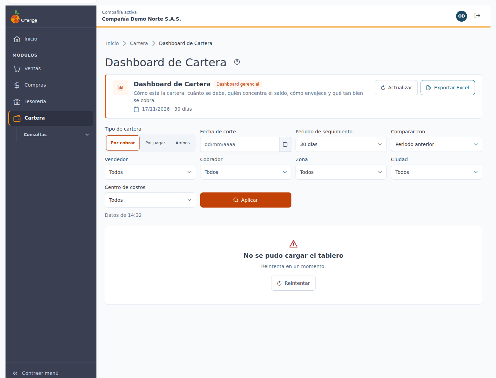

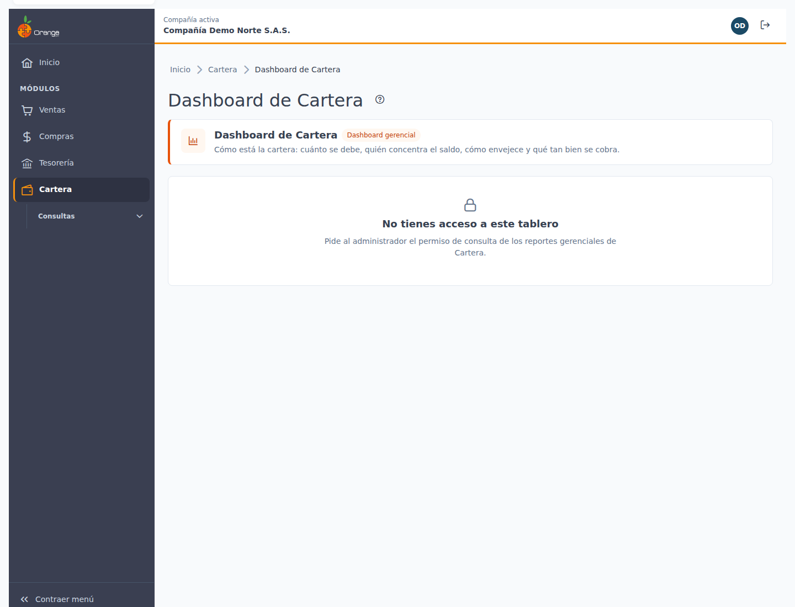

---

## ❓ Preguntas frecuentes

**¿Por qué mi cifra de saldo es igual a la del reporte de Cartera de terceros?**
Porque ambas salen de la misma información a la misma fecha de corte y con los mismos filtros.

**¿Por qué no veo la pantalla de Dashboard?**
Su perfil no tiene el permiso de la pantalla gerencial de Cartera. Consulte con su administrador.

**¿Por qué no veo algunas pestañas o bloques?**
Las pestañas son las mismas para todos los que tienen el dashboard. Un bloque que no aparece o dice **Sin acceso** depende de un permiso adicional, como el de Seguimiento, Prejurídico, el Panel de Cobro o la Proyección. Consulte con su administrador.

**¿Por qué «Por vencer» no baja cuando hay saldo a favor?**
Porque **Por vencer** nunca es negativo. El saldo a favor se muestra aparte, en **A favor**, para que no se reste de lo que todavía no vence.

**¿Por qué los DSO y DPO dicen «No disponible»?**
Porque la compañía no tiene ventas o compras a crédito en la ventana elegida para calcularlos. Es distinto de cero: significa que falta la base de cálculo.

**¿Por qué la evolución dice «Sin histórico»?**
Porque todavía no hay cierres mensuales para mostrar. Las líneas se llenan cuando se generen los cierres.

**¿Por qué la evolución no muestra Vendedor, Zona o Cobrador?**
Porque el histórico de cierres no guarda esos datos. El tablero lo avisa. Sí aplican el tipo de cartera y el centro de costos.

**¿Por qué el puente de cartera no aparece?**
Porque sus componentes no cuadran con el saldo del corte. Por seguridad no se publica un puente que no cierre. Revise los movimientos en los reportes de Cartera.

**¿Por qué los días de cartera no coinciden con mis facturas?**
Porque el indicador es la antigüedad promedio del saldo, ponderada por cuánto debe cada documento. No es la rotación frente a las ventas.

**¿Por qué el cubrimiento o el embudo dice «No disponible» en compromisos?**
Porque esa parte depende de la fase 2 del seguimiento de cartera, que su compañía no tiene habilitada. El cubrimiento y la efectividad siguen funcionando.

**¿Por qué el cobrador no aparece en el explorador?**
Porque está en **Por pagar** (ahí no hay cobradores), porque la fase 2 no está habilitada, o porque su perfil no lo puede ver.

**¿Por qué un cliente aparece en la tarjeta de cupo y no en la tabla de terceros?**
La tarjeta de cupo no responde al filtro de tramo, pero la tabla sí. Si hay un tramo elegido, quite el filtro para ver al cliente en la tabla.

**¿Por qué el Pareto dice que hay miembros que no entran?**
Porque los miembros con saldo a favor no suman a la concentración. El aviso dice cuántos son.

**¿Cambian las cifras si otro usuario registra un pago o una gestión?**
Sí, al volver a calcularlas (**Aplicar** o **Actualizar**). El tablero no se actualiza solo.

---

## 🆚 Cambios frente a la versión anterior

| # | Qué cambió |
|---|-----------|
| 1 | Solo se pide la **fecha de corte**. La fecha inicial de cinco años atrás ya no se pide: las cifras no cambian. |
| 2 | Las cifras se calculan en el servidor. La tabla de la pantalla es de **terceros**, con paginación; el detalle de documentos se ve en el panel de cada tercero. Para una lista completa de documentos use los reportes de Cartera. |
| 3 | Elige **Por cobrar**, **Por pagar** o **Ambos**. Solo se calcula lo que elige. |
| 4 | Aging con los **tramos de la compañía** y barras por tramo, lado, vendedor, cobrador o zona, con filtro al hacer clic. |
| 5 | Pestañas nuevas: **Comparativos**, **Análisis financiero**, **Edades** y **Cobro**. Se cargan solo al abrirlas. |
| 6 | **Por vencer** nunca es negativo y el **saldo a favor** se muestra aparte. |
| 7 | Permiso por cada acción: ver, exportar y las secciones de seguimiento. |
| 8 | **Exportar Excel** de lo que se ve. |

---

## 🧷 Relacionado

- [Cartera de terceros](reportes/terceros.md)
- [Cartera de terceros por sucursal](reportes/sucursales.md)
- [Cartera por vendedores](reportes/vendedores.md)
- [Seguimiento de Cartera](movimientos/seguimiento.md)
- [Panel de Cobro](movimientos/panel-cobro.md)
- [Cola de cobro](movimientos/cola.md)
- [Edades de cartera](edades.md)
- [Parámetros de cartera](parametros.md)
- [Proyección de recaudo](consultas/proyeccion.md)
