[Regresar a Cartera](readme.md)

---

# 📈 Dashboard de Cartera

---

## 📋 Descripción

El **Dashboard de Cartera** es la vista de gerencia de la cartera de la compañía, en una sola pantalla:

- **Cuánto se debe** y **cuánto está vencido**, con sus indicadores y su comparación contra una fecha anterior.
- **Cómo envejece** la cartera: por tramos de días de atraso.
- **Quién concentra el saldo**: los terceros con mayor saldo, con su detalle.
- **Qué clientes pasan su cupo** de crédito.
- **Qué tan bien se está cobrando**: el cubrimiento y la efectividad de la gestión de cobro.

Es una pantalla de **solo lectura**: no cambia documentos, saldos ni gestiones.

> 📘 El uso de tablas, búsquedas y orden es igual en todas las pantallas: ver [Manejo general de la información](../Generales/manejo-general-informacion.md).

> 💡 Las cifras de saldo, vencido y edades son **las mismas** que las de los reportes de [Cartera de terceros](reportes/terceros.md), [Cartera por sucursal](reportes/sucursales.md) y [Cartera por vendedores](reportes/vendedores.md) a la misma fecha de corte.

> ℹ️ Las cifras son de la **fecha de corte** que elija. Muestran también la hora en que se consultaron los datos.

---

## 🎯 Acceso

1. En el menú principal, haga clic en **Cartera**.
2. Si su perfil tiene el dashboard, el tablero es la **pantalla de inicio** del módulo.

> 🔐 **Quién lo ve:** el dashboard está en el **menú gerencial** de la compañía. Lo ven los perfiles que tienen **Consultar** en la opción **Reportes gerenciales de Cartera** (324) y en los dos grupos de menú gerencial que la contienen. Si no lo ve en el menú, su perfil no tiene ese permiso: consulte con su administrador. En ese caso, la pantalla de inicio de Cartera es la de bienvenida y no muestra cifras.

---

## 🖥️ Pantalla principal

| Elemento | Para qué sirve |
|----------|----------------|
| **?** (junto al título) | Abre esta ayuda en un panel lateral. |
| **Datos de hh:mm** | Hora de la consulta. Si los datos vienen de la última consulta, lo dice: pulse **Actualizar** para recalcularlos. |
| **Actualizar** | Vuelve a calcular las cifras con los filtros aplicados, sin usar la última consulta. |
| **Exportar Excel** | Descarga lo que está viendo. Ver *Exportar*. |
| **Tipo de cartera** | **Por cobrar**, **Por pagar** o **Ambos**. Ver *Por cobrar, por pagar o ambos*. |
| **Filtros** | Fecha de corte, periodo de seguimiento, comparación, vendedor, cobrador, zona y centro de costos. Pulse **Aplicar** para verlos. |
| **Indicadores** | Saldo, Vencido, Por vencer, % vencido, Días de cartera y Saldo a favor. |
| **Aging** | Cartera por tramos de días de atraso. |
| **Terceros** | Los que tienen mayor saldo, con su tabla y su panel. |
| **Clientes sobre cupo** | Clientes que están en alerta o pasaron su cupo. |
| **Cubrimiento y efectividad** | Qué parte de la cartera vencida se gestionó y qué tanto se recaudó. |

### Qué ve cada permiso

| Permiso | Qué puede ver o hacer |
|---------|----------------------|
| **Consultar** del dashboard y de su grupo gerencial | Todo el tablero. |
| **Exportar** del dashboard | Ver **Exportar Excel**. |
| **Consultar** de **Seguimiento de Cartera** | Además, en el panel de un tercero, los **compromisos de pago** y las **últimas gestiones**, y el enlace **Abrir en Seguimiento**. Sin este permiso, esas secciones se omiten y el resto del panel funciona. |

Si no tiene el permiso de **Exportar**, no verá el botón. Si no tiene el de **Seguimiento de Cartera**, el clic en **Ver en Seguimiento** no lo lleva a esa pantalla.

---

## 🔁 Por cobrar, por pagar o ambos

Elija el **Tipo de cartera**:

| Opción | Qué muestra |
|--------|-------------|
| **Por cobrar** | Lo que los clientes deben a la compañía. Es la opción por defecto. Incluye el cobrador, el cupo y el seguimiento. |
| **Por pagar** | Lo que la compañía debe a sus proveedores. Muestra el comprador en lugar del vendedor. No incluye el cobrador, el cupo ni el seguimiento. |
| **Ambos** | Los dos lados juntos: cada indicador aparece para cada lado, más la **posición neta** y el **% en mora (global)**. |

Cuando cambia el tipo, los filtros que no aplican a ese lado se quitan.

---

## 📊 Indicadores

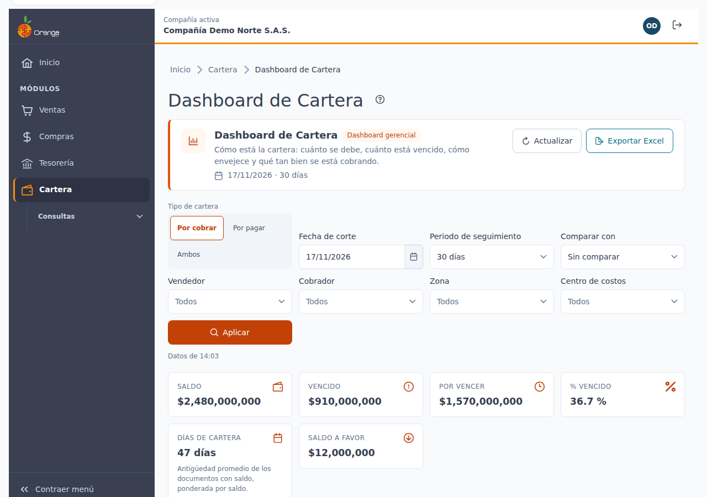

| Indicador | Qué significa |
|-----------|---------------|
| **Saldo** | Lo que se debe a la fecha de corte. |
| **Vencido** | La parte del saldo cuyos documentos ya superaron su plazo. |
| **Por vencer** | La parte del saldo cuyos documentos todavía no vencen. |
| **% vencido** | Vencido dividido entre saldo. |
| **Días de cartera** | Antigüedad promedio de la cartera, ponderada por el saldo. Ver *Cómo se calcula*. |
| **Saldo a favor** | Lo que los terceros tienen a favor de la compañía (se muestra aparte). |
| **Posición neta** | Solo en **Ambos**: lo que se debe por cobrar menos lo que se debe por pagar. |
| **% en mora (global)** | Solo en **Ambos**: vencido de los dos lados dividido entre el saldo de los dos lados. |

### Comparar con una fecha anterior

En **Comparar con** elija:

- **Periodo anterior**: la misma cantidad de días que el periodo de seguimiento, antes de la fecha de corte.
- **Mes anterior**: el último día del mes anterior a la fecha de corte.
- **Año anterior**: el mismo día del año anterior.
- **Sin comparar**: no muestra la comparación.

Cada indicador muestra su valor, el valor anterior (por ejemplo, **Antes (18 oct 2026): $2.390.000.000**) y la **variación**, en importe o en puntos. Para **vencido** y **% vencido**, un aumento es malo.

Si no hay datos de la fecha anterior, el indicador dice **Sin datos**.

### Cómo se calculan los días de cartera

Los **días de cartera** son la antigüedad promedio del saldo: cada documento pesa según cuánto debe.

**Ejemplo ficticio:** hay dos documentos con saldo:

| Documento | Saldo | Días desde su fecha |
|-----------|------:|--------------------:|
| A | $1.000.000 | 30 |
| B | $3.000.000 | 10 |

Cálculo: (1.000.000 × 30 + 3.000.000 × 10) ÷ 4.000.000 = **15 días**.

No es la rotación de cartera frente a las ventas: el indicador solo mide cuánto tiempo lleva pendiente el saldo.

---

## 📶 Aging: cartera por edades

El **aging** muestra cuánto del saldo está en cada tramo de días de atraso. Los tramos son los de la compañía (en **Edades de cartera**); por defecto son:

**Sin vencer** · **1-30** · **31-60** · **61-90** · **91-180** · **+180** días.

- Cada barra es un lado (**Por cobrar** o **Por pagar**). En **Ambos** hay dos barras.
- Con **Agrupar por** puede ver una barra por **Vendedor**, **Zona** o **Cobrador**. Se muestran las ocho más grandes; el resto va en **Otros**, y las cuentas sin cobrador en **Sin asignar**.
- La suma de las barras es el saldo del indicador.

### Filtrar por tramo

Puede filtrar de dos formas:

- Elija un tramo en **Filtrar por tramo**, o
- Haga clic en un segmento de una barra.

Al filtrar por tramo, **todo el tablero** se ajusta: indicadores, terceros y exportación. La tarjeta **Clientes sobre cupo** no cambia, porque el cupo se mide sobre el saldo total. Las fichas de filtro aparecen arriba y se quitan con su botón **Quitar el filtro**.

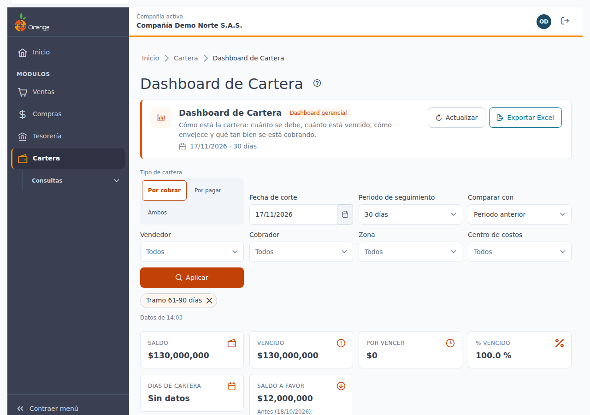

Cada gráfico tiene una **tabla equivalente** con los mismos datos, para leerlo sin ver los colores: **Ver tabla equivalente**.

Con **Ambos** el aging muestra una barra por cada lado, y la suma de cada barra es su saldo:

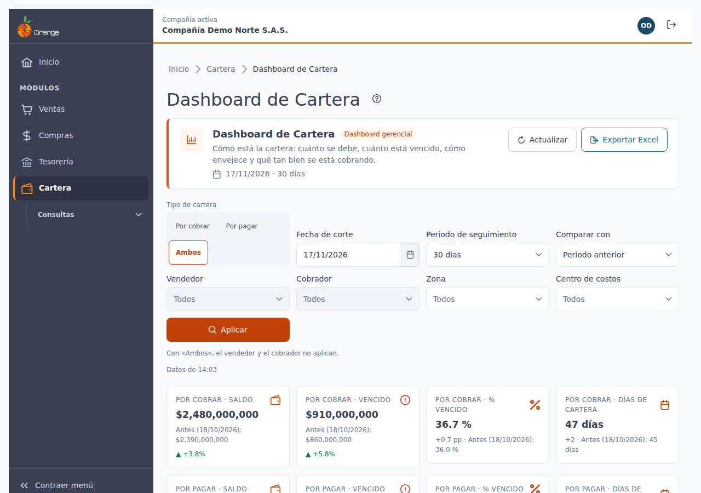

---

## 👥 Terceros con mayor saldo

La parte de **Terceros** muestra los diez terceros con mayor saldo en un gráfico de barras. Con **Ver más** llega hasta 50; el resto aparece como **Otros N terceros** con su total.

Debajo está la **tabla de terceros del filtro**, paginada en el servidor (10, 25, 50 o 100 filas):

| Columna | Qué muestra |
|---------|-------------|
| **Documento** y **Nombre** | Del tercero. |
| **Saldo** y **Vencido** | A la fecha de corte. |
| **Mora máx. (días)** | Días de atraso del documento más atrasado. |
| **Tramo mayor** | El tramo de edad del documento más atrasado. |
| **Cobrador** | Solo en **Por cobrar** con la fase 2. Muestra **+N** si tiene apoyos. |
| **Cupo** | El semáforo de cupo (en **Por cobrar** y **Por pagar**). |

Para buscar, escriba al menos dos letras en **Tercero contiene**: documento o nombre.

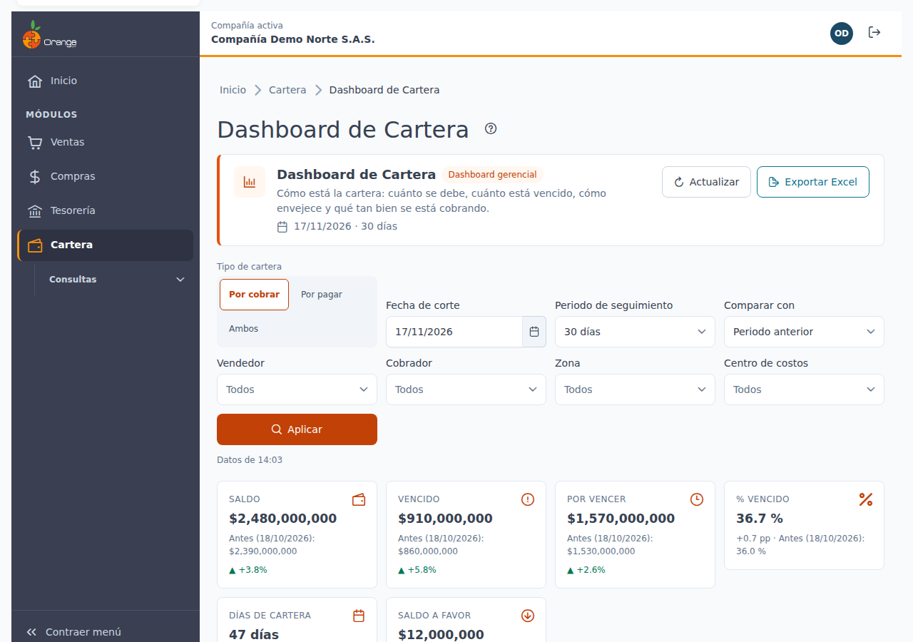

### Panel del tercero

Haga clic en el tercero (o en **Ver detalle**) para abrir su panel lateral:

- **Documentos con saldo**: los documentos del tercero, del más atrasado al menos atrasado, con su total.
- Con permiso de **Seguimiento de Cartera**:
  - **Compromisos de pago**, con su estado (**Pendiente**, **Cumplido** o **Incumplido**).
  - **Últimas gestiones**: fecha, canal y resultado. **No se muestra el mensaje** de la gestión.
  - El enlace **Abrir en Seguimiento**.

Para cerrar el panel use **Cerrar panel** o la tecla **Escape**.

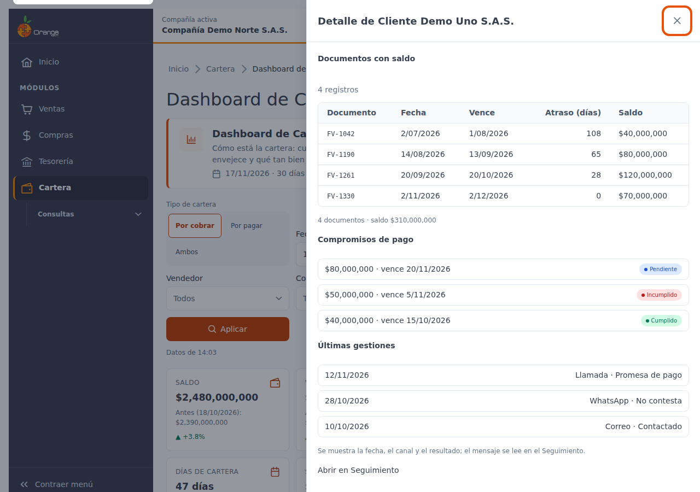

Sin el permiso de Seguimiento de Cartera, el panel explica que esas secciones no están disponibles y muestra igual los documentos.

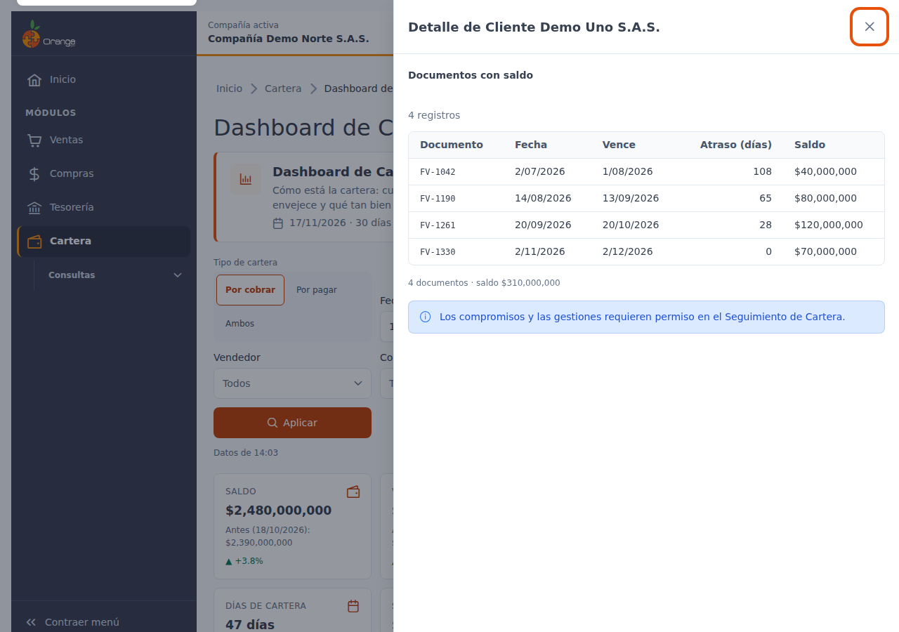

---

### Estados del tablero

Cada bloque muestra su propio estado, con texto:

| Estado | Qué ve |
|--------|--------|
| **Consultando la cartera…** | El bloque está cargando. Los demás siguen disponibles. |
| **Cambia el corte o los filtros.** | No hay cifras para esa combinación. |
| **No se pudo cargar el tablero** | Pulse **Reintentar**. Los filtros se conservan. |
| **Sin acceso** | Su perfil no tiene permiso para ese bloque. |

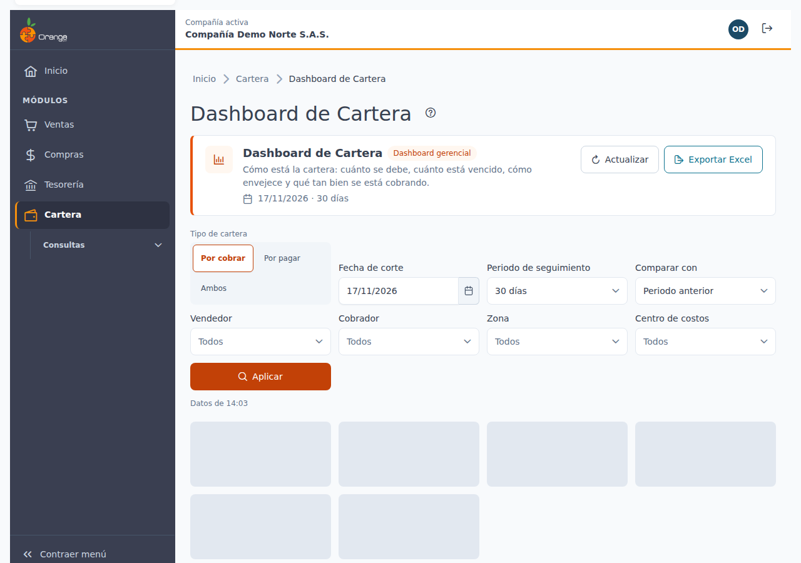

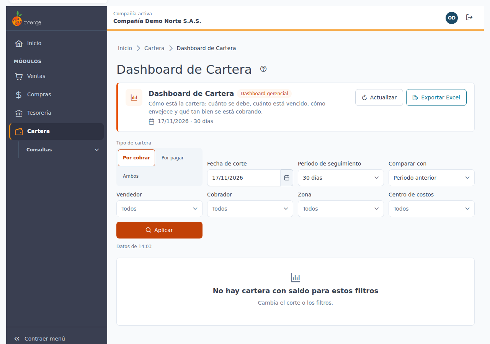

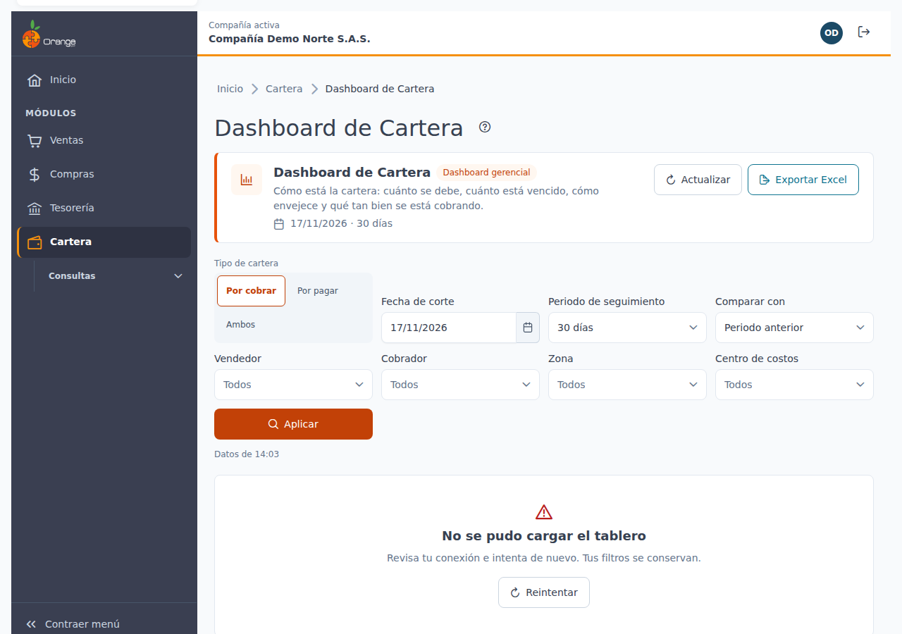

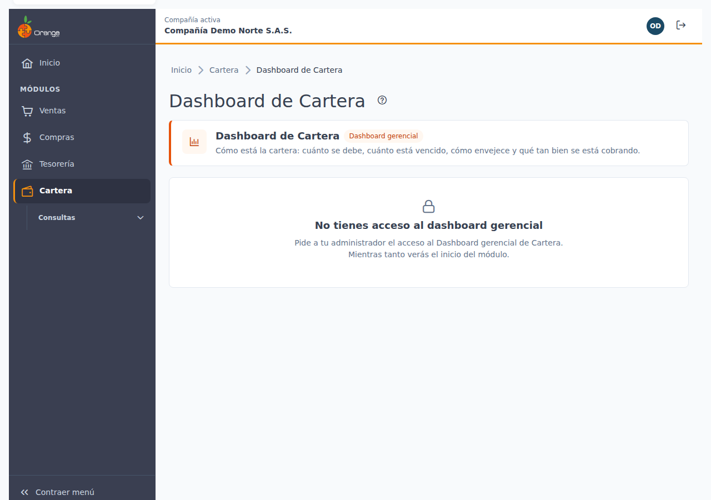

Si el cubrimiento o los indicadores de seguimiento tardan más de lo normal, el resto del tablero sigue cargando. Si la consulta de seguimiento falla, esa parte muestra su error y el aging y los indicadores siguen visibles.

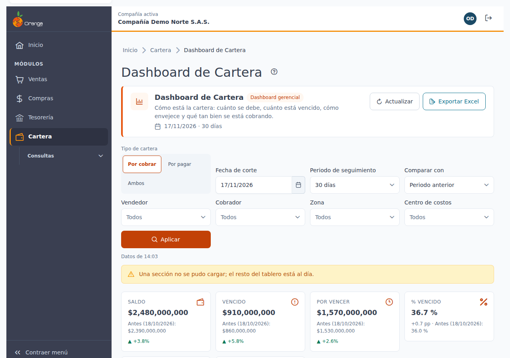

---

## ⚠️ Clientes sobre cupo

Esta tarjeta muestra cuántos clientes están en **alerta** (a partir del porcentaje de alerta de la compañía) o **sobre el cupo** de crédito. Para cada grupo indica cuántos clientes son, cuánto saldo tienen y cuánto exceden el cupo.

- Solo aparece en **Por cobrar** (en **Ambos**, solo los clientes).
- Muestra el top 5 por exceso, con el uso de su cupo en texto.
- Con **Ver en Seguimiento** pasa a la pantalla de seguimiento filtrada por sobrecupo (requiere ese permiso).
- No responde al filtro de tramo.

Los umbrales se configuran en [Parámetros de cartera](parametros.md).

---

## 🎯 Cubrimiento y efectividad

Este bloque responde qué tan bien se está gestionando la cartera vencida. Aparece solo en **Por cobrar**. Usa el **periodo de seguimiento** que elija (7, 15, 30, 60 o 90 días; por defecto 30) y termina en la fecha de corte.

### Cómo se calculan

**Cubrimiento en valor:** de la cartera vencida, qué parte corresponde a clientes que tuvieron al menos una gestión en el periodo.

*Ejemplo ficticio:* el vencido total es $10.000.000 y el vencido de los clientes gestionados es $6.000.000. Cubrimiento = 6.000.000 ÷ 10.000.000 = **60 %**.

**Cubrimiento en terceros:** lo mismo, pero contando clientes en vez de pesos. Si 20 clientes tienen vencido y 12 fueron gestionados, el cubrimiento es **60 %**.

**Efectividad de cobro:** de lo que tenían vencido los clientes gestionados al inicio del periodo, cuánto pagaron después de la primera gestión. Cada cliente cuenta hasta el monto de su vencido inicial: un pago por deuda nueva no mejora la cifra.

*Ejemplo ficticio:*

| Cliente | Vencido al inicio del periodo | Pagado después de la primera gestión |
|---------|------------------------------:|-------------------------------------:|
| A | $4.000.000 | $3.000.000 |
| B | $6.000.000 | $0 |

Efectividad = (3.000.000 + 0) ÷ (4.000.000 + 6.000.000) = **30 %**.

Cada indicador muestra también su variación frente al periodo anterior (en puntos).

### Otras medidas

Con la fase 2 habilitada, el bloque muestra también:

- **Compromisos cumplidos ÷ hechos**: en valor y en cantidad. Solo cuentan los compromisos ya cerrados (cumplidos o incumplidos).
- **Contactos efectivos ÷ intentos**: de las gestiones con estructura, cuántas tuvieron contacto (contactado, promesa de pago o rechazo).

### Por edad y por cobrador

- **Por edad**: el cubrimiento de cada tramo. El tramo que filtró se resalta.
- **Por cobrador**: saldo, vencido, terceros, cubrimiento, efectividad, compromisos y contactos de cada cobrador. Cada cliente se cuenta una sola vez, en su cobrador titular. Los clientes sin cobrador aparecen en **Sin asignar**.

Si no hay cobradores definidos, aparece **Sin cobradores definidos**. Si el periodo no tiene gestiones, aparece **Aún no hay gestiones en el periodo**.

### Cuando la fase 2 no está disponible: «No disponible»

Si su administrador no ha habilitado la fase 2 de seguimiento de cartera, algunas medidas dicen **No disponible**:

- Las **otras medidas** (compromisos y contactos).
- El desglose **Por cobrador**.

Esto no es un error ni un cero: esas medidas dependen de datos que no existen todavía. El cubrimiento, la efectividad principal y el aging siguen funcionando.

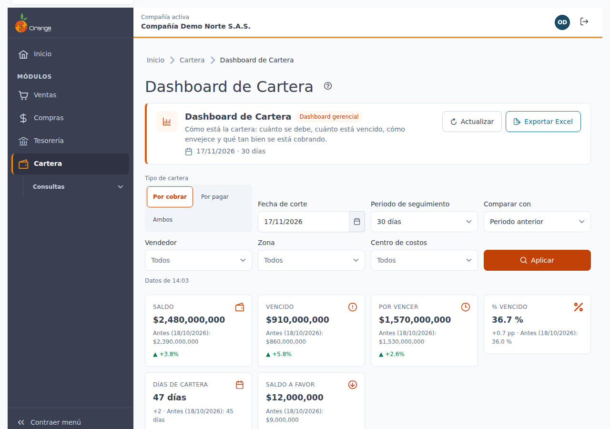

Con la fase 2 habilitada pero sin datos, el desglose muestra **Sin base** donde no hay denominador.

---

## 🔎 Filtros

| Filtro | Qué hace |
|--------|----------|
| **Fecha de corte** | Día con el que se calculan todas las cifras. Por defecto es hoy. No puede ser posterior a hoy. |
| **Periodo de seguimiento** | 7, 15, 30, 60 o 90 días para cubrimiento y efectividad. |
| **Comparar con** | Ver la sección *Comparar con una fecha anterior*. |
| **Vendedor** (o **Comprador** en **Por pagar**) | Limita las cifras a sus documentos. |
| **Cobrador** | Solo en **Por cobrar** con la fase 2. Limita las cifras a los clientes de esos cobradores. |
| **Zona** | Limita las cifras a los terceros de esa zona. |
| **Centro de costos** | Limita las cifras a esos centros. |

Los filtros se aplican con el botón **Aplicar**. Los clics en el aging (tramo o barra) se aplican al instante. Con **Limpiar filtros** se quitan todos.

Si cambió un filtro y no pulsó **Aplicar**, las cifras siguen siendo las anteriores: el aviso dice **Filtros sin aplicar**.

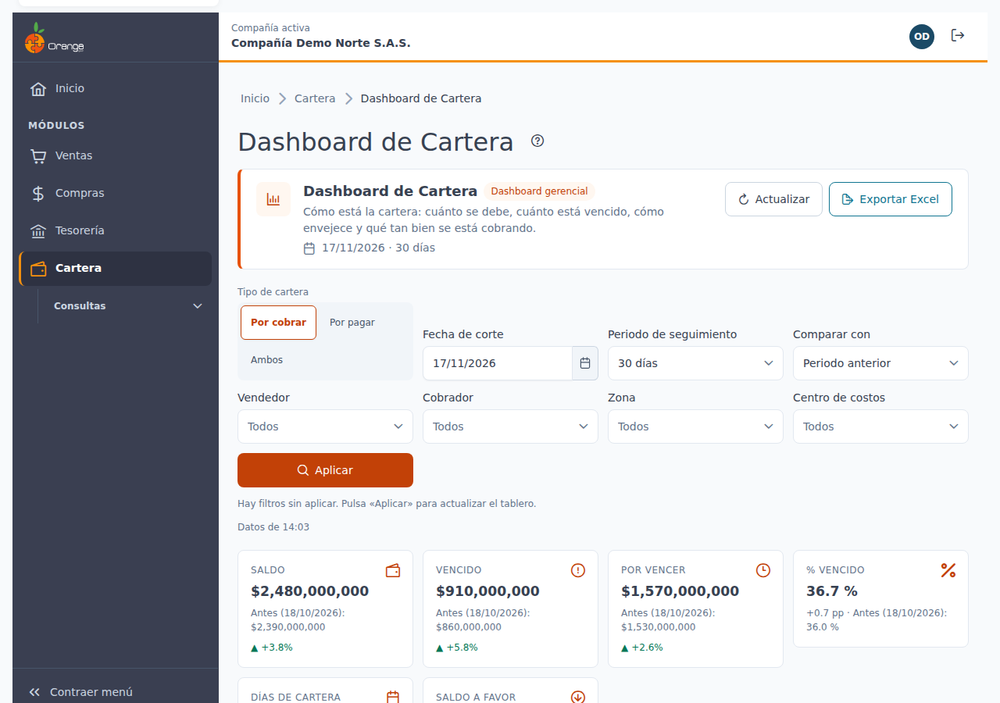

---

## 📤 Exportar

1. Elija los filtros y pulse **Aplicar**.
2. Haga clic en **Exportar Excel**.

El archivo incluye lo que usted ve, con los mismos filtros: un resumen con los indicadores y la comparación, el aging en tabla, la tabla de terceros completa del filtro, el cupo, el seguimiento, el desglose por cobrador y los filtros usados. Lleva encabezado con empresa, reporte, filtros, fecha y hora, y usuario.

- Los números salen como valores, para sumar en la hoja.
- **No incluye los mensajes** de las gestiones.
- Si la tabla de terceros supera **50.000 filas**, el sistema no genera el archivo y le pide acotar los filtros.

Mientras se genera, el botón aparece deshabilitado con el aviso **Generando el Excel…**.

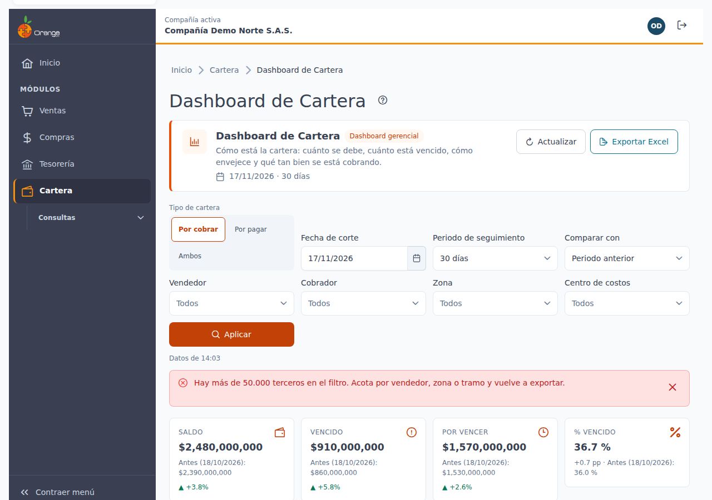

---

## 🆚 Diferencias con el sistema anterior

El dashboard anterior mostraba cuatro tarjetas, un aging fijo de seis tramos, diez terceros y un detalle de todos los documentos. Estas son las diferencias:

| # | Antes | Ahora |
|---|-------|-------|
| D1 | Pedía una **fecha inicial** de cinco años atrás además de la de corte. | Solo se pide la **fecha de corte**. Las cifras no cambian: la fecha inicial era un artificio del sistema anterior. |
| D2 | Cargaba **todos los documentos** en la pantalla y los filtraba allí. | Las cifras se calculan en el servidor. La tabla es de **terceros**, paginada, y el detalle de documentos solo se ve dentro del panel de cada tercero. Para una lista completa de documentos use los reportes de Cartera. |
| D3 | Mostraba **por cobrar y por pagar** siempre juntos. | Elige **Por cobrar**, **Por pagar** o **Ambos**. Solo se calcula lo que elige. |
| D4 | Aging de seis tramos fijos. | Aging con los **tramos de la compañía** (por defecto, los mismos seis). |
| D5 | Una barra por tramo. | Barras **apiladas por tramo**, por lado o por vendedor, cobrador o zona, y se puede filtrar haciendo clic. |
| D6 | Permiso solo para ver la pantalla. | Permiso por cada acción: ver, exportar y las secciones de seguimiento. |
| D7 | No se podía exportar. | **Exportar Excel** de lo que se ve. |

Además, el dashboard **compara** con una fecha anterior, muestra el **cupo**, el **cubrimiento** y la **efectividad**, y explica sus cifras en la ayuda.

---

## ❓ Preguntas frecuentes

**¿Por qué mi cifra de saldo es igual a la del reporte de Cartera de terceros?**
Porque ambas salen de la misma información a la misma fecha de corte y con los mismos filtros.

**¿Por qué no veo la pantalla de Dashboard?**
Su perfil no tiene el permiso de la pantalla gerencial de Cartera. Consulte con su administrador.

**¿Por qué las cifras dicen «Datos de» una hora anterior?**
Porque vienen de la última consulta. Pulse **Actualizar** para recalcularlas.

**¿Por qué no aparece el cobrador?**
Porque está en **Por pagar** (ahí no hay cobradores), porque la fase 2 no está habilitada, o porque su perfil no lo puede ver.

**¿Por qué los días de cartera no coinciden con mis facturas?**
Porque el indicador es la antigüedad promedio del saldo, ponderada por cuánto debe cada documento. No es la rotación frente a las ventas.

**¿Por qué el cubrimiento dice «Sin base»?**
Porque en el periodo no hay cartera vencida para calcularlo, o no hay gestiones.

**¿Por qué un cliente aparece en la tarjeta de cupo y no en la tabla de terceros?**
La tarjeta de cupo no responde al filtro de tramo, pero la tabla sí. Si hay un tramo elegido, quite el filtro para ver al cliente en la tabla.

**¿Cambian las cifras si otro usuario registra un pago o una gestión?**
Sí, al volver a calcularlas (**Aplicar** o **Actualizar**). El tablero no se actualiza solo.

---

## 🛠️ Errores comunes

| Mensaje | Qué hacer |
|---------|-----------|
| **No se pudo cargar el tablero** | Pulse **Reintentar**. Los filtros se conservan. |
| **Sin acceso** | Su perfil no tiene permiso para ese bloque. Consulte con su administrador. |
| **No se pudieron cargar los documentos.** | Pulse **Reintentar** en el panel del tercero. |
| **Filtros sin aplicar** | Pulse **Aplicar** para ver las cifras con los nuevos filtros. |
| **No disponible** | La fase 2 no está habilitada para esa medida. Ver *Cuando la fase 2 no está disponible*. |

---

## 🧷 Relacionado

- [Cartera de terceros](reportes/terceros.md)
- [Cartera de terceros por sucursal](reportes/sucursales.md)
- [Cartera por vendedores](reportes/vendedores.md)
- [Seguimiento de Cartera](movimientos/seguimiento.md)
- [Cola de cobro](movimientos/cola.md)
- [Edades de cartera](edades.md)
- [Parámetros de cartera](parametros.md)
