[Regresar a Cartera](readme.md)

---

# 📊 Edades de cartera

---

## 📋 Descripción

Las **edades de cartera** son los tramos de antigüedad con los que se agrupa la cartera de la compañía: lo que está por vencer y lo que ya está vencido, separado por cuántos días lleva de atraso. Cada tramo tiene un código, un nombre y el último día de atraso que cubre.

En esta pantalla puede **consultar, crear, editar, eliminar, restaurar los valores del legado y exportar** los tramos de la compañía con la que está trabajando.

> 📘 La búsqueda, el orden y la exportación funcionan igual en todas las tablas: ver [Manejo general de la información](../../Generales/manejo-general-informacion.md).

> 💡 Cada pestaña del navegador trabaja con **una compañía**. El nombre de la compañía se ve en el título de la pestaña y en la barra superior.

---

## 🎯 Acceso

1. En el menú principal, haga clic en **Cartera**.
2. En **Maestros**, haga clic en **Edades de cartera**.

---

## 🖥️ Pantalla principal

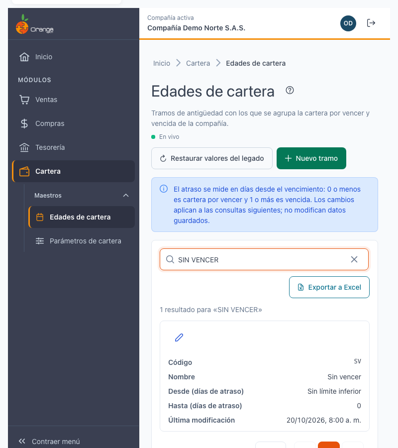

| Elemento | Para qué sirve |
|----------|----------------|
| **?** (junto al título) | Abre esta ayuda en un panel lateral, sin salir de la pantalla. |
| **En vivo** | La pantalla está conectada: los cambios de otros usuarios aparecen solos. Ver *Cambios de otros usuarios* más abajo. |
| **Nuevo tramo** | Crea un tramo. |
| **Restaurar valores del legado** | Reemplaza todos los tramos por los iniciales. Ver *Restaurar los valores del legado*. |
| **Buscar por código o nombre** | Filtra el listado mientras escribe. No distingue mayúsculas ni tildes. |
| **Exportar a Excel** | Descarga el listado con el filtro y el orden que tenga en pantalla. |
| **Lápiz** / **Papelera** | Editar o eliminar el tramo de esa fila. Siempre están en la **primera columna**. |
| **Columnas** | Código, Nombre, Desde (días de atraso), Hasta (días de atraso) y Última modificación. |
| **Encabezados** | Un clic ordena de forma ascendente, el segundo descendente y el tercero quita el orden. |

El listado queda ordenado de menor a mayor límite. **Desde** se calcula solo: el primer tramo dice *Sin límite inferior* y cada tramo empieza el día siguiente al límite del anterior. El último tramo dice *En adelante* en **Hasta**.

> 📱 En el celular, o en una ventana angosta, cada tramo se muestra como una tarjeta, con las acciones visibles.

**¿No ve algún botón?** Cada acción depende de los permisos de su perfil sobre la opción Edades de cartera:

| Permiso | Qué habilita |
|---------|--------------|
| Consultar | Ver la pantalla |
| Crear | **Nuevo tramo** |
| Actualizar | **Lápiz** (editar) y **Restaurar valores del legado** |
| Eliminar | **Papelera** (eliminar), salvo en los tramos esenciales |
| Exportar | **Exportar a Excel** |

Con solo el permiso Consultar verá los tramos, pero no los botones de cambio.

---

## ➕ Crear un tramo

1. Haga clic en **Nuevo tramo**.
2. Complete el código, el nombre y el límite. Al escribir el límite verá, debajo, el rango que cubrirá el tramo.
3. Haga clic en **Guardar**.

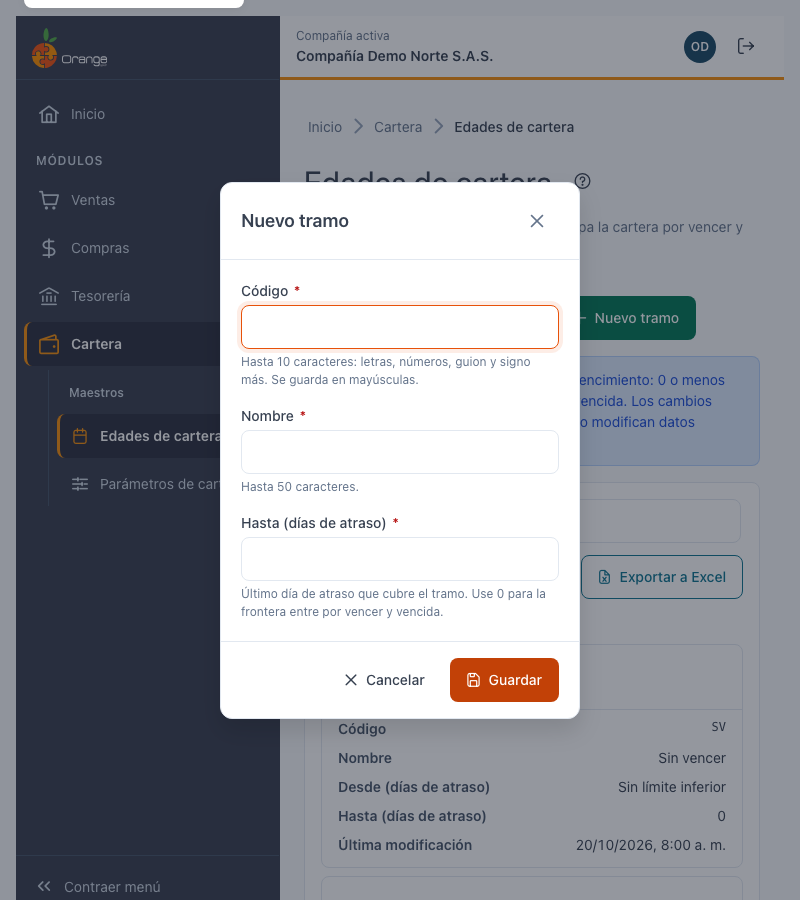

| Campo | Obligatorio | Reglas | Ejemplo |
|-------|:-----------:|--------|---------|
| **Código** | ✅ | Hasta 10 caracteres: letras, números, guion y signo más. Se guarda **siempre en MAYÚSCULAS**. No se puede repetir en la compañía. | `120` |
| **Nombre** | ✅ | Hasta 50 caracteres, sin comas ni punto y coma. | `91-120 días` |
| **Hasta (días de atraso)** | ✅ | Número entero: el último día de atraso que cubre el tramo. Use **0** para la frontera entre lo que está por vencer y lo vencido. | `120` |

Con el ejemplo de la tabla, la vista previa dice: *Este tramo cubrirá desde el día 91 hasta el día 120.* El tramo que antes empezaba en el día 91 pasa a empezar en el 121: no tiene que ajustarlo a mano.

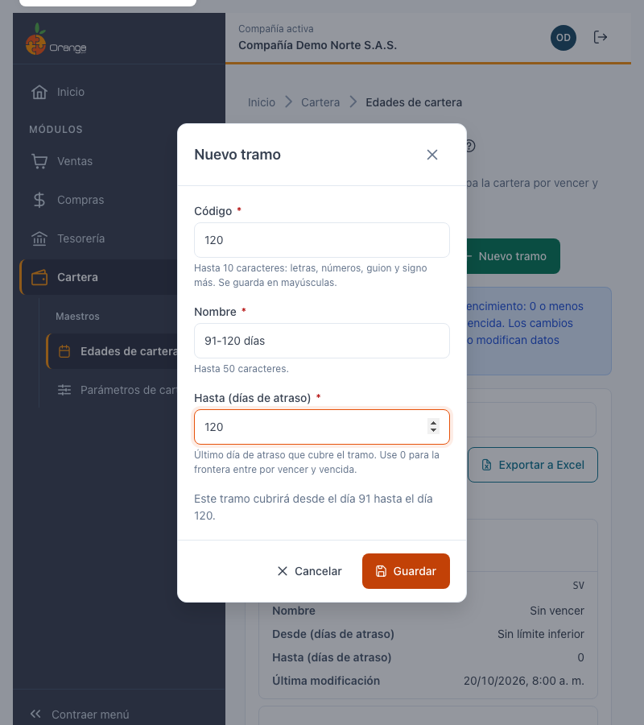

Al guardar verá el mensaje **"Tramo … creado."** y el tramo aparece en el listado.

Si cierra el diálogo sin cambios, no se guarda nada.

### ¿Qué puede salir mal?

Los mensajes aparecen debajo del campo que debe corregir, y lo que escribió se conserva:

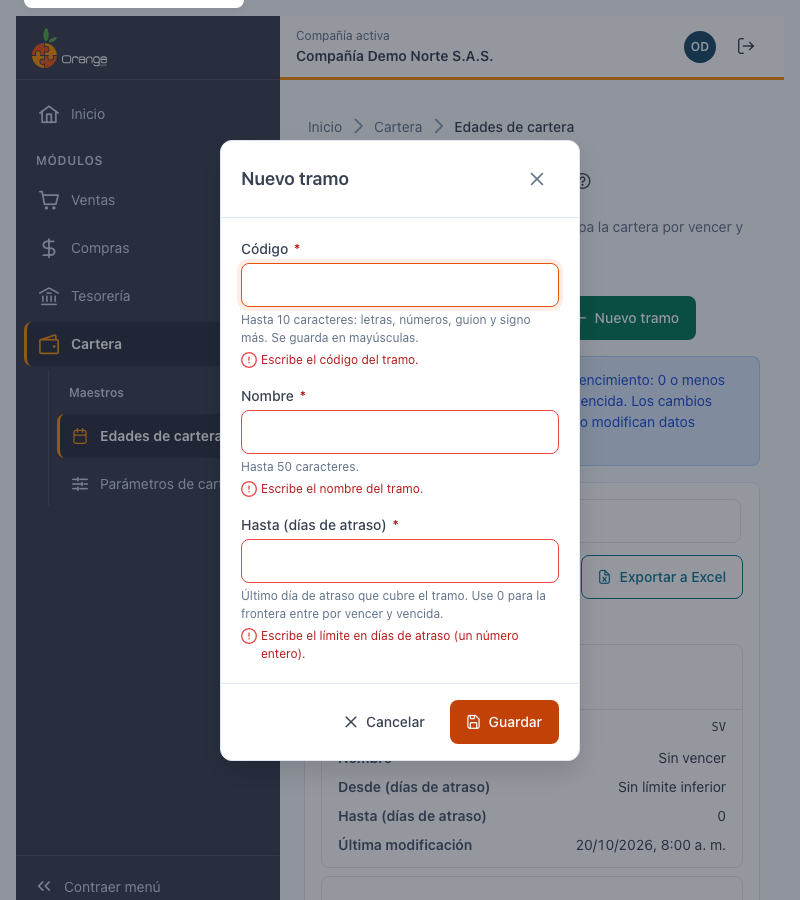

| Mensaje | Qué hacer |
|---------|-----------|
| Escribe el código del tramo. | Complete el campo. |
| Usa solo letras, números, guion y signo más (máximo 10). | Quite espacios, tildes u otros símbolos del código. |
| Ya existe un tramo con el código … | Use otro código. |
| Escribe el nombre del tramo. | Complete el campo. |
| El nombre no puede tener comas ni punto y coma (máximo 50). | Corrija el nombre. |
| Escribe el límite en días de atraso (un número entero). | Escriba un número entero, por ejemplo `90`. |
| Ya existe un tramo que termina en el día … | Elija otro límite. Cada tramo tiene un límite distinto. |
| Con este cambio el conjunto quedaría inválido: debe tener entre 3 y 10 tramos, el tramo que termina en 0 y un solo tramo abierto al final. | Revise el límite: la lista de tramos debe seguir completa (ver *Reglas de los tramos*). |
| No se pudo guardar el tramo. Inténtalo de nuevo. | Vuelva a guardar. Si sigue igual, consulte a su administrador. |

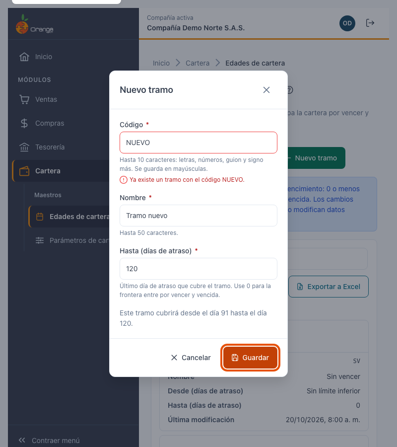

---

## ✏️ Editar un tramo

1. Haga clic en el **lápiz** del tramo.
2. Cambie el código, el nombre o el límite y haga clic en **Guardar**. Al abrir el diálogo, el cursor queda en **Nombre**.

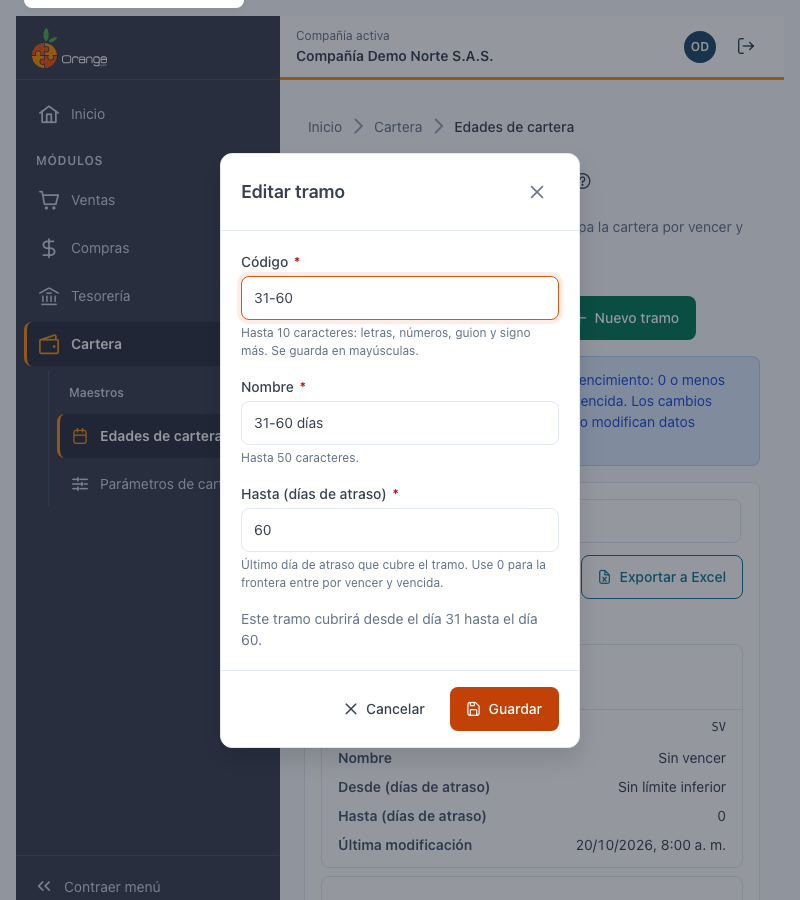

Al cambiar el límite, el tramo siguiente se ajusta solo: si el tramo 31-60 pasa a terminar en el día 45, el de 61-90 pasa a empezar en el 46.

> ⚠️ **Cambiar el código** está permitido, pero verá un aviso: los reportes que muestren el código usarán el nuevo. El tramo sigue siendo el mismo.

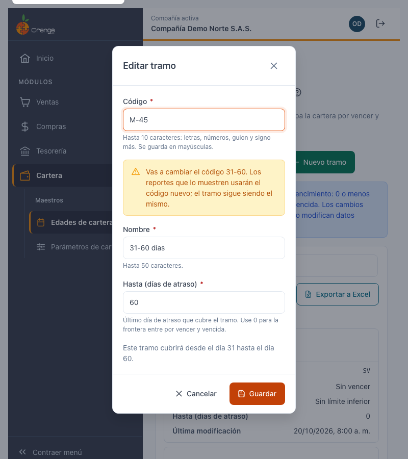

**Tramo abierto.** El último tramo (*En adelante*) no tiene límite que editar: cubre todo lo que supere el tramo anterior. Puede cambiar su código o su nombre.

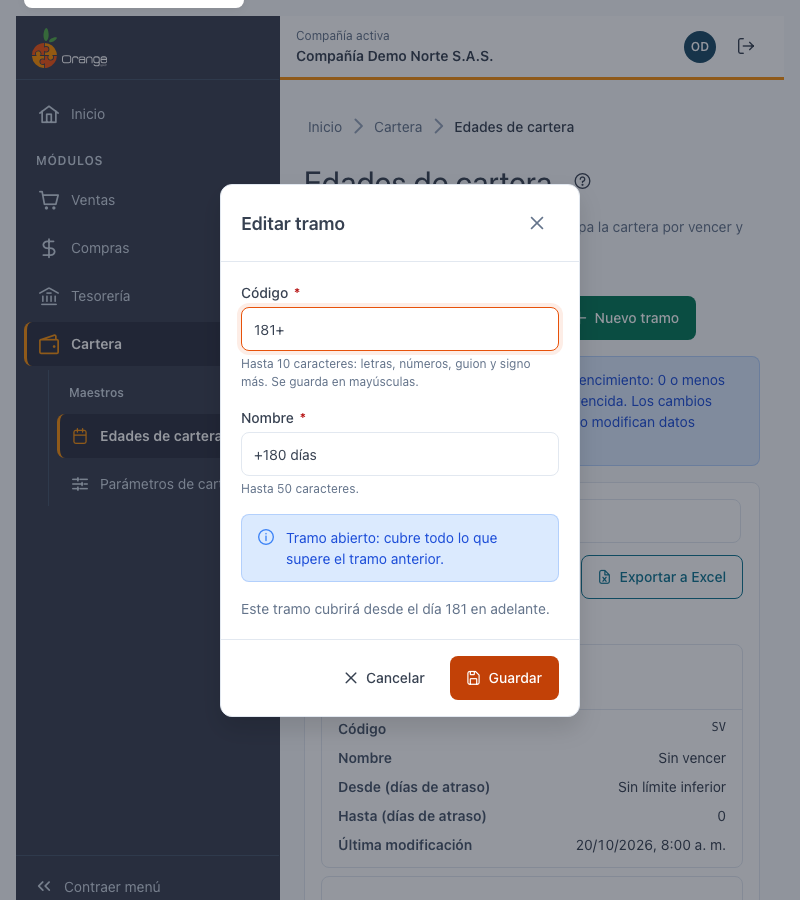

Si guarda sin haber cambiado nada, el diálogo se cierra y no se registra ningún cambio.

Si otro usuario eliminó el tramo mientras lo editaba, al guardar aparece el aviso **"Este tramo ya no existe"**, el diálogo se cierra y la fila desaparece del listado.

---

## 🗑️ Eliminar un tramo

1. Haga clic en la **papelera** del tramo.
2. Revise el nombre y el código en el diálogo y confirme con **Eliminar tramo**.

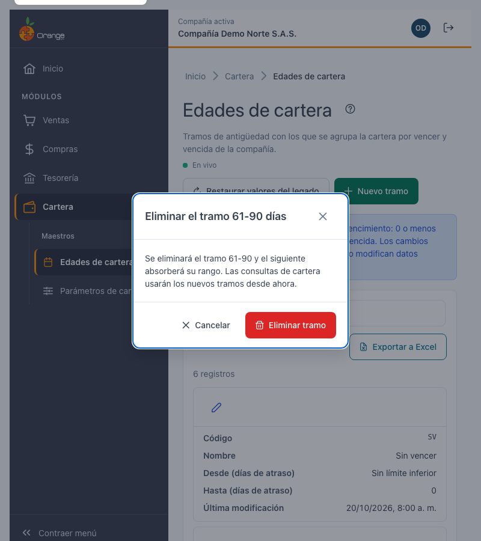

Al eliminar un tramo, el siguiente absorbe su rango: si elimina el 61-90, el 91-180 pasa a cubrir del 61 al 180.

### Tramos que no se pueden eliminar

No se pueden eliminar:

- el tramo que termina en **0** (la frontera entre lo que está por vencer y lo vencido);
- el tramo **abierto** (*En adelante*);
- ningún tramo cuando la lista tiene solo **3** tramos, porque quedaría con menos de 3.

Estos tramos **no muestran el botón Eliminar**. Si aun así el sistema lo rechaza, el diálogo lo explica con un mensaje como: *El tramo … es esencial (frontera de 0 días o tramo abierto) o el conjunto quedaría con menos de 3 tramos. No se puede eliminar.*

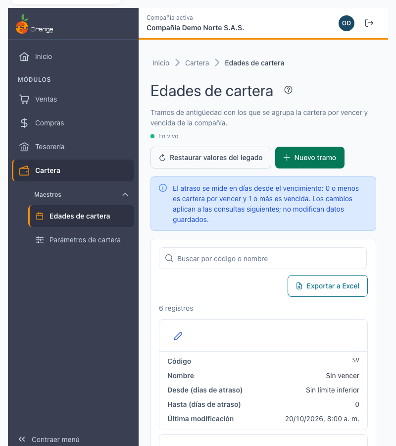

---

## ↩️ Restaurar los valores del legado

Use **Restaurar valores del legado** para volver a los seis tramos iniciales: **Sin vencer, 1-30, 31-60, 61-90, 91-180 y +180 días**.

1. Haga clic en **Restaurar valores del legado**.
2. Lea el aviso y confirme con **Restaurar**.

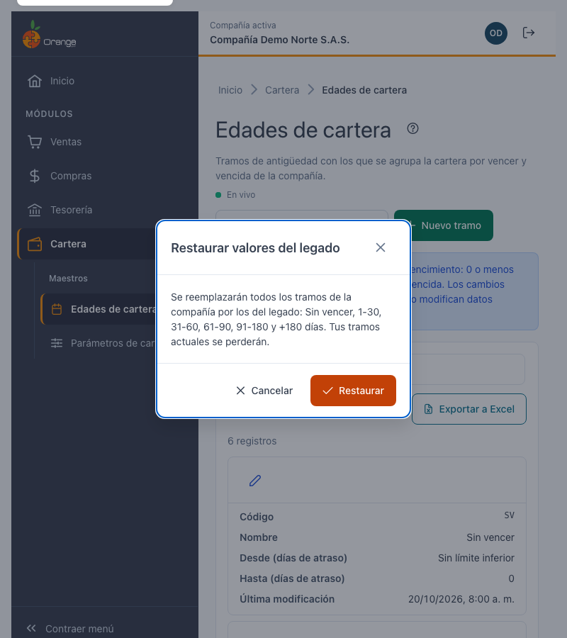

> ⚠️ **Sus tramos actuales se pierden.** Todos se reemplazan por los iniciales. Antes de confirmar, anote los que quiera conservar o exporte la lista a Excel.

Al restaurar, verá el mensaje **"Valores del legado restaurados."**. Si el usuario no tiene el permiso Actualizar, este botón no aparece.

---

## 📤 Exportar a Excel

Haga clic en **Exportar a Excel**. Se descarga un archivo de Excel con los tramos del filtro actual y en el orden que tiene en pantalla.

---

## 🔄 Cambios de otros usuarios (en vivo)

Si otra persona crea, modifica, elimina o restaura tramos mientras usted tiene abierta esta pantalla, **no tiene que recargar**: el listado se pone al día solo, sin perder lo que buscó ni el orden.

- Las filas nuevas o modificadas se **resaltan** unos segundos.
- Abajo a la derecha aparece un aviso, por ejemplo *"Otro usuario creó el tramo 91-120 días."*
- Junto a la descripción verá **En vivo** mientras la conexión esté activa. Si se interrumpe, dice **Reconectando…**; al volver, la pantalla se actualiza sola.

**Si estaba editando ese mismo tramo:**

| Qué hizo el otro usuario | Qué verá | Qué puede hacer |
|--------------------------|----------|-----------------|
| Lo modificó | *"Otro usuario modificó este tramo mientras lo editabas. Revisa sus cambios antes de guardar."* | **Ver sus cambios** para cargar lo que él guardó. |
| Lo eliminó | *"Otro usuario eliminó este tramo. Ya no se puede guardar."* | **Cancelar**. El botón Guardar queda deshabilitado. |

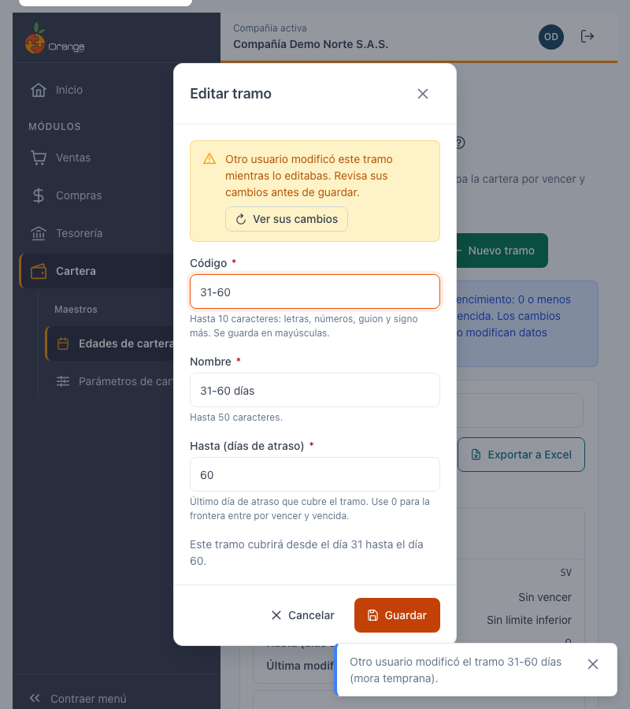

Si estaba por confirmar la eliminación de un tramo que otro ya eliminó, el diálogo se cierra con el aviso *"Otro usuario eliminó el tramo …"*.

> ℹ️ Los cambios que usted hace en esta misma pestaña no generan avisos.

---

## 📐 Reglas de los tramos

- El atraso se cuenta en **días desde el vencimiento**. **0 o menos** es cartera por vencer; **1 o más** es cartera vencida.
- La lista debe tener **entre 3 y 10 tramos**.
- Debe existir un tramo que termine en **0**.
- Debe haber **un solo tramo abierto**, el último de la lista.
- Cada tramo tiene un **código** y un **límite** distintos de los demás.
- Los cambios aplican a las consultas que se hagan **después** de guardar. No modifican la cartera ni los datos que ya están guardados.

---

## ❓ Preguntas frecuentes

**¿Por qué la pantalla ya trae tramos si no los he creado?**
La primera vez que se abre la pantalla, se cargan los seis tramos iniciales del legado: Sin vencer, 1-30, 31-60, 61-90, 91-180 y +180 días.

**¿Por qué no puedo eliminar un tramo?**
Es el tramo de 0 días, el tramo abierto, o la lista quedaría con menos de tres tramos. Esos tramos son necesarios para que toda la cartera quede agrupada.

**¿Por qué el día de inicio no lo escribo yo?**
Para que los tramos no se traslapen ni dejen días sin cubrir, el día de inicio se calcula a partir del límite del tramo anterior.

**¿Por qué el código quedó en mayúsculas?**
Los códigos se guardan en mayúsculas para que no haya dos tramos "iguales" escritos distinto.

**¿Cambiar un tramo cambia las cifras de cartera que ya vi?**
No. Las consultas se calculan en el momento. Verá el nuevo agrupamiento en las consultas que haga después de guardar.

**No veo "En vivo".**
La conexión en vivo no está disponible en este momento. La pantalla funciona igual; para ver cambios de otros usuarios, recargue la página.

**No veo los botones Nuevo tramo, Editar, Eliminar o Restaurar.**
Su perfil no tiene ese permiso sobre la opción Edades de cartera. Consulte con el administrador de OrangeERP.

**No veo el botón Exportar a Excel.**
Su perfil no tiene el permiso Exportar sobre la opción Edades de cartera.
