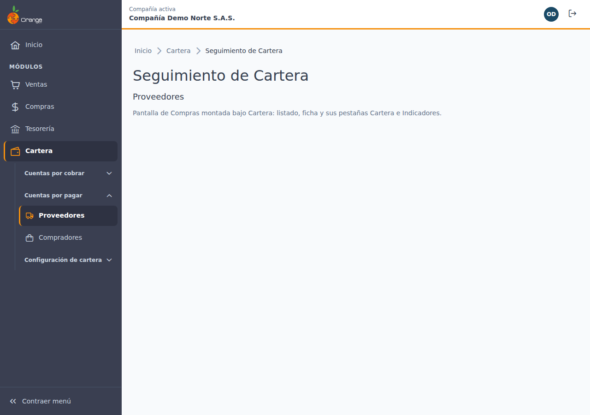

[Regresar a Cartera](readme.md)

---

# 🗂️ Maestros de Cartera por tipo

---

## 📋 Descripción

El menú **Maestros** de Cartera reúne los maestros que usa la cartera, organizados según lo que representan:

- **Cuentas por cobrar**: los **clientes** y los **vendedores**.
- **Cuentas por pagar**: los **proveedores** y los **compradores**.
- **Configuración de cartera**: las **edades de cartera** y los **parámetros de cartera**.

Antes, el menú de Cartera solo ofrecía los maestros de cuentas por cobrar. Ahora también puede abrir **Proveedores** y **Compradores** sin salir del módulo de Cartera.

> 💡 Los grupos y las opciones aparecen solo si su perfil tiene permiso para verlas. Un grupo sin ninguna opción disponible no aparece.

> ℹ️ Cada maestro se mantiene en su propia pantalla: **Clientes** y **Vendedores** están en el módulo de [Ventas](../ventas/readme.md), y **Proveedores** y **Compradores** están en el módulo de [Compras](../compras/readme.md). Cartera solo los presenta en su menú.

---

## 🎯 Acceso

1. En el menú principal, haga clic en **Cartera**.
2. En **Maestros**, elija el grupo y la opción que necesita.

---

## 🖥️ Pantalla principal

| Grupo | Opción | Qué es | Permiso que se necesita |
|-------|--------|--------|-------------------------|
| **Cuentas por cobrar** | **Clientes** | Los clientes, con su ficha completa. | Consultar **Clientes** (Ventas). |
| **Cuentas por cobrar** | **Vendedores** | Los vendedores y su zona. | Consultar **Vendedores** (Ventas). |
| **Cuentas por pagar** | **Proveedores** | Los proveedores, con su ficha y sus pestañas (Cartera, Indicadores, Inventario y las demás). | Consultar **Proveedores** en Cartera **y** en Compras. |
| **Cuentas por pagar** | **Compradores** | Los compradores de la compañía. | Consultar **Compradores** en Cartera **y** en Compras. |
| **Configuración de cartera** | **Edades de cartera** | Los tramos de antigüedad de la cartera. Ver [Edades de cartera](edades.md). | Consultar **Edades de cartera**. |
| **Configuración de cartera** | **Parámetros de cartera** | La configuración de la cobranza. Ver [Parámetros de cartera](parametros.md). | Consultar **Parámetros de cartera**. |

Cuando abre **Proveedores** o **Compradores** desde Cartera, la pantalla es la de Compras: el listado, la ficha y sus acciones son las mismas. Las migas de pan dicen **Cartera › Proveedores** o **Cartera › Compradores** para que sepa desde dónde entró.

### Qué permisos hacen falta para Proveedores y Compradores

Para ver **Proveedores** o **Compradores** desde Cartera necesita dos permisos de Consultar:

1. El de Cartera (opción **346** Proveedores o **347** Compradores). Es lo que muestra la opción en el menú.
2. El de Compras (opción **46** Proveedores o **47** Compradores). Es lo que el sistema revisa al cargar los datos.

Si solo tiene el permiso de Compras, puede entrar con la dirección directa, pero la opción no aparece en el menú de Cartera. Si solo tiene el de Cartera, la pantalla carga, pero el servidor responde **«sin permiso»**: verá el mensaje *No tiene permiso en Compras para esta pantalla*.

Para crear, editar o eliminar proveedores o compradores, use los permisos de Compras.

---

## ❓ Preguntas frecuentes

**¿Por qué no veo Proveedores o Compradores en el menú de Cartera?**
Su perfil no tiene el permiso de Consultar en la opción de Cartera (346 o 347) o no tiene el de Compras. Pida a su administrador los dos permisos.

**¿Por qué dice que la pantalla no está disponible?**
La pantalla de Compras no respondió. Lo llevamos al inicio de Cartera. Intente de nuevo en unos minutos.

**¿Dónde registro un proveedor nuevo?**
En **Proveedores**, desde el menú de Cartera. La pantalla es la de Compras y guarda el proveedor igual que desde Compras.

**¿Por qué no aparece el grupo Cuentas por pagar?**
Porque su perfil no tiene permiso en ninguna de sus opciones. Ningún grupo sin opciones disponibles se muestra.

---

## 🛠️ Errores comunes

| Mensaje | Qué hacer |
|---------|-----------|
| **Esta pantalla no está disponible ahora** | Volvemos al inicio de Cartera. Intente de nuevo en unos minutos. |
| **No tiene permiso en Compras para esta pantalla** | Pida a su administrador el permiso de Consultar de Proveedores o Compradores en Compras. |

---

## 🧷 Relacionado

- [Seguimiento de Cartera](movimientos/seguimiento.md): la lista de clientes y proveedores con saldo y su gestión de cobro.
- [Edades de cartera](edades.md)
- [Parámetros de cartera](parametros.md)
- [Proveedores (Compras)](../compras/maestros/proveedores.md)
- [Compradores (Compras)](../compras/maestros/compradores.md)
