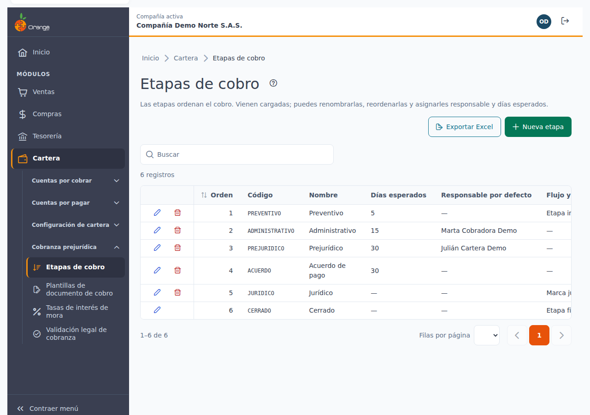

[Regresar a Cartera](../readme.md)

---

# 🪜 Etapas de cobro

---

> ⚠️ **Aviso.** Esta pantalla es del **cobro prejurídico** (nivel 2). Requiere que el nivel 2 esté activo en [Parámetros de cartera](../parametros.md).
>
> ⚠️ **Funciones que aún no están disponibles:** comunicaciones, acuerdos de pago, intereses, centrales de riesgo y prescripción.
>
> ⚠️ **Los parámetros legales los debe validar el abogado de su empresa.** Este manual describe cómo usar la pantalla; **no es asesoría jurídica**.

## 📋 Descripción

Las **etapas de cobro** son los pasos por los que pasa un caso de cobro: desde el cobro preventivo hasta el cierre. Cada etapa tiene un **orden**, unos **días esperados** (cuánto tiempo suele durar en esa etapa) y, si quiere, un **responsable por defecto**.

La compañía recibe cinco etapas ya cargadas, que puede cambiar.

---

## 🎯 Acceso

1. En el menú principal, haga clic en **Cartera**.
2. En **Maestros**, en el grupo **Configuración de cartera**, haga clic en **Etapas de cobro**.

---

## 🖥️ Pantalla principal

| Columna | Qué muestra |
|---------|-------------|
| **Código** | Código de la etapa (en mayúsculas, único en la compañía). |
| **Nombre** | Nombre que ve el usuario. |
| **Orden** | El lugar en la secuencia. |
| **Días esperados** | Cuántos días suele durar un caso en esa etapa. |
| **Responsable** | El responsable por defecto, si tiene. |
| **Estado** | Activa o inactiva. |

### Etapas precargadas

| Orden | Etapa | Qué marca |
|:-----:|-------|-----------|
| 1 | **Preventivo** | Es la etapa **inicial**: así entran los casos nuevos. |
| 2 | **Administrativo** | Gestión administrativa de la cuenta. |
| 3 | **Prejurídico** | Cobro antes de pasar a jurídico. |
| 4 | **Acuerdo de pago** | Acuerdo con el cliente. |
| 5 | **Jurídico** | Marca el caso para pasar a jurídico. **Todavía no abre expediente**: el proceso jurídico no está disponible. |
| 6 | **Cerrado** | Es la etapa **final**: cierra el caso. |

**Preventivo** es la etapa inicial de fábrica y **Cerrado** la final. Puede cambiar cuál es la inicial, pero solo puede haber una.

Las etapas se cargan la primera vez que se activa el nivel 2. No necesita cargarlas a mano, ni importar un archivo.

---

## ➕ Crear una etapa

1. Haga clic en **Nueva etapa**.
2. Complete los campos y haga clic en **Guardar**.

| Campo | Regla |
|-------|-------|
| **Código** | Obligatorio. Se guarda en **mayúsculas** y no puede repetirse en la compañía. |
| **Nombre** | Obligatorio. |
| **Orden** | Obligatorio. Define la secuencia. |
| **Días esperados** | Opcional. Cuántos días suele durar un caso en esa etapa. |
| **Responsable por defecto** | Opcional. Si la etapa tiene responsable, el caso lo toma al entrar. |
| **Inicial** | Solo una etapa puede ser inicial. |
| **Final** | Al menos una etapa debe ser final. |
| **Jurídica** | Marca la etapa para pasar a jurídico. Por ahora solo marca el caso. |
| **Activa** | Apagada, la etapa no se puede elegir para nuevos cambios. |

---

## ✏️ Editar, desactivar y eliminar

- **Editar**: puede renombrar, reordenar, asignar responsable y días, y desactivar cualquier etapa **excepto Cerrado**, que no se desactiva ni se elimina.
- **Eliminar**: solo las etapas que creó la compañía. Si ya la usa un caso o su historial, no se puede eliminar: el sistema **la desactiva** y avisa.

Si la etapa ya está en uso, la pantalla no la borra: la desactiva y se queda en el historial de los casos.

Los casos que ya están en una etapa no cambian si cambia el nombre o el orden de esa etapa.

---

## 🔐 Permisos

| Permiso (opción 353) | Qué puede hacer |
|----------------------|-----------------|
| **Consultar** | Ver las etapas. |
| **Crear** | Crear etapas de la compañía. |
| **Actualizar** | Editar, reordenar y desactivar. |
| **Eliminar** | Eliminar etapas sin uso. |
| **Exportar** | Exportar la lista a Excel. |

Sin el permiso, el botón no aparece.

---

## ❓ Preguntas frecuentes

**¿Por qué no puedo desactivar Cerrado?**
Porque es la etapa final: todo caso termina ahí. Puede cambiarle el nombre, pero no desactivarla.

**¿Puedo tener dos etapas iniciales?**
No. Solo una etapa puede ser la inicial.

**¿Qué pasa con los casos si cambio el nombre de una etapa?**
Los casos conservan su etapa: el cambio de nombre se ve en todos.

**¿Para qué sirven los días esperados?**
Para marcar en la ficha del caso cuándo pasó el tiempo esperado en su etapa. No cambian la etapa solos.

**¿Por qué aparece la etapa Jurídico si no hay proceso jurídico?**
Porque la etapa existe para marcar el caso. El expediente jurídico no se abre desde esta pantalla todavía.

---

## 🛠️ Errores comunes

| Mensaje | Qué hacer |
|---------|-----------|
| **No se pudo cargar la información** | Pulse **Reintentar**. |
| Campos marcados en rojo | Corrija el campo y guarde de nuevo. |

---

## 🧷 Relacionado

- [Casos de cobro](../movimientos/casos.md)
- [Parámetros de cartera](../parametros.md)
- [Cobradores](../cobradores.md): los responsables por defecto de las etapas.
