[Regresar a Cartera](../readme.md)

---

# ⚖️ Casos de cobro

---

> ⚠️ **Aviso.** Esta pantalla es del **cobro prejurídico** (nivel 2). Requiere que la compañía tenga activado el **nivel 2** en [Parámetros de cartera](../parametros.md) y que la fase 2 de Seguimiento de Cartera esté habilitada. Con el nivel 1, esta pantalla no aparece.
>
> ⚠️ **Por validar.** Los textos de las plantillas, las tasas de mora, la fórmula de intereses, los plazos de prescripción y los días del aviso a centrales **nacen vacíos o por validar**. **El abogado de la empresa debe validarlos** antes de usarlos con clientes.
>
> ⚠️ **Este manual y el sistema no son asesoría jurídica.** Las funciones de jurídico (expediente y «Escalar a jurídico») todavía no están disponibles.

## 📋 Descripción

Un **caso de cobro** agrupa los documentos vencidos de un cliente que pasan a la gestión prejurídica. Cada caso tiene un número (por ejemplo, **CC-000001**), una **etapa** (dónde va la gestión), un **responsable** (quién la lleva) y su **saldo**.

Un cliente tiene **un solo caso abierto**. Si escala más documentos, se agregan a ese mismo caso. Un documento solo puede estar en **un caso abierto**.

Un caso nace de un botón en el [Seguimiento de Cartera](seguimiento.md): **Escalar**. No hay formulario previo.

---

## 🎯 Acceso

1. En el menú principal, haga clic en **Cartera**.
2. En **Movimientos**, haga clic en **Casos de cobro**.

También puede llegar desde el panel de un cliente en el Seguimiento, en la pestaña **Caso**.

---

## ➕ Escalar documentos de un cliente

Escalar se hace desde el panel del cliente, en la pestaña **Documentos**.

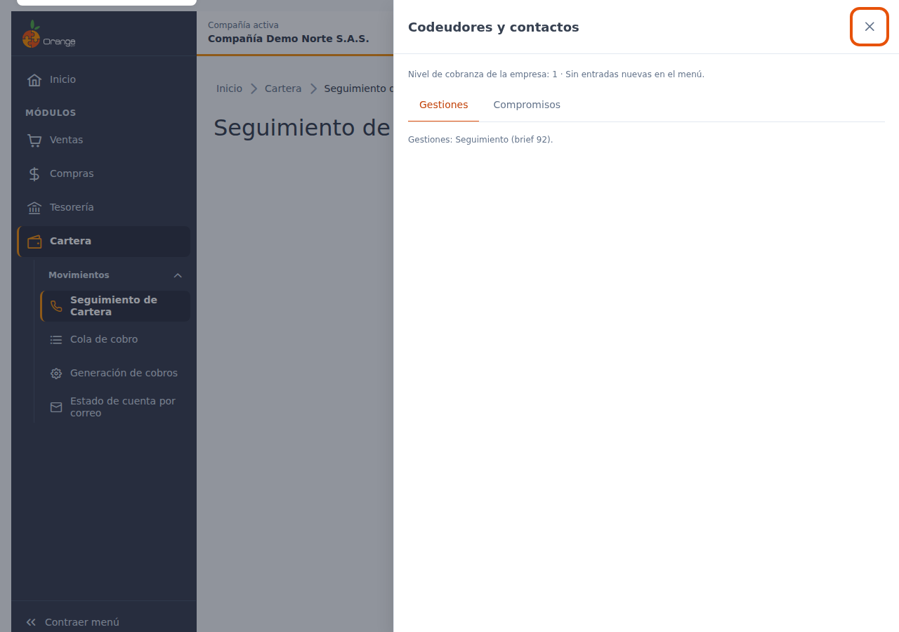

Con el nivel 2 activo:

1. Abra el panel del cliente en el [Seguimiento de Cartera](seguimiento.md).
2. Haga clic en la pestaña **Documentos**. Verá los documentos con saldo del cliente.
3. Marque los documentos que quiere escalar.
4. Haga clic en **Escalar los seleccionados (N)**.

Aparece el diálogo **Escalar a cobro prejurídico**. Dice cuántos documentos y cuánto saldo va a escalar, en qué etapa queda y quién es el responsable:

- La etapa inicial es **Preventivo**.
- El responsable es el **cobrador titular** del cliente. Si el cliente no tiene cobrador, el caso queda a cargo de usted.
- Si el cliente ya tiene un caso abierto, el diálogo ofrece **Agregar al caso**.

Haga clic en **Crear el caso**.

Al terminar, aparece **Caso CC-… creado.** con el enlace **Abrir el caso**.

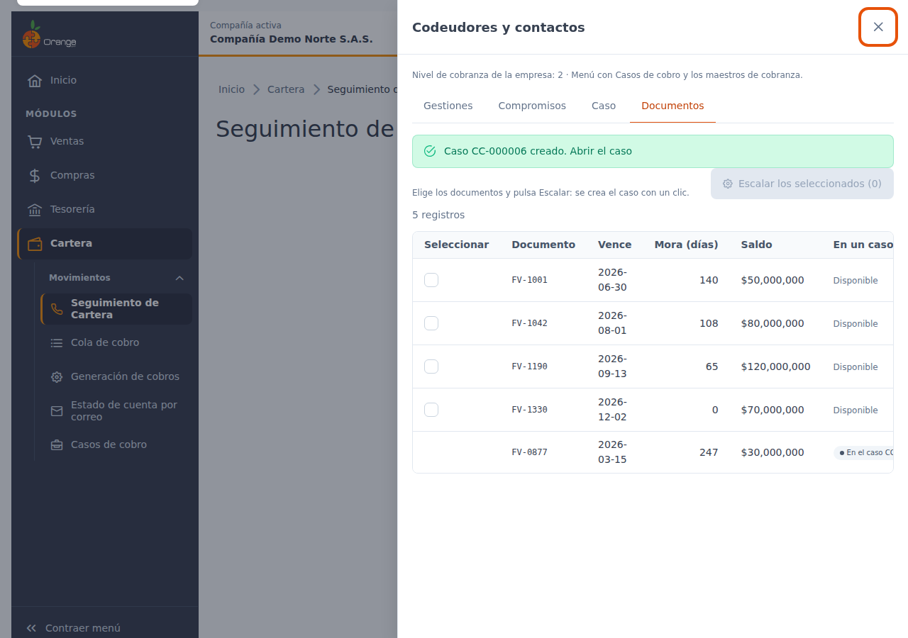

| Mensaje | Qué hacer |
|---------|-----------|
| **Selecciona al menos un documento.** | Marque al menos un documento. |
| **Máximo 200 documentos por caso.** | Escale menos documentos, o agréguelos en otro caso abierto. |
| Un documento sin saldo | No se puede escalar. Revise el documento. |

Si algo falla, no se guarda nada: el caso se crea completo o no se crea.

---

## 📑 Lista de casos

Abra **Casos de cobro** en el menú. La lista muestra un caso por fila:

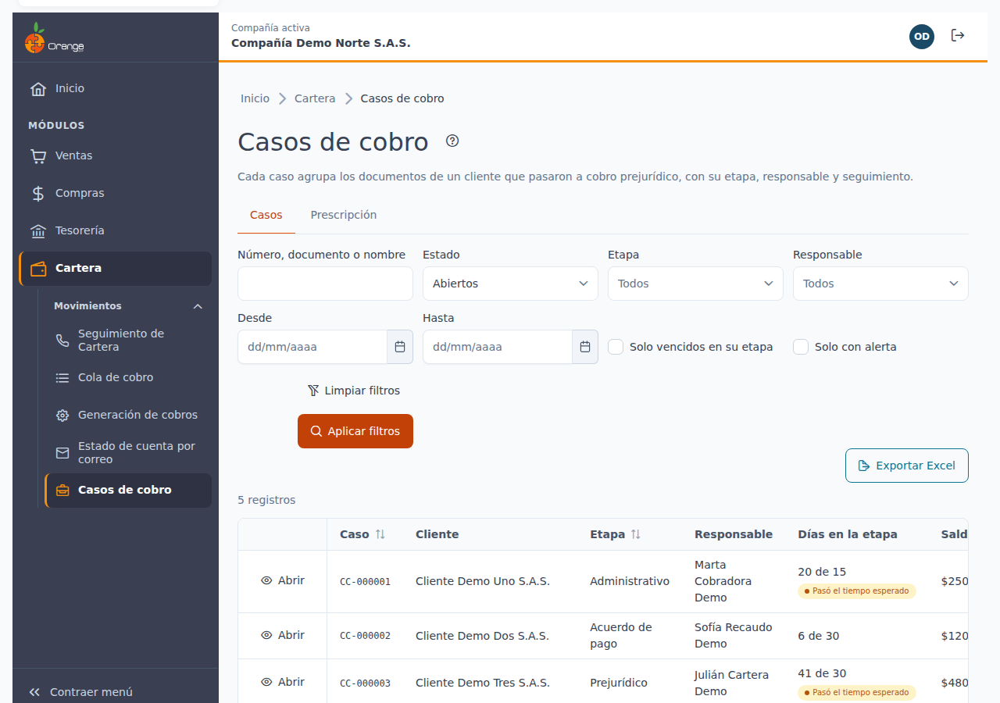

| Columna | Qué muestra |
|---------|-------------|
| **Caso** | Número del caso. Con **Abrir** entra a la ficha. |
| **Cliente** | El cliente del caso. |
| **Etapa** | En qué etapa está. |
| **Responsable** | Quién lleva el caso. Si no tiene, dice **Sin responsable**. |
| **Días en la etapa** | Por ejemplo, **20 de 15**. Si pasó el tiempo esperado, dice **Pasó el tiempo esperado**. |
| **Saldo** | Saldo de hoy de los documentos del caso. |
| **Próxima acción** | La siguiente acción prevista. |
| **Alertas** | Avisos en texto. |
| **Estado** | **Abierto** o **Cerrado**. |

Los filtros son: **Número, documento o nombre**, **Estado**, **Etapa**, **Responsable**, rango de fechas, **Solo vencidos en su etapa** y **Solo con alerta**. Pulse **Aplicar filtros** o **Limpiar filtros**. Con **Exportar Excel** descarga la lista filtrada.

Si no hay casos, dice **Aún no hay casos de cobro**. Si los filtros no encuentran nada, dice **No hay casos con estos filtros**.

Con el nivel 1 la pantalla no muestra casos: el nivel 2 debe estar activo para usarla.

---

## 🗂️ Ficha del caso

Haga clic en **Abrir** de un caso. La ficha tiene estas pestañas:

| Pestaña | Qué tiene |
|---------|-----------|
| **Resumen y documentos** | Número, cliente, etapa, responsable, días en la etapa, saldos y documentos. |
| **Etapas e historial** | La línea de etapas y cada cambio. |

| Pestaña | Qué tiene | Sección |
|---------|-----------|---------|
| **Comunicaciones** | Cartas, requerimientos y avisos con PDF o correo. | [Comunicaciones](#-comunicaciones) |
| **Acuerdo de pago** | El acuerdo vigente y sus cuotas. | [Acuerdo de pago](#-acuerdo-de-pago) |
| **Intereses** | Liquidación de intereses de mora. | [Intereses](#-intereses) |
| **Centrales** | El control de reporte a centrales de riesgo. | [Centrales de riesgo](#-centrales-de-riesgo) |
| **Partes** | Codeudores y contactos. | [Partes](#-partes) |

La ficha también tiene el botón **PDF** (permiso **Imprimir**), que descarga el resumen del caso.

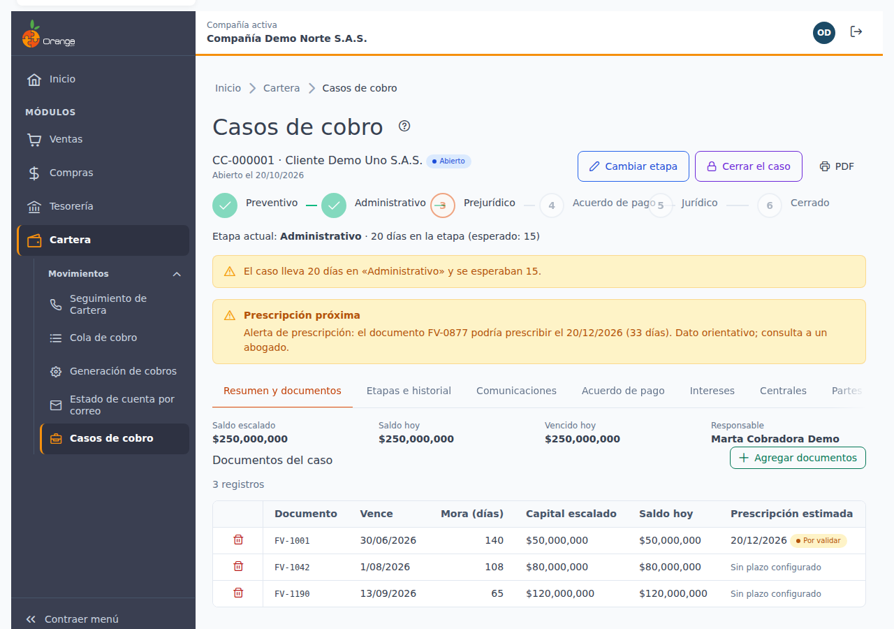

En **Resumen y documentos** verá:

- **Saldo escalado**: el saldo al momento de escalar.
- **Saldo hoy** y **Vencido hoy**: el saldo vivo de los documentos.
- **Documentos del caso**: cada documento con su saldo de hoy. Con **Quitar** saca un documento del caso (no se puede si está en un acuerdo vigente).
- **Agregar documentos**: suma documentos del cliente que no estén en otro caso abierto.

### Cambiar la etapa

Sirve para mover el caso a la siguiente gestión (por ejemplo, de **Administrativo** a **Prejurídico**).

1. Haga clic en **Cambiar etapa**.
2. Elija la **Nueva etapa**.
3. Escriba el **Motivo del cambio**. Es obligatorio.
4. Si la etapa tiene responsable por defecto, aparece **Responsable en la nueva etapa**. Puede cambiarlo.
5. Haga clic en **Cambiar etapa**.

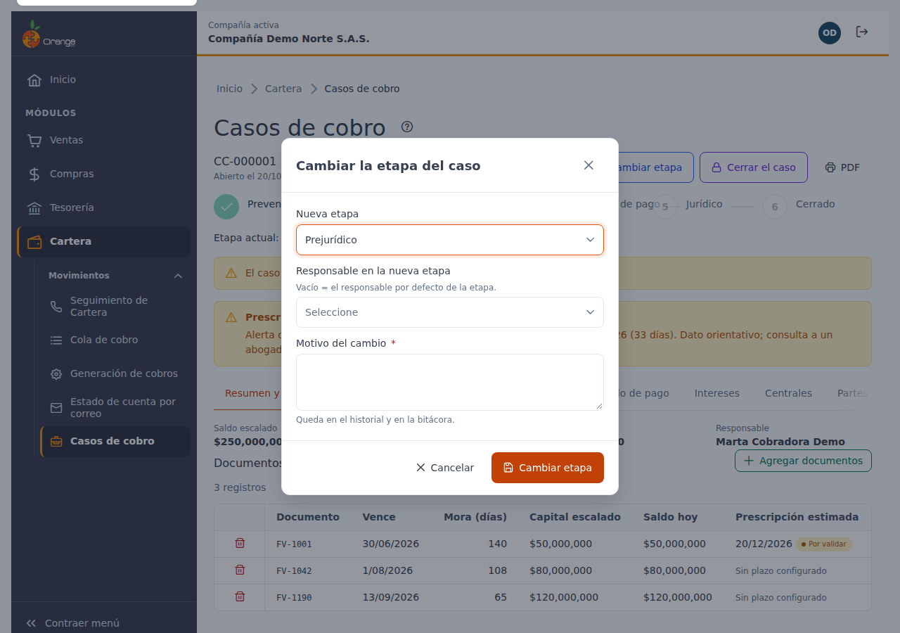

Al cambiar la etapa, el nuevo responsable recibe un aviso en la campana, sin importes. Cada cambio queda en el historial.

Si la etapa es **Cerrado**, el sistema pide el **Motivo del cierre**.

| Mensaje | Qué hacer |
|---------|-----------|
| **Escribe el motivo del cambio.** | Complete el motivo. |

### Etapas e historial

La línea de etapas muestra por dónde ha pasado el caso. El historial tiene una fila por cada cambio:

| Columna | Qué muestra |
|---------|-------------|
| **Fecha** | Cuándo se hizo el cambio. |
| **De** y **A** | La etapa anterior y la nueva. |
| **Quién** | Quién hizo el cambio. |
| **Motivo** | El motivo escrito. |
| **Saldo al ingreso** | El saldo del caso al entrar a la etapa. |

Si el caso pasó el tiempo esperado de su etapa, aparece la marca **Pasó el tiempo esperado**, con texto.

### Responsable

Con **Cambiar responsable** cambia quién lleva el caso. El responsable no gana permisos por serlo: sus permisos son los de su perfil.

---

## 📨 Comunicaciones

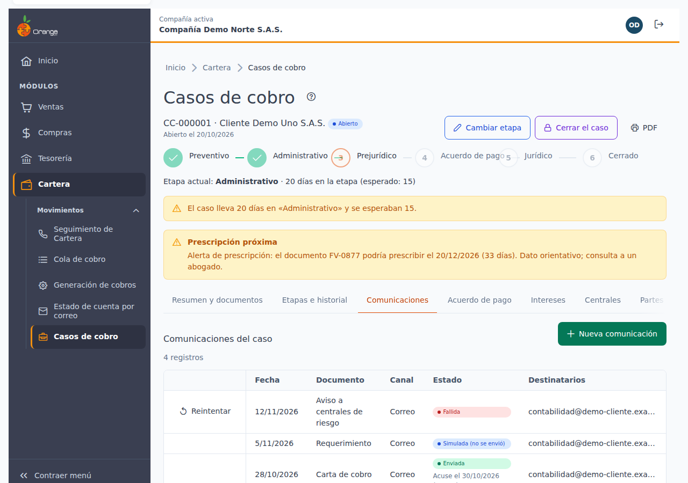

Una comunicación es una carta, un requerimiento o un aviso que sale del caso, en **PDF** o por **correo**. La lista muestra la fecha, el documento, el canal, el **estado** en texto, los destinatarios y el acuse.

### Crear una comunicación

1. En la pestaña **Comunicaciones**, haga clic en **Nueva comunicación**.
2. Elija la **plantilla** y el **plazo de pago (días)**.
3. Elija el **canal**: **Correo** o **Solo PDF**.
4. Si quiere, marque **Enviar también a** una parte del caso.
5. Revise la **vista previa del mensaje** y la **vista previa del PDF**.
6. Haga clic en **Enviar por correo** o en **Generar PDF**.

Si el canal es **Solo PDF**, el documento queda como **Generada (solo PDF)** y se descarga con **Imprimir**. Sirve, por ejemplo, para entregarla en papel.

### Estados de una comunicación

| Estado | Qué significa |
|--------|---------------|
| **En cola** | Va a salir por correo. |
| **Enviada** | El servidor de correo la aceptó. |
| **Simulada (no se envió)** | Estaba en **Modo de prueba**: el correo no salió. |
| **Fallida** | No salió. Se puede **Reintentar**. |
| **Generada (solo PDF)** | Se generó para imprimir o entregar. |

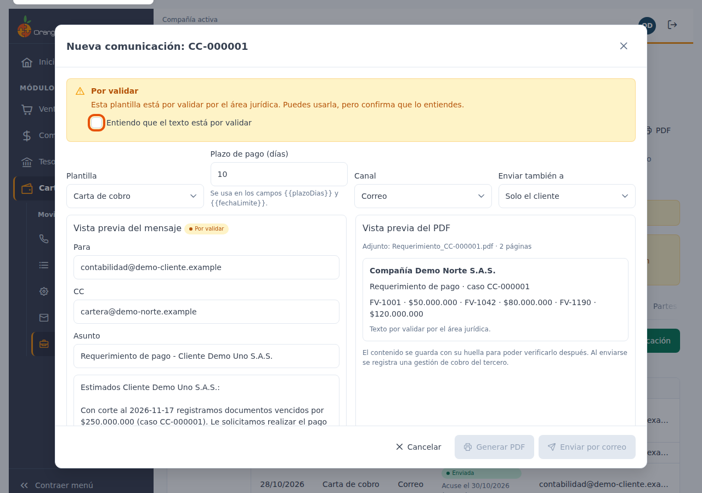

Si la plantilla no está validada, aparece una advertencia. Para enviar, marque **Entiendo que el texto está por validar**.

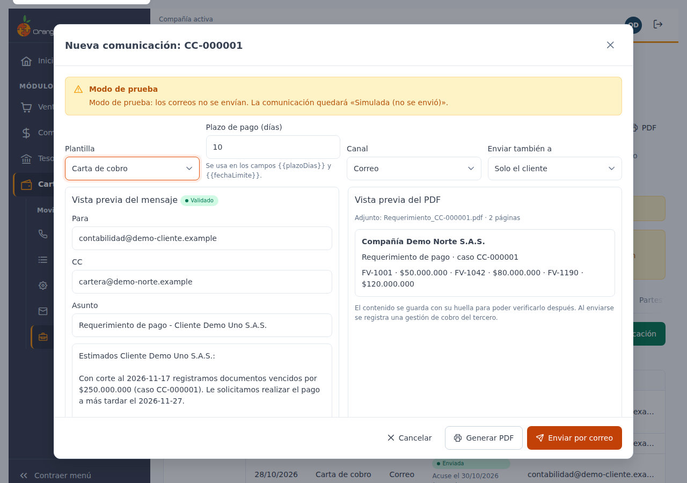

Con el **Modo de prueba** el diálogo dice que los correos no se envían, y la comunicación queda **Simulada (no se envió)**. No se registra como enviada.

### Acuse de recibo

El acuse **no es automático**. Si el cliente recibió la comunicación, use **Registrar acuse** e indique la fecha, el medio y una nota. Así queda constancia.

Las comunicaciones del caso **no se borran**: son la evidencia del proceso mientras el caso exista.

Cuando un correo queda **Enviada**, el sistema registra una gestión de cobro del cliente por correo.

---

## 🤝 Acuerdo de pago

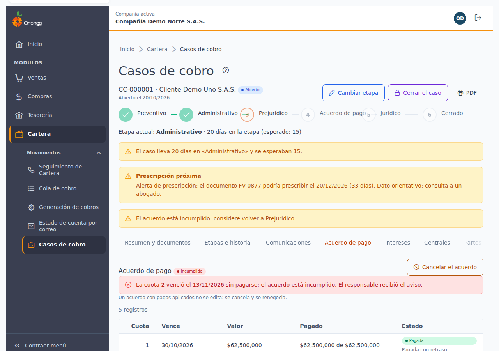

Un caso tiene **un solo acuerdo vigente**. Para crear otro, primero hay que cancelar el anterior: queda cancelado con el motivo **renegociado**.

### Crear el acuerdo

1. En la pestaña **Acuerdo de pago**, haga clic en **Nuevo acuerdo de pago**.
2. En el **Asistente**, complete las condiciones:

| Campo | Regla |
|-------|-------|
| **Valor total del acuerdo** | Por defecto, el saldo vivo del caso. Puede cambiarlo. |
| **Cuota inicial** | Opcional. |
| **Número de cuotas** | De 1 a 60. |
| **Periodicidad** | **Semanal**, **Quincenal** o **Mensual**. |
| **Fecha de la primera cuota** | No puede ser anterior a hoy. |
| **Incluir los intereses liquidados** | Opcional. Usa una liquidación de intereses. |

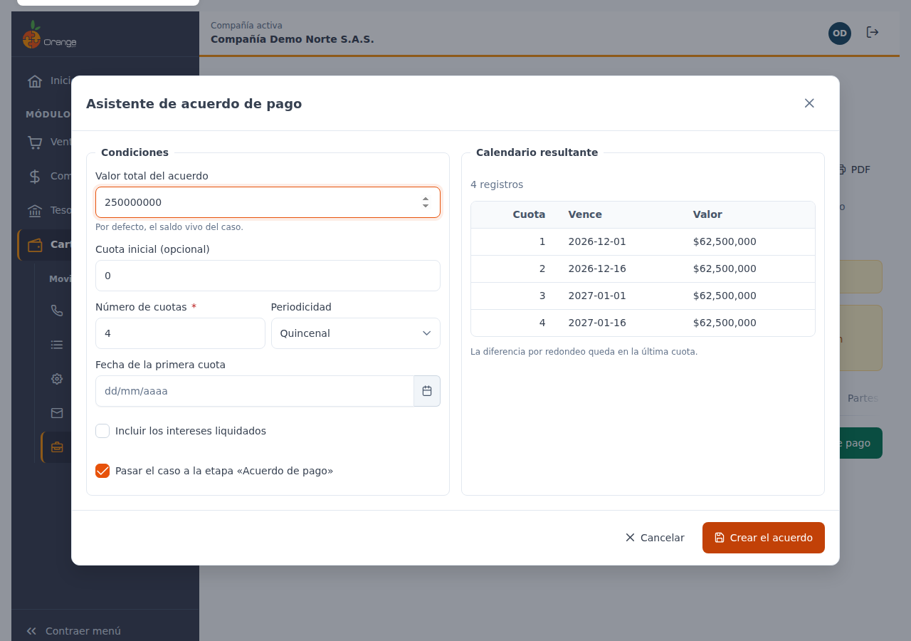

El **calendario resultante** aparece antes de crear. La cuota es el total dividido entre el número de cuotas, con dos decimales; **la diferencia de redondeo va a la última cuota**. Si una fecha cae en un mes sin ese día, se ajusta al último día del mes.

Al crear el acuerdo, el sistema **pregunta** si el caso pasa a la etapa **Acuerdo de pago**. No lo hace solo.

Con **Crear el acuerdo** queda creado. Con **Cancelar el acuerdo** (con motivo) se cancela. Un acuerdo con pagos aplicados no se edita: se cancela y se renegocia.

### Cuotas y pagos

La tabla de cuotas muestra cada cuota con su vencimiento, su valor, lo pagado de ese valor y su estado: **Pendiente**, **Pagada**, **Parcial** o **Incumplida**. Una cuota pagada después de su vencimiento dice **Pagada con retraso**.

Los **recibos de caja** del cliente se aplican solos, **en orden**, a las cuotas desde la fecha del acuerdo. Cuando lo recibido cubre una cuota, queda **Pagada**. Si se anula un recibo, el sistema vuelve a calcular.

Cuando todas las cuotas están pagadas, el acuerdo queda **Cumplido**. El caso **sugiere** cerrarse como **Acuerdo cumplido**; no se cierra solo.

### Acuerdo incumplido

Si una cuota vence sin cubrirse (más los días de tolerancia, por validar), queda **Incumplida** y el acuerdo pasa a **Incumplido**. Aparece una alerta con la cuota incumplida y se avisa por campana al responsable del caso y al titular de la cuenta, **sin importes**.

El sistema **no cambia la etapa solo**. El caso muestra la sugerencia **considere volver a la etapa Prejurídico**: la decisión es de la persona.

### Constancia del acuerdo

**Constancia del acuerdo** descarga el PDF con las cuotas. Se puede enviar también como comunicación.

---

## 📉 Intereses

Esta pestaña calcula los **intereses de mora** de los documentos vencidos del caso. Los intereses son **informativos**: no cambian el saldo del cliente ni generan asientos.

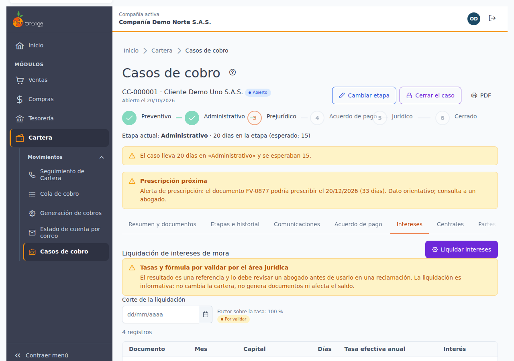

1. Elija el **Corte de la liquidación** (no puede ser posterior a hoy).
2. Haga clic en **Liquidar intereses**.
3. Revise el detalle por documento y mes: **Mes**, **Capital**, **Días**, **Tasa efectiva anual** e **Interés**.
4. Con **Guardar la liquidación** queda registrada. Las liquidaciones guardadas se listan en **Liquidaciones guardadas**.

El cálculo usa **interés simple**: cada mes aplica la tasa de ese mes, sobre los días de atraso de ese mes. Usa el **factor** sobre la tasa (por defecto 100 %) y la **base de días del año** (por defecto 365). Factor, base y fórmula están **por validar**.

### Sin tasa, no se liquida

Si falta la tasa de algún mes del periodo, **no se calcula**. La pantalla dice qué meses faltan y ofrece **Ir a Tasas de mora**. Nunca se calcula con una tasa supuesta.

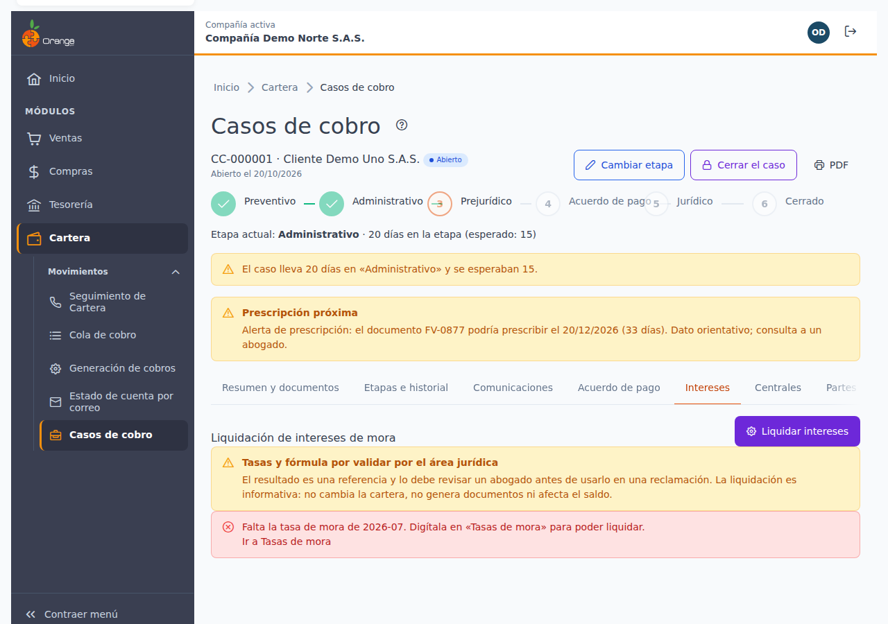

Las tasas se cargan en [Tasas de mora](../tasas-mora.md).

---

## 🏛️ Centrales de riesgo

> ⚠️ **El sistema no reporta a las centrales de riesgo.** No genera archivos de reporte ni se conecta con ninguna central. Esta pestaña solo **lleva el control**: que la autorización y el aviso previo estén registrados, y cuándo se puede reportar. El reporte lo hace la empresa, fuera del sistema, y lo marca aquí.

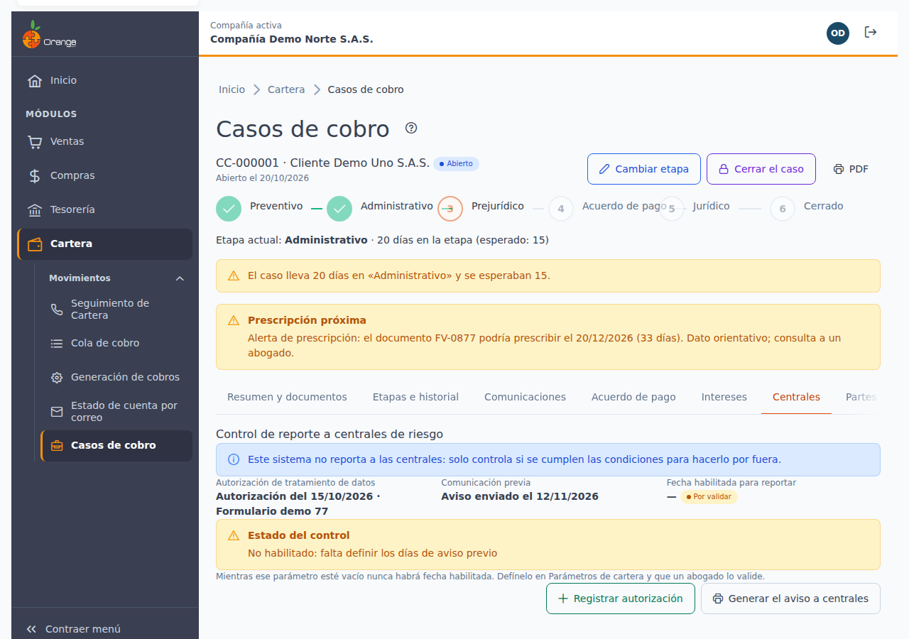

El control tiene tres pasos:

1. **Autorización de tratamiento de datos**: fecha y referencia o nota. Se registra con **Registrar autorización**. No se adjunta ningún archivo.
2. **Comunicación previa**: el **aviso a centrales** enviado al cliente. Con **Generar el aviso a centrales** se crea la comunicación del caso.
3. **Fecha habilitada**: la fecha del aviso más los **días de aviso previo** de la compañía. Estos días **no tienen valor por defecto**: la empresa los define y su abogado debe validarlos (ver [Parámetros de cartera](../parametros.md)).

### Estado del control

| Estado | Qué significa |
|--------|---------------|
| **Sin autorización** | Falta registrar la autorización. |
| **Sin comunicación previa** | Falta el aviso enviado. |
| **Sin parámetro** | Falta configurar los días de aviso previo. |
| **En espera hasta** | Ya hay autorización y aviso, pero no llega la fecha. |
| **Habilitado desde** | Ya se puede reportar. |
| **Reportado externamente el** | Se marcó como reportado fuera del sistema. |

Nunca aparece **Habilitado** sin autorización, sin aviso previo y sin los días configurados.

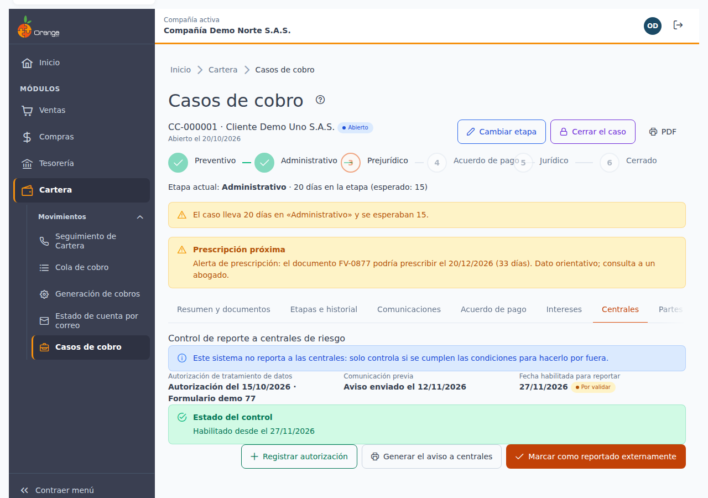

Cuando reporte fuera del sistema, use **Marcar como reportado externamente** con la fecha y una nota.

---

## 👥 Partes

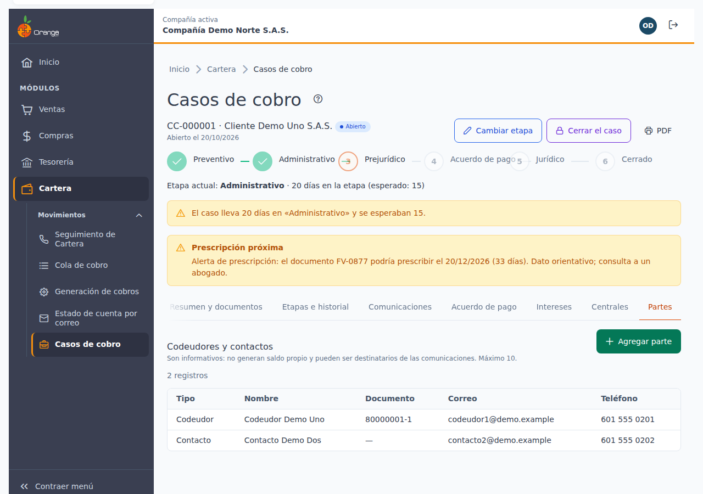

Las **partes** son codeudores, deudores solidarios o contactos adicionales del caso. Hasta **10** partes por caso. Cada una tiene un **tipo** (**Codeudor**, **Solidario** o **Contacto**), nombre, documento, correo, teléfono y una nota. Si es un tercero de la compañía, puede elegirlo.

Las partes **no generan deuda**: son informativas. Al enviar una comunicación, puede marcarlas como destinatarias adicionales. Sin partes, dice **Sin partes registradas.**

---

## ⏳ Prescripción

Esta lista muestra los documentos de cartera que se acercan a su **fecha estimada de prescripción**. Se encuentra en la lista de casos, en la pestaña **Prescripción**.

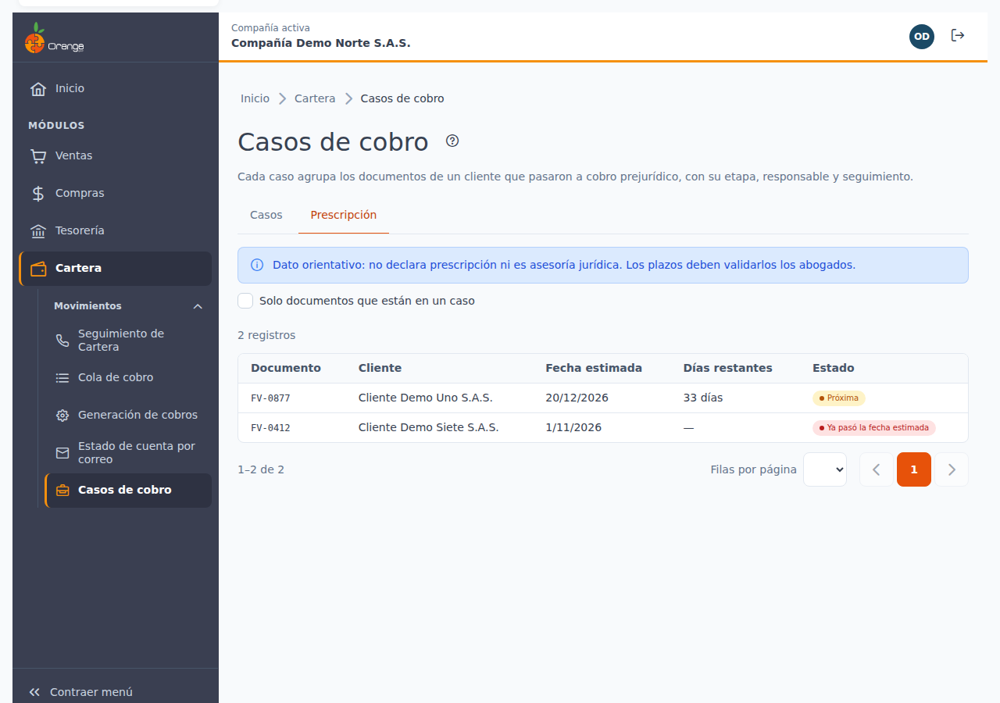

> ⚠️ La fecha es **orientativa**. No declara prescripción y no es asesoría jurídica.

- **Fecha estimada**: la fecha de vencimiento del documento más el **plazo** del tipo de movimiento.
- **Días restantes**: por ejemplo, **45 días**. Si ya pasó, dice **Ya pasó la fecha estimada**.
- Si un tipo no tiene plazo configurado, la pantalla dice **Sin plazo** y explica dónde definirlo.

Los plazos se configuran en [Parámetros de cartera](../parametros.md) y **nacen sin valor**: el sistema no inventa términos. Hasta que su abogado los valide, no hay alertas.

Si hay una **interrupción** del término (por ejemplo, un reconocimiento de deuda), se puede registrar en el documento del caso con una nota. Desde esa fecha se cuenta de nuevo.

**Alertas**: cada día, la campana avisa al responsable de cada caso abierto cuyo documento está a **90 días** o menos de su fecha estimada (valor por defecto, por validar).

---

## 🔒 Cerrar y reabrir

- **Cerrar el caso** pide un motivo: **Recuperado**, **Acuerdo cumplido**, **Incobrable** u **Otro**. El caso queda **Cerrado** con la fecha y el motivo.
- **Reabrir el caso** lo vuelve a **Abierto**. Requiere permiso de **Actualizar**.

Si el cliente tiene un caso cerrado y escala más documentos, se crea un caso nuevo. El motivo **Escalado a jurídico** no está disponible todavía.

---

## 🔐 Permisos

| Permiso | Qué puede hacer |
|---------|-----------------|
| **Consultar** (352) | Ver la lista, la ficha, las comunicaciones, los acuerdos, las liquidaciones, los controles de centrales, las partes y la prescripción. |
| **Crear** (352) | Escalar documentos, crear comunicaciones y acuerdos, liquidar intereses y agregar partes. |
| **Actualizar** (352) | Cambiar la etapa y el responsable, cerrar y reabrir, cancelar acuerdos, registrar acuses y marcar reportes externos. |
| **Exportar** (352) | Exportar la lista a Excel. |
| **Imprimir** (352) | Descargar el PDF del caso, de la constancia y de las comunicaciones. |
| **Consultar** de **Seguimiento de Cartera** (300) | Necesario para escalar desde el panel del cliente. |

Sin el permiso, el botón no aparece. Si su perfil no puede ver los casos, verá **No tiene permiso para ver esta información**.

---

## ❓ Preguntas frecuentes

**¿Por qué no veo la pestaña Documentos ni el botón Escalar?**
Porque el nivel 2 no está activo para la compañía, o porque su perfil no tiene el permiso de Crear en Casos de cobro. Consulte con su administrador.

**¿Por qué no puedo escalar un documento que sí está vencido?**
Porque ya está en otro caso abierto. Un documento solo puede estar en un caso abierto. Revise el caso donde está.

**¿Qué pasa con el cobrador del cliente?**
El caso queda a cargo del cobrador titular del cliente. Si el cliente no tiene cobrador, queda a cargo de quien lo escaló.

**¿Puedo cambiar de etapa sin motivo?**
No. El motivo es obligatorio y queda en el historial.

**¿Qué significa Pasó el tiempo esperado?**
Que el caso lleva más días en su etapa que los días esperados configurados en [Etapas de cobro](../etapas.md).

**¿Un caso cerrado se puede reabrir?**
Sí, con permiso de Actualizar.

---

## 🛠️ Errores comunes

| Mensaje | Qué hacer |
|---------|-----------|
| **Selecciona al menos un documento.** | Marque documentos antes de escalar. |
| **Máximo 200 documentos por caso.** | Escale por partes. |
| **No se pudo cargar la información** | Pulse **Reintentar**. |
| **No hay casos con estos filtros** | Cambie los filtros o pulse **Limpiar filtros**. |

---

## 🧷 Relacionado

- [Seguimiento de Cartera](seguimiento.md): donde se escala.
- [Etapas de cobro](../etapas.md)
- [Parámetros de cartera](../parametros.md): cómo activar el nivel 2.
- [Cobradores](../cobradores.md)
