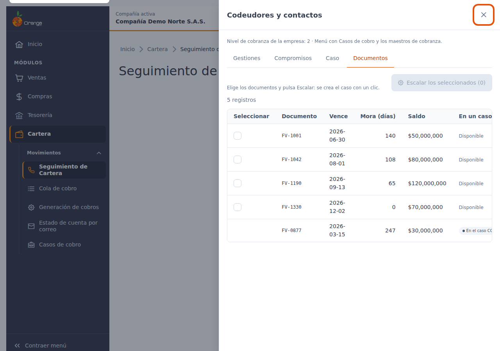
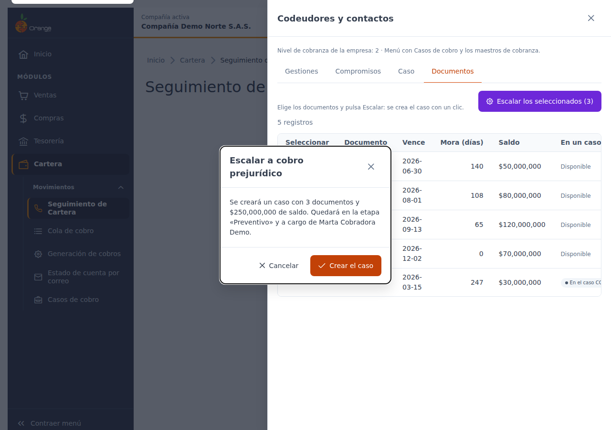
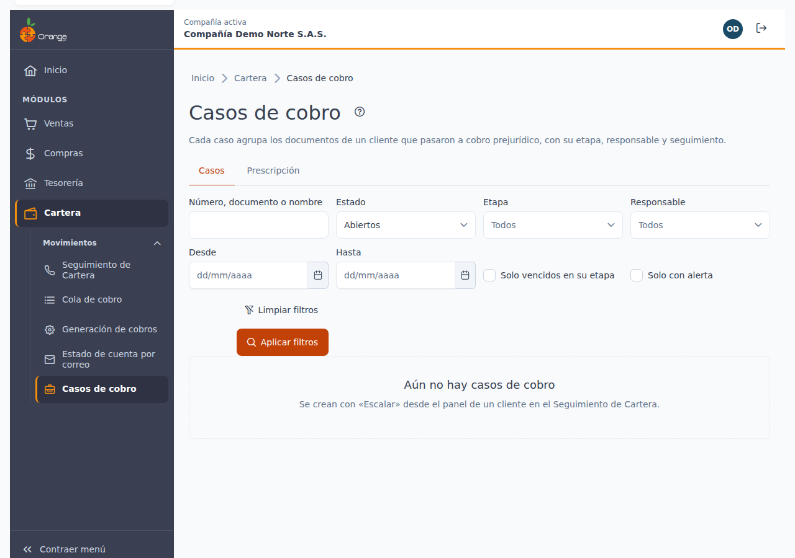
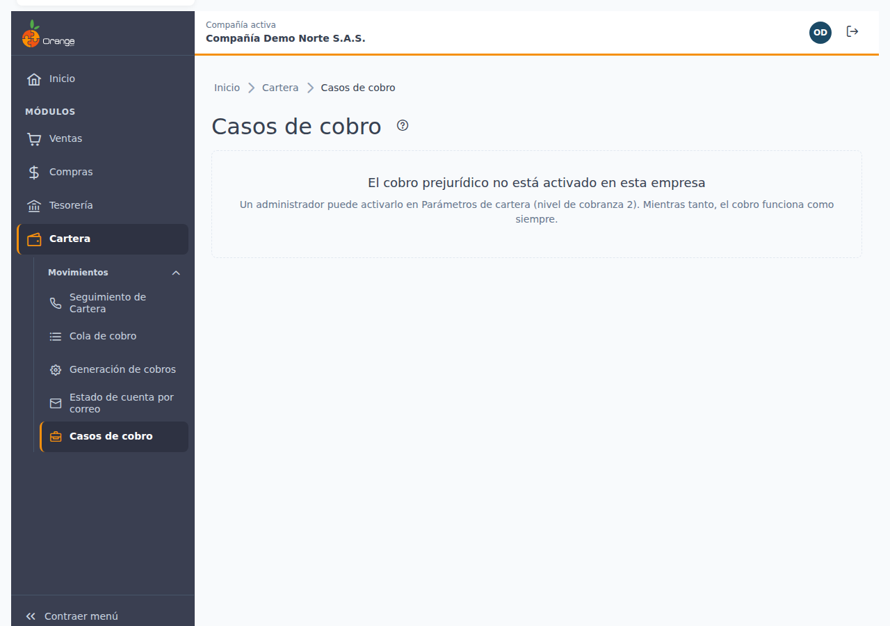
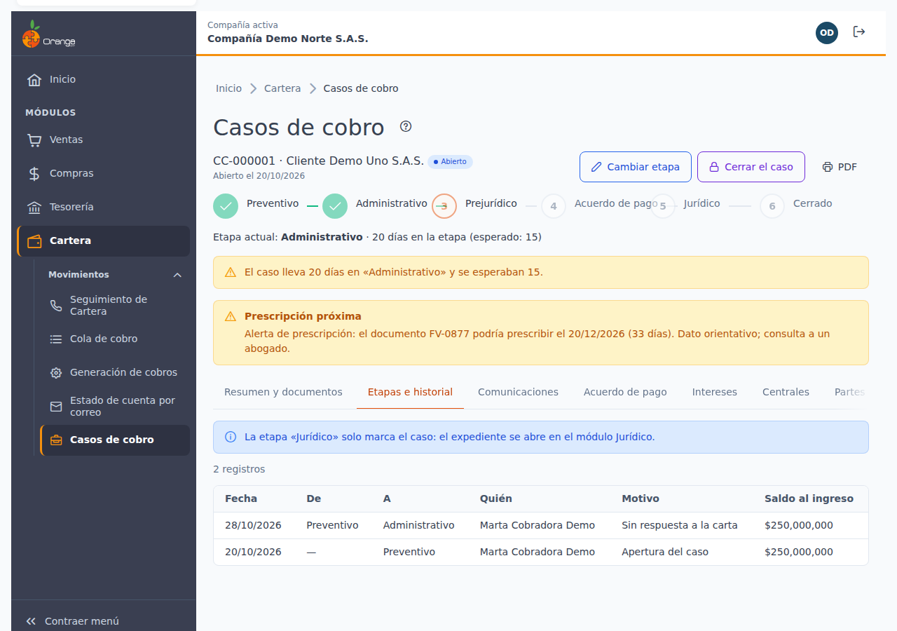

[Regresar a Cartera](../readme.md)

---

# ⚖️ Casos de cobro

---

> ⚠️ **Aviso.** Esta pantalla es del **cobro prejurídico** (nivel 2). Requiere que la compañía tenga activado el **nivel 2** en [Parámetros de cartera](../parametros.md) y que la fase 2 de Seguimiento de Cartera esté habilitada. Con el nivel 1, esta pantalla no aparece.
>
> ⚠️ **Funciones que aún no están disponibles:** las comunicaciones con el cliente, los acuerdos de pago, los intereses de mora, los reportes a centrales de riesgo y la alerta de prescripción. No aparecen todavía en esta versión.
>
> ⚠️ **Los parámetros legales los debe validar el abogado de su empresa.** Este manual describe cómo usar la pantalla; **no es asesoría jurídica**.

## 📋 Descripción

Un **caso de cobro** agrupa los documentos vencidos de un cliente que pasan a la gestión prejurídica. Cada caso tiene un número (por ejemplo, **CC-000001**), una **etapa** (dónde va la gestión), un **responsable** (quién la lleva) y su **saldo**.

Un cliente tiene **un solo caso abierto**. Si escala más documentos, se agregan a ese mismo caso. Un documento solo puede estar en **un caso abierto**.

Un caso nace de un botón en el [Seguimiento de Cartera](seguimiento.md): **Escalar**. No hay formulario previo.

---

## 🎯 Acceso

1. En el menú principal, haga clic en **Cartera**.
2. En **Movimientos**, haga clic en **Casos de cobro**.

También puede llegar desde el panel de un cliente en el Seguimiento, en la pestaña **Caso**.

---

## ➕ Escalar documentos de un cliente

Escalar se hace desde el panel del cliente, en la pestaña **Documentos**.

Con el nivel 2 activo:

1. Abra el panel del cliente en el [Seguimiento de Cartera](seguimiento.md).
2. Haga clic en la pestaña **Documentos**. Verá los documentos con saldo del cliente.
3. Marque los documentos que quiere escalar.
4. Haga clic en **Escalar los seleccionados (N)**.

Aparece el diálogo **Escalar a cobro prejurídico**. Dice cuántos documentos y cuánto saldo va a escalar, en qué etapa queda y quién es el responsable:

- La etapa inicial es **Preventivo**.
- El responsable es el **cobrador titular** del cliente. Si el cliente no tiene cobrador, el caso queda a cargo de usted.
- Si el cliente ya tiene un caso abierto, el diálogo ofrece **Agregar al caso**.

Haga clic en **Crear el caso**.

Al terminar, aparece **Caso CC-… creado.** con el enlace **Abrir el caso**.

| Mensaje | Qué hacer |
|---------|-----------|
| **Selecciona al menos un documento.** | Marque al menos un documento. |
| **Máximo 200 documentos por caso.** | Escale menos documentos, o agréguelos en otro caso abierto. |
| Un documento sin saldo | No se puede escalar. Revise el documento. |

Si algo falla, no se guarda nada: el caso se crea completo o no se crea.

---

## 📑 Lista de casos

Abra **Casos de cobro** en el menú. La lista muestra un caso por fila:

| Columna | Qué muestra |
|---------|-------------|
| **Caso** | Número del caso. Con **Abrir** entra a la ficha. |
| **Cliente** | El cliente del caso. |
| **Etapa** | En qué etapa está. |
| **Responsable** | Quién lleva el caso. Si no tiene, dice **Sin responsable**. |
| **Días en la etapa** | Por ejemplo, **20 de 15**. Si pasó el tiempo esperado, dice **Pasó el tiempo esperado**. |
| **Saldo** | Saldo de hoy de los documentos del caso. |
| **Próxima acción** | La siguiente acción prevista. |
| **Alertas** | Avisos en texto. |
| **Estado** | **Abierto** o **Cerrado**. |

Los filtros son: **Número, documento o nombre**, **Estado**, **Etapa**, **Responsable**, rango de fechas, **Solo vencidos en su etapa** y **Solo con alerta**. Pulse **Aplicar filtros** o **Limpiar filtros**. Con **Exportar Excel** descarga la lista filtrada.

Si no hay casos, dice **Aún no hay casos de cobro**. Si los filtros no encuentran nada, dice **No hay casos con estos filtros**.

Con el nivel 1 la pantalla no muestra casos: el nivel 2 debe estar activo para usarla.

---

## 🗂️ Ficha del caso

Haga clic en **Abrir** de un caso. La ficha tiene estas pestañas:

| Pestaña | Qué tiene |
|---------|-----------|
| **Resumen y documentos** | Número, cliente, etapa, responsable, días en la etapa, saldos y documentos. |
| **Etapas e historial** | La línea de etapas y cada cambio. |

Las demás pestañas (comunicaciones, acuerdos, intereses, centrales y partes) no están disponibles todavía.

En **Resumen y documentos** verá:

- **Saldo escalado**: el saldo al momento de escalar.
- **Saldo hoy** y **Vencido hoy**: el saldo vivo de los documentos.
- **Documentos del caso**: cada documento con su saldo de hoy. Con **Quitar** saca un documento del caso (no se puede si está en un acuerdo vigente).
- **Agregar documentos**: suma documentos del cliente que no estén en otro caso abierto.

### Cambiar la etapa

Sirve para mover el caso a la siguiente gestión (por ejemplo, de **Administrativo** a **Prejurídico**).

1. Haga clic en **Cambiar etapa**.
2. Elija la **Nueva etapa**.
3. Escriba el **Motivo del cambio**. Es obligatorio.
4. Si la etapa tiene responsable por defecto, aparece **Responsable en la nueva etapa**. Puede cambiarlo.
5. Haga clic en **Cambiar etapa**.

Al cambiar la etapa, el nuevo responsable recibe un aviso en la campana, sin importes. Cada cambio queda en el historial.

Si la etapa es **Cerrado**, el sistema pide el **Motivo del cierre**.

| Mensaje | Qué hacer |
|---------|-----------|
| **Escribe el motivo del cambio.** | Complete el motivo. |

### Etapas e historial

La línea de etapas muestra por dónde ha pasado el caso. El historial tiene una fila por cada cambio:

| Columna | Qué muestra |
|---------|-------------|
| **Fecha** | Cuándo se hizo el cambio. |
| **De** y **A** | La etapa anterior y la nueva. |
| **Quién** | Quién hizo el cambio. |
| **Motivo** | El motivo escrito. |
| **Saldo al ingreso** | El saldo del caso al entrar a la etapa. |

Si el caso pasó el tiempo esperado de su etapa, aparece la marca **Pasó el tiempo esperado**, con texto.

### Responsable

Con **Cambiar responsable** cambia quién lleva el caso. El responsable no gana permisos por serlo: sus permisos son los de su perfil.

---

## 🔒 Cerrar y reabrir

- **Cerrar el caso** pide un motivo: **Recuperado**, **Acuerdo cumplido**, **Incobrable** u **Otro**. El caso queda **Cerrado** con la fecha y el motivo.
- **Reabrir el caso** lo vuelve a **Abierto**. Requiere permiso de **Actualizar**.

Si el cliente tiene un caso cerrado y escala más documentos, se crea un caso nuevo. El motivo **Escalado a jurídico** no está disponible todavía.

---

## 🔐 Permisos

| Permiso | Qué puede hacer |
|---------|-----------------|
| **Consultar** (352) | Ver la lista y la ficha de los casos. |
| **Crear** (352) | Escalar documentos y agregar documentos al caso. |
| **Actualizar** (352) | Cambiar la etapa y el responsable, cerrar y reabrir. |
| **Exportar** (352) | Exportar la lista a Excel. |
| **Consultar** de **Seguimiento de Cartera** (300) | Necesario para escalar desde el panel del cliente. |

Sin el permiso, el botón no aparece. Si su perfil no puede ver los casos, verá **No tiene permiso para ver esta información**.

---

## ❓ Preguntas frecuentes

**¿Por qué no veo la pestaña Documentos ni el botón Escalar?**
Porque el nivel 2 no está activo para la compañía, o porque su perfil no tiene el permiso de Crear en Casos de cobro. Consulte con su administrador.

**¿Por qué no puedo escalar un documento que sí está vencido?**
Porque ya está en otro caso abierto. Un documento solo puede estar en un caso abierto. Revise el caso donde está.

**¿Qué pasa con el cobrador del cliente?**
El caso queda a cargo del cobrador titular del cliente. Si el cliente no tiene cobrador, queda a cargo de quien lo escaló.

**¿Puedo cambiar de etapa sin motivo?**
No. El motivo es obligatorio y queda en el historial.

**¿Qué significa Pasó el tiempo esperado?**
Que el caso lleva más días en su etapa que los días esperados configurados en [Etapas de cobro](../maestros/etapas-cobro.md).

**¿Un caso cerrado se puede reabrir?**
Sí, con permiso de Actualizar.

---

## 🛠️ Errores comunes

| Mensaje | Qué hacer |
|---------|-----------|
| **Selecciona al menos un documento.** | Marque documentos antes de escalar. |
| **Máximo 200 documentos por caso.** | Escale por partes. |
| **No se pudo cargar la información** | Pulse **Reintentar**. |
| **No hay casos con estos filtros** | Cambie los filtros o pulse **Limpiar filtros**. |

---

## 🧷 Relacionado

- [Seguimiento de Cartera](seguimiento.md): donde se escala.
- [Etapas de cobro](../maestros/etapas-cobro.md)
- [Parámetros de cartera](../parametros.md): cómo activar el nivel 2.
- [Cobradores](../cobradores.md)
