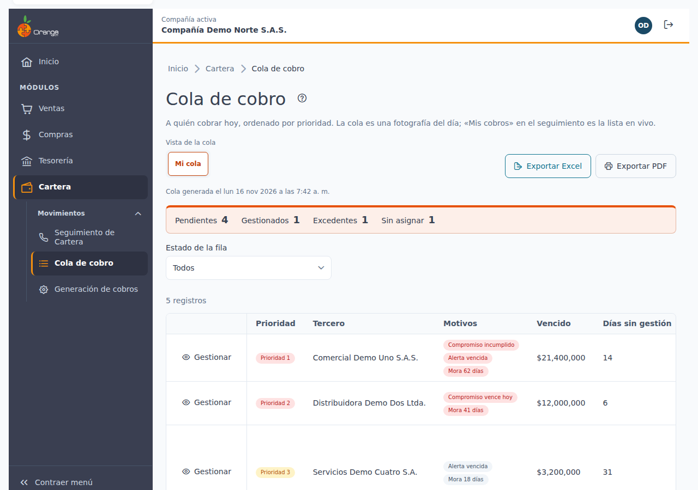
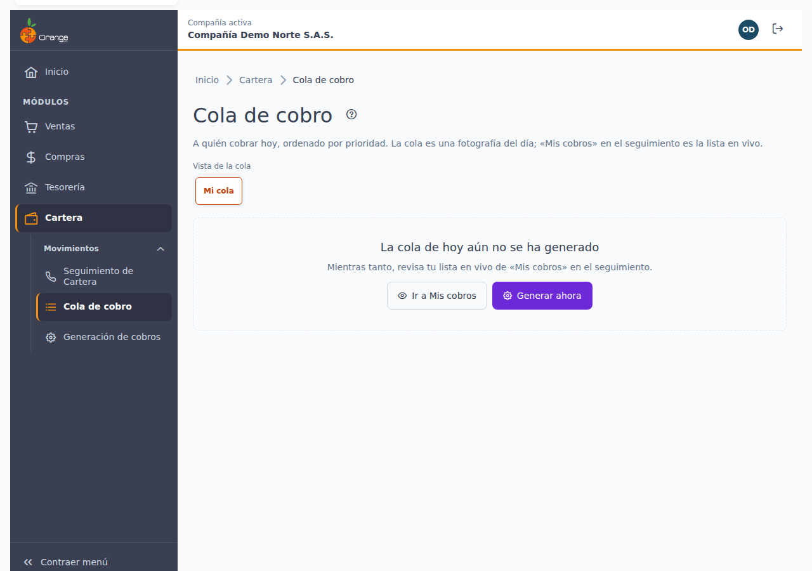
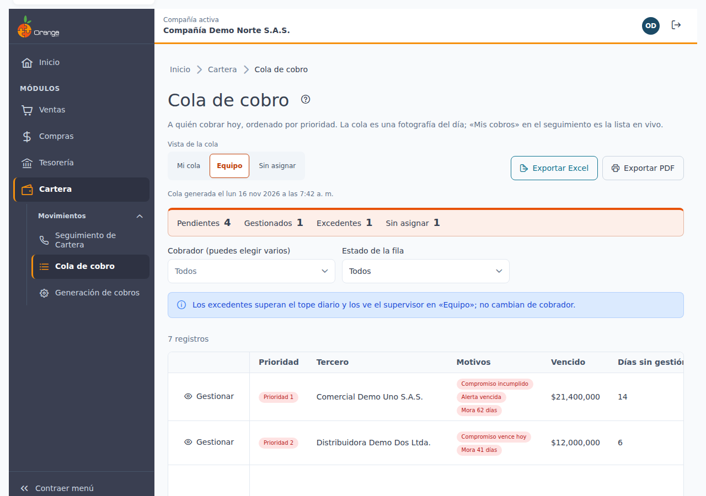

[Regresar a Cartera](../readme.md)

---

# 📋 Cola de cobro

---

> ⚠️ Esta pantalla requiere que el administrador haya habilitado las tablas y los permisos de la **fase 2** de Seguimiento de Cartera. Si no los ve, consulte con su administrador.

## 📋 Descripción

La **cola de cobro** responde una sola pregunta: **¿a quién cobrar hoy?** Es la lista priorizada de los clientes que necesitan una gestión hoy, con el motivo de cada uno: un compromiso que vence o venció, una alerta de seguimiento, una mora alta o un saldo vencido.

Cada cobrador ve su propia cola en orden de prioridad. Quien supervisa el equipo ve la cola de todos y los clientes que todavía no tienen cobrador.

> 💡 La cola es una **fotografía del día**: se arma al generar los cobros ([Generación de cobros](generacion.md)) y no se recalcula sola mientras pasa el día. Para ver en vivo a quién le toca cada cliente, use **Mis cobros** en la pantalla de [Seguimiento de Cartera](seguimiento.md).

> 💡 La cola solo incluye clientes (cuentas por cobrar).

---

## 🎯 Acceso

1. En el menú principal, haga clic en **Cartera**.
2. En **Movimientos**, haga clic en **Cola de cobro**.

---

## 🖥️ Pantalla principal

| Elemento | Para qué sirve |
|----------|----------------|
| **?** (junto al título) | Abre esta ayuda en un panel lateral. |
| **Mi cola** | Sus cobros del día. Todos los usuarios con permiso de consulta la ven. |
| **Equipo** y **Sin asignar** | La cola de todo el equipo y los clientes sin cobrador. Solo las ve quien tiene el permiso de **Actualizar** de esta opción. |
| **Cola generada el … a las …** | Cuándo se armó la cola de hoy. |
| **Resumen** | **Pendientes**, **Gestionados**, **Excedentes** y **Sin asignar**. |
| **Filtros** | **Cobrador** y **Estado** de la fila. |
| **Gestionar** | Abre el panel de gestión del cliente en [Seguimiento de Cartera](seguimiento.md). |
| **Exportar Excel** y **Exportar PDF** | Descargan la cola con sus filtros. |

### Columnas

| Columna | Qué muestra |
|---------|-------------|
| **Prioridad** | El lugar del cliente en su cola: **Prioridad 1** es el primero que debe gestionar. |
| **Tercero** | Nombre y documento del cliente. |
| **Motivos** | Por qué está en la cola, en texto: **Compromiso incumplido**, **Compromiso vence hoy**, **Alerta vencida**, **Alerta de hoy**, **Mora N días** o **Con saldo vencido**. Puede tener varios. |
| **Vencido** | Saldo vencido a la fecha de la cola. |
| **Días sin gestión** | Días desde la última gestión. Si nunca se gestionó, dice **Nunca**. |
| **Cobrador** | Quién debe gestionarlo. Dice **Por ausencia de …** si su titular está ausente, o **En apoyo** si usted es apoyo. |
| **Estado** | **Pendiente**, **Gestionado**, **Excedente** o **Sin asignar** (ver abajo). |

### Cómo se ordena

Dentro de cada cobrador, la cola se ordena en este orden:

1. Compromiso incumplido o que vence hoy.
2. Alerta vencida o de hoy.
3. Mora más alta.
4. Saldo vencido más alto.
5. Más días sin gestión primero (los nunca gestionados, antes).

Si dos clientes empatan en todo, sale primero el que tiene el número de tercero más bajo.

### Estados de la fila

| Estado | Qué significa |
|--------|---------------|
| **Pendiente** | Hay que gestionarlo hoy. |
| **Gestionado** | Ya tiene una gestión registrada hoy, por cualquiera. Aparece como **Gestionada hoy**. |
| **Excedente** | Superó el tope diario del cobrador. Queda visible para el supervisor, y la asignación no cambia. |
| **Sin asignar** | No tiene cobrador. |

Los clientes en **apoyo** aparecen una sola vez: en la cola del titular no se repiten.

### Qué ve cada permiso

| Permiso (opción 349) | Qué puede hacer |
|----------------------|-----------------|
| **Consultar** | Ver **Mi cola**. |
| **Actualizar** | Ver **Equipo** y **Sin asignar**. |
| **Exportar** | Exportar a Excel. |
| **Imprimir** | Exportar a PDF. |

Sin **Consultar**, la pantalla le dice que no tiene permiso.

---

## ✅ Gestionar desde la cola

1. Busque el cliente en la fila y haga clic en **Gestionar**.
2. Se abre el panel de gestión de [Seguimiento de Cartera](seguimiento.md) con el cliente.
3. Registre la gestión. Al guardarla, la fila pasa a **Gestionado**.

---

## 🕓 Cuando no hay cola de hoy

Si la cola de hoy todavía no se generó, la pantalla dice **La cola de hoy aún no se ha generado**.

- Vaya a **Ir a Mis cobros** y trabaje desde el seguimiento.
- Si tiene el permiso **Crear** de la opción 350, puede pulsar **Generar ahora** para armarla. Ver [Generación de cobros](generacion.md).

Si la cola no tiene filas para usted, dice **No tienes cobros para hoy**. Si el filtro no encuentra nada, dice **No hay cobros en la cola con este filtro**: cambie el estado o el cobrador.

En **Equipo**, una nota explica los excedentes del tope de cada cobrador.

---

## 🔄 Cambios de otros usuarios (en vivo)

La cola no se recalcula sola. Si otro usuario gestiona un cliente de su cola, la fila se actualiza a **Gestionado** o la pantalla avisa que hay cambios.

---

## ❓ Preguntas frecuentes

**¿Por qué la cola no tiene un cliente que sí debo gestionar hoy?**
Porque la cola se arma con los datos de la última generación del día. Si el cliente ya tiene una gestión hoy, aparece como **Gestionado**. Si la cola de hoy no se generó, vea [Generación de cobros](generacion.md).

**¿Por qué hay clientes en Excedente?**
Porque el cobrador superó su tope diario. Esos clientes siguen asignados a él: el supervisor puede reasignarlos o repartirlos.

**¿Por qué un cliente sale con «En apoyo»?**
Porque usted es un cobrador de apoyo de ese cliente. Lo ve en su cola sin duplicarlo.

**¿Por qué no veo la vista Equipo?**
Solo la ve quien tiene el permiso de **Actualizar** de la opción 349 (supervisión).

---

## 🛠️ Errores comunes

| Mensaje | Qué hacer |
|---------|-----------|
| **No se pudo cargar la información** | Pulse **Reintentar**. |
| **No tiene permiso para ver esta información** | Pida a su administrador el permiso de la opción 349. |

---

## 🧷 Relacionado

- [Seguimiento de Cartera](seguimiento.md)
- [Generación de cobros](generacion.md)
- [Cobradores](../cobradores.md)
