[Regresar a Cartera](../readme.md)

---

# ✉️ Estado de cuenta por correo

---

## 📋 Descripción

El **estado de cuenta** es un PDF con los documentos que un cliente tiene pendientes de pagar a la fecha de corte: cada documento con su saldo, sus días de atraso y un resumen por edades. Puede enviarlo por correo a un cliente, o a varios a la vez, desde [Seguimiento de Cartera](seguimiento.md).

Esta pantalla es el **registro de envíos**: muestra quién recibió cada estado de cuenta, cuándo, con qué resultado y en qué lote se envió.

> ⚠️ **Modo de prueba.** Mientras la compañía no tenga habilitado el envío real, **los correos no se envían**. Lo verá en la parte de arriba de cada diálogo: **Modo de prueba: los correos no se envían.** Los envíos quedan registrados como **Simulado (no se envió)**. Ver *Modo de prueba* más abajo.

> 📘 Las tablas, las búsquedas y el orden funcionan igual en todas las pantallas: ver [Manejo general de la información](../../Generales/manejo-general-informacion.md).

> ℹ️ Los estados de cuenta son para **clientes**. Los proveedores no reciben este correo.

---

## 🎯 Acceso

Hay tres formas de llegar:

1. **Desde el Seguimiento**: en el listado de [Seguimiento de Cartera](seguimiento.md), haga clic en **Estado de cuenta** de la fila del cliente, o en el panel del cliente.
2. **Envío en lote**: en el listado de Seguimiento, marque varios clientes (o elija seleccionar todos los del filtro) y use la acción de envío en lote de la barra del listado.
3. **Registro**: en el menú principal, haga clic en **Cartera**, luego en **Movimientos** y después en **Estado de cuenta por correo**.

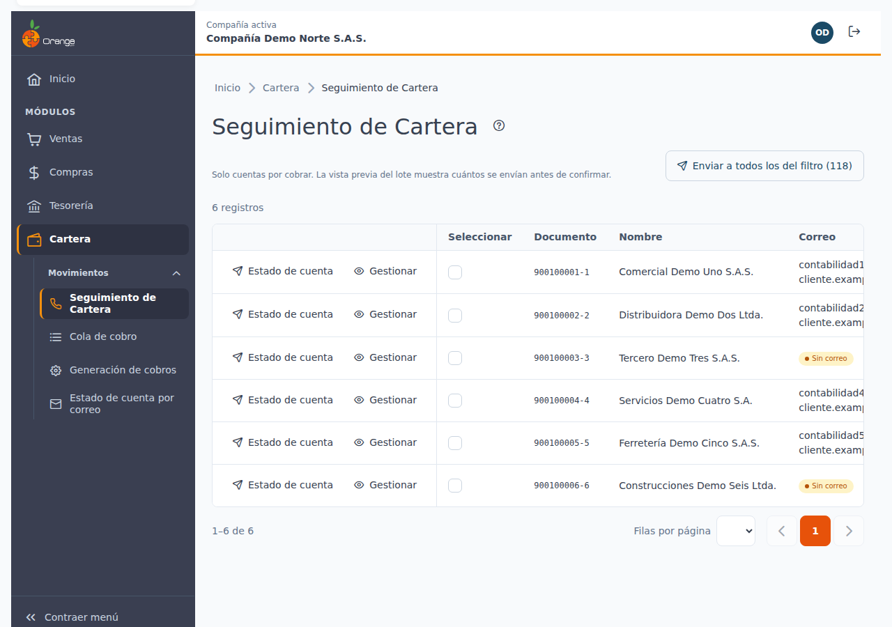

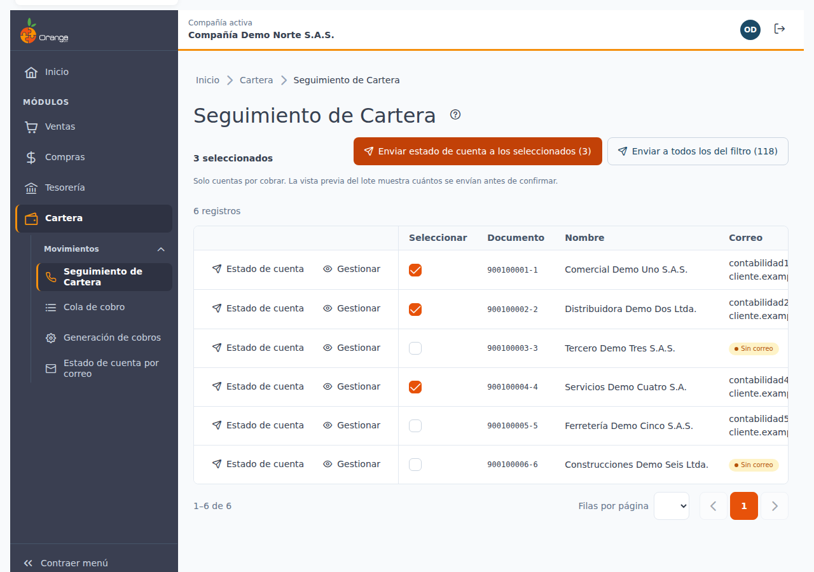

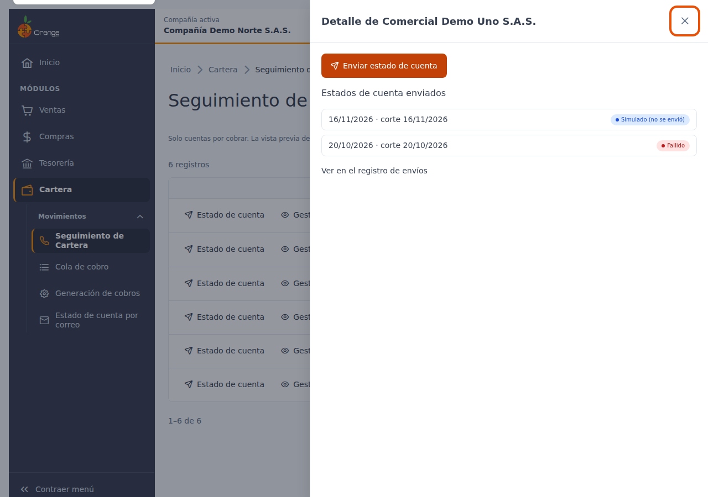

En el panel del cliente aparece también el historial **Estados de cuenta enviados**, con el enlace **Ver en el registro de envíos**.

---

## 📄 Estado de cuenta (PDF)

El PDF es vertical y tiene:

- **Encabezado**: nombre de la empresa, NIT, *Estado de cuenta* y la fecha y hora de emisión.
- **Datos del cliente**: documento y nombre, y la fecha de corte.
- **Tabla de documentos con saldo**: número del movimiento, referencia, fecha, vencimiento, días de atraso, valor, saldo y tramo de edad.
- **Resumen por edades**, con los tramos de la compañía (los de [Edades de cartera](../edades.md)).
- **Total a pagar**, con el saldo y el vencido.
- **Saldos a favor**, si el cliente tiene alguno, aparte del total.
- **Pie**: el texto que la compañía configura (por ejemplo, datos de pago o contacto).

El estado de cuenta usa las mismas cifras que el [Seguimiento de Cartera](seguimiento.md) y que [Cartera de terceros](../reportes/terceros.md) a la misma fecha de corte.

El **PDF no se guarda**: se vuelve a generar cuando hace falta, con el mismo corte. Si el PDF pasa de 5 MB, no se puede enviar.

---

## ✉️ Enviar a un cliente

1. En el Seguimiento, haga clic en **Estado de cuenta** del cliente.
2. Se abre el diálogo **Estado de cuenta de [nombre]**. Elija la **Fecha de corte** (no puede ser posterior a hoy).
3. Revise la **vista previa del PDF** y la **vista previa del correo**.
4. Revise el **Para**, el **CC**, el **Asunto** y el **Mensaje**.
5. Haga clic en **Enviar estado de cuenta**.

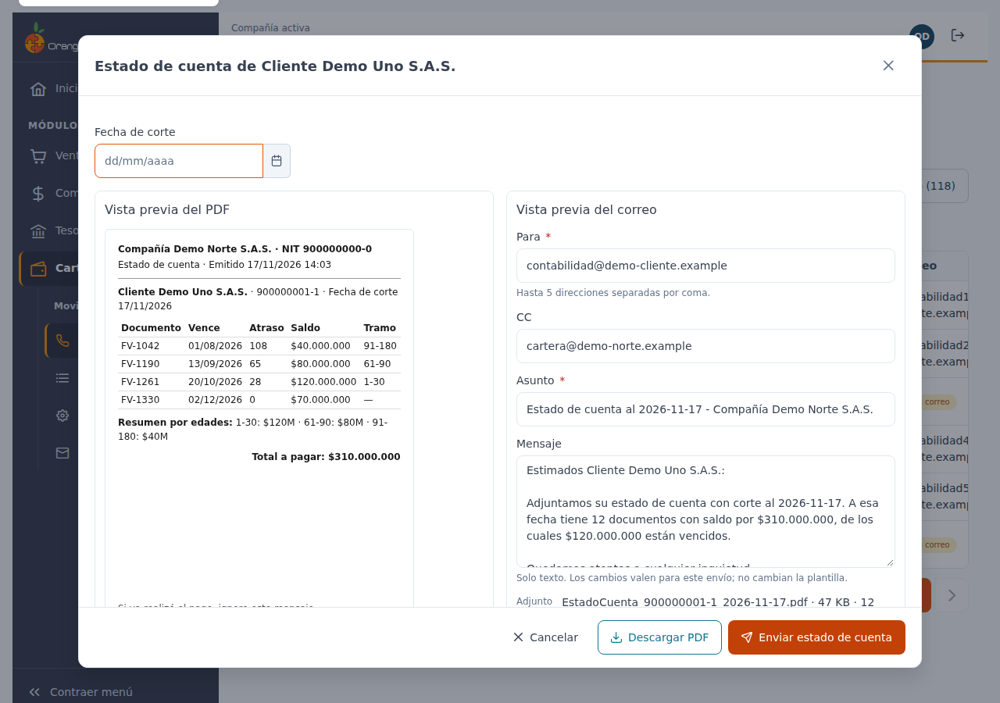

### Destinatarios, copia y mensaje

- **Para**: viene con el correo del cliente. Puede agregar hasta **5** correos.
- **CC**: viene con la copia por defecto de la plantilla. Puede tener hasta **5** correos.
- **Asunto** y **Mensaje**: puede cambiarlos solo para este envío. La plantilla de la compañía no cambia.
- **Adjunto**: el PDF, con su nombre, su tamaño y la cantidad de documentos.

Los cambios de **Para** y **CC** tienen que ser direcciones válidas y no repetidas. Si escribe más de 5 en CC, aparece **Máximo 5 direcciones en CC.**. Si el asunto queda vacío, aparece **Escribe el asunto.**

Puede **Descargar PDF** sin enviar nada. Descargar requiere el permiso **Imprimir**.

### Antes de enviar

El diálogo **Antes de enviar** le advierte cuando algo no permite el envío:

| Advertencia | Qué significa |
|-------------|---------------|
| **Sin correo** | El cliente no tiene correo registrado. Agréguelo en **Para** o en la ficha del cliente. |
| **Ya enviado hoy** | Ya se envió un estado de cuenta de este corte hoy. Para enviarlo otra vez, use **Enviar de todos modos**. |
| **Sin saldo** | El cliente no tiene saldo pendiente a esa fecha. No se envía. |
| **Modo de prueba** | El correo no se envía. |

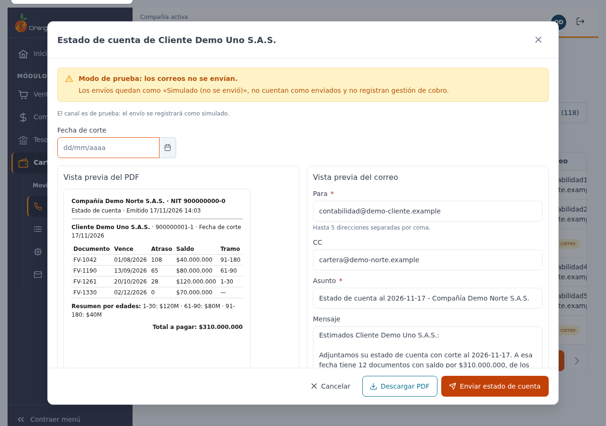

### Después de enviar

El envío aparece en la **cola** y luego en **Enviando**. Cuando el servidor de correo lo acepta queda **Enviado** y se crea una gestión de cobro del cliente por **Correo**, con la fecha de alerta de siempre. El seguimiento queda así registrado.

Si el envío es de **Modo de prueba**, queda **Simulado (no se envió)** y **no** crea la gestión de cobro.

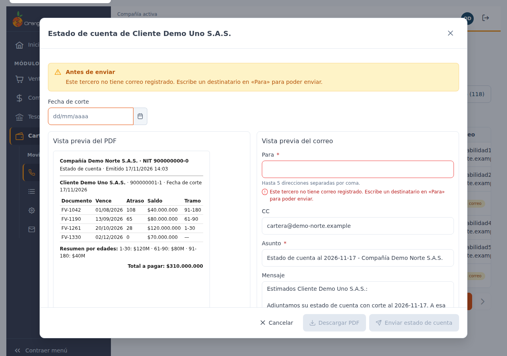

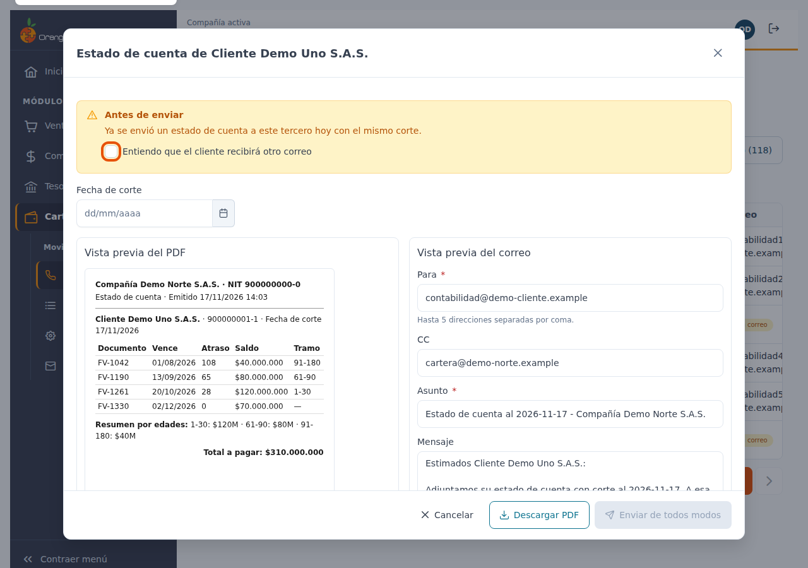

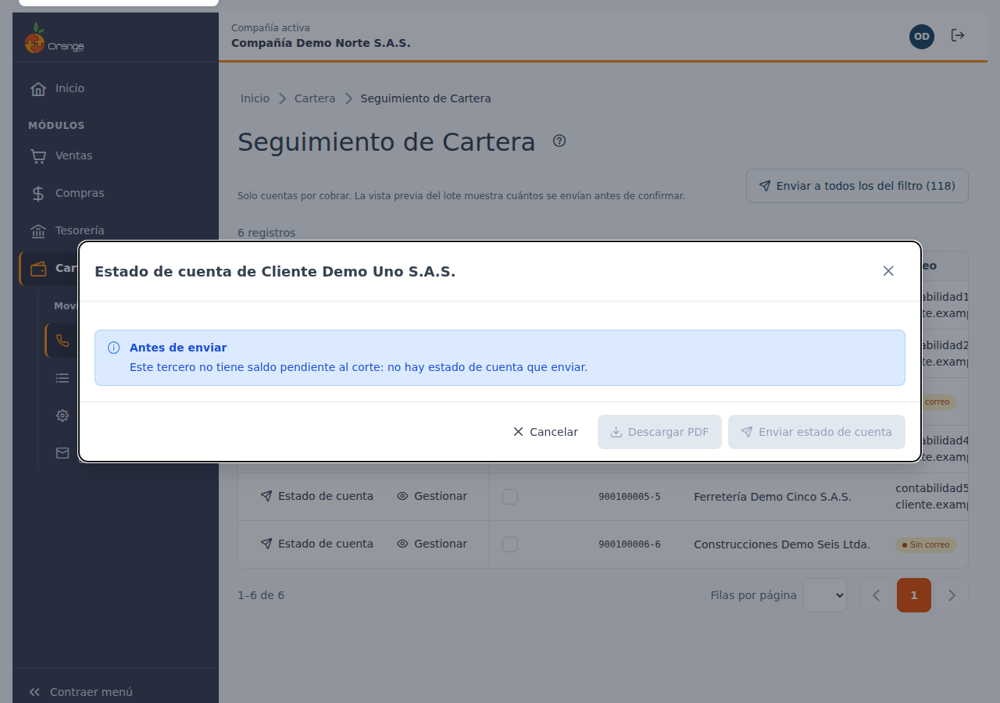

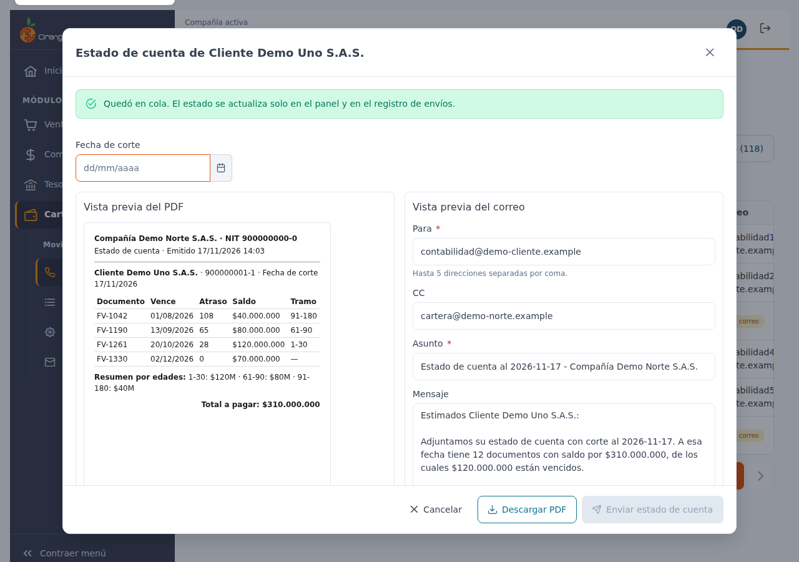

---

## 📨 Envío en lote

Sirve para enviar a varios clientes a la vez.

1. En el listado del Seguimiento, marque las filas de los clientes, o elija seleccionar todos los del filtro.
2. Use la acción de envío en lote de la barra del listado. Se abre el diálogo **Enviar estados de cuenta en lote**.
3. Elija la **Fecha de corte** y, si quiere, deje activado **Omitir a quienes ya recibieron uno en las últimas 24 horas**.
4. Haga clic en **Ver vista previa del lote**.
5. Revise la tabla de la vista previa.
6. Marque **Entiendo que no se puede deshacer** y haga clic en **Confirmar y enviar**.

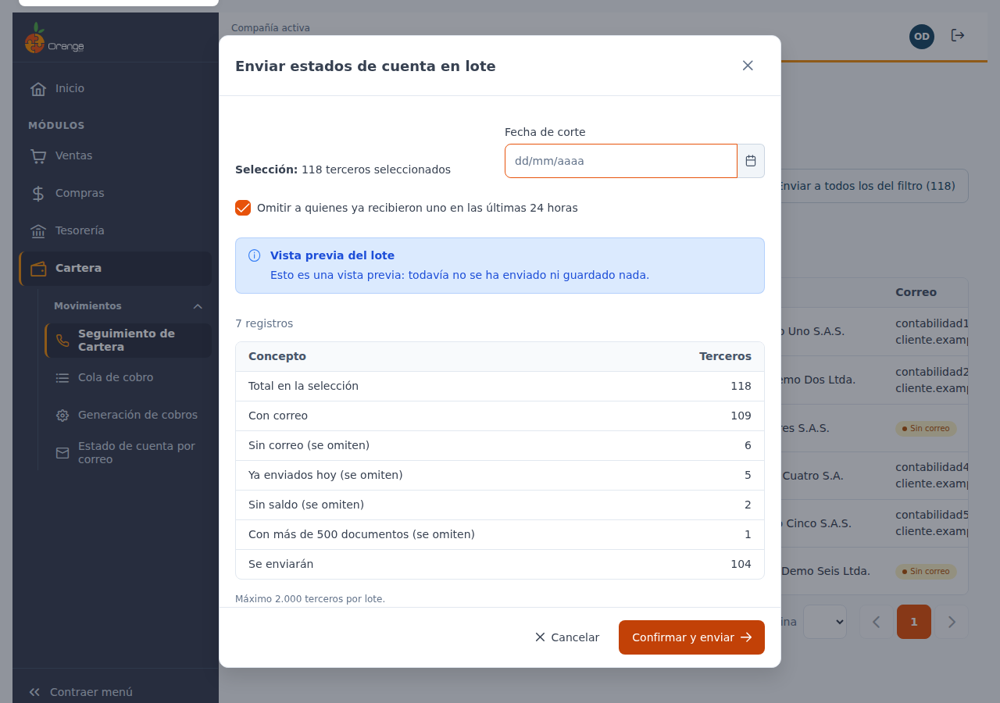

### La vista previa del lote

La vista previa no envía nada. Cuenta los clientes de la selección:

| Concepto | Qué significa |
|----------|---------------|
| **Con correo** | Tienen correo válido: se envían. |
| **Sin correo (se omiten)** | No tienen correo registrado. |
| **Ya enviados hoy (se omiten)** | Ya recibieron un estado de cuenta de este corte en las últimas 24 horas. |
| **Sin saldo (se omiten)** | No tienen saldo pendiente a la fecha de corte. |
| **Con más de 500 documentos (se omiten)** | Son demasiados documentos para un PDF. Revise esos clientes uno a uno. |
| **Se enviarán** | Cuántos se van a enviar. |

Un lote puede tener hasta **2.000 clientes**. Si la selección es mayor, el sistema lo indica y debe reducirla.

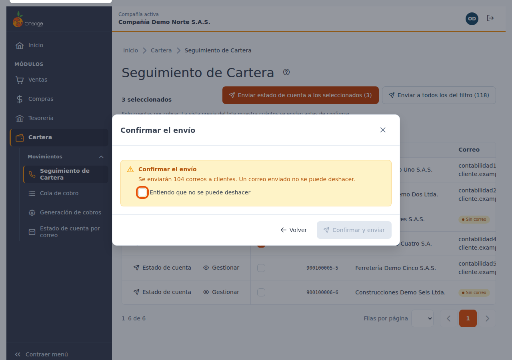

### Mientras se envía

El lote muestra su avance: *N de M procesados*. Los clientes se envían uno por uno y, si un envío falla, el lote sigue con los demás.

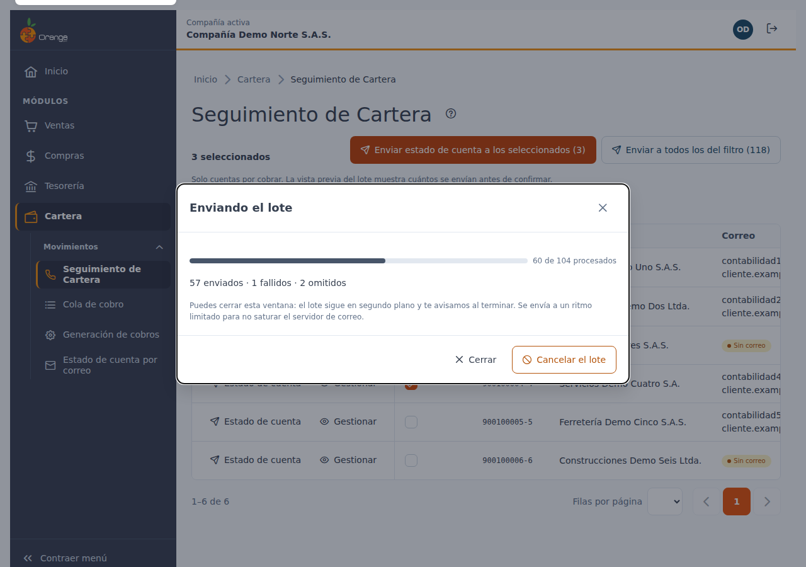

Puede **Cancelar el lote** mientras esté en curso. Lo que ya se envió **no se puede deshacer**; lo que faltaba queda **Cancelado**.

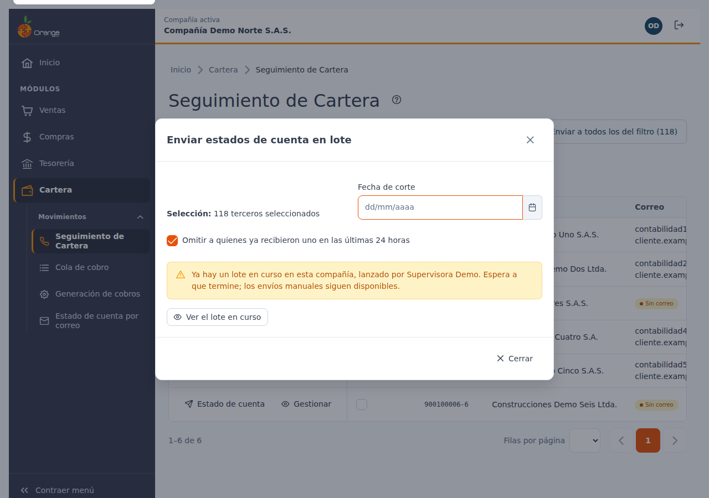

Solo puede haber **un lote en curso** por compañía. Si ya hay uno, el sistema lo indica y le muestra cuál es.

### Cuando el lote termina con errores

Si algunos envíos fallaron, el lote aparece como **Completado con errores**, con cuántos fueron enviados, simulados, fallidos y omitidos. Revise los fallidos en el registro y use **Reintentar** (ver *Reintentar un envío*).

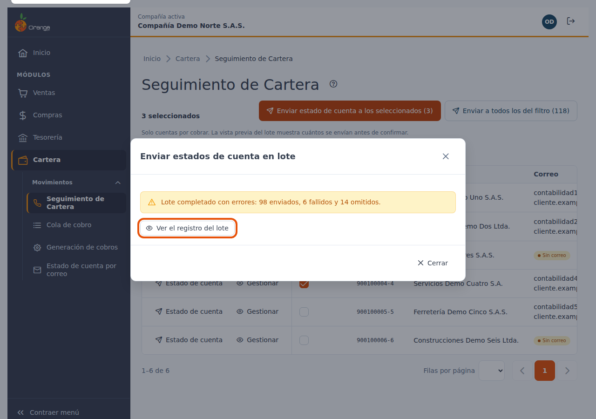

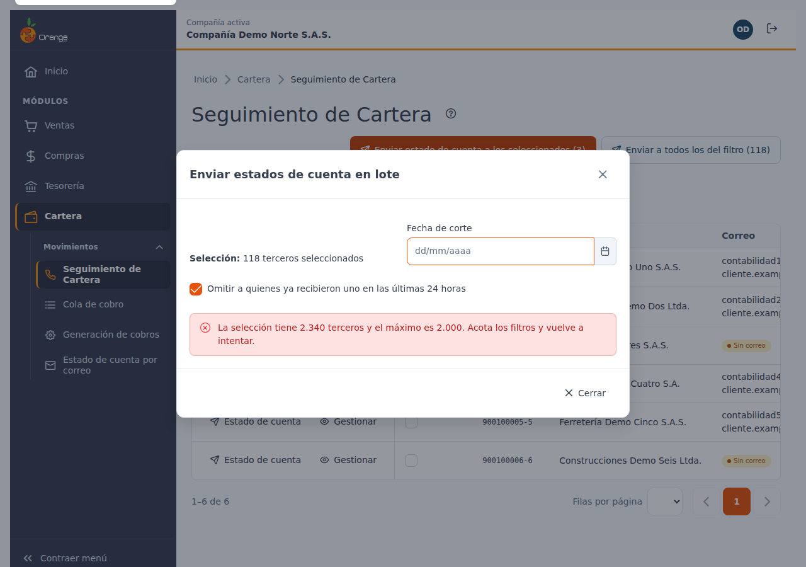

Al terminar el lote, quien lo lanzó recibe un aviso en la campana de notificaciones. El aviso no incluye correos ni importes.

---

## 🗂️ Registro de envíos

La pantalla del menú tiene dos pestañas: **Envíos** y **Lotes**.

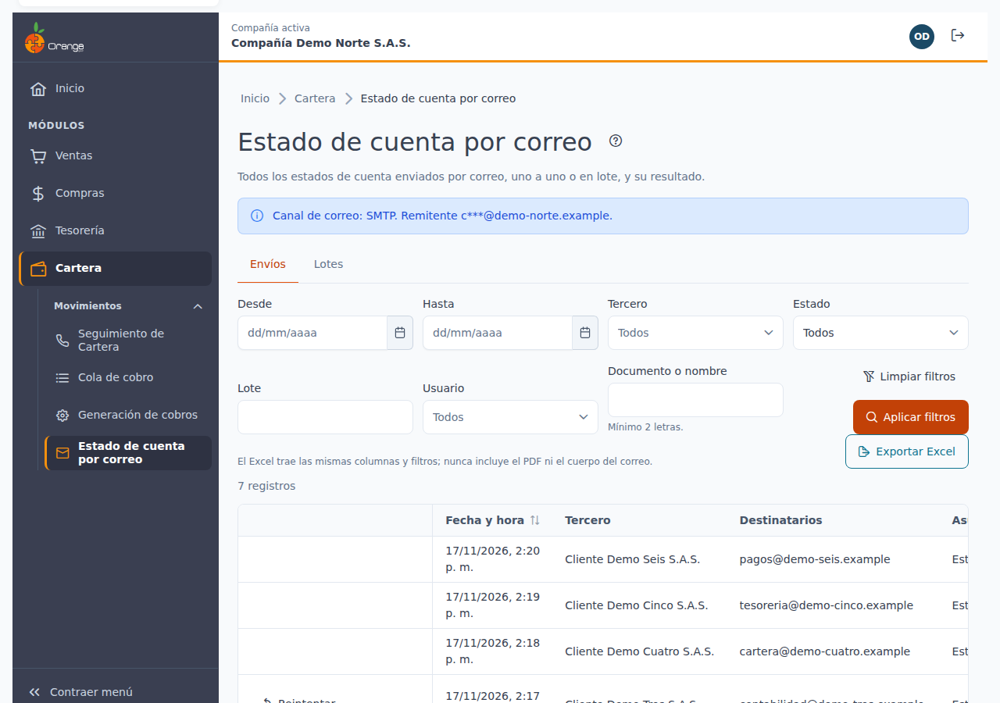

### Envíos

Cada fila es un envío a un cliente:

| Columna | Qué muestra |
|---------|-------------|
| **Fecha y hora** | Cuándo se envió o se intentó. |
| **Tercero** | El cliente. |
| **Destinatarios** | Para y CC. |
| **Asunto** | El asunto del correo. |
| **Estado** | Ver la tabla de estados más abajo. |
| **Intentos** | Cuántas veces se intentó. |
| **Usuario** | Quién lo solicitó. |
| **Origen** | **Manual** o **Lote #N**. |
| **Corte** | La fecha de corte del estado de cuenta. |

Los filtros son: **Desde** y **Hasta** (hasta un año), **Tercero**, **Estado**, **Lote**, **Usuario** y **Documento o nombre** (mínimo 2 letras). Pulse **Aplicar filtros** o **Limpiar filtros**. Con **Exportar Excel** descarga el registro filtrado.

### Estados de un envío

| Estado | Qué significa |
|--------|---------------|
| **En cola** | Está esperando su turno para enviarse. |
| **Enviando** | Se está enviando en este momento. |
| **Enviado** | El servidor de correo aceptó el mensaje. |
| **Simulado (no se envió)** | Estaba en **Modo de prueba**: el correo no salió. |
| **Fallido** | El envío no se pudo hacer. Debajo aparece el motivo en texto, por ejemplo **La dirección del destinatario no existe.** o **El servidor de correo rechazó el mensaje.** Se puede reintentar. |
| **Incierto** | El servidor no confirmó si el correo salió. Ver *Qué significa Incierto*. |
| **Omitido** | No se envió a propósito (sin correo, sin saldo, ya enviado hoy o demasiados documentos). |
| **Cancelado** | Un lote se canceló antes de enviarlo. |

### Qué significa «Incierto»

Un envío queda **Incierto** cuando el sistema no puede confirmar el resultado con el servidor de correo, por ejemplo porque la conexión se interrumpió o no respondió a tiempo. Puede que el correo **sí haya salido** o que no. El sistema no lo sabe.

> ⚠️ Antes de reintentar un envío **Incierto**, revise la bandeja de enviados de la cuenta de la compañía. Si el correo ya salió, el cliente lo recibiría dos veces.

Por eso, reintentar un **Incierto** pide confirmación: marque **Entiendo que podría ser un duplicado y quiero reintentar**. Los inciertos **no** se reintentan con el botón de reintentar lote: se reintentan uno a uno.

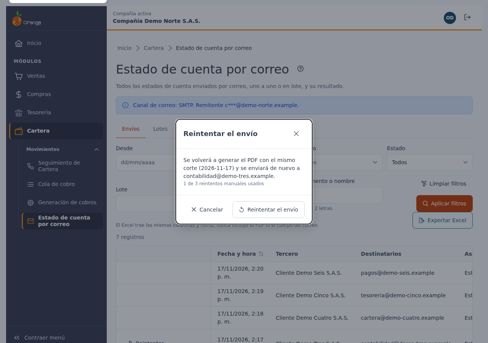

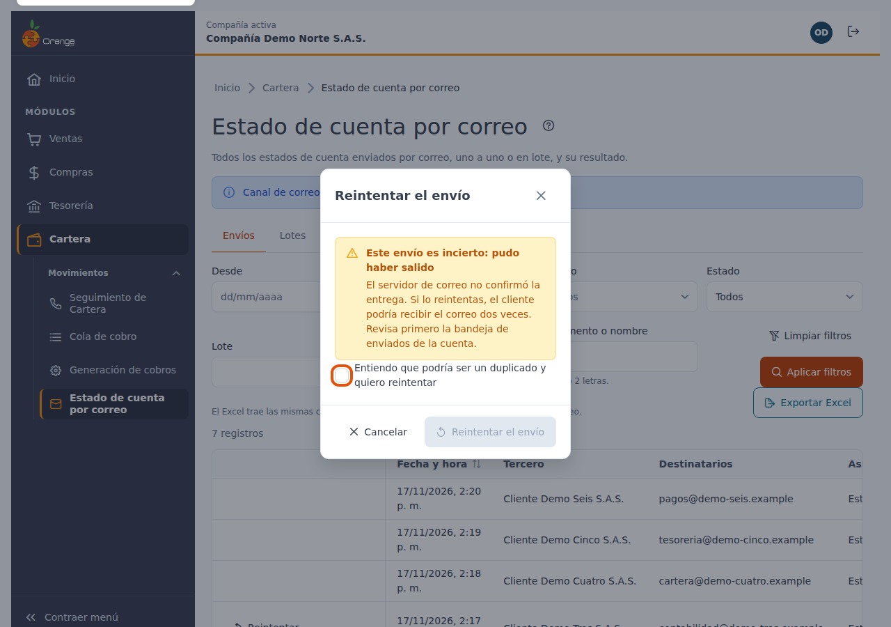

### Reintentar un envío

1. En la fila del envío **Fallido** o **Incierto**, haga clic en **Reintentar**.
2. Revise el diálogo: se vuelve a generar el PDF con el **mismo corte** y se envía de nuevo.
3. Si el envío es **Incierto**, marque la confirmación del posible duplicado.
4. Haga clic en **Reintentar el envío**.

Cada envío tiene hasta **3 reintentos manuales**. El diálogo dice cuántos usó: *N de 3 reintentos manuales usados*. Cuando se acaban, dice **Sin reintentos manuales disponibles**.

Para reintentar todos los fallidos de un lote, use **Reintentar los fallidos del lote** en la pestaña **Lotes**.

### Lotes

La pestaña **Lotes** muestra cada lote con su **Estado** (**En curso**, **Completado**, **Completado con errores** o **Cancelado**), y los totales de **Enviados**, **Simulados**, **Fallidos** y **Omitidos**.

- **Ver envíos**: abre los envíos de ese lote.
- **Cancelar el lote**: solo para lotes en curso, con permiso de **Actualizar**.

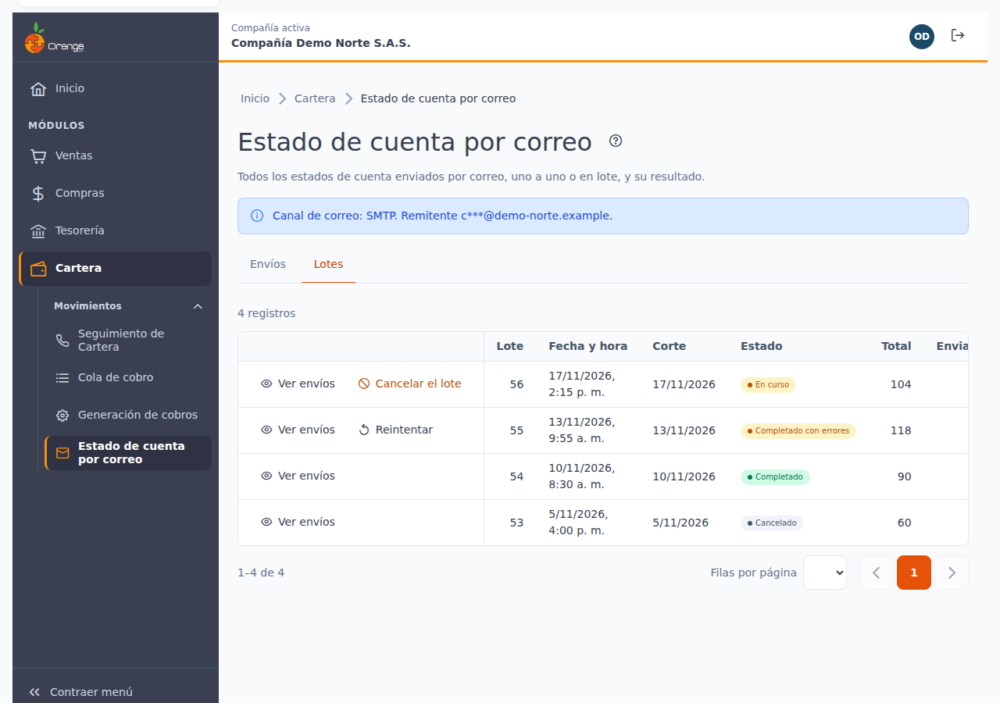

### Sin envíos

Si todavía no se ha enviado ninguno, dice **Aún no se ha enviado ningún estado de cuenta**, con la indicación de que se envían desde el Seguimiento. Si los filtros no encuentran nada, dice **No hay envíos con estos filtros**.

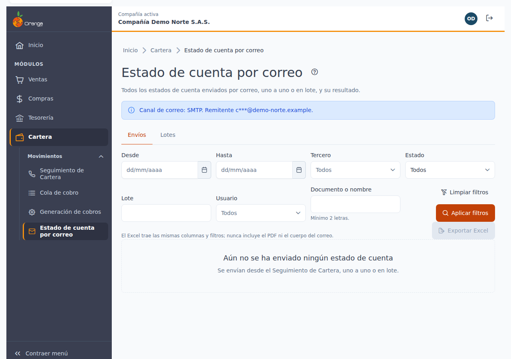

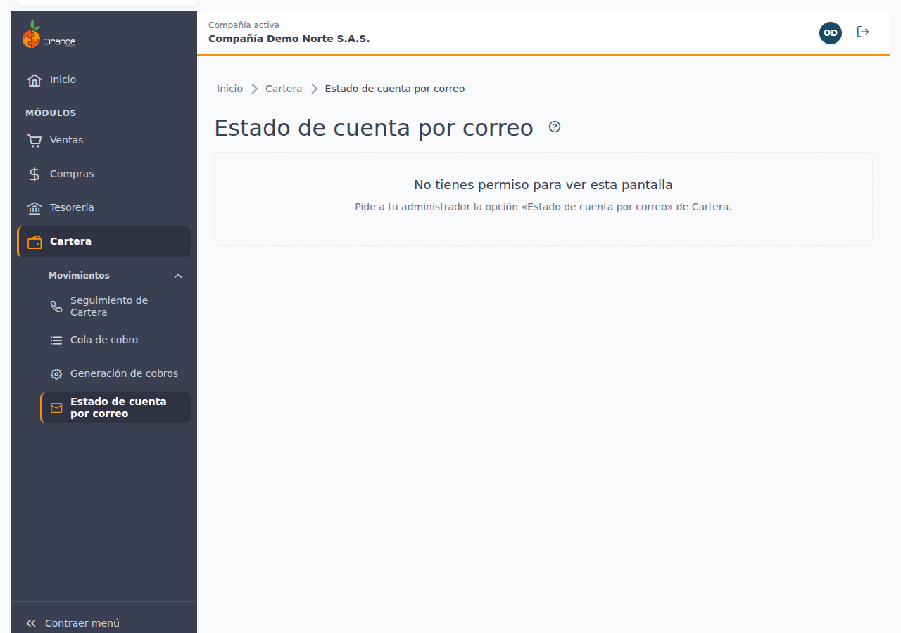

---

## 🧪 Modo de prueba

Mientras la compañía no tenga el envío real habilitado:

- En la parte de arriba de los diálogos aparece **Modo de prueba: los correos no se envían.**
- Los envíos quedan como **Simulado (no se envió)**.
- Un envío simulado **no cuenta como enviado**, **no crea gestión de cobro** y **no impide** enviar después de verdad.

Lo que hace falta para que los correos salgan de verdad lo decide el administrador de la plataforma, compañía por compañía, con una cuenta de correo de la empresa. No se configura desde esta pantalla. Si necesita el envío real, pida a su administrador que lo habilite.

El banner muestra el motivo cuando el canal no está listo: que la función de envío real está apagada, que la compañía no tiene cuenta de correo, que la cuenta no tiene credencial o que la cuenta está inactiva.

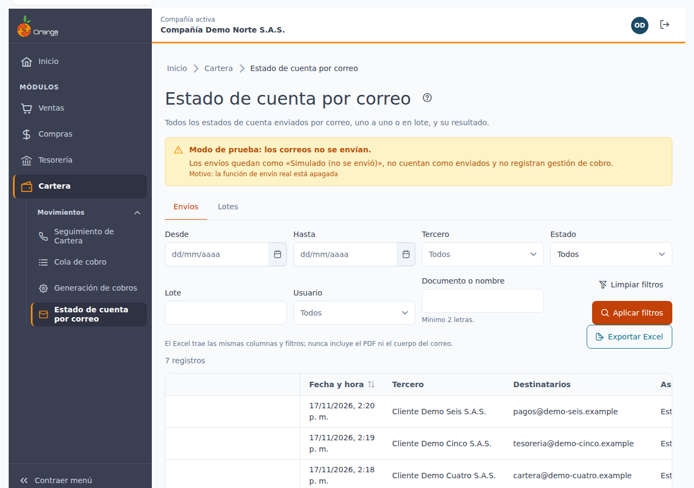

---

## 🔐 Permisos

| Permiso (opción 351) | Qué puede hacer |
|----------------------|-----------------|
| **Consultar** | Ver el registro de envíos, los lotes y el historial de un cliente. |
| **Crear** | Enviar a un cliente, crear un lote y ver su vista previa. |
| **Actualizar** | Reintentar envíos y lotes, y cancelar lotes. |
| **Imprimir** | Descargar el PDF sin enviar. |
| **Exportar** | Exportar el registro a Excel. |

Además, para enviar desde el Seguimiento hace falta **Consultar** de la opción 300 (Seguimiento de Cartera). Para cambiar el texto del correo hace falta el permiso **Actualizar** de la opción 344 (Parámetros de cartera).

Sin el permiso, el botón no aparece. Si la pantalla no le permite ver el registro, verá **No tiene permiso para ver esta información**.

---

## 🔔 Avisos y cambios en vivo

- **Campana**: al terminar un lote, quien lo lanzó recibe un aviso. Si un envío individual falla de forma definitiva, también recibe aviso. Los envíos exitosos no generan aviso.
- **En vivo**: el registro y el lote se actualizan solos cuando cambia su estado.

---

## ❓ Preguntas frecuentes

**¿Por qué dice «Modo de prueba»?**
Porque el envío real no está habilitado para la compañía. Los correos no salen. Lo ve en el banner y en el estado **Simulado (no se envió)**.

**¿Un envío simulado cuenta como enviado?**
No. No crea la gestión de cobro y no reemplaza un envío real.

**¿Por qué no se envió a un cliente de la lista?**
Porque quedó omitido: no tiene correo, no tiene saldo a la fecha de corte, ya recibió un estado de cuenta en las últimas 24 horas, o tiene más de 500 documentos. La vista previa del lote lo indica antes de enviar.

**¿Puedo programar un envío para otro día?**
No. Los envíos se hacen al momento, a demanda. No hay envíos programados.

**¿Puedo cambiar el texto del correo?**
Sí. El texto de la plantilla se configura en [Parámetros de cartera](../parametros.md). Lo que escriba en **Mensaje** solo cambia ese envío.

**¿Se guarda el PDF que envié?**
No. El sistema guarda los datos del envío (a quién, cuándo, con qué corte y con qué resultado). El PDF se vuelve a generar con el mismo corte cuando se reintenta.

**¿Cuánto tiempo queda el registro?**
Los envíos se guardan 400 días y luego se borran.

**¿Qué hago si un envío aparece como Incierto?**
Revise primero la bandeja de enviados de la cuenta de la compañía. Si el correo no aparece allí, reintente y confirme. Si sí aparece, no lo reintente.

**¿Por qué el envío de un cliente aparece como Enviado pero no lo recibió?**
Un estado **Enviado** significa que el servidor de correo aceptó el mensaje. Si el cliente no lo ve, pídale que revise su carpeta de correo no deseado y que la dirección sea la correcta.

---

## 🛠️ Errores comunes

| Mensaje | Qué hacer |
|---------|-----------|
| **Máximo 5 direcciones en CC.** | Quite direcciones hasta dejar 5. |
| **Escribe el asunto.** | Complete el asunto. |
| **No se pudo generar la vista previa del PDF.** | Pulse **Reintentar**. Si sigue igual, consulte a su administrador. |
| **Máximo 2.000 terceros por lote.** | Reduzca la selección. |
| **La dirección del destinatario no existe.** | Corrija el correo del cliente y reintente. |
| **El servidor de correo rechazó el mensaje.** | Reintente. Si vuelve a fallar, consulte a su administrador. |
| **No se pudo cargar la información** | Pulse **Reintentar**. |

---

## 🧷 Relacionado

- [Seguimiento de Cartera](seguimiento.md): desde donde se envía.
- [Parámetros de cartera](../parametros.md): la plantilla del correo.
- [Edades de cartera](../edades.md): los tramos del resumen del PDF.
- [Cartera de terceros](../reportes/terceros.md)
- [Cola de cobro](cola.md)
