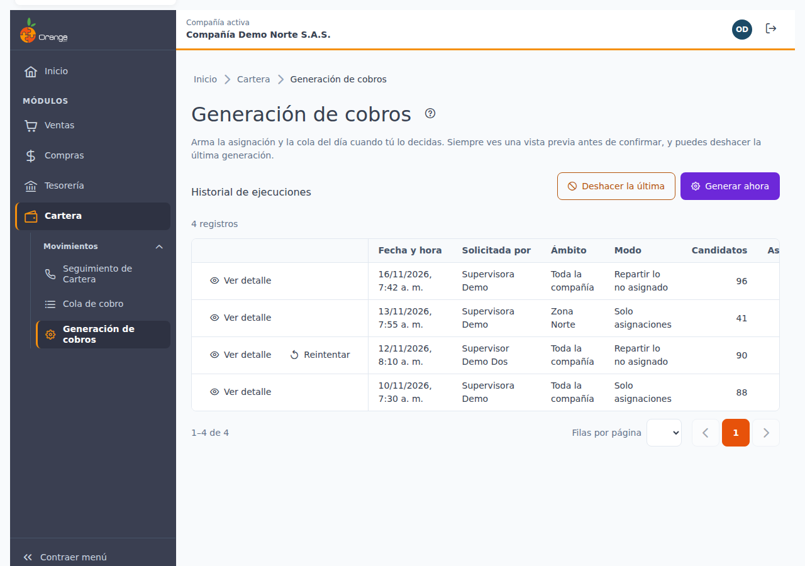
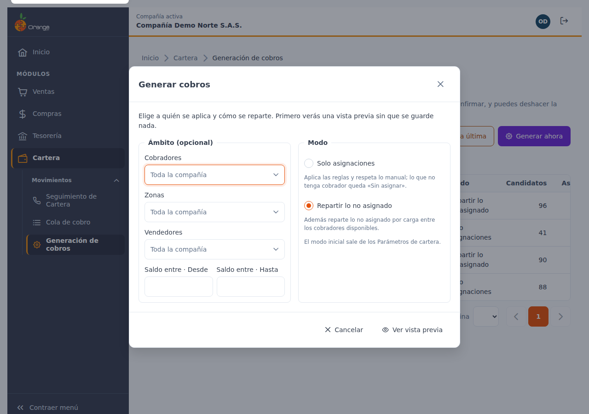
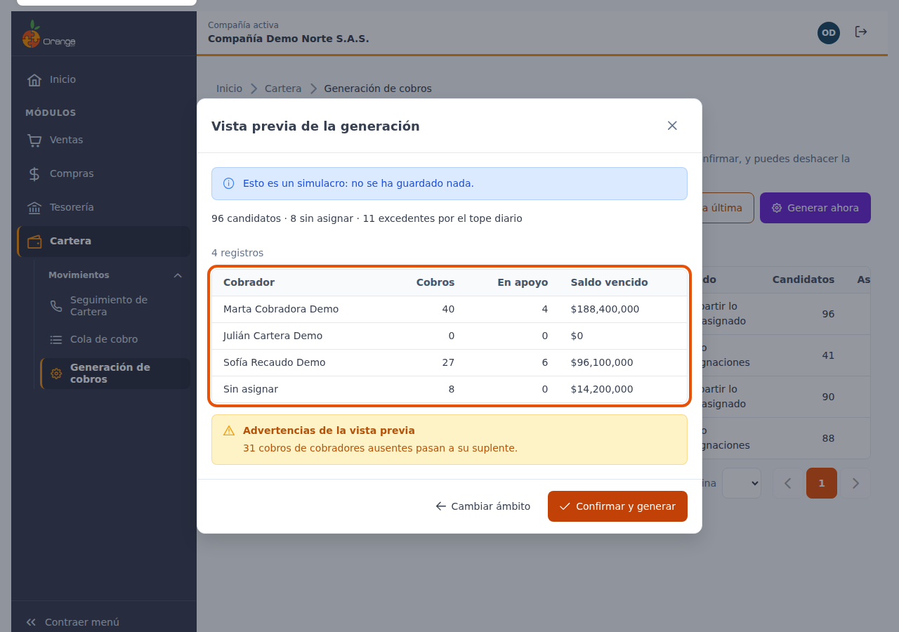
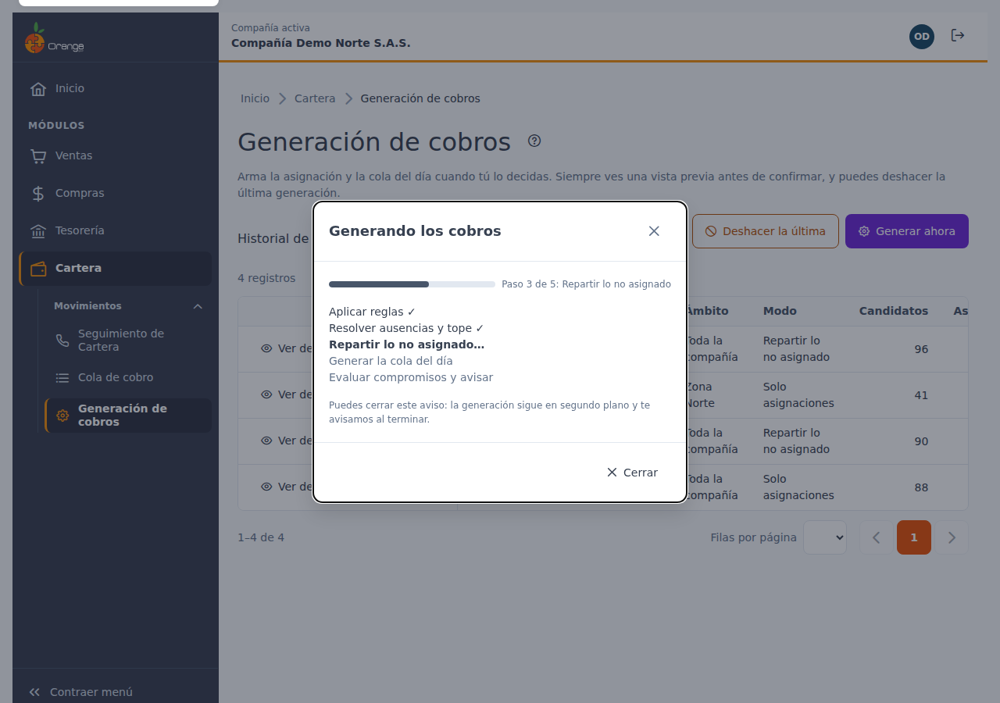
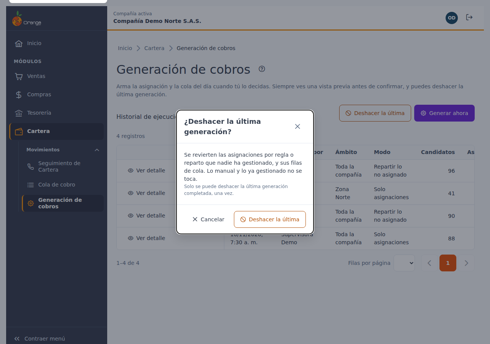

[Regresar a Cartera](../readme.md)

---

# ⚙️ Generación de cobros

---

> ⚠️ Esta pantalla requiere que el administrador haya habilitado las tablas y los permisos de la **fase 2** de Seguimiento de Cartera. Si no los ve, consulte con su administrador.

## 📋 Descripción

**Generar ahora** arma los cobros del día: asigna los clientes a los cobradores según las reglas, reparte los que quedaron sin cobrador si usted lo pide, y crea la **cola de cobro** de hoy. Los avisos llegan a cada cobrador (**Tienes N cobros hoy**) y a quien lanzó la generación.

La generación **solo se hace cuando usted la pide**. No corre sola en segundo plano para asignar cartera.

> 💡 Puede revisar antes qué pasaría: la **vista previa** calcula los cobros por cobrador **sin guardar nada**.

---

## 🎯 Acceso

1. En el menú principal, haga clic en **Cartera**.
2. En **Movimientos**, haga clic en **Generación de cobros**.

---

## 🖥️ Pantalla principal

| Elemento | Para qué sirve |
|----------|----------------|
| **?** (junto al título) | Abre esta ayuda en un panel lateral. |
| **Generar ahora** | Inicia una generación nueva. Requiere el permiso **Crear** de la opción 350. |
| **Deshacer la última** | Revierte la última generación completada. Requiere **Actualizar**. Ver *Deshacer*. |
| **Historial de ejecuciones** | Cada generación que se ha hecho, de la más reciente a la más antigua. |

### Columnas del historial

| Columna | Qué muestra |
|---------|-------------|
| **Fecha y hora** | Cuándo se inició. |
| **Solicitada por** | Quién la lanzó. |
| **Ámbito** | **Toda la compañía** o el filtro usado. |
| **Modo** | **Solo asignaciones** o **Repartir lo no asignado**. |
| **Candidatos**, **Asignados**, **Sin asignar**, **Excedentes**, **Errores** | Cuántos clientes entraron y qué pasó con cada uno. |
| **Duración** | Cuánto tardó. |
| **Estado** | **Pendiente**, **En curso**, **Completada**, **Fallida** o **Deshecha**. |

Con **Ver detalle** ve las asignaciones automáticas de esa ejecución: cuántas salieron por regla y cuántas por reparto.

Si una generación está **Fallida**, aparece **Reintentar**. Ver *Errores*.

### Qué ve cada permiso (opción 350)

| Permiso | Qué puede hacer |
|---------|-----------------|
| **Consultar** | Ver el historial y el detalle de cada ejecución. |
| **Crear** | Ver la vista previa, **Generar ahora** y **Reintentar**. |
| **Actualizar** | Ver **Deshacer la última**. |

Sin **Consultar**, la pantalla le dice que no tiene permiso.

---

## ▶️ Generar cobros

1. Haga clic en **Generar ahora**.
2. Elija el **ámbito**. Puede dejar **Toda la compañía** o limitar por **Cobradores**, **Zonas**, **Vendedores** o **Saldo entre**.
3. Elija el **modo**:
   - **Solo asignaciones**: aplica las reglas y las ausencias. No toca los clientes sin cobrador.
   - **Repartir lo no asignado**: además reparte entre los cobradores activos los clientes que quedaron **Sin asignar**, según la carga de cada uno.
   El modo que aparece por defecto es el de **Parámetros de cartera**.
4. Haga clic en **Ver vista previa**.

### Vista previa

La vista previa muestra, por cobrador, cuántos cobros recibiría, cuántos son en apoyo y su saldo vencido. También muestra los clientes **Sin asignar** y las **advertencias** (por ejemplo, de ausencias).

**La vista previa no guarda nada.** Puede cambiar el ámbito con **Cambiar ámbito** y volver a verla.

5. Si todo está bien, haga clic en **Confirmar y generar**.

### Progreso

Mientras corre, aparece el avance con sus pasos:

1. Aplicar reglas
2. Resolver ausencias y tope
3. Repartir lo no asignado
4. Generar la cola del día
5. Evaluar compromisos y avisar

Puede **cerrar** la ventana de progreso: la generación sigue y el resultado queda en el historial.

Solo puede haber **una generación a la vez** por compañía. Si otro usuario ya tiene una en curso, el sistema no inicia otra y le muestra quién la inició.

### Qué hace y qué no toca

| Sí hace | No toca |
|---------|---------|
| Asigna clientes según las reglas, si el ámbito lo incluye. | Las **asignaciones manuales**: una asignación hecha a mano siempre gana. |
| Reparte lo no asignado, si eligió **Repartir**. | Los clientes que ya tienen una **gestión** del día. |
| Arma la cola de cobro de hoy. | Los saldos, las facturas y los recibos. |
| Marca los compromisos de pago que ya vencieron sin cumplirse. | Los parámetros de cartera (solo se leen). |
| Avisa al cobrador y a quien la lanzó. | Los correos: no envía correos. |

Si la generación se repite el mismo día, no duplica nada: los clientes ya trabajados hoy no se reasignan.

---

## ↩️ Deshacer la última generación

**Deshacer la última** revierte la **última generación completada** de la compañía, y solo una vez.

Revierte solo lo que esa generación asignó automáticamente y que **todavía no tiene gestión**. Lo gestionado y lo asignado a mano **no se toca**.

Si ya hay una generación posterior, no se puede deshacer la anterior: el sistema lo avisa. Al confirmar, la ejecución queda como **Deshecha** y el aviso dice **La generación quedó deshecha.**

---

## 🔁 Errores y reintentos

Si una generación falla por un problema temporal, el sistema lo vuelve a intentar varias veces de forma automática. Si aun así falla, queda en **Fallida**, avisa a quien supervisa y puede usar **Reintentar** una vez.

Ninguna generación deja asignaciones a medias: si falla, no queda nada guardado a medio camino.

| Mensaje | Qué hacer |
|---------|-----------|
| **Ya hay una generación en curso, iniciada por …. Espera a que termine; no se puede lanzar otra a la vez.** | Espere a que termine y revise el historial. |
| **La generación falló** | Revise el detalle y pulse **Reintentar** (una vez). |
| **No se pudo cargar la información** | Pulse **Reintentar**. |
| **No tiene permiso para ver esta información** | Pida a su administrador el permiso de la opción 350. |

---

## ❓ Preguntas frecuentes

**¿Cada cuánto se genera la cola?**
Solo cuando alguien pulsa **Generar ahora**. El sistema no genera la cola solo.

**¿Qué pasa si genero dos veces el mismo día?**
No duplica nada. Los clientes ya gestionados hoy no se tocan y las asignaciones manuales se respetan.

**¿Puedo generar solo para un cobrador?**
Sí. En el ámbito, elija el cobrador y genere solo para sus clientes.

**¿Para qué sirve la vista previa?**
Para ver el resultado antes de decidir. No guarda nada.

**¿Puedo deshacer una generación de hace días?**
No. Solo se puede deshacer la última generación completada, y si ya hay una posterior, no.

---

## 🧷 Relacionado

- [Cola de cobro](cola.md)
- [Seguimiento de Cartera](seguimiento.md)
- [Cobradores](../cobradores.md): titulares, reglas y ausencias que usa la generación.
- [Parámetros de cartera](../parametros.md): tope diario, modo de reparto y avisos a apoyos.
