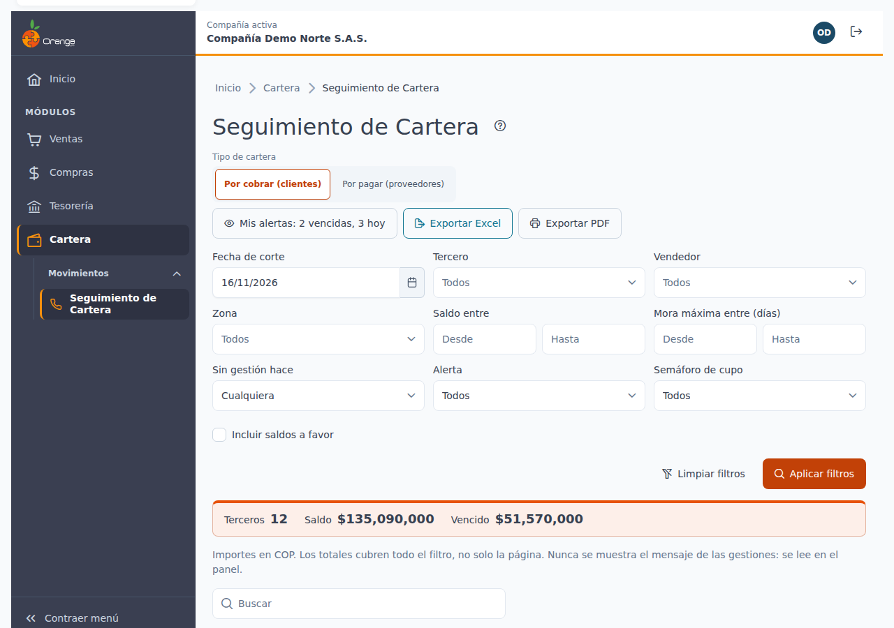
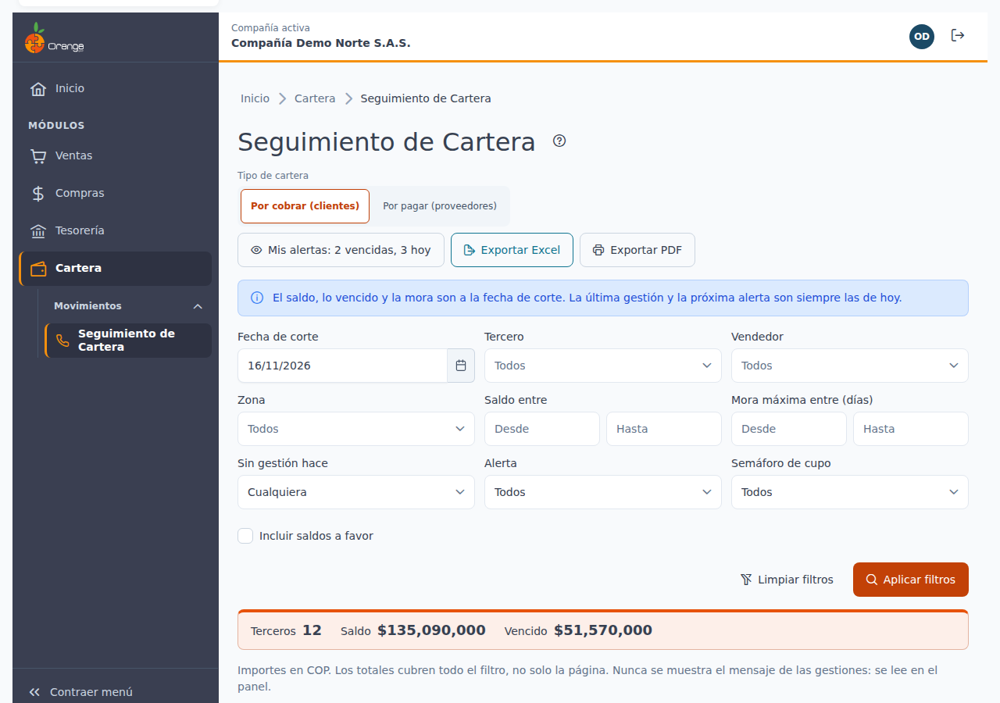
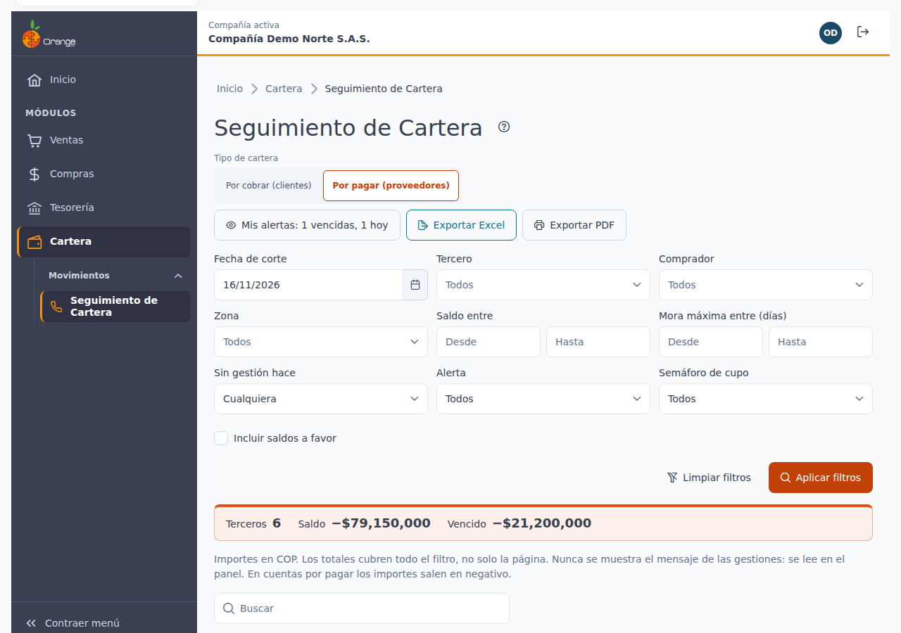
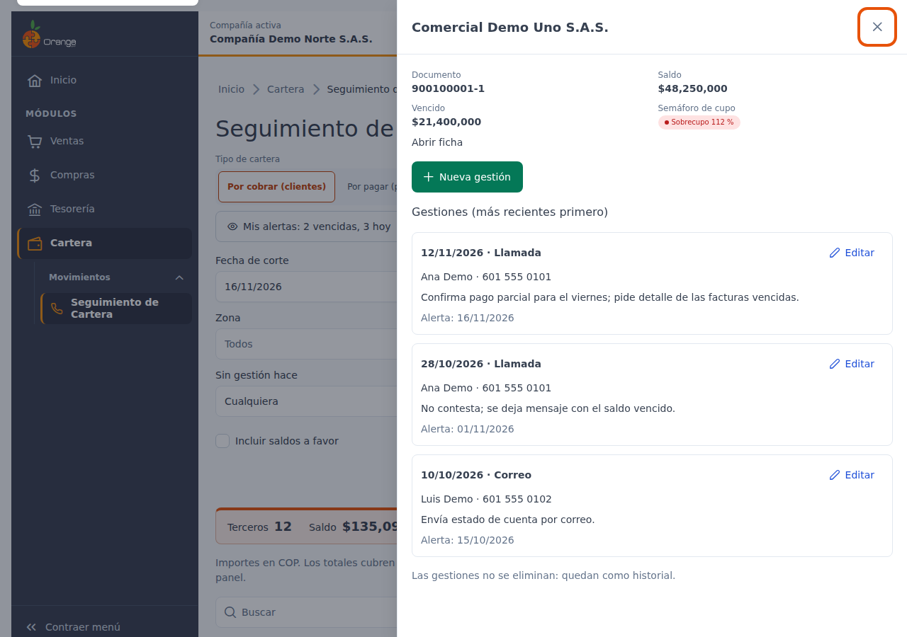
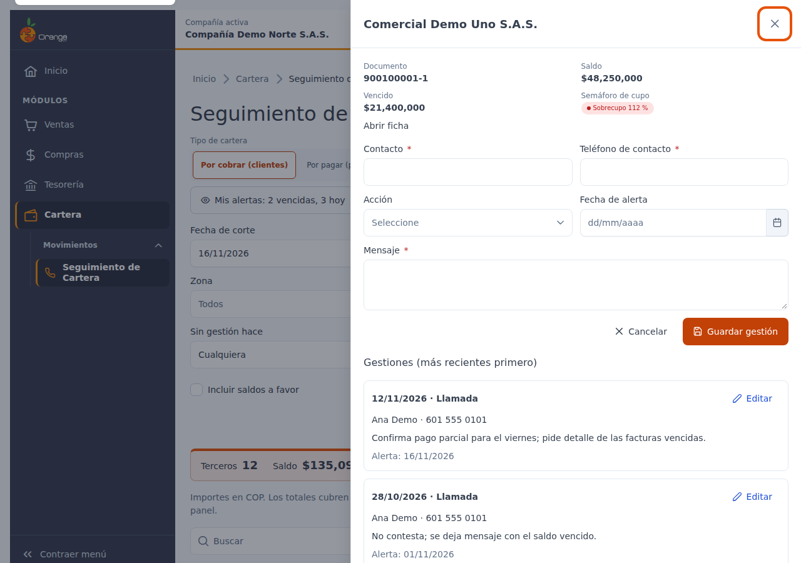
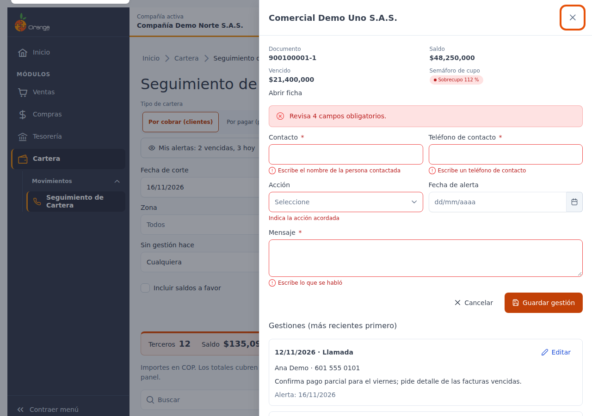
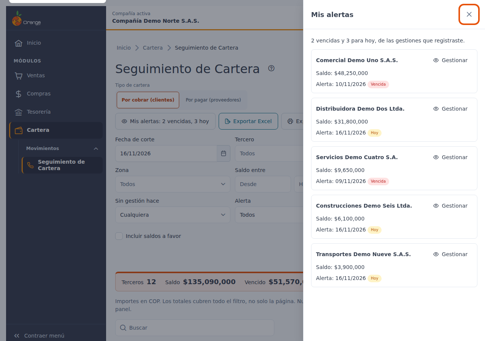
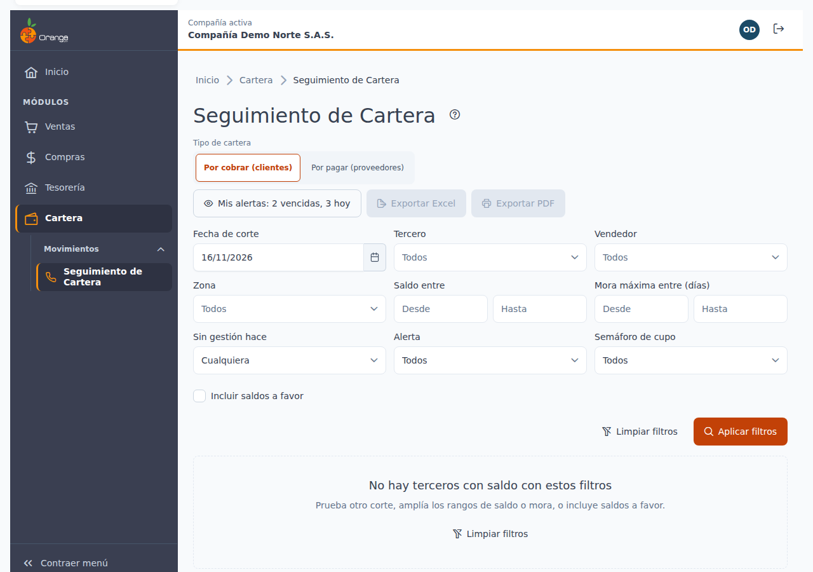

[Regresar a Cartera](../readme.md)

---

# 📞 Seguimiento de Cartera

---

## 📋 Descripción

**Seguimiento de Cartera** es la lista de quién le debe a la compañía (**por cobrar**, clientes) o a quién le debe la compañía (**por pagar**, proveedores), con su saldo, lo que está vencido y la **última gestión** que se hizo con cada tercero. Le sirve para decidir a quién llamar hoy y para no olvidar una llamada pendiente.

Desde la lista puede:

- **Registrar una gestión** (a quién se llamó, qué se habló, qué se acordó y cuándo volver a revisar) en un **panel lateral**, sin salir de la lista.
- Ver sus **alertas**: los terceros que debe volver a llamar hoy o que ya están vencidos.
- **Exportar** la lista a Excel o a PDF.

> 📘 La búsqueda, el orden y la exportación de las tablas funcionan igual en todas las pantallas: ver [Manejo general de la información](../../Generales/manejo-general-informacion.md).

> 💡 Los **importes** están en pesos colombianos. En cuentas por pagar los importes salen en **negativo**.

> 💡 Los **totales** (terceros, saldo y vencido) cubren **todo el filtro**, no solo la página que está viendo.

> ℹ️ Los mensajes de las gestiones **no aparecen en la lista, en el Excel ni en el PDF**. Para leerlos, abra el panel del tercero.

---

## 🎯 Acceso

1. En el menú principal, haga clic en **Cartera**.
2. En **Movimientos**, haga clic en **Seguimiento de Cartera**.

---

## 🖥️ Pantalla principal

| Elemento | Para qué sirve |
|----------|----------------|
| **?** (junto al título) | Abre esta ayuda en un panel lateral, sin salir de la pantalla. |
| **Tipo de cartera** | **Por cobrar (clientes)** o **Por pagar (proveedores)**. Al cambiarlo, la lista se vuelve a consultar y se limpian los filtros que no aplican a ese tipo. |
| **Fecha de corte** | Día con el que se calculan el saldo, lo vencido y la mora. Por defecto es hoy. No puede ser una fecha posterior a hoy. |
| **Filtros** | Limitan la lista. Ver *Filtros* más abajo. Use **Aplicar filtros** para verlos y **Limpiar filtros** para quitarlos. |
| **Mis alertas** | Abre el panel de sus alertas, con un contador de **vencidas** y **para hoy**. Ver *Mis alertas*. |
| **Exportar Excel** | Descarga la lista completa del filtro. Ver *Exportar a Excel*. |
| **Exportar PDF** | Descarga la lista completa del filtro en PDF horizontal. Ver *Exportar a PDF*. |
| **Buscar por documento o nombre** | Escriba al menos 2 caracteres. |
| **Gestionar** | Abre el panel de gestión de ese tercero. También puede hacer clic en la fila. |
| **Tabla** | Un tercero por fila. Haga clic en un encabezado para ordenar por esa columna. |

### Columnas de la lista

| Columna | Qué muestra |
|---------|-------------|
| **Documento** | Número de identificación del tercero, con su dígito de verificación. |
| **Nombre** | Nombre del tercero. |
| **Teléfono** y **Correo** | Datos de contacto que tiene registrados. |
| **Saldo** | Lo que debe (por cobrar) o lo que se le debe (por pagar) a la fecha de corte. |
| **Vencido** | La parte del saldo que ya superó su plazo a la fecha de corte. |
| **Mora (días)** | Días de atraso del documento más atrasado del tercero. |
| **Cupo** | Semáforo del cupo de crédito. Ver *Semáforo de cupo*. |
| **Última gestión** | Fecha de la última gestión registrada y su acción. Si no hay gestiones, dice **Sin gestión**. |
| **Próxima alerta** | Próxima fecha de revisión que dejó una gestión. Si ya pasó, dice **Alerta vencida**; si es hoy, dice **Hoy**. Si no hay, dice **Sin alerta**. |

Los terceros aparecen **solo si tienen saldo** a la fecha de corte. Un tercero con saldo cero no aparece, salvo que incluya los saldos a favor (ver *Filtros*).

Cuando la fecha de corte no es hoy, aparece este aviso: *El saldo, lo vencido y la mora son a la fecha de corte. La última gestión y la próxima alerta son siempre las de hoy.*

### Qué ve cada permiso

| Permiso | Qué puede hacer |
|---------|-----------------|
| **Consultar** (opción 300) | Ver la lista, usar los filtros, ver las gestiones en el panel y ver **Mis alertas**. |
| **Crear** | Ver el botón **Nueva gestión** y registrar gestiones nuevas. |
| **Actualizar** | Ver **Editar** en cada gestión y guardar cambios. |
| **Exportar** | Ver **Exportar Excel**. |
| **Imprimir** | Ver **Exportar PDF**. |

No existe permiso para **eliminar** gestiones: las gestiones no se borran. Ver *Preguntas frecuentes*.

Si su perfil no tiene **Consultar**, verá el aviso **No tiene permiso para ver el seguimiento de cartera**, con la indicación de pedir a su administrador el permiso de la opción 300.

---

## 🔎 Filtros y orden

| Filtro | Qué hace |
|--------|----------|
| **Buscar por documento o nombre** | Busca un tercero por su documento o su nombre. |
| **Tercero** | Elige un tercero concreto. |
| **Vendedor** (en por cobrar) o **Comprador** (en por pagar) | Muestra solo los terceros con documentos de ese vendedor o comprador. |
| **Zona** | Muestra solo los terceros de esa zona. |
| **Saldo entre** | Rango de saldo, desde y hasta. |
| **Mora máxima entre (días)** | Rango de días de atraso del documento más atrasado. |
| **Sin gestión hace** | **Cualquiera**, **15 días o más**, **30 días o más** o **60 días o más**. Incluye los terceros que nunca se han gestionado. |
| **Alerta** | **Vencida**, **Hoy**, **Próximos 7 días** o **Sin alerta**. |
| **Semáforo de cupo** | **En cupo**, **En alerta**, **Sobrecupo** o **Sin cupo asignado**. |
| **Incluir saldos a favor** | Muestra también los terceros cuyo saldo está a favor de ellos (saldo negativo). |

Los filtros se combinan: solo verá los terceros que cumplan **todos** a la vez.

Para ordenar, haga clic en el encabezado de la columna: un clic ordena de menor a mayor y otro clic de mayor a menor. Por defecto la lista va por **Nombre**. Puede mostrar **10, 25, 50 o 100** filas por página.

Al ordenar por **Última gestión** de menor a mayor, primero aparecen los terceros que nunca se han gestionado y luego los de gestión más antigua. Así ve primero a los más olvidados.

> ⚠️ Si la consulta falla, sus filtros se conservan. Pulse **Reintentar**.

---

## 🚦 Semáforo de cupo

El semáforo compara el **saldo** con el **cupo de crédito** del tercero, con los mismos porcentajes de alerta que se usan en la ficha del cliente:

- **En cupo**: el saldo todavía está por debajo del umbral de alerta.
- **En alerta**: el saldo ya superó el umbral de alerta, pero no el cupo.
- **Sobrecupo**: el saldo supera el cupo.

El porcentaje indica cuánto del cupo está usado. El estado siempre se lee con texto, no solo con el color.

Para **proveedores**, el cupo es el **Cupo del proveedor** y se compara con lo que la compañía les debe.

Si el cupo es **0** o está vacío, no hay semáforo: la columna muestra **—** y el filtro **Sin cupo asignado** lo incluye.

---

## 🧾 Panel de gestión

El panel se abre al hacer clic en la fila o en **Gestionar**. Queda al lado de la lista: al cerrarlo, la lista y la página que estaba viendo se conservan.

El panel muestra:

- El encabezado del tercero: documento, nombre, saldo, vencido y semáforo.
- El botón **Abrir ficha**, que lleva a la ficha del cliente (si es cliente) o a la del proveedor (si es proveedor).
- La lista de **gestiones**, de la más reciente a la más antigua.

Si el tercero no tiene gestiones, dice **Aún no hay gestiones de este tercero.**

### Registrar una gestión

1. Abra el panel del tercero.
2. Haga clic en **Nueva gestión**.
3. Complete los campos y haga clic en **Guardar gestión**.

| Campo | Qué escribir | Obligatorio |
|-------|--------------|:-----------:|
| **Contacto** | Nombre de la persona con la que habló. | ✅ |
| **Teléfono de contacto** | Teléfono por el que se comunicó. | ✅ |
| **Mensaje** | Lo que se habló. Puede escribir varias líneas. | ✅ |
| **Acción** | La acción acordada, por ejemplo *Llamar el 30/10*. | ✅ |
| **Fecha de alerta** | Día en que debe volver a revisar a este tercero. | No |

Si deja la **fecha de alerta** vacía, se programa **3 días después** de la gestión. La fecha y la hora de la gestión las pone el sistema al guardar.

Al guardar, el panel muestra la gestión nueva y la fila de la lista se actualiza con su **Última gestión** y su **Próxima alerta**. El aviso dice **Gestión registrada. La fila se actualizó.**

### Errores al registrar

Los mensajes aparecen debajo del campo que debe corregir, y lo que escribió se conserva:

| Mensaje | Qué hacer |
|---------|-----------|
| **Escriba el nombre de la persona contactada** | Complete el campo **Contacto**. |
| **Escriba un teléfono de contacto** | Complete el campo **Teléfono de contacto**. |
| **Escriba lo que se habló** | Complete el campo **Mensaje**. |
| **Indique la acción acordada** | Complete el campo **Acción**. |
| **La alerta no puede ser anterior a la gestión** | Elija una fecha igual a hoy o posterior. |
| **Revise N campos obligatorios.** | Los campos marcados están incompletos. |

### Editar una gestión

1. En la gestión que quiere corregir, haga clic en **Editar**.
2. Cambie lo que necesite y haga clic en **Guardar gestión**.

Las gestiones **no se eliminan**: quedan como historial de la gestión de cobro. Si se equivocó, edítela.

Para cerrar el panel, use **Cerrar panel** o **Cancelar**. Si cierra con cambios sin guardar, lo escrito se pierde.

---

## ⏰ Mis alertas

El botón **Mis alertas** muestra cuántas alertas tiene: **vencidas** y **para hoy**.

El panel lista solo los terceros cuya **última gestión** registró usted y cuya fecha de alerta ya venció o es hoy. Por cada uno ve el tercero, su saldo, la fecha de alerta y el botón **Gestionar** para abrir su panel.

No ve las alertas de gestiones registradas por otros usuarios. Si no tiene alertas, dice **No tiene alertas vencidas ni para hoy.**

### Aviso en la campana de notificaciones

Cada día, a las **5:00 a. m. (hora de Colombia)**, el sistema avisa en la campana de notificaciones a quien registró una gestión con fecha de alerta vencida o de hoy. Al pulsar el aviso, se abre **Seguimiento de Cartera** con el panel de ese tercero ya abierto. El aviso no incluye el mensaje de la gestión.

---

## 📤 Exportar a Excel

1. Aplique los filtros que necesita y haga clic en **Aplicar filtros**.
2. Haga clic en **Exportar Excel**.

El archivo tiene:

- El encabezado estándar de los reportes: empresa, NIT, nombre del reporte, tipo de cartera, fecha de corte, filtros usados, fecha y hora de la descarga y usuario que lo generó.
- Todas las filas del filtro, **no solo la página** que ve.
- Las columnas de la tabla, con **teléfono** y **correo**, más el **celular**.
- Los totales al pie.
- **Ningún mensaje de gestión.**

Si el filtro supera **50.000 filas**, el sistema no genera el archivo y dice *El Excel supera 50.000 filas. Acote el corte o los filtros.*

Si no ve el botón **Exportar Excel**, su perfil no tiene el permiso **Exportar** de la opción 300.

---

## 📄 Exportar a PDF

1. Aplique los filtros y haga clic en **Exportar PDF**.

El PDF es horizontal. Tiene las columnas de la tabla (con teléfono y correo, sin celular), todas las filas del filtro, los totales y el mismo encabezado. No tiene **mensajes de gestión**. La vista de impresión es el mismo PDF.

Si el filtro supera **4.000 filas**, el sistema dice *El PDF supera 4.000 filas. Use Excel o acote los filtros.* En ese caso, use el Excel o filtre más.

Si no ve **Exportar PDF**, su perfil no tiene el permiso **Imprimir** de la opción 300.

### Qué no se exporta

- Los **mensajes** de las gestiones (ni en el Excel ni en el PDF).
- El **celular**, que solo aparece en el Excel.
- Las filas de la página que no está viendo: siempre se exporta todo el filtro.

---

## 🔄 Cambios de otros usuarios (en vivo)

Esta pantalla **se actualiza sola**. Si otro usuario registra una gestión de un tercero que está en su lista, la fila de ese tercero se actualiza (**Última gestión** y **Próxima alerta**) sin recargar la pantalla y sin perder sus filtros.

Si tiene abierto el panel de ese tercero, aparece el aviso **Otro usuario registró una gestión de este tercero; la fila se actualizó.** Su usuario no recibe ese aviso por sus propias gestiones.

---

## 🆚 Diferencias con el sistema anterior

| Antes | Ahora |
|-------|-------|
| Solo mostraba **clientes**. | Muestra **clientes** (por cobrar) y **proveedores** (por pagar). Con el **Tipo de cartera** cambia de lado. |
| La fecha de corte era siempre hoy. | Puede elegir una **fecha de corte** anterior a hoy. |
| La lista era una sola tabla, sin filtros ni orden. | Tiene **filtros**, **orden** y **páginas** de 10 a 100 filas. |
| El saldo podía no coincidir con el reporte de cartera de terceros. | El saldo es el mismo que el del reporte **Cartera de terceros** y el de la pestaña **Cartera** de la ficha del cliente. |
| Mostraba la fecha de la última llamada. | Muestra la **última gestión** con su acción y la **próxima alerta**. |
| Para anotar la gestión había que entrar a la ficha de cada tercero. | El registro se hace en el **panel lateral**, sin salir de la lista. |
| No se podía exportar. | Se exporta a **Excel** y a **PDF**. |
| No había semáforo de cupo. | El **semáforo de cupo** aparece en clientes y proveedores. |
| No había alertas por pantalla. | **Mis alertas** lista sus alertas vencidas y de hoy. |

Teléfono, correo, documento y nombre siguen en la lista como antes.

---

## ❓ Preguntas frecuentes

**¿Por qué un tercero no aparece en la lista?**
La lista solo muestra terceros con saldo a la fecha de corte. Revise la fecha de corte, los filtros y el aviso de **Incluir saldos a favor**.

**¿Por qué el saldo no es el de hoy?**
Porque la fecha de corte es anterior a hoy. Con la fecha de corte, el saldo y el vencido se calculan a ese día; la última gestión y la próxima alerta siempre son de hoy.

**¿Por qué no veo el semáforo de un tercero?**
El semáforo necesita un cupo de crédito mayor que cero. Si el cupo es 0 o está vacío, no hay semáforo.

**¿Por qué no puedo eliminar una gestión?**
Porque las gestiones son el historial de la gestión de cobro y no se borran. Si algo está mal, edite la gestión.

**¿Es la misma gestión que aparece en la ficha del cliente?**
Sí. Las gestiones que registra aquí son las mismas que aparecen en la pestaña [Seguimiento de Cartera](../../ventas/clientes/ficha-seguimiento-cartera.md) de la ficha del cliente.

**¿Por qué no veo el botón Exportar Excel o Exportar PDF?**
Su perfil no tiene el permiso **Exportar** (Excel) o **Imprimir** (PDF) de la opción 300. Pida el permiso a su administrador.

**¿Por qué no veo Nueva gestión?**
Su perfil puede consultar, pero no crear gestiones. Pida el permiso **Crear** a su administrador.

**¿Por qué no me llegó el aviso de una alerta?**
El aviso llega a quien registró la gestión, a las 5:00 a. m., y solo si la fecha de alerta es vencida o de hoy. Los avisos de otros usuarios no le llegan a usted.

---

## 🛠️ Errores comunes

| Mensaje | Qué hacer |
|---------|-----------|
| **No se pudo consultar la cartera** | Sus filtros se conservaron. Pulse **Reintentar**. |
| **No tiene permiso para ver el seguimiento de cartera** | Su perfil no tiene **Consultar** en la opción 300. Pida el permiso a su administrador. |
| **Ningún resultado coincide con la búsqueda** o **No hay terceros con saldo con estos filtros** | Pulse **Limpiar filtros** o cambie la fecha de corte. |
| **No se pudo generar el archivo. Intente de nuevo.** | Vuelva a exportar. Si sigue igual, consulte a su administrador. |

---

## 🧷 Relacionado

- [Maestros de Cartera por tipo](../maestros.md): Clientes, Vendedores, Proveedores y Compradores desde el menú de Cartera.
- [Ficha del cliente · Seguimiento de Cartera](../../ventas/clientes/ficha-seguimiento-cartera.md)
- [Ficha del cliente · Cartera](../../ventas/clientes/ficha-cartera.md)
- [Cartera de terceros](../reportes/terceros.md)
- [Parámetros de cartera](../parametros.md): los umbrales del semáforo de cupo.
