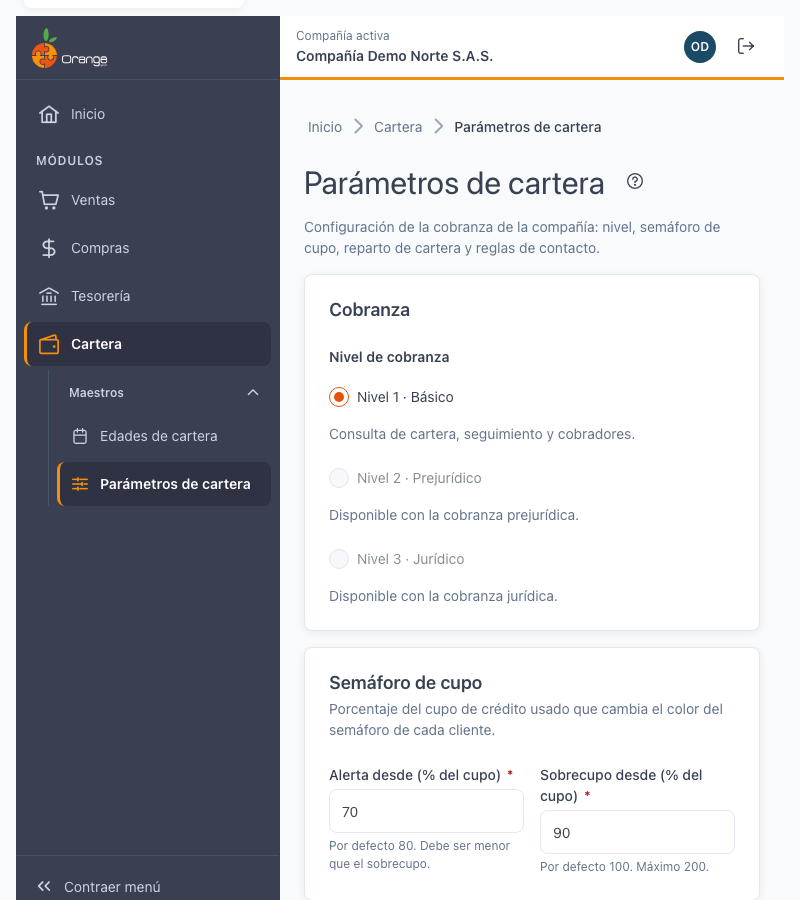
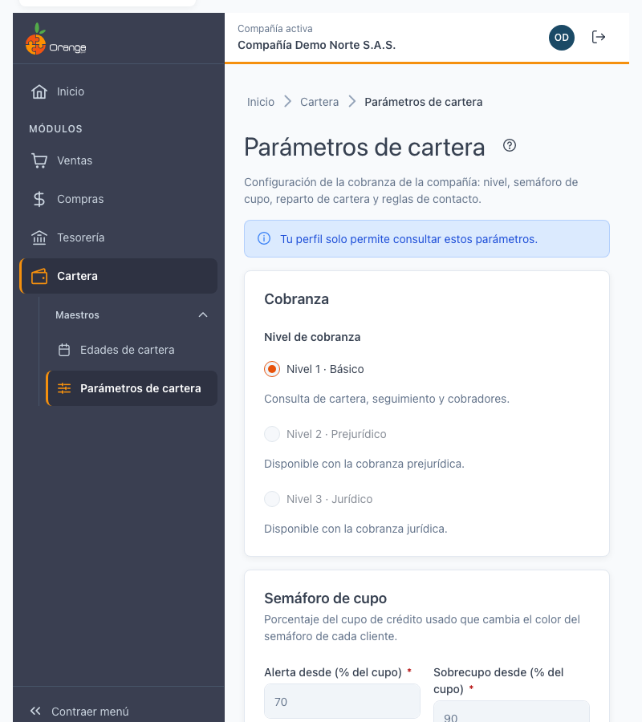
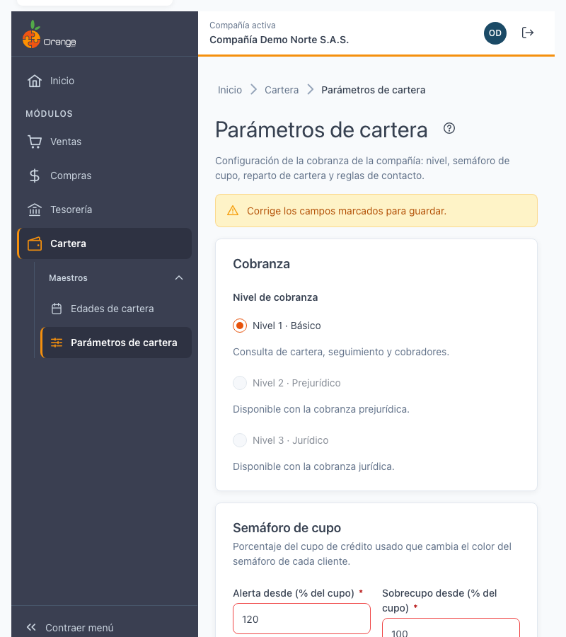
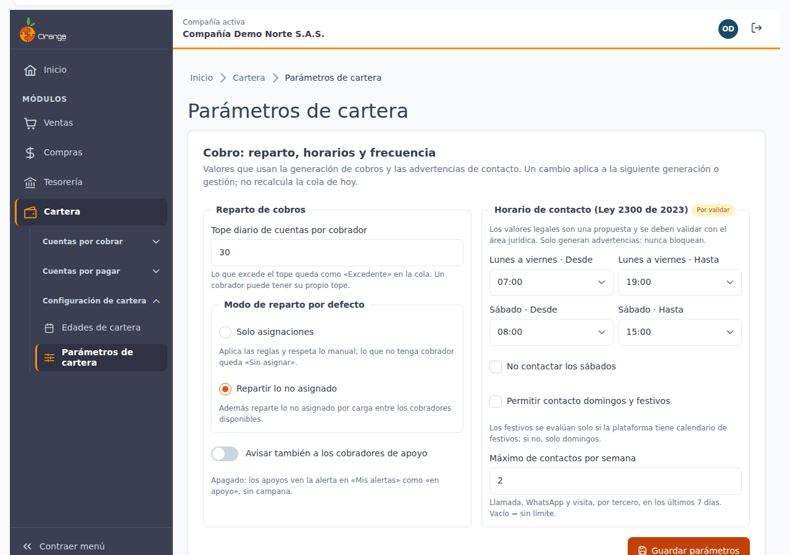
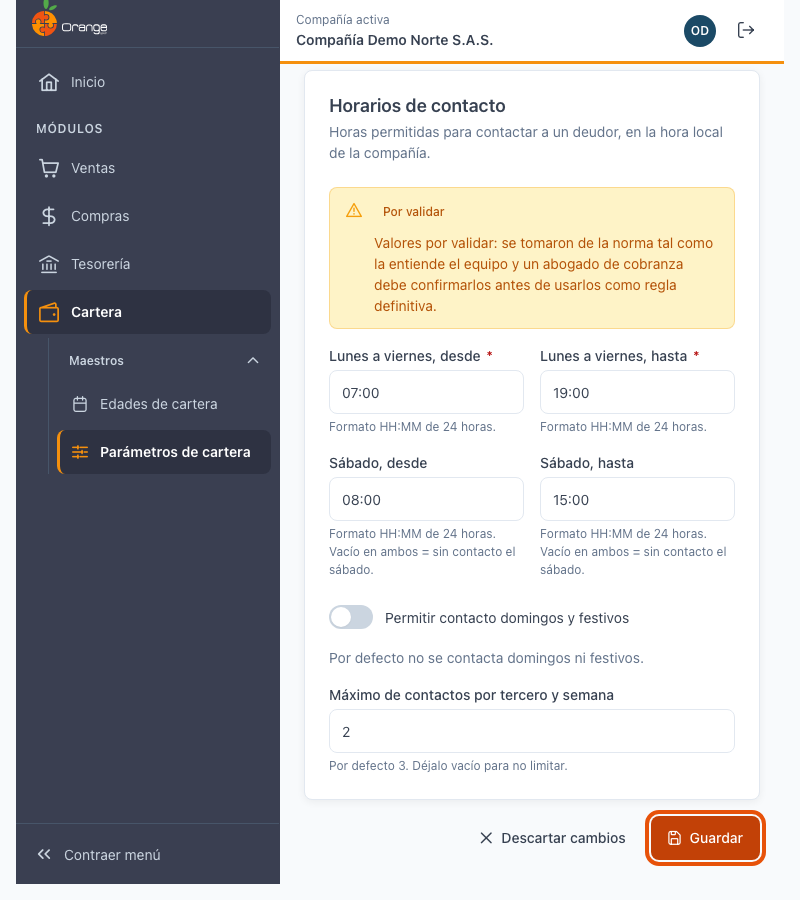
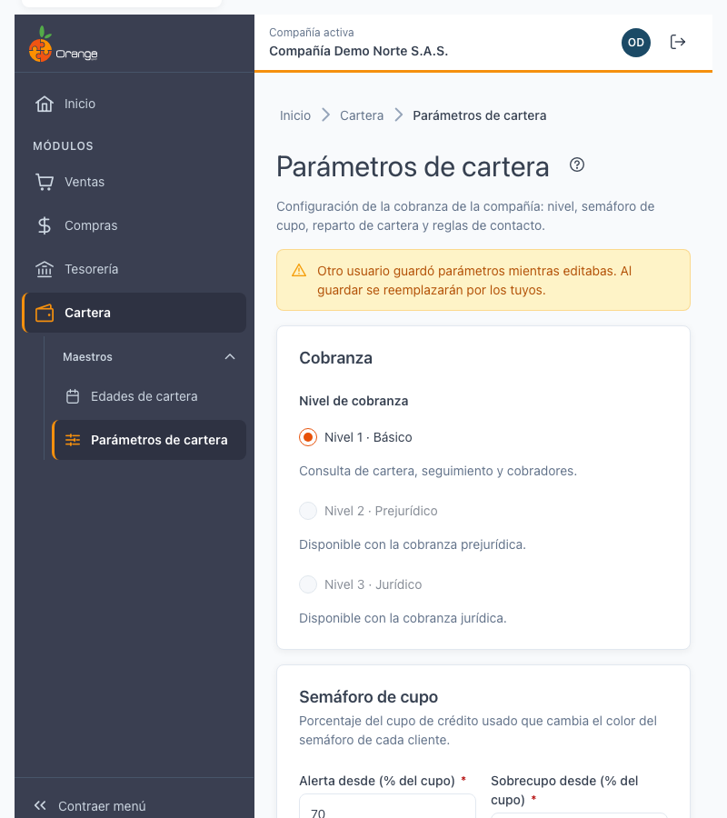

[Regresar a Cartera](readme.md)

---

# ⚙️ Parámetros de cartera

---

## 📋 Descripción

Los **parámetros de cartera** son la configuración de la cobranza de la compañía. Están en una sola página, con cuatro bloques:

- **Cobranza**: el nivel de cobranza.
- **Semáforo de cupo**: a qué porcentaje del cupo de crédito cambia el color del semáforo.
- **Reparto de cartera**: el modo de reparto por defecto y el tope diario por cobrador.
- **Horarios de contacto**: en qué horas y días se puede contactar a un deudor, y cuántas veces por semana.

Cada compañía tiene **un solo juego de parámetros**. Si todavía no los ha guardado, la pantalla muestra los valores por defecto y no guarda nada hasta que usted pulse **Guardar**.

> ⚠️ Los **horarios de contacto** están marcados **Por validar**: un abogado de cobranza debe confirmarlos antes de usarlos como regla definitiva.

> 📘 Cada pestaña del navegador trabaja con **una compañía**. El nombre de la compañía se ve en el título de la pestaña y en la barra superior.

---

## 🎯 Acceso

1. En el menú principal, haga clic en **Cartera**.
2. En **Maestros**, haga clic en **Parámetros de cartera**.

---

## 🖥️ Pantalla principal

| Elemento | Para qué sirve |
|----------|----------------|
| **?** (junto al título) | Abre esta ayuda en un panel lateral, sin salir de la pantalla. |
| **Descartar cambios** | Vuelve a los valores guardados sin guardar lo que escribió. |
| **Guardar** | Guarda los parámetros de la compañía. Es el único botón de color sólido. |

Los botones de la parte inferior solo aparecen cuando su perfil puede cambiar los parámetros.

**¿No ve los botones?** Su perfil solo tiene el permiso **Consultar** sobre la opción Parámetros de cartera. Verá la pantalla con el aviso *Tu perfil solo permite consultar estos parámetros.*, con todos los campos deshabilitados.

| Permiso | Qué habilita |
|---------|--------------|
| Consultar | Ver la pantalla |
| Actualizar | Cambiar los campos, **Guardar** y **Descartar cambios** |

> 📱 En pantallas angostas, los bloques se muestran uno debajo del otro, y los botones ocupan todo el ancho.

---

## 💾 Guardar los parámetros

1. Cambie los valores que necesite.
2. Haga clic en **Guardar**.
3. Verá el mensaje **"Parámetros de cartera guardados."**

Si no está seguro de un cambio, use **Descartar cambios** antes de guardar: la pantalla vuelve a lo último que se guardó.

Si algún campo no es válido, no se guarda nada. Aparece el aviso **"Corrija los campos marcados para guardar."**, el campo con error queda marcado con su motivo y el cursor va al primero que debe corregir.

---

## 🧩 Bloques de la pantalla

> ⚠️ Los valores de **Reparto de cartera** y **Horarios de contacto** son los que usan las funciones de cobro de la **fase 2** (cobradores, cola de cobro y generación de cobros). Esas funciones requieren que el administrador haya habilitado sus tablas y permisos.

En la fase 2, esta pantalla muestra estos bloques dentro de la sección **Cobro: reparto, horarios y frecuencia**:

### Cobranza

- **Nivel de cobranza**: por ahora solo puede elegir **Nivel 1 · Básico**, que cubre la consulta de cartera, el seguimiento y los cobradores.
- **Nivel 2 · Prejurídico** y **Nivel 3 · Jurídico** aparecen deshabilitados, con la nota de que estarán disponibles con esa cobranza. No se pueden elegir todavía.

Si se intenta guardar el nivel 2 o 3, el sistema lo rechaza con el mensaje *Ese nivel de cobranza todavía no está disponible para esta compañía.*

### Semáforo de cupo

El semáforo de cupo indica qué tan cerca está un cliente de su límite de crédito. Estos dos porcentajes marcan los cambios de color:

| Campo | Por defecto | Regla |
|-------|:-----------:|-------|
| **Alerta desde (% del cupo)** | 80 | Entero entre 1 y 200, y menor que el sobrecupo. |
| **Sobrecupo desde (% del cupo)** | 100 | Entero entre 1 y 200, y mayor que la alerta. |

Ejemplo: con alerta en 70 y sobrecupo en 90, un cliente que usa el 75 % de su cupo entra en **alerta**.

Los mensajes de error son *La alerta debe estar entre 1 y 200 y ser menor que el sobrecupo.* y *El sobrecupo debe estar entre 1 y 200 y ser mayor que la alerta.*

### Reparto de cartera

- **Modo de reparto por defecto**: **Manual** (solo aplica las reglas y las asignaciones), **Por zona** (reparte los clientes de cada zona entre los cobradores que tienen regla en esa zona) o **Por carga de trabajo** (reparte entre todos los cobradores activos según su carga). Es el modo que se propone al generar los cobros.
- **Tope diario por cobrador**: número de cuentas que puede recibir un cobrador en un día. Déjelo **vacío** para no poner tope. Si escribe algo, debe ser un entero de 1 o más. Un tope propio del cobrador tiene prioridad sobre este.
- **Los apoyos reciben aviso**: si está activado, se avisa también a los cobradores de apoyo cuando se les asigna cartera.

> ℹ️ Un cambio aplica a la **siguiente** generación de cobros o a la **siguiente** gestión que se registre. **No recalcula** la cola de hoy.
>
> Si la empresa no tiene parámetros guardados, se usan los valores iniciales: modo **Manual**, apoyos avisados y frecuencia de 2 contactos por semana.

### Horarios de contacto (por validar)

Estos valores se toman de la norma de contacto a deudores tal como la entiende el equipo, y están marcados **Por validar**. Puede editarlos y guardarlos; un abogado de cobranza debe confirmarlos antes de usarlos como regla definitiva.

| Campo | Por defecto | Regla |
|-------|-------------|-------|
| **Lunes a viernes, desde / hasta** | 07:00 a 19:00 | Formato HH:MM de 24 horas. La hora inicial debe ser anterior a la final. |
| **Sábado, desde / hasta** | 08:00 a 15:00 | Formato HH:MM. Si los dos están **vacíos**, no se contacta los sábados. |
| **Permitir contacto domingos y festivos** | Apagado | Por defecto no se contacta domingos ni festivos. |
| **Máximo de contactos por tercero y semana** | 2 | Entero de 1 o más. Déjelo **vacío** para no limitar. |

Las advertencias de horario y frecuencia aparecen en la gestión de cobro antes de guardar. Son **solo advertencias**: nunca impiden registrar una gestión, y no son asesoría legal.

Los errores típicos son *Escriba la hora como HH:MM (por ejemplo 07:00).* y *La hora inicial debe ser anterior a la final.*

---

## ⚠️ Cambios de otros usuarios

Esta pantalla **no se actualiza sola** cuando otro usuario cambia los parámetros. Si otra persona guardó mientras usted los editaba, verá el aviso:

> *Otro usuario guardó parámetros mientras editabas. Al guardar se reemplazarán por los tuyos.*

Puede seguir y guardar: **gana el último que guarda**, es decir, sus valores reemplazan los de la otra persona. Si prefiere ver lo que guardó el otro usuario, use **Descartar cambios** o recargue la página antes de guardar.

---

## ❓ Preguntas frecuentes

**¿Por qué la pantalla muestra valores si nunca los guardé?**
Son los valores por defecto. Se guardan la primera vez que pulse **Guardar**. Hasta entonces, la pantalla le avisa con *Esta compañía aún no guardó parámetros: se muestran los valores por defecto.*

**¿Por qué no puedo elegir el nivel 2 o 3?**
Esos niveles dependen de la cobranza prejurídica y jurídica, que todavía no está disponible para la compañía.

**¿Qué significa "Por validar"?**
Que los horarios de contacto son una propuesta basada en la norma, pendiente de confirmación por un abogado de cobranza. Puede usarlos y guardarlos, pero no los trate como una regla definitiva hasta esa confirmación.

**¿Dejar vacío el tope diario o la frecuencia cambia algo?**
Sí, quita el límite: sin tope diario por cobrador, o sin máximo de contactos por tercero y semana.

**¿Cambiar los parámetros cambia la cartera que ya vi?**
No. Los cambios aplican a las consultas que se hagan después de guardar. No modifican los datos guardados.

**No puedo guardar y no veo el botón Guardar.**
Su perfil solo puede consultar esta pantalla. Consulte con el administrador de OrangeERP si necesita cambiarla.

**Veo "Tu perfil ya no permite esta acción".**
Sus permisos cambiaron mientras tenía la pantalla abierta. Recargue la página para ver sus permisos actualizados.
