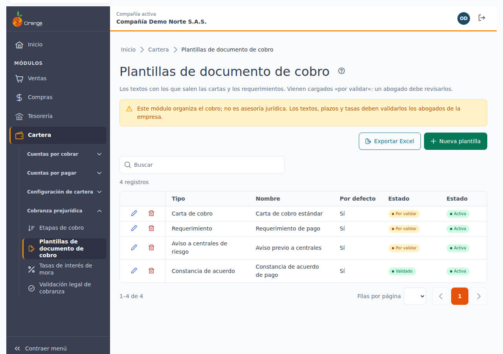
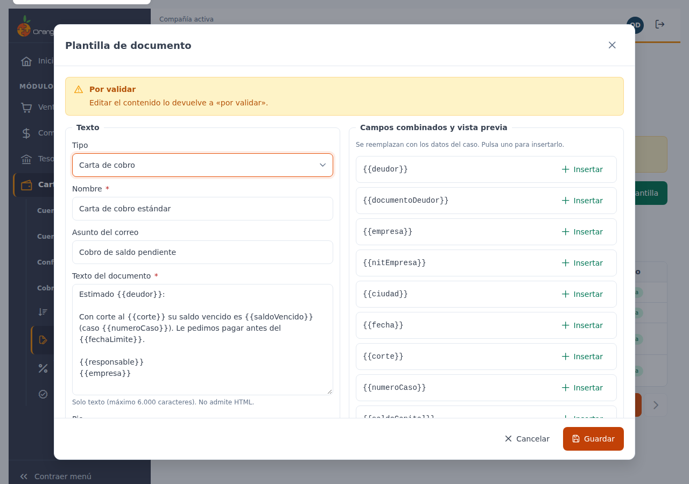
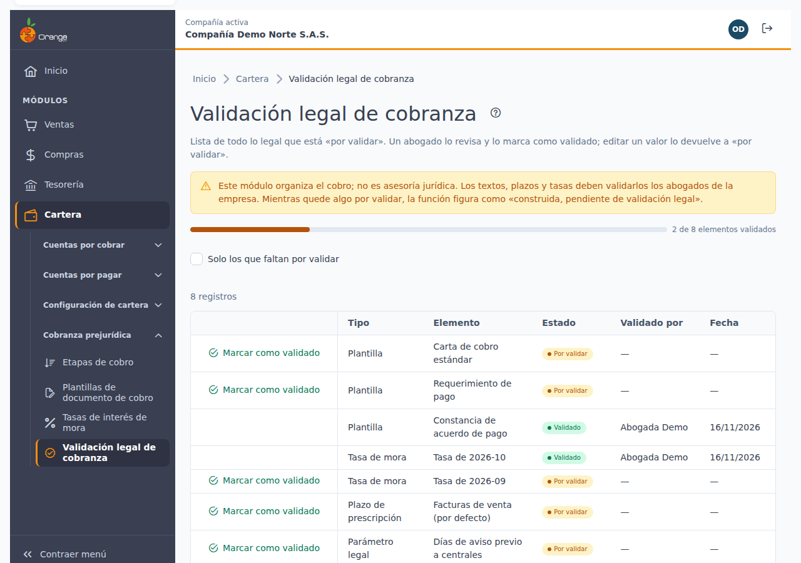
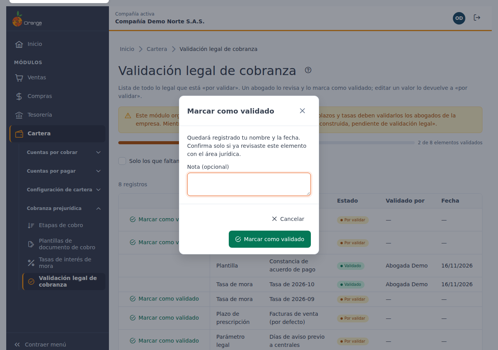

[Regresar a Cartera](readme.md)

---

# 📄 Plantillas de documento de cobro

---

> ⚠️ **Por validar.** Los textos de estas plantillas **nacen sin validar**: el sistema trae un texto genérico de ejemplo y lo marca **«por validar»**. **El abogado de la empresa debe revisar y validar cada plantilla** antes de usarla con clientes.
>
> ⚠️ **Este manual y el sistema no son asesoría jurídica.** Describen cómo usar la pantalla; el contenido legal es responsabilidad de la empresa y de su abogado.

## 📋 Descripción

Las **plantillas de documento** son los textos que el sistema usa en el cobro prejurídico: la carta de cobro, el requerimiento, el aviso a centrales de riesgo y la constancia de un acuerdo de pago. Con una plantilla, el sistema genera el **PDF** y el **correo** de una comunicación del caso, rellenando los datos del cliente.

Hay **una plantilla por tipo** marcada como **por defecto**. Puede tener varias plantillas de un mismo tipo, pero solo una queda por defecto.

---

## 🎯 Acceso

1. En el menú principal, haga clic en **Cartera**.
2. En **Maestros**, en el grupo de **Configuración de cartera**, haga clic en **Plantillas de documento de cobro**.

---

## 🖥️ Pantalla principal

| Columna | Qué muestra |
|---------|-------------|
| **Tipo** | Carta de cobro, Requerimiento, Aviso a centrales de riesgo o Constancia de acuerdo. |
| **Nombre** | Nombre de la plantilla. |
| **Por defecto** | **Sí** en la plantilla que usa el sistema por defecto para su tipo. |
| **Estado** | **Activa** o **Inactiva**, y **Por validar** o **Validado**. |

Con **Nueva plantilla** crea una plantilla. Con **Editar** cambia el texto. El estado **Por validar** o **Validado** aparece en cada fila.

---

## ✏️ Crear o editar una plantilla

| Campo | Regla |
|-------|-------|
| **Tipo** | Obligatorio. No cambia después de crearla. |
| **Nombre** | Obligatorio. |
| **Asunto del correo** | Hasta 200 caracteres. Es el asunto del correo que sale con esta plantilla. |
| **Texto del documento** | Obligatorio. Hasta 6.000 caracteres. Es **texto sin formato**: no admite HTML, imágenes ni enlaces. |
| **Pie** | Hasta 500 caracteres. Aparece al final del documento. |
| **Activa** | Apagada, la plantilla no se puede elegir para una comunicación nueva. |
| **Por defecto** | Solo una plantilla por tipo puede ser la de defecto. |

### Campos combinados

Los campos combinados son palabras entre llaves, como `{{deudor}}`. Al generar el documento, el sistema las reemplaza por el dato del caso. Use el botón **Insertar** para ponerlas sin escribirlas a mano.

| Campo | Se reemplaza por |
|-------|------------------|
| `{{deudor}}` y `{{documentoDeudor}}` | Nombre y documento del cliente. |
| `{{empresa}}`, `{{nitEmpresa}}` y `{{ciudad}}` | Datos de la compañía. |
| `{{fecha}}` y `{{corte}}` | Fecha de emisión y fecha de corte. |
| `{{numeroCaso}}` | Número del caso (por ejemplo, CC-000001). |
| `{{saldoCapital}}`, `{{saldoVencido}}`, `{{intereses}}`, `{{totalAdeudado}}` | Saldos y totales del caso. |
| `{{documentos}}` | Tabla de los documentos del caso. |
| `{{plazoDias}}` y `{{fechaLimite}}` | Plazo de pago. Lo digita quien genera el documento. |
| `{{cuotas}}` | Calendario del acuerdo de pago. |
| `{{codeudores}}` y `{{responsable}}` | Las partes del caso y el responsable. |

Un campo que no existe en esta lista **no se acepta**: al guardar, el sistema le indica el campo a corregir. Revise el texto y corrija el campo marcado.

Use **Vista previa** para ver el documento con **datos ficticios** antes de guardar. Los datos de la vista previa no son de ningún cliente real.

---

## 🟡 Por validar y Validado

Cada plantilla tiene un estado:

| Estado | Qué significa |
|--------|---------------|
| **Por validar** | El texto todavía no lo ha revisado el abogado de la empresa. El PDF muestra la línea **Texto por validar por el área jurídica**. |
| **Validado** | Un usuario con el permiso de validación lo marcó como revisado. |

**Editar el texto devuelve la plantilla a «Por validar»**, aunque antes estuviera validada. Así queda claro que el texto cambió y debe revisarse otra vez.

### Quién valida

La validación la hace quien tiene el permiso **Actualizar** de la opción de **Validación legal** (356). La pantalla de validación lista todas las plantillas, tasas y parámetros legales que faltan por validar. Con **Marcar como validado** puede agregar una nota opcional y guardar la fecha y el nombre de quien valida.

Sin ese permiso, la pantalla de validación se ve solo para leer.

### Qué pasa si una plantilla no está validada

- En una comunicación del caso, el sistema muestra una **advertencia**. Para enviar, debe marcar la casilla **Entiendo que el texto está por validar**.
- El PDF muestra la línea **Texto por validar por el área jurídica**.

Esto no impide el uso, pero deja constancia de que el texto no está validado.

---

## 🧪 Modo de prueba

Mientras el envío de correo real no esté habilitado para la compañía, las comunicaciones por correo quedan como **Simulada (no se envió)**. El diálogo lo dice antes de enviar: los correos no se envían.

---

## 🔐 Permisos

| Permiso (opción 354) | Qué puede hacer |
|----------------------|-----------------|
| **Consultar** | Ver las plantillas y su vista previa. |
| **Crear** | Crear plantillas nuevas. |
| **Actualizar** | Editar el texto y marcar la plantilla por defecto. |
| **Eliminar** | Eliminar plantillas que no se han usado. |
| **Exportar** | Exportar la lista a Excel. |

Para marcar una plantilla como validada, se necesita el permiso **Actualizar** de la validación legal (356).

---

## ❓ Preguntas frecuentes

**¿Por qué la plantilla dice «Por validar»?**
Porque su texto no lo ha revisado el abogado de la empresa, o porque alguien lo cambió después de la última validación.

**¿Puedo usar la plantilla sin validar?**
El sistema lo permite con una advertencia y una confirmación. La responsabilidad de usarla es de la empresa: lo recomendable es validarla antes.

**¿Por qué no puedo guardar la plantilla?**
Porque el texto tiene un campo combinado que no existe, o porque el asunto está vacío. Revise los campos marcados.

**¿Se guarda el PDF que se genera?**
No. El PDF se vuelve a generar a partir del texto final y los datos del caso. Lo que sí se guarda es la huella del documento, para comprobar que es el mismo.

---

## 🛠️ Errores comunes

| Mensaje | Qué hacer |
|---------|-----------|
| **Revisa N campos de la plantilla.** | Corrija los campos marcados. |
| **El asunto no puede estar vacío.** | Escriba el asunto del correo. |
| Un campo combinado no reconocido | Quítelo o cámbielo por uno de la lista. |
| **No se pudo cargar la información** | Pulse **Reintentar**. |

---

## 🧷 Relacionado

- [Casos de cobro](movimientos/casos.md): donde se usan las plantillas en las comunicaciones.
- [Tasas de mora](tasas-mora.md)
- [Parámetros de cartera](parametros.md)
