[Regresar a Cartera](../readme.md)

---

# 📊 Cartera de terceros

---

## 📋 Descripción

Este reporte muestra el saldo de cada **tercero** a una **fecha de corte**. Puede verlo de dos formas:

- **Por cobrar (CxC)**: lo que los terceros deben a la compañía.
- **Por pagar (CxP)**: lo que la compañía debe a los terceros.

Además, puede leer el saldo por **valores** (cuánto debe cada tercero) o por **rangos de edad** (cuánto de ese saldo está por vencer y cuánto lleva vencido, en tramos de días).

Puede verlo **resumido** (una fila por tercero) o **detallado** (cada documento, agrupado por tercero).

> 📘 El reporte solo consulta: no cambia ningún documento ni ningún saldo.

> 💡 El reporte **no se consulta solo** al abrirlo. Elija los filtros y pulse **Consultar**. Cambiar la forma de leer los valores o el nivel de detalle vuelve a leer el resultado con los filtros que ya tiene.

> 💡 Las cifras de los totales son de **todo el filtro**, no solo de la página que está viendo.

> ℹ️ El resultado que ve es el suyo. Otro usuario que consulte el reporte no lo ve ni lo cambia.

Los otros dos reportes de cartera, por sucursal y por vendedores, están al final de este manual.

---

## 🎯 Acceso

1. En el menú principal, haga clic en **Cartera**.
2. En **Consultas**, haga clic en **Cartera de terceros**.

---

## 🔐 Permisos

El reporte se autoriza por su propia opción. Cada acción depende de los permisos de su perfil sobre **Cartera de terceros**:

| Permiso | Qué habilita |
|---------|--------------|
| Consultar | Abrir el reporte, consultarlo, ver los totales y buscar dentro del resultado. |
| Exportar | El botón **Exportar Excel**. |
| Imprimir | El botón **Exportar PDF**. |

> ℹ️ Tener acceso a este reporte no da acceso a **Cartera de terceros por sucursal** ni a **Cartera por vendedores**. Cada uno tiene su propio permiso.

> ℹ️ Si su perfil no tiene **Consultar**, la pantalla le muestra *No tienes permiso para consultar este reporte* y no hace ninguna consulta. Si no ve un botón de exportar, su perfil no tiene el permiso correspondiente. Consulte con su administrador.

---

## 🖥️ Pantalla principal

Al abrir el reporte ve los filtros y el mensaje *Elige los filtros y pulsa Consultar*. Todavía no hay resultado ni se ha consultado nada.

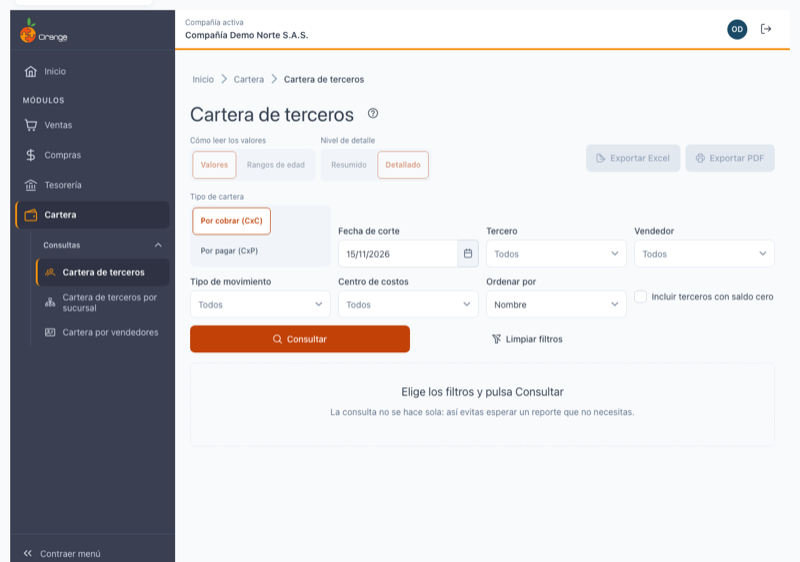

Con un resultado, la pantalla se ve así:

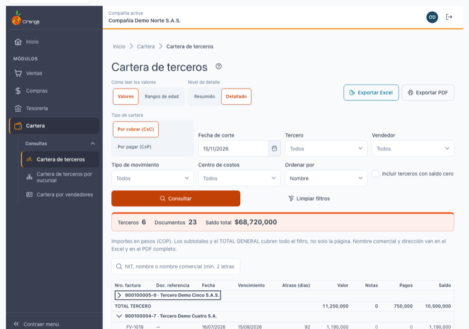

| Elemento | Para qué sirve |
|----------|----------------|
| **?** (junto al título) | Abre esta ayuda en un panel lateral, sin salir de la pantalla. |
| **Cómo leer los valores** | **Valores** o **Rangos de edad**. Cambiarlo vuelve a leer el resultado con los mismos filtros. |
| **Nivel de detalle** | **Resumido** o **Detallado**. Cambiarlo vuelve a leer el resultado con los mismos filtros. |
| **Exportar Excel** y **Exportar PDF** | Descargan el resultado. Están deshabilitados hasta que haya un resultado. Ver *Exportar a Excel y a PDF*. |
| **Consultar** | Ejecuta el reporte con los filtros de la pantalla. |
| **Limpiar filtros** | Devuelve los filtros a su valor inicial. No consulta. |
| **Franja de totales** | Terceros, documentos y saldo total de todo el filtro. |
| **Buscar en el resultado** | Filtra las filas por NIT, nombre o nombre comercial. Ver *Buscar en el resultado*. |

---

## 🔎 Filtros

| Filtro | Qué hace |
|--------|----------|
| **Tipo de cartera** | **Por cobrar (CxC)** es el valor inicial. Al cambiar a **Por pagar (CxP)** la pantalla se limpia: hay que volver a pulsar **Consultar**. |
| **Fecha de corte** | El día hasta el que se calcula la cartera. Al abrir la pantalla es hoy. No puede ser posterior a hoy. |
| **Rango de edades** | Solo aparece en **Rangos de edad**. Puede elegir **Semanal (7 días)**, **Catorcenal (14 días)**, **Quincenal (15 días)**, **Mensual (30 días)** (el valor inicial) o **Edades de la empresa**. |
| **Tercero** | Limita el reporte a uno o varios terceros. Vacío significa todos. |
| **Vendedor** / **Comprador** | Limita el reporte a uno o varios vendedores (en CxC) o compradores (en CxP). |
| **Tipo de movimiento** | Cuenta solo los documentos de los tipos elegidos. Vacío significa todos. |
| **Centro de costos** | Cuenta solo los documentos de los centros elegidos. Vacío significa todos. |
| **Ordenar por** | **NIT** o **Nombre**. |
| **Incluir terceros con saldo cero** | Apagado por defecto: los terceros sin saldo no aparecen. Enciéndalo para verlos. |

> ℹ️ **Edades de la empresa** usa los tramos que configuró en [Edades de cartera](../edades.md). Si esos tramos no se pueden leer, el reporte usa el esquema Gerencial y lo avisa al pie del resultado.

> ℹ️ No hay filtro de fecha inicial: el reporte siempre parte del corte y muestra toda la cartera abierta a esa fecha.

---

## 📑 Valores y rangos de edad

**Valores** muestra, por cada tercero, **Valor**, **Notas**, **Pagos** y **Saldo**. En el detalle se agrega **Atraso (días)**: los días desde el vencimiento del documento. Cero o menos significa que todavía no está vencido.

**Rangos de edad** reemplaza Valor, Notas y Pagos por los tramos de vencimiento del rango elegido, y conserva **Saldo** al final. Así puede ver cuánto de cada saldo está por vencer y cuánto lleva vencido. Con el rango **Mensual (30 días)** las columnas son:

| Grupo | Columnas | Qué significa |
|-------|----------|---------------|
| **Sin vencer** | -121 o más · -120 a -91 · -90 a -61 · -60 a -31 · -30 a 0 | Días que faltan para vencer. **-30 a 0** son los documentos que vencen dentro de los próximos 30 días, o hoy. |
| **Rangos de vencimientos** | 1 a 30 · 31 a 60 · 61 a 90 · 91 a 120 · 121 o más | Días de atraso. |

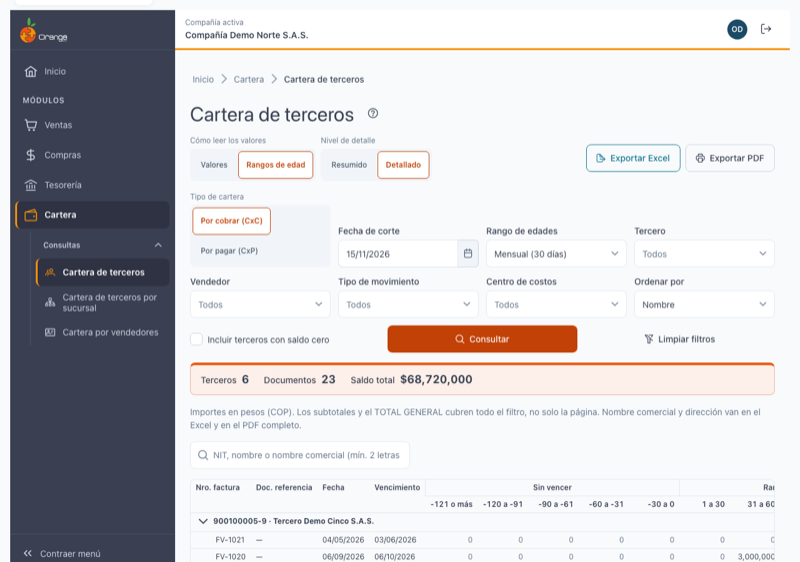

> ℹ️ La suma de los tramos de cada fila es igual a su **Saldo**. Con los otros rangos (semanal, catorcenal, quincenal o de la empresa) los tramos cambian, pero el saldo sigue siendo el mismo.

---

## 📋 Resumido y Detallado

**Resumido** muestra una fila por tercero, sin documentos:

- Documento (NIT-DV), Nombre, Teléfono y Ciudad.
- Valor, Notas, Pagos y Saldo, o los tramos de edad.

**Detallado** muestra cada tercero como un grupo que puede contraer y expandir:

- En el encabezado del grupo: Documento (NIT-DV) y Nombre.
- Debajo, cada documento con Nro. factura, Doc. referencia, Fecha, Vencimiento, Atraso (días) y montos.
- Al final del grupo, **TOTAL TERCERO**.
- Al final del listado, **TOTAL GENERAL**.

El detallado se pagina por documentos. Elija **10, 25, 50 o 100** filas por página. Los subtotales y el TOTAL GENERAL siguen cubriendo todo el filtro, no solo la página.

**Sin ciudad o zona.** Si un tercero no tiene ciudad, en la columna **Ciudad** aparece **Sin ciudad/zona**. El tercero sigue en el reporte y su saldo se suma al TOTAL GENERAL.

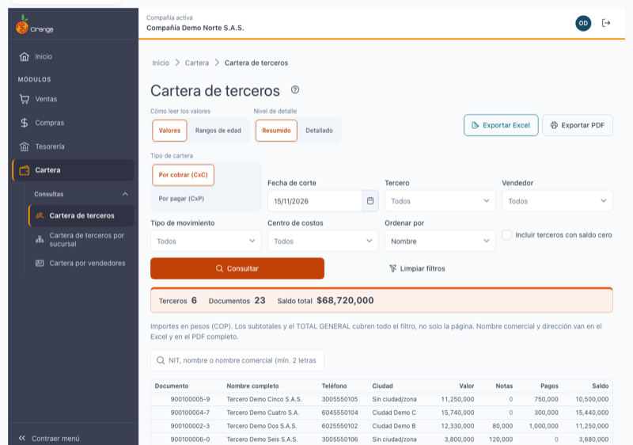

> ℹ️ El **Nombre comercial** y la **Dirección** no se ven en pantalla porque ocupan mucho espacio. Están en el Excel y en el PDF completo.

---

## 🔄 Cambiar a CxP

Al elegir **Por pagar (CxP)**:

- La pantalla se limpia y vuelve al estado inicial. No se reutiliza el resultado de CxC.
- Los importes salen en negativo, como en la contabilidad.

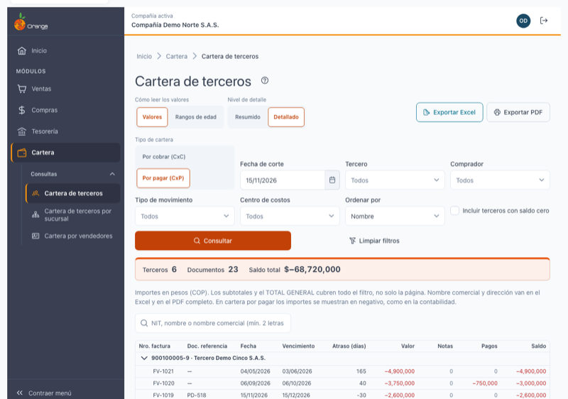

---

## 🔍 Buscar en el resultado

Escriba al menos **2 letras** en el campo **NIT, nombre o nombre comercial**. La búsqueda se hace un instante después de terminar de escribir. Los totales de arriba siguen cubriendo todo el filtro, aunque la búsqueda deje pocas filas a la vista.

Si ninguna fila coincide, aparece *Ningún resultado coincide con la búsqueda*, con el texto buscado.

---

## 📤 Exportar a Excel y a PDF

Las exportaciones usan los **filtros con los que consultó**. Si cambió algún filtro, pulse **Consultar** antes de exportar.

**Exportar Excel** descarga un archivo de Excel con:

- Un encabezado con la compañía (nombre, NIT, dirección, teléfono y ciudad), el nombre del reporte, la fecha de corte, los filtros, la fecha y hora, y el usuario que lo generó.
- Las columnas de la pantalla, con números y fechas que Excel puede usar en cálculos.
- Subtotales por tercero y TOTAL GENERAL.
- Nombre comercial y dirección de cada tercero.

**Exportar PDF** genera un documento en **orientación horizontal**, con el mismo encabezado, los subtotales y el TOTAL GENERAL. Para que quepan los tramos de edad, el PDF lleva solo las columnas esenciales: **no incluye Nombre comercial, Dirección ni Teléfono**. Esos datos están en el Excel.

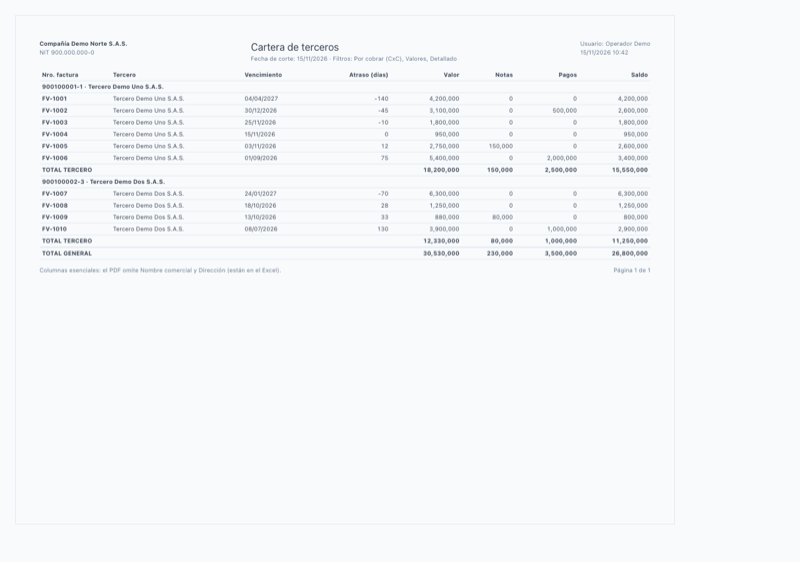

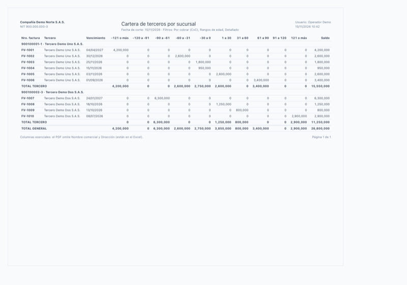

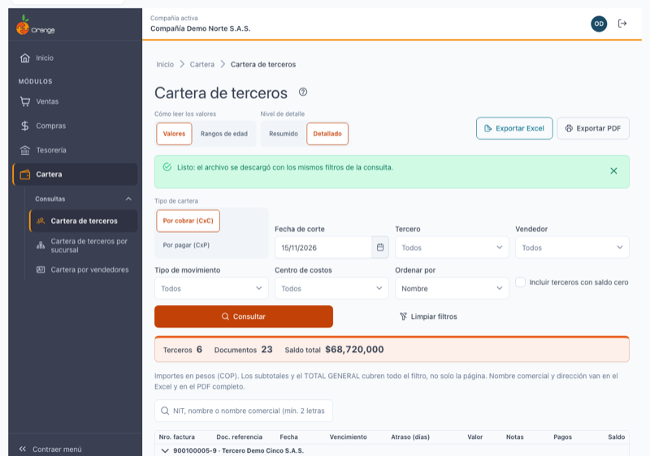

**Límites.** Excel admite hasta **50.000 filas**; PDF, hasta **4.000**. Si el resultado supera el límite, la pantalla muestra un aviso con el máximo y no descarga nada. Acote el corte, el tercero o el tipo de movimiento, y vuelva a intentar. Con el PDF también puede usar el Excel.

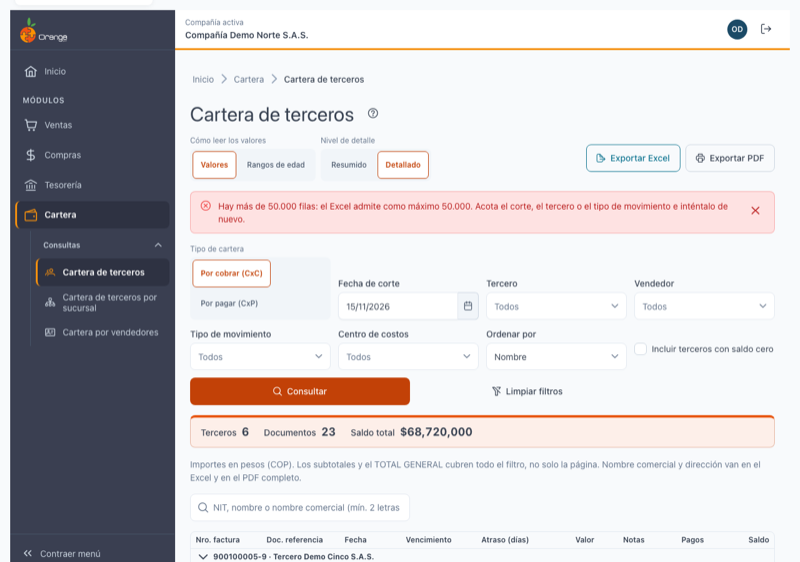

Cada exportación queda registrada en la bitácora de la compañía: quién la hizo, con qué filtros y cuántas filas tuvo. El archivo no guarda las filas en la bitácora.

---

## ⚠️ ¿Qué puede salir mal?

Los mensajes aparecen cerca de lo que debe corregir. Sus filtros no se pierden.

| Mensaje | Qué hacer |
|---------|-----------|
| No tienes permiso para consultar este reporte | Pida a su administrador el permiso **Consultar** sobre esta opción. |
| El corte no puede ser posterior a hoy. | Elija una fecha igual o anterior a hoy. |
| No hay cartera con esos filtros | Pruebe otra fecha de corte, incluya terceros con saldo cero o quite un filtro. |
| No se pudo consultar la cartera | Pulse **Reintentar**. Revise su conexión si sigue igual. |
| Hay más de 50.000 filas… / Hay más de 4.000 filas… | Acote los filtros. En PDF, use el Excel. |
| No se pudo generar el archivo. Inténtalo de nuevo. | Vuelva a exportar. |
| No se pudieron leer las edades de la empresa… | Se usó el esquema Gerencial. Revise [Edades de cartera](../edades.md). |

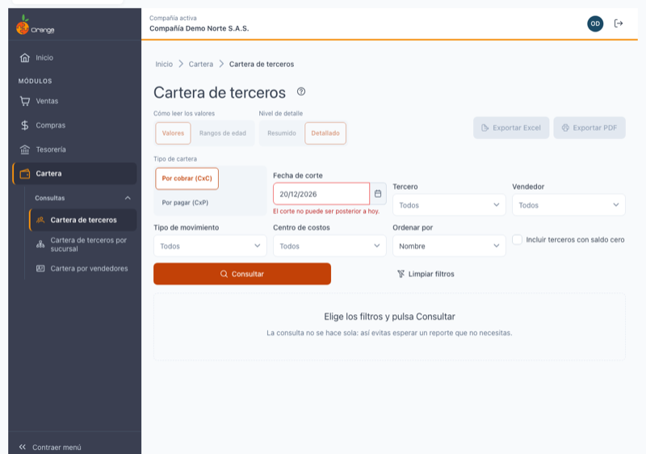

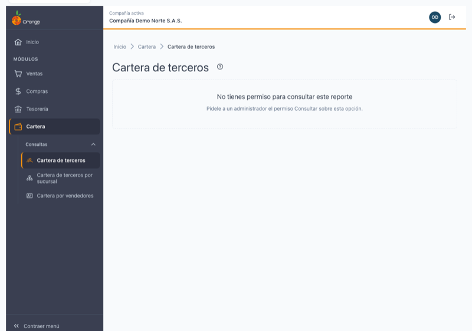

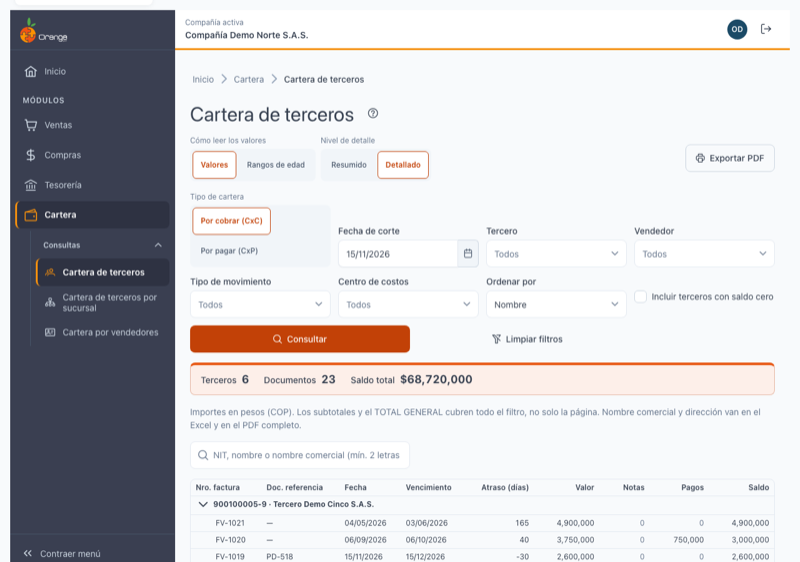

---

## 🔁 Diferencias con el legado

Este reporte reemplaza la consulta de cartera por terceros del sistema anterior (orange.net). Las cifras cuadran con el legado, salvo las diferencias que se indican aquí.

| En el legado | Ahora |
|--------------|-------|
| El resultado quedaba en un espacio compartido por todos los usuarios. | Cada usuario ve su propio resultado. |
| Había un campo **Fecha inicial** deshabilitado, que ocultaba documentos. | No existe. Solo hay **Fecha de corte**. |
| Los terceros sin ciudad o zona desaparecían del reporte. | Aparecen con **Sin ciudad/zona**, y el total cuadra con la contabilidad. |
| El filtro **Tipo de cliente** no tenía efecto en el resultado. | No aparece. |
| Los filtros eran pocos. | Nuevos filtros: **Tipo de movimiento** y **Centro de costos**; **Edades de la empresa** como rango. |
| La cartera se cargaba completa y se paginaba en la pantalla. | La paginación se hace en el servidor. Los totales cubren todo el filtro. |
| El filtro **Cobrador** existía. | Todavía no está disponible en esta versión. |
| Los rangos de edad no mostraban el saldo. | Se agrega la columna **Saldo** junto a los tramos. |

---

## ❓ Preguntas frecuentes

**¿Por qué no veo ningún resultado al abrir el reporte?**
El reporte no se consulta solo. Elija los filtros y pulse **Consultar**.

**¿Por qué un tercero aparece con Sin ciudad/zona?**
Su ficha no tiene ciudad. Corrija la ciudad del tercero en su ficha y consulte de nuevo.

**¿Por qué el total no es igual al del reporte del legado?**
Porque los terceros sin ciudad o zona ahora se incluyen. El total de este reporte es el que cuadra con la contabilidad.

**¿Por qué los importes de CxP salen en negativo?**
Así se presentan las cuentas por pagar, como en la contabilidad.

**¿El reporte se actualiza si otro usuario cambia un documento?**
No. Pulse **Consultar** para ver los cambios.

**¿Qué es el Atraso?**
Los días que han pasado desde el vencimiento del documento. Cero o menos significa que todavía no está vencido.

**No veo el botón Exportar Excel.**
Su perfil no tiene el permiso **Exportar** sobre esta opción.

**No veo el botón Exportar PDF.**
Su perfil no tiene el permiso **Imprimir** sobre esta opción.

---

## 🔗 Otros reportes de cartera

- [Cartera de terceros por sucursal](sucursales.md)
- [Cartera por vendedores](vendedores.md)
- [Edades de cartera](../edades.md) y [Parámetros de cartera](../parametros.md)
- [Manejo general de la información](../../Generales/manejo-general-informacion.md)
