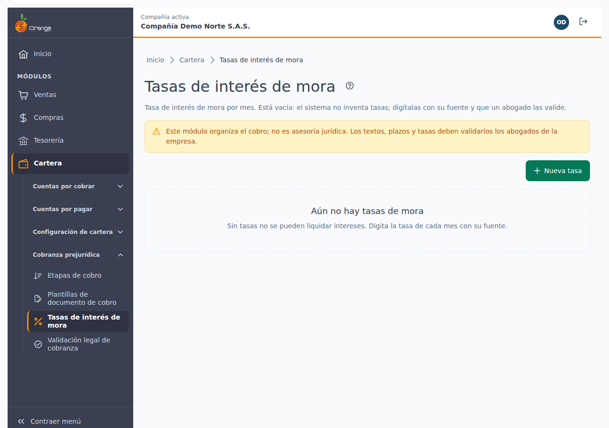
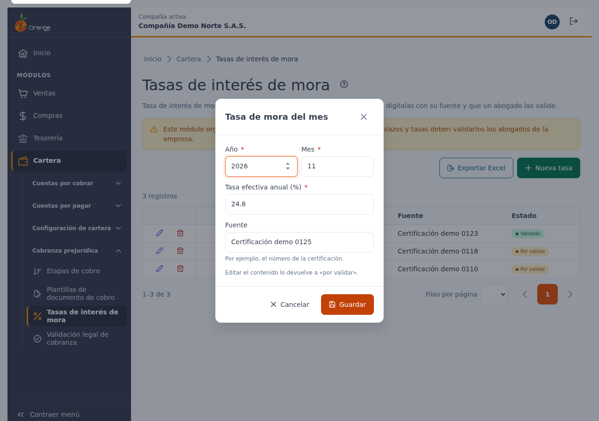
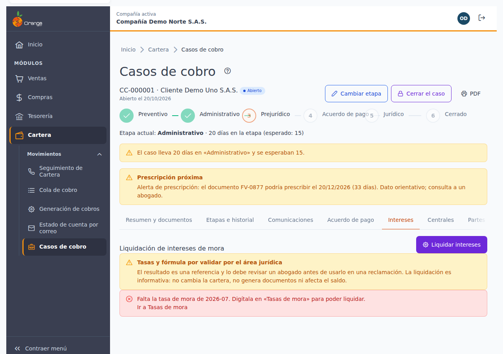
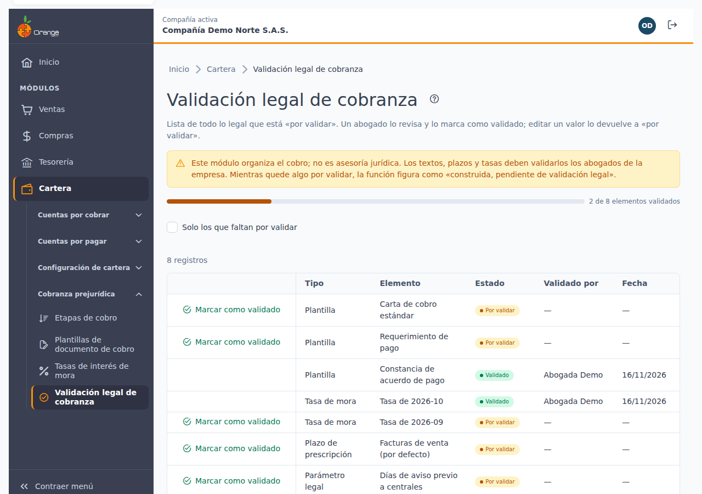
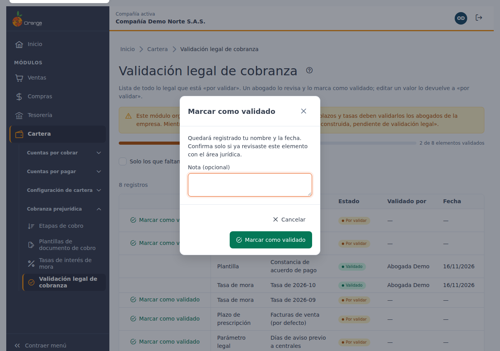

[Regresar a Cartera](readme.md)

---

# 📉 Tasas de mora

---

> ⚠️ **La tabla nace vacía.** El sistema **no trae tasas** y **no las consulta** en internet. Las tasas las digita un usuario con permiso, con su fuente, y las debe certificar el abogado de la empresa.
>
> ⚠️ **Por validar.** Toda tasa nace **por validar** y se marca así hasta que el abogado la valide.
>
> ⚠️ **Este manual y el sistema no son asesoría jurídica.** La tasa máxima permitida la define la empresa con su abogado.

## 📋 Descripción

Las **tasas de mora** son la tasa de interés de mora que se usa para liquidar los intereses de los documentos vencidos de un caso de cobro prejurídico. Se guardan **una por mes**: cada mes tiene su propia tasa efectiva anual.

Sin tasa para un mes, el sistema **no liquida** los intereses de ese mes. Esto evita calcular con tasas supuestas.

---

## 🎯 Acceso

1. En el menú principal, haga clic en **Cartera**.
2. En **Maestros**, en el grupo de **Configuración de cartera**, haga clic en **Tasas de mora**.

---

## 🖥️ Pantalla principal

Al principio la tabla está vacía y dice **Aún no hay tasas de mora**.

Cuando hay tasas, la tabla muestra:

| Columna | Qué muestra |
|---------|-------------|
| **Año** | Año de la tasa. |
| **Mes** | Mes de la tasa (1 a 12). |
| **Tasa efectiva anual (%)** | La tasa del mes. |
| **Fuente** | De dónde sale la tasa (por ejemplo, el número de la certificación). |
| **Estado** | **Por validar** o **Validado**. |

---

## ➕ Agregar una tasa

1. Haga clic en **Nueva tasa**.
2. Complete los campos y haga clic en **Guardar**.

| Campo | Regla |
|-------|-------|
| **Año** | Un año entre 2000 y 2100. |
| **Mes** | Un mes entre 1 y 12. |
| **Tasa efectiva anual (%)** | Obligatoria. Mayor que cero y hasta 1.000. |
| **Fuente** | Hasta 100 caracteres. Escriba de dónde sale la tasa: el número de la certificación o el documento. |

Solo puede haber **una tasa por año y mes**. Si ya existe una para ese mes, el sistema no la repite: edite la existente.

Una tasa nueva o editada entra como **Por validar**.

---

## ✏️ Editar y eliminar

- **Editar**: cambia la tasa o la fuente. **Cualquier cambio la devuelve a Por validar**.
- **Eliminar**: solo es posible si **ninguna liquidación guardada** usa ese mes. Si una liquidación lo usa, el sistema no la elimina.

---

## 🧮 Cómo se usan las tasas: intereses de mora

Las tasas se usan en la pestaña **Intereses** de un caso (ver [Casos de cobro](movimientos/casos.md)). El cálculo es así:

- Para cada documento vencido, el capital es su saldo vivo a la fecha de corte.
- Los días de atraso se cuentan **mes por mes**. Cada mes usa **la tasa de ese mes**.
- El interés es **simple**: no se cobra interés sobre interés.
- La compañía puede aplicar un **factor** sobre la tasa (por defecto 100 %). Ese factor también está por validar.
- Se usa una **base de días del año** (por defecto 365). Está por validar.

**Ejemplo ficticio:** un documento con un capital de $1.000.000 que lleva vencido 20 días en un mes con tasa de 24 % anual. El interés se calcula con la tasa de ese mes sobre esos 20 días, con la base de días configurada. El resultado es informativo: no cambia el saldo del cliente ni genera asientos.

### Cuando falta una tasa

Si un mes del periodo no tiene tasa, la liquidación **no se calcula**. La pantalla dice **Faltan tasas**, con la lista de los meses que faltan, y ofrece **Ir a Tasas de mora**.

Agregue las tasas de esos meses y vuelva a liquidar.

---

## 🔐 Validación

Las tasas se validan igual que las plantillas: con el permiso **Actualizar** de la validación legal (356), en la pantalla de validación. Hasta que se validen, la liquidación de intereses se marca **por validar**.

---

## 🔐 Permisos

| Permiso (opción 355) | Qué puede hacer |
|----------------------|-----------------|
| **Consultar** | Ver la tabla de tasas. |
| **Crear** | Agregar tasas. |
| **Actualizar** | Editar tasas. |
| **Eliminar** | Eliminar tasas que no usa ninguna liquidación. |
| **Exportar** | Exportar la tabla. |

---

## ❓ Preguntas frecuentes

**¿Por qué la tabla está vacía?**
Porque el sistema no trae tasas. Las tasas las digita la compañía, con su fuente, y las debe certificar su abogado.

**¿El sistema actualiza las tasas solo?**
No. Ni las trae por defecto ni las consulta en internet.

**¿Por qué no se calcula el interés de un caso?**
Porque falta la tasa de un mes del periodo. La pantalla le dice qué meses faltan.

**¿Puedo borrar una tasa ya usada?**
No, mientras una liquidación guardada use ese mes.

**¿El interés que calcula es el que debo cobrar?**
Es un cálculo informativo. Su abogado debe validar la tasa, la fórmula y el factor antes de usarlo en una comunicación o en un acuerdo.

---

## 🛠️ Errores comunes

| Mensaje | Qué hacer |
|---------|-----------|
| La pantalla de intereses dice qué meses faltan | Agregue las tasas de esos meses y vuelva a liquidar. |
| Un año o mes fuera de rango, o una tasa vacía | Corrija el campo marcado y guarde de nuevo. |
| Una tasa usada por una liquidación no se puede eliminar | Conserve la tasa. |

---

## 🧷 Relacionado

- [Casos de cobro](movimientos/casos.md): la pestaña Intereses.
- [Plantillas de documento de cobro](plantillas-cobro.md)
- [Parámetros de cartera](parametros.md): factor, base de días y validación legal.
