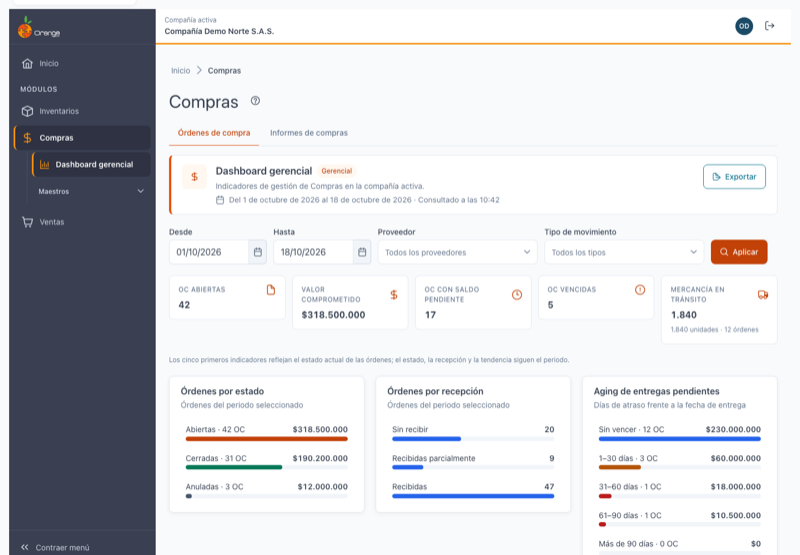
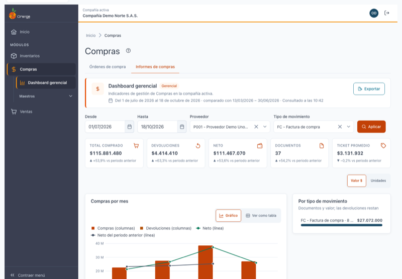
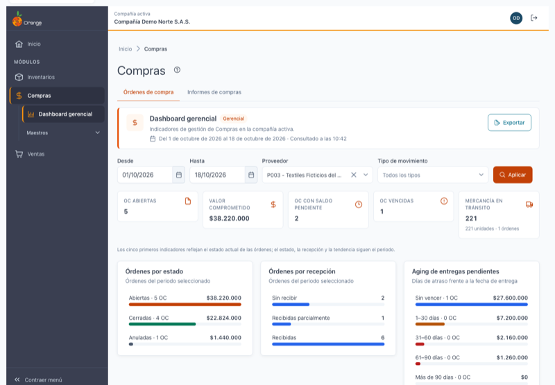
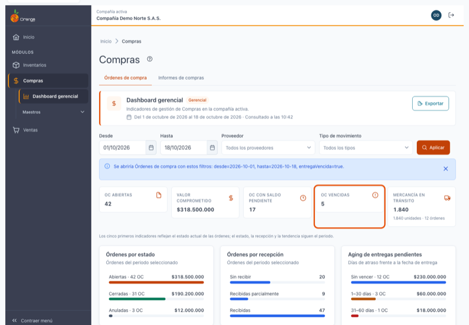
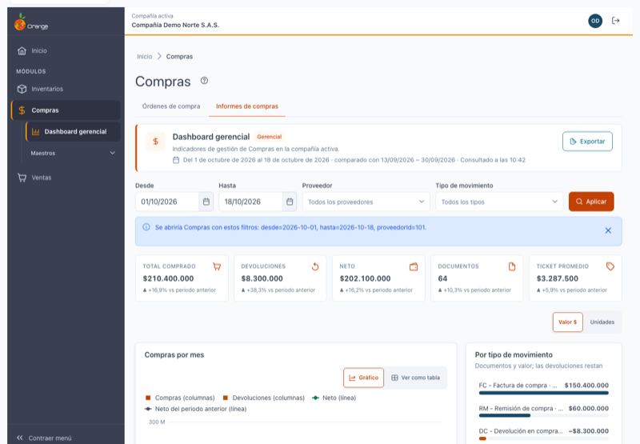
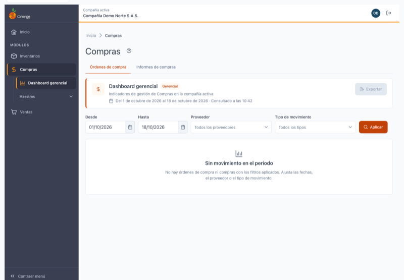
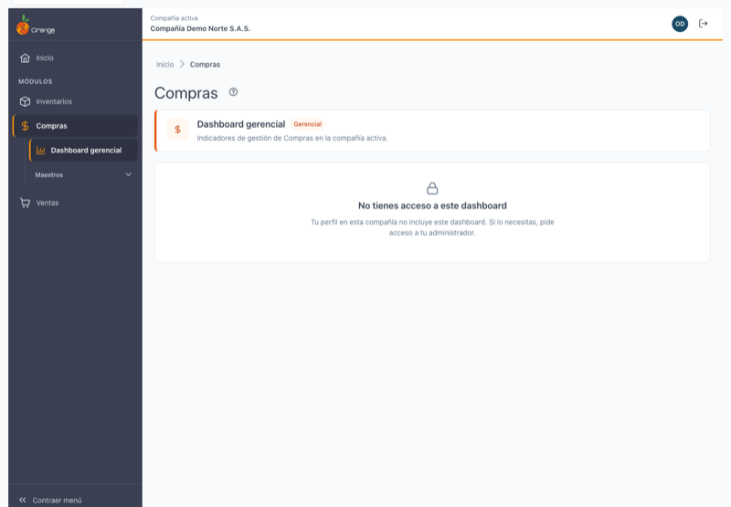
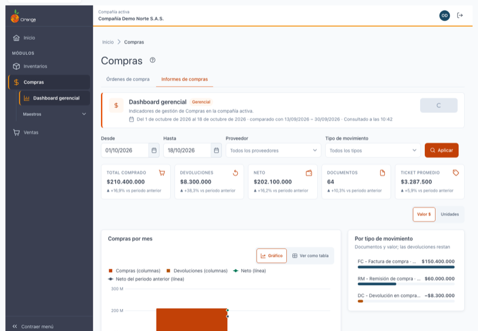
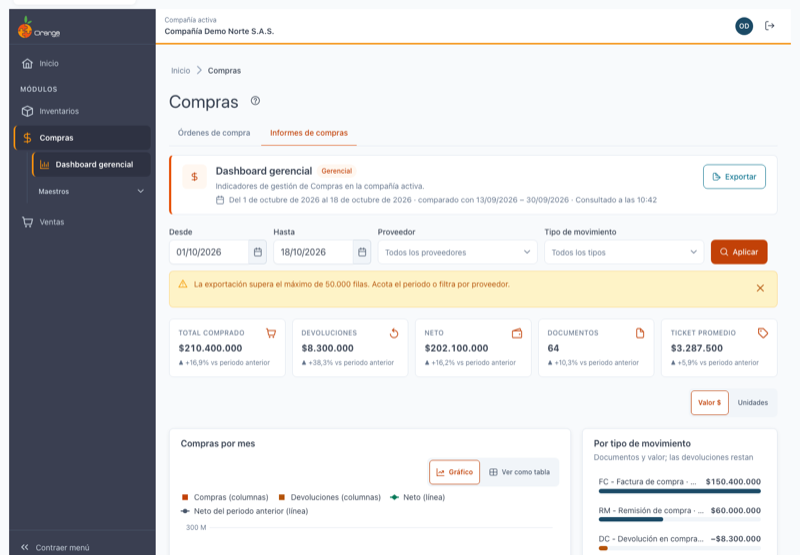

[Regresar a Compras](readme.md)

---

# 📊 Dashboard gerencial de Compras

---

## 📋 Descripción

El **dashboard gerencial** le muestra de un vistazo **qué falta por recibir** de sus órdenes de compra y **cuánto, a quién y de qué se compró** en un periodo, comparado con el periodo anterior. Las cifras son **en vivo**: se calculan con los documentos registrados hasta el momento de la consulta.

En esta pantalla puede:

- Revisar las **órdenes de compra** abiertas, su valor comprometido, las que tienen saldo pendiente, las vencidas y la mercancía en tránsito.
- Ver la **distribución** de las órdenes por estado y por recepción, el **aging** de las entregas pendientes, los proveedores con más valor pendiente y el **cumplimiento** de entregas.
- Ver las **compras y devoluciones** del periodo, con el neto, el número de documentos, el ticket promedio y la tendencia mensual frente al periodo anterior.
- Ver los principales **proveedores**, **referencias o grupos** y **tipos de movimiento** del periodo, y saltar al listado de órdenes o de compras para investigar una cifra.
- **Exportar** a Excel el ranking de la pestaña que está viendo.

Es solo de consulta: no modifica órdenes, compras ni inventario.

> 💡 Si su perfil no tiene el dashboard gerencial, al entrar a Compras verá el dashboard inicial del módulo en lugar de esta pantalla.

---

## 🎯 Acceso

1. En el menú principal, haga clic en **Compras**.
2. Se abre el dashboard gerencial, con las pestañas **Órdenes de compra** e **Informes de compras**.

Para volver a este dashboard desde otra pantalla de Compras, use el menú o las migas de navegación.

---

## 🖥️ Pantalla principal

| Elemento | Para qué sirve |
|----------|----------------|
| **?** (junto al título) | Abre esta ayuda en un panel lateral, sin salir de la pantalla. |
| **Órdenes de compra / Informes de compras** | Las dos pestañas del dashboard. Ver *Pestañas* más abajo. |
| **Del … al …** | El periodo que está viendo. Por defecto, el **mes en curso**. |
| **comparado con …** | El periodo anterior de igual longitud, en la pestaña *Informes de compras*. |
| **Consultado a las HH:MM** | La hora en que se hizo la última consulta. |
| **Exportar** | Descarga el ranking de la pestaña activa a Excel. Ver *Exportar a Excel* más abajo. |
| **Desde**, **Hasta**, **Proveedor**, **Tipo de movimiento** y **Aplicar** | Filtros. Ver *Filtros* más abajo. |
| **Indicadores** | Las cifras principales de la pestaña. |
| **Widgets** | Rankings, distribuciones y tendencias de la pestaña. |

---

## 🗂️ Pestañas

El dashboard tiene dos pestañas. Cada una carga sus datos solo cuando la abre, con los filtros que tenga aplicados.

| Pestaña | Qué responde |
|---------|--------------|
| **Órdenes de compra** | ¿Qué falta por recibir? Lo que está pendiente hoy: órdenes abiertas, saldo, vencidas, tránsito y entregas. |
| **Informes de compras** | ¿Cuánto se compró y devolvió en el periodo? Compras, devoluciones, neto, documentos, tendencia y ranking. |

Al cambiar de pestaña, el filtro **Tipo de movimiento** se limpia, porque las dos pestañas usan listas distintas. **Desde**, **Hasta** y **Proveedor** se conservan.

---

## 🔎 Filtros

| Filtro | Qué hace |
|--------|----------|
| **Desde** | Fecha inicial del periodo. Por defecto, el primer día del mes en curso. Es obligatoria. |
| **Hasta** | Fecha final del periodo. Por defecto, hoy. No se pueden elegir fechas futuras. Es obligatoria. |
| **Proveedor** | Opcional. Vacío = **Todos los proveedores**. Escriba parte del código o del nombre para buscarlo. Con la **✕** vuelve a todos. |
| **Tipo de movimiento** | Opcional. Vacío = **Todos los tipos**. En *Órdenes de compra* son los tipos de orden; en *Informes de compras*, los tipos de compra y devolución. |

Reglas de las fechas:

- *Hasta* no puede ser anterior a *Desde*: verá *"La fecha final no puede ser anterior a la inicial."*
- El periodo no puede superar **366 días**: verá *"El rango no puede superar 366 días."*
- Si borra una fecha, verá *"Indica la fecha inicial."* o *"Indica la fecha final."*

> ℹ️ **Cambiar un filtro no consulta.** Aparece el aviso *"Cambiaste los filtros. Pulsa Aplicar…"*. Los datos cambian solo al hacer clic en **Aplicar**, que vuelve a consultar la pestaña que está viendo.

Si el periodo no tiene movimientos, verá **"Sin movimiento en el periodo"**, con los filtros disponibles para cambiarlos.

---

## 🕒 Cifras en vivo

Este dashboard **no guarda resultados**: cada consulta lee la información actual. Por eso:

- Los documentos que registre con fecha dentro del periodo aparecen en la siguiente consulta (al hacer clic en **Aplicar**, o al volver a abrir la pestaña).
- No hay botón **Actualizar**. Para ver lo último, haga clic en **Aplicar**.
- **Consultado a las HH:MM** indica cuándo se hizo la consulta que está viendo.

> ℹ️ Si otro usuario registra un documento mientras usted mira la pantalla, no lo verá hasta volver a consultar.

---

## 📦 Pestaña Órdenes de compra

### Indicadores

| Indicador | Qué muestra |
|-----------|-------------|
| **OC abiertas** | Órdenes de compra abiertas (no anuladas ni cerradas). Al hacer clic, abre el listado de órdenes abiertas. |
| **Valor comprometido** | Suma del valor pendiente de recibir de las órdenes abiertas. |
| **OC con saldo pendiente** | Órdenes a las que todavía les falta mercancía por recibir. |
| **OC vencidas** | Órdenes con saldo cuya fecha de entrega ya pasó. Al hacer clic, abre el listado de órdenes vencidas. |
| **Mercancía en tránsito** | Unidades pendientes de llegar y el número de órdenes a las que pertenecen. |

> ℹ️ Estos cinco indicadores muestran el **estado actual**, no el periodo que eligió en los filtros. Los filtros de *Proveedor* y *Tipo de movimiento* sí los afectan.

### Órdenes por estado y por recepción

Dos rankings del **periodo seleccionado**, con la cantidad de órdenes y su valor:

- **Estado**: *Abiertas*, *Cerradas* y *Anuladas*. Las anuladas se muestran aunque sean cero, para que la suma cuadre con el total de órdenes del periodo.
- **Recepción**: *Sin recibir*, *Recibidas parcialmente* y *Recibidas*.

### Aging de entregas pendientes

Muestra las órdenes con saldo agrupadas por **días de atraso** frente a la fecha de entrega:

| Tramo | Significado |
|-------|-------------|
| **Sin vencer** | La fecha de entrega todavía no llega. |
| **1–30 días** | Atrasadas entre 1 y 30 días. |
| **31–60 días** | Atrasadas entre 31 y 60 días. |
| **61–90 días** | Atrasadas entre 61 y 90 días. |
| **Más de 90 días** | Atrasadas más de 90 días. |

Cada tramo indica cuántas órdenes tiene y su valor pendiente. Los tramos atrasados llevan un color de alerta y también el texto, para que se lea sin color.

### Proveedores con más valor pendiente

Los 10 proveedores con mayor valor pendiente de recibir. Con **Ver detalle (+N)** se ven todos; con **Ver menos**, vuelven los 10 primeros. Es el estado actual de las órdenes con saldo.

### Cumplimiento de entregas

Porcentaje de las órdenes con fecha pactada dentro del periodo que se recibieron **a tiempo**, con el detalle de *a tiempo*, *tarde* y *sin recibir*, y la **cobertura** (qué parte de las órdenes del periodo se pudo medir).

Si hay pocas órdenes para medir, en lugar del porcentaje verá **"Muestra insuficiente"**. Un porcentaje con pocas órdenes puede cambiar mucho de un mes a otro, por eso no se muestra.

### Órdenes emitidas vs recibidas

Columnas mensuales de las órdenes **emitidas** y **recibidas** en los meses del periodo. Si el último mes todavía no ha terminado, se indica como *parcial*.

---

## 📈 Pestaña Informes de compras

### Indicadores

| Indicador | Qué muestra |
|-----------|-------------|
| **Total comprado** | Valor de las compras del periodo. |
| **Devoluciones** | Valor de las devoluciones a proveedores del periodo. |
| **Neto** | Total comprado menos devoluciones. |
| **Documentos** | Número de documentos de compra del periodo. |
| **Ticket promedio** | Total comprado dividido entre el número de documentos de compra. |

Bajo cada indicador aparece la **variación** frente al periodo anterior de igual longitud, por ejemplo *"▲ +16,9 % vs periodo anterior"*. Si el periodo anterior no tiene datos, verá *"— Sin datos del periodo anterior"*.

> ℹ️ Para leer la variación: **▲** significa que el periodo actual es mayor que el anterior, y **▼** que es menor. Compare siempre periodos del mismo largo.

### Compras por mes

Columnas mensuales de **Compras** y **Devoluciones**, con una línea para el **Neto** del periodo y otra para el **Neto del periodo anterior**, alineadas por posición de mes. Así puede ver si el neto va por encima o por debajo del periodo anterior.

### Por tipo de movimiento

Cada tipo de movimiento con su número de documentos y su valor. Las devoluciones aparecen con signo negativo.

### Proveedores

Los 10 proveedores con mayor valor **neto** del periodo (compras menos devoluciones).

### Referencias y grupos

Los 10 primeros según el nivel elegido:

- **Referencia**: las referencias de mayor valor neto.
- **Grupo**: los grupos de mayor valor neto.

Cambiar entre *Referencia* y *Grupo* es inmediato, sin volver a consultar. Este ranking solo muestra datos: no enlaza a un listado.

### Métrica: Valor $ o Unidades

En *Proveedores* y *Referencias y grupos*, el conmutador **Valor $ / Unidades** cambia el orden y la medida de las barras. Es inmediato y no vuelve a consultar.

---

## 🔗 Ir al detalle (*drill-down*)

Puede saltar al listado de origen para investigar una cifra:

| Desde | Va a |
|-------|------|
| **OC abiertas**, **OC vencidas** | Listado de **Órdenes de compra**, ya filtrado (abiertas o vencidas). |
| **Total comprado**, **Devoluciones**, **Documentos** | Listado de **Compras**, ya filtrado por naturaleza. |
| **Un proveedor** del ranking de pendientes o del ranking de informes | El listado correspondiente, con el proveedor y el periodo. |
| **Un tipo de movimiento** | El listado correspondiente, con el tipo y el periodo. |

El listado se abre con el **periodo**, el **proveedor** y el **tipo de movimiento** que tenía aplicados.

> 💡 **¿Por qué a veces no hay enlace?** Para saltar a un listado necesita el permiso de consultarlo: **Órdenes de compra** para la pestaña *Órdenes*, o **Compras** para *Informes*. Sin ese permiso, la cifra o la fila se ven, pero no son un enlace. Las **referencias** y los **grupos** nunca enlazan, porque los listados no filtran por ellos.

---

## 🚦 Estados de la pantalla

| Qué ve | Cuándo | Qué hacer |
|--------|--------|-----------|
| **Cargando** | Mientras se consultan los datos. | Espere. Los filtros siguen visibles, pero **Aplicar** queda deshabilitado. |
| **Sin movimiento en el periodo** | No hay órdenes ni compras con los filtros. | Cambie las fechas, el proveedor o el tipo de movimiento. |
| **No se pudo cargar el dashboard** | Falló la consulta de la pestaña. | Haga clic en **Reintentar**. Se usan los mismos filtros. |
| **Fallo parcial** (*"No se pudo cargar esta sección"*) | Solo falló un widget. | Haga clic en **Reintentar** dentro de ese widget; el resto sigue funcionando. |
| **Muestra insuficiente** | Hay pocas órdenes para calcular el cumplimiento. | No requiere acción; es informativo. |
| **Sin acceso** (candado) | Su perfil no tiene el permiso del dashboard. | Pida al administrador que lo revise. |

Así se ve un periodo sin movimientos:

Así se ve cuando su perfil no tiene acceso al dashboard:

---

## 📤 Exportar a Excel

Haga clic en **Exportar** (en la banda de arriba). Se descarga un archivo llamado `compras-dashboard_<pestaña>_<desde>_<hasta>.xlsx`, con los códigos y los nombres por separado, y los importes como números para sumar o filtrar en Excel:

- En *Órdenes de compra*, la hoja **Proveedores con saldo**: OC con saldo, OC vencidas y valor pendiente por proveedor.
- En *Informes de compras*, la hoja **Proveedores**: compras, devoluciones, neto, unidades y documentos por proveedor.

El archivo tiene **el mismo periodo y los mismos filtros** que está viendo.

Se pueden exportar hasta **50.000 filas**. Si el ranking tiene más, verá:

> *"La exportación supera el máximo de 50.000 filas. Acota el periodo o filtra por proveedor."*

Acote el periodo o elija un proveedor, y exporte de nuevo. Si la exportación falla, verá *"No se pudo exportar. Inténtalo de nuevo."*

> ℹ️ No hay opción de **Imprimir** en este dashboard.

---

## 🔒 Permisos

| Para… | Su perfil necesita |
|-------|--------------------|
| Ver este dashboard | Permiso de **Consultar** sobre **Reportes Gerenciales**, su grupo de reportes y la opción **Compras** (además del acceso al módulo Compras). Sin ese permiso, verá el dashboard inicial del módulo. |
| Ver **Órdenes de compra** y **Compras** desde el dashboard | Permiso de **Consultar** sobre esos listados. Sin él, la cifra se ve pero no es un enlace. |
| **Exportar** | Además, el permiso de **Exportar** sobre la opción **Compras** de Reportes Gerenciales. Sin él, el botón **Exportar** no aparece. |

> 🗂️ Cada consulta queda registrada en la bitácora de actividad, con el usuario, la pestaña y el periodo consultados.

---

## 📐 Definiciones

| Término | Cómo se calcula |
|---------|-----------------|
| **OC abierta** | Orden no anulada y no cerrada. |
| **Valor comprometido** | Suma del valor pendiente de recibir de las órdenes abiertas. Las anuladas no suman. |
| **OC con saldo** | La cantidad pedida es mayor que la recibida. |
| **OC vencida** | Tiene saldo y su fecha de entrega (fecha de la orden más sus días de plazo) ya pasó. |
| **Aging** | Días de atraso de cada orden con saldo, en los tramos de la tabla de *Aging de entregas pendientes*. |
| **Ticket promedio** | Total comprado dividido entre el número de documentos de compra. |
| **Neto** | Total comprado menos devoluciones. |

Los valores de las compras y devoluciones se calculan igual que en el listado de [Compras y devoluciones](movimientos/compras-devoluciones.md).

---

## 🔀 Relación con los reportes de la versión anterior

Los reportes de compras de la versión anterior (el reporte de **Compras** y sus variantes por proveedor, por referencia y por tipo de movimiento) se resumen ahora en este dashboard, con las mismas cifras de compras, devoluciones y proveedores.

Algunas diferencias son intencionales:

- El dashboard **no tiene selección múltiple** de referencias, atributos, bodegas, centros de costo ni compradores. Para ese detalle use el listado de Compras.
- El dashboard muestra **un proveedor y un tipo de movimiento** a la vez en los filtros.
- No hay exportación a PDF; la exportación es a Excel, del ranking que está viendo.
- El detalle documento a documento sigue en el listado de **Compras**, al que se llega desde el dashboard.

---

## ❓ Preguntas frecuentes

**¿Por qué no cambia la pantalla cuando elijo otras fechas?**
Los cambios en los filtros no se aplican solos. Haga clic en **Aplicar**.

**¿Por qué los cinco indicadores de órdenes no cambian al cambiar el periodo?**
Porque muestran el estado actual de las órdenes, no el periodo. El proveedor y el tipo de movimiento sí los filtran.

**Registré una compra y no aparece.**
Haga clic en **Aplicar** para volver a consultar. Si la compra tiene una fecha fuera del periodo que eligió, no aparecerá.

**La fecha de entrega aparece como vencida, pero la mercancía llegó.**
Revise que la recepción esté registrada en la orden de compra. El dashboard solo cuenta lo que está registrado.

**El porcentaje de cumplimiento dice "Muestra insuficiente".**
Hay pocas órdenes con fecha pactada en el periodo para calcular un porcentaje confiable. Amplíe el periodo para tener más órdenes.

**Las referencias no me llevan al listado.**
Es así a propósito: los listados de Órdenes y Compras no se filtran por referencia ni por grupo.

**No veo el botón Exportar.**
Su perfil no tiene el permiso de exportar sobre la opción Compras de Reportes Gerenciales.

**No veo el dashboard; veo el resumen del módulo.**
Su perfil no tiene el permiso del dashboard gerencial. Pida al administrador que lo revise.
