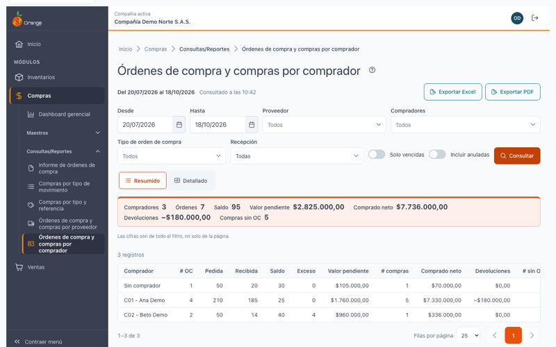
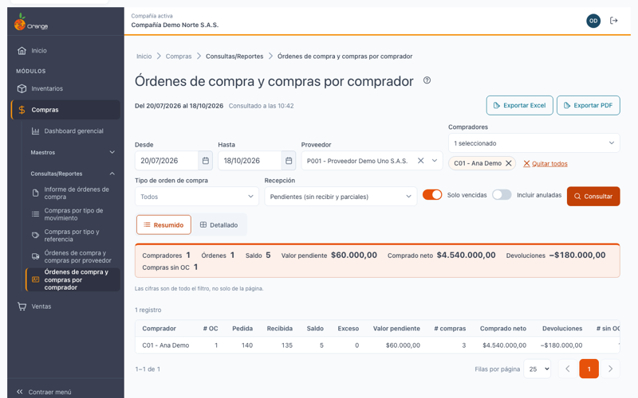
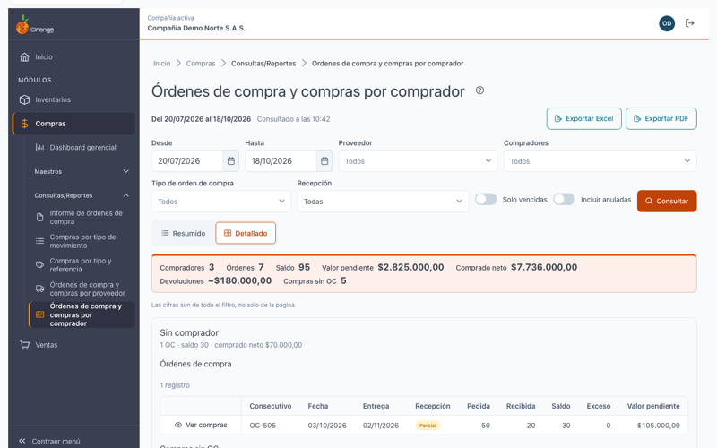

[Regresar a Compras](../readme.md)

---

# Órdenes de compra y compras por comprador

**Módulo**: Compras · **Submódulo**: Consultas/Reportes · **Versión**: V2026 · **Actualizado**: 18/10/2026

---

## Descripción

El informe **Órdenes de compra y compras por comprador** le muestra, para cada comprador, cuántas órdenes gestionó, cuánto se pidió, cuánto ya se recibió, cuánto falta y cuánto se compró, incluidas las compras **sin orden de compra**.

Sirve para evaluar la gestión de cada comprador: si sus órdenes se cumplen, si quedan pendientes o vencidas y cuánto se compra por fuera de las órdenes.

Puede verlo en dos vistas:

- **Resumido**: una fila por comprador, con sus totales.
- **Detallado**: comprador → sus órdenes de compra → las compras de cada orden, y al final las compras sin orden de compra.

Las compras que no tienen comprador aparecen en el grupo **Sin comprador**. Es una categoría normal, no un error.

Es solo de consulta: no modifica órdenes, compras ni inventario.

---

## Acceso

1. En el menú, entre a **Compras › Consultas/Reportes › Órdenes de compra y compras por comprador**.
2. Para ver el informe necesita el permiso **Consultar** sobre esta pantalla.
3. Para usar **Exportar Excel** y **Exportar PDF** necesita además el permiso **Exportar**.

Las compras y las órdenes se abren desde el informe solo si tiene permiso para consultarlas.

---

## Pantalla principal

| Elemento | Para qué sirve |
|----------|----------------|
| **?** (junto al título) | Abre esta ayuda en un panel lateral. |
| **Del … al …** | Periodo de las **órdenes**. Por defecto, los **últimos 90 días** hasta hoy. |
| **Vista del informe** | **Resumido** o **Detallado**. |
| **Exportar Excel** / **Exportar PDF** | Descarga el resultado con los mismos filtros. Ver *Exportar*. |
| **Filtros** | Comprador, Proveedor, Tipo de orden de compra, Recepción, Solo vencidas e Incluir anuladas. Ver *Filtros*. |
| **Consultar** | Ejecuta el informe con los filtros elegidos. |
| Totales | Cifras de **todo el filtro**, no solo de la página. |

> El informe **no se consulta solo**. Si cambia un filtro, pulse **Consultar**.

---

## Filtros

| Filtro | Qué hace |
|--------|----------|
| **Desde** / **Hasta** | Fecha de la orden. El rango no puede superar **366 días**. |
| **Comprador** | Solo esos compradores. Puede elegir varios (máximo 50). |
| **Proveedor** | Solo las órdenes de esos proveedores. |
| **Tipo de orden de compra** | Solo ese tipo de orden. |
| **Recepción** | **Todas**, **Pendientes** (sin recibir y parciales), **Sin recibir**, **Parciales**, **Realizadas** (recepción total) o **Con exceso**. |
| **Solo vencidas** | Solo las órdenes con saldo cuya fecha de entrega ya pasó. |
| **Incluir anuladas** | Muestra las órdenes anuladas, marcadas. No suman a los totales. |

---

## Vistas

### Resumido

Una fila por comprador y al final el **TOTAL GENERAL**.

| Columna | Qué significa |
|---------|---------------|
| **Órdenes** | Cuántas órdenes gestionó el comprador en el periodo. |
| **Pedido** | Cantidad y valor pedidos. |
| **Recibida** | Cantidad recibida, neta: las devoluciones restan. |
| **Saldo** | Lo que falta por recibir. |
| **Exceso** | Lo que se recibió de más. |
| **Valor pendiente** | Valor estimado de lo que falta por recibir. |
| **Compras** | Cuántas compras cumplieron las órdenes del comprador. |
| **Comprado neto** | Compras menos devoluciones de esas órdenes. |
| **Devoluciones** | Valor de las devoluciones. |
| **Compras sin OC** | Cuántas compras **sin orden de compra** tiene y su valor neto. |

### Detallado

Cada comprador tiene:

1. Sus **órdenes de compra**, con la misma recepción y saldo del informe de órdenes de compra.
2. En cada orden, el botón **Ver compras**, que abre el detalle de las compras que la cumplieron.
3. Al final, el bloque **Compras sin OC de [comprador]**, con sus documentos.

### Reglas de atribución

- La **orden** y **todas las compras que la cumplen** se cuentan con el comprador **de la orden**.
- Una **compra sin orden** se cuenta con el comprador **de su propio documento**.
- Si el comprador de la compra es distinto al de la orden, el detalle de la orden muestra los dos.
- Si el documento no tiene comprador, se cuenta en el grupo **Sin comprador**.
- **Valor** es el subtotal de las líneas, **sin IVA ni retenciones** del encabezado.
- Las compras **anuladas no suman**.
- Una compra que cumple una orden, pero cae **fuera del rango de fechas** de la orden, no suma en la fila del comprador. Se ve en el detalle de la orden.

---

## Ver las compras de una orden

1. En el detalle, pulse **Ver compras** en la fila de la orden.
2. Se abre el panel **Compras de la orden**, con la recepción por variante y las compras que la cumplieron.
3. Las devoluciones restan. Las compras anuladas aparecen marcadas y no suman.
4. Pulse **Cerrar el detalle** para volver.

Para el detalle completo, vea el [informe de órdenes de compra](ordenes-compra.md#ver-las-compras-de-una-orden).

---

## Exportar a Excel y a PDF

Con el permiso **Exportar** verá **Exportar Excel** y **Exportar PDF**. Descargan el informe con **los mismos filtros** y la misma vista.

| Formato | Límite | Qué incluye |
|---------|--------|-------------|
| **Excel** (.xlsx) | Hasta **50.000 filas**. | Una fila por comprador, con sus órdenes y su bloque de compras sin OC, y el **TOTAL GENERAL**. |
| **PDF** | Hasta **4.000 filas**. Se imprime en horizontal. | Encabezado con la empresa, los filtros, el usuario y la fecha y hora; **subtotales por comprador** y **TOTAL GENERAL**. |

Si el resultado supera el límite, no se descarga nada: *Hay demasiadas filas para exportar a Excel (máximo 50.000). Acota los filtros.* o *El PDF admite hasta 4.000 filas; filtra más o usa Excel.*

---

## Estados de la pantalla

| Situación | Qué ve |
|-----------|--------|
| Antes de consultar | *Elige los filtros y consulta*. |
| Sin resultados | *No hay resultados para los filtros elegidos*. |
| Error al consultar | *No se pudo consultar el informe*, con **Reintentar**. Sus filtros se conservan. |
| Sin permiso | *No tiene permiso para ver este informe*. |

---

## Preguntas frecuentes

**¿Qué es el grupo «Sin comprador»?**
Son los documentos que no tienen comprador asignado. Es normal: revise si conviene asignar un comprador en el documento.

**¿Por qué la compra aparece con un comprador y su orden con otro?**
La orden manda. La compra se cuenta con el comprador de la orden, y en el detalle aparecen los dos nombres.

**¿Por qué una compra sin orden aparece en un comprador?**
Se cuenta con el comprador que tiene el documento de compra.

**¿Por qué no veo una orden anulada?**
Active **Incluir anuladas**. La orden aparece marcada, sin saldo, y no suma a los totales.

---

## Otros informes de Compras

- [Informe de órdenes de compra](ordenes-compra.md)
- [Compras por tipo de movimiento](tipo-movimiento.md)
- [Compras por tipo y referencia](tipo-referencia.md)
- [Órdenes de compra y compras por proveedor](proveedores.md)

[Regresar a Compras](../readme.md)
