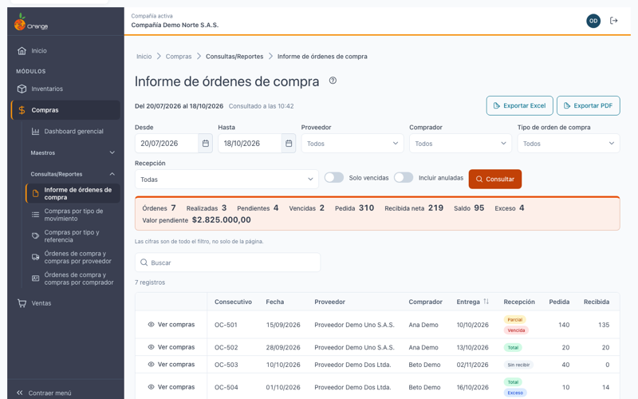
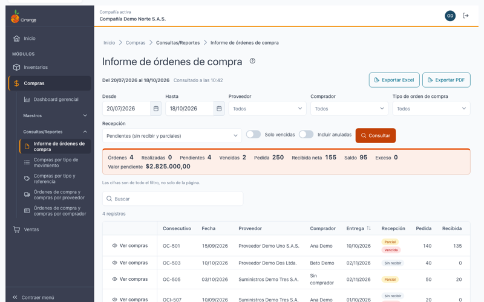
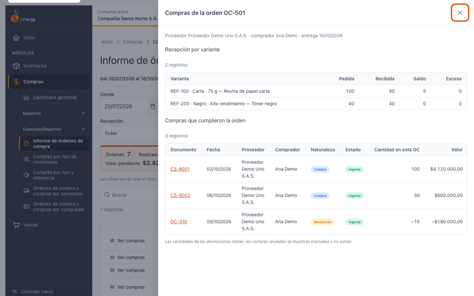
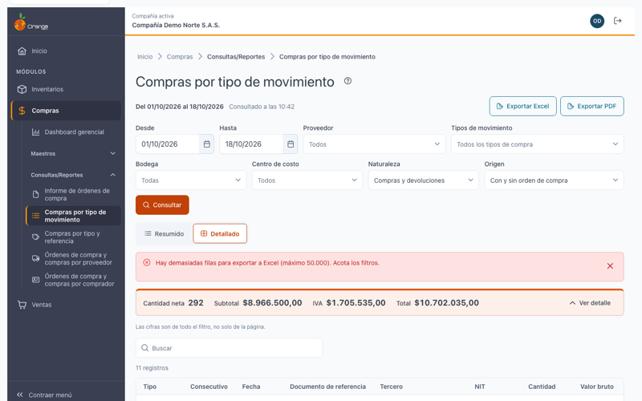
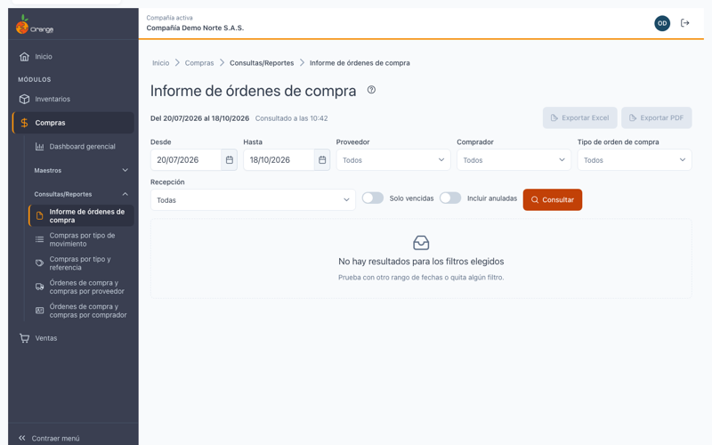

[Regresar a Compras](../readme.md)

---

# Informe de órdenes de compra

**Módulo**: Compras · **Submódulo**: Consultas/Reportes · **Versión**: V2026 · **Actualizado**: 18/10/2026

---

## Descripción

El **informe de órdenes de compra** le muestra qué se pidió a cada proveedor, cuánto ya llegó y **qué falta por recibir**. Sirve para revisar las órdenes realizadas, las pendientes, las que llegaron de más y las vencidas.

Cada orden tiene su **recepción**: lo que se ha recibido con las compras y devoluciones que la cumplen. Al pulsar **Ver compras** puede revisar esos documentos uno por uno.

Las cifras se calculan **al consultar**, con los documentos registrados hasta ese momento. El informe es solo de consulta: no modifica órdenes, compras ni inventario.

---

## Acceso

1. En el menú, entre a **Compras › Consultas/Reportes › Informe de órdenes de compra**.
2. Para ver el informe necesita el permiso **Consultar** sobre esta pantalla.
3. Para usar **Exportar Excel** y **Exportar PDF** necesita además el permiso **Exportar**.

Si no tiene el permiso de consulta, verá el mensaje *No tiene permiso para ver este informe*.

---

## Pantalla principal

| Elemento | Para qué sirve |
|----------|----------------|
| **?** (junto al título) | Abre esta ayuda en un panel lateral, sin salir del informe. |
| **Del … al …** | Periodo consultado. Por defecto, los **últimos 90 días** hasta hoy. |
| **Consultado a las HH:MM** | Hora de la última consulta. |
| **Exportar Excel** / **Exportar PDF** | Descarga el resultado con los mismos filtros. Ver *Exportar*. |
| **Filtros** (Proveedor, Comprador, Tipo de orden de compra, Recepción) | Limitan el resultado. Ver *Filtros*. |
| **Solo vencidas** / **Incluir anuladas** | Interruptores. Ver *Filtros*. |
| **Consultar** | Ejecuta el informe con los filtros elegidos. |
| Franja de totales | Cifras de **todo el filtro**, no solo de la página: órdenes, realizadas, pendientes, vencidas, pedida, recibida neta, saldo, exceso y valor pendiente. |
| **Buscar** | Busca dentro del resultado que ya está en pantalla. |
| **Ver compras** | Abre el detalle de la orden. Ver *Ver las compras de una orden*. |

> El informe **no se consulta solo**. Si cambia un filtro, pulse **Consultar** para ver el resultado nuevo.

---

## Filtros

| Filtro | Qué hace |
|--------|----------|
| **Desde** / **Hasta** | Fecha de la orden. El rango no puede superar **366 días**. Si lo supera, verá *El rango no puede superar 366 días*. |
| **Proveedor** | Solo las órdenes de los proveedores elegidos. Puede elegir varios (máximo 50). |
| **Comprador** | Solo las órdenes de ese comprador. |
| **Tipo de orden de compra** | Solo ese tipo de orden. |
| **Recepción** | Ver la tabla de estados abajo. |
| **Solo vencidas** | Muestra solo las órdenes con saldo cuya fecha de entrega ya pasó. |
| **Incluir anuladas** | Muestra también las órdenes anuladas, marcadas. No tienen saldo y **no suman** a los totales. |

**Opciones de Recepción:**

| Opción | Muestra |
|--------|---------|
| Todas | Todas las órdenes del filtro. |
| Pendientes (sin recibir y parciales) | Órdenes con algo por recibir. |
| Sin recibir | Órdenes sin ninguna recepción. |
| Parciales | Órdenes con una parte recibida. |
| Realizadas (recepción total) | Órdenes completamente recibidas. |
| Con exceso | Órdenes a las que se recibió más de lo pedido. |

Puede ordenar el resultado por **Entrega**, **Saldo** o **Valor pendiente**.

---

## Columnas y definiciones

| Columna | Qué significa |
|---------|---------------|
| **Consecutivo** | Número de la orden. |
| **Fecha** / **Entrega** | Fecha de la orden y fecha de entrega (fecha de la orden más los días de plazo). |
| **Proveedor** / **Comprador** | Quién vende y quién gestiona la orden. |
| **Recepción** | **Sin recibir**, **Parcial** o **Total**. Además puede aparecer **Vencida**, **Exceso** o **Anulada**. |
| **Pedida** | Cantidad pedida en la orden. |
| **Recibida** | Cantidad recibida, neta: las devoluciones **restan**. |
| **Saldo** | Lo que falta por recibir. Nunca es negativo. |
| **Exceso** | Lo que se recibió de más. |
| **Valor pendiente** | Valor estimado de lo que falta por recibir. |

Una orden está **vencida** cuando su fecha de entrega ya pasó y todavía tiene saldo.

Las cantidades se revisan **por variante** (por ejemplo, cada talla o color de una referencia). Una misma variante puede aparecer en varias líneas o bodegas de la orden; el saldo se muestra por orden y variante.

---

## Ver las compras de una orden

1. En la fila de la orden, pulse **Ver compras**.
2. Se abre el panel **Compras de la orden** con tres partes:
   - **Resumen**: proveedor, comprador y fecha de entrega.
   - **Recepción por variante**: pedida, recibida, saldo y exceso de cada variante.
   - **Compras que cumplieron la orden**: cada compra o devolución, con su documento, fecha, proveedor, naturaleza (**Compra** o **Devolución**), estado (**Vigente** o **Anulada**), cantidad aplicada a esta orden y valor.
3. Las cantidades de las devoluciones restan. Las compras anuladas se muestran marcadas y no suman.
4. Si el documento es un enlace, pulse el número para abrir la compra. El enlace aparece solo si tiene permiso para consultar **Compras y devoluciones**.
5. Pulse **Cerrar el detalle** para volver al informe.

Si la orden todavía no tiene compras, verá *Sin compras asociadas*.

---

## Exportar a Excel y a PDF

Con el permiso **Exportar** verá los botones **Exportar Excel** y **Exportar PDF**. Cada uno descarga el informe con **los mismos filtros** que tiene aplicados.

| Formato | Límite | Qué incluye |
|---------|--------|-------------|
| **Excel** (.xlsx) | Hasta **50.000 filas**. | Todas las filas del filtro, con los totales. |
| **PDF** | Hasta **4.000 filas**. Se imprime en horizontal. | Encabezado con la empresa, los filtros, el usuario y la fecha y hora; las filas y el **TOTAL GENERAL**. |

Si el resultado supera el límite, no se descarga nada y verá un aviso: *Hay demasiadas filas para exportar a Excel (máximo 50.000). Acota los filtros.* o *El PDF admite hasta 4.000 filas; filtra más o usa Excel.*

Mientras se genera el archivo verá *Generando el archivo…*. Si falla, verá *No se pudo generar el archivo. Intenta de nuevo.*

---

## Estados de la pantalla

| Situación | Qué ve |
|-----------|--------|
| Antes de consultar | *Elige los filtros y consulta*. El informe no se consulta solo. |
| Sin resultados | *No hay resultados para los filtros elegidos*. Pruebe otro rango o quite un filtro. |
| Error al consultar | *No se pudo consultar el informe*, con el botón **Reintentar**. Sus filtros se conservan. |
| Sin permiso | *No tiene permiso para ver este informe*. |

---

## Preguntas frecuentes

**¿Por qué una orden anulada no tiene saldo?**
Porque ya no se espera su recepción. Se muestra solo si activa **Incluir anuladas**, marcada, y no suma a los totales.

**¿Por qué el saldo sube después de una devolución?**
Porque la devolución resta de lo recibido. Revise las compras de la orden con **Ver compras**: la devolución aparece con cantidad negativa.

**¿Por qué una orden con exceso no tiene saldo?**
Se recibió más cantidad que la pedida. El saldo no puede ser negativo: lo recibido de más aparece en la columna **Exceso**.

**¿Por qué no veo los botones de Excel y PDF?**
Su perfil no tiene el permiso **Exportar** sobre este informe. Pida el permiso a un administrador.

**¿Por qué una compra no aparece en el resultado?**
El informe muestra **órdenes**. Una compra aparece dentro de la orden a la que cumple, con **Ver compras**. Las compras que no tienen orden de compra se ven en los informes por tipo de movimiento y por tipo y referencia.

**¿Cómo veo las cifras de un solo proveedor o comprador?**
Use los filtros **Proveedor** o **Comprador**, o los informes **Órdenes de compra y compras por proveedor** y **por comprador**.

---

## Otros informes de Compras

- [Compras por tipo de movimiento](tipo-movimiento.md)
- [Compras por tipo y referencia](tipo-referencia.md)
- [Órdenes de compra y compras por proveedor](proveedores.md)
- [Órdenes de compra y compras por comprador](compradores.md)

[Regresar a Compras](../readme.md)
