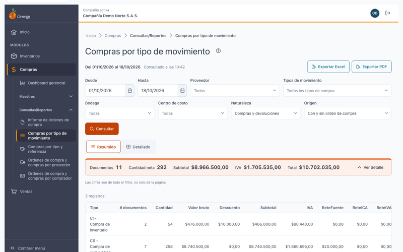
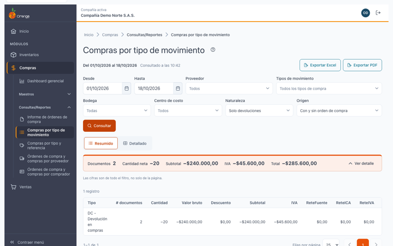
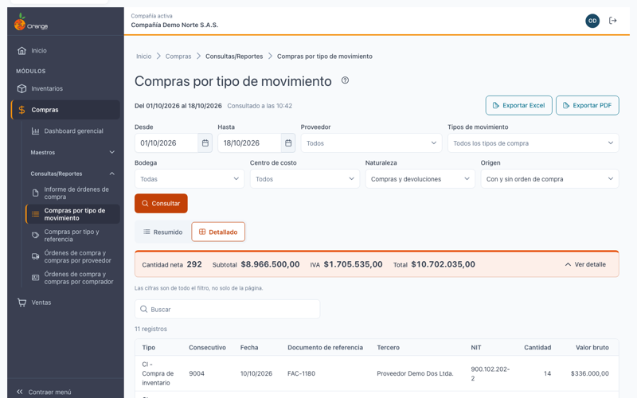
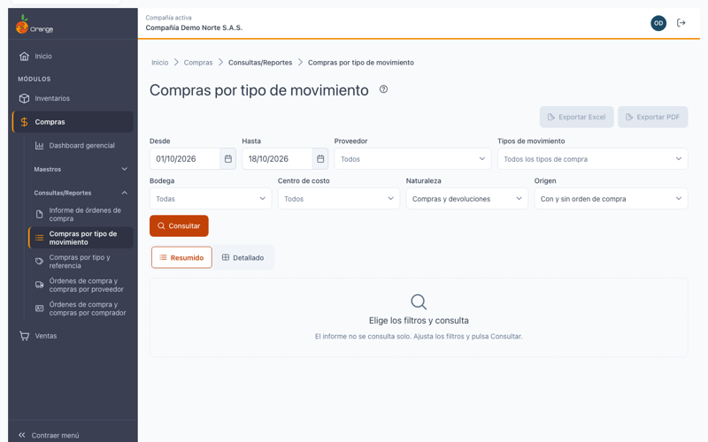

[Regresar a Compras](../readme.md)

---

# Compras por tipo de movimiento

**Módulo**: Compras · **Submódulo**: Consultas/Reportes · **Versión**: V2026 · **Actualizado**: 18/10/2026

---

## Descripción

El informe **Compras por tipo de movimiento** le muestra cuánto compró en un periodo, separado por **tipo de movimiento** (por ejemplo, compra nacional o compra de importación, según los tipos que tenga configurados).

Puede verlo en dos vistas:

- **Resumido**: un renglón por tipo de movimiento, con sus totales.
- **Detallado**: un renglón por **documento** de compra o devolución.

Las devoluciones restan. Los totales son **netos**: compras menos devoluciones.

Es solo de consulta: no modifica compras ni inventario.

---

## Acceso

1. En el menú, entre a **Compras › Consultas/Reportes › Compras por tipo de movimiento**.
2. Para ver el informe necesita el permiso **Consultar** sobre esta pantalla.
3. Para usar **Exportar Excel** y **Exportar PDF** necesita además el permiso **Exportar**.

---

## Pantalla principal

| Elemento | Para qué sirve |
|----------|----------------|
| **?** (junto al título) | Abre esta ayuda en un panel lateral. |
| **Del … al …** | Periodo consultado. Por defecto, el **mes en curso**. |
| **Vista del informe** | **Resumido** o **Detallado**. |
| **Exportar Excel** / **Exportar PDF** | Descarga el resultado con los mismos filtros. Ver *Exportar*. |
| **Filtros** | Tipos de movimiento, Proveedor, Bodega, Centro de costo, Naturaleza y Origen. Ver *Filtros*. |
| **Consultar** | Ejecuta el informe con los filtros elegidos. |
| Totales | Cifras de **todo el filtro**, no solo de la página. |

> El informe **no se consulta solo**. Si cambia un filtro, pulse **Consultar**.

---

## Filtros

| Filtro | Qué hace |
|--------|----------|
| **Desde** / **Hasta** | Fecha del documento. El rango no puede superar **366 días**. |
| **Tipos de movimiento** | Puede elegir varios (máximo 50). Si no elige ninguno, se incluyen **todos** los tipos de compra. |
| **Proveedor** | Solo los documentos de esos proveedores. |
| **Bodega** | Solo las líneas de esas bodegas. |
| **Centro de costo** | Solo las líneas de esos centros de costo. |
| **Naturaleza** | **Compras y devoluciones** (predeterminado), **Solo compras** o **Solo devoluciones**. |
| **Origen** | **Con y sin orden de compra** (predeterminado), **Con orden de compra** o **Sin orden de compra**. |

Los documentos **sin orden de compra** son una categoría normal. En el detallado aparecen con **Sin OC** en la columna **OC**.

---

## Vistas

### Resumido

Una fila por tipo de movimiento, y al final el **TOTAL GENERAL**.

| Columna | Qué significa |
|---------|---------------|
| **Código** y **Nombre** | Tipo de movimiento. |
| **Documentos** | Cuántos documentos tiene ese tipo. |
| **Cantidad** | Cantidad neta. |
| **Bruto**, **Descuento**, **Subtotal**, **IVA** | Valores del tipo. |
| **ReteFuente**, **ReteICA**, **ReteIVA** | Retenciones. |
| **Seguro/Fletes**, **Otros** | Valores de encabezado. |
| **Total** | Valor neto del tipo, compras menos devoluciones. |

### Detallado

Una fila por documento, agrupada por tipo de movimiento. Cada grupo tiene su **subtotal**, y al final el **TOTAL GENERAL**.

| Columna | Qué significa |
|---------|---------------|
| **Tipo** y **Consecutivo** | Tipo de movimiento y número del documento. |
| **Fecha** | Fecha del documento. |
| **Documento de referencia** | Número de la factura del proveedor, si la tiene. |
| **Tercero** y **NIT** | Proveedor del documento. |
| **Cantidad**, **Bruto** … **Total** | Mismos valores del resumido, por documento. |
| **OC** | Número de la orden de compra, o **Sin OC**. |

Las devoluciones aparecen con cantidad y valores **negativos**.

### Reglas de los valores

- El **flete**, **otros valores**, las **retenciones** y el **IVA de encabezado** se cuentan **una sola vez por documento**, aunque el documento tenga varias bodegas o centros de costo.
- Los **anulados no se cuentan**, igual que en el informe anterior de compras por tipo de movimiento.

---

## Exportar a Excel y a PDF

Con el permiso **Exportar** verá **Exportar Excel** y **Exportar PDF**. Descargan el informe con **los mismos filtros** y la misma vista.

| Formato | Límite | Qué incluye |
|---------|--------|-------------|
| **Excel** (.xlsx) | Hasta **50.000 filas**. | Filas de cada tipo con su **subtotal** y el **TOTAL GENERAL**. |
| **PDF** | Hasta **4.000 filas**. Se imprime en horizontal. | Encabezado con la empresa, los filtros, el usuario y la fecha y hora; subtotales y **TOTAL GENERAL**. |

Si el resultado supera el límite, no se descarga nada: *Hay demasiadas filas para exportar a Excel (máximo 50.000). Acota los filtros.* o *El PDF admite hasta 4.000 filas; filtra más o usa Excel.*

---

## Estados de la pantalla

| Situación | Qué ve |
|-----------|--------|
| Antes de consultar | *Elige los filtros y consulta*. |
| Sin resultados | *No hay resultados para los filtros elegidos*. |
| Error al consultar | *No se pudo consultar el informe*, con **Reintentar**. Sus filtros se conservan. |
| Sin permiso | *No tiene permiso para ver este informe*. |

---

## Diferencias con el informe anterior

| Tema | Informe anterior | Ahora |
|------|------------------|-------|
| Rango de fechas | Máximo 31 días. | Máximo 366 días. |
| Tipos de movimiento | Había que elegir al menos uno. | Si no elige ninguno, se incluyen todos los tipos de compra. |
| Encabezado del documento | Podía repetir el flete, las retenciones y el IVA en cada bodega o centro de costo. | Se cuentan **una vez** por documento. |
| Retención en la fuente | Se aplicaba solo si la base era **mayor** que el umbral. | Se aplica desde el umbral **en adelante** (base mayor o igual). |
| Anulados | No se cuentan. | No se cuentan. |

---

## Preguntas frecuentes

**¿Por qué el total de un tipo es menor que la suma de sus compras?**
Porque las devoluciones restan. Para ver solo compras, elija **Naturaleza: Solo compras**.

**¿Por qué un documento aparece como Sin OC?**
Porque no tiene orden de compra. Es normal: la mayoría de las compras se registran sin orden. Para verlas solas, elija **Origen: Sin orden de compra**.

**¿Por qué no aparece una compra que registré ayer?**
Revise el rango de fechas y pulse **Consultar**. Un documento anulado no aparece en el informe.

**¿Puedo ver solo una bodega o un centro de costo?**
Sí. Use los filtros **Bodega** o **Centro de costo**.

---

## Otros informes de Compras

- [Informe de órdenes de compra](ordenes-compra.md)
- [Compras por tipo y referencia](tipo-referencia.md)
- [Órdenes de compra y compras por proveedor](proveedores.md)
- [Órdenes de compra y compras por comprador](compradores.md)

[Regresar a Compras](../readme.md)
