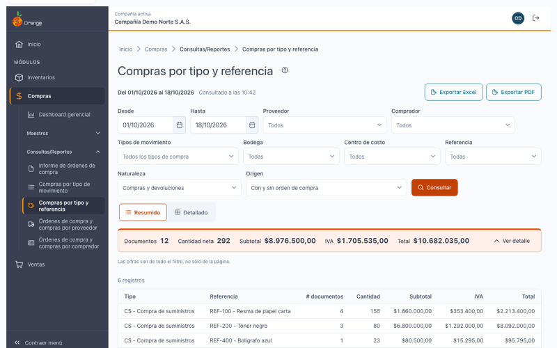
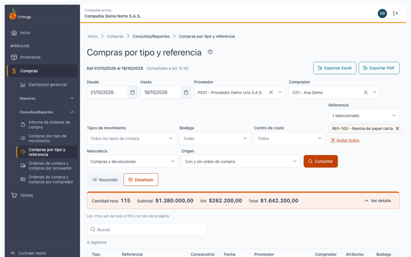
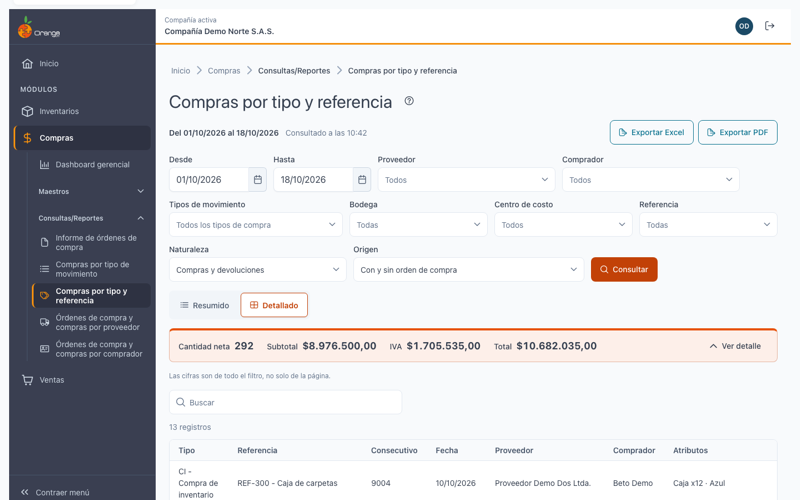

[Regresar a Compras](../readme.md)

---

# Compras por tipo y referencia

**Módulo**: Compras · **Submódulo**: Consultas/Reportes · **Versión**: V2026 · **Actualizado**: 18/10/2026

---

## Descripción

El informe **Compras por tipo y referencia** le muestra qué **referencias** (productos) se compraron y devolvieron en un periodo, dentro de cada **tipo de movimiento**.

Puede verlo en dos vistas:

- **Resumido**: por tipo de movimiento y, dentro, por referencia.
- **Detallado**: hasta la **línea de cada documento**: qué referencia, en qué bodega, a qué precio y con qué orden de compra.

Las devoluciones restan. Los totales son **netos**.

Es solo de consulta: no modifica compras ni inventario.

---

## Acceso

1. En el menú, entre a **Compras › Consultas/Reportes › Compras por tipo y referencia**.
2. Para ver el informe necesita el permiso **Consultar** sobre esta pantalla.
3. Para usar **Exportar Excel** y **Exportar PDF** necesita además el permiso **Exportar**.

---

## Pantalla principal

| Elemento | Para qué sirve |
|----------|----------------|
| **?** (junto al título) | Abre esta ayuda en un panel lateral. |
| **Del … al …** | Periodo consultado. Por defecto, el **mes en curso**. |
| **Vista del informe** | **Resumido** o **Detallado**. |
| **Exportar Excel** / **Exportar PDF** | Descarga el resultado con los mismos filtros. Ver *Exportar*. |
| **Filtros** | Tipos de movimiento, Proveedor, Referencia, Comprador, Bodega, Centro de costo, Naturaleza y Origen. Ver *Filtros*. |
| **Consultar** | Ejecuta el informe con los filtros elegidos. |
| Totales | Cifras de **todo el filtro**, no solo de la página. |

> El informe **no se consulta solo**. Si cambia un filtro, pulse **Consultar**.

---

## Filtros

| Filtro | Qué hace |
|--------|----------|
| **Desde** / **Hasta** | Fecha del documento. El rango no puede superar **366 días**. |
| **Tipos de movimiento** | Puede elegir varios (máximo 50). Si no elige ninguno, se incluyen **todos** los tipos de compra. |
| **Proveedor** | Solo los documentos de esos proveedores. |
| **Referencia** | Solo esas referencias. |
| **Comprador** | Solo los documentos de ese comprador. |
| **Bodega** | Solo las líneas de esas bodegas. |
| **Centro de costo** | Solo las líneas de esos centros de costo. |
| **Naturaleza** | **Compras y devoluciones** (predeterminado), **Solo compras** o **Solo devoluciones**. |
| **Origen** | **Con y sin orden de compra** (predeterminado), **Con orden de compra** o **Sin orden de compra**. |

Los filtros se aplican en el servidor, sobre todos los documentos del periodo, no solo sobre la página que ve.

---

## Vistas

### Resumido

Por cada **tipo de movimiento**, una fila por **referencia**. Cada tipo tiene su subtotal y al final está el **TOTAL GENERAL**.

| Columna | Qué significa |
|---------|---------------|
| **Código** y **Nombre** | Referencia. |
| **Cantidad** | Cantidad neta. |
| **Subtotal**, **IVA**, **Total** | Valores netos de la referencia. |
| **Documentos** | Cuántos documentos incluyen esa referencia. |

### Detallado

Tipo de movimiento → referencia → **línea de cada documento**.

| Columna | Qué significa |
|---------|---------------|
| **Consecutivo** y **Fecha** | Documento de compra o devolución. |
| **Proveedor** y **Comprador** | Quién vende y quién compra. |
| **Atributos** | Variante de la referencia (por ejemplo, talla o color). |
| **Bodega** y **Centro de costo** | Donde entró o salió la mercancía. |
| **Cantidad** y **Valor unitario** | Cantidad de la línea (negativa en devoluciones) y su precio. |
| **Subtotal**, **IVA**, **Total** | Valores de la línea. |
| **OC** | Orden de compra, o **Sin OC**. |

### Reglas de los valores

- Las devoluciones aparecen con cantidad y valores **negativos**, así el total queda neto.
- El **IVA**, el flete y las retenciones de encabezado se cuentan **una sola vez por documento**, aunque el documento tenga varias bodegas o centros de costo.
- Los **anulados no se cuentan**, igual que en el informe anterior de compras por tipo y referencia.

---

## Exportar a Excel y a PDF

Con el permiso **Exportar** verá **Exportar Excel** y **Exportar PDF**. Descargan el informe con **los mismos filtros** y la misma vista.

| Formato | Límite | Qué incluye |
|---------|--------|-------------|
| **Excel** (.xlsx) | Hasta **50.000 filas**. | Cada tipo con sus referencias o líneas, subtotales y **TOTAL GENERAL**. |
| **PDF** | Hasta **4.000 filas**. Se imprime en horizontal. | Encabezado con la empresa, los filtros, el usuario y la fecha y hora; subtotales y **TOTAL GENERAL**. |

Si el resultado supera el límite, no se descarga nada: *Hay demasiadas filas para exportar a Excel (máximo 50.000). Acota los filtros.* o *El PDF admite hasta 4.000 filas; filtra más o usa Excel.*

---

## Estados de la pantalla

| Situación | Qué ve |
|-----------|--------|
| Antes de consultar | *Elige los filtros y consulta*. |
| Sin resultados | *No hay resultados para los filtros elegidos*. |
| Error al consultar | *No se pudo consultar el informe*, con **Reintentar**. Sus filtros se conservan. |
| Sin permiso | *No tiene permiso para ver este informe*. |

---

## Diferencias con el informe anterior

| Tema | Informe anterior | Ahora |
|------|------------------|-------|
| Devoluciones | En el informe por tipo y referencia se **sumaban como si fueran compras**, y el total quedaba sobrestimado. | Restan. El total es neto. |
| Anulados | No se cuentan. | No se cuentan. **Igual que en el informe anterior.** |
| Rango de fechas | Máximo 31 días. | Máximo 366 días. |
| Filtros | Se aplicaban sobre el resultado ya cargado. | Se aplican en el servidor, sobre todo el periodo. |
| Retención en la fuente | Se aplicaba solo si la base era **mayor** que el umbral. | Se aplica desde el umbral **en adelante** (base mayor o igual). |

---

## Preguntas frecuentes

**¿Por qué una referencia tiene cantidad negativa?**
Porque en ese periodo se devolvió más de lo que se compró. Para ver solo compras, elija **Naturaleza: Solo compras**.

**¿Por qué una compra anulada no aparece?**
Los documentos anulados no se cuentan, igual que en el informe anterior. Si necesita verlos, revise el documento en la pantalla de **Compras y devoluciones**.

**¿Cómo veo qué compró un comprador de una referencia?**
Filtre por **Comprador** y **Referencia**, y consulte en la vista **Detallado**.

**¿Por qué un documento aparece como Sin OC?**
Porque no tiene orden de compra. Es normal. Para verlos solos, elija **Origen: Sin orden de compra**.

---

## Otros informes de Compras

- [Informe de órdenes de compra](ordenes-compra.md)
- [Compras por tipo de movimiento](tipo-movimiento.md)
- [Órdenes de compra y compras por proveedor](proveedores.md)
- [Órdenes de compra y compras por comprador](compradores.md)

[Regresar a Compras](../readme.md)
