[Regresar a Compras](../readme.md)

---

# 🚦 Reposición del proveedor

---

## 📋 Descripción

El modo **Reposición** de la pestaña **Inventario y rotación** de la ficha de un proveedor le dice **qué referencias de ese proveedor conviene reponer, cuánto comprar y en qué orden**.

Sirve para responder preguntas como estas:

- ¿Qué referencias de este proveedor ya están por debajo del nivel seguro?
- ¿Cuántas unidades conviene comprar de cada una para quedar en el nivel verde?
- ¿Qué compro primero?
- ¿Qué referencias tienen más de lo necesario, y cuánto dinero representa?

Para decidir, la pantalla usa un **semáforo de reposición**. Es una forma sencilla de planear las compras por niveles (en la literatura se llama DDMRP). Cada referencia tiene tres topes, que dependen de cuánto se consume por día y de cuánto tarda el proveedor en entregar. Según dónde esté lo que hay en existencia frente a esos topes, la referencia cae en una **zona** de color: **Roja**, **Amarilla**, **Verde**, **Exceso** o **Sin demanda**.

Puntos clave:

- Es **solo de consulta**. Esta pantalla no crea órdenes de compra ni cambia ningún dato.
- El **sugerido de compra** es una propuesta. Usted decide qué compra.
- Trabaja con una **fecha de corte** que usted elige. La demanda son siempre los **90 días** que terminan en esa fecha.
- Exporta a **Excel** y a dos formatos de **PDF**. El PDF para el proveedor es un **pedido sugerido** y no incluye costos ni valores.

> 🔐 Necesita el permiso **Consultar** sobre **Proveedores**. Sin ese permiso la pestaña no aparece.

Para ver la existencia de hoy de las referencias del proveedor, vea el manual de [Inventario del proveedor](proveedores-inventario.md). Para ver qué tan rápido se mueve el inventario, vea el manual de [Rotación del proveedor](proveedores-rotacion.md). Para crear o editar el proveedor, vea el manual de [Proveedores](proveedores.md).

---

## 🎯 Acceso

1. Entre a **Compras › Proveedores** y abra la ficha de un proveedor **ya guardado**.
2. Haga clic en la pestaña **Inventario y rotación**.
3. Debajo de la descripción de la pestaña, elija **Reposición** en el selector **Qué quieres ver**.

Al abrir la pestaña, el selector queda en **Inventario**. Elegir **Reposición** no consulta nada por sí solo: la primera consulta la hace usted con **Consultar**.

Mientras el proveedor se está creando y no se ha guardado, la pestaña no aparece. Guárdelo primero.

En la parte superior de la pantalla, junto al título, el botón **?** abre este manual cuando el modo **Reposición** está elegido. Con el modo **Inventario** abre el manual de [Inventario del proveedor](proveedores-inventario.md), y con el modo **Rotación**, el de [Rotación del proveedor](proveedores-rotacion.md).

---

## 🔀 Los tres modos

| Modo | Qué muestra | Cuándo usarlo |
|------|-------------|---------------|
| **Inventario** | Cuánto hay hoy de las referencias del proveedor, a una fecha de corte. | Para saber la existencia. |
| **Rotación** | Cuánto se consumió y qué tan rápido rota el inventario, en un periodo. | Para saber qué tan rápido se mueve. |
| **Reposición** | Qué zona tiene cada referencia, cuánto comprar y en qué orden. | Para decidir qué comprar a este proveedor. |

- Cambiar de modo **no consulta nada** por sí solo. En **Reposición**, la primera consulta la hace usted con **Consultar**.
- La vista **A · Total / B · Prorrateado** es **la misma** para los tres modos. Si la cambia en uno, los otros la conservan.
- Cada modo hace su propia consulta. Para ver la existencia y la reposición de una misma referencia, cambie de modo.

---

## 1️⃣ Pantalla principal

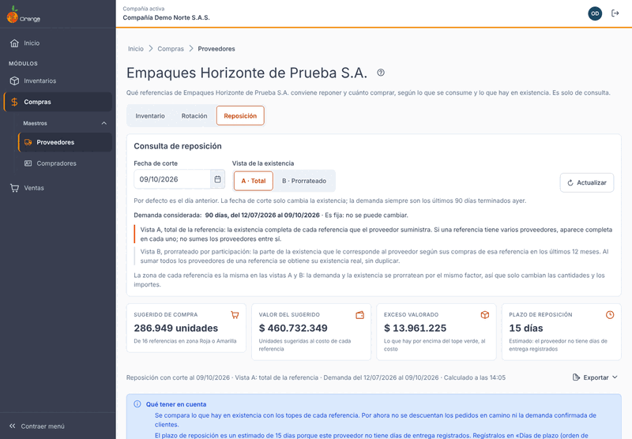

Al elegir **Reposición**, verá, de arriba hacia abajo:

| Parte | Qué muestra |
|-------|-------------|
| **Consulta de reposición** | La **fecha de corte**, la **vista** (A o B) y el botón **Consultar** (o **Actualizar**, después de la primera consulta). |
| **Demanda considerada** | El periodo de 90 días que se usa para la demanda. Es fijo. |
| **Tarjetas** | Cuatro cifras del proveedor: **Sugerido de compra**, **Valor del sugerido**, **Exceso valorado** y **Plazo de reposición**. |
| **Línea de cálculo** | La fecha de corte, la vista, el periodo de la demanda y la hora del cálculo. Aquí también está el botón **Exportar**. |
| **Qué tener en cuenta** | Los límites del cálculo (sección 1️⃣4️⃣). |
| **Referencias por zona** | Cuántas referencias hay en cada zona, en gráfico o en tabla. |
| **Qué comprar primero** | Las referencias que están en zona Roja o Amarilla, de la más urgente a la menos urgente. |
| **Zonas del semáforo** | La leyenda de las cinco zonas. |
| **Cómo se calcula** | Una explicación paso a paso y los parámetros de la instalación (haga clic para abrirla). |
| **Tabla** | Una fila por referencia, con el filtro por zona, el buscador y los topes en la fila expandible. |

Antes de la primera consulta la pantalla muestra *Aún no hay consulta de reposición* y el botón **Consultar**.

### Qué ve cada permiso

- **Con Consultar sobre Proveedores** usted ve el modo completo, consulta, exporta y ve **costos y valores**.
- **Sin Consultar** la pestaña no aparece. Si el permiso se le quita mientras la pantalla está abierta, verá el aviso *No tienes permiso para consultar la reposición de este proveedor. Se requiere el permiso Consultar sobre Proveedores.*

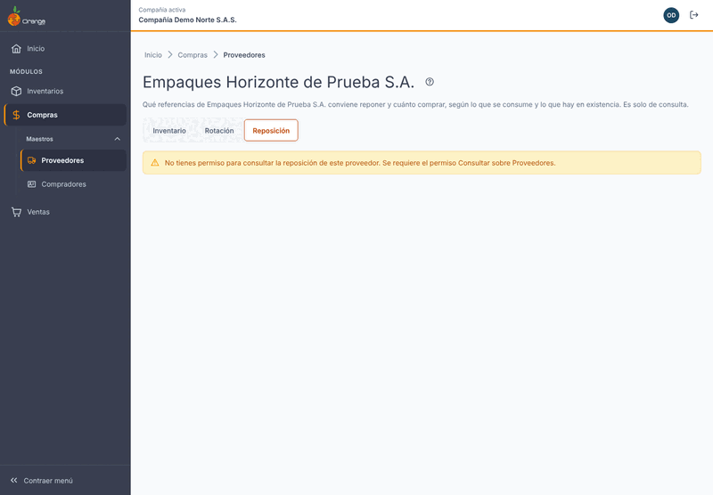

---

## 2️⃣ Fecha de corte

La fecha de corte cumple dos funciones:

- Define la **existencia**: lo que hay en ese día.
- Define el **último día de la demanda**. Los 90 días de consumo van desde 90 días antes hasta la fecha de corte.

Reglas:

- **Por defecto** es el **día anterior**. Por ejemplo, si hoy es 10/10/2026, el corte es el 09/10/2026, y la demanda va del 12/07/2026 al 09/10/2026.
- **La ventana de 90 días es fija.** No se puede cambiar. Lo que sí cambia con la fecha de corte es la existencia y los 90 días que se miden.
- **La fecha de corte no puede ser futura.** Si la escribe, la pantalla dice *La fecha de corte no puede ser futura.*
- **La fecha de corte no puede quedar vacía.** Mientras falte, el botón **Consultar** está deshabilitado y la pantalla dice *Elige una fecha de corte.*

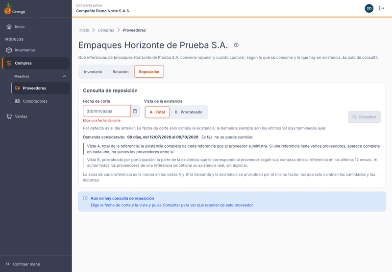

Cambiar la fecha o la vista **no consulta** por sí solo. La pantalla le avisa con *Cambiaste los filtros. Pulsa Consultar para ver la reposición con ellos.* Mientras no consulte de nuevo, lo que ve sigue con la fecha y la vista con que se calculó.

---

## 3️⃣ Consultar y Actualizar

- **Consultar** trae la reposición con la fecha de corte y la vista que eligió. Úselo la primera vez o después de cambiar la fecha o la vista.
- **Actualizar** vuelve a calcular con la información vigente. Úselo cuando registró compras, entradas, salidas o ajustes, o cuando cambió los días de plazo del proveedor en su ficha.
- La línea de cálculo dice a qué hora se calculó lo que ve.

Consultar **no deja registro** en la bitácora ni cambia datos. Puede repetirla sin riesgo.

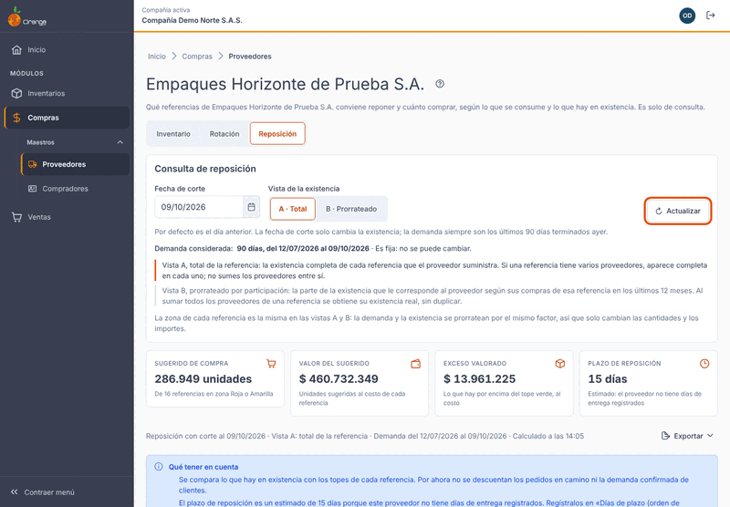

---

## 4️⃣ Vista A y vista B

Elija la vista con el selector **Vista de la existencia**:

| Vista | Qué muestra | Cuándo usarla |
|-------|-------------|---------------|
| **A · Total** (la que aparece por defecto) | La existencia **completa** de cada referencia que el proveedor suministra. | Para saber cuánto hay de cada referencia y cuánto comprar. |
| **B · Prorrateado** | La parte que le corresponde a **este** proveedor, según su participación en las compras de esa referencia en los **últimos 12 meses**. | Para repartir la existencia y las compras entre proveedores. |

**Lo que debe recordar:**

- **La zona de cada referencia es la misma en la vista A y en la vista B.** Solo cambian las cantidades y los importes.
- En la **vista B** se reparten por el mismo factor la existencia, el sugerido y los importes. La demanda diaria, los topes, la zona y la prioridad **no cambian**.
- En la **vista A**, una referencia que compra a varios proveedores aparece completa en cada uno. **No sume los proveedores entre sí.**

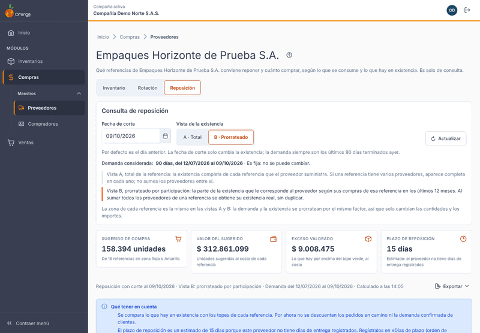

---

## 5️⃣ Demanda diaria (ADU)

La **demanda diaria** es lo que se consume por día, en unidades. En la tabla aparece como **Demanda diaria (ADU)**.

**Cálculo:** unidades consumidas en los 90 días que terminan en la fecha de corte, dividido entre 90.

Por ejemplo, si en esos 90 días se consumieron 900 unidades, la demanda diaria es 900 ÷ 90 = **10 unidades por día**.

Lo que cuenta como consumo es el mismo criterio de la pantalla de [Rotación](proveedores-rotacion.md), en su sección «¿Qué cuenta como consumo?»:

- **Materia prima o insumo:** lo que **salió a producción**.
- **Producto terminado:** lo que **se vendió** (ventas, remisiones y ventas de punto de venta).
- Las **devoluciones** de esos movimientos restan. Si el neto da negativo, cuenta como 0.

Si una referencia no tuvo consumo en los 90 días, su demanda diaria es **0**. Esa referencia cae en la zona **Sin demanda** (sección 7️⃣).

---

## 6️⃣ Plazo de reposición

El **plazo de reposición** son los días que tarda el proveedor en entregar desde que usted hace la orden de compra.

- **Dónde se registra:** en la ficha del proveedor, pestaña **Proveedor**, sección **Condiciones comerciales**, campo **Días de plazo (orden de compra)**.
- **No confunda** ese campo con **Días de plazo (factura)**. Este último no se usa para reponer.
- **Si el proveedor tiene días de entrega registrados**, la pantalla usa ese plazo y no lo marca.
- **Si no los tiene**, la pantalla usa el **plazo por defecto** de la instalación y lo marca como **estimado**. En la instalación de ejemplo, ese plazo es de **15 días**.

Cómo se ve el estimado:

- En la tarjeta **Plazo de reposición** aparece *Estimado: el proveedor no tiene días de entrega registrados*.
- En la columna **Plazo (días)** de la tabla, la cifra va seguida de la palabra *estimado*.
- En **Qué tener en cuenta** aparece el aviso del plazo, con el campo a registrar.

Para quitar la marca de estimado, registre los días de plazo en la ficha del proveedor, guarde, y después pulse **Actualizar** en la pantalla de reposición.

Cuando el proveedor sí tiene días registrados, la tarjeta dice *Los días de entrega registrados del proveedor*.

---

## 7️⃣ Cómo se arman las zonas

Cada referencia tiene tres topes. Se calculan así:

| Tope | Cómo se calcula |
|------|-----------------|
| **Tope rojo (TOR)** | La parte base del rojo = demanda diaria × plazo × **factor de plazo**. El TOR es esa parte base más esa parte base × **factor de variabilidad**. |
| **Tope amarillo (TOY)** | El TOR + demanda diaria × plazo. |
| **Tope verde (TOG)** | El TOY + el mayor entre demanda diaria × **ciclo de pedido** y la parte base del rojo. |

Los factores, el plazo por defecto y el ciclo de pedido son **de la instalación**. En la sección **Cómo se calcula** puede verlos, pero no se editan aquí.

### Las cinco zonas

Cada zona tiene **nombre**, **ícono** y **color**. Lea siempre el **nombre**: el color solo acompaña.

| Zona | Cuándo cae la referencia | Qué significa |
|------|--------------------------|---------------|
| **Roja** | La existencia está **hasta el TOR**. | Hay que comprar. |
| **Amarilla** | Por encima del TOR y **hasta el TOY**. | Conviene comprar. |
| **Verde** | Por encima del TOY y **hasta el TOG**. | Bien abastecida. No hace falta comprar. |
| **Exceso** | Por encima del **TOG**. | Hay más de lo necesario. |
| **Sin demanda** | No hubo consumo en los 90 días (demanda diaria 0). | No se sugiere compra. |

Si la existencia es **exactamente igual** a un tope, la referencia queda en la **zona de abajo**, es decir, en la más urgente.

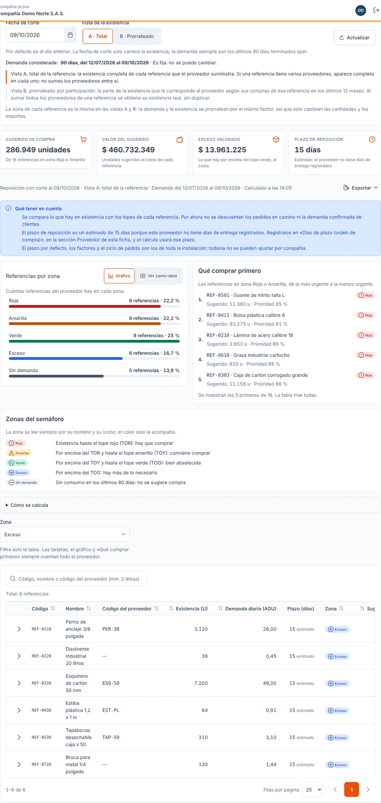

### Ejemplo con cifras ficticias

Con una demanda de **10 unidades por día**, un plazo de **10 días**, factor de plazo **0,5**, factor de variabilidad **0,5** y ciclo de pedido de **30 días**:

- Parte base del rojo: 10 × 10 × 0,5 = **50**
- **TOR** = 50 + 50 × 0,5 = **75**
- Amarilla: 10 × 10 = **100**. **TOY** = 75 + 100 = **175**
- Verde: el mayor entre 10 × 30 = 300 y 50, es **300**. **TOG** = 175 + 300 = **475**

| Existencia | Zona | Sugerido | Qué significa |
|------------|------|----------|---------------|
| **60** | Roja | **415** (475 − 60) | Hay que comprar 415 unidades para llegar al TOG. |
| **200** | Verde | **0** | Está entre el TOY y el TOG. No hace falta comprar. |
| **500** | Exceso | **0** | Sobran 25 unidades (500 − 475). Se valoran al costo. |

Con 60 unidades, la prioridad es 1 − 60 ÷ 475 = 0,87, es decir, **87 %**.

---

## 8️⃣ Sugerido de compra y prioridad

- **Sugerido** = TOG − existencia, redondeado hacia arriba. Solo aparece en las zonas **Roja** y **Amarilla**. En las demás zonas es **0**.
- **Prioridad** = 1 − existencia ÷ TOG, entre 0 % y 100 %. Mientras más alta, antes conviene comprar. Una referencia sin existencia tiene 100 %.

La tarjeta **Sugerido de compra** muestra el total de unidades y de cuántas referencias sale: *De N referencias en zona Roja o Amarilla*.

La sección **Qué comprar primero** lista las referencias de zona **Roja** y **Amarilla**, de la más urgente a la menos urgente, con su sugerido y su prioridad. Muestra las primeras cinco. Si hay más, el texto *Se muestran las N primeras de T. La tabla trae todas.* le avisa, y en la tabla están todas.

Si ninguna referencia está en zona Roja ni Amarilla, la sección dice *Por ahora no hay referencias por comprar: ninguna está en zona Roja ni Amarilla.*

---

## 9️⃣ Valor del sugerido y exceso valorado

**Valor del sugerido** es el sugerido en pesos. Cada referencia se valora así, en este orden:

1. Con el **precio de la última compra** a este proveedor, registrado en el catálogo de referencias del proveedor. Ese precio lo deja la importación de referencias compradas.
2. Si no hay precio de compra, con el **costo promedio** de la referencia (existencia valorizada ÷ unidades).
3. Si tampoco hay costo, la referencia queda en **$ 0**. La tarjeta avisa: *N referencias con sugerido no tienen costo con qué valorarlas: el valor está subestimado.*

**Exceso valorado** es lo que hay por encima del **TOG**, en pesos. Se valora al **costo promedio** de la referencia, no al precio del proveedor.

Por ejemplo, si sobran 25 unidades de una referencia con costo promedio de $ 1.000 por unidad, el exceso de esa referencia es **$ 25.000** (cifras ficticias).

**Exceso de referencias sin demanda.** Una referencia **Sin demanda** no tiene tope (su TOG es 0). Por eso **todo** su saldo cuenta como exceso. La pantalla lo muestra aparte: *De este exceso, $ X viene de referencias sin demanda.*

En la vista B, el sugerido y los importes ya vienen prorrateados.

---

## 🔟 Tarjetas del proveedor

| Tarjeta | Qué significa |
|---------|---------------|
| **Sugerido de compra** | Unidades que conviene comprar para llevar a TOG las referencias en zona Roja y Amarilla. |
| **Valor del sugerido** | El sugerido en pesos (sección 9️⃣). |
| **Exceso valorado** | Lo que hay por encima del TOG, al costo (sección 9️⃣). |
| **Plazo de reposición** | Los días de plazo del proveedor, o el plazo estimado de la instalación (sección 6️⃣). |

- Las tarjetas **siempre cuentan todo el proveedor**, aunque filtre la tabla por zona.
- Mientras se calcula, las tarjetas se muestran en espera.

---

## 1️⃣1️⃣ Referencias por zona y filtro

### Gráfico por zona

El bloque **Referencias por zona** muestra, para cada zona, cuántas referencias hay y qué porcentaje representan del total del proveedor.

- **Gráfico** (la forma por defecto): una barra por zona, con el número de referencias y el porcentaje.
- **Ver como tabla**: la misma información en una tabla, con las columnas **Zona**, **Referencias** y **% de las referencias**. Es útil si prefiere leer las cifras, o si usa lector de pantalla.

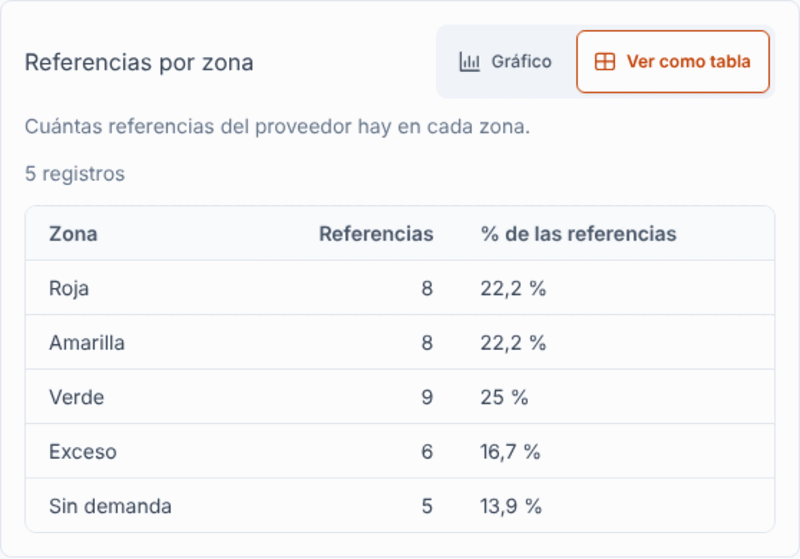

El gráfico y la tabla **no filtran** la lista de referencias: siempre muestran todo el proveedor.

### Filtro por zona

- En **Zona** elija una o varias zonas. Si no elige ninguna, aparecen todas (**Todas las zonas**).
- El filtro **solo afecta la tabla**. Las tarjetas, el gráfico, la leyenda y **Qué comprar primero** siguen mostrando todo el proveedor.

---

## 1️⃣2️⃣ La tabla de referencias

Una fila por referencia. Las columnas son:

| Columna | Qué significa |
|---------|---------------|
| **Código** | Código de la referencia. |
| **Nombre** | Nombre de la referencia. |
| **Código del proveedor** | El código con el que este proveedor identifica la referencia. Si no tiene uno, aparece **—**. |
| **Existencia (U)** | Unidades en existencia. En la vista B dice **Existencia prorrateada (U)**. |
| **Demanda diaria (ADU)** | Unidades consumidas por día (sección 5️⃣). |
| **Plazo (días)** | Días de plazo usados en el cálculo. Si son estimados, dice *estimado* (sección 6️⃣). |
| **Zona** | La zona de la referencia, escrita con su nombre (sección 7️⃣). |
| **Sugerido (U)** | Unidades sugeridas para comprar. |
| **Prioridad** | Qué tan urgente es comprar (sección 8️⃣). |
| **Exceso valorado ($)** | Lo que pasa del TOG, al costo (sección 9️⃣). |

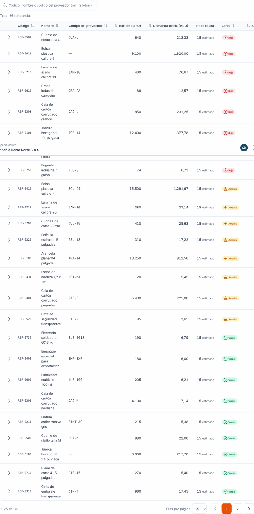

**Filtrar por zona:** elija una o varias zonas en el filtro de la sección 1️⃣1️⃣. Solo cambia lo que ve en la tabla.

**Buscar:**

- Escriba en el buscador el código, el nombre o el código del proveedor.
- Escriba **al menos 2 letras**. Con una sola no se busca.
- Si ninguna referencia coincide, la tabla dice *Sin resultados* y el texto *Ninguna referencia coincide con…*. Pulse **Limpiar búsqueda** para volver a verla completa.

**Orden y páginas:**

- Por defecto la tabla va de la **referencia más urgente a la menos urgente** (mayor prioridad primero).
- Haga clic en el encabezado de una columna para ordenar por ella.
- Por defecto se ven **25** filas por página. Puede elegir **10**, **25**, **50** o **100**.
- El texto *Mostrando X de Y referencias* le dice cuántas hay en el resultado.

**Fila expandible: los topes.** Use la flecha de la fila para abrirla. Muestra:

- Los topes de la referencia: **Tope rojo (TOR)**, **Tope amarillo (TOY)** y **Tope verde (TOG)**.
- El valor del sugerido de esa referencia.
- Una frase que dice dónde está la referencia. Por ejemplo: *Con 60 unidades está en zona Roja (hasta 75). Para llegar al tope verde (475) conviene comprar 415 unidades.*

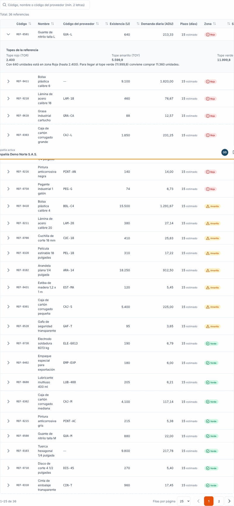

---

## 1️⃣3️⃣ Exportar

El botón **Exportar** solo se habilita cuando hay un resultado vigente. El archivo sale con **la misma fecha de corte, la misma vista, las mismas zonas, la misma búsqueda y el mismo orden** que ve en pantalla, y trae **todas** las referencias del resultado, no solo la página.

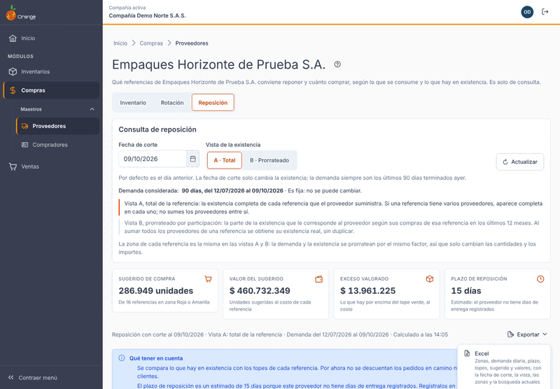

| Opción | Qué trae | Quién lo ve |
|--------|----------|-------------|
| **Excel** | Zonas, demanda diaria, plazo, topes, sugerido y valores. | Con costos y valores. |
| **PDF interno** | Zonas, sugerido y valores. | Con costos y valores. Es para uso dentro de la empresa. |
| **PDF para el proveedor** | El **pedido sugerido**: referencia, código del proveedor, existencia, demanda diaria y sugerido en unidades. Solo trae las referencias con **sugerido mayor que cero**. | **Sin costos ni valores**. Sin zonas, topes ni prioridad. |

**Sobre el PDF para el proveedor:**

- El sistema **no lo envía**. Usted lo descarga y se lo envía al proveedor por su correo u otro medio, por fuera del sistema.
- Si ninguna referencia tiene sugerido, el PDF dice *No hay sugerido de compra para este proveedor.*
- Si necesita un pedido menor, acote el resultado con la búsqueda o con el filtro de zona antes de exportar.

Exportar sí queda registrado en la bitácora, con las cantidades y los filtros, nunca con el contenido del archivo.

Mientras se prepara el archivo, la pantalla dice *Preparando el archivo…*. Al terminar aparece *{archivo} descargado.* y el archivo queda en la carpeta de descargas de su equipo.

Si el resultado es demasiado grande para exportar, vea la sección 1️⃣5️⃣. Si la descarga falla, la pantalla dice *No se pudo exportar*. No se descarga ningún archivo: inténtelo de nuevo.

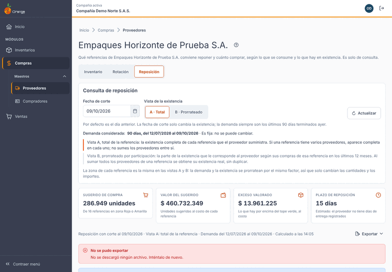

---

## 1️⃣4️⃣ Qué tener en cuenta

La pantalla muestra estos límites en el bloque **Qué tener en cuenta**:

- **La posición de cada referencia es su existencia.** Por ahora **no se descuentan los pedidos en camino** ni la **demanda confirmada de clientes**. Si ya hay mercancía pedida que todavía no llega, el sugerido puede ser mayor de lo necesario.
- **El plazo puede ser estimado.** Mientras el proveedor no tenga días de entrega registrados, el plazo es el de la instalación (sección 6️⃣).
- **Los parámetros son de la instalación.** El plazo por defecto, los factores y el ciclo de pedido valen para toda la instalación. Todavía no se ajustan por compañía.
- **La demanda es fija:** siempre son los 90 días que terminan en la fecha de corte.
- **Es una propuesta.** La decisión de comprar, y cuánto, es suya.

---

## 1️⃣5️⃣ Mensajes frecuentes y qué hacer

Los mensajes se muestran tal como aparecen en la pantalla.

| Mensaje en pantalla | Qué hacer |
|---------------------|-----------|
| *Aún no hay consulta de reposición* | Elija la fecha de corte y la vista, y pulse **Consultar**. |
| *Elige una fecha de corte.* | Escriba o elija la fecha que falta. |
| *La fecha de corte no puede ser futura.* | Elija hoy o una fecha anterior. |
| *Cambiaste los filtros. Pulsa Consultar para ver la reposición con ellos.* | Pulse **Consultar**. |
| *Estamos calculando la reposición* | Espere. Con muchas referencias puede tardar varios minutos. La pantalla consulta sola cada pocos segundos y la campana le avisa al terminar. Puede pulsar **Reintentar ahora**. No tiene que esperar frente a la pantalla. |
| *El cálculo de esta reposición ya no está disponible* | Venció o aún no se ha calculado. Pulse **Actualizar**. |
| *La reposición se está calculando* | Otro proceso calcula esa misma consulta. Espere unos segundos y pulse **Reintentar**. |
| *No se pudo consultar la reposición* | Revise su conexión y pulse **Reintentar**. No se modificó ningún dato. Este mismo mensaje aparece cuando el servicio de cálculo no está disponible. Si se repite, avise a quien administra el sistema. |
| *El resultado es demasiado grande* | Hay más movimientos de los que se pueden calcular de una vez. La ventana de 90 días es fija: pruebe más tarde o pida a quien administra el sistema que revise el límite. |
| *Este proveedor no tiene referencias de inventario* | Aquí aparecen las referencias que manejan inventario y están en el catálogo del proveedor o se le han comprado. Las de gasto o de material sin inventario no se incluyen. |
| *Por ahora no hay referencias por comprar: ninguna está en zona Roja ni Amarilla.* | Es normal: no hace falta comprar nada a este proveedor en esa fecha de corte. Revise las zonas de la tabla. |
| *Sin resultados* | Pulse **Limpiar búsqueda** o cambie el texto. |
| *El resultado es demasiado grande para exportar* | Acote el resultado con la búsqueda o con el filtro de zona, y exporte de nuevo. |
| *No se pudo exportar* | Vuelva a intentar. No se descargó ningún archivo. |
| *No tienes permiso para consultar la reposición de este proveedor.* | Pida a quien administra los permisos que le asigne **Consultar** sobre **Proveedores**. |
| *Este proveedor ya no existe.* | Vuelva al listado de proveedores y búsquelo de nuevo. |

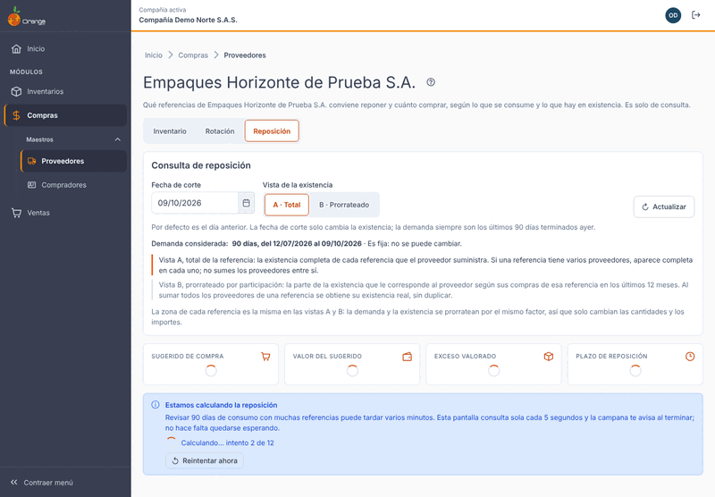

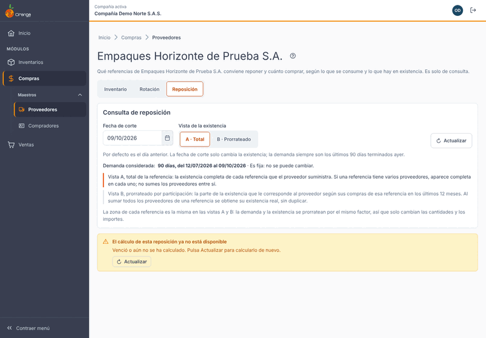

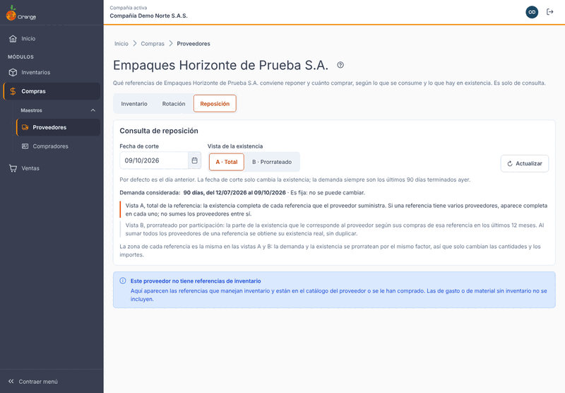

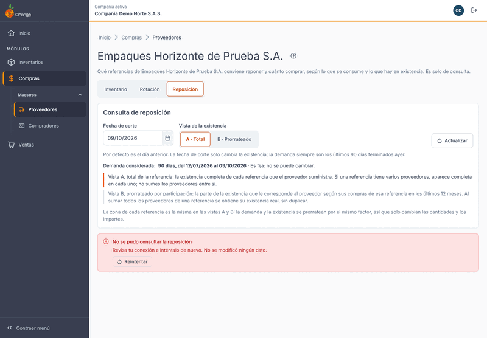

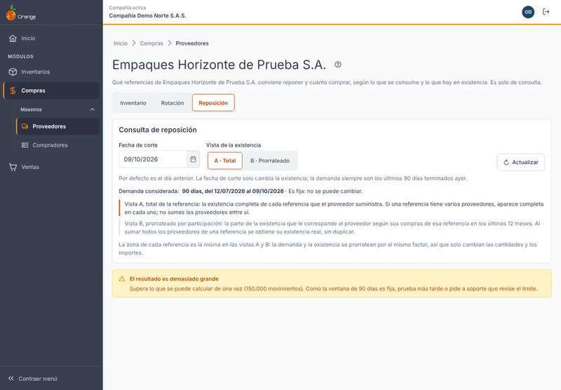

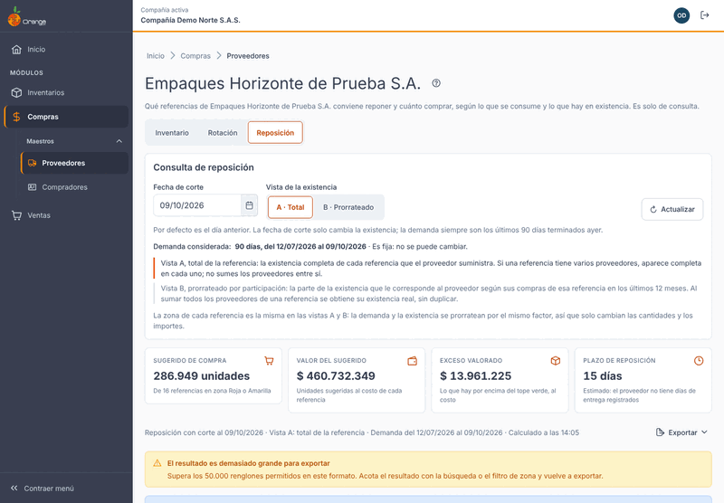

---

## ❓ Preguntas frecuentes

**¿Por qué una referencia aparece en Exceso?**
Porque su existencia está por encima del TOG (el tope verde). Hay más de lo que la demanda y el plazo necesitan. El exceso se valora al costo promedio.

**¿Por qué una referencia aparece como Sin demanda?**
Porque no tuvo consumo en los 90 días que terminan en la fecha de corte. Sus topes son 0 y no se sugiere compra. Todo lo que tiene en existencia cuenta como exceso valorado. Si esperaba que hubiera consumo, revise qué cuenta como consumo en el manual de [Rotación del proveedor](proveedores-rotacion.md).

**¿Por qué el sugerido es 0?**
Porque la referencia está en zona **Verde**, **Exceso** o **Sin demanda**. Solo las zonas **Roja** y **Amarilla** tienen sugerido.

**¿Por qué el plazo dice estimado?**
Porque el proveedor no tiene días de entrega registrados. Regístrelos en la ficha del proveedor, en la pestaña **Proveedor**, sección **Condiciones comerciales**, campo **Días de plazo (orden de compra)**. Después pulse **Actualizar**.

**¿Por qué el valor del sugerido está en 0 o dice que está subestimado?**
Porque no hay un precio de compra registrado para esta referencia con este proveedor, ni un costo promedio con existencia. Cuando la referencia tenga compras con valor, el precio aparece en el catálogo del proveedor y el valor se verá al volver a consultar.

**Ya hice el pedido, pero la referencia sigue en Roja. ¿Por qué?**
Porque los pedidos en camino **no se descuentan** todavía. El sugerido no baja hasta que la mercancía entra a la existencia.

**¿Por qué la zona no cambia cuando paso a la vista B?**
Porque la zona se calcula con la referencia completa. La vista B solo cambia las cantidades y los importes que corresponden a este proveedor.

**¿Por qué cambian las cifras si pulso Actualizar?**
Porque **Actualizar** vuelve a calcular con la información vigente: compras, entradas, salidas, ajustes y días de plazo registrados.

**¿Puedo cambiar los 90 días, el plazo por defecto o los factores?**
No desde esta pantalla. Son de la instalación.

**¿El sistema hace la orden de compra?**
No. Esta pantalla solo sugiere cuánto comprar. La orden la registra usted por el procedimiento habitual.

**¿El sistema envía el PDF para el proveedor?**
No. Usted lo descarga y se lo envía al proveedor por su correo u otro medio, por fuera del sistema.
