[Regresar a Compras](../readme.md)

---

# 🔄 Rotación del proveedor

---

## 📋 Descripción

El modo **Rotación** de la pestaña **Inventario y rotación** de la ficha de un proveedor le muestra **qué tan rápido se consume** lo que ese proveedor le suministra.

Sirve para responder preguntas como estas:

- ¿Cuántas veces se consumió en el año el inventario de lo que me vende este proveedor?
- ¿Cuántos días de inventario tengo de sus referencias?
- ¿Qué referencias de este proveedor casi no se mueven?
- ¿Cuánto del valor del inventario de este proveedor está en referencias lentas?

Puntos clave:

- Es **solo de consulta**. Esta pantalla no cambia ningún dato.
- Trabaja sobre un **periodo** de hasta **12 meses** que usted elige.
- Cada referencia se clasifica como **Alta**, **Media**, **Baja**, **Sin rotación**, **Obsoleto** o **Sin movimiento**.
- Exporta a **Excel** y a dos formatos de **PDF**. Uno de ellos no tiene costos ni valores y está pensado para enviárselo al proveedor.

> 🔐 Necesita el permiso **Consultar** sobre **Proveedores**. Sin ese permiso la pestaña no aparece.

Para ver la existencia de hoy de las referencias del proveedor, vea el manual de [Inventario del proveedor](proveedores-inventario.md). Para crear o editar el proveedor, vea el manual de [Proveedores](proveedores.md).

---

## 🎯 Acceso

1. Entre a **Compras › Proveedores** y abra la ficha de un proveedor **ya guardado**.
2. Haga clic en la pestaña **Inventario y rotación**. Está entre **Contactos** y **Cartera**.
3. Debajo de la descripción de la pestaña, elija **Rotación** en el selector **Qué quieres ver**.

Al abrir la pestaña, el selector queda en **Inventario**. Elegir **Rotación** no cambia la dirección de la página.

Mientras el proveedor se está creando y no se ha guardado, la pestaña no aparece. Guárdelo primero.

En la parte superior de la pantalla, junto al título, el botón **?** abre este manual cuando el modo **Rotación** está elegido. Con el modo **Inventario**, abre el manual de [Inventario del proveedor](proveedores-inventario.md).

---

## 🔀 Cambiar entre Inventario y Rotación

| Modo | Qué muestra | Cuándo usarlo |
|------|-------------|---------------|
| **Inventario** | Cuánto hay hoy de las referencias del proveedor, a una fecha de corte. | Para saber la existencia. |
| **Rotación** | Cuánto se consumió y qué tan rápido rota el inventario, en un periodo. | Para saber qué tan rápido se mueve. |

- Cambiar de modo **no consulta nada** por sí solo. En **Rotación**, la primera consulta la hace usted con **Consultar**.
- La **vista A · Total / B · Prorrateado** es **la misma** para los dos modos. Si la cambia en uno, el otro la conserva.
- Para ver la existencia y la rotación de una misma referencia, cambie de modo: son dos consultas distintas.

---

## 1️⃣ Pantalla principal

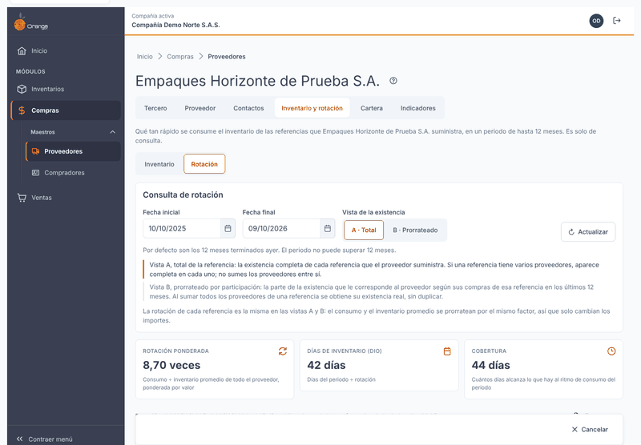

Al elegir **Rotación**, verá, de arriba hacia abajo:

| Parte | Qué muestra |
|-------|-------------|
| **Consulta de rotación** | Las **fechas** del periodo, la **vista** (A o B) y el botón **Consultar** (o **Actualizar**, después de la primera consulta). |
| **Tarjetas** | Tres cifras del proveedor: **Rotación ponderada**, **Días de inventario (DIO)** y **Cobertura**. |
| **Línea de frescura** | El periodo, los días, la vista y la hora en que se calculó. |
| **Exportar** | Menú para descargar la rotación en Excel o en PDF. |
| **Valor del inventario por clase** | El valor del inventario en cada clase, en gráfico o en tabla. |
| **Clases de rotación** | Qué significa cada clase y con qué regla se asigna. |
| **¿Qué cuenta como consumo?** | Una explicación plegable (haga clic para abrirla). |
| **Tabla** | Una fila por referencia, con el filtro por clase y el buscador. |

Antes de la primera consulta la pantalla muestra solo el mensaje *Aún no hay consulta de rotación* y el botón **Consultar**.

### Qué ve cada permiso

- **Con Consultar sobre Proveedores** usted ve el modo completo, consulta, exporta y ve **costos y valores**.
- **Sin Consultar** la pestaña no aparece. Si el permiso se le quita mientras la pantalla está abierta, verá el aviso *No tienes permiso para consultar la rotación de este proveedor. Se requiere el permiso Consultar sobre Proveedores.*

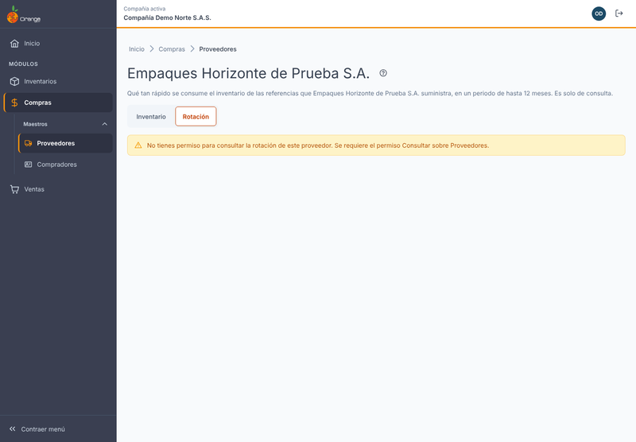

---

## 2️⃣ Periodo

El periodo se define con dos fechas: **Fecha inicial** y **Fecha final**. Puede escribirlas o elegirlas en el calendario.

- **Por defecto** son los **12 meses terminados ayer**. Por ejemplo, si hoy es 10/10/2026, el periodo es del 10/10/2025 al 09/10/2026 (365 días).
- **El periodo no puede superar 12 meses.** La fecha final puede llegar, como máximo, a la misma fecha del año siguiente a la inicial. Si la inicial es el 10/10/2025, la final puede ser hasta el 10/10/2026.
- **La fecha final no puede ser futura.** El día de hoy todavía no está cerrado: las compras, entradas y salidas pueden seguir cambiando. Una fecha futura todavía no tiene movimientos.
- **La fecha final no puede quedar vacía.** El periodo necesita las dos fechas para saber hasta cuándo medir. Mientras falte la fecha final, el botón **Consultar** está deshabilitado y la pantalla dice *Elige una fecha final.*
- **La fecha inicial no puede ser posterior a la final.**

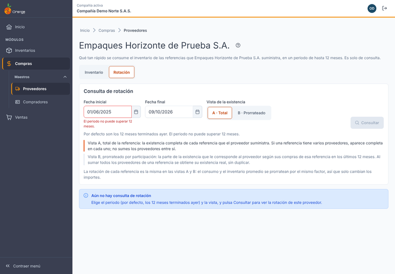

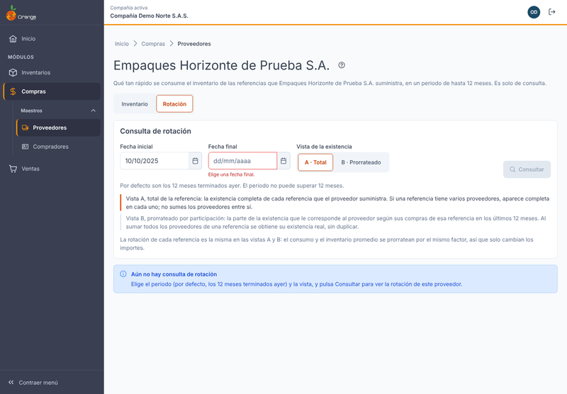

Cambiar las fechas o la vista **no consulta** por sí solo. La pantalla le avisa con *Cambiaste los filtros. Pulsa Consultar para ver la rotación con ellos.* Mientras no consulte de nuevo, los datos que ve siguen con el periodo y la vista con que se calcularon.

---

## 3️⃣ Consultar y Actualizar

- **Consultar** trae la rotación con el periodo y la vista que eligió. Úselo la primera vez o después de cambiar las fechas o la vista.
- **Actualizar** vuelve a calcular con la información vigente. Úselo cuando registró compras, entradas, salidas o ajustes dentro del periodo, o cuando quiere la cifra más reciente.
- La línea de frescura dice a qué hora se calculó lo que ve.

Consultar **no deja registro** en la bitácora ni cambia datos. Puede repetirla sin riesgo.

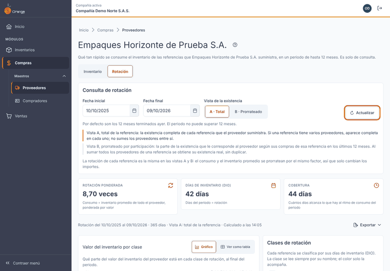

---

## 4️⃣ Vista A y vista B

Elija la vista con el selector **Vista de la existencia**:

| Vista | Qué muestra | Cuándo usarla |
|-------|-------------|---------------|
| **A · Total** (la que aparece por defecto) | Los importes **completos** de cada referencia que el proveedor suministra. | Para saber cuánto consume y cuánto hay de cada referencia. |
| **B · Prorrateado** | La parte que le corresponde a **este** proveedor, según su participación en las compras de esa referencia en los **últimos 12 meses**. | Para repartir el consumo y el inventario entre proveedores. |

**Lo que debe recordar:**

- **La rotación de cada referencia es la misma en la vista A y en la vista B.** En ambas, el consumo y el inventario promedio se reparten con el mismo factor, así que solo cambian los importes en pesos.
- En la **vista A**, una referencia que compra a varios proveedores aparece completa en cada uno. **No sume los proveedores entre sí.**
- En la **vista B**, al sumar todos los proveedores de una referencia obtiene su consumo e inventario reales, sin duplicar.
- Debajo del selector siempre se explican las dos vistas. La vista elegida queda marcada.

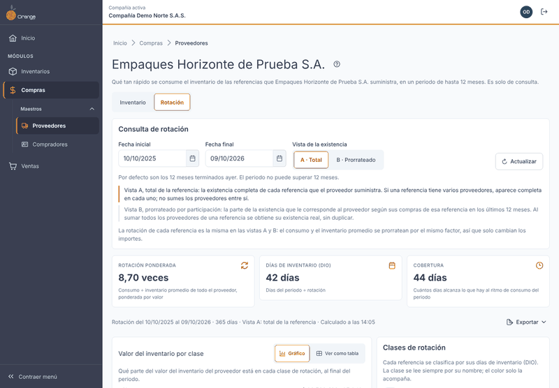

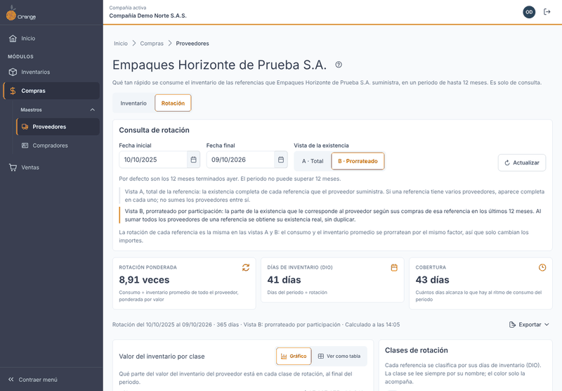

---

## 5️⃣ ¿Qué cuenta como consumo?

Esta explicación está en el bloque **¿Qué cuenta como consumo?** de la pantalla. Lo que cuenta como consumo depende del **tipo** de la referencia, que aparece en la columna **Tipo** de la tabla.

| Tipo | Qué cuenta como consumo | Ejemplo |
|------|-------------------------|---------|
| **Materia prima o insumo** | Lo que **salió a producción**: la descarga de insumos de una orden de producción. | Se descargan 50 cajas de empaque a una orden de producción. Esas 50 cajas son consumo. |
| **Producto terminado** | Lo que **se vendió**: ventas, remisiones y ventas de punto de venta. | Se venden 30 unidades a un cliente. Esas 30 unidades son consumo. |

Reglas que completan la explicación:

- Las **devoluciones** de esos movimientos **restan** del consumo. Si el cliente devuelve 2 de esas 30 unidades, el consumo es 28.
- Los demás movimientos **cambian la existencia pero no cuentan como consumo**: traslados entre bodegas, ajustes, compras y la entrada de productos terminados desde producción.
- La **venta directa de una materia prima** tampoco cuenta como consumo. Si vende 10 cajas de empaque directamente a un cliente, la existencia baja, pero esas 10 cajas no suman a la rotación de la materia prima.

---

## 6️⃣ Cómo se calcula

Las fórmulas, en palabras:

| Cifra | Cómo se calcula |
|-------|-----------------|
| **Inventario promedio** | Se suman los saldos de inventario al inicio del periodo y al final de cada mes, y se divide entre la cantidad de saldos. |
| **Rotación** | Consumo ÷ inventario promedio. Dice cuántas veces se consumió el inventario promedio en el periodo. |
| **Días de inventario (DIO)** | Días del periodo ÷ rotación. Dice cuántos días de inventario hay, al ritmo del periodo. |
| **Cobertura** | Existencia final ÷ consumo diario. Dice cuántos días alcanza lo que hay, al ritmo de consumo del periodo. El consumo diario es el consumo del periodo ÷ los días del periodo. |
| **Rotación ponderada del proveedor** | Consumo total de todas sus referencias ÷ inventario promedio total. Se pondera por valor; no es el promedio de las rotaciones de cada fila. |

**Ejemplo con cifras ficticias** (una referencia, periodo de 365 días):

- Consumo del periodo: **$ 12.000.000**
- Saldos medidos: $ 2.000.000, $ 3.000.000 y $ 4.000.000. Inventario promedio: (2.000.000 + 3.000.000 + 4.000.000) ÷ 3 = **$ 3.000.000**
- Rotación: 12.000.000 ÷ 3.000.000 = **4 veces**
- Días de inventario: 365 ÷ 4 = **91 días**. Con 91 días la referencia queda en la clase **Baja**.
- Existencia final: **$ 2.000.000**. Consumo diario: 12.000.000 ÷ 365 = $ 32.877. Cobertura: 2.000.000 ÷ 32.877 = **61 días** (redondeado).

La rotación es la del periodo que eligió; no se anualiza. Compare rotaciones solo entre periodos de la misma duración.

---

## 7️⃣ Clases de rotación

Cada referencia se clasifica por sus **días de inventario (DIO)**:

| Clase | Regla | Cómo se lee |
|-------|-------|-------------|
| **Alta** | DIO de 30 días o menos. | Se consume rápido. |
| **Media** | DIO de 31 a 90 días. | Rotación normal. |
| **Baja** | DIO de 91 a 180 días. Una referencia con más de 180 días, pero con algún consumo, también es **Baja**. | Se consume despacio. |
| **Sin rotación** | Hay existencia y no hubo consumo en el periodo. | Hay inventario, pero no se movió hacia afuera. |
| **Obsoleto** | No hubo consumo ni ningún movimiento (entrada o salida de cualquier tipo) en el periodo, y el periodo es de **365 días o más**. | Inventario sin uso. Con un periodo más corto, la misma referencia aparece como **Sin rotación**. |
| **Sin movimiento** | No tiene existencia ni consumo. | No se clasifica. |

Cómo leer el color y el texto:

- **La clase se lee siempre por su nombre**, escrito en la leyenda, en la tabla y en el gráfico.
- El color solo acompaña el nombre. Si no distingue los colores, el nombre le dice la clase.

Los umbrales de **Alta**, **Media** y **Baja** son los de la compañía. En esta pantalla **no se editan**. La leyenda lo recuerda al pie.

---

## 8️⃣ Tarjetas del proveedor

| Tarjeta | Qué significa |
|---------|---------------|
| **Rotación ponderada** | Veces que se consumió el inventario de **todo el proveedor** en el periodo. Ejemplo: *8,70 veces*. |
| **Días de inventario (DIO)** | Días del periodo ÷ rotación ponderada. Ejemplo: *42 días*. |
| **Cobertura** | Cuántos días alcanza lo que hay hoy al ritmo de consumo del periodo. Ejemplo: *44 días*. |

- Si una cifra no tiene consumo en el periodo, la tarjeta dice **Sin consumo en el periodo**. No dice 0.
- Mientras se calcula, las tarjetas se muestran en espera.
- Las tarjetas **siempre cuentan todo el proveedor**, aunque filtre la tabla por clase.

---

## 9️⃣ Valor del inventario por clase

El bloque **Valor del inventario por clase** muestra qué parte del valor del inventario del proveedor, al final del periodo, está en cada clase.

- **Gráfico** (la forma por defecto): una barra por clase, con su valor en pesos y su porcentaje del total.
- **Ver como tabla**: la misma información en una tabla, con las columnas **Clase**, **Referencias**, **Valor ($)** y **% del valor**. Es útil si prefiere leer las cifras, o si usa lector de pantalla.

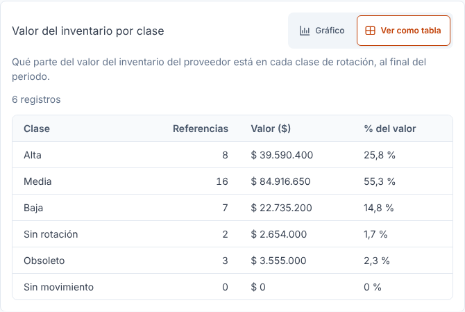

El gráfico y la tabla **no filtran** la lista de referencias: siempre muestran todo el proveedor.

---

## 🔟 La tabla de referencias

Una fila por referencia. Las columnas son:

| Columna | Qué significa |
|---------|---------------|
| **Código** | Código de la referencia. |
| **Nombre** | Nombre de la referencia. |
| **Tipo** | **Materia prima** o **Terminado**. Define qué cuenta como consumo (sección 5). |
| **Consumo ($)** | Consumo del periodo en pesos. En la vista B dice **Consumo prorrateado ($)**. |
| **Inv. promedio ($)** | Inventario promedio del periodo en pesos. En la vista B dice **Inv. promedio prorrateado ($)**. |
| **Rotación** | Consumo ÷ inventario promedio. Si no hubo consumo aparece **—**. |
| **DIO (días)** | Días de inventario. Si no hubo consumo aparece **—**. |
| **Cobertura (días)** | Cuántos días alcanza la existencia final al ritmo de consumo del periodo. |
| **Clase** | La clase de rotación, escrita con su nombre (sección 7). |

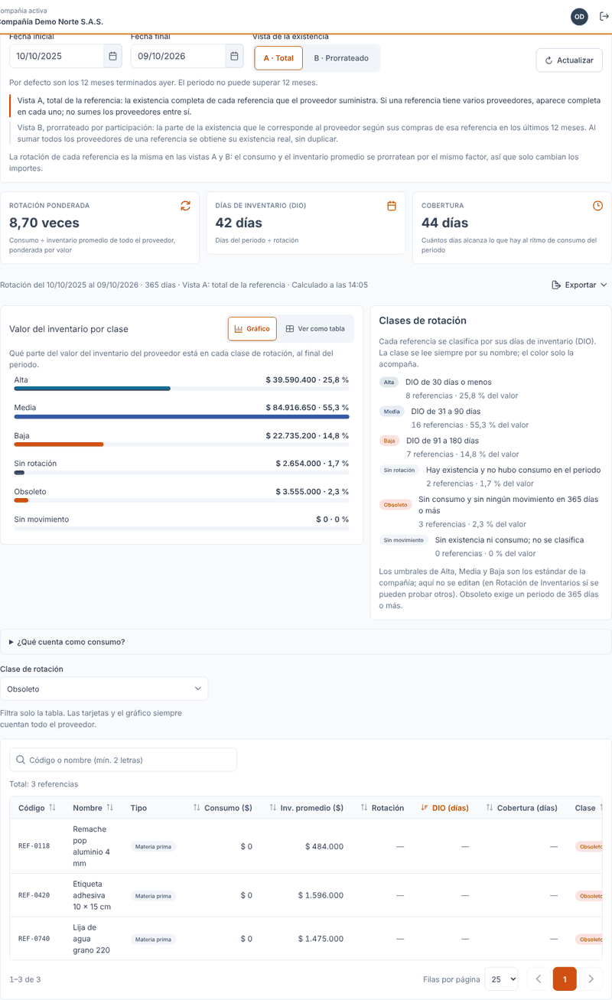

**Filtrar por clase:**

- En **Clase de rotación** elija una o varias clases. Si no elige ninguna, aparecen todas.
- El filtro **solo afecta la tabla**. Las tarjetas, el gráfico y la leyenda siguen mostrando todo el proveedor.

**Buscar:**

- Escriba en el buscador el código o el nombre de la referencia.
- Escriba **al menos 2 letras**. Con una sola no se busca.
- Si ninguna referencia coincide, la tabla dice **Sin resultados**. Pulse **Limpiar búsqueda** para volver a verla completa.

**Orden y páginas:**

- Por defecto la tabla está ordenada por **DIO, de mayor a menor**: las referencias más lentas aparecen primero.
- Haga clic en el encabezado de una columna para ordenar por ella. La columna **Tipo** no se ordena.
- Por defecto se ven **25** filas por página. Puede elegir **10**, **25**, **50** o **100**.
- El texto **Mostrando X de Y referencias** le dice cuántas hay en el resultado.

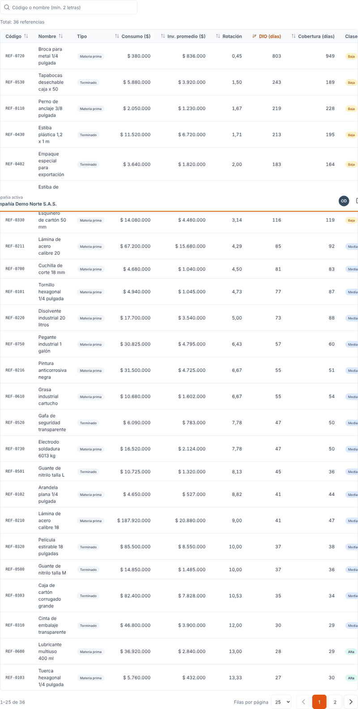

---

## 1️⃣1️⃣ Exportar

El botón **Exportar** solo se habilita cuando hay un resultado vigente. El archivo sale con **el mismo periodo, la misma vista, las mismas clases y la misma búsqueda** que ve en pantalla, y trae **todas** las filas del resultado, no solo la página.

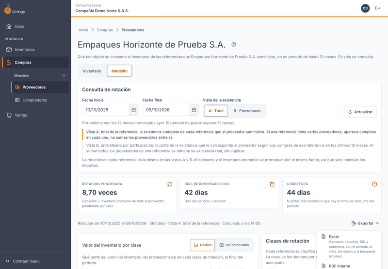

| Opción | Qué trae | Quién lo ve |
|--------|----------|-------------|
| **Excel** | Consumo, rotación, DIO y cobertura. | Con costos y valores. |
| **PDF interno** | Consumo y rotación, con valores. | Con costos y valores. Es para uso dentro de la empresa. |
| **PDF para el proveedor** | **Solo cantidades**: unidades, rotación, DIO, cobertura y clase. | **Sin costos ni valores**: no trae consumo ni inventario en pesos. |

Mientras se prepara el archivo la pantalla dice *Preparando el archivo…*. Al terminar aparece *{archivo} descargado.* y el archivo queda en la carpeta de descargas de su equipo.

**Sobre el PDF para el proveedor:** el sistema **no lo envía**. Usted lo descarga y se lo envía al proveedor por su correo u otro medio, por fuera del sistema.

Si el resultado es demasiado grande para exportar, vea la sección 1️⃣2️⃣. Si la descarga falla, la pantalla dice *No se pudo exportar. No se descargó ningún archivo.* Inténtelo de nuevo.

---

## 1️⃣2️⃣ Mensajes frecuentes y qué hacer

Los mensajes se muestran tal como aparecen en la pantalla.

| Mensaje en pantalla | Qué hacer |
|---------------------|-----------|
| *Aún no hay consulta de rotación* | Elija el periodo y la vista, y pulse **Consultar**. |
| *Cambiaste los filtros. Pulsa Consultar para ver la rotación con ellos.* | Pulse **Consultar**. |
| *Calculando la rotación…* | Espere un momento. |
| *Estamos calculando la rotación* | Un periodo largo con muchas referencias puede tardar varios minutos. La pantalla consulta sola cada 5 segundos, hasta 12 veces, y la campana le avisa al terminar. Puede pulsar **Reintentar ahora**. No tiene que esperar frente a la pantalla. |
| *El cálculo de este periodo ya no está disponible* | Venció o aún no se ha calculado. Pulse **Actualizar** para calcularlo de nuevo. |
| *La rotación se está calculando* | Otro proceso está calculando ese periodo. Espere unos segundos y pulse **Reintentar**. |
| *No hay rotación que mostrar* | Ninguna referencia con inventario de este proveedor tiene existencia ni consumo en el periodo. Pruebe otro periodo. |
| *No se pudo consultar la rotación* | Revise su conexión y pulse **Reintentar**. No se modificó ningún dato. Este mismo mensaje aparece cuando el servicio de cálculo no responde; si se repite, avise a quien administra el sistema. |
| *Elige una fecha inicial.* / *Elige una fecha final.* | Complete la fecha que falta. |
| *La fecha final no puede ser futura.* | Elija hoy o una fecha anterior. |
| *La fecha inicial no puede ser posterior a la final.* | Cambie las fechas para que la inicial quede antes de la final. |
| *El periodo no puede superar 12 meses.* | Acorte el periodo (vea la sección 2️⃣). |
| *El resultado es demasiado grande* | El periodo tiene más movimientos de los que se pueden calcular de una vez. Acorte el periodo, por ejemplo a 6 meses, y vuelva a consultar. |
| *El resultado es demasiado grande para exportar* | Acote el resultado con el buscador o con el filtro de clase, y exporte de nuevo. |
| *No se pudo exportar* | Vuelva a intentar. |
| *No tienes permiso para consultar la rotación de este proveedor.* | Pida a quien administra los permisos que le asigne **Consultar** sobre **Proveedores**. |
| *Este proveedor ya no existe.* | Vuelva al listado de proveedores y búsquelo de nuevo. |
| *Sin resultados* | Pulse **Limpiar búsqueda** o cambie el texto. |

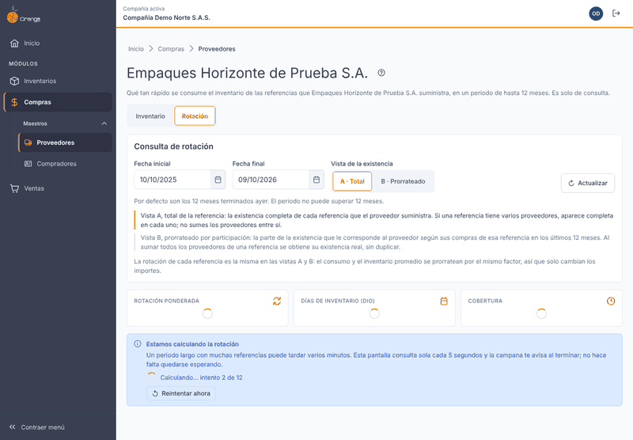

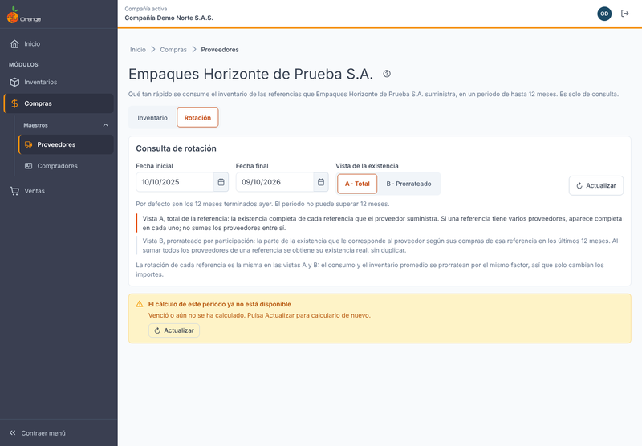

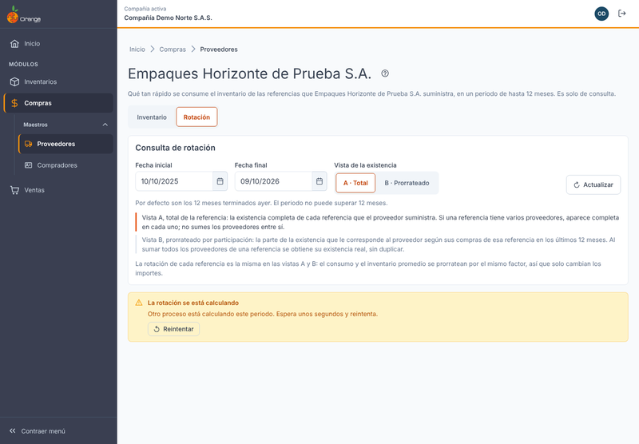

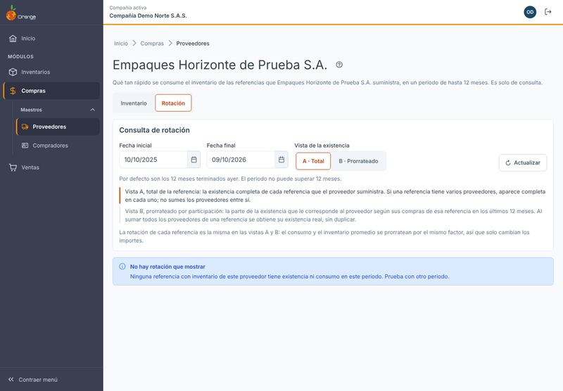

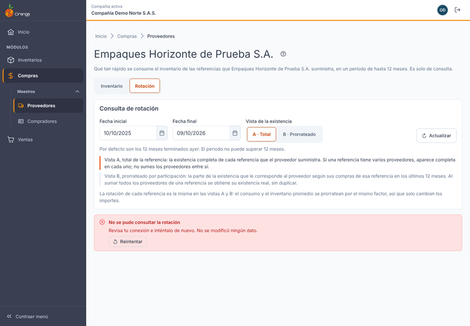

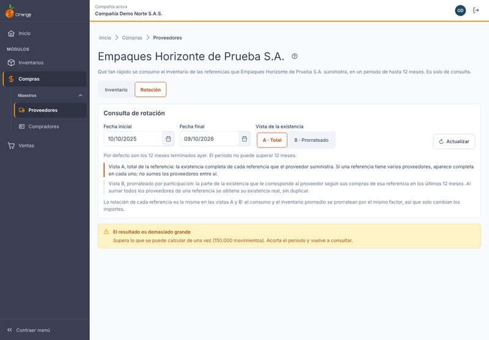

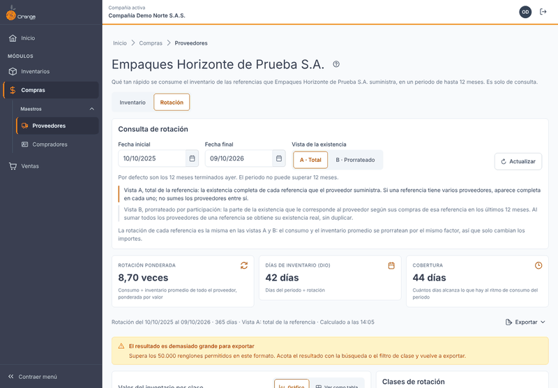

---

## ❓ Preguntas frecuentes

**¿Por qué una referencia con existencia aparece como Sin rotación?**
Porque tiene inventario, pero en el periodo no hubo consumo: una materia prima no salió a producción y un producto terminado no se vendió. Si además no tuvo ningún movimiento en 365 días o más, aparecerá como **Obsoleto**, pero solo con un periodo de 365 días o más.

**¿Por qué una materia prima no cuenta las ventas?**
Porque, para una materia prima, el consumo es lo que sale a producción. Si la vende directamente, sale de la existencia, pero no es consumo de producción. El tipo de cada referencia está en la columna **Tipo**. Si una referencia tiene un tipo que no corresponde, avise a quien administra las referencias.

**¿Por qué la rotación es la misma en la vista A y en la vista B?**
Porque en las dos vistas el consumo y el inventario promedio se reparten con el mismo factor. Solo cambian los importes en pesos.

**¿Por qué las tarjetas no cambian cuando filtro por clase?**
Porque las tarjetas, el gráfico y la leyenda siempre cuentan todo el proveedor. El filtro solo afecta la tabla.

**¿Por qué no puedo cambiar los umbrales de las clases?**
Porque los umbrales de la compañía no se editan en esta pantalla. Son los de la compañía, y la leyenda los muestra.

**¿Por qué mis cifras no coinciden con la pantalla de Rotación de Inventarios?**
Con las mismas referencias y las mismas fechas, las cifras deben ser las mismas. Si la otra pantalla tiene filtros de bodega, grupo o clase, compare sin ellos.

**¿Puedo comparar un periodo de 6 meses con uno de 12?**
Es mejor comparar periodos de la misma duración. La rotación es la del periodo que eligió y no se anualiza.

**¿El sistema envía el PDF para el proveedor?**
No. Usted lo descarga y se lo envía por su correo u otro medio, por fuera del sistema.

**¿Cuándo llega el semáforo de reposición?**
Llegará en una versión posterior, como indicador de cuándo conviene pedir. Este manual todavía no lo describe.
