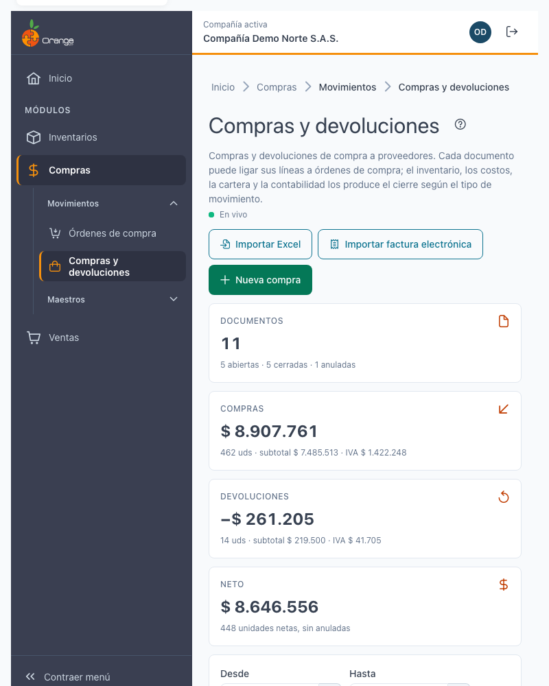
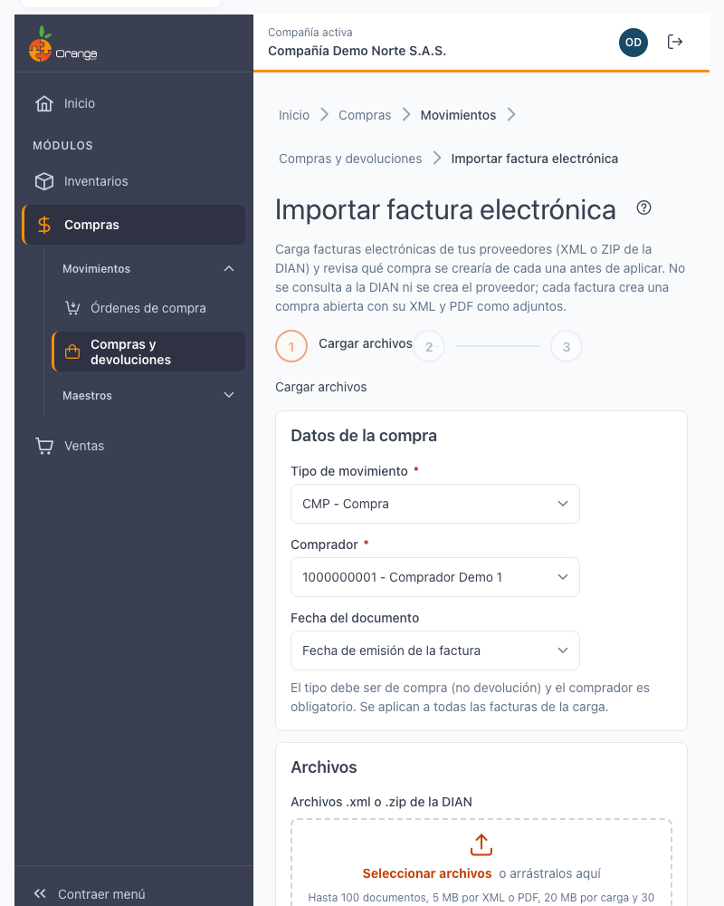
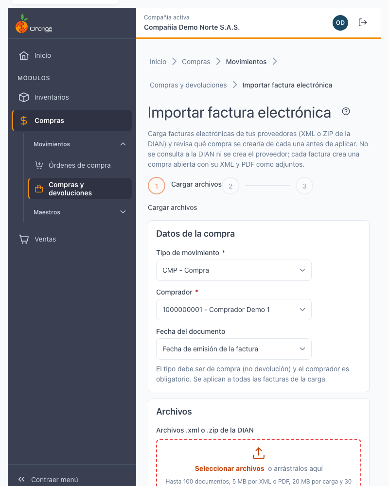
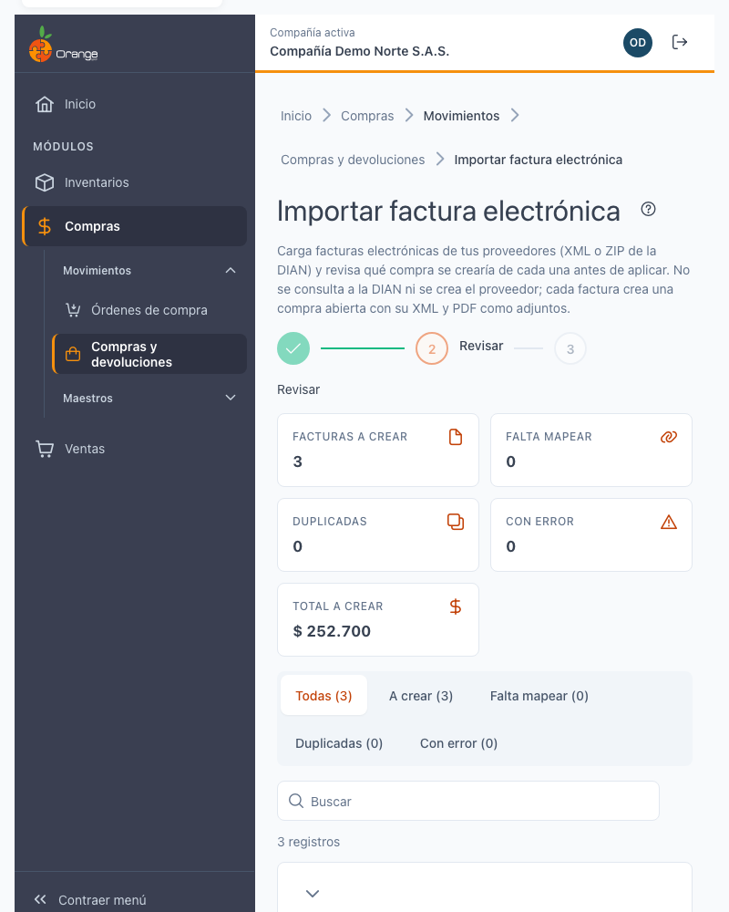
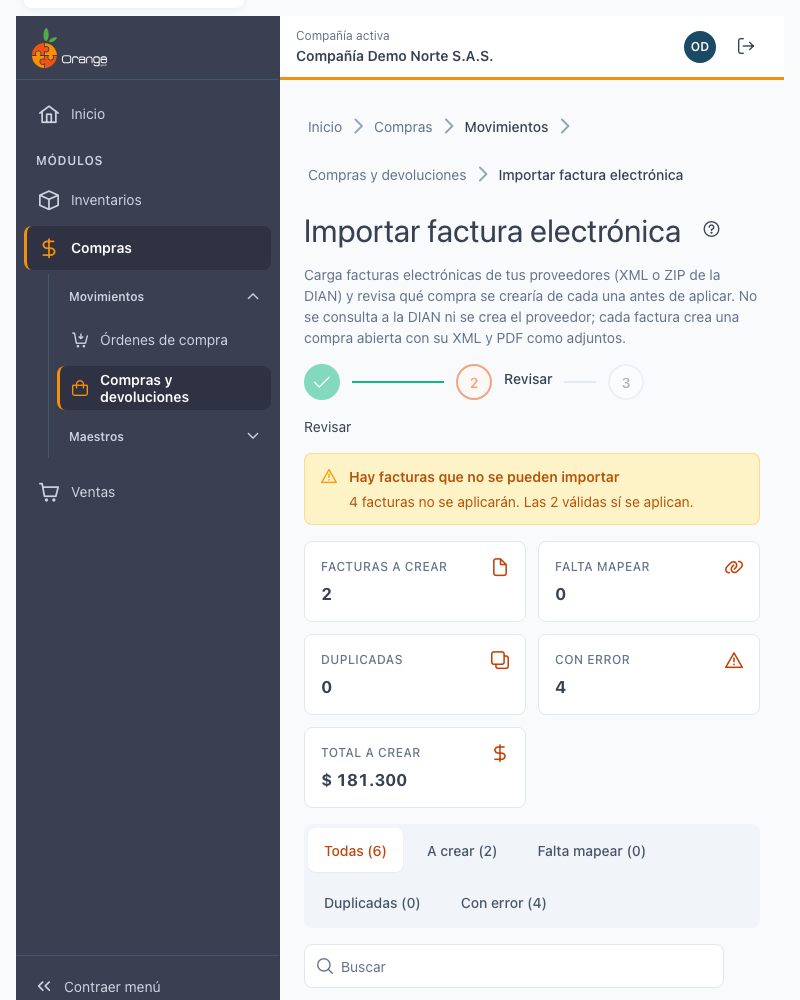
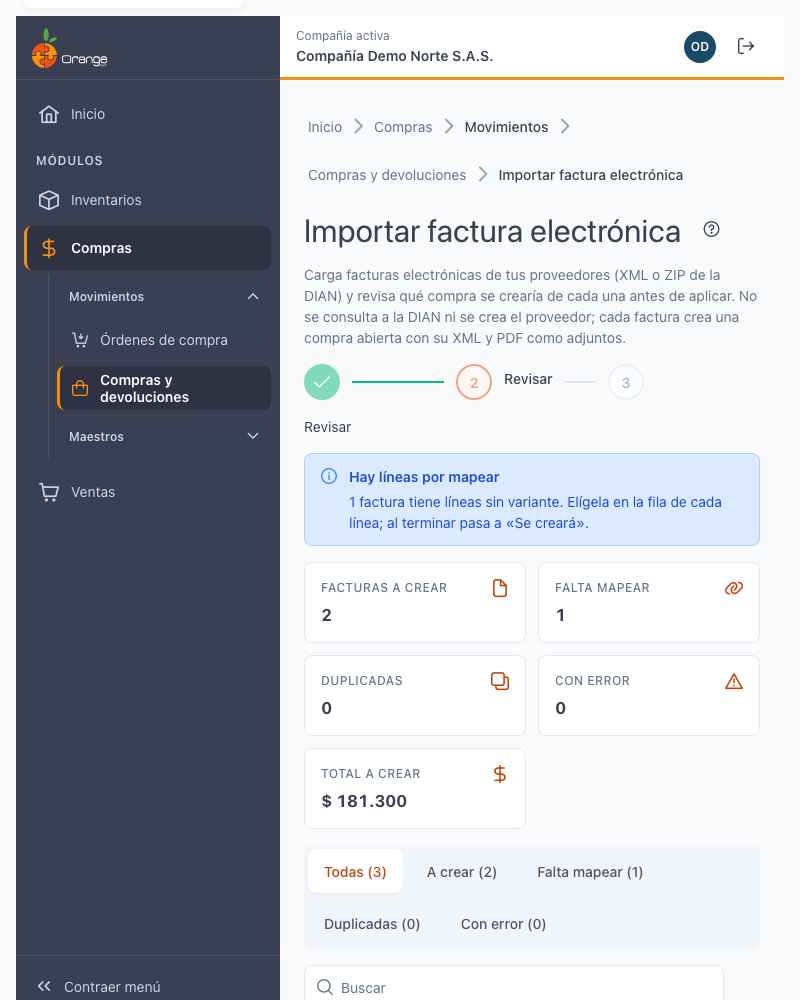
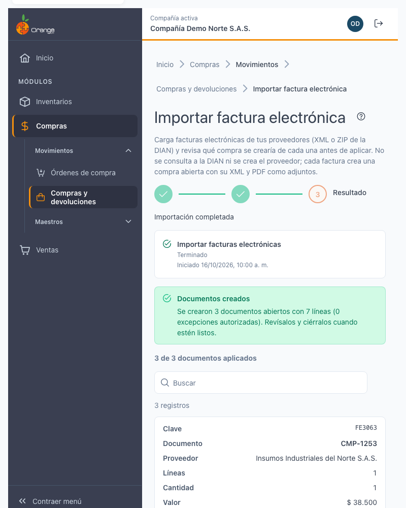

# Importar factura electrónica

[← Volver al índice de compras](../readme.md) · [Compras y devoluciones](compras-devoluciones.md) · [Importar desde Excel](compras-devoluciones-importar.md)

Carga las **facturas electrónicas** de sus proveedores (archivos XML o ZIP que entrega la DIAN) y revisa qué compra se crearía de cada una **antes de aplicar**. Cada factura crea **una compra abierta**, con su XML y su PDF como adjuntos.

Esta importación **no consulta a la DIAN** y **no crea proveedores**. Lo que verifica es lo que trae el propio archivo.

## Acceso

En el listado de [compras y devoluciones](compras-devoluciones.md) pulse **Importar factura electrónica**. El botón aparece solo si tiene los permisos **Crear** y **Exportar** sobre esa opción.

## Los tres pasos: Cargar archivos → Revisar → Resultado

**1. Cargar archivos.** Elija los datos de la compra, luego arrastre los archivos al recuadro o elíjalos con el botón. Puede cargar **.xml** o **.zip** de la DIAN.

Si algún archivo no sirve, verá el motivo y no se envía nada: no es un XML o ZIP, un XML o PDF pesa más de 5 MB, la carga trae más de 100 facturas o pesa más de 20 MB, o el ZIP descomprimido supera 30 MB o trae demasiados archivos.

**2. Revisar.** El sistema valida cada factura **sin guardar nada**. Verá el resumen, la lista de facturas y, en cada una, su estado (ver Revisar la vista previa).

**3. Aplicar y resultado.** Pulse **Aplicar N facturas**. Ver Aplicar y resultado.

## Datos de la compra

Antes de cargar elija tres datos. **Se aplican a todas las facturas de la carga.**

- **Tipo de movimiento:** solo tipos de **compra** (no devolución).
- **Comprador:** obligatorio.
- **Fecha del documento:** **Fecha de emisión de la factura** (la que trae el XML) o **Usar la fecha de hoy**.

## Qué se hace y qué no

- **La carga es manual.** No hay conexión con la DIAN ni con su proveedor tecnológico de facturación.
- **Se lee la respuesta de la DIAN** que trae el archivo. Si el código de validación es **02**, la factura está validada. **No se verifica la firma** del documento ni se recalcula el CUFE.
- **El proveedor se busca por su NIT.** Si no existe, créelo en **Compras › Proveedores** y vuelva a validar.
- **Solo se importan facturas de venta.** Las notas crédito y débito, las exportaciones, los documentos soporte, los documentos de prueba y las facturas en otra moneda que no sea pesos colombianos se **rechazan**.
- **El receptor debe ser la compañía activa.** Si la factura está a nombre de otra empresa, no se puede importar ni forzar.
- **Cada factura crea una compra abierta.** Puede revisarla y cerrarla después.

## Revisar la vista previa

El resumen muestra **Facturas a crear**, **Falta mapear**, **Duplicadas**, **Con error** y el **Total a crear**. Cada factura tiene uno de estos estados:

- **Se creará:** la factura está lista.
- **Falta mapear:** alguna línea no tiene variante del sistema. Elíjala (ver Mapear las líneas).
- **Duplicada:** esta factura ya fue importada (ver Factura duplicada).
- **Con error:** la factura no se puede importar. El motivo aparece en la fila.

Con **Todas**, **A crear**, **Falta mapear**, **Duplicadas** o **Con error** filtra la lista. Pulse una factura para ver su detalle: proveedor emparejado, forma y plazo de pago, CUFE completo, validación de la DIAN, líneas y totales.

Las facturas con error no se aplican; las válidas sí. Pulse **Descargar errores** para guardar la lista o **Cambiar archivos** para cargar otros.

## Mapear las líneas a sus referencias

Cada línea de la factura debe corresponder a una **variante** de su inventario. El sistema busca la coincidencia en este orden y se detiene en la primera que encuentra de forma única:

1. **Por código de barras** (el código GTIN de la línea).
2. **Por código del proveedor** (el código que su proveedor usa para ese producto), si ya lo tiene registrado como equivalencia.
3. **Por código de la referencia** (el código de la referencia en su inventario).

Si ninguna coincide, la línea queda **sin mapear**: elija la variante en la fila con **Elegir variante** y busque por código o nombre. El nombre del producto **solo sugiere**: nunca se asigna solo.

Cada línea muestra cómo quedó mapeada: *por código de barras*, *por código del proveedor*, *por código de la referencia*, *elegida por usted* o *solo una sugerencia*.

**Recordar para este proveedor.** Si marca esta casilla al elegir una variante, el sistema guarda la **equivalencia** entre el código que el proveedor usa y la referencia de su inventario. Así, la próxima factura de ese proveedor con ese código se mapea sola. Es opcional y requiere el permiso **Actualizar** sobre **Proveedores**; sin ese permiso la casilla no aparece.

Cuando todas las líneas tienen variante, la factura pasa a **Se creará**.

## Órdenes de compra citadas en la factura

Si la factura cita una **orden de compra** y su referencia coincide con una orden cerrada del proveedor, verá *La factura cita la orden OC-…* con la opción **Ligar a OC**.

- Ligar es **su decisión**. Nunca se liga sin que lo confirme; también puede elegir **No ligar**.
- Puede ligar solo las líneas cuya variante esté en la orden. Cada línea se valida contra la orden: saldo, valor, bodega, descuento, IVA y fecha.
- Si la orden citada no corresponde a una orden elegible, no bloquea: la factura se importa sin orden.

Las diferencias con la orden se pueden autorizar como en la captura: vea [Autorización de administrador](compras-devoluciones.md).

## Factura sin validación de la DIAN

La DIAN responde en el propio archivo con un **código de validación**:

- **Código 02 (validada):** la factura se puede importar. Las advertencias de la DIAN son informativas y no bloquean.
- **Sin respuesta de la DIAN:** el archivo no trae la respuesta, así que no se puede confirmar que la factura esté validada. La factura aparece como **Sin validación de la DIAN**. Para importarla, marque **Importar sin validación de la DIAN** y confirme. Revise el documento antes de cerrarlo.
- **Otro código (la DIAN no aceptó el documento):** no se puede importar.

Recuerde que esta pantalla **no verifica la firma** ni recalcula el CUFE. Si necesita esa verificación, consulte el portal de la DIAN.

## Factura duplicada (CUFE)

Cada factura electrónica tiene un **CUFE**, su identificador único. Si ya la importó, aparece como **Duplicada** y dice en qué compra está (*Esta factura ya se importó en la compra…*). **No se vuelve a crear.**

- Si la carga trae la misma factura dos veces, verá el duplicado en el archivo.
- Si la compra anterior se **anuló o eliminó**, la factura se puede volver a importar.

## Periodo cerrado

Si la fecha de emisión de alguna factura cae en un **periodo contable cerrado**, verá *Hay facturas de un periodo cerrado*. Puede:

- elegir **Usar la fecha de hoy** en los datos de la compra: las compras se crean con la fecha de hoy, o
- cambiar la fecha de la carga y validar de nuevo.

## Adjuntos: XML y PDF

Cada compra creada lleva como adjuntos el **XML** de la factura y su **PDF**, si el ZIP lo trae.

- **PDF incluido:** se adjunta junto al XML.
- **Sin PDF:** la factura se importa igual; solo queda el XML.
- **Varios PDF:** se adjuntan todos.
- **PDF sin asociar:** no se adjunta, porque no se pudo emparejar con su XML.

Los adjuntos de una compra importada quedan **protegidos**: no se pueden borrar desde la pantalla de la compra.

Verá también la comparación de **totales**: lo que dice el XML contra lo que calcula el sistema. Las **retenciones** del XML se informan, pero el sistema calcula las suyas con la configuración del proveedor; las del XML no se aplican.

## Aplicar y resultado

Pulse **Aplicar N facturas**. Las facturas válidas se aplican en **segundo plano**. Puede salir de la pantalla: le avisamos en la **campana** cuando termine. Si un bloqueo transitorio detiene el proceso, se reintenta solo con las facturas que faltan.

Resultados posibles:

- **Importación completada:** *Se crearon N compras abiertas con sus adjuntos XML y PDF.*
- **Importación parcial:** algunas compras se crearon y otra falló. Las creadas no se deshacen. Revise la causa y reintente.
- **La importación falló:** no se creó ninguna compra. Revise la causa y vuelva a validar.

Desde el resultado puede **Ver el listado** o **Importar otro archivo**.

## Preguntas frecuentes y errores comunes

**La factura dice «No validada por la DIAN».**
El archivo no trae la respuesta de la DIAN. Puede importarla marcando **Importar sin validación de la DIAN**, pero primero confirme con el proveedor que la factura fue aceptada.

**Dice «La DIAN no aceptó este documento».**
El código de validación no es 02. No se puede importar. Pida al proveedor una factura validada.

**Dice «Ya se importó en la compra…».**
Esa factura (mismo CUFE) ya está registrada. No la vuelva a importar. Si la compra fue anulada o eliminada, sí puede importarla de nuevo.

**Dice «El documento es una nota…» o similar.**
Solo se importan facturas de venta. Las notas crédito y débito, las exportaciones y los documentos soporte se rechazan en esta pantalla.

**Dice «El adquirente no es la compañía activa».**
La factura está a nombre de otra empresa. No se puede importar aquí.

**Dice «No hay un proveedor activo con el documento…».**
Cree el proveedor en **Compras › Proveedores** con ese NIT y vuelva a validar.

**Dice que la moneda no está soportada.**
Solo se importan facturas en pesos colombianos.

**Los totales no coinciden.**
El total del XML y el del sistema difieren más de la tolerancia. Revise las líneas, el IVA y los descuentos de la compra antes de aplicar.

**Una línea dice «la unidad del XML es distinta a la de la referencia».**
Las cantidades no se convierten. Corrija la unidad de la referencia o elija otra variante.

**Una línea no trae IVA.**
La compra se crea sin IVA aunque la referencia lo cobre. Revise la línea antes de cerrar.

**Dice «Falta mapear».**
Elija la variante de cada línea marcada. Al terminar, la factura pasa a **Se creará**.

**¿Por qué no aparece el botón Importar factura electrónica?**
Necesita los permisos **Crear** y **Exportar** sobre la opción de compras y devoluciones.
