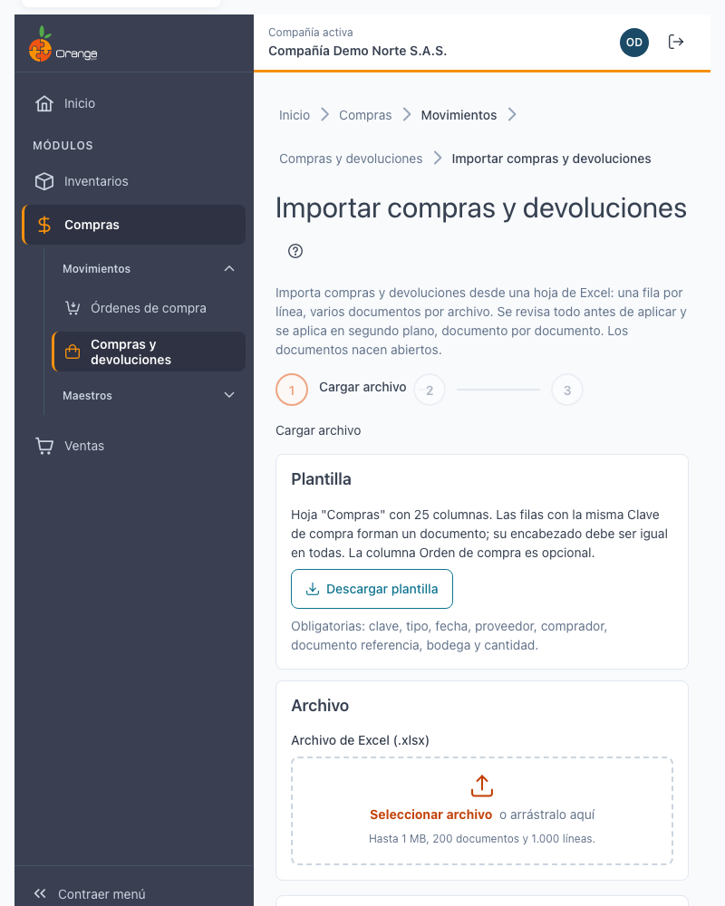
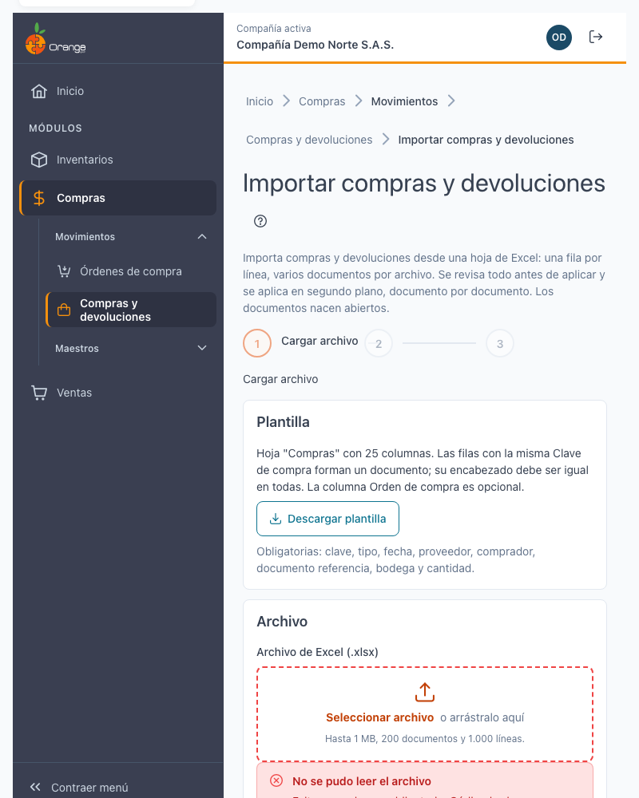
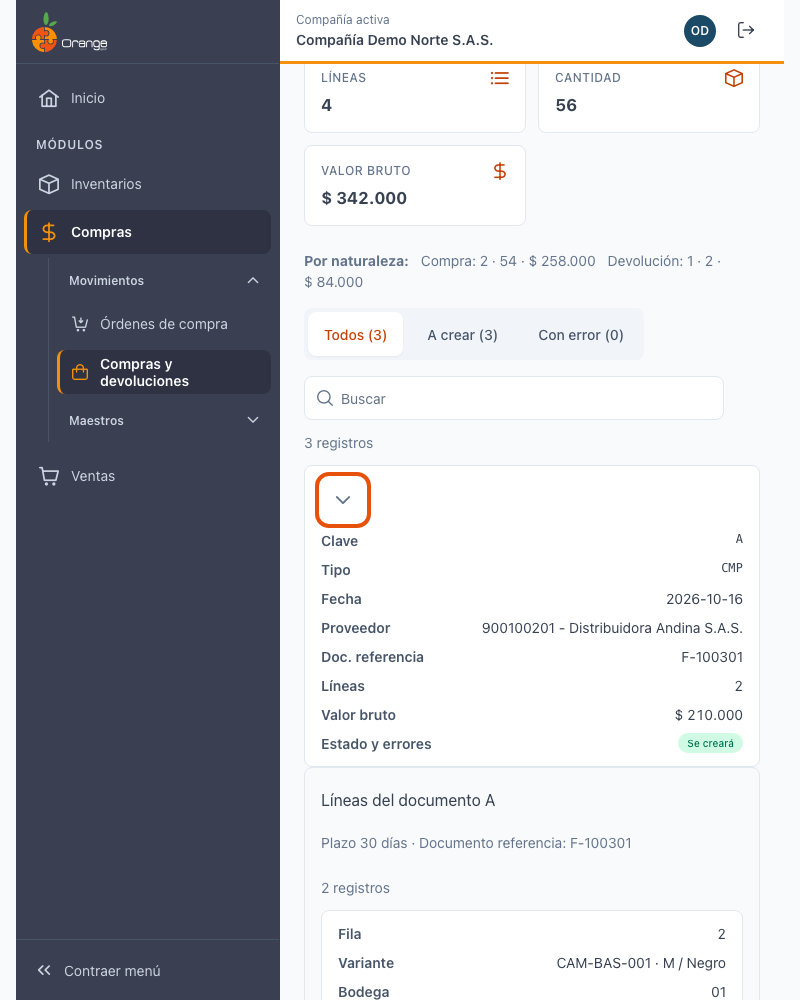
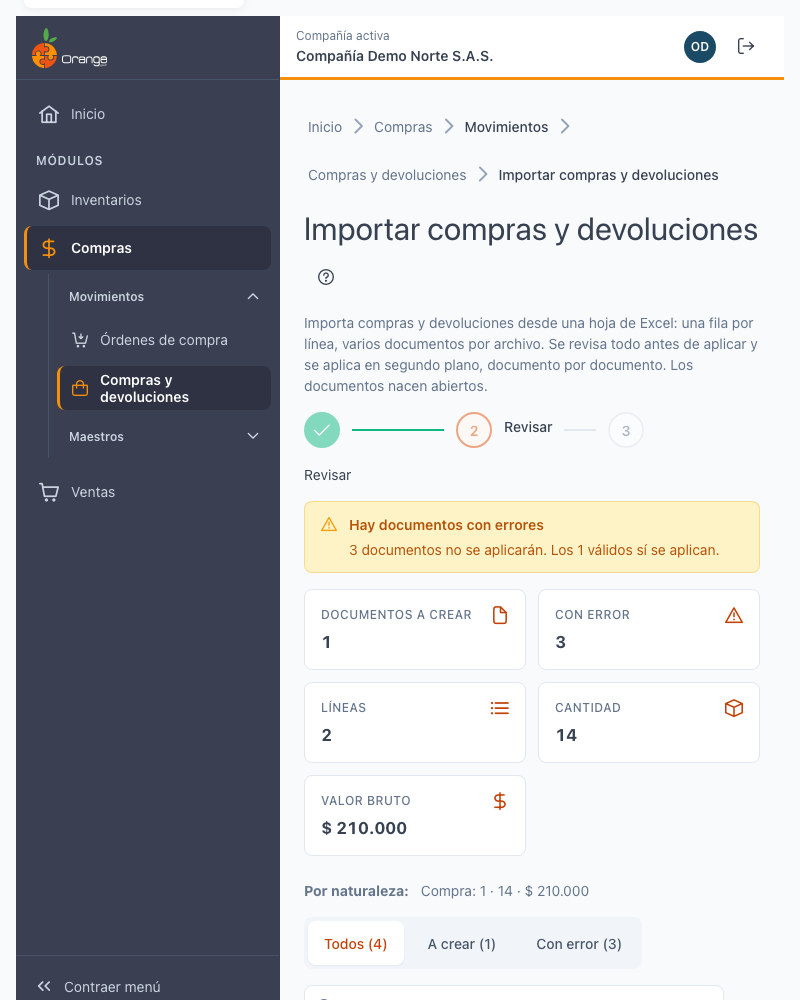
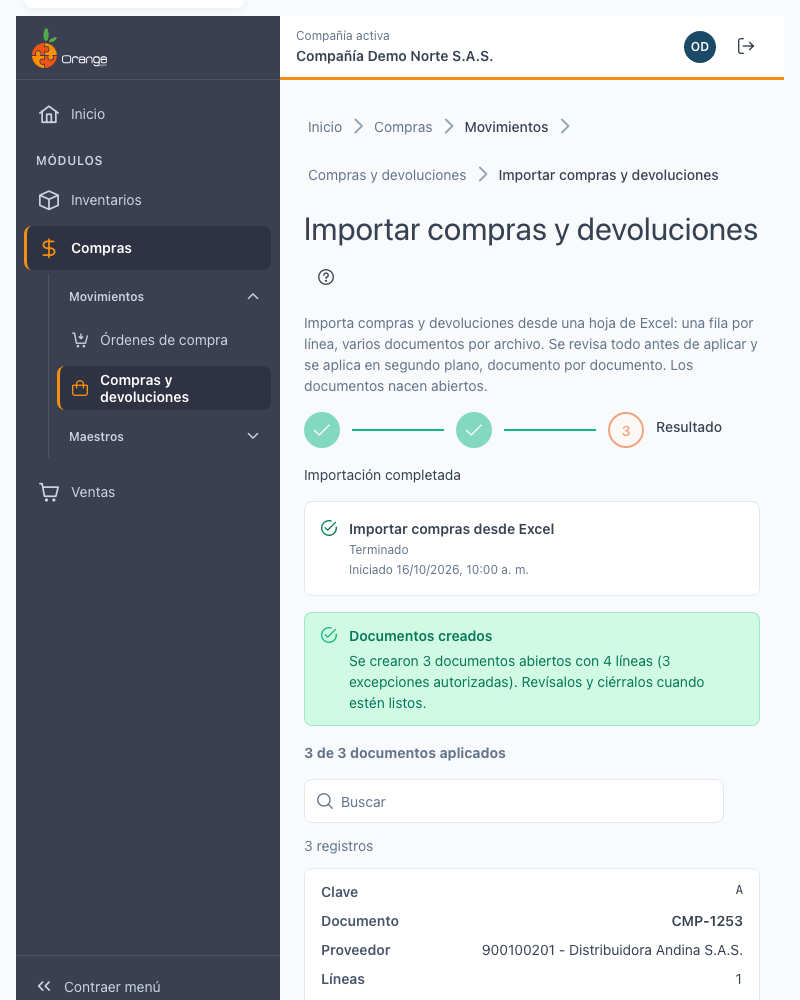
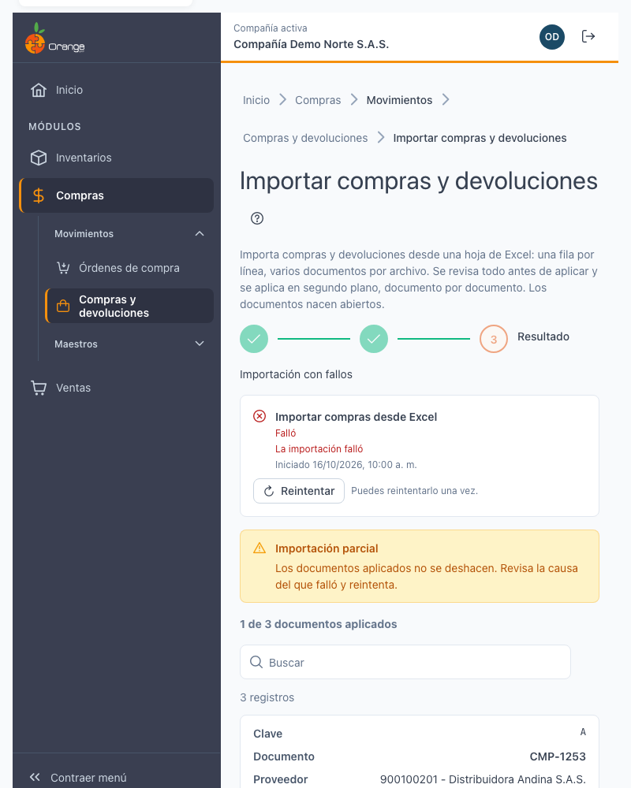

# Importar compras y devoluciones desde Excel

[← Volver al índice de compras](../readme.md) · [Compras y devoluciones](compras-devoluciones.md) · [Importar factura electrónica](compras-devoluciones-importar-factura-electronica.md)

Crea **varios documentos de compra o devolución** de una sola vez a partir de una hoja de Excel: cada fila es una línea y las filas con la misma **Clave de compra** forman un documento. Antes de guardar, el sistema le muestra qué documentos va a crear y qué filas tienen errores. **Nada se guarda hasta que usted aplica.**

## Acceso

En el listado de [compras y devoluciones](compras-devoluciones.md) pulse **Importar Excel**. El botón aparece solo si tiene los permisos **Crear** y **Exportar** sobre esa opción. En la importación solo puede usar los tipos de movimiento que tiene autorizados. Si le falta alguno de los dos permisos, el botón no aparece.

La importación **solo crea documentos nuevos**. Nunca modifica ni elimina los que ya existen. Los documentos nacen **abiertos**: los revisa y los cierra después.

## Los tres pasos: Cargar archivo → Revisar → Resultado

**1. Cargar archivo.** Descargue la **plantilla** con **Descargar plantilla** (archivo `PlantillaImportarCompras.xlsx`, hoja **Compras**). Llénela, arrastre el archivo `.xlsx` al recuadro o elíjalo con el botón.

Si el archivo no sirve, verá el motivo y no se envía nada. Por ejemplo: no es un `.xlsx`, le falta una columna obligatoria, no tiene filas, pesa más de 1 MB o trae más de 200 documentos o de 1.000 líneas.

**2. Revisar.** El sistema valida cada fila **sin guardar nada**.

- El resumen muestra **Documentos a crear**, **Con error**, **Líneas**, **Cantidad** y **Valor bruto**, y el detalle **Por naturaleza** (compras o devoluciones).
- La lista muestra **un documento por fila**. Pulse el documento para ver sus líneas.
- Con **Todos**, **A crear** o **Con error** filtra la lista.
- Un error en una línea marca **todo el documento** como *Con error*. Ese documento no se aplicará; los válidos sí.

Pulse **Cambiar archivo** para cargar otro, o **Descargar errores** para tener la lista de errores y corregirla en Excel.

**3. Aplicar y resultado.** Pulse **Aplicar N documentos** (N es el número de documentos válidos). La aplicación se describe en Aplicar y resultado.

## La hoja Compras: 25 columnas

Las columnas se leen por su **nombre** (el orden no importa). Las marcadas con * son obligatorias.

**Encabezado del documento** (columnas 1 a 10). Deben ser **iguales** en todas las filas del mismo documento:

1. Clave de compra *
2. Código tipo de movimiento *
3. Fecha *
4. Documento proveedor * (la identificación del proveedor)
5. Documento comprador * (la identificación del comprador)
6. Días de plazo (vacío = el plazo del proveedor)
7. Documento referencia * (la factura o documento del proveedor)
8. Observaciones (máximo 200 caracteres, sin comas ni punto y coma)
9. Código ReteFuente
10. Código ReteIVA

**Línea** (columnas 11 a 25). Son propias de cada fila:

11. Código referencia
12. Código atributo principal
13. Código atributo secundario
14. Código de barras
15. Lote (obligatorio si la referencia lo exige)
16. Código bodega *
17. Código ubicación
18. Código centro de costos
19. Número OP
20. Código IVA (vacío = el sistema lo toma de la referencia)
21. % Descuento
22. Valor unitario
23. Cantidad *
24. Detalle
25. Orden de compra (opcional; ver Órdenes de compra)

> 💡 Si un documento tiene la misma clave en varias filas, el encabezado debe escribirse igual en todas. Si no, verá *El encabezado difiere* con la fila que no coincide.

## Órdenes de compra en la importación

- Si la columna **Orden de compra** va **vacía**, la vista previa puede **sugerir** la orden de compra del proveedor. La sugerencia **nunca se liga sin que usted la confirme**.
- Si hay varias órdenes posibles, elija una en la fila (**Elegir la OC**) o deje **Sin OC**.
- Pulse **Aceptar las N sugeridas** para aceptarlas todas.
- Si no decide, las líneas se aplican **sin orden de compra**.

Cada línea ligada a una orden de compra se valida contra ella: saldo, valor unitario, bodega, centro de costos, descuento, IVA y fecha.

## Autorización de excepciones

Si una línea excede la orden de compra, aparece como **excepción**. Puede ser:

- **Autorizable:** un administrador puede autorizarla. Verá **Autorizar (n)** en el documento o **Autorizar todas (n)** para todo el archivo.
- **No autorizable:** la orden de compra no se puede usar (anulada, congelada o abierta), o la devolución supera lo recibido. Corrija el archivo.

Al pulsar **Autorizar** se abre el diálogo de [autorización de administrador](compras-devoluciones.md): un administrador de la compañía ingresa su usuario, su contraseña y un motivo. **Su sesión no cambia.** Una sola autorización puede cubrir las excepciones de la vista previa, cada una con su límite exacto.

Si **usted** es administrador, no le pide contraseña: verá **Confirmar (n)** o **Confirmar todas (n)**, y cada confirmación queda en la bitácora como autorización implícita de administrador.

## Errores comunes y su solución

| Lo que ve | Qué hacer |
|---|---|
| *Ya existe una compra no anulada de este proveedor con ese documento de referencia.* | Revise si la compra ya está registrada. Si es otra factura, cambie el documento referencia. |
| *El mismo proveedor y documento de referencia se repite en el archivo.* | Deje solo una fila por documento, o use una clave distinta para cada compra. |
| *No hay un proveedor activo con el documento…* | Cree el proveedor en Compras › Proveedores y vuelva a validar. |
| *La referencia exige lote y la fila no lo trae.* | Escriba el lote en la columna Lote. |
| *El encabezado difiere… frente a la fila…* | Copie el mismo encabezado en todas las filas de la clave. |
| *La cantidad supera el saldo de la OC.* | Baje la cantidad al saldo, quite la orden o pida la autorización de un administrador. |
| *El valor unitario es distinto al de la OC.* | Corrija el valor o pida la autorización de un administrador. |
| *La bodega es distinta a la de la OC.* | Use la bodega de la orden o pida la autorización. |
| *La OC no se puede usar (anulada, congelada o abierta).* | Quite la orden de compra de la fila; no se puede autorizar. |
| *La fecha cae en un periodo contable cerrado.* | Use una fecha de un periodo abierto. |
| *Otra compra cambió el saldo de la OC antes de aplicar.* | Nada se creó. Pulse **Volver a validar**. |

Si una referencia de la fila no existe o no está activa en la compañía, la fila aparece con error y el mensaje indica la columna.

## Límites

- Archivo: **.xlsx**, máximo **1 MB**.
- Máximo **200 documentos** y **1.000 líneas** por archivo.
- Si el archivo supera el límite de la aplicación, verá *El archivo es demasiado grande para aplicar*. Divídalo en dos o más archivos.

## Aplicar y resultado

Pulse **Aplicar N documentos**. El sistema:

- **Aplica los documentos válidos.** Uno con error no frena a los demás y nunca se escribe a medias.
- Aplica en **segundo plano**, documento por documento. Puede salir de la pantalla: le avisamos en la **campana** cuando termine.
- Si un bloqueo transitorio detiene la importación, **reintenta sola** los documentos que faltan.

El resultado puede ser:

- **Importación completada:** *Documentos creados* con el número de documentos, líneas y excepciones autorizadas.
- **Importación parcial:** algunos documentos se crearon y otro falló. Los creados **no se deshacen**. Revise la causa del que falló y pulse **Reintentar** o **Volver a validar**.
- **La importación falló:** no se creó ningún documento. Revise la causa y vuelva a intentar.

Desde el resultado puede **Ver el listado** o **Importar otro archivo**.

## Preguntas frecuentes

**¿Qué pasa si envío el mismo archivo dos veces?**
Si lo envía de nuevo en pocos minutos, la pantalla muestra el proceso que ya está en marcha; no crea otro. Si el resultado fue parcial, corrija el archivo y vuelva a validar.

**¿Puedo deshacer una importación?**
No como un solo paso. Cada documento creado se puede anular o eliminar desde el listado, con las reglas de [compras y devoluciones](compras-devoluciones.md).

**¿Por qué no aparece el botón Importar Excel?**
Necesita los permisos **Crear** y **Exportar** sobre la opción de compras y devoluciones.

**¿Por qué un documento no se aplica aunque las demás filas estén bien?**
Porque tiene al menos una línea con error. Solo ese documento queda fuera; corrijalo y vuelva a cargar el archivo o a validar.

**¿Qué pasa con las fechas de periodos cerrados?**
Un documento cuya fecha cae en un periodo contable cerrado se marca con error. Cámbiela a un periodo abierto.
