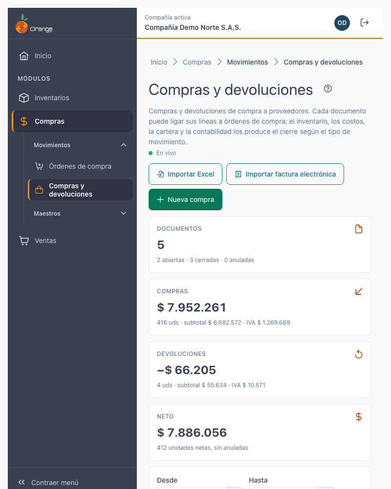
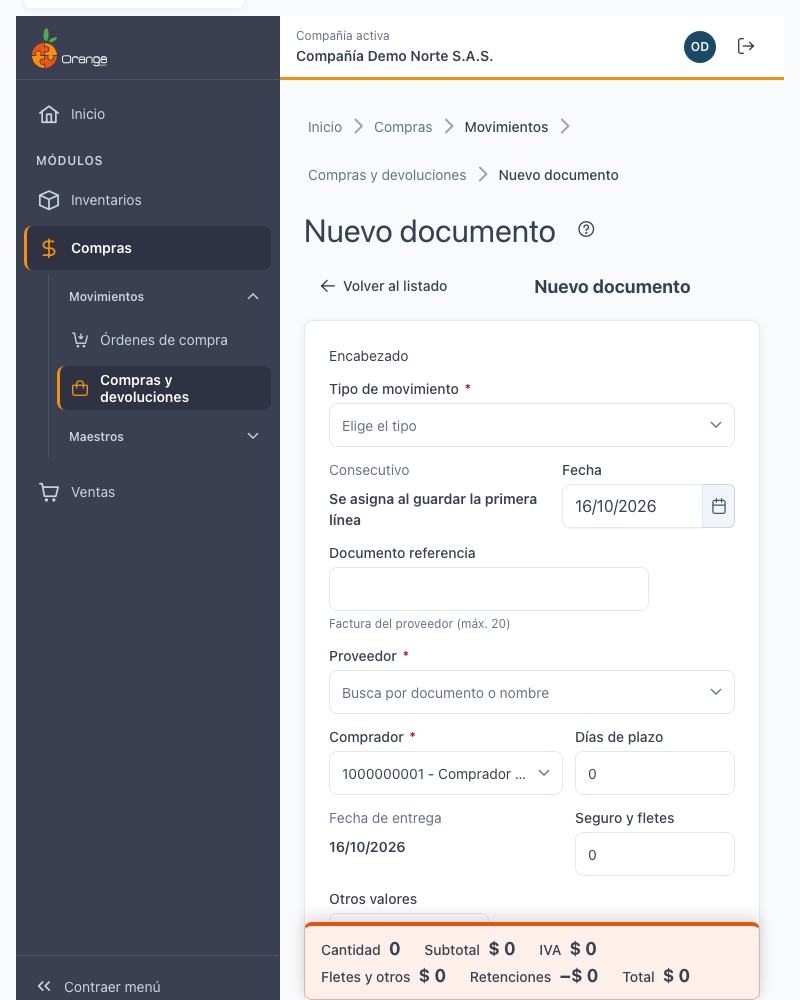
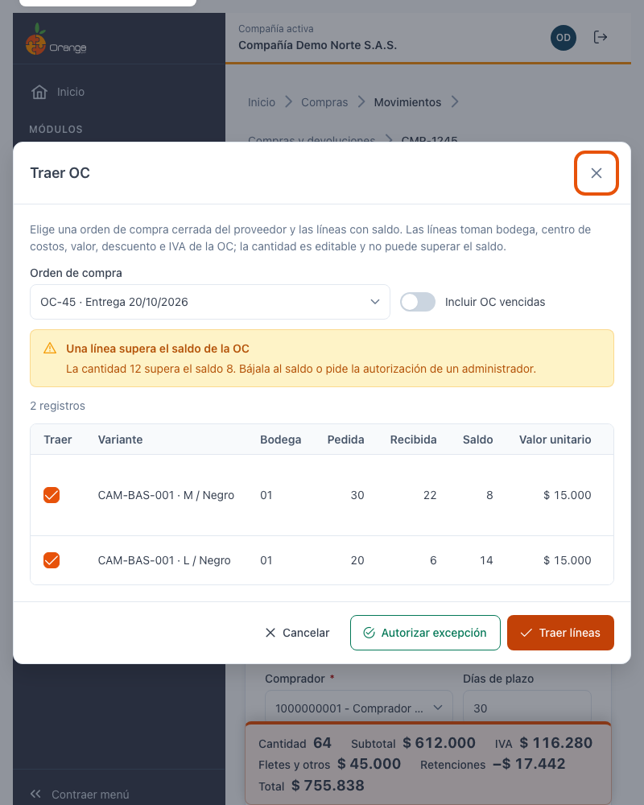
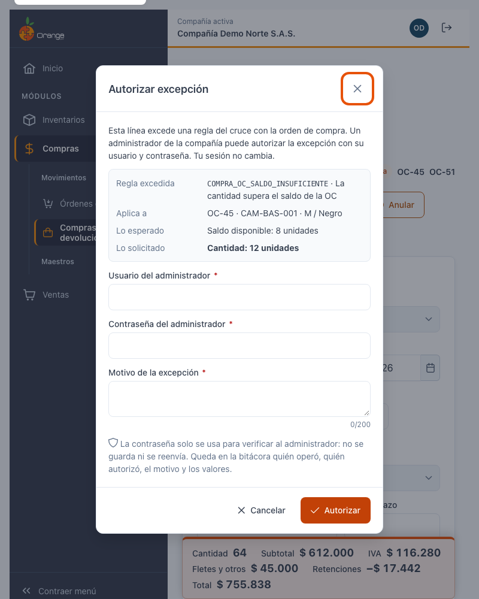
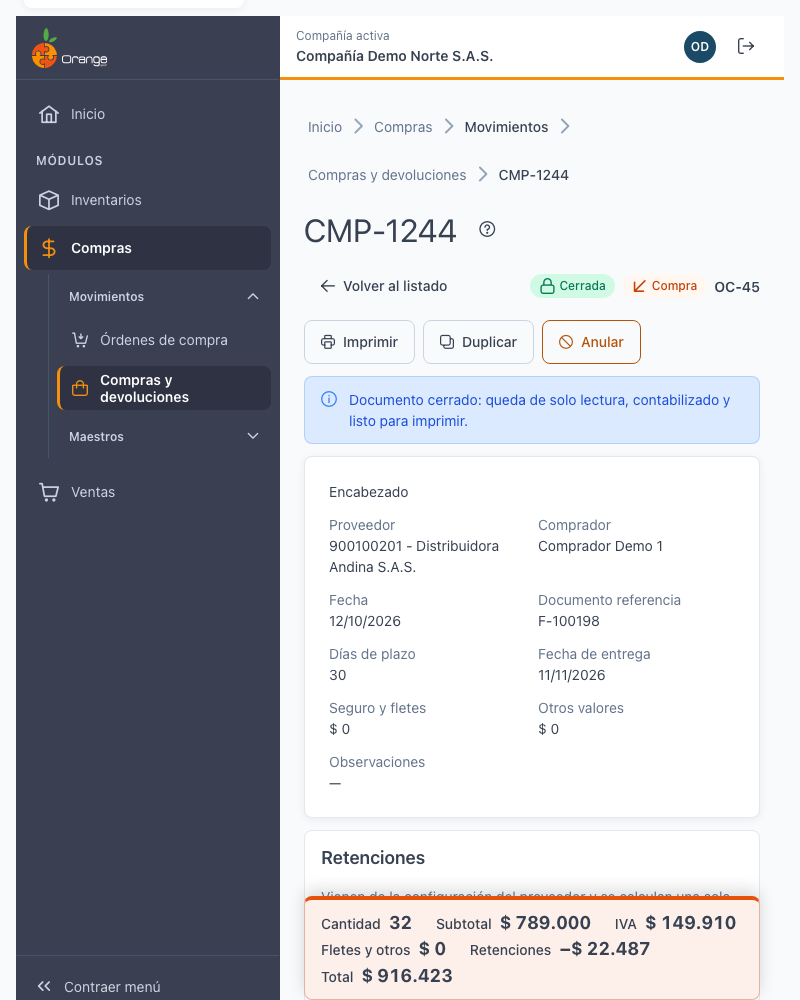
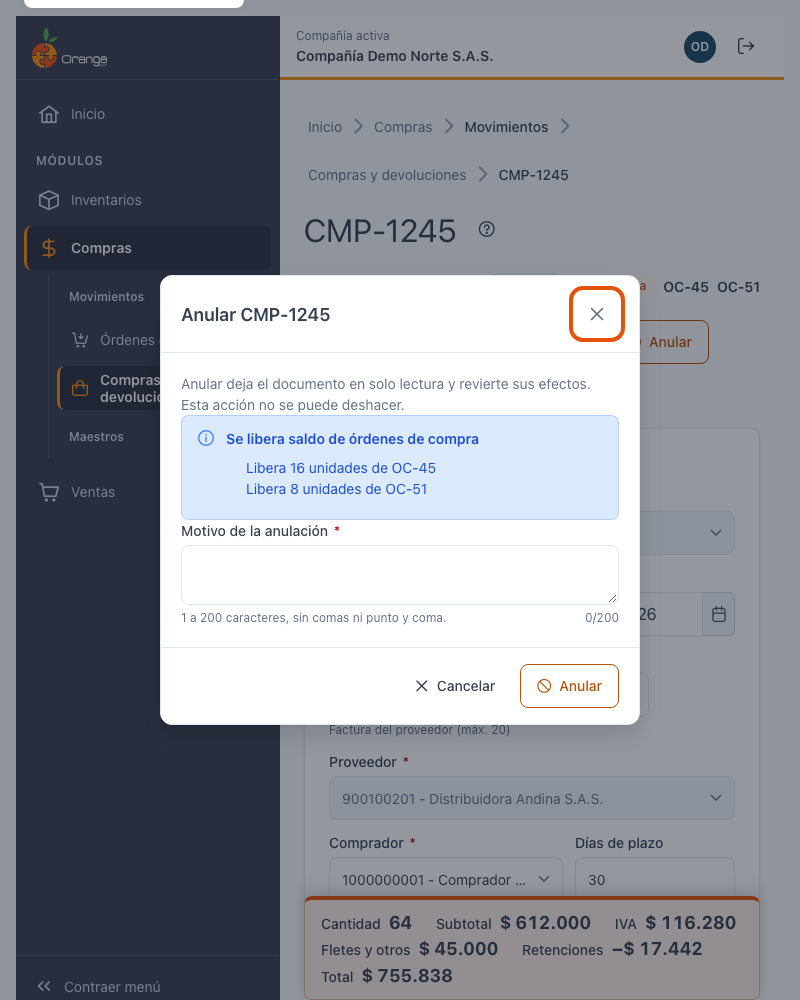
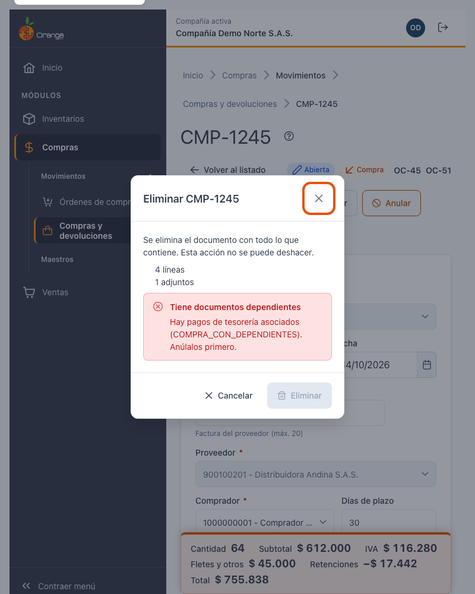
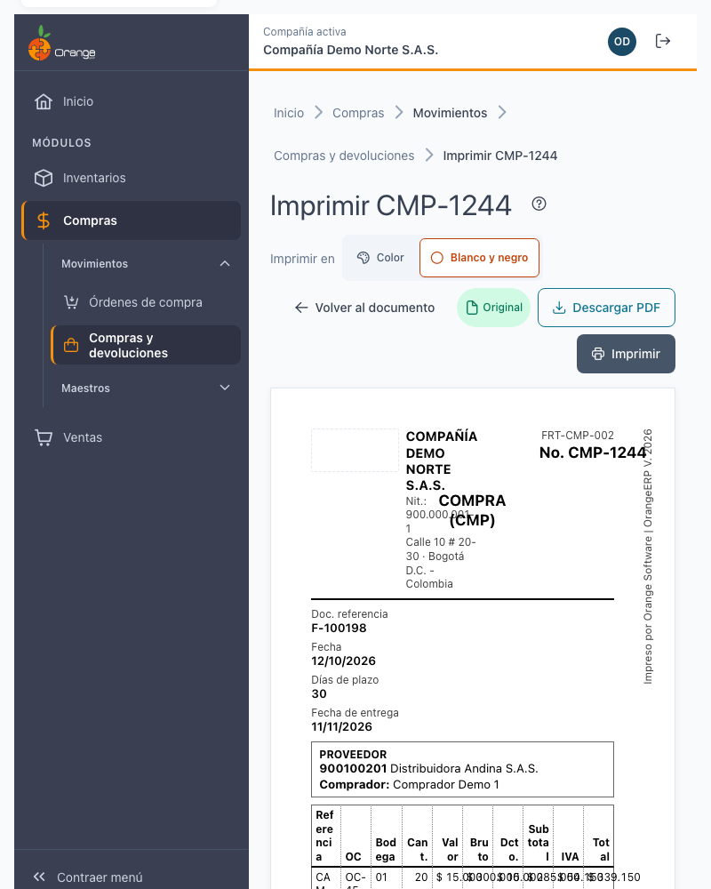

# Compras y devoluciones

[← Volver al índice de compras](../readme.md) · [Importar desde Excel](compras-devoluciones-importar.md) · [Importar factura electrónica](compras-devoluciones-importar-factura-electronica.md)

Aquí se registran las **compras** a sus proveedores y las **devoluciones** de mercancía. Cada documento tiene las líneas de productos, el proveedor, el comprador y, si lo necesita, las **órdenes de compra** de las que viene la mercancía. Al cerrar el documento, el sistema actualiza el inventario, los costos, la cartera y la contabilidad según el tipo de movimiento.

## Acceso y permisos

Abra el menú de **Compras** y elija **Compras y devoluciones**. La pantalla usa los permisos de su perfil sobre esta opción:

| Permiso | Qué le permite |
|---|---|
| **Consultar** | Ver el listado y los documentos. Sin este permiso la pantalla muestra *Sin permiso*. |
| **Crear** | Crear compras y devoluciones nuevas. Con **Exportar** también puede importar. |
| **Actualizar** | Editar líneas, cerrar documentos y autorizar excepciones como administrador. |
| **Eliminar** | Eliminar documentos. |
| **Anular** | Anular documentos. |
| **Imprimir** | Imprimir documentos cerrados. |
| **Exportar** | Usar **Importar Excel** e **Importar factura electrónica** (junto con **Crear**). |

Además, solo ve los **tipos de movimiento** que su usuario tiene autorizados. Si necesita un permiso, pídalo a un administrador de la compañía.

## Pantalla principal: el listado

El listado muestra los documentos de la compañía, con paginación.

- **Filtros:** Desde y Hasta (por defecto, el mes en curso), **Tipo de movimiento**, **Proveedor**, **Estado** (Abierta, Cerrada o Anulada), **Naturaleza** (Compras y devoluciones, Compra o Devolución), **Documento o número** y **Con OC ligada**. **Limpiar filtros** los quita todos. El rango no puede superar 366 días.
- **Resumen del filtro:** cantidad de documentos (abiertos, cerrados y anulados), compras, devoluciones y el neto de unidades (sin anuladas).
- **Columnas:** número, fecha, documento referencia, proveedor, comprador, naturaleza, OC ligadas, cantidad, valor total y estado.
- **Acciones por fila:** ver, editar, imprimir, anular y eliminar. Solo aparecen las que su permiso y el estado del documento permiten.
- **Botones:** **Nueva compra**, **Importar Excel** e **Importar factura electrónica** (estos dos últimos solo con permiso **Crear** y **Exportar**).

Si el listado no tiene documentos, verá *Aún no hay compras ni devoluciones*. Si el filtro no encuentra nada, verá *Sin resultados*.

## Crear una compra o devolución

1. Pulse **Nueva compra**.
2. En el encabezado elija primero el **Tipo de movimiento**. Sin tipo no se puede capturar nada.
3. Elija el **Proveedor** (busque por documento o nombre). Al elegirlo, el sistema precarga sus días de plazo, su descuento comercial y sus retenciones. Puede revisarlos.
4. Complete el **Documento referencia** (la factura del proveedor, máximo 20 caracteres), la **Fecha** y el **Comprador**. Opcionalmente, **Fecha de entrega**, **Seguro y fletes**, **Otros valores** y **Observaciones**.
5. Agregue las líneas: **Variante** (código o nombre), **Bodega**, **Lote** si la referencia lo exige, **Cantidad** y **Valor unitario**. Pulse **Agregar línea**.

**El consecutivo se asigna al guardar la primera línea.** Hasta entonces el documento no tiene número.

> 💡 Si el documento referencia ya fue usado con ese proveedor en una compra no anulada, verá un aviso: *El documento para este proveedor ya se encuentra en uso. Puedes continuar.* Es un aviso, no un bloqueo.

Cada línea se guarda al momento y se valida en el servidor. Si una línea no se puede guardar:

- **Problema de red:** verá *No se pudo guardar por un problema de red*. Pulse **Reintentar** en la línea o **Reintentar todas**.
- **Otra compra usa el saldo de la misma orden:** la línea queda en conflicto. Espere unos segundos y reintente.
- **Dato inválido** (por ejemplo, cantidad cero o bodega sin elegir): el campo indica el error. Corríjalo o use **Descartar** para quitar la línea.

Mientras haya líneas sin guardar, el encabezado muestra *N líneas sin guardar* y los totales dicen que no incluyen esas líneas pendientes.

## Traer líneas de una orden de compra

Si la mercancía viene de una **orden de compra** (OC), no es necesario digitar las líneas: use **Traer OC**.

1. En la captura pulse **Traer OC** y elija la orden de compra del proveedor. Solo se ofrecen órdenes **cerradas**, del mismo proveedor, no anuladas y con saldo. Las órdenes vencidas no aparecen, salvo que marque **Incluir OC vencidas**.
2. Verá las líneas con saldo: **Pedida**, **Recibida** y **Saldo**. Marque **Traer** en las que necesite.
3. Ajuste la **Cantidad a traer** si hace falta. La cantidad **no puede superar el saldo**.
4. Pulse **Traer líneas**. Cada línea toma la bodega, el centro de costos, el valor, el descuento y el IVA de la orden.

Si una cantidad supera el saldo, verá *La cantidad supera el saldo de la OC* con el saldo disponible. Baje la cantidad al saldo o pida la autorización de un administrador (ver la siguiente sección).

Si alguna línea falla al traer, el resumen dice cuántas se guardaron y cuántas no. Pulse **Ir a la línea** para revisarla.

Las líneas ligadas a una orden de compra quedan con su número de OC en el documento y en la pestaña **Órdenes de compra**.

## Autorización de administrador

Algunas diferencias con la orden de compra no se bloquean para siempre: el sistema las marca como **excepción** y un **administrador de la compañía** puede autorizarlas. Son las diferencias de **saldo**, **valor unitario**, **bodega**, **centro de costos**, **descuento**, **IVA** y **fecha** (la compra no puede ser anterior a la orden).

Al intentar guardar una línea así, verá un mensaje como *La cantidad supera el saldo de la OC. Un administrador puede autorizar la excepción.* y el botón **Autorizar excepción**. Se abre un diálogo con:

- **Detalle de la excepción:** la regla que se excede, **Lo esperado** (lo de la orden) y **Lo solicitado** (lo de la compra).
- **Usuario del administrador** y **Contraseña del administrador**.
- **Motivo de la excepción** (de 1 a 200 caracteres, sin comas ni punto y coma).

Reglas que conviene conocer:

- **La contraseña es solo para verificar al administrador.** No se guarda ni se reenvía. **Su sesión no cambia**: sigue trabajando con su propio usuario.
- La autorización es **de una sola vez** para esa línea y ese límite exacto. Si la autorización vence (son unos pocos minutos), vuelva a pedirla.
- Si la contraseña o el usuario no son correctos, o el usuario no es administrador de la compañía, verá *No se pudo autorizar*. Su sesión sigue abierta.
- Después de varios intentos fallidos la autorización se bloquea **15 minutos**. Espere o pida ayuda a otro administrador.
- Quedan en la **bitácora** quién operó, quién autorizó, el motivo y los valores.

**Si usted es administrador**, no ve el diálogo: el sistema le pide solo confirmar la excepción con un clic (*Confirmar excepción*), sin contraseña. El motivo queda registrado como autorización implícita de administrador y la excepción queda en la bitácora.

Hay diferencias que **no se pueden autorizar**. Verá *No autorizable* y deberá corregir la línea:

- La orden de compra está **anulada**: no se puede ligar.
- La devolución supera lo que se recibió de esa orden de compra.

## Editar y guardar

- Un documento **abierto** se edita con el permiso **Actualizar**. Las líneas se guardan una a una.
- Un documento **cerrado** queda de solo lectura. Para cambiarlo se necesita el permiso de editar documentos cerrados que asigna un administrador.
- Puede **cambiar el proveedor** solo si el documento no tiene líneas ligadas a una orden de compra.
- Un documento de un **periodo contable cerrado** solo se puede consultar. Verá el aviso *Periodo cerrado*.
- Algunos tipos de movimiento (documento soporte, nota de ajuste de documento soporte y servicios) se pueden ver, pero no crear ni editar desde esta pantalla.

El documento tiene estas pestañas:

- **Detalle:** líneas, retenciones y totales.
- **Órdenes de compra:** las OC de las que vienen las líneas.
- **Contabilidad:** la contabilidad del documento. Se genera al cerrarlo.
- **Adjuntos:** archivos del documento (máximo 10 MB cada uno). Solo se pueden adjuntar mientras está abierto.
- **Bitácora:** quién creó, cerró, anuló o autorizó cada cambio, y cuándo.

## Cerrar, anular, eliminar

**Cerrar transacción.** Confirma el documento: queda **contabilizado**, de solo lectura y listo para imprimir. Requiere el permiso **Actualizar**. Al cerrar, el inventario, los costos y la cartera se actualizan.

**Anular.** Deja el documento en solo lectura y **revierte sus efectos**. Es irreversible. Requiere el permiso **Anular** y que el periodo contable esté abierto.

- Escriba el **motivo** de la anulación (de 1 a 200 caracteres, sin comas ni punto y coma).
- Si el documento tenía líneas de una orden de compra, el diálogo avisa cuántas unidades **se liberan** de cada orden. El saldo vuelve a estar disponible.
- Si parte de lo comprado ya se vendió o consumió, el diálogo muestra un **aviso informativo** con las variantes y bodegas que quedarían con existencia negativa. Es un aviso: puede continuar.
- Si hay **pagos de tesorería** asociados, no se puede anular. Anule primero esos pagos desde Tesorería.

**Eliminar.** Borra el documento con todo lo que contiene (líneas y adjuntos). Es irreversible. Requiere el permiso **Eliminar**, el periodo contable abierto, que el documento no esté anulado y que no tenga documentos dependientes (por ejemplo, pagos de tesorería).

Si el documento tenía líneas de una orden de compra, al eliminarlo el saldo de esas órdenes vuelve a estar disponible.

Si una acción no está disponible, el botón no aparece o el diálogo le explica por qué (periodo cerrado, documento anulado o documentos dependientes).

## Imprimir

Solo se imprimen documentos **cerrados y no anulados**. Verá la vista previa con las copias **Original** y **Copia**. Desde ahí puede **Imprimir** o **Descargar PDF**.

El documento impreso muestra el proveedor, el comprador, el documento referencia, las fechas, las líneas con su orden de compra, los totales, las retenciones, el valor en letras y los espacios de **Elabora** y **Aprueba**.

Si el documento está abierto o anulado verá *Este documento no se puede imprimir*. Ciérrelo antes.

## Importar desde Excel o factura electrónica

Desde el listado puede crear muchos documentos a la vez:

- **[Importar Excel](compras-devoluciones-importar.md):** una hoja de Excel con una fila por línea.
- **[Importar factura electrónica](compras-devoluciones-importar-factura-electronica.md):** los XML o ZIP que entrega la DIAN.

Ambas importaciones revisan todo antes de guardar. Los documentos nacen **abiertos** para que los revise antes de cerrarlos.

## Cambios de otros usuarios en vivo

La pantalla se actualiza sola cuando otro usuario crea, edita, cierra, anula o elimina un documento. Verá el indicador **En vivo**: *los cambios de otros usuarios aparecen automáticamente*.

- Si la conexión se corta, el indicador dice **Reconectando…**. Al volver la conexión, la pantalla se pone al día.
- Si otro usuario anula o elimina un documento que usted creó, le llega un **aviso** en la campana de notificaciones.
- Si usted tiene abierto un documento que otro usuario cambió, revise antes de guardar: sus cambios pueden chocar con los de él.

## Preguntas frecuentes y errores comunes

**No puedo cambiar un documento.**
Revise el estado. Un documento **cerrado** es de solo lectura. Un documento de un **periodo contable cerrado** solo se consulta. Si aun así necesita cambiarlo, pida a un administrador que le asigne el permiso de editar documentos cerrados.

**Al traer la orden de compra o guardar una línea aparece «La cantidad supera el saldo de la OC».**
La orden de compra ya tiene recibida parte de lo pedido y la cantidad que intenta traer es mayor que lo que queda. Tiene dos opciones: bajar la cantidad al saldo que se muestra, o pedir la **autorización de un administrador** (ver Autorización de administrador).

**¿Qué es la autorización de administrador?**
Es la confirmación de un administrador de la compañía para una diferencia con la orden de compra que usted no puede resolver solo, por ejemplo una cantidad mayor al saldo o un valor distinto. El administrador ingresa su usuario, su contraseña y un motivo. Su propia sesión no cambia y la contraseña no se guarda. Si usted es administrador, solo confirma con un clic. Todo queda en la bitácora.

**La orden de compra no aparece al traerla.**
Solo se ofrecen órdenes **cerradas**, del **mismo proveedor**, **no anuladas** y con **saldo**. Si la orden está vencida, marque **Incluir OC vencidas**. Si la orden está abierta, ciérrela primero en Órdenes de compra.

**Aparece el aviso «El documento para este proveedor ya se encuentra en uso».**
Ya existe una compra no anulada de ese proveedor con el mismo documento referencia. Es un aviso: revise que no esté duplicando la compra. Puede continuar si es un documento distinto.

**No puedo anular: aparece un aviso de documentos dependientes.**
El documento tiene pagos registrados en Tesorería. Anule primero esos pagos y luego la compra.

**No puedo eliminar un documento.**
Eliminar requiere el permiso **Eliminar**, el periodo abierto, que el documento no esté anulado y que no tenga documentos dependientes. Si tiene dependientes, anúlelos primero.

**Dice «Periodo cerrado».**
La fecha del documento cae en un periodo contable cerrado. Solo puede consultarlo. Para registrar una compra nueva, use una fecha de un periodo abierto o pida a su administrador de contabilidad que lo habilite.

**Al anular aparece un aviso de existencia negativa.**
Parte de lo comprado ya se consumió o vendió y la existencia de esa bodega quedaría negativa. Es un aviso: la anulación se puede hacer. Revise el inventario después de anular.

**Veo un tipo de movimiento que no puedo editar.**
Los documentos soporte, las notas de ajuste de documento soporte y los de servicios se pueden consultar, pero no crear ni editar desde esta pantalla.

**Veo «Sin permiso».**
Su perfil no tiene **Consultar** sobre esta opción, o el tipo de movimiento del documento no está autorizado para su usuario. Pida acceso a un administrador.

**No veo los botones Importar Excel ni Importar factura electrónica.**
Necesita los permisos **Crear** y **Exportar** sobre esta opción.
