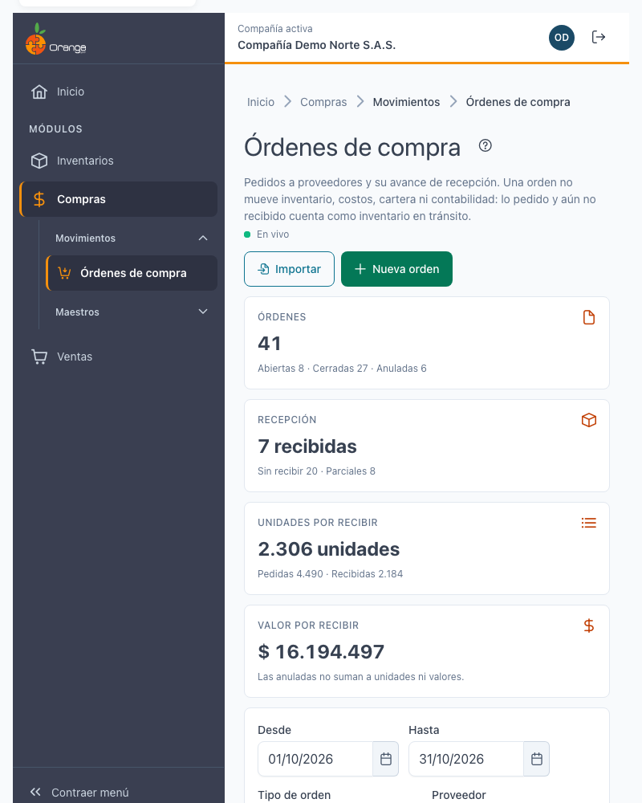
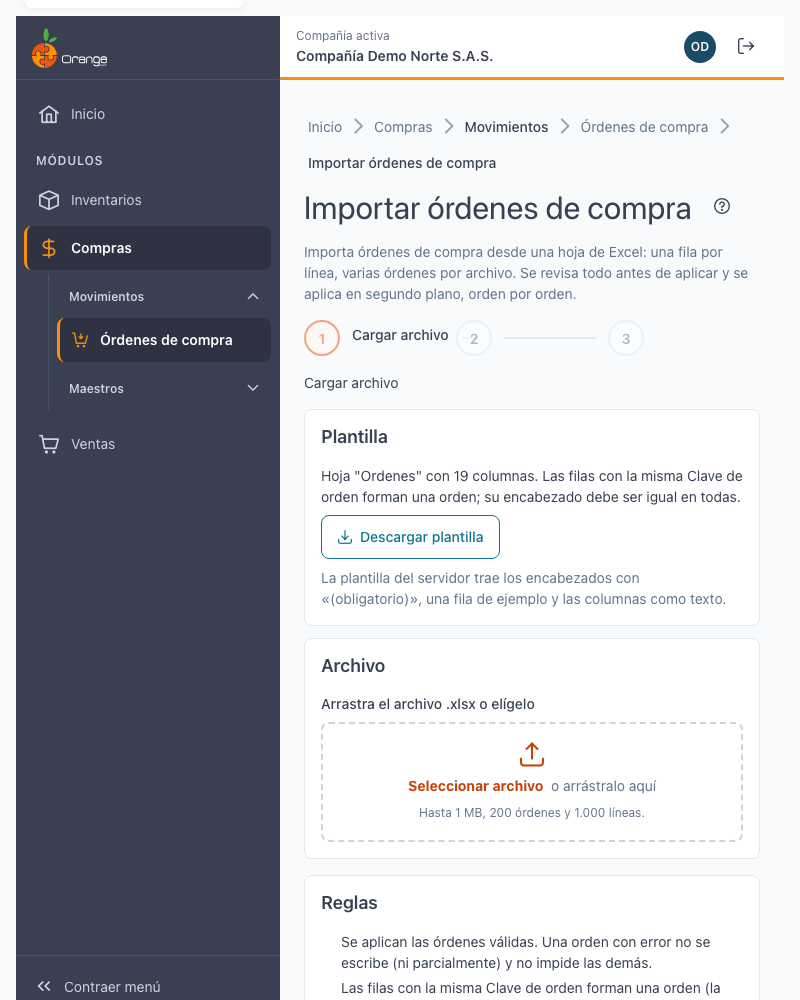
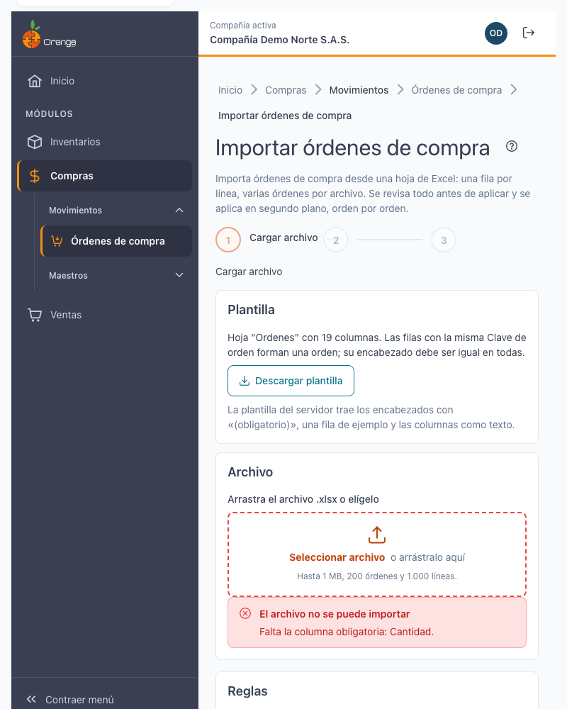
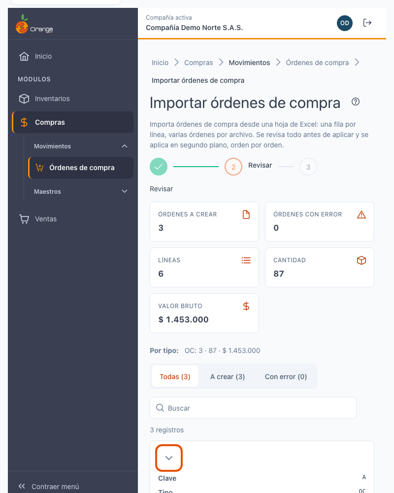
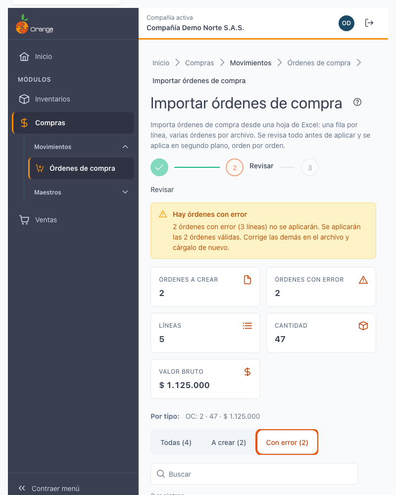
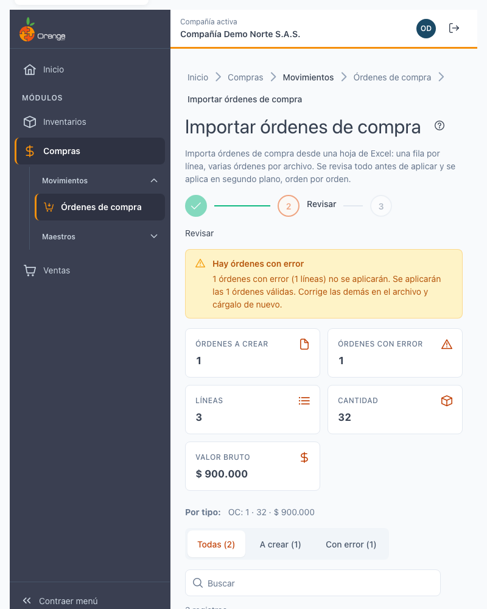
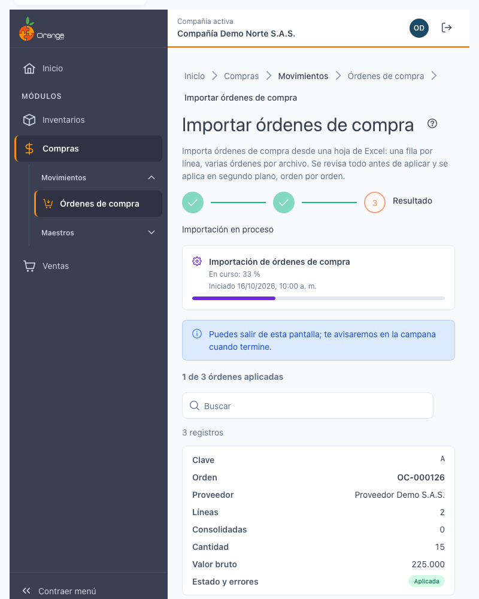
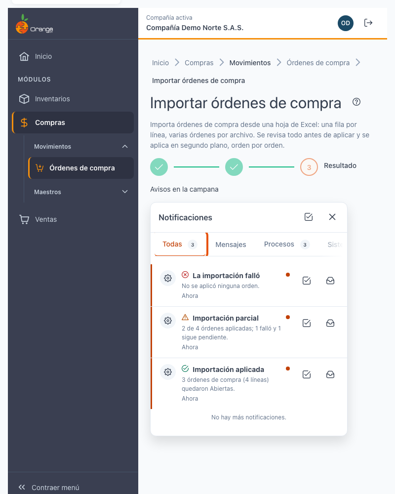
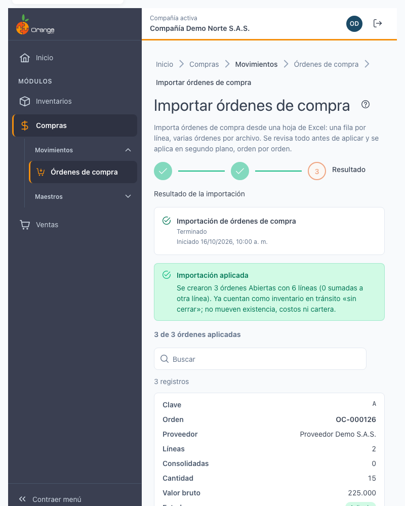
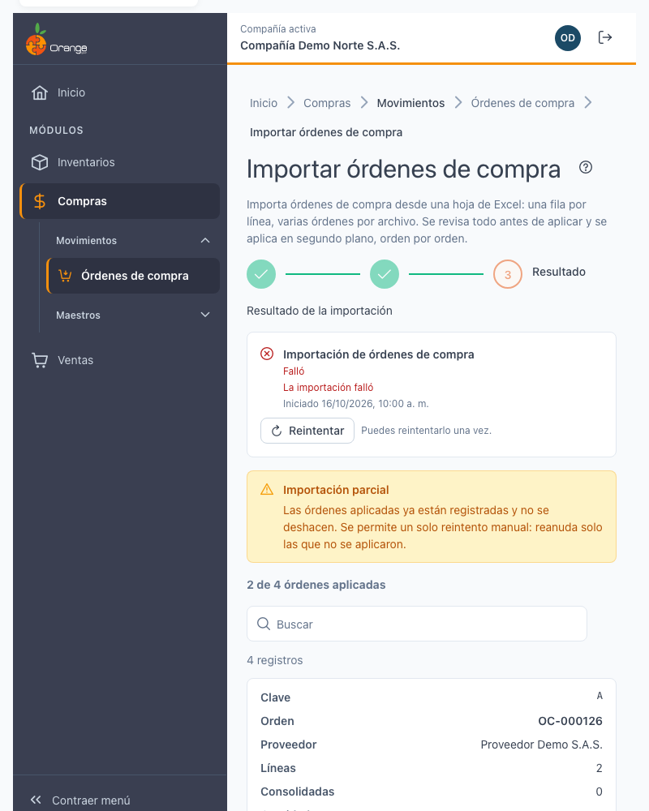

# Importar órdenes de compra desde Excel

[← Volver al índice de compras](../readme.md) · [Órdenes de compra](ordenes-compra.md)

Crea **varias órdenes de compra nuevas** de una sola vez a partir de una hoja de Excel: cada fila es una línea de una orden y las filas con la misma **Clave de orden** forman una orden. Antes de guardar, el sistema le muestra qué órdenes va a crear y qué filas tienen errores. **Nada se guarda hasta que usted aplica.**

- [Permisos y acceso](#acceso)
- [Los tres pasos](#pasos)
- [La hoja Ordenes: 19 columnas](#columnas)
- [Cómo se identifican proveedor, comprador y referencia](#identificacion)
- [Valores vacíos](#vacios)
- [Revisar y corregir errores](#revisar)
- [Errores por código](#errores)
- [Límites](#limites)
- [Aplicar, avisos y resultado](#aplicar)
- [Qué queda después de importar](#despues)
- [Reintentar](#reintentar)

## Acceso

En el listado de [órdenes de compra](ordenes-compra.md) pulse **Importar**. El botón aparece solo si tiene los permisos **Crear** y **Exportar** sobre la opción de órdenes de compra, y en la pantalla solo puede usar los tipos de movimiento que tiene autorizados. Si le falta alguno de los dos permisos, el botón no aparece y la pantalla no se abre.

La importación **solo crea órdenes nuevas**. Nunca modifica, anula ni borra las órdenes que ya existen.

## Los tres pasos: Cargar archivo → Revisar → Resultado

**1. Cargar archivo.** Descargue la **plantilla** con **Descargar plantilla** (archivo `PlantillaImportarOrdenesCompra.xlsx`, hoja **Ordenes**, con los encabezados en la primera fila y un ejemplo en la segunda). Llénela, arrastre el archivo `.xlsx` al recuadro o elíjalo con el botón. Con **Cancelar** regresa sin importar nada.

> 💡 Las columnas de la plantilla quedan como texto. Si escribe los números con punto o coma decimal, el sistema los interpreta; no use separador de miles.

Si el archivo no sirve, verá el motivo y no se envía nada: no es un `.xlsx`, no tiene la hoja **Ordenes**, le falta una columna obligatoria, no tiene filas, pesa más de 1 MB o trae más de 200 órdenes o de 1.000 líneas.

**2. Revisar.** El sistema valida cada fila **sin guardar nada**.

- El resumen muestra **Órdenes a crear**, **Órdenes con error**, **Líneas**, **Cantidad** y **Valor bruto**, y el detalle **Por tipo**.
- La lista muestra una fila por **orden**. Pulse **Expandir** para ver sus líneas.
- Con **Todas**, **A crear** o **Con error (n)** filtra la lista.
- Un error en una línea marca **toda la orden** como *Con error*.
- Si dos líneas iguales se van a sumar en una, verá *Se suma a la fila N*.

**3. Aplicar y resultado.** Pulse **Aplicar N órdenes** (N es el número de órdenes válidas). La aplicación se describe en [Aplicar, avisos y resultado](#aplicar).

## La hoja Ordenes: 19 columnas

El orden de las columnas no importa: el sistema las lee por su nombre, sin distinguir mayúsculas, tildes ni el texto «(obligatorio)». Las columnas desconocidas se ignoran. Las marcadas con * son obligatorias.

Los datos de la **orden** (columnas 1 a 8) deben repetirse igual en todas las filas de esa orden. Los datos de la **línea** (columnas 9 a 19) son propios de cada fila.

| N.º | Columna | Qué escribir |
|-----|---------|--------------|
| 1 | **Clave de orden*** | Texto de hasta 20 caracteres, sin comas ni punto y coma. Solo agrupa las filas; no se guarda. |
| 2 | **Código tipo de movimiento*** | Código del tipo de orden de compra que usted puede usar. |
| 3 | **Fecha*** | Fecha de Excel o `aaaa-mm-dd`. |
| 4 | **Documento proveedor*** | Documento (NIT o cédula) de un proveedor activo. |
| 5 | **Documento comprador*** | Documento de un comprador activo. |
| 6 | **Días de plazo** | Número entero de 0 a 365. |
| 7 | **Documento referencia** | Hasta 20 caracteres: el documento del proveedor al que corresponde la orden. No puede repetirse con el mismo proveedor. |
| 8 | **Observaciones** | Hasta 200 caracteres. Las comas y los punto y coma se quitan. |
| 9 | **Código referencia** | Código de la referencia. |
| 10 | **Código atributo principal** | Código del atributo principal, si la referencia lo usa. |
| 11 | **Código atributo secundario** | Código del atributo secundario, si la referencia lo usa. |
| 12 | **Código de barras** | Código de barras de la variante (en lugar de referencia y atributos). |
| 13 | **Código bodega*** | Código de la bodega. |
| 14 | **Código ubicación** | Código de la ubicación dentro de la bodega, si aplica. |
| 15 | **Código centro de costos** | Obligatorio solo si el tipo de movimiento lo exige. |
| 16 | **Número OP** | Obligatorio solo si el tipo lo exige. Puede escribir `TIPO-consecutivo` o solo el consecutivo. |
| 17 | **Cantidad*** | Mayor que 0, hasta 4 decimales. |
| 18 | **Valor unitario** | Mayor que 0. Si lo deja vacío, se usa el valor sugerido. |
| 19 | **% Descuento** | De 0 a 100. Si lo deja vacío, se usa el descuento del proveedor (solo si el tipo liquida descuento). |

> 💡 No hay columna de **impuesto**: el sistema toma el impuesto de la referencia. Tampoco hay columna de **consecutivo**: el sistema asigna el número de cada orden.

## Cómo se identifican proveedor, comprador y referencia

Todo se identifica por **código o documento**, nunca por un número interno.

| Dato | Cómo se busca | Qué debe cumplir |
|------|---------------|------------------|
| **Proveedor** | Documento (columna 4) | Un tercero con perfil de proveedor y **activo**. |
| **Comprador** | Documento (columna 5) | Un tercero con perfil de comprador y **activo**. |
| **Tipo de movimiento** | Código (columna 2) | Un tipo de orden de compra que usted tiene autorizado. |
| **Referencia y variante** | Código de referencia, atributos y bodega | Dentro de su compañía, sin distinguir mayúsculas. |
| **Variante por código de barras** | Código de barras (columna 12) | La misma búsqueda que al capturar por código de barras. |
| **Bodega, ubicación, centro de costos y OP** | Código (columnas 13 a 16) | Un código existente en su compañía. |

**La variante se informa de una sola forma:**

- **Por referencia:** código de referencia y, si la referencia los usa, sus atributos principal y secundario; **o**
- **Por código de barras.**

No informe las dos formas en la misma fila, y tampoco deje las dos vacías. Solo se pueden comprar referencias **comercializadas** o **materiales**; una referencia de otro tipo da error.

## Valores vacíos

| Columna | Si la deja vacía |
|---------|------------------|
| Días de plazo | Se usan los días de entrega del proveedor. |
| Valor unitario | Se usa el valor sugerido de la referencia. |
| % Descuento | Se usa el descuento comercial del proveedor, si el tipo de movimiento liquida descuento. Si el tipo no liquida descuento, déjela vacía. |
| Documento referencia | La orden se crea sin control de duplicados. |
| Observaciones | La orden se crea sin observaciones. |
| Código ubicación | Se usa la bodega sin ubicación específica. |
| Centro de costos y Número OP | Son obligatorios solo si el tipo los exige; si no, déjelos vacíos. |
| Atributos y código de barras | Use la forma de variante que corresponda (ver arriba). Los atributos van vacíos si la referencia no los usa. |

Nunca se usa un cero por defecto: un código escrito que no existe da error, aunque sea un código de bodega o de ubicación.

## Revisar y corregir errores

Cada error se rotula con el encabezado de su columna y el valor que el sistema no reconoció.

- **Una orden con error no se crea**, aunque solo tenga un error en una línea. Las demás órdenes válidas sí se pueden aplicar.
- **Descargar errores** genera un Excel con las filas con error y su motivo, para corregirlas.
- **Cambiar archivo** vuelve al paso 1 con un archivo nuevo.
- **Volver a validar** vuelve a revisar el mismo archivo, por si los datos cambiaron (por ejemplo, otro usuario cambió un proveedor).

**Cuando no hay órdenes válidas**, **Aplicar** queda deshabilitado (**Aplicar 0 órdenes**). Corrija el archivo y vuelva a cargarlo.

## Errores por código

La vista previa muestra el mensaje de cada error. Esta tabla explica qué significa y qué hacer.

| Mensaje (código) | Qué significa | Qué hacer |
|------------------|---------------|-----------|
| Falta la clave de orden (`CLAVE_REQUIRED`) | La fila no tiene clave. | Escriba una clave en la columna 1. |
| La clave supera 20 caracteres o tiene "," o ";" (`CLAVE_FORMAT`) | La clave no es válida. | Use una clave corta, sin comas ni punto y coma. |
| La columna … difiere de la primera fila de la orden (`ENCABEZADO_DISTINTO`) | Una fila de la misma orden tiene otro proveedor, fecha, comprador, tipo, plazo, referencia u observaciones. | Deje los datos de la orden iguales en todas sus filas. |
| El tipo de movimiento … no existe (`TIPO_NOT_FOUND`) | El código de tipo no existe. | Use un código de tipo de orden de compra existente. |
| No está autorizado para el tipo … (`TIPO_NO_AUTORIZADO`) | Usted no puede usar ese tipo. | Use un tipo autorizado o pida el permiso a quien administra sus accesos. |
| La fecha … no es válida (`FECHA_FORMAT`) | La fecha no se reconoce. | Escriba la fecha como `aaaa-mm-dd` o como fecha de Excel. |
| El periodo de … está cerrado (`FECHA_PERIODO_CERRADO`) | No se puede registrar en ese mes. | Use una fecha de un periodo abierto. |
| Falta el documento del proveedor (`PROVEEDOR_REQUIRED`) | La columna 4 está vacía. | Escriba el documento del proveedor. |
| El proveedor … no existe (`PROVEEDOR_NOT_FOUND`) | No hay un proveedor con ese documento. | Revise el documento. |
| El proveedor … está inactivo (`PROVEEDOR_INACTIVO`) | El proveedor existe pero no está activo. | Active el proveedor o use otro. |
| Falta el documento del comprador (`COMPRADOR_REQUIRED`) | La columna 5 está vacía. | Escriba el documento del comprador. |
| El comprador … no existe (`COMPRADOR_NOT_FOUND`) | No hay un comprador con ese documento. | Revise el documento. |
| El comprador está inactivo; elija otro (`COMPRADOR_INACTIVO`) | El comprador existe pero no está activo. | Use un comprador activo. |
| Los días de plazo … no son válidos (`PLAZO_INVALIDO`) | El plazo no es un entero de 0 a 365. | Corrija el número. |
| Falta la variante (`VARIANTE_REQUIRED`) | No informó referencia ni código de barras. | Informe la referencia con sus atributos, o el código de barras. |
| Informe la variante por referencia o por código de barras, no por ambas (`VARIANTE_DOBLE`) | Informó las dos formas. | Deje solo una. |
| La variante … no existe o no está activa (`VARIANTE_NOT_FOUND`) | Ningún código coincide. | Revise referencia, atributos o código de barras. |
| La variante … coincide con varias (`VARIANTE_AMBIGUA`) | El código de barras coincide con más de una variante. | Informe referencia y atributos. |
| La referencia no es comercializada ni material (`VARIANTE_NO_COMPRABLE`) | No se puede comprar esa referencia. | Use una referencia comprable. |
| … no existe (`CODIGO_NOT_FOUND`) | La bodega, la ubicación, el centro de costos o la OP no existe en su compañía. | Escriba el código tal como aparece en el catálogo. |
| El tipo exige centro de costos (`CCOSTOS_REQUIRED`) | Falta el centro de costos. | Escriba el centro de costos. |
| El tipo exige número de OP (`OP_REQUIRED`) | Falta la OP. | Escriba el número de OP. |
| El valor … no es numérico (`NUMERO`) | Hay texto donde va un número. | Escriba solo el número. |
| La cantidad … debe ser mayor que cero (`CANTIDAD_INVALIDA`) | Cantidad cero, negativa o con más de 4 decimales. | Corrija la cantidad. |
| El valor unitario debe ser mayor que cero tras redondear (`VALOR_INVALIDO`) | El valor queda en cero al redondear. | Escriba un valor mayor. |
| El % de descuento … debe estar entre 0 y 100 (`DESCUENTO_INVALIDO`) | Descuento fuera de rango. | Escriba un porcentaje de 0 a 100. |
| El tipo no liquida descuento (`DESCUENTO_NO_APLICA`) | El tipo no admite descuento y la fila trae uno. | Deje la columna vacía. |
| La referencia no tiene el impuesto configurado (`IMPUESTO_SIN_CONFIGURAR`) | No hay impuesto para la referencia. | Configure el impuesto de la referencia antes de importar. |
| El impuesto de la referencia está vencido (`IMPUESTO_VENCIDO`) | El impuesto no está vigente. | Actualice el impuesto de la referencia. |
| El texto supera el máximo permitido (`TEXTO_LARGO`) | Un texto pasa del largo permitido. | Acórtelo. |
| La orden supera las … líneas que permite el tipo (`LINEAS_EXCEDIDAS`) | Hay más líneas que el tipo permite (se cuentan las líneas que quedarían). | Divida la orden en dos claves. |
| La orden supera el tope de valor del tipo (`TOPE_EXCEDIDO`) | El valor total pasa del tope del tipo. | Divida la orden o revise cantidades y valores. |
| Ya existe la orden … de este proveedor con el mismo documento de referencia (`DOCUMENTO_REFERENCIA_DUPLICADO`) | Ya hay una orden de ese proveedor con el mismo documento de referencia. | No la importe de nuevo. Si es otra compra, cambie el documento de referencia. |
| Otra orden del archivo tiene el mismo proveedor y documento de referencia (`DUPLICADO_EN_ARCHIVO`) | Dos claves del archivo tienen el mismo proveedor y documento. | Deje una sola, o cambie el documento de referencia de una. |
| Ya hay una línea igual con otro descuento o impuesto; cambie esa línea (`LINEA_CONSOLIDA_DISTINTA`) | Dos líneas que el sistema sumaría en una (misma variante y bodega) tienen distinto descuento o impuesto. | Use el mismo descuento en esas líneas, o sepárelas en otra orden. |

Un error en cualquier línea deja **toda la orden** con error. Corrija todas sus filas y vuelva a validar.

## Límites

| Límite | Valor |
|--------|-------|
| Archivo | `.xlsx`, hasta **1 MB**. Si pesa más, no se envía. |
| Órdenes por archivo | Hasta **200** órdenes (por clave distinta). |
| Líneas por archivo | Hasta **1.000** líneas. |

Si el archivo pasa de algún límite, el sistema no lo acepta, ni para revisar ni para aplicar: divídalo en dos o más archivos, con claves de orden distintas en cada uno.

## Aplicar, avisos y resultado

Pulse **Aplicar N órdenes**. La aplicación **no ocurre al instante**: el sistema la pone en cola como un **proceso en segundo plano**, y crea la orden completa de una en una.

- **Tarda.** Un archivo grande puede tomar varios minutos. Mientras corre verá el porcentaje y cuántas órdenes van aplicadas. Cada orden se marca como **Aplicada**, **Falló** o **Pendiente**.
- **Puede salir de la pantalla.** El proceso sigue y le avisamos en la **campana de notificaciones** cuando termine, con el número de órdenes y de líneas y un enlace al resultado.
- **Si vuelve a abrir la importación** mientras el proceso sigue, la pantalla retoma su estado.
- **No envíe dos veces el mismo archivo en 10 minutos.** El sistema reutiliza el proceso que ya está en curso y no crea otro, así que no se duplican órdenes. Si ya hubo un resultado parcial con ese archivo, responde que la importación parcial ya existe: use **Reintentar** o cargue solo las órdenes que faltan.

**Se aplican las órdenes válidas, aunque otras fallen.** Las órdenes con error de la vista previa **nunca** se escriben, ni parcialmente. Cada orden válida se guarda completa o no se guarda. Si una falla al guardarse, no queda nada de esa orden, **las que ya se aplicaron se conservan** y el proceso sigue con las demás.

Al terminar, cada orden aparece con su estado. Si se aplicó, verá su **número** como enlace a la orden (por ejemplo, `OC-000126`).

**Resultado parcial.** Algunas órdenes se aplicaron y otras no: verá el aviso *Importación parcial* y el conteo. Las aplicadas ya están registradas; las que fallaron muestran el motivo.

| Aviso | Qué hacer |
|-------|-----------|
| *Importación parcial: las órdenes aplicadas ya están registradas.* | Reintente las pendientes, o cargue un archivo solo con las que faltan. |
| *Los datos cambiaron* (conflicto) | Use **Volver a validar** y revise el archivo. Ocurre si, después de validar, otro usuario cambió un proveedor, el periodo, el tipo o apareció una orden con el mismo documento de referencia. Nada se aplicó. |
| *La importación falló. No se aplicó ninguna orden.* | Corrija la causa que muestra cada orden y reintente. |
| *El servicio de procesos no está disponible.* | Nada se aplicó. Intente más tarde. |

## Qué queda después de importar

- Cada orden se crea **Abierta**, con el número que asigna el sistema. **No se cierra**: ciérrela a mano cuando la haya revisado. Al cerrarla, el documento queda fijo.
- **No mueve inventario, costos ni cartera.** Una orden de compra no es una entrada de mercancía; la recepción se registra con la compra.
- Las órdenes importadas entran en **Compras en tránsito** con la marca **«sin cerrar»**, porque están abiertas. En **Disponibilidad** puede dejarlas fuera con el interruptor **Incluir OC sin cerrar**.
- Cada orden importada queda en su **bitácora** como una orden creada.
- Si otro usuario tiene el listado de órdenes abierto, verá el aviso **Hay cambios nuevos**.

**Para corregir una orden que ya se creó,** no la vuelva a importar: ábrala desde el listado de [órdenes de compra](ordenes-compra.md) y edítela mientras esté abierta. La importación nunca cambia una orden existente.

## Reintentar

- **Reintentar** (en un proceso parcial o fallido) vuelve a intentar **solo las órdenes que faltan**. Las ya aplicadas no se duplican. Se puede reintentar una vez.
- **Volver a validar** vuelve a revisar el archivo con los datos actuales. Úselo antes de reintentar si el aviso dice que los datos cambiaron.
- Para cargar un archivo nuevo, pulse **Importar otro archivo**.

Si una orden sigue con error después de corregir el archivo, revise la columna y el código del mensaje en la [tabla de errores](#errores).

---

[← Volver al índice de compras](../readme.md)
