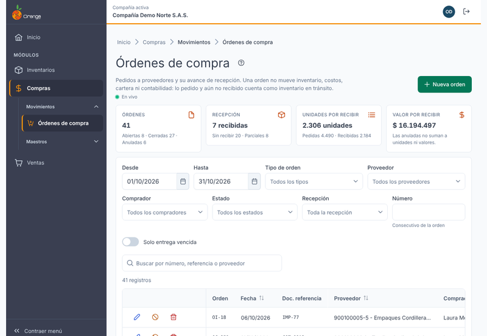
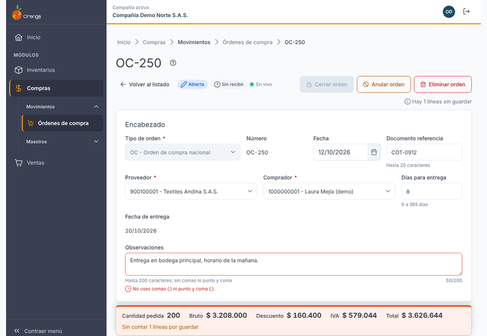
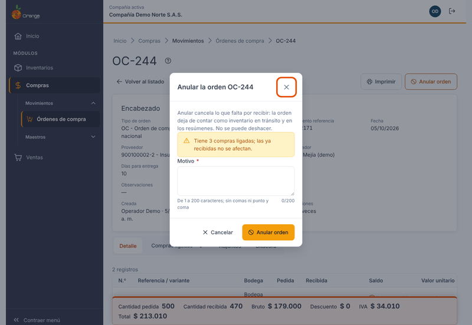
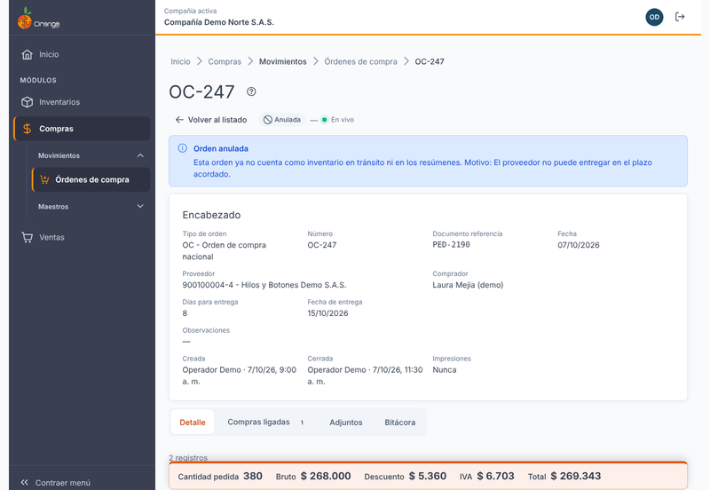
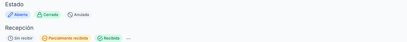
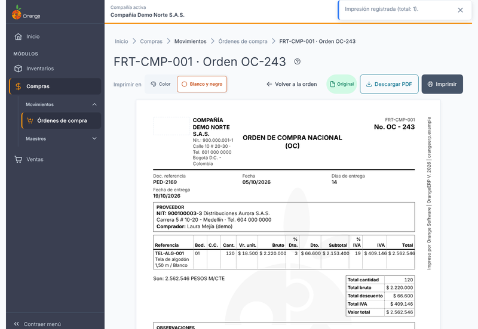
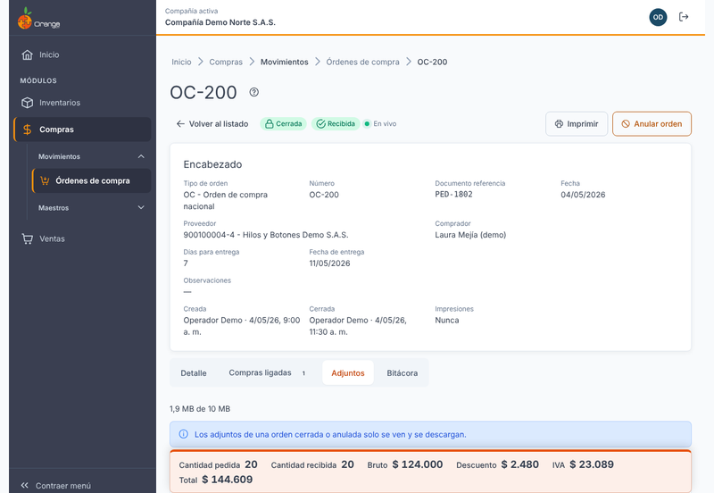

[Regresar a Compras](../readme.md)

---

# 🛒 Órdenes de compra

---

## 📋 Descripción

Una **orden de compra** es el pedido que la compañía le hace a un proveedor: qué referencias necesita, en qué bodega las quiere, cuántas unidades, a qué valor y para qué fecha. Cada orden lleva el **avance de recepción**: cuánto ya llegó y cuánto falta.

Una orden de compra **no mueve inventario, costos, cartera ni contabilidad**. Lo que se pidió y aún no ha llegado se llama **inventario en tránsito**: sirve para planear el abastecimiento y se ve en la pantalla [Disponibilidad de Inventarios](../../inventarios/consultas/disponibilidad.md) (ver [Qué es el inventario en tránsito](#transito)).

En esta pantalla puede **consultar, crear, editar, cerrar, anular, eliminar, imprimir y adjuntar documentos** a las órdenes. Trabaje siempre con la compañía que aparece en la barra superior.

> 📘 La búsqueda, el orden, la paginación y la ayuda funcionan igual en todas las tablas: ver [Manejo general de la información](../../Generales/manejo-general-informacion.md).

> ⚠️ **Cambio de nombre:** el estado que antes se llamaba **Congelada** ahora se llama **Anulada**. Antes el botón decía *Congelar*; ahora dice **Anular orden**. Es la misma acción y el mismo estado: la orden deja de contar como pendiente.

---

## 🎯 Acceso

1. En el menú principal, haga clic en **Compras**.
2. En **Movimientos**, haga clic en **Órdenes de compra**.

---

## 🖥️ Pantalla principal: el listado

El listado muestra las órdenes de la compañía, de la más reciente a la más antigua. Arriba hay cuatro indicadores del filtro que está aplicado:

| Indicador | Qué muestra |
|-----------|-------------|
| **Órdenes** | Cuántas órdenes hay, y cuántas están abiertas, cerradas y anuladas. |
| **Recepción** | Cuántas están sin recibir y cuántas están parcialmente recibidas. |
| **Unidades por recibir** | Unidades pedidas y recibidas. Las anuladas no suman. |
| **Valor por recibir** | Valor de lo que falta por recibir. Las anuladas no suman. |

Cada fila muestra el número de la orden, la fecha, el documento de referencia, el proveedor, el comprador, la fecha de entrega, la cantidad pedida, la cantidad recibida (por ejemplo, *4 de 10 · 40 %*), el valor total, la **recepción** y el **estado**. El estado y la recepción siempre llevan texto e ícono, no solo color.

### Filtrar el listado

Los filtros aparecen arriba de la tabla:

- **Desde** y **Hasta**: rango de fechas de la orden. Por defecto es el mes en curso.
- **Tipo de orden**, **Proveedor** y **Comprador**.
- **Estado**: *Abierta*, *Cerrada* o *Anulada*.
- **Recepción**: *Sin recibir*, *Parcialmente recibida* o *Recibida*. **Para filtrar por recepción debe elegir un rango de fechas** (desde y hasta).
- **Número**: el consecutivo de la orden.
- **Solo entrega vencida**: muestra las órdenes cuya fecha de entrega ya pasó y todavía tienen unidades por recibir.
- **Buscar**: por número, documento de referencia o proveedor.

### ¿Qué puedo hacer desde una fila?

Los botones de cada fila dependen del estado de la orden y de sus permisos:

| Botón | Cuándo aparece |
|-------|----------------|
| **Ver** | Siempre que tenga permiso para consultar. |
| **Editar** | Órdenes abiertas (y cerradas, con el permiso especial para editar cerrados). |
| **Imprimir** | Solo órdenes cerradas y no anuladas. Ver [Imprimir](#imprimir). |
| **Anular** | Órdenes abiertas o cerradas que no estén anuladas. |
| **Eliminar** | Solo sin compras ligadas. Ver [Anular o eliminar](#anular-eliminar). |

Si su usuario no tiene permiso para consultar órdenes de compra, la pantalla le muestra el aviso de acceso restringido.

---

## ➕ Crear una orden

1. En el listado, haga clic en **Nueva orden**.
2. Elija el **Tipo de orden**. Sin tipo no se pueden capturar líneas.
3. Elija el **Proveedor**. Si el proveedor está inactivo, el sistema no lo acepta; elija otro.
4. Revise el **Comprador**, los **Días para entrega** y las **Observaciones**. Los días para entrega se llenan con las condiciones del proveedor y puede cambiarlos (entero de 0 a 365). La **Fecha de entrega** se calcula sola: fecha de la orden más los días.
5. Capture las líneas (ver [Captura línea a línea](#captura)).
6. Cuando la orden tenga líneas guardadas, cierre la orden (ver [Cerrar](#cerrar)).

> 💡 El número de la orden aparece como *tentativo* hasta que la orden se guarda. Si el tipo de orden cambia después de crearla, no se puede cambiar: elija bien el tipo antes de capturar.

### Datos del encabezado

| Campo | Regla |
|-------|-------|
| **Tipo de orden** | Obligatorio. No se cambia después de crear la orden. |
| **Proveedor** | Obligatorio. Se busca por documento o nombre. Se bloquea si la orden ya tiene recepciones. |
| **Comprador** | Obligatorio. Se busca por nombre. |
| **Días para entrega** | Entero de 0 a 365. |
| **Fecha de entrega** | Solo lectura: fecha de la orden más los días. |
| **Documento referencia** | Hasta 20 caracteres (opcional). |
| **Observaciones** | Hasta 200 caracteres. **No use comas (,) ni punto y coma (;).** |

---

## ⌨️ Captura línea a línea

En una orden no hay botón *Guardar documento*. **Cada línea se guarda en el momento en que la confirma.** Así, si otro usuario o la red fallan, solo se pierde la línea que estaba escribiendo.

La fila de captura sigue este orden (con **Enter** avanza al siguiente campo; en el último campo, guarda):

**Referencia / variante → Bodega → Centro de costos (si el tipo lo exige) → Cantidad → Valor unitario → % Dto. (si el tipo lo liquida)**

| Campo | Regla |
|-------|-------|
| **Referencia / variante** | Obligatorio. Se busca por código o nombre. |
| **Bodega** | Obligatoria. |
| **Centro de costos** | Solo si el tipo de orden lo exige. |
| **Cantidad** | Mayor que 0, hasta 4 decimales. No puede ser menor que lo que ya se recibió. |
| **Valor unitario** | Mayor que 0. Se propone el valor sugerido de la referencia; puede cambiarlo. |
| **% Dto.** | De 0 a 100. Por defecto el descuento del proveedor. |

El **IVA** se toma de la referencia y del tipo de orden; usted no lo escribe. En la lista de líneas guardadas se ve la columna **IVA** de cada una. Si el tipo y la referencia liquidan IVA pero la referencia no tiene impuesto configurado, el sistema no guarda la línea y se lo indica: pida que se configure el impuesto en la referencia. El **Total** de la línea se calcula solo.

Una orden de compra no pide **ubicación**, **lote** ni **existencia**, porque no mueve inventario.

### ¿Qué referencias puedo elegir?

En una orden de compra solo aparecen las referencias **comercializadas** y los **materiales**. Una referencia que no sea ninguna de las dos no sale en el buscador, y si por algún motivo se intenta guardar, el sistema responde que «esta variante no se puede comprar». Si no encuentra la referencia que busca, revise en su ficha que esté marcada como comercializada o como material.

### Capturar varias variantes con la matriz

Cuando una referencia tiene variantes (por ejemplo talla y color), no hace falta capturar una línea por cada una:

1. En la fila de captura, elija **Bodega** (y **Centro de costos**, si el tipo lo exige) y escriba el **Valor unitario**.
2. Pulse **Matriz de variantes**.
3. Busque y elija la referencia. Se muestra una cuadrícula con un atributo en las filas y el otro en las columnas.
4. Escriba la **cantidad** en cada celda que quiera comprar. La matriz de una orden no muestra existencias ni lotes.
5. Acepte. **Cada celda con cantidad entra como una línea** con la bodega, el centro de costos, el valor y el descuento de la captura, y se guarda como cualquier otra línea.

Si faltan datos (bodega, centro de costos o encabezado), el botón le dice qué falta. Si las celdas superan las líneas que admite el tipo de orden, se le avisa antes de agregarlas.

### Estados de cada línea

Cada línea muestra su estado con texto e ícono:

| Estado | Qué significa | Qué puede hacer |
|--------|---------------|-----------------|
| **En cola** | Se va a guardar. | Espere. |
| **Guardando…** | Se está guardando. | Espere. |
| **Guardada** | Quedó guardada. | Editarla o quitarla. |
| **Error** | El sistema no la aceptó (por ejemplo, cantidad menor que lo recibido). Se muestra el motivo. | **Corregir** o **Descartar**. |
| **No se guardó** | Se perdió la conexión. | **Reintentar** (o **Alt+R** para todas las fallidas). |
| **Conflicto** | Otra persona cambió esta línea. | **Usar la versión actual** o **Descartar**. |

Atajos de la captura: **Esc** limpia la fila, **F2** edita la línea seleccionada, **Supr** la quita y **Alt+N** lleva el cursor a la captura.

### ¿Qué puede salir mal?

- **«Elige primero el tipo de orden» / «Elige el proveedor para capturar líneas»**: complete el encabezado. Los campos de la captura quedan bloqueados mientras tanto y el motivo aparece al lado.
- **«La cantidad no puede ser menor que lo ya recibido»**: la orden ya tiene recepciones. Use una cantidad igual o mayor.
- **«No se puede quitar una línea que ya tiene recepciones»**: esa línea se queda. Si ya no se necesita, anule la orden o deje la cantidad como está.
- **«El tipo admite máximo N líneas»**: la línea no se guardó. Divida la compra en otra orden.
- **«La fecha está en un periodo cerrado»**: cambie la fecha de la orden a un periodo abierto.
- **«Hay N líneas sin guardar»**: el botón **Cerrar orden** no está disponible hasta que todas las líneas estén guardadas, corregidas o descartadas.

---

## ✏️ Editar una orden

- Una orden **abierta** se edita directamente: encabezado y líneas.
- Una orden **cerrada** solo se edita si su usuario tiene el permiso especial **Editar documentos cerrados** y la fecha de la orden está en un periodo abierto. Si el periodo está cerrado, la orden es solo lectura.
- Una orden **anulada** no se edita.

---

## 🔒 Cerrar una orden

**Cerrar orden** deja la orden lista para imprimir y enviar al proveedor.

1. Confirme en el diálogo **Cerrar la orden**.
2. La orden queda de **solo lectura**: se ocultan los botones de agregar líneas y adjuntar, y aparece **Imprimir**.

Para cerrar, debe tener permiso para actualizar la orden, tener al menos una línea guardada y no tener líneas pendientes.

---

## 🚫 Anular o eliminar

Son dos acciones distintas. **Si ya recibió mercancía de la orden, anule; no elimine.**

| | **Anular orden** | **Eliminar orden** |
|--|------------------|--------------------|
| **Qué hace** | Cancela lo que falta por recibir. La orden queda en estado **Anulada** y se conserva para consulta. | Borra la orden, sus líneas y sus adjuntos de forma definitiva. |
| **Motivo** | Obligatorio: de 1 a 200 caracteres, sin comas ni punto y coma. | No pide motivo, pero pide confirmar escribiendo el número de la orden (por ejemplo, *OC-243*). |
| **Con compras ligadas** | Se permite. El aviso dice *Tiene N compras ligadas; las ya recibidas no se afectan*. Lo ya recibido no cambia. | **No se permite.** El sistema responde que tiene compras ligadas y sugiere anular. |
| **Efecto en el tránsito** | La orden deja de contar como inventario en tránsito y en los resúmenes. | Igual, porque la orden desaparece. |
| **Reversible** | No. Para comprar lo que sigue faltando, cree una orden nueva. | No. |

Un documento anulado no se puede anular otra vez, no se imprime y no se edita.

> 💡 Una orden anulada se sigue viendo en el listado y en el filtro de estado *Anulada*. En su encabezado aparece el motivo de la anulación.

### ¿Qué puede salir mal?

- **«No se puede eliminar: tiene N compras ligadas. Puedes anularla en su lugar.»**: use **Anular orden**.
- **«Demasiadas eliminaciones seguidas; espera un minuto.»**: el sistema permite hasta 10 eliminaciones por minuto. Espere y vuelva a intentar.
- **«La orden ya estaba anulada.»**: otra persona ya la anuló. Actualice la pantalla.

---

## 🏷️ Estados de la orden

Cada orden tiene **dos** estados que se leen juntos: el **documento** y la **recepción**.

### Estado del documento

| Estado | Qué significa |
|--------|---------------|
| **Abierta** | Se puede seguir editando. No se puede imprimir. |
| **Cerrada** | Lista para imprimir y enviar. Solo lectura, salvo con el permiso especial. |
| **Anulada (antes Congelada)** | Se anuló lo pendiente. No cuenta en el tránsito ni en los resúmenes, no se imprime y no se edita. |

### Estado de la recepción

La recepción se calcula sola con lo que ya llegó a Compras. Usted no la cambia en esta pantalla.

| Estado | Cuándo aparece |
|--------|----------------|
| **Sin recibir** | No se ha recibido nada de la orden. |
| **Parcialmente recibida** | Ya llegó algo, pero no todo. Se muestra, por ejemplo, *Recibida 4 de 10 · 40 %*. |
| **Recibida** | Todas las líneas ya llegaron en su totalidad. |

Una orden **anulada** no tiene recepción: en su lugar aparece *Sin recepción: la orden está anulada*.

Una orden con unidades por recibir cuya fecha de entrega ya pasó se marca como **Entrega vencida**, con texto e ícono.

---

## 📦 Qué es el inventario en tránsito

El **inventario en tránsito** es lo que la compañía ya pidió a un proveedor y todavía no ha recibido. Es la cantidad **pendiente** de cada orden, por referencia y bodega:

> **Pendiente = cantidad pedida − cantidad recibida** (nunca menos de cero, por cada orden).

Reglas:

- Cuentan las órdenes **abiertas** y **cerradas**. **No cuentan** las **anuladas**.
- Una orden **abierta** se marca como **Sin cerrar** porque todavía puede cambiar.
- Una orden **vencida** (entrega ya pasada) cuenta y se marca.
- Solo cuentan las líneas de la **bodega seleccionada** en Disponibilidad.
- Solo se muestran **cantidades**. Esta pantalla no muestra valores de tránsito.

### Cómo afecta al disponible proyectado

En la pantalla **Disponibilidad de Inventarios** el disponible proyectado se calcula así:

> **Existencia − Por despachar = Disponible hoy**
> **Disponible hoy + En producción + En tránsito (compras) = Disponible proyectado**

Es decir, lo que llega de una orden de compra aumenta el disponible proyectado antes de que la mercancía esté físicamente en bodega. El **disponible hoy** no cambia: lo que no ha llegado no se puede prometer hoy.

En Disponibilidad:

- La columna **En tránsito (compras)** muestra el número de unidades. Si hay órdenes sin cerrar, lo indica al lado de la cifra.
- El interruptor **Incluir OC sin cerrar**, en *Más filtros › Qué se cuenta*, viene **activo** por defecto. Apagado, deja fuera las órdenes abiertas y el filtro lo muestra como chip.
- Para ver el **detalle** (qué orden, qué proveedor, qué fecha de entrega) necesita el permiso de **Órdenes de compra**. Sin ese permiso solo ve el número total.

> ⚠️ **Advertencia: hoy el tránsito puede estar sobrestimado.** La recepción de una compra todavía no queda ligada a la orden de compra en todos los casos. Si la mercancía ya llegó, la orden puede seguir mostrando esa cantidad como pendiente. Cuando esto pasa, Disponibilidad muestra la insignia **Tránsito posiblemente sobrestimado**. Antes de comprar por esa cifra, revise la orden y sus compras ligadas.

---

## 🖨️ Imprimir

Solo se imprimen órdenes **cerradas** y **no anuladas**. El botón **Imprimir** aparece en el documento y en el listado.

1. Abra la orden cerrada y haga clic en **Imprimir**.
2. Elija **Color** o **Blanco y negro**.
3. Haga clic en **Imprimir** para mandarla a la impresora, o en **Descargar PDF** para guardarla.

En la ventana de impresión puede elegir el **papel** (**Carta** o **A4**) y si el PDF sale a color. El documento muestra la empresa, el número y la fecha, el proveedor, el comprador, las fechas de entrega, las líneas con sus valores y totales, el valor en letras, las observaciones, la información tributaria y los espacios de firma.

- La **primera** impresión lleva la marca **Original**. Las siguientes llevan la marca **Copia**.
- Cada impresión queda registrada: el encabezado muestra el número de impresiones, quién la hizo y cuándo (**Impresiones**).
- Para volver a la orden, use **Volver a la orden**.

### ¿Qué puede salir mal?

- **«Solo se imprimen órdenes cerradas y no anuladas.»**: cierre la orden primero. Una orden anulada no se imprime.
- **No ve el botón Imprimir**: su usuario no tiene el permiso **Imprimir** sobre Órdenes de compra.

---

## 📎 Adjuntos

Puede adjuntar archivos a la orden, por ejemplo una cotización o un acuerdo con el proveedor.

- Solo se adjunta en una orden **abierta**.
- Cada adjunto lleva una **descripción** de 1 a 200 caracteres.
- El espacio se comparte entre todos los adjuntos de la orden: **10 MB**. La pantalla muestra cuánto va usado (por ejemplo, *2,4 MB de 10 MB*). Si el archivo supera el espacio libre, no se guarda.
- Puede **descargar** y **quitar** cada adjunto (botones *Descargar* y *Quitar* por archivo).
- En una orden **cerrada** o **anulada** los adjuntos solo se ven y se descargan.
- Al eliminar la orden se eliminan también sus adjuntos.

---

## 🔗 Compras ligadas

La pestaña **Compras ligadas** muestra las compras que recibieron mercancía de esta orden. Una **devolución** reabre el saldo. Por ahora el número de la compra es solo texto: todavía no lleva a la pantalla de Compras.

---

## 🔄 Cambios de otros usuarios (en vivo)

La pantalla se actualiza sola cuando otro usuario cambia algo de las órdenes:

- **Otro usuario creó, modificó o eliminó una orden:** aparece un aviso en el listado. Haga clic en **Actualizar** para ver los cambios.
- **Otro usuario modificó la orden que tiene abierta:** aparece el aviso *«[usuario] modificó esta orden. Actualiza para ver los cambios.»*
- **Otro usuario anuló la orden:** aparece *«[usuario] anuló esta orden. Actualiza para ver su estado.»*
- **Otro usuario eliminó la orden:** aparece *«[usuario] eliminó esta orden. Vuelve al listado.»*
- **Conflicto en una línea:** si otra persona cambió la línea que usted editaba, la línea muestra **Conflicto**. Elija **Usar la versión actual** para tomar la versión guardada, o **Descartar** para dejar su cambio fuera.

---

## 📜 Bitácora

La **Bitácora** de la orden (quién y cuándo creó la orden, agregó o cambió líneas, la cerró, la anuló y la imprimió) **todavía no está disponible en pantalla**: se activará en una próxima entrega. Mientras tanto, esos movimientos sí quedan registrados.

---

## 🔐 Permisos

¿No ve algún botón? Cada acción depende de los permisos de su perfil.

| Permiso | Opción | Qué habilita |
|---------|--------|--------------|
| Consultar | Órdenes de compra (48) | Ver el listado, abrir las órdenes y el detalle de tránsito. |
| Crear | Órdenes de compra (48) | **Nueva orden**. |
| Actualizar | Órdenes de compra (48) | Agregar, cambiar y quitar líneas; cambiar el encabezado; **Cerrar orden**. |
| Anular | Órdenes de compra (48) | **Anular orden**. |
| Eliminar | Órdenes de compra (48) | **Eliminar orden**. |
| Imprimir | Órdenes de compra (48) | **Imprimir** y **Descargar PDF**. |
| Editar documentos cerrados (permiso especial del usuario) | Órdenes de compra (48) | Editar una orden cerrada con periodo abierto. |
| Consultar | Disponibilidad de Inventarios (327) | Ver el número **En tránsito (compras)** y el disponible proyectado. |

Sin el permiso de Órdenes de compra, la columna de tránsito en Disponibilidad se ve, pero el detalle de las órdenes no aparece.

---

## ❓ Preguntas frecuentes

**¿Por qué no hay botón Guardar?**
Cada línea se guarda cuando la confirma. El encabezado también se guarda al cambiarlo.

**¿Por qué no puedo cerrar la orden?**
Porque tiene líneas sin guardar o con error. El botón dice cuántas faltan. Guárdelas, corríjalas o descártelas.

**¿Cambia la existencia de inventario al crear una orden?**
No. La orden no mueve inventario, costos, cartera ni contabilidad. Lo pedido aparece como inventario en tránsito.

**¿Qué pasa con lo que ya recibí de una orden que voy a anular?**
Lo ya recibido no se afecta. Solo se cancela lo pendiente.

**¿Puedo cancelar solo una línea de la orden?**
No. Anule la orden y cree una nueva con lo que sí va a llegar.

**¿Por qué la orden aparece como «Sin cerrar» en Disponibilidad?**
Porque sigue abierta. Si no quiere contarla todavía, apague **Incluir OC sin cerrar** en *Más filtros › Qué se cuenta* de Disponibilidad.

**¿Por qué el tránsito dice «posiblemente sobrestimado»?**
Porque la mercancía de esa orden ya pudo llegar y todavía no está ligada en la orden. Revise las compras ligadas y compare antes de comprar de más.

**¿Por qué no veo el detalle del tránsito de una referencia?**
Porque su usuario no tiene permiso de consulta sobre Órdenes de compra. El número total sí lo ve en Disponibilidad.

**¿Por qué el estado dice «Anulada» y antes decía «Congelada»?**
Es el mismo estado con el nombre actualizado. Significa que la orden se anuló.

---

## 📚 Relacionado

- [Compras](../readme.md): índice del módulo.
- [Proveedores](../maestros/proveedores.md): condiciones de entrega y descuento que se precargan en la orden.
- [Compradores](../maestros/compradores.md): quién aparece como comprador en la orden.
- [Disponibilidad de Inventarios](../../inventarios/consultas/disponibilidad.md): donde se ve el inventario en tránsito.
- [Manejo general de la información](../../Generales/manejo-general-informacion.md): búsqueda, orden, paginación y ayuda.
