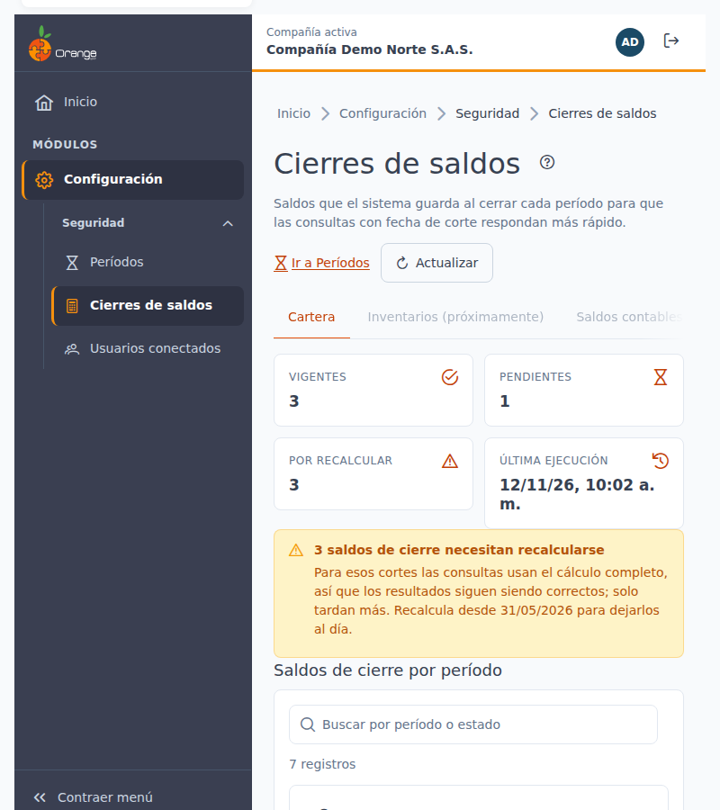
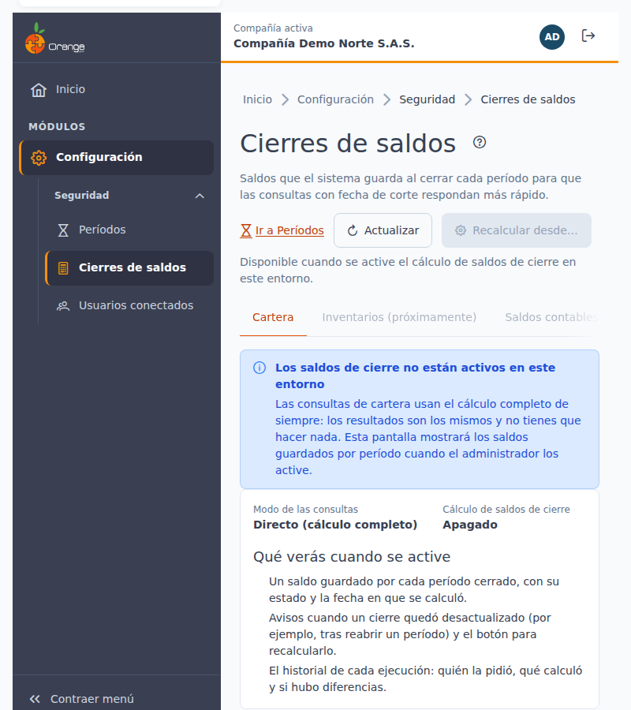
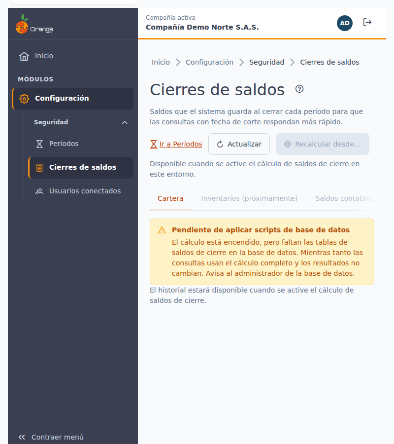
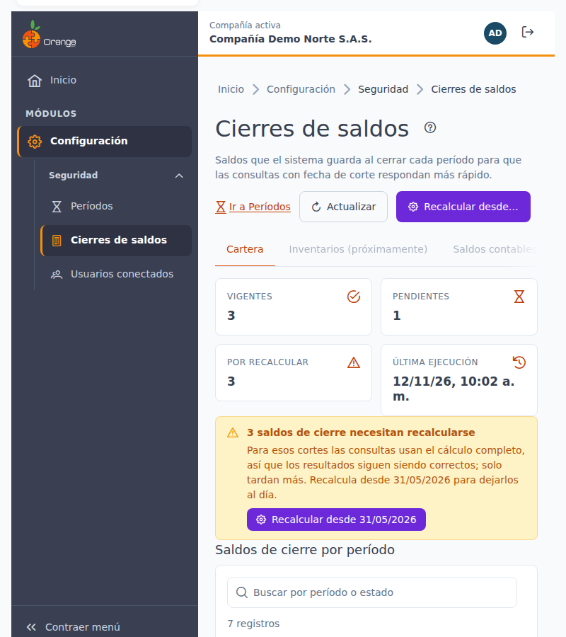
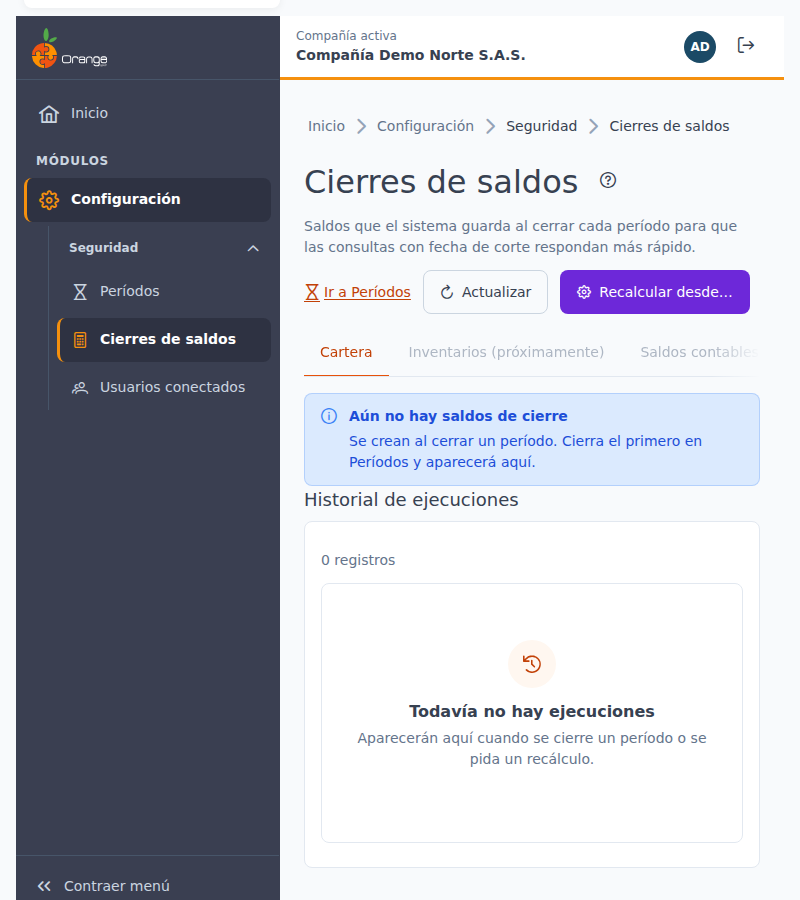
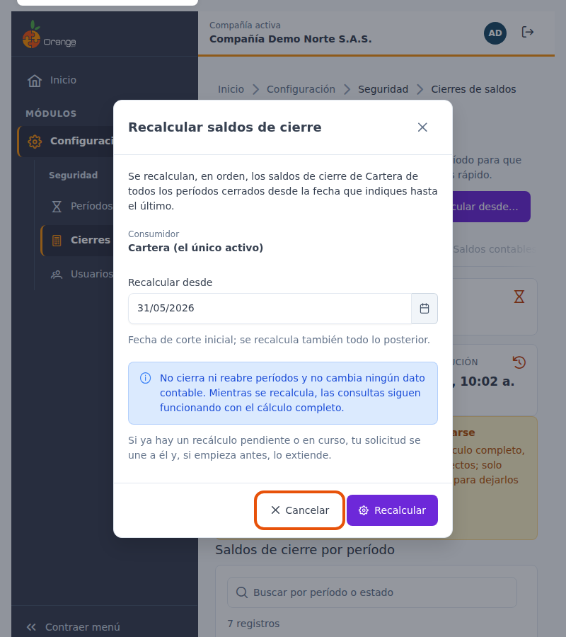
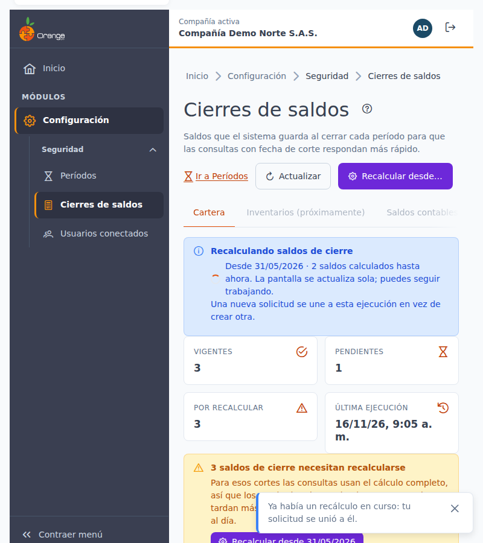
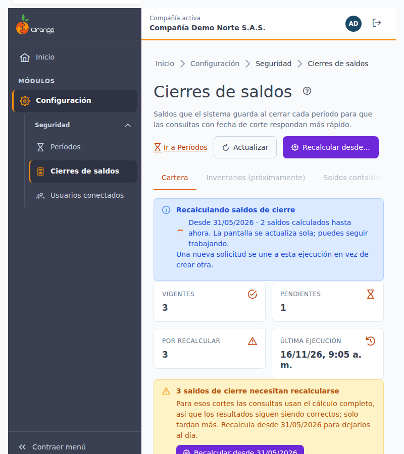
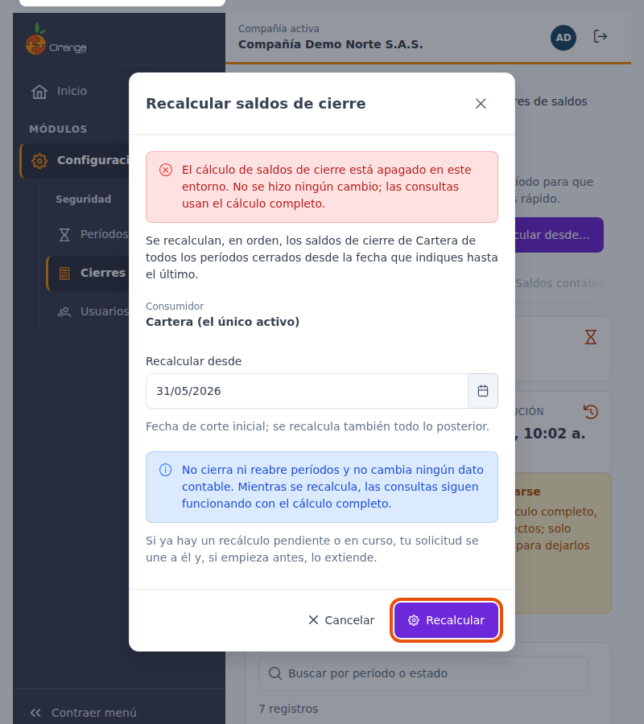

[Regresar a Configuración](../readme.md)

---

# 🧮 Cierres de saldos

---

## 📋 Descripción

Muestra los **saldos que OrangeERP guarda al cerrar cada período** de [Períodos](periodos.md), para que las consultas con fecha de corte respondan más rápido.

Desde aquí usted puede:

- Ver **en qué estado está** el saldo guardado de cada período cerrado.
- Ver si hay saldos **desactualizados** que conviene recalcular.
- **Recalcular desde una fecha** los saldos guardados.
- Revisar el **historial** de las ejecuciones.

> 📘 **Hoy esta capacidad no está activa en su entorno.** Las consultas usan el cálculo completo de siempre: los resultados son los mismos y **no tiene que hacer nada**. La pantalla le explica el estado y, cuando el administrador la active, mostrará los saldos guardados. Ver [Cuando la capacidad no está activa](#-cuando-la-capacidad-no-está-activa).

> ℹ️ Esta pantalla **no cierra ni reabre períodos**. Eso se hace en [Períodos](periodos.md).

> 📘 La búsqueda y el orden de las tablas funcionan como en el resto de pantallas: ver [Manejo general de la información](../../Generales/manejo-general-informacion.md).

---

## 🎯 Acceso

1. En el menú principal, haga clic en **Configuración**.
2. En **Seguridad**, haga clic en **Cierres de saldos**.

Para ver la pantalla necesita el permiso **Consultar** de esta opción. Si su perfil no lo tiene, verá el mensaje **"No tienes permiso para ver los cierres de saldos"**.

### Permisos

| Permiso | Qué le permite |
|---------|----------------|
| **Consultar** | Ver el estado de los saldos, la lista por período y el historial. |
| **Crear** | Usar **Recalcular desde…**. Sin este permiso el botón no aparece. |

Esta pantalla no tiene permisos de editar, eliminar ni exportar.

---

## 🖥️ Pantalla principal

En la parte superior verá:

| Elemento | Para qué sirve |
|----------|----------------|
| **?** (junto al título) | Abre esta ayuda en un panel lateral, sin salir de la pantalla. |
| **Ir a Períodos** | Lleva a la pantalla de [Períodos](periodos.md). |
| **Actualizar** | Vuelve a cargar el estado en ese momento. |
| **Recalcular desde…** | Pide recalcular los saldos desde una fecha. Ver [Recalcular desde una fecha](#-recalcular-desde-una-fecha). Requiere **Crear** y que la capacidad esté activa. |

### Consumidores

Los saldos se agrupan por **consumidor**, es decir, por el módulo que los usa:

| Pestaña | Estado |
|---------|--------|
| **Cartera** | Activa. Es la única que tiene saldos hoy. |
| **Inventarios (próximamente)** | Aún no disponible. |
| **Saldos contables (próximamente)** | Aún no disponible. |

---

## ⏸️ Cuando la capacidad no está activa

Es el estado normal hoy. Verá el aviso **"Los saldos de cierre no están activos en este entorno"**, con la explicación:

> **"Las consultas de cartera usan el cálculo completo de siempre: los resultados son los mismos y no tienes que hacer nada."**

Debajo aparece una ficha con:

- **Modo de las consultas**: Directo (cálculo completo).
- **Cálculo de saldos de cierre**: Apagado.
- **Qué verás cuando se active**: un saldo guardado por cada período cerrado con su estado y su fecha de cálculo; avisos cuando un cierre quedó desactualizado; y el historial de cada ejecución.

En este estado:

- El historial se reemplaza por el mensaje **"El historial estará disponible cuando se active el cálculo de saldos de cierre."**
- **Recalcular desde…** aparece **deshabilitado**, con la razón visible: **"Disponible cuando se active el cálculo de saldos de cierre en este entorno."**

> 💡 Este aviso es informativo. No es un error: no hay que corregir nada ni avisar a nadie para que las consultas funcionen.

### Pendiente de aplicar scripts

Si el cálculo está encendido pero faltan tablas en la base de datos, verá **"Pendiente de aplicar scripts de base de datos"**. Mientras tanto las consultas siguen con el cálculo completo y no cambia ningún resultado. Avise al administrador de la base de datos. **Recalcular desde…** queda deshabilitado.

---

## 📊 Saldos por período

Cuando la capacidad está activa, verá un resumen con cuatro tarjetas: **Vigentes**, **Pendientes**, **Por recalcular** y **Última ejecución**.

Debajo, la tabla **Saldos de cierre por período** muestra un renglón por cada período cerrado:

| Columna | Qué muestra |
|---------|-------------|
| **Fecha de corte** | Fecha final del período; hasta esa fecha se acumula el saldo. |
| **Período** | Código del período. Con **Ver el período {código}** abre [Períodos](periodos.md). |
| **Estado** | Ver la tabla de estados abajo. |
| **Se usa en consultas** | **Sí** si las consultas usan ese saldo; **No** si no. |
| **Filas** | Cuántos registros tiene el saldo guardado. |
| **Versión del saldo** | Número de la versión del cálculo guardado. |
| **Calculado** | Cuándo se calculó, en la zona horaria de la compañía. Si no se ha calculado, dice **Sin calcular**. |

### Estados

| Estado | Qué significa | Qué hacer |
|--------|---------------|-----------|
| **Vigente** | Se usa en las consultas. | Nada. |
| **Pendiente** | Espera su cálculo. | Nada; se calculará. |
| **Desactualizado** | Hubo cambios posteriores al cierre. | Recalcular desde esa fecha. |
| **Invalidado** | El período se reabrió. | Vuelva a cerrar el período en [Períodos](periodos.md). |
| **Falló** | El cálculo falló. | Recalcular desde esa fecha. |

Cada estado se muestra con icono y texto, no solo con color.

### Por recalcular

Si hay saldos **desactualizados**, **invalidados** o **fallidos**, aparece el aviso **"N saldos de cierre necesitan recalcularse"**, con el botón **Recalcular desde {fecha}**.

Mientras tanto, las consultas usan el cálculo completo. **Los resultados siguen siendo correctos; solo tardan más.** Recalcular los deja al día.

### Si no hay períodos cerrados

Verá **"Aún no hay saldos de cierre"**: **"Se crean al cerrar un período. Cierra el primero en Períodos y aparecerá aquí."**

---

## 🔁 Recalcular desde una fecha

Recalcular vuelve a calcular, en orden, los saldos de todos los períodos cerrados **desde la fecha que indique hasta el último**.

**Cuándo usarlo:**

- Hay saldos **Desactualizados** o **Falló**.
- Se reabrió y volvió a cerrar un período: su saldo queda **Invalidado** hasta que se recalcule.

Para recalcular:

1. Pulse **Recalcular desde…**, o use el botón **Recalcular desde {fecha}** del aviso o de una fila.
2. Revise la **fecha** (viene sugerida con la fecha de corte más antigua que necesita recalcularse). Puede cambiarla; no puede ser posterior a hoy.
3. Lea la confirmación y pulse **Recalcular**.

La confirmación aclara que:

- **No cierra ni reabre períodos** y no cambia ningún dato contable.
- Mientras se recalcula, las consultas siguen funcionando con el cálculo completo.
- Si ya hay un recálculo pendiente o en curso, **su solicitud se une a él** y, si empieza antes, lo extiende.

Al terminar la solicitud verá **"Recálculo solicitado desde 31/05/2026."**. Si ya había un recálculo, verá **"Ya había un recálculo en curso: tu solicitud se unió a él."**

### Recálculo en curso

Mientras se recalcula, la pantalla muestra **"Recalculando saldos de cierre"** con el número de saldos calculados hasta ahora. La pantalla se actualiza sola y puede seguir trabajando. La ejecución aparece primero en el historial, con estado **En curso**.

---

## 📜 Historial de ejecuciones

La pestaña **Historial de ejecuciones** lista cada cálculo, de más reciente a más antiguo:

| Columna | Qué muestra |
|---------|-------------|
| **Solicitada** | Cuándo se pidió. |
| **Consumidor** | Qué saldos calculó (hoy, Cartera). |
| **Desde** | Fecha de corte desde la que se recalculó. |
| **Origen** | Quién o qué lo pidió (ver abajo). |
| **Estado** | **Pendiente**, **En curso**, **Completada**, **Falló** o **Cancelada**. Si se reinició, aparece también **reiniciada**. |
| **Saldos calculados** | Cuántos saldos se calcularon. |
| **Diferencias** | **Sin diferencias** si el saldo guardado coincide con el cálculo completo; si no, cuántas diferencias hubo. |
| **Duración** | Cuánto tardó. |

Los orígenes posibles son:

- **Vigía automático**: el sistema detectó un saldo que necesitaba cálculo.
- **Verificación nocturna**: revisión automática de los saldos.
- **Solicitud de un usuario**: alguien pidió **Recalcular desde…**.
- **Cambio de versión de cálculo**: se actualizó la forma de calcular.
- **Cierre o reapertura de un período**: se cerró o se reabrió un período en [Períodos](periodos.md).

Si todavía no hay ejecuciones, verá **"Todavía no hay ejecuciones"**. Si el historial no carga, pulse **Reintentar**.

---

## 🔗 Relación con Períodos

- Cada vez que **cierra** o **reabre** un período en [Períodos](periodos.md), se registra una ejecución aquí con el origen **Cierre o reapertura de un período**.
- Desde esta pantalla, **Ir a Períodos** y **Ver el período {código}** le llevan a la pantalla de períodos.
- Desde [Períodos](periodos.md), el botón **Ver cierres de saldos** le trae a esta pantalla.

---

## 🔜 Próximamente

- **Inventarios**: saldos de cierre de inventarios.
- **Saldos contables**: saldos de cierre contables.

Cuando estén disponibles, aparecerán como pestañas activas en esta misma pantalla.

---

## ❗ Mensajes de error frecuentes

| Mensaje | Qué hacer |
|---------|-----------|
| **La fecha no es válida para recalcular. Revísala e inténtalo de nuevo.** | Revise la fecha; no puede ser posterior a hoy. |
| **El cálculo de saldos de cierre está apagado en este entorno. No se hizo ningún cambio; las consultas usan el cálculo completo.** | No es necesario hacer nada. Se podrá recalcular cuando el administrador lo active. |
| **Faltan scripts de base de datos por aplicar. No se hizo ningún cambio; avisa al administrador.** | Avise al administrador de la base de datos. |
| **Tu perfil ya no permite esta acción. Recarga la pantalla.** | Recargue la pantalla; si el permiso **Crear** le falta, pídalo al administrador. |
| **No se pudo pedir el recálculo. No se hizo ningún cambio; inténtalo de nuevo.** | Vuelva a intentarlo. |
| **No se pudo cargar el estado de los cierres.** / **No se pudo cargar el historial.** | Revise su conexión y pulse **Reintentar**. |

---

## ❓ Preguntas frecuentes

**¿Mis reportes de cartera cambian si los saldos de cierre no están activos?**
No. Las consultas usan el cálculo completo y los resultados son los mismos.

**¿Qué significa "Desactualizado"?**
Que después del cierre hubo cambios en el período. Las consultas siguen siendo correctas, pero tardan más. Recalcule desde esa fecha.

**¿Tengo que recalcular cada vez que cierro un período?**
No. Al cerrar un período se crea su saldo. Recalcule solo cuando aparezca un saldo **Desactualizado**, **Invalidado** o **Falló**.

**¿Recalcular cierra o reabre períodos?**
No. Solo recalcula los saldos guardados. Para cerrar o reabrir, use [Períodos](periodos.md).

**¿Por qué el botón Recalcular está deshabilitado?**
Porque la capacidad no está activa en su entorno, o porque hay un problema con los scripts de base de datos. El texto debajo del botón indica la razón.

**¿Por qué no veo el botón Recalcular?**
Su perfil no tiene el permiso **Crear**.

**¿Se guardan importes en esta pantalla?**
No. Solo muestra estados, cantidades de filas y fechas.
