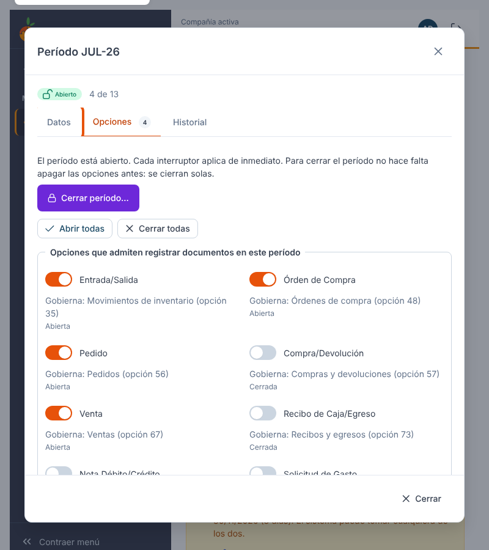
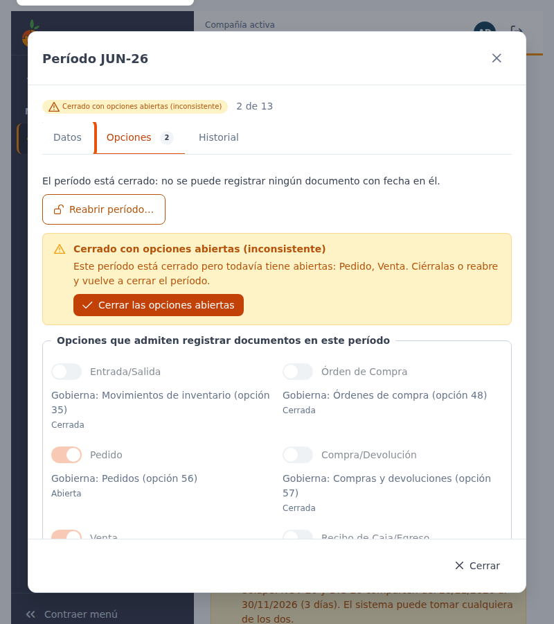
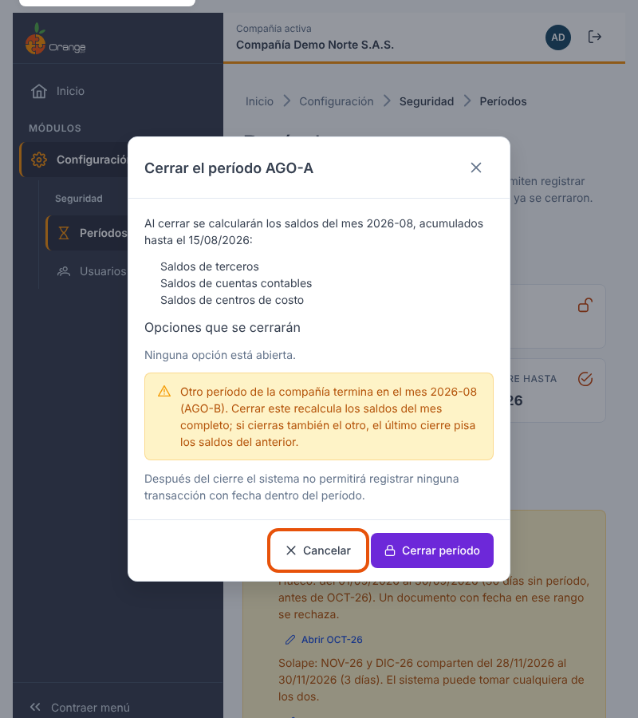
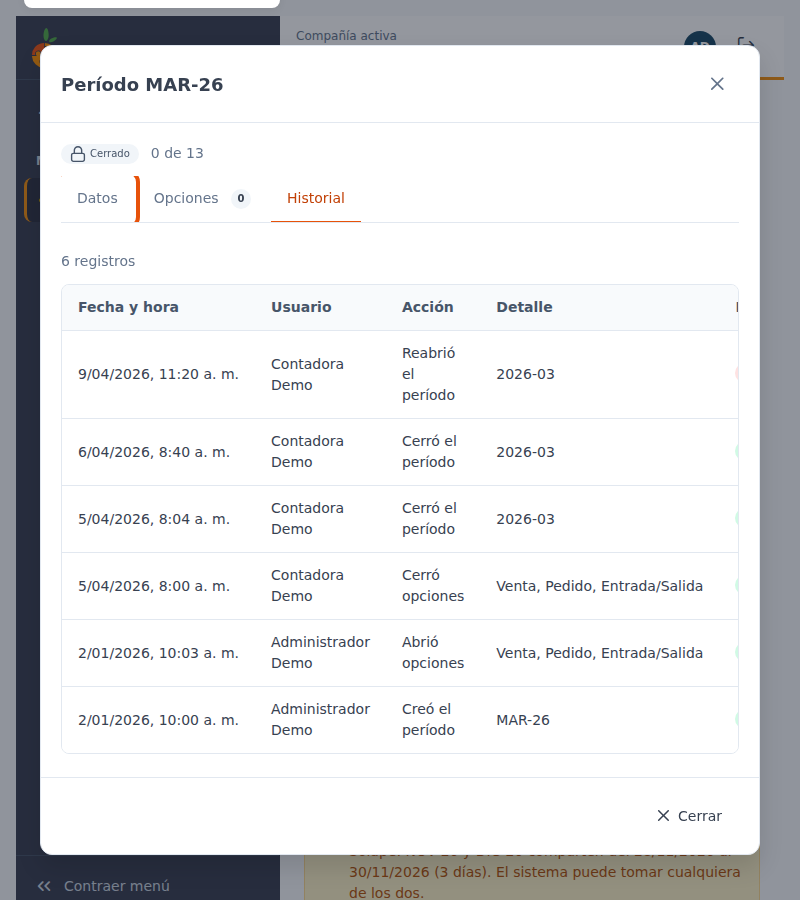
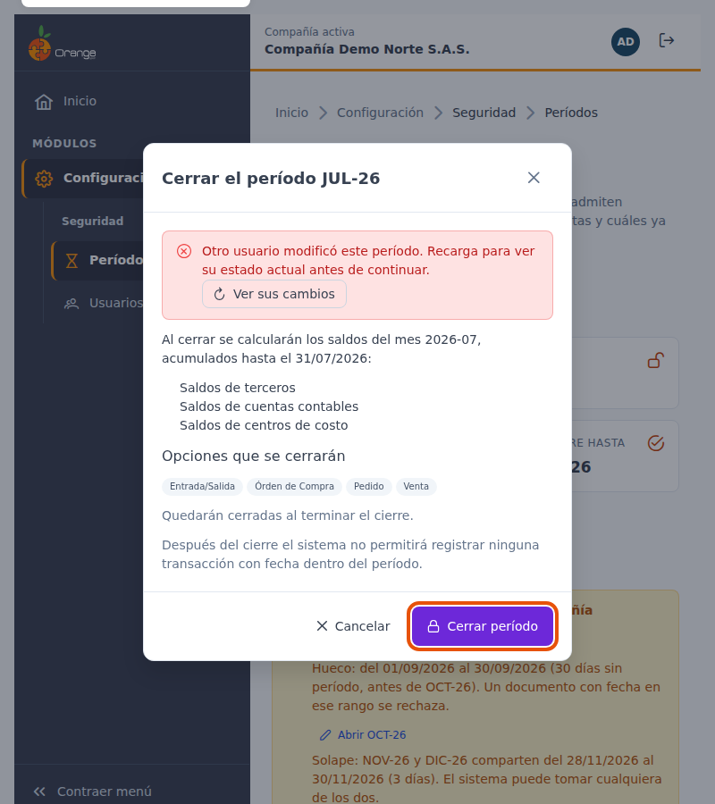
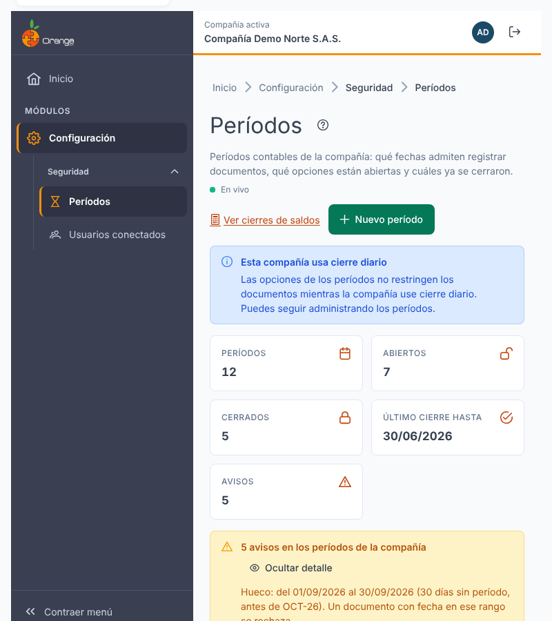

[Regresar a Configuración](../readme.md)

---

# 🗓️ Períodos

---

## 📋 Descripción

Los **períodos** definen **qué fechas admiten registrar documentos** en su compañía y **cierran la contabilidad de cada mes**.

Desde aquí usted puede:

- Crear, editar y eliminar períodos (estos últimos, solo si están abiertos y no tienen saldos).
- **Marcar o desmarcar las casillas de cada opción** del sistema (ventas, compras, recibos, notas, etc.) para cada período.
- **Cerrar un período** con el botón **Cerrar Período** del formulario: OrangeERP calcula y guarda los saldos del mes.
- **Abrir un período cerrado** con el botón **Período Cerrado - Abrir Período**: OrangeERP elimina los saldos del mes para poder corregirlo.

> 💡 La pantalla funciona como siempre: la lista, **un solo formulario** para crear y editar, las casillas en el mismo orden y los mismos botones. Lo nuevo (columna **Estado**, avisos y cambios en vivo) es discreto y no cambia la forma de trabajar.

> ⚠️ Cerrar y reabrir afectan los saldos de su compañía. Lea la confirmación antes de aceptar: le dice qué saldos se calculan o se eliminan y qué opciones quedan cerradas.

> 📘 La búsqueda y el orden de la lista funcionan como en el resto de pantallas: ver [Manejo general de la información](../../Generales/manejo-general-informacion.md).

> 🕒 Si su compañía usa **cierre diario**, las opciones de los períodos **no restringen los documentos**. Ver [Compañías con cierre diario](#-compañías-con-cierre-diario).

---

## 🎯 Acceso

1. En el menú principal, haga clic en **Configuración**.
2. En **Seguridad**, haga clic en **Períodos**.

Para ver la pantalla necesita el permiso **Consultar** de esta opción. Si su perfil no lo tiene, verá el mensaje **"No tienes permiso para ver los períodos"** y la pantalla no mostrará datos.

### Permisos

| Permiso | Qué le permite |
|---------|----------------|
| **Consultar** | Ver la lista, los avisos, el formulario de cada período y su historial. Los botones de cambio no aparecen; en la fila verá **Ver** en lugar de **Editar**. |
| **Crear** | Crear períodos con **Crear Periodo**. |
| **Actualizar** | Editar el período, marcar o desmarcar sus opciones y usar **Cerrar Período** / **Período Cerrado - Abrir Período**. |
| **Eliminar** | Eliminar períodos abiertos que no tengan saldos. |
| **Exportar** | Descargar la lista con el botón **Exportar a Excel**. |

> 💡 Cada acción exige su propio permiso. Si un botón no aparece, su perfil no tiene ese permiso; pida al administrador de la compañía que se lo asigne.

---

## 🖥️ Pantalla principal

En la parte superior verá:

| Elemento | Para qué sirve |
|----------|----------------|
| **?** (junto al título) | Abre esta ayuda en un panel lateral, sin salir de la pantalla. |
| **En vivo** | La lista se actualiza sola cuando otro usuario crea, cambia o cierra un período. Ver [Cambios en vivo](#-cambios-en-vivo). |
| **Ver cierres de saldos** | Lleva a la pantalla de [Cierres de saldos](cierres-saldos.md). |
| **Crear Periodo** | Crea un período (requiere **Crear**). |

### Avisos

Si hay algo que revisar, aparece un panel amarillo plegable **"N avisos en los períodos de la compañía"**. Pulse **Ver detalle** u **Ocultar detalle** para desplegarlo o plegarlo; cada aviso tiene un enlace **Abrir** con el código del período.

| Aviso | Qué significa |
|-------|---------------|
| **Hueco** | Hay días sin ningún período entre dos períodos. Un documento con fecha en ese rango **se rechaza**. |
| **Solape** | Dos períodos comparten fechas. Con solape, el sistema puede tomar cualquiera de los dos para validar una fecha. |
| **Abierto antes de un cierre** | Un período abierto termina antes del último período cerrado. |
| **Cerrado con opciones abiertas** | Un período está cerrado pero todavía tiene opciones abiertas. Es una situación inconsistente. |
| **Mismo mes** | Dos períodos terminan en el mismo mes. Cerrar uno recalcula los saldos del mes completo y puede pisar los saldos del otro. |

Los avisos son informativos: **no bloquean ninguna acción**. Sirven para corregir la configuración antes de que afecte a los documentos o a los cierres.

### La lista

Cada fila es **un período** de la compañía en la que está trabajando.

| Columna | Qué muestra |
|---------|-------------|
| **Acciones** | Los botones de la fila (ver [Acciones de cada fila](#acciones-de-cada-fila)). |
| **Código** | Identificador corto del período, por ejemplo `JUL-26`. |
| **Descripción** | Texto que describe el período. |
| **Fecha Inicial** y **Fecha Final** | Rango de fechas del período (se muestran como día/mes/año). |
| **Estado** | **Abierto**, **Cerrado** o **Cerrado con opciones abiertas (inconsistente)**. Esta columna es nueva respecto a la versión anterior. |
| **Avisos** | Los avisos que afectan a esa fila, por ejemplo **Hueco antes** o **Solapa con NOV-26**. |

Para ordenar, pulse el encabezado de la columna. En la búsqueda puede escribir un código, una descripción o un estado; no importan las tildes ni las mayúsculas.

Si no hay períodos, verá **"Aún no hay períodos"**. Sin períodos no se pueden registrar documentos con fecha; cree el primero con **Crear Periodo**.

### Acciones de cada fila

| Botón | Para qué sirve | Permiso |
|-------|----------------|---------|
| **Editar** (lápiz) | Abre el formulario del período. Si solo tiene **Consultar**, el botón se llama **Ver**. | Actualizar |
| **Eliminar** (papelera) | Aparece solo en períodos abiertos sin saldos. | Eliminar |

Cerrar y abrir un período se hace **dentro del formulario**, como siempre (ver [Cerrar un período](#-cerrar-un-período)).

---

## ➕ Crear un período

1. Pulse **Crear Periodo**.
2. Complete los datos del formulario **Periodos | Crear nuevo**:
   - **Código**: hasta 8 caracteres. Se guarda en mayúsculas.
   - **Descripción**: hasta 50 caracteres.
   - **Fecha Inicio** y **Fecha Finalización**: la final no puede ser anterior a la inicial.
3. Opcional: marque las **casillas de las opciones** que quiera dejar abiertas (ver [Opciones del período](#-opciones-del-período)).
4. Pulse **Guardar** (o **Cancelar** para salir sin guardar).

Por defecto, el período **nace con todas las casillas desmarcadas** (opciones cerradas): no se podrá registrar ningún documento con fecha en él hasta que las marque. Las casillas que marque al crear quedan abiertas al guardar.

Al guardar aparece **"Período JUL-26 creado."** y la fila nueva queda resaltada.

### Si el período se solapa con otro

Si las fechas se cruzan con un período existente, el sistema no lo guarda y le indica con cuál: **"Las fechas se cruzan con el período NOV-26. Ajusta el rango para que no se solapen."**

---

## ✏️ Editar un período

1. En la fila, pulse **Editar**.
2. Cambie lo que necesite en el formulario **Periodos | Editar existente**.
3. Pulse **Guardar**. Las casillas **no se aplican solas**: se guardan junto con los datos al pulsar **Guardar**.

El formulario es **uno solo**, sin pestañas. Al pie muestra **Última modificación: usuario, fecha y hora** y, a su lado, el enlace discreto **Historial** (ver [Historial](#-historial)).

### Período cerrado

En un período cerrado las **fechas y las casillas aparecen deshabilitadas** y verá la nota **"Período cerrado: las opciones no se pueden modificar."** El código y la descripción sí se pueden corregir. El botón del formulario dice **Período Cerrado - Abrir Período**.

Para cambiar las fechas o las opciones de un período cerrado, primero **ábralo** (ver [Reabrir un período](#-reabrir-un-período)).

---

## 🔘 Opciones del período

En el formulario verá **una casilla por opción (12), una por línea**, en este orden. **Marcada = la opción está abierta** y acepta documentos; **desmarcada = cerrada**.

| Opción | Qué documentos regula |
|--------|-----------------------|
| Entrada/Salida | Movimientos de inventario de entrada y salida. |
| Órden de Compra | Órdenes de compra. |
| Compra/Devolucion | Compras y devoluciones de compra. |
| Pedido | Pedidos de venta. |
| Venta | Ventas. |
| Recibo de Caja/Egreso | Recibos de caja y de egreso. |
| Nota Débito/Crédito | Notas débito y crédito. |
| Solicitud de Gasto | Solicitudes de gasto. |
| Causación de Gasto | Causaciones de gasto. |
| Nota Bancaria | Notas bancarias. |
| Asientos Contables | Asientos contables. |
| Traslado | Traslados. |

- Las casillas **se guardan con el botón Guardar**, junto con el resto del formulario. Una sola operación guarda los datos y todas las casillas que cambió.
- Si no se pueden guardar las opciones, el formulario sigue abierto con el estado real y aparece **"No se pudo cambiar la opción. Se restauró el valor anterior."** (lo demás ya se había guardado).

### Cerrado con opciones abiertas

Un período cerrado no debería tener casillas marcadas. Si las tiene, la fila y el formulario lo marcan como **Cerrado con opciones abiertas (inconsistente)** con el aviso **"Este período está cerrado pero tiene opciones marcadas. Desmárcalas y guarda."**

Para corregirlo, **desmarque las casillas y pulse Guardar**. En ese caso solo se permite desmarcar. Si prefiere, también puede abrir el período y volver a cerrarlo.

---

## 🔒 Cerrar un período

Cerrar un período hace dos cosas:

1. **Calcula y guarda los saldos** del mes: de terceros, de cuentas contables y de centros de costo, acumulados hasta la fecha final del período.
2. Deja el período en estado **Cerrado**.

El botón **Cerrar Período** está **en el formulario del período**, a todo el ancho, debajo de las casillas. Solo aparece **cuando todas las casillas están desmarcadas**; si hay alguna marcada verá en su lugar la nota **"Para cerrar el período, desmarca primero todas las opciones."** Si cambió casillas y aún no guardó, el botón queda deshabilitado con la nota **"Guarda los cambios antes de cerrar o abrir el período."**

Para cerrarlo:

1. En la fila, pulse **Editar**.
2. Desmarque todas las casillas y pulse **Guardar** (si hacía falta), y vuelva a abrir el formulario.
3. Pulse **Cerrar Período**. Se abre la confirmación **Realizar Cierre de Período**; lea el detalle.
4. Pulse **Cerrar período** para confirmar, o **Cancelar** para volver al formulario.

Al terminar (o al cancelar) **vuelve al formulario**, y el botón ya dice **Período Cerrado - Abrir Período**.

La confirmación le muestra:

- El **mes** cuyos saldos se calcularán y hasta qué fecha.
- Los tipos de saldos que se calcularán.
- Las opciones que se cerrarán (como el botón solo aparece con todo desmarcado, normalmente dice "Ninguna opción está abierta").
- Que, después del cierre, **no se podrá registrar ninguna transacción con fecha dentro del período**.

Mientras el sistema calcula, el botón queda deshabilitado y aparece **"Calculando los saldos del mes. Puede tardar; no cierres esta ventana."**. Al terminar, verá **"Período JUL-26 cerrado: saldos calculados."**.

Si el cierre no se completa, **no se guarda ningún cambio** y el período sigue abierto. Verá **"El cierre no se completó y no se guardó ningún cambio. Inténtalo de nuevo; si persiste, avisa al administrador."**

### Mes compartido

Si otro período de la compañía termina en el mismo mes, la confirmación lo avisa:

> **"Cerrar este recalcula los saldos del mes completo; si cierras también el otro, el último cierre pisa los saldos del anterior."**

Revise los períodos antes de cerrarlos. Si el otro período ya está cerrado, el sistema no permitirá el cierre (ver [Mensajes de error](#-mensajes-de-error-frecuentes)).

---

## 🔓 Reabrir un período

Reabrir sirve para corregir un período ya cerrado. Al reabrirlo:

- Se **eliminan los saldos del mes** (terceros, cuentas contables, centros de costo y saldos contables del período).
- **Las opciones quedan cerradas** (casillas desmarcadas). Usted las marca después y guarda.
- Los **saldos acumulados de los períodos posteriores no se recalculan**. Cuando termine, vuelva a cerrar el período.

Para reabrirlo:

1. En la fila del período cerrado, pulse **Editar**.
2. Pulse **Período Cerrado - Abrir Período** (botón rojo, a todo el ancho). Se abre la confirmación **Abrir Período**; lea el detalle.
3. Pulse **Reabrir período** para confirmar, o **Cancelar** para volver al formulario.

Al terminar, **vuelve al formulario** y el botón ya dice **Cerrar Período** otra vez.

Verá **"Período JUL-26 reabierto: saldos eliminados. Sus opciones quedaron cerradas."**

> ⚠️ Reabra un período solo cuando sea necesario. Mientras esté reabierto, sus saldos no existen hasta que vuelva a cerrarlo.

---

## 🗑️ Eliminar un período

Solo se pueden eliminar períodos **abiertos y sin saldos asociados**.

1. En la fila, pulse **Eliminar** (papelera).
2. Lea la confirmación: muestra la descripción del período y que la eliminación es definitiva.
3. Pulse **Eliminar**.

Verá **"Período JUL-26 eliminado."**.

### Si no se puede eliminar

| Mensaje | Qué hacer |
|---------|-----------|
| **No se puede eliminar: el período tiene saldos contables asociados. Reábrelo si está cerrado para quitar sus saldos.** | Si está cerrado, reábralo; luego podrá eliminarlo. |
| **Un período cerrado no se puede eliminar.** | Reábralo primero y después elimínelo. |

---

## 📤 Exportar

Con el permiso **Exportar** aparece el botón **Exportar a Excel**. Descarga un archivo de Excel con las filas que ve en la lista, en el mismo orden y con el estado y las 13 opciones de cada período.

Si no ve el botón, su perfil no tiene el permiso **Exportar**.

---

## 📜 Historial

Al editar un período, junto a **Última modificación** hay un enlace pequeño **Historial**. Al pulsarlo, el formulario se reemplaza por una **lista de solo lectura**, de la más reciente a la más antigua:

| Columna | Qué muestra |
|---------|-------------|
| **Fecha y hora** | Cuándo ocurrió, en la zona horaria de la compañía. |
| **Usuario** | Quién lo hizo. |
| **Acción** | **Creó el período**, **Modificó el período**, **Abrió opciones**, **Cerró opciones**, **Cerró el período** o **Reabrió el período**. |
| **Detalle** | Información adicional de la acción. |

Pulse **Cerrar** para volver al formulario: lo que había escrito sin guardar se conserva. Al crear un período no hay historial todavía. Si el período nunca ha cambiado, verá **"Sin movimientos registrados"**.

### Historial pendiente de activar

Mientras el administrador de la base de datos no active el índice de historial, la lista muestra **"Historial detallado pendiente de activar"** y la **última modificación** (usuario, fecha y hora). Los cambios se registran igual.

---

## 🔄 Cambios en vivo

Mientras la pantalla está abierta y el indicador dice **En vivo**, la lista se actualiza sola cuando otro usuario:

- crea un período (**"Otro usuario creó el período JUL-26."**),
- cierra un período (**"Otro usuario cerró el período JUL-26."**),
- reabre un período (**"Otro usuario reabrió el período JUL-26."**).

La fila cambiada se resalta unos segundos y su búsqueda y su orden se conservan.

### Si tiene el formulario o una confirmación abiertos

Si tiene abierto el formulario o la confirmación de un período que otro usuario cambió, **la pantalla no se cierra sola**. Verá un aviso:

> **"Otro usuario cambió este período mientras lo tenías abierto. Si guardas sin recargar, el servidor lo rechazará."**

Pulse **Ver sus cambios** para recargar. En una confirmación de cerrar o reabrir, el botón queda deshabilitado hasta que recargue.

Si el otro usuario elimina el período, el aviso lo indica y el botón **Guardar** se deshabilita.

Si el indicador dice **Reconectando…**, la conexión se interrumpió; al recuperarse, la lista se recarga sola.

---

## ❗ Mensajes de error frecuentes

| Mensaje | Qué hacer |
|---------|-----------|
| **Otro usuario modificó este período. Recarga para ver su estado actual antes de continuar.** | Pulse **Ver sus cambios**, revise el período y repita la acción si todavía corresponde. |
| **El período ya estaba cerrado (otro usuario lo cerró). Recarga para ver su estado actual.** | No es necesario cerrarlo otra vez. Recargue la lista. |
| **El período ya estaba abierto (otro usuario lo reabrió). Recarga para ver su estado actual.** | No es necesario reabrirlo. Recargue la lista. |
| **Ya existe un período con el código JUL-26.** | Use otro código. No distingue mayúsculas de minúsculas. |
| **Las fechas se cruzan con el período NOV-26.** | Ajuste el rango para que no se solape con otro período. |
| **La fecha final no puede ser anterior a la inicial.** | Corrija las fechas. |
| **El código admite hasta 8 caracteres.** / **La descripción admite hasta 50 caracteres.** | Acorte el texto. |
| **No se puede cerrar: NOV-26 ya está cerrado y comparte el mes 2026-11; cerrar este pisaría sus saldos. Reabre NOV-26 primero.** | Reabra primero el otro período que comparte el mes. |
| **El período está cerrado: reábrelo para cambiar sus fechas, sus opciones o eliminarlo.** | Reabra el período para hacer el cambio. |
| **No se pudo completar la acción. No se guardó ningún cambio; inténtalo de nuevo.** | Vuelva a intentarlo. Si persiste, avise al administrador. |
| **El cierre tardó más de lo permitido. Revisa el estado del período antes de reintentar.** | Revise si el período quedó cerrado antes de volver a intentarlo. |
| **No tienes permiso para ver los períodos.** | Pida al administrador de la compañía el permiso **Consultar** de la opción. |

---

## 🏢 Compañías con cierre diario

Si su compañía usa **cierre diario**, verá el aviso **"Esta compañía usa cierre diario"**. En ese caso:

- Las opciones de los períodos **no restringen los documentos**; se guardan igual, pero no bloquean nada.
- Puede seguir creando, editando, cerrando y abriendo períodos, y revisando los avisos.

---

## ❓ Preguntas frecuentes

**¿Por qué un documento con fecha de un período me lo rechaza?**
La fecha cae en un hueco (sin período) o en un período cerrado, o la opción correspondiente está cerrada. Revise la lista: el aviso **Hueco** indica el rango afectado.

**¿Qué es "Cerrado con opciones abiertas"?**
Es una situación inconsistente: el período está cerrado, pero algunas opciones siguen abiertas. Desmarque las casillas en el formulario y pulse **Guardar**.

**¿Puedo cerrar un período cuya fecha final todavía no ha llegado?**
Sí, por defecto el sistema lo permite. Tenga en cuenta que los documentos posteriores a la fecha final seguirán sin período hasta que lo cree.

**¿Cerrar un período es reversible?**
Sí. Al abrirlo de nuevo se eliminan los saldos del mes y sus opciones quedan cerradas. Luego puede volver a cerrarlo. Los saldos acumulados de los períodos posteriores no se recalculan automáticamente.

**¿Por qué el cierre tarda?**
Calcular los saldos de toda la compañía puede tardar unos minutos. No cierre la ventana mientras aparece **"Calculando los saldos del mes"**.

**¿Por qué no puedo editar las fechas de un período?**
Porque está cerrado. Reábralo para cambiar las fechas y las opciones.

**¿Qué pasa si dos usuarios cierran el mismo período a la vez?**
Solo uno lo consigue. El otro recibe **"El período ya estaba cerrado (otro usuario lo cerró)"** y la lista se actualiza.

**¿Por qué no veo los botones de cambio?**
Su perfil tiene solo el permiso **Consultar**. Para crear, editar, cerrar o abrir necesita los permisos correspondientes (ver [Permisos](#permisos)).

**¿Dónde veo los cierres de saldos?**
Desde el botón **Ver cierres de saldos** de esta pantalla. Ahí verá el estado de los saldos que se guardan al cerrar cada período: ver [Cierres de saldos](cierres-saldos.md).

**¿Qué diferencia hay con [Usuarios conectados](usuarios-conectados.md)?**
Esa pantalla muestra quién está conectado. Esta muestra los períodos contables de la compañía.
