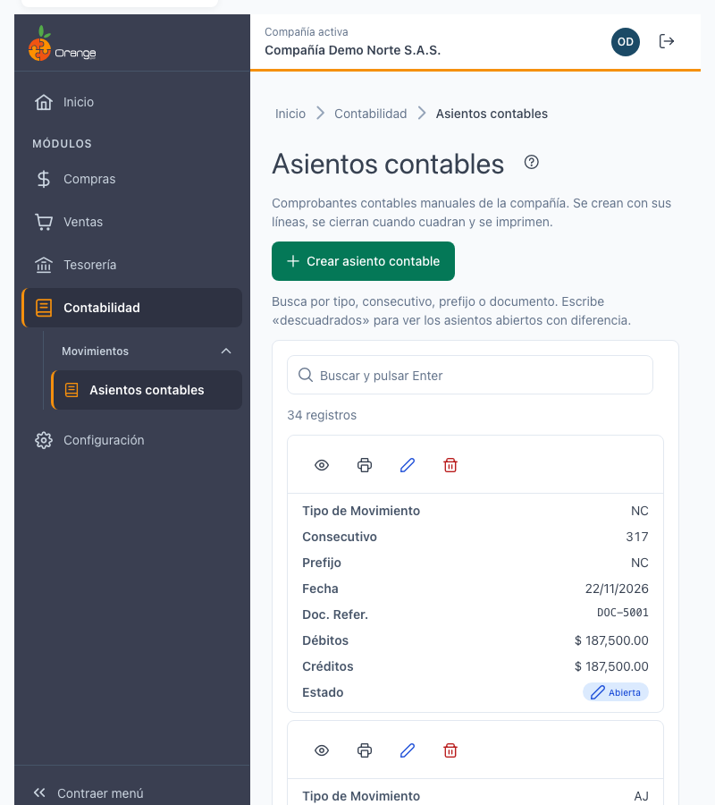
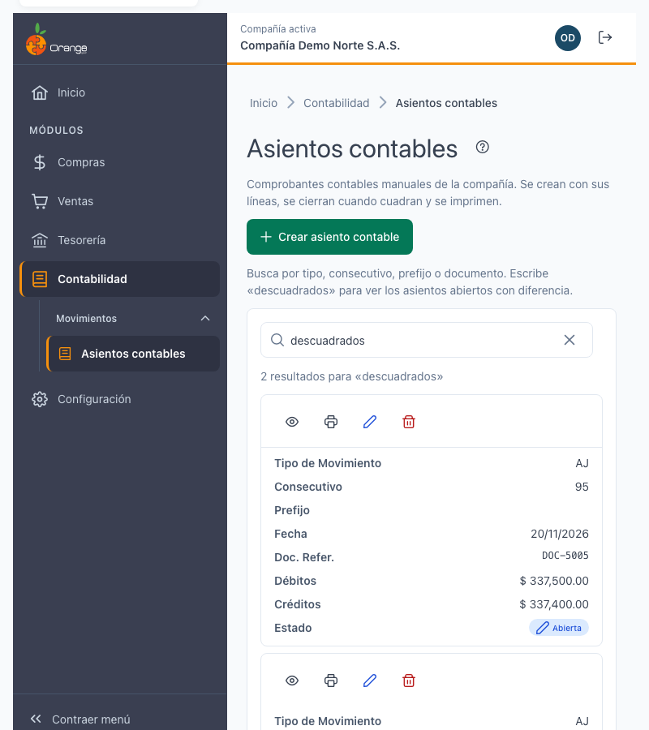
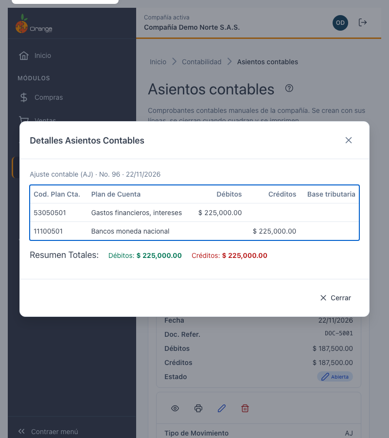
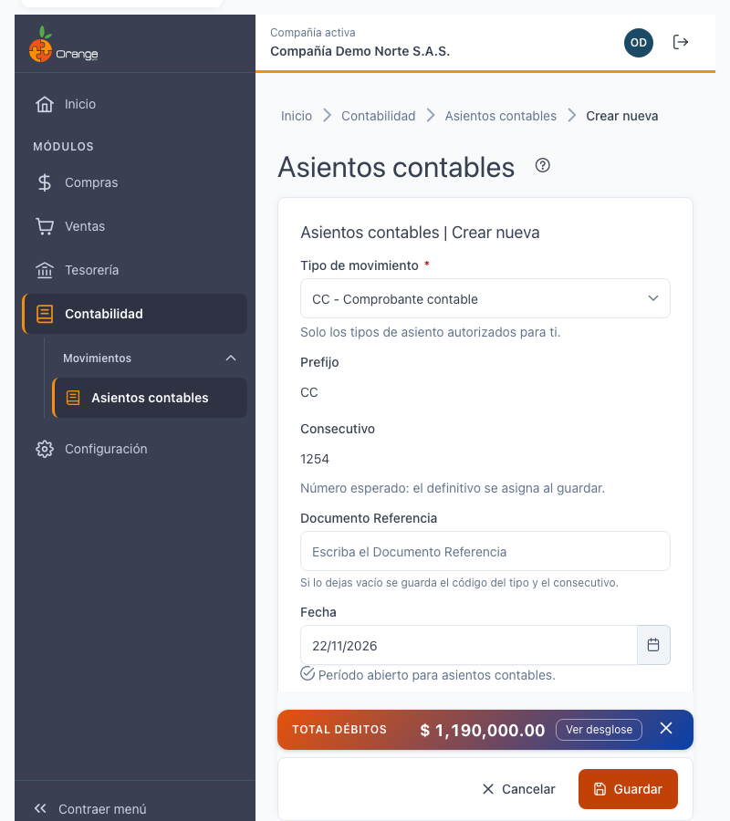
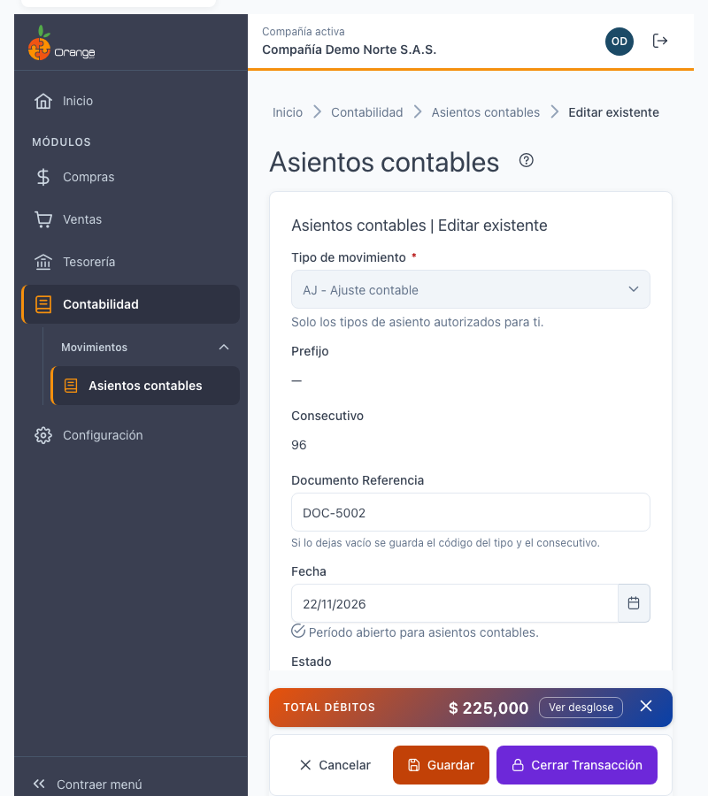
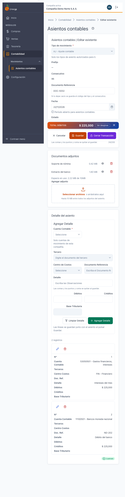
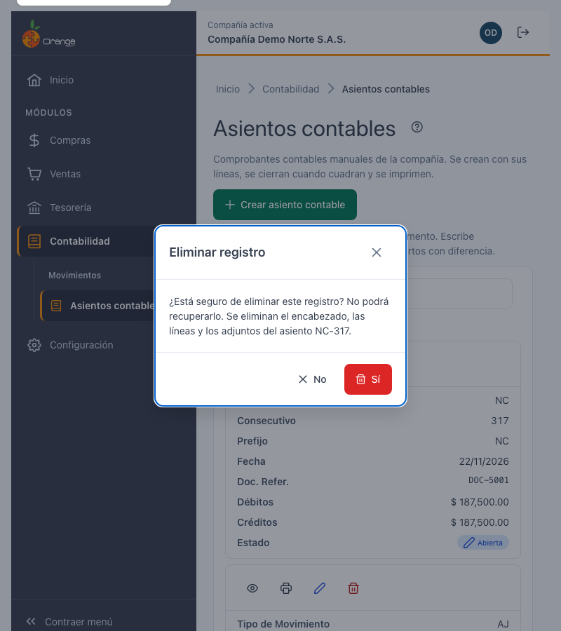
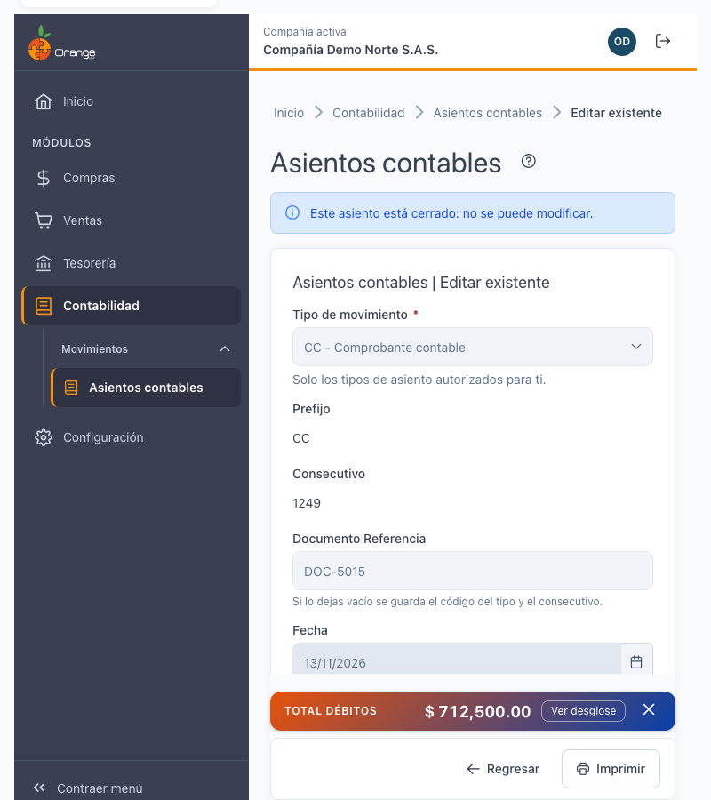

[Regresar a Contabilidad](readme.md)

---

# ASIENTOS CONTABLES

## Qué es

Un **asiento contable** es un comprobante manual del libro contable de la compañía: un encabezado (tipo de movimiento, consecutivo, fecha, documento de referencia y observaciones) con sus líneas de **débito** y **crédito**. Cada línea tiene una cuenta contable y, según la cuenta, un tercero, un centro de costos y una base tributaria.

Esta pantalla le permite:

- Buscar los asientos y ver su estado (**Abierta**, **Cerrada** o **Anulada**).
- Ver el detalle de un asiento, con sus líneas y sus totales.
- Crear un asiento, con sus líneas, y guardarlo.
- Editar un asiento abierto, o uno cerrado si su usuario tiene el permiso de editar documentos cerrados.
- Adjuntar documentos al asiento (PDF, imágenes, Word o Excel).
- Cerrar un asiento cuando cuadra.
- Eliminar un asiento abierto que cumpla las condiciones.
- Imprimir el comprobante.

El listado también muestra movimientos contables de otros módulos, como Ventas o Tesorería. Esos solo se pueden ver; ver la sección «Movimientos de otros módulos», más abajo.

> **Importante:** crear, editar, cerrar, eliminar y adjuntar documentos solo funciona en las compañías donde la escritura de asientos esté habilitada. Si su compañía no la tiene, la pantalla lo indica con el mensaje *«La escritura de asientos aún no está habilitada en este entorno»* y no se guarda nada. En ese caso puede consultar los asientos y sus adjuntos, pero no cambiarlos.

Para importar asientos desde Excel, use la importación de asientos (opción 239, en Configuración › Importaciones). Se describe aparte.

## Cómo llegar

- Abra **Contabilidad** en el menú principal y luego **Movimientos > Asientos contables**.
- Necesita permiso de **Consultar** sobre Asientos contables. Si no ve la opción, pida a su administrador que se lo asigne.

## Permisos

| Permiso | Qué permite |
|---|---|
| **Consultar** | Ver el listado, buscar y ver el detalle de los asientos y sus adjuntos. |
| **Crear** | Crear asientos y cerrarlos. |
| **Actualizar** | Editar asientos abiertos, agregar y quitar adjuntos, y cerrar. |
| **Eliminar** | Botón **Eliminar** de la fila y de la ficha. |
| **Imprimir** | Botón **Imprimir** del listado y de la ficha. |
| **Editar documentos cerrados** (permiso aparte) | Editar un asiento cerrado que cuadre al terminar. |

Si no tiene un permiso, el botón correspondiente no aparece. Aunque el botón no aparezca, el sistema también revisa el permiso al guardar.

## Listado

La tabla muestra una fila por asiento, con estas columnas:

- **Tipo de movimiento** (código; al pasar el cursor aparece el código y el nombre).
- **Consecutivo** y **Prefijo**.
- **Fecha**.
- **Doc. Refer.** (documento de referencia).
- **Débitos** y **Créditos**.
- **Estado**: **Abierta**, **Cerrada** o **Anulada**.

Los asientos aparecen del más reciente al más antiguo. Puede mostrar 15, 25, 50 o todos por página.

### Buscar

Escriba en el buscador y pulse **Enter**. Busca por tipo, consecutivo, prefijo, documento o fecha (dd/mm/aaaa). La búsqueda se hace en el servidor, así que la pantalla no trae todos los asientos de la compañía.

Si escribe **descuadrados**, la lista muestra solo los asientos abiertos cuyos débitos y créditos no suman lo mismo.

### Acciones de cada fila

- **Ver detalle**: siempre disponible.
- **Imprimir**: con permiso de **Imprimir**. No aparece en los asientos anulados.
- **Editar**: con permiso de **Actualizar** y el período de la fecha abierto. En un asiento cerrado, además se necesita el permiso de editar documentos cerrados.
- **Eliminar**: solo en asientos abiertos, con permiso de **Eliminar**, en período abierto y que no sean de cierre anual (ver [Eliminar](#eliminar)).

Un asiento **Anulada** solo se puede consultar. Esta versión no permite anular asientos.

## Ver el detalle

El detalle muestra el encabezado y cada línea, con:

- Cuenta contable (código y nombre), débito, crédito y base tributaria. Los importes en cero aparecen vacíos.
- **Total débitos** y **Total créditos**.
- Si débitos menos créditos es distinto de cero, la **diferencia** del asiento (el asiento está descuadrado).

Un asiento de otro módulo se muestra del mismo modo, pero sin botones para cambiarlo.

## Crear un asiento

> Esta sección requiere que la escritura de asientos esté habilitada en su compañía (ver la nota al inicio).

1. Pulse **Crear asiento contable**.
2. Elija el **Tipo de movimiento**. Solo aparecen los tipos de asiento autorizados para su usuario.
3. Revise la **Fecha**. Debe estar en un período abierto. Si no lo está, la pantalla lo indica y no se puede guardar.
4. Escriba el **Documento Referencia** (hasta 20 caracteres). Si lo deja vacío, se guarda el código del tipo y el consecutivo. El **Consecutivo** se asigna al guardar.
5. Escriba las **Observaciones** (hasta 200 caracteres).
6. En **Agregar Detalle**, elija la **Cuenta Contable** y complete la línea:
   - **Tercero**, si la cuenta lo exige.
   - **Centro de Costos**, si la cuenta lo exige.
   - **Documento Referencia** de la línea, si la cuenta lo exige.
   - **Detalle** (hasta 100 caracteres).
   - **Débitos** o **Créditos**. Una línea tiene un valor en uno de los dos, no en ambos. No puede tener cero en los dos.
   - **Base Tributaria**, si la cuenta lo exige. Puede pulsar **Calcular Base Tributaria** cuando tenga un valor.
7. Pulse **Agregar Detalle**. La línea pasa a la lista de líneas del asiento.
8. Repita los pasos 6 y 7 para cada línea.
9. Pulse **Guardar**.

Las líneas se guardan junto con el asiento al pulsar **Guardar**: si una línea tiene un error, no se guarda nada del asiento.

### Digitar varias líneas seguidas

Al agregar una línea nueva, la pantalla **conserva el Documento Referencia y el Detalle** de la línea anterior. Así no tiene que escribirlos otra vez cuando varias líneas comparten el mismo documento o la misma descripción. Cuenta, tercero, centro, débitos, créditos y base se limpian para la siguiente línea.

### Reglas de las líneas

Las reglas dependen de la cuenta contable:

- Solo se pueden usar **cuentas de movimiento**. Las cuentas de mayor no aparecen en la lista.
- Si la cuenta exige **tercero**, debe elegir un tercero activo de su compañía.
- Si la cuenta exige **centro de costos**, debe elegir uno de su compañía.
- Si la cuenta exige **documento de referencia** o **base tributaria**, debe completarlos.
- Si la cuenta no los exige, esos campos se guardan vacíos o en cero, aunque los haya escrito.
- Los valores negativos no se aceptan.
- Las comas y los puntos y coma se quitan al guardar el detalle y las observaciones.

El sistema también valida estas reglas al guardar. Si una línea no cumple, la pantalla le indica cuál es y no guarda el asiento.

### Guardar un asiento descuadrado

Puede **guardar** un asiento aunque sus débitos y créditos no sean iguales: queda **abierto** y puede terminarlo después. Lo que no se puede es **cerrarlo** descuadrado (ver [Cerrar](#cerrar)).

## Editar un asiento

1. En el listado, pulse **Editar** en la fila del asiento.
2. Cambie el encabezado o las líneas: agregue, modifique o quite líneas.
3. Pulse **Guardar**.

Puede editar un asiento **abierto** si tiene el permiso de **Actualizar** y su fecha está en un período abierto.

Un asiento **cerrado** se edita solo si su usuario tiene el permiso de editar documentos cerrados, y el resultado debe quedar cuadrado. Si no queda cuadrado, la pantalla no guarda nada.

Si otro usuario cambió el asiento después de que usted lo abrió, la pantalla no guarda sus cambios y le pide **recargar** para ver lo que cambió. Así no se pisan cambios de otra persona.

Un asiento **Anulada** no se puede editar.

Para quitar una línea, use el botón **Quitar** de la línea (se aplica al guardar). Si quita todas las líneas, el asiento no se puede guardar: necesita al menos una.

## Documentos adjuntos

Puede adjuntar al asiento documentos de respaldo, como un soporte o un extracto.

- Los adjuntos solo se pueden agregar **después de guardar** el asiento. Antes de guardar, la pantalla lo indica.
- Cada adjunto necesita una **descripción** (hasta 200 caracteres). No se puede adjuntar sin ella.
- Tipos admitidos: **PDF**, imágenes (JPG, PNG, GIF, BMP), **Word** (DOC, DOCX) y **Excel** (XLS, XLSX). El contenido del archivo debe corresponder a su extensión: no basta con cambiarle el nombre.
- El archivo no puede estar vacío.
- El **tope es de 10 MB por asiento**, sumando todos sus adjuntos. La pantalla muestra **Espacio en uso** (por ejemplo, *2.22 MB de 10 MB*). Si el archivo supera el tope, no se adjunta nada.
- Para quitar un adjunto, use el botón de la fila y confirme. El archivo se elimina y no se puede recuperar.
- Quien solo consulta puede **ver o descargar** los adjuntos, pero no agregarlos ni quitarlos.
- Los adjuntos de un asiento cerrado o no editable se pueden ver y descargar, pero no cambiar.

## Cerrar

**Cerrar Transacción** deja el asiento cerrado: ya no se puede modificar ni agregar líneas.

1. Pulse **Cerrar Transacción**.
2. Confirme. La pantalla advierte: *«No podrá hacer más modificaciones»*.

Para cerrar, el asiento debe cumplir:

- Tener al menos una línea.
- Que la suma de **Débitos** sea igual a la suma de **Créditos**. Si no, la pantalla muestra la diferencia y no cierra.
- Estar en un período abierto.

Después de cerrar, el asiento queda **Cerrada** y puede **Imprimir**.

## Eliminar

Eliminar borra el encabezado, las líneas y los adjuntos del asiento. **No se puede recuperar.**

Un asiento solo se puede eliminar si cumple todo esto:

- Su estado es **Abierta** (no cerrada ni anulada).
- Su usuario tiene el permiso de **Eliminar**.
- Su fecha está en un período abierto.
- No es de un tipo de cierre anual.
- No tiene otros movimientos asociados.

Si no cumple, la pantalla indica el motivo y no borra nada. Para eliminar, pulse **Eliminar** y confirme con **Sí**.

## Imprimir

**Imprimir** genera el comprobante en PDF tamaño carta, con los datos de la compañía, el encabezado, las líneas, los totales y el espacio de firma de recibido.

Cada impresión queda registrada en el asiento (cuántas veces se ha impreso). Un asiento anulado no se puede imprimir desde esta pantalla.

## Asiento cerrado: solo lectura

Un asiento cerrado sin permiso para editar documentos cerrados se muestra solo para consulta: puede ver sus líneas, sus adjuntos y, con permiso, imprimirlo.

## Movimientos de otros módulos

El listado y el detalle también muestran los movimientos contables que generan otros módulos, como Ventas, Compras, Inventarios o Tesorería, de los tipos que su usuario tiene autorizados. Cada fila indica su **módulo** y tiene un candado en lugar del lápiz.

- Puede **ver el detalle** de esos movimientos.
- No puede editarlos, cerrarlos, eliminarlos, adjuntar documentos ni cambiar su impresión desde esta pantalla. Para cambiarlos, use el módulo donde se generaron.
- Puede **imprimir** su comprobante PDF.

Si intenta cambiar uno, la pantalla muestra que el movimiento pertenece a otro módulo y no lo modifica.

## Preguntas frecuentes

**¿Por qué no puedo guardar y la pantalla dice que la escritura no está habilitada?**
La escritura de asientos todavía no está activa en su compañía. Puede consultar los asientos, pero no guardar. Consulte con su administrador.

**¿Por qué no veo el tipo de movimiento que necesito?**
Solo aparecen los tipos de asiento que su usuario tiene autorizados. Pida a su administrador que se lo autorice.

**¿Por qué no puedo cerrar el asiento?**
Revise que tenga al menos una línea, que la suma de débitos sea igual a la de créditos y que la fecha esté en un período abierto. La pantalla muestra la diferencia.

**¿Por qué no aparece el botón Editar?**
Puede que el asiento esté cerrado y su usuario no tenga el permiso de editar documentos cerrados, o que su fecha esté en un período cerrado, o que no tenga el permiso de **Actualizar**.

**¿Por qué no puedo quitar el asiento?**
Solo se eliminan asientos abiertos, en período abierto y que no sean de cierre anual. La pantalla indica el motivo.

**Guardé el asiento y no aparece el consecutivo que esperaba.**
El consecutivo se asigna al guardar. Si otro usuario tomó el mismo número al mismo tiempo, la pantalla no guarda nada: vuelva a guardar para recibir el siguiente.

**¿Por qué no puedo adjuntar un archivo?**
Revise que sea PDF, imagen, Word o Excel, que el contenido corresponda a su extensión, que tenga descripción y que la suma de los adjuntos no supere 10 MB. El asiento debe estar guardado y poder editarse.

**¿Cómo cambio un asiento anulado?**
No se puede. Esta versión no permite anular asientos ni hacer reversos.

**¿Por qué veo movimientos de Ventas o Tesorería en el listado?**
Son movimientos contables de otros módulos, en solo lectura. Para cambiarlos, use el módulo donde se generaron.

---

[Regresar a Contabilidad](readme.md)
