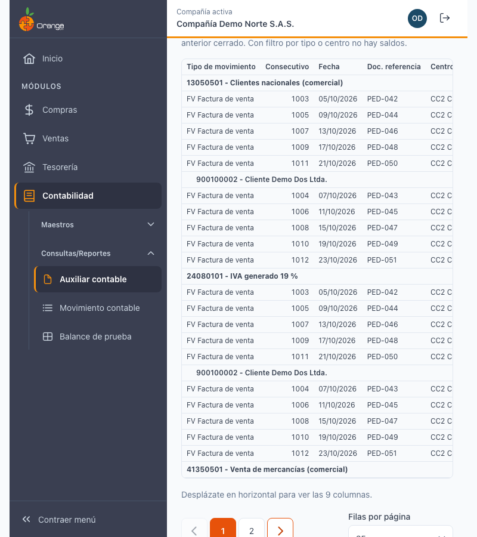
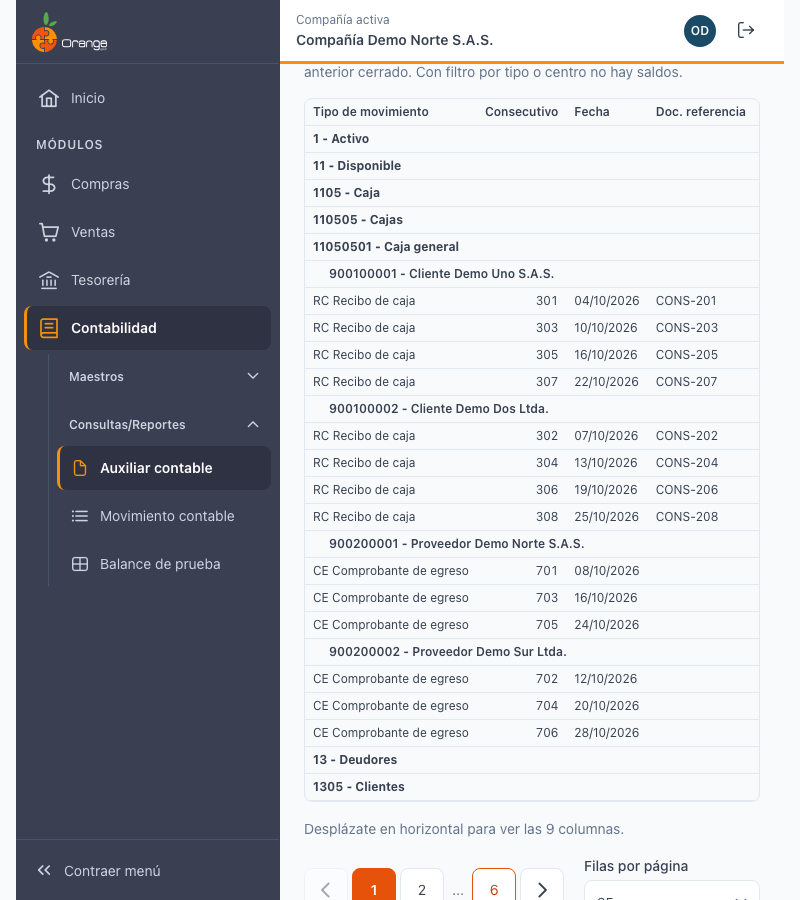

[Regresar a Contabilidad](readme.md)

---

# AUXILIAR CONTABLE

## Qué es

El **Auxiliar contable** muestra los movimientos y los saldos de cada cuenta y de cada tercero en un **período contable**. Dentro del período, usted elige las fechas de inicio y fin. Sirve para revisar qué movió una cuenta, qué quedó a favor o en contra de cada tercero y en qué tipos de movimiento y centros de costo se registró.

La consulta no se ejecuta sola: usted elige los filtros y pulsa **Consultar**.

## Cómo llegar

- Abra **Contabilidad** en el menú principal y luego **Consultas/Reportes > Auxiliar contable**.
- Necesita permiso de **Consultar** sobre el Auxiliar contable. Si no ve la opción, pida a su administrador que se lo asigne.

## Permisos

Lo que ve depende de sus permisos:

- **Consultar**: puede usar los filtros, consultar y ver el resultado.
- **Exportar**: puede descargar el resultado en **Exportar Excel**.
- **Imprimir**: puede descargar el resultado en **Exportar PDF**.

Sin **Exportar** o sin **Imprimir**, el botón correspondiente no está disponible. Sus filtros y la consulta siguen funcionando.

## Filtros

Antes de consultar, elija el período y las fechas. El período y las fechas son obligatorios; los demás filtros son opcionales. Si un filtro se deja vacío, la consulta incluye todos sus valores.

| Filtro | Qué hace |
|---|---|
| **Período** | Período contable de la consulta. Es obligatorio. La lista muestra cada período con su estado, **Abierto** o **Cerrado**, y tiene **Buscar período**. Si la lista no carga o no hay períodos, la pantalla lo indica con **Reintentar** o con el aviso **No hay períodos configurados**. |
| **Fecha inicio** y **Fecha fin** | Rango de fechas dentro del período elegido. Son obligatorias y se habilitan al elegir el período. Al elegirlo, se llenan con su primer y último día, y usted puede acotarlas. Si una fecha queda fuera del período, o si la fecha inicio es posterior a la fecha fin, la pantalla lo indica y no consulta. |
| **Tipos de movimiento** | Muestra solo los movimientos de los tipos elegidos. |
| **Terceros** | Muestra solo los saldos y movimientos de los terceros elegidos. |
| **Nivel** | Va de 0 a 100. Vacío o 0 muestra todo. Con un nivel, la consulta muestra solo los saldos de las cuentas hasta ese nivel y los saldos por tercero, sin las líneas de movimiento. |
| **Cuentas** | Solo aparecen las cuentas de movimiento del plan. Puede elegir varias. |
| **Centros de costos** | Muestra solo los movimientos de los centros elegidos. |

Reglas que conviene conocer:

- Las dos fechas deben caer **dentro del mismo período**. Si no, la pantalla muestra: **La fecha debe estar dentro del período ({inicio} a {fin}).** Si el servidor rechaza el rango, muestra: **Las fechas deben estar dentro de un mismo período. Ajústalas o elija otro período.** En ambos casos, ajuste las fechas o elija otro período.
- Si filtra por **tipo de movimiento** o por **centro de costos**, la consulta muestra solo las líneas de movimiento que cumplen el filtro. **No muestra saldos** ni filas de cuentas.
- Si filtra por **tercero**, solo aparecen las filas de esos terceros.
- **Limpiar filtros** deja las fechas y los demás filtros vacíos.

## Cómo se lee el resultado

El resultado está agrupado en tres tipos de fila:

- **Fila de cuenta**: muestra el código y el nombre de la cuenta, en negrita. Sus importes son los de la cuenta en el rango.
- **Fila de tercero**: muestra el documento y el nombre del tercero, en negrita, con sus importes.
- **Fila de movimiento**: muestra el tipo de movimiento (código y nombre), el consecutivo, la fecha, el documento de referencia, el centro de costos, los débitos y los créditos. El saldo inicial y el saldo final de una línea de movimiento quedan vacíos; lo que cuenta en esa línea son sus débitos y créditos.

Las columnas son: **Tipo de movimiento**, **Consecutivo**, **Fecha**, **Doc. referencia**, **Centro de costos**, **Saldo inicial**, **Débitos**, **Créditos** y **Saldo final**.

Los importes están en pesos (COP), con separador de miles y dos decimales. Un importe en cero aparece vacío.

Para ver las columnas completas en un teléfono o una pantalla pequeña, desplácese en horizontal.

### Páginas

La tabla muestra 25 filas por página. Puede cambiar a 10, 50 o 100 filas por página. Encima de la tabla aparece el total de filas y la página en la que está. Al cambiar de página, la clasificación de las filas no cambia.

## Saldo inicial, saldo final y totales

Esta sección explica cómo se calculan los saldos. Es la parte que más preguntas genera.

**Saldo inicial.** Es el **neto del mes anterior ya cerrado**: el saldo que dejó cada tercero en cada cuenta al cierre de ese mes. No es el acumulado de toda la historia de la compañía.

- El mes que se toma es el anterior a la fecha de inicio de la consulta. Para que el saldo inicial sea el neto del mes anterior cerrado, **empiece la consulta el día 1 del mes**.
- Si el mes anterior no está cerrado, o no tiene saldos para esa cuenta y ese tercero, el saldo inicial aparece vacío (cero).
- Si un mes se reabre y se vuelve a cerrar, su saldo puede cambiar, y el saldo inicial de las consultas que lo usan cambia con él.
- El saldo inicial sale de los saldos guardados al cierre de cada mes. Si hubo cambios después de ese cierre, el saldo inicial puede no coincidir con la suma de los movimientos de meses anteriores.

**Saldo final.** Es siempre el saldo inicial, más los débitos, menos los créditos. Se calcula como débitos menos créditos, sin cambiar el signo según la naturaleza de la cuenta.

**Cuentas y terceros sin datos.** Una cuenta o un tercero que no tiene saldo inicial, ni movimientos, ni saldo final en el rango, no aparece en el resultado.

**Totales.** Bajo la tabla aparecen los **Débitos** y los **Créditos** del resultado completo, no solo de la página que ve. Los totales suman las líneas de movimiento.

- Si los débitos y los créditos del resultado no son iguales, aparece **Descuadre** con la diferencia. Es un dato del resultado: revise el rango, los filtros y los movimientos de esa cuenta en el [Movimiento contable](movimiento-contable.md).
- Si son iguales, el descuadre no aparece.

## Consultar

1. Elija el **Período**.
2. Elija las fechas de inicio y fin dentro de ese período.
3. Elija los filtros que necesite; los demás déjelos vacíos.
4. Pulse **Consultar**. Mientras se consulta, la pantalla muestra **Consultando…**.
5. Revise el resultado y cambie de página con los controles de abajo.

Si cambia un filtro, el resultado anterior no se actualiza: pulse **Consultar** otra vez. Lo mismo ocurre si otro usuario registra movimientos mientras usted consulta.

Si no hay movimientos con esos filtros, la pantalla muestra **No hay movimientos con esos filtros**. Cambie el rango de fechas o quite algún filtro.

Si la consulta falla, la pantalla muestra **No se pudo consultar** con el botón **Reintentar**. Sus filtros se conservan.

## Exportar

Puede descargar el resultado con los filtros que tiene puestos al pulsar el botón. Si cambió algún filtro, consulte otra vez antes de exportar.

### Exportar Excel

- Necesita permiso de **Exportar**.
- Descarga una hoja de Excel con el encabezado de la compañía, el rango de fechas, el usuario que exporta y las mismas filas y importes de la pantalla.
- El límite es de **50.000 filas**.

### Exportar PDF

- Necesita permiso de **Imprimir**.
- Genera un PDF horizontal, tamaño carta, con el encabezado de la compañía, los datos de la consulta (desde y hasta), las mismas columnas de la pantalla, la fecha y hora de impresión y el usuario que lo imprimió. No tiene totales.
- El límite es de **4.000 filas**.

### Si el resultado es demasiado grande

Si el resultado supera el límite, la pantalla no genera el archivo y muestra un aviso como este:

> El resultado tiene más de 50.000 filas y no se puede exportar a Excel. Acote el rango de fechas o los filtros e inténtelo de nuevo.

Para resolverlo, acote el rango de fechas o agregue filtros, y pulse **Consultar** y luego exportar otra vez. Si el PDF es muy grande, use el Excel.

Mientras se genera el archivo, la pantalla muestra **Generando el archivo…**. Si la generación falla, aparece **No se pudo generar el archivo. Inténtelo de nuevo.** y no se descarga nada.

## Preguntas frecuentes

**¿Por qué el saldo inicial aparece vacío?**
El mes anterior a la fecha de inicio no está cerrado, o no tiene saldo para esa cuenta y ese tercero. Revise si el mes anterior está cerrado.

**¿Por qué el saldo inicial no es el saldo total de la cuenta desde que se creó?**
Porque el saldo inicial es el neto del mes anterior cerrado, no el acumulado histórico. Vea la sección [Saldo inicial, saldo final y totales](#saldo-inicial-saldo-final-y-totales).

**¿Por qué el saldo inicial cambió si consulto otro día?**
Cambia el mes que se toma como referencia. Para el saldo del mes anterior, empiece la consulta el día 1 del mes.

**¿Por qué no puedo consultar un rango que cruza dos períodos?**
Cada consulta trabaja con un solo período. Si necesita dos períodos, consulte cada uno por separado.

**¿Por qué las fechas están bloqueadas?**
Hasta que elija el período, las fechas no se habilitan. Al elegirlo, puede ajustar las fechas solo dentro de ese período.

**¿Por qué no veo saldos cuando filtro por tipo de movimiento o por centro de costos?**
Con esos filtros la consulta muestra solo las líneas de movimiento. Los saldos y las filas de cuentas no aparecen.

**¿Por qué no aparecen algunas cuentas?**
Solo aparecen las cuentas que tienen saldo inicial, movimientos o saldo final en el rango. Las demás se omiten.

**¿Por qué aparece Descuadre?**
Los débitos y los créditos del resultado no son iguales. Revise el rango de fechas y los filtros, y el detalle en el [Movimiento contable](movimiento-contable.md).

**¿Por qué no veo Exportar Excel ni Exportar PDF?**
Su usuario no tiene el permiso de **Exportar** (Excel) o de **Imprimir** (PDF) sobre el Auxiliar contable. Pida a su administrador que lo revise.

**¿Dónde veo las líneas de un asiento o de un documento?**
En el [Movimiento contable](movimiento-contable.md), que muestra las líneas del libro con los filtros de documento, tercero, tipo, cuenta y centro de costos.

**¿Dónde veo los saldos de una cuenta por período?**
En la ficha de la cuenta del [Plan de cuentas](plan-cuentas.md), en las pestañas **Movimientos** y **Saldos por tercero**.
