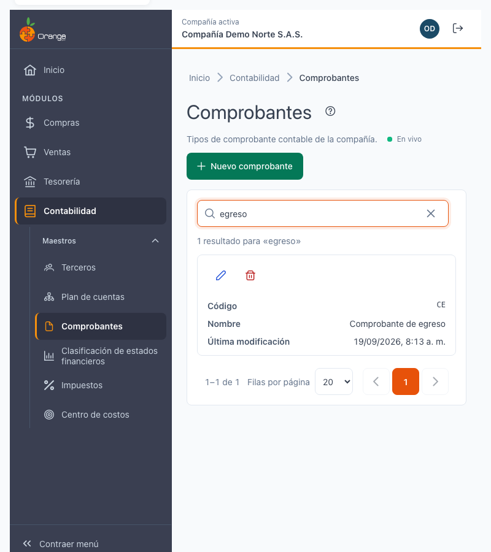
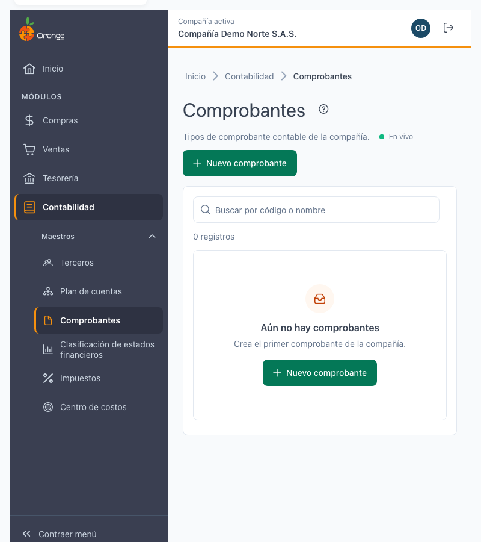
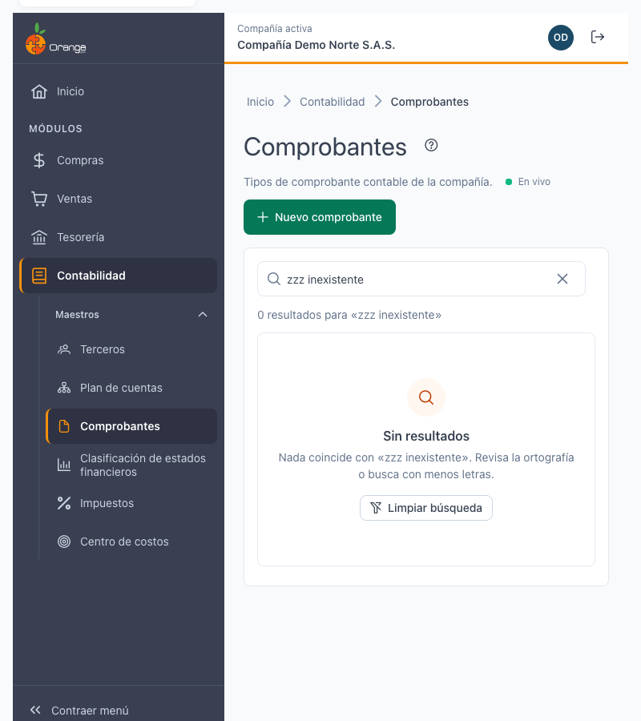
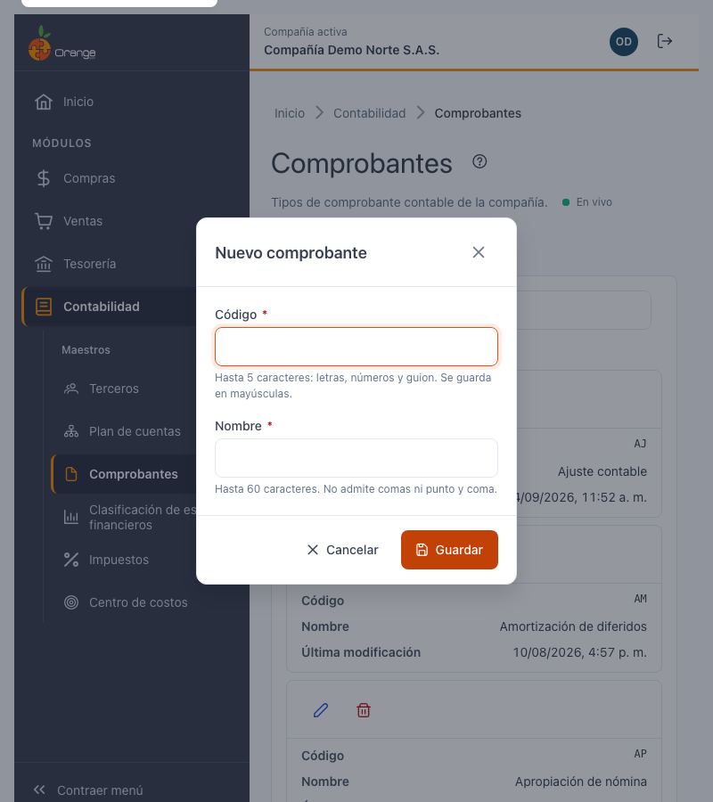
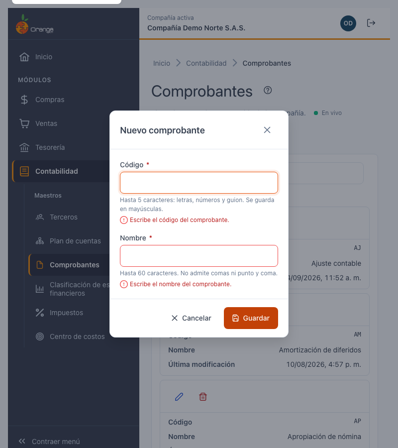
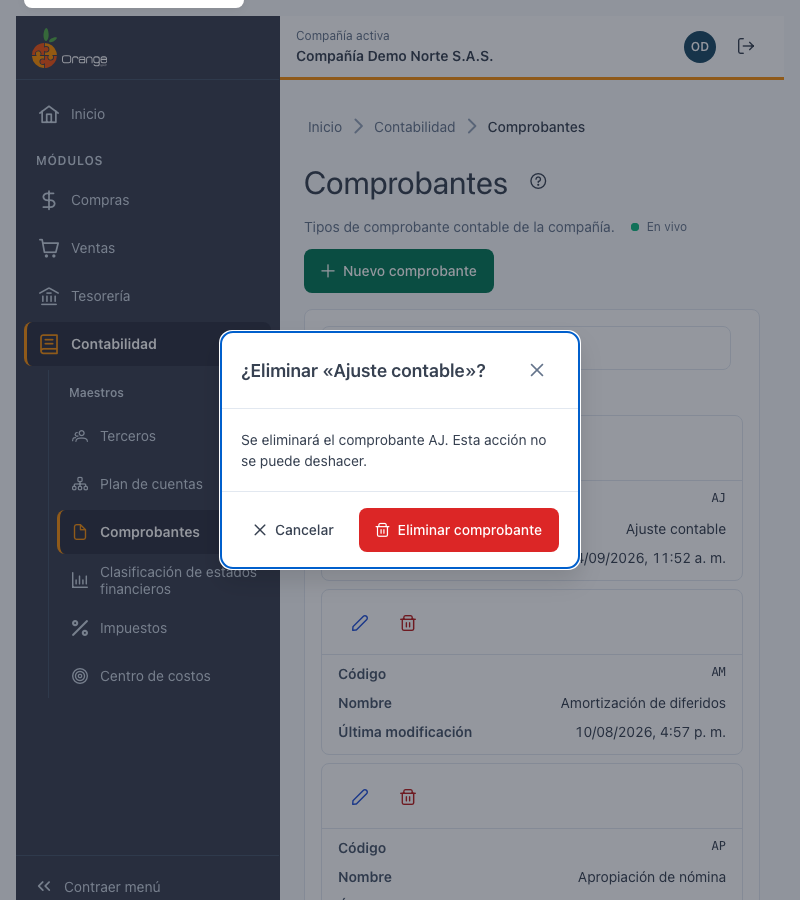
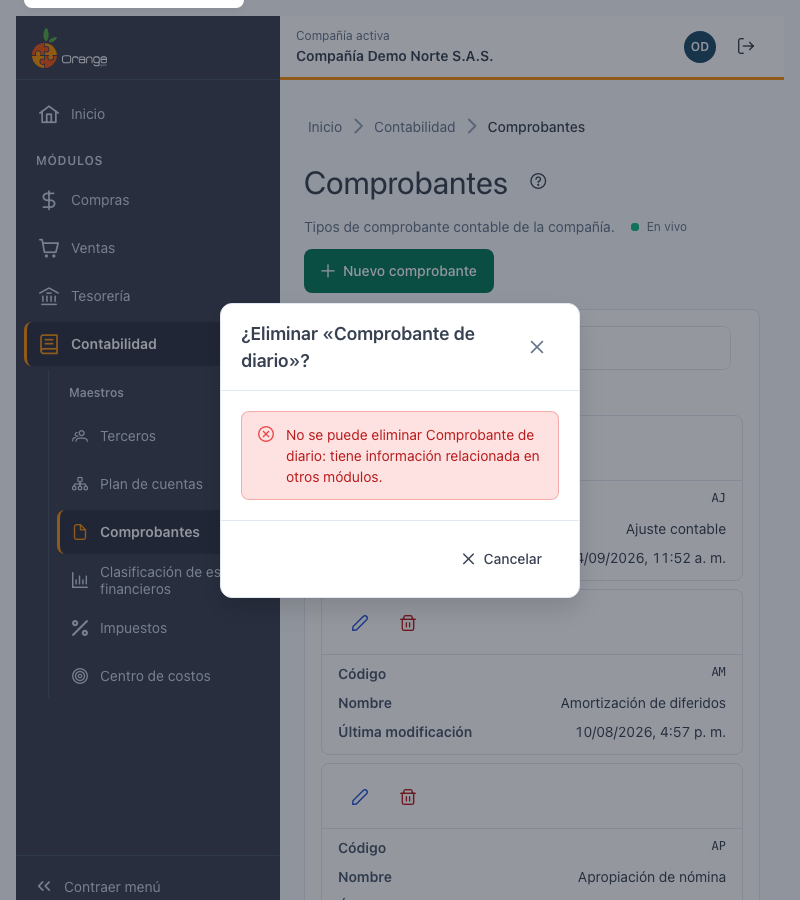

[Regresar a Contabilidad](readme.md)

---

# COMPROBANTES

## Qué es

Los **comprobantes** son los tipos de comprobante contable de la compañía, por ejemplo, un comprobante de diario o de egreso. Cada uno tiene un código corto y un nombre. Desde aquí los consulta, crea, edita y elimina.

## Cómo llegar

- Abra **Contabilidad** en el menú principal y luego **Maestros > Comprobantes**.
- Necesita permiso de **Consultar** sobre Comprobantes. Si no ve la opción, pida a su administrador que se lo asigne.

## Permisos

- **Consultar**: ve el listado y puede buscar y ordenar.
- **Crear**: ve el botón **Nuevo comprobante**.
- **Actualizar**: puede abrir un comprobante, cambiarlo y guardarlo.
- **Eliminar**: puede eliminar un comprobante.

Si solo tiene **Consultar**, no ve los botones de crear, editar ni eliminar.

## Pantalla principal

La pantalla muestra una tabla con tres columnas: **Código**, **Nombre** y **Última modificación**. Las acciones **Editar** y **Eliminar** están en la primera columna de cada fila.

- **Buscar**: escriba parte del código o del nombre. No importan las mayúsculas ni las tildes.
- **Ordenar**: pulse el encabezado de una columna.
- **Páginas**: la tabla se divide en páginas, con controles de abajo.

Estados de la pantalla:

- **Cargando**: mientras se obtiene la lista.
- **Vacío**: la compañía todavía no tiene comprobantes.
- **Sin resultados**: la búsqueda no encuentra nada. Cambie el texto para buscar de nuevo.
- **Error**: la lista no carga. Pulse **Reintentar**.

## Crear un comprobante

1. Pulse **Nuevo comprobante**.
2. Escriba el **Código** y el **Nombre**.
3. Pulse **Guardar**.

Reglas de los campos:

- **Código**: obligatorio, hasta 5 caracteres. Solo admite letras, números y guion. Se guarda en mayúsculas, aunque lo escriba en minúsculas.
- **Nombre**: obligatorio, hasta 60 caracteres. No admite comas ni punto y coma.
- El código no puede repetirse en su compañía. Si ya existe, la pantalla no guarda y le indica que el código está en uso.

Si un campo no cumple, la pantalla lo señala y conserva lo que escribió en el diálogo.

Al crear, la lista se actualiza y el nuevo comprobante aparece con un aviso.

## Editar un comprobante

1. Busque el comprobante y pulse **Editar** en su fila.
2. Cambie el nombre o el código.
3. Pulse **Guardar**.

Si cambia el código de un comprobante que ya existía, la pantalla le avisa antes de guardar.

Si el comprobante fue eliminado por otro usuario mientras usted lo editaba, la pantalla lo indica: cierre el diálogo y refresque la lista.

## Eliminar un comprobante

1. Pulse **Eliminar** en la fila del comprobante.
2. Revise el código y el nombre en el diálogo y confirme.

Si el comprobante ya lo usa otro módulo de la compañía, no se elimina. La pantalla muestra que el comprobante **tiene información relacionada en otros módulos** y deja el registro en la lista.

## Cambios de otros usuarios en vivo

Si otro usuario crea, cambia o elimina un comprobante, la lista se actualiza sola, la fila cambiada se resalta y aparece un aviso.

## Preguntas frecuentes

**¿Por qué no veo el botón Nuevo comprobante?**
Su usuario no tiene permiso para crear. Pida a su administrador que se lo asigne.

**¿Por qué no puedo guardar un código?**
Revise la longitud (hasta 5 caracteres) y los caracteres: solo letras, números y guion. Si el código ya existe en la compañía, debe usar otro.

**¿Por qué no puedo guardar un nombre con coma o punto y coma?**
Esos caracteres no se admiten en el nombre. Escriba el nombre sin ellos.

**¿Por qué no puedo eliminar un comprobante?**
Otro módulo de la compañía lo está usando. Mientras esté en uso, no se elimina.

**¿Puedo importar comprobantes desde Excel?**
No. Esta pantalla no tiene importación ni exportación a Excel.
