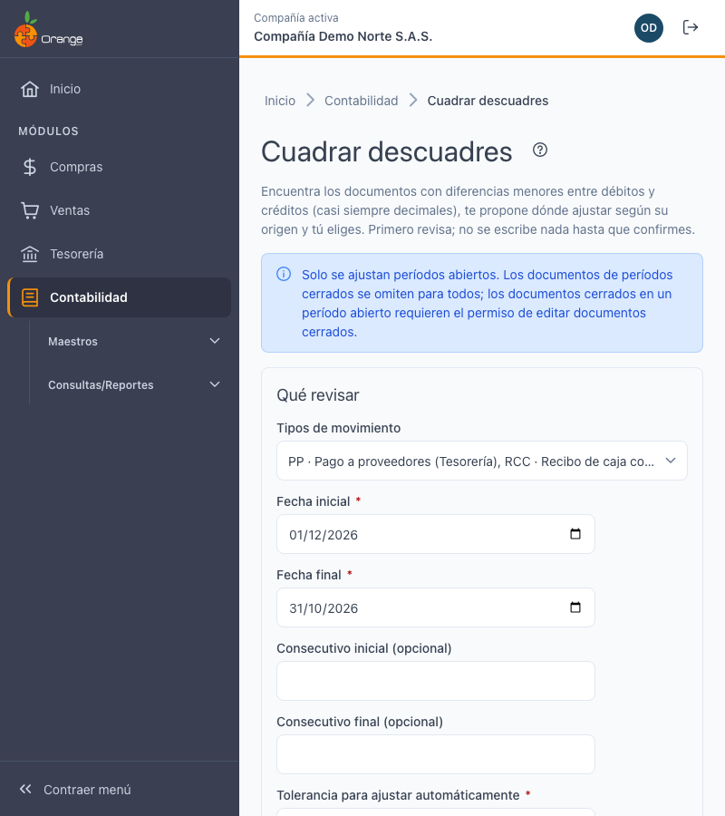
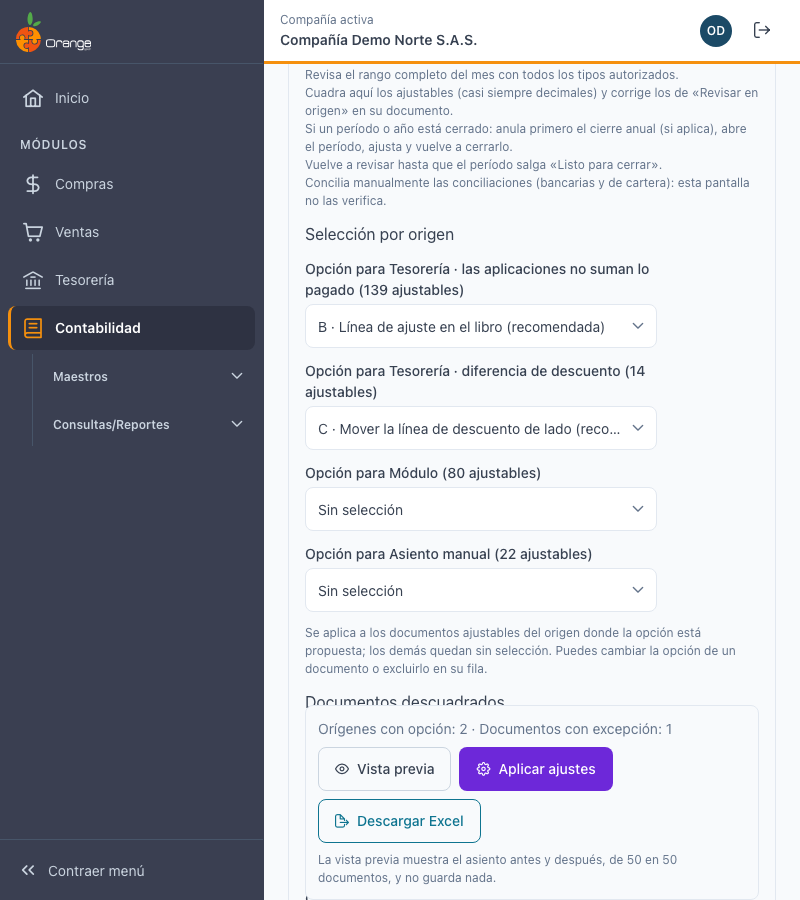
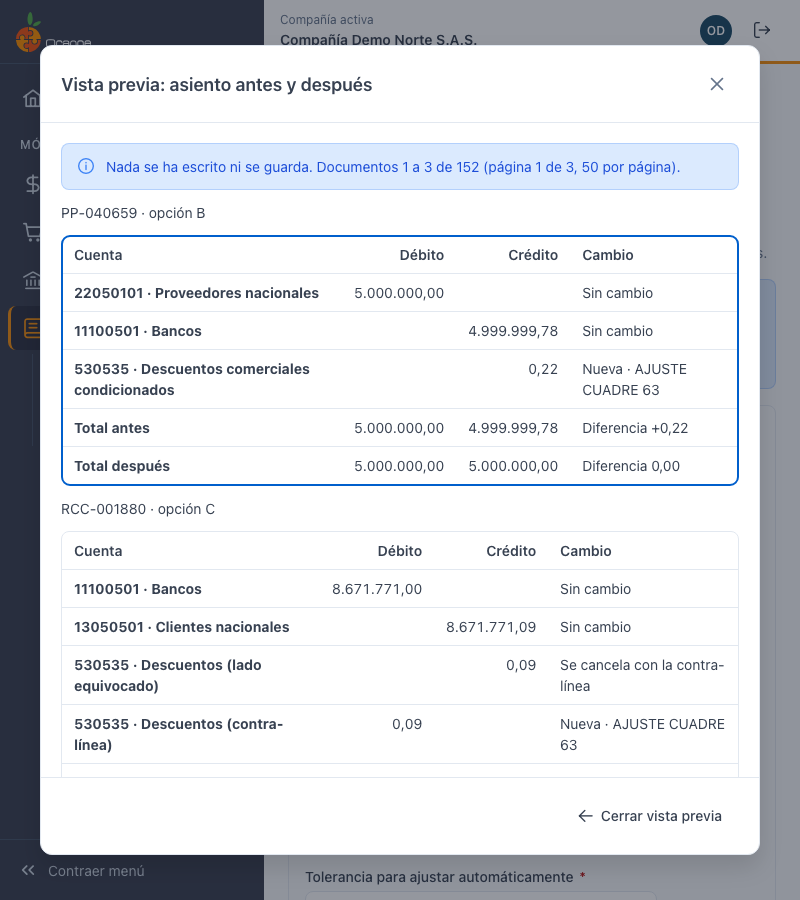
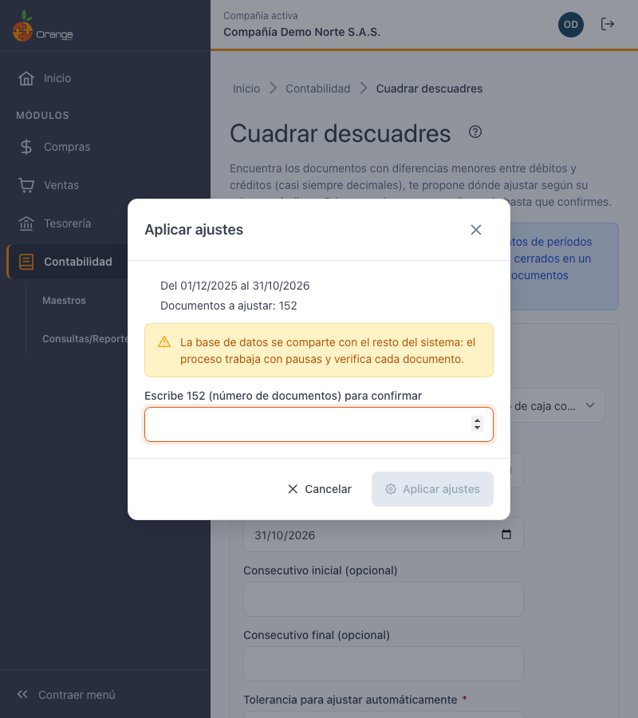
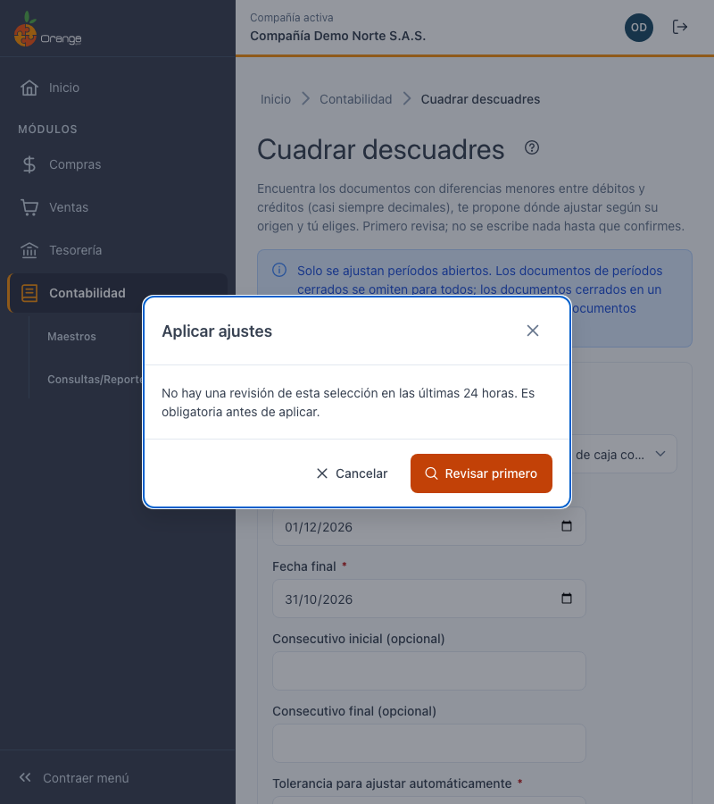
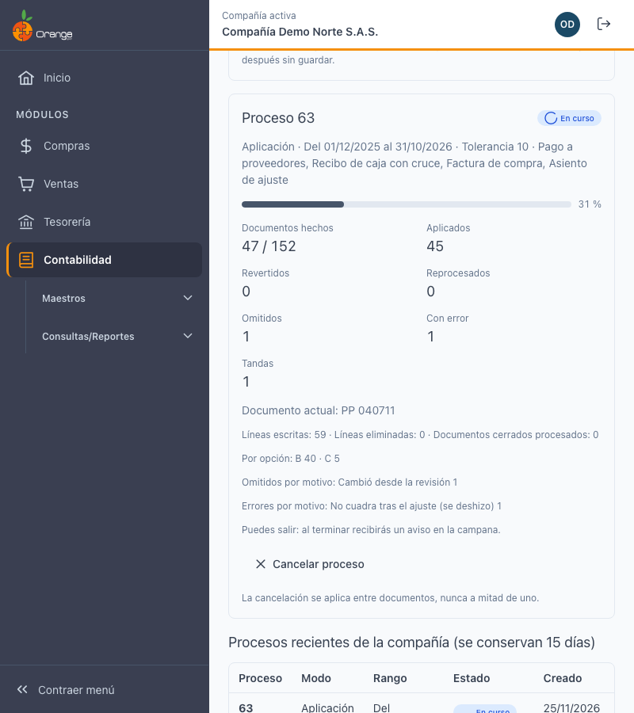
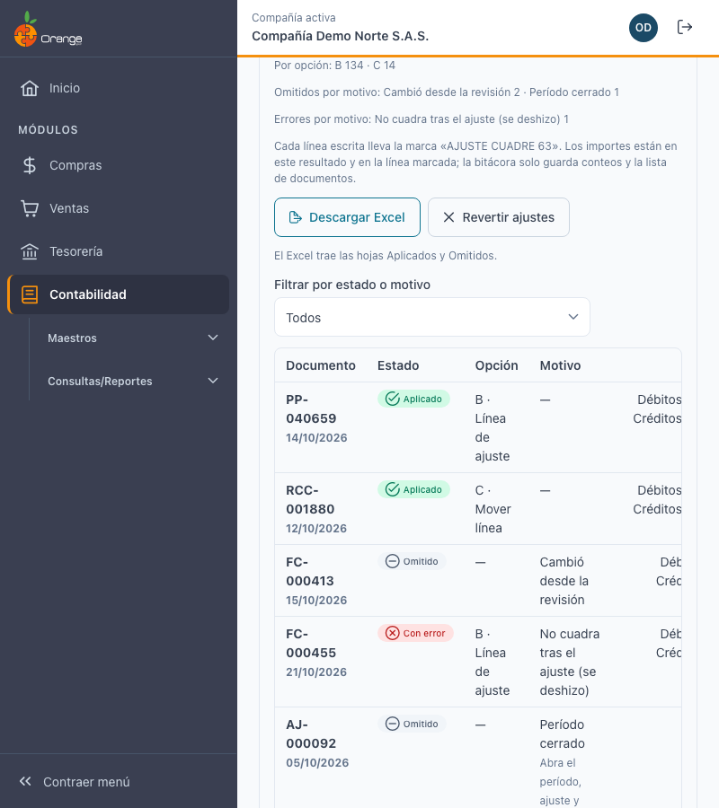
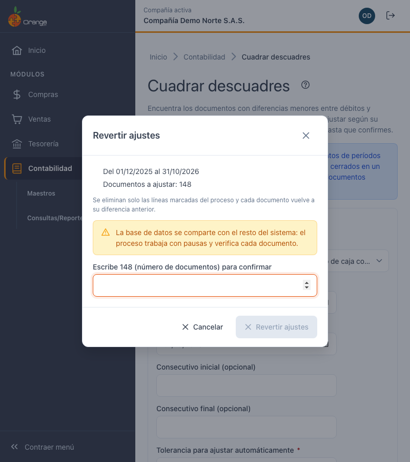
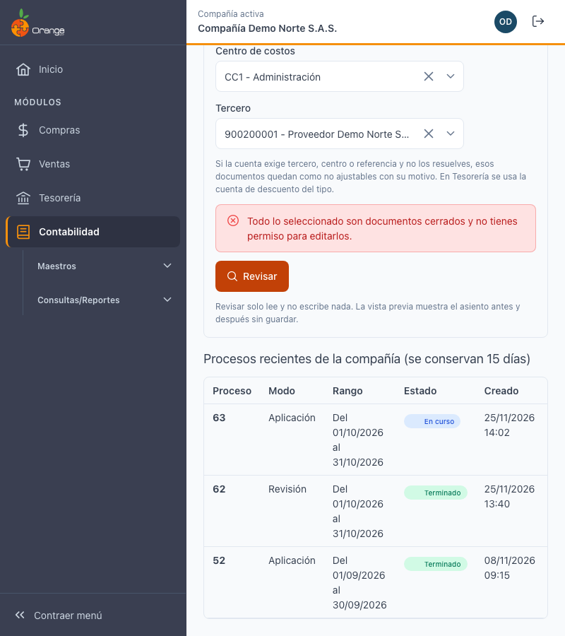

[Regresar a Contabilidad](readme.md)

---

# Cuadrar descuadres

> **Paso 1 del cierre del mes.** Revise aquí todos los documentos descuadrados antes de conciliar cuentas y cerrar períodos.

---

## Descripción

Un documento está **descuadrado** cuando sus débitos y créditos no son iguales. Casi siempre la diferencia son centavos, pero también puede ser un error mayor en el documento de origen.

**Cuadrar descuadres** le permite:

- Ver **todos** los documentos descuadrados de un rango de fechas, con su diferencia.
- Clasificar cada uno: **Ajustable**, **Revisar en origen** o **Bloqueado**.
- Cuadrar en bloque los **ajustables**, eligiendo la forma de ajuste y la cuenta, el centro de costo y el tercero del ajuste.
- Corregir los demás en su documento de origen.
- Deshacer un ajuste aplicado, por proceso.

Esta opción **no** modifica períodos cerrados ni cambia saldos. Tampoco concilia cuentas: esa verificación la hace usted.

> **Ayuda:** la pantalla tiene ayuda en el botón **?**, junto al título.

---

## Acceso

1. En el menú principal, haga clic en **Contabilidad**.
2. En **Procesos**, haga clic en **Cuadrar descuadres**.

Si la opción no aparece en el menú, su usuario no tiene el permiso de **Consultar**.

| Permiso | Qué permite |
|---------|-------------|
| **Consultar** | Ver la pantalla, **Revisar**, la **Vista previa**, el historial, el resultado y el Excel. |
| **Crear** | Botones **Aplicar ajustes** y **Reintentar**. Sin este permiso, la selección se puede ver pero no aplicar. |
| **Actualizar** | Botón **Revertir ajustes**. |
| **Anular** | Botón **Cancelar proceso** mientras el proceso corre. |
| **Editar documentos cerrados** (permiso aparte, de documentos) | Permite ajustar los documentos cerrados que estén en un período abierto. |

Si Aplicar, Revertir y Cancelar no aparecen, o la pantalla muestra una nota de escritura no disponible, la función de escritura todavía no está activa en su compañía. Puede revisar y ver la vista previa.

---

## Pantalla principal

| Elemento | Para qué sirve |
|----------|----------------|
| **Tipos de movimiento** | Elija uno o varios. Solo aparecen los tipos autorizados a su usuario. |
| **Fecha inicial** y **Fecha final** | Obligatorias. La fecha inicial no puede ser posterior a la final. |
| **Consecutivo inicial** y **Consecutivo final** | Opcionales. |
| **Tolerancia para ajustar automáticamente** | Por defecto, **10**. Puede llegar hasta **100**. Solo decide qué descuadres son **Ajustables**. |
| **Origen** | Opcional. Filtra por módulo de origen (por ejemplo, Tesorería o Compras). |
| **Cuenta, centro y tercero de ajuste** | Se buscan escribiendo. Son las cuentas que usará el ajuste. Elíjalos con la búsqueda antes de revisar. |
| **Revisar** | Busca los descuadrados. No escribe nada. |

La lista muestra **todos** los descuadrados del rango, grandes y pequeños. La tolerancia no los oculta: solo decide cuáles se pueden cuadrar en bloque.

---

## Clasificación

Cada documento descuadrado tiene una clasificación, calculada por el sistema:

| Clasificación | Qué significa | Qué hacer |
|---------------|---------------|-----------|
| **Ajustable** | La diferencia es menor o igual a la tolerancia y hay una forma de cuadrarla aquí. | Elegir la opción de ajuste (B o C) y aplicar. |
| **Revisar en origen** | La diferencia es mayor a la tolerancia, o no hay una causa clara, o el documento necesita reglas propias (por ejemplo, cierre anual o nómina). | Corregir el documento en su módulo de origen. |
| **Bloqueado** | El período o el año está cerrado, o el documento está cerrado sin el permiso necesario. | Seguir la guía del motivo (ver la sección **Períodos y años cerrados**). |

Cada fila muestra la **diferencia** (débitos menos créditos), el **motivo** y el **antes → después** de débitos y créditos.

---

## Listo para cerrar

Después de revisar, la pantalla muestra un resumen **por período** de los descuadrados:

- **Listo para cerrar**: no quedan pendientes y la revisión está completa.
- **N pendientes**: quedan documentos por corregir o por decidir.
- **No evaluado**: la revisión fue parcial (por ejemplo, con filtros).
- **Cerrado**: el período ya está cerrado.

Este resumen es informativo y vale **24 horas**. Después, vuelva a revisar. La pantalla no cierra ningún período por usted.

---

## Seleccionar

### Por origen

Cada origen con documentos ajustables aparece en **Selección por origen**. Elija para todo el origen:

- **Sin selección**: no se ajusta nada del origen.
- **B · Línea de ajuste**: se agrega una línea marcada que iguala débitos y créditos.
- **C · Mover línea**: se agregan dos líneas marcadas: una contra-línea que cancela la línea equivocada y otra en el lado correcto.

La opción **A** todavía no está disponible.

### Por documento

En la tabla, cada documento ajustable tiene un selector con la opción recomendada, **B**, **C** o **No ajustar**. Use **No ajustar** para excluir un documento concreto aunque el origen esté seleccionado.

Los filtros por **Clasificación**, **Período**, **Origen** y **Tipo de movimiento** acotan la lista.

### Abrir el documento

Cada fila tiene un enlace para ver el documento:

- **Abrir documento**: disponible para los documentos de Tesorería y de Compras. Si el documento no tiene ruta al módulo de origen, el botón aparece deshabilitado y la pantalla indica el motivo.
- **Asientos**: abre el asiento del documento en Asientos contables. Siempre está disponible.

---

## Vista previa

Antes de aplicar, use **Vista previa**. Muestra, por documento, el asiento **antes** y **después** del ajuste: las líneas actuales, las líneas nuevas (marcadas como **AJUSTE CUADRE**) y los totales. La vista previa no escribe nada.

Si entre la revisión y la vista previa cambió la diferencia o las líneas de un documento, ese documento aparece como **Cambió desde la revisión** y no se puede aplicar. Vuelva a revisar.

---

## Aplicar ajustes

Haga clic en **Aplicar ajustes**. Aparece la confirmación con el rango y el número de documentos que se van a ajustar.

1. Revise el rango, los documentos y la advertencia de que la base de datos es compartida.
2. **Escriba el número de documentos** a ajustar. El botón se habilita solo si coincide.

**Condiciones:**

- **Fuera de la ventana**: la aplicación se hace en la ventana nocturna, de **20:00 a 06:00** (hora de Bogotá) y los domingos. Fuera de ella puede **agendar** el proceso o **ejecutarlo ahora**, con confirmación. Queda en la bitácora.
- **Sin revisión vigente**: si la revisión tiene más de 24 horas, la pantalla pide **Revisar primero**.

El ajuste se aplica **documento por documento**, en tandas. Si un documento no cuadra después del ajuste, se deshace solo ese documento y queda como **No cuadra tras el ajuste (se deshizo)**.

---

## Progreso y cancelación

Durante el proceso se ven: la barra de avance, el número de documentos hechos, **Aplicados**, **Revertidos**, **Reprocesados**, **Omitidos**, **Con error** y las **tandas**. También el documento actual y el número de líneas escritas y eliminadas.

- **Cancelar proceso** detiene el proceso al terminar el documento en curso. Lo ya aplicado se conserva.
- Si el proceso **falla**, la pantalla muestra el motivo y el botón **Reintentar**.

---

## Resultado

El resultado muestra los mismos conteos y el detalle por documento:

- **Aplicado**: el ajuste quedó escrito y cuadra.
- **Omitido**: no se tocó, por una regla (período cerrado, año con cierre anual, documento cerrado sin permiso, cambio desde la revisión u otra). El detalle indica el motivo y lo que debe hacer.
- **Con error**: no se pudo ajustar. Su contabilidad anterior se conserva.
- **Reprocesado**: el proceso se interrumpió en ese documento y se volvió a procesar.

Cada documento muestra débitos y créditos **antes → después** y la diferencia. Puede filtrar por estado o por motivo.

**Descargar Excel** exporta dos hojas: **Aplicados** y **Omitidos**.

### Revertir ajustes

**Revertir ajustes** deshace un proceso de aplicación. Solo quita las líneas **AJUSTE CUADRE** de ese proceso, documento por documento. No toca otras líneas. Requiere el permiso de **Actualizar** y la función de escritura activa.

Puede revertir **todos** los documentos del proceso o solo **los documentos seleccionados**. Marque los documentos en la tabla y elija **Revertir seleccionados**; para todos, use **Revertir ajustes**. En ambos casos escriba el número de documentos, igual que al aplicar.

### Procesos recientes

En **Procesos recientes** aparecen los procesos de los últimos **15 días**, con su modo (aplicación o reversión), rango, estado y fecha. Si el resultado ya no está disponible, la pantalla lo indica.

---

## Períodos y años cerrados

Esta sección es la guía del contador. **Esta pantalla nunca abre ni cierra períodos ni años, ni modifica un período cerrado.** Usted hace cada paso en la pantalla que corresponda.

**Mientras un año tenga cierre anual, la opción de períodos no permite reabrir sus períodos ni sus opciones.** Si lo intenta, la pantalla le pide **anular primero el cierre anual**. El orden es obligatorio: primero anule el cierre anual (CEA y CEAN) del año y solo después reabra el período.

### Período cerrado (el año no tiene cierre anual)

El documento sale **Bloqueado** con el motivo **Período cerrado**. Siga estos pasos:

1. **Reabra el período** en el menú **Seguridad**, opción **Períodos**.
2. **Cuadre** los documentos en esta opción (Cuadrar descuadres).
3. **Concilie** manualmente las cuentas que el ajuste afecte, como cartera o bancos. Esta pantalla no las verifica.
4. **Cierre** las opciones (módulos) que haya abierto para corregir en el origen, y después el período.
5. **Recalcule los saldos** con la opción **Recálculo de saldos (285)**, para los períodos posteriores.

### Año con cierre anual

Si el año tiene **cierre anual** (documentos de cierre de diciembre y de enero), el documento sale **Bloqueado** con el motivo **Año con cierre anual**. Siga este orden:

1. **Anule primero el cierre anual** del año: el documento de cierre del 31 de diciembre (CEA) y el de cierre del 1 de enero siguiente (CEAN). Hoy esa anulación se hace por el medio disponible actualmente para su compañía (el sistema anterior). Tenga en cuenta que anularlos **cambia los saldos de apertura del año siguiente**.
2. Siga los pasos de **período cerrado** (reabrir el período, cuadrar, conciliar, cerrar opciones y período).
3. **Recalcule los saldos** con **Recálculo de saldos (285)**, incluido el año siguiente.
4. **Vuelva a generar el cierre anual** con **Cierre anual (306)**.

> **Nota:** mientras el año tenga cierre anual, esta opción sigue bloqueando sus documentos aunque el período esté abierto. Si anula el cierre anual y luego reabre el período, el documento deja de salir como **Año con cierre anual**.

Si la selección es solo de documentos bloqueados por el año, la pantalla no permite aplicar.

### Documento cerrado sin permiso

El documento está en un período abierto, pero ya fue cerrado individualmente y su usuario no tiene el permiso de editar documentos cerrados. Pida ese permiso a su administrador, o corrija el documento con quien lo tenga.

---

## Guía del contador antes de cerrar el mes

1. Revise el rango completo del mes con todos los tipos autorizados.
2. Cuadre aquí los ajustables (casi siempre decimales) y corrija los de **Revisar en origen** en su documento.
3. Si un período o un año está cerrado, anule primero el cierre anual (si aplica), abra el período, ajuste y vuelva a cerrarlo.
4. Vuelva a revisar hasta que el período salga **Listo para cerrar**.
5. Concilie manualmente las cuentas bancarias y de cartera. Esta pantalla no las verifica.

---

## Preguntas frecuentes

**¿Este proceso cierra el mes?**
No. Es el primer paso. Después concilie las cuentas, cierre las opciones y el período, y haga el cierre anual si corresponde.

**¿Por qué un documento de centavos sale como Revisar en origen?**
Porque la diferencia es mayor a la tolerancia o no tiene una causa clara. Puede subir la tolerancia (hasta 100) para que se pueda ajustar aquí, o corregir el documento en su origen.

**No veo el botón Aplicar ajustes.**
Su usuario necesita el permiso de **Crear**, y la función de escritura debe estar activa en su compañía.

**Un documento aparece como "Cambió desde la revisión".**
Cambió la diferencia o las líneas después de revisar. Vuelva a revisar y luego aplique.

**¿Puedo deshacer un ajuste?**
Sí, con **Revertir ajustes** en el resultado del proceso de aplicación. Solo quita las líneas de ese proceso.

**¿Por qué el proceso dice que el documento está bloqueado si el período está abierto?**
Porque su año tiene cierre anual. Anule primero el cierre anual del año y siga la guía de la sección **Períodos y años cerrados**.

**¿Puedo cancelar el proceso?**
Sí, con **Cancelar proceso**. Lo ya aplicado se conserva.

**¿Esta opción concilia las cuentas de cartera o de bancos?**
No. La conciliación la hace usted, de forma manual.

---

[Regresar a Contabilidad](readme.md)
