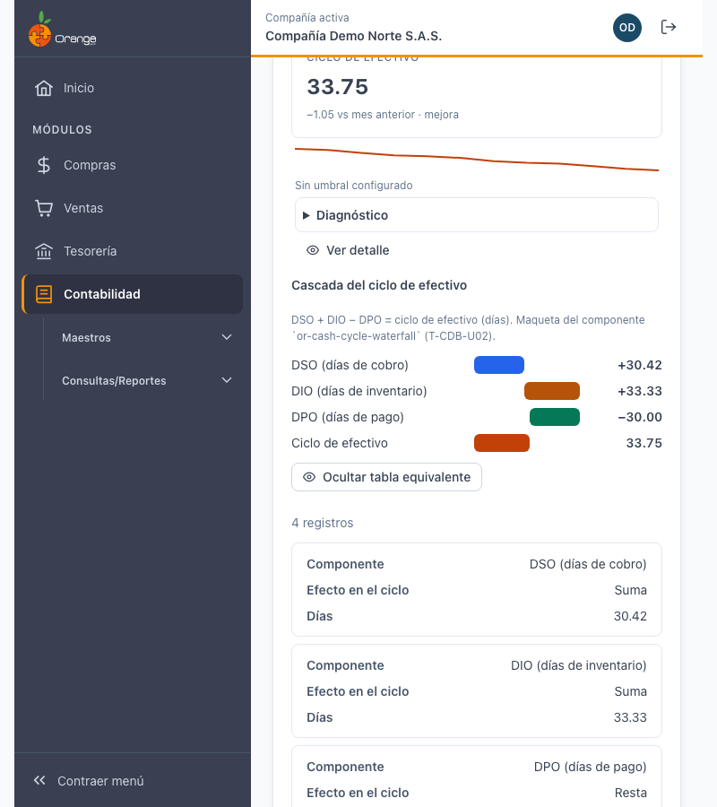
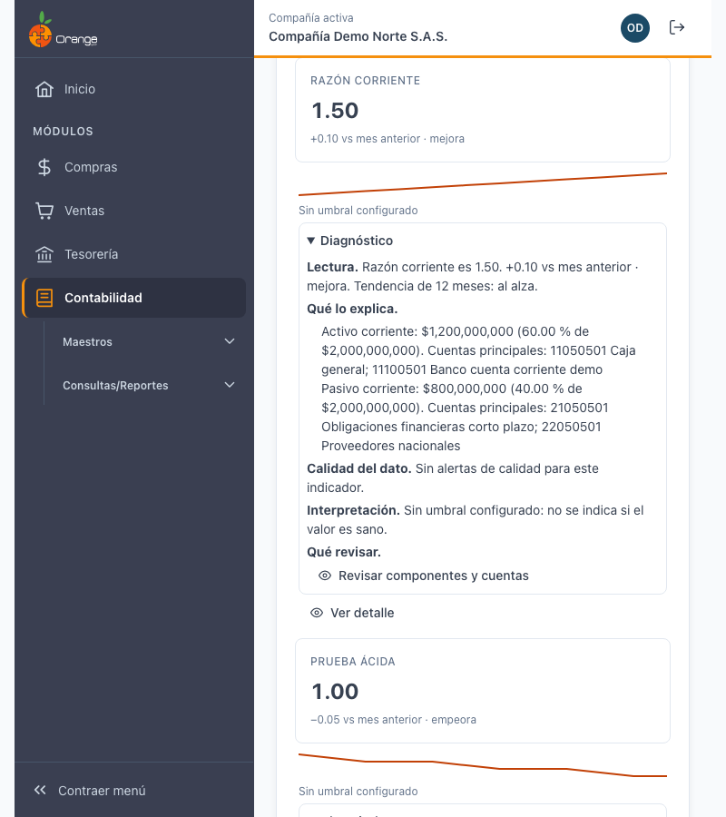
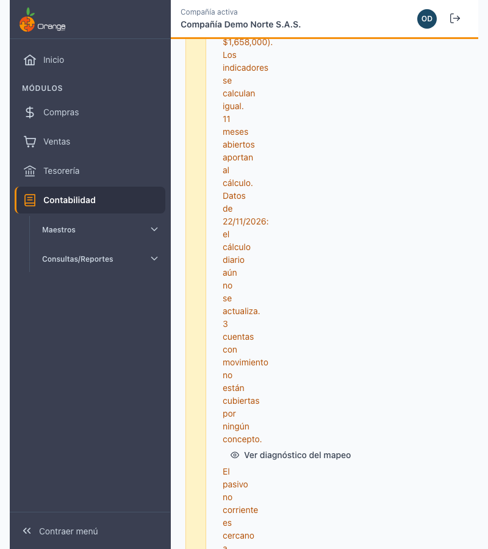
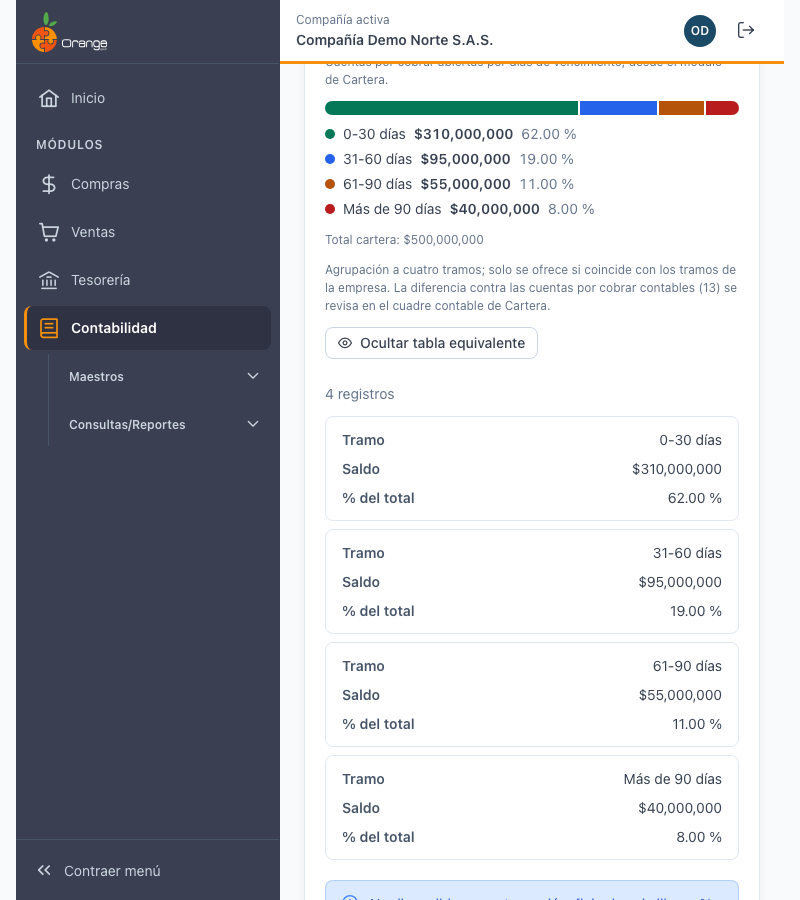
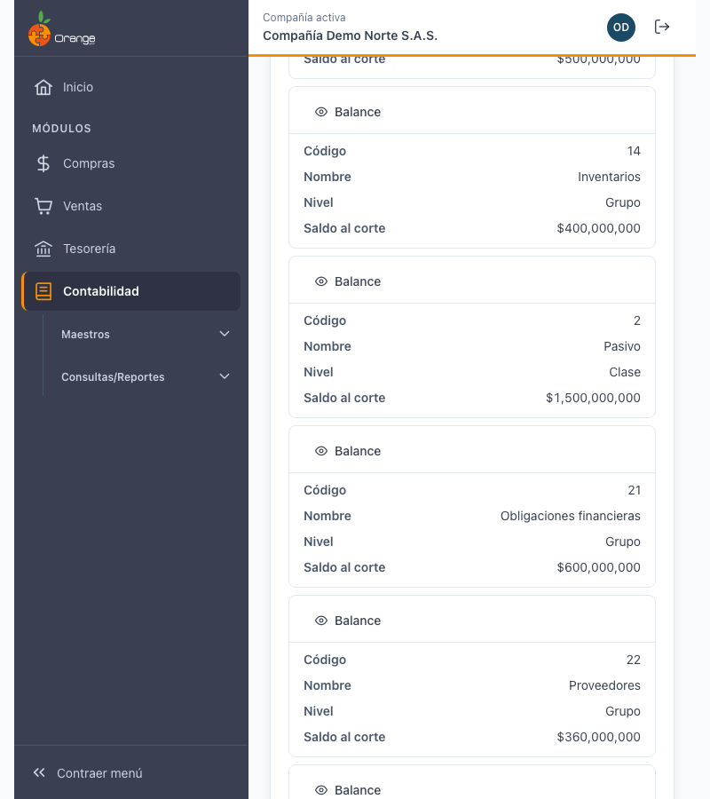

[Regresar a Contabilidad](readme.md)

---

# Financiero: indicadores financieros

> **Resumen gerencial.** Muestra los indicadores financieros de la compañía (liquidez, ciclo de caja, endeudamiento, rentabilidad y cartera por edades), calculados desde el libro contable, con la fecha de corte a la vista. Cada cifra se puede revisar hasta las cuentas y los movimientos que la explican.

---

## Descripción

**Financiero** es la primera pantalla de **Contabilidad** cuando está habilitada en su compañía. Sirve para saber, de un vistazo, qué tan líquida, eficiente, endeudada y rentable está la compañía, y para entender por qué cada cifra es la que es.

Lo que encuentra en la pantalla:

- **Indicadores** agrupados en bloques, cada uno con su valor, su comparación con otro período y la tendencia de los últimos 12 meses.
- **Avisos de calidad de datos**: situaciones del libro que conviene revisar antes de tomar decisiones con las cifras.
- **Detalle** de cada indicador: qué componentes lo forman, qué cuentas los explican y, desde ahí, el Auxiliar contable y el Balance de prueba.
- **Diagnóstico** de cada indicador: una lectura en palabras de lo que muestra y qué revisar.
- **Estructura del balance** al corte, por clase y por grupo.
- **Excel** con las cifras de la pantalla.

> **Importante:** el tablero **no define si un indicador es sano o no**. Esa referencia la pone la propia compañía con sus umbrales y benchmarks. Mientras no existan, la pantalla dice **Sin umbral configurado**.

> **Ayuda:** la pantalla tiene ayuda en el botón **?**, junto al título.

---

## Acceso

1. En el menú principal, haga clic en **Contabilidad**.
2. Se abre **Financiero**. No hay una opción aparte en el menú.

Si Contabilidad abre una página de bienvenida sin indicadores, el tablero no está habilitado para su compañía en este ambiente. Pida a soporte que lo active.

| Permiso | Qué permite |
|---------|-------------|
| **Consultar** (Financiero) | Ver el tablero, los indicadores, el detalle, el diagnóstico, la estructura del balance y la configuración de solo lectura. |
| **Exportar** (Financiero) | Botón **Exportar Excel**. |
| **Actualizar** (Financiero) | Botón **Recalcular indicadores**. |
| **Consultar** en **Auxiliar contable** y en **Balance de prueba** | Los enlaces del detalle hacia esas pantallas. Sin este permiso el botón aparece inactivo y un texto explica por qué. |

Sin el permiso de **Consultar** de Financiero, la pantalla muestra **No tienes acceso a este tablero**. Pida a su administrador ese permiso.

---

## Pantalla principal

| Elemento | Para qué sirve |
|----------|----------------|
| **Configuración y diagnóstico** | Abre el panel de solo lectura con los parámetros de la compañía, el mapeo de conceptos y las cuentas sin cubrir. |
| **Actualizar cálculo** | Vuelve a leer los indicadores del servidor. No vuelve a calcular el libro; para eso use **Recalcular indicadores**. |
| **Recalcular indicadores** | Pide un nuevo cálculo de la compañía. Solo aparece con el permiso **Actualizar**. |
| **Exportar Excel** | Descarga las cifras de la pantalla. Se activa cuando el tablero está cargado. |
| **Corte** y **Calculado** | La fecha de corte y la hora en que se calcularon los indicadores (ver más abajo). |
| **Resumen** | Cuatro indicadores clave: razón corriente, capital de trabajo, nivel de endeudamiento y margen neto. |

---

## Filtros

Los filtros están en una sola fila. Cambie lo que necesite y pulse **Aplicar**: el tablero no cambia hasta que lo haga. Si hay cambios sin aplicar, aparece el aviso **Hay filtros sin aplicar**. **Limpiar filtros** vuelve a los valores iniciales y actualiza el tablero.

| Filtro | Opciones y qué hace |
|--------|---------------------|
| **Compañía activa** | Muestra la compañía con la que trabaja. No se cambia desde aquí; use la selección de compañía de OrangeERP. |
| **Corte** | **Ayer** (valor inicial), que es el último día completo, o el **fin de mes** de los últimos 12 meses. No admite hoy ni fechas futuras. |
| **Comparar contra** | **Mes anterior** (valor inicial), **Año anterior** o **Sin comparar**. El comparativo se toma a fin de mes: el mes anterior al corte o el mismo mes del año anterior. |
| **Base de flujos** | **12 meses móviles** (valor inicial): suma los últimos doce meses hasta el corte. **Año a la fecha**: suma desde enero hasta el corte. Afecta a los indicadores que usan ventas, costos, gastos o ganancia. |
| **Promedio de saldos** | **Saldo final** (valor inicial) usa el saldo al corte. **Promedio inicial y final** usa el promedio del saldo al inicio y al corte. Aplica a los días de cartera, de inventario y de pago, y al ROA y ROE. |
| **Días base** | **365** o **360** días. Lo fija la empresa: en la pantalla solo se muestra, no se cambia. |

---

## Fecha de corte y hora del cálculo

- El **corte** es la fecha hasta la cual se calculan los indicadores. Por defecto es el último día completo, es decir, **ayer**.
- **Calculado** es la hora (hora de Bogotá) en que se calcularon esas cifras. Aparece junto al corte, por ejemplo: *Corte: 24/11/2026 · Calculado: 06:10*.
- Si el cálculo es de una fecha anterior al corte, aparece el aviso **Datos de [fecha]: el cálculo diario aún no se actualiza**. Las cifras son válidas, pero no incluyen lo registrado después de esa fecha.

---

## Primera carga y actualización

- **Calculando por primera vez**: la primera vez que se abre el tablero para una compañía, el sistema calcula los indicadores en segundo plano. La pantalla lo indica y vuelve a revisar sola; cuando termina, muestra los indicadores. No necesita recargar la página.
- Los indicadores se calculan en **segundo plano**. Use **Actualizar cálculo** para leer la versión más reciente.
- Si cree que los indicadores no reflejan un cambio reciente en el libro, use **Recalcular indicadores** (con el permiso **Actualizar**). El tablero muestra **El recálculo quedó en cola** y se actualizará cuando termine. Si ya hay un recálculo en curso, lo indica y no crea otro.

---

## Indicadores

Los indicadores están agrupados en cinco bloques. En cada uno, el texto explica qué mide. Para algunos indicadores el tablero no dice si mejora o empeora (por ejemplo, el KTNO y los días de inventario y de pago), porque depende de la empresa.

### Liquidez

| Indicador | Qué mide |
|-----------|----------|
| **Razón corriente** | Cuántas veces los activos corrientes cubren las obligaciones de corto plazo. Mayor es mejor. |
| **Prueba ácida** | Lo mismo que la razón corriente, sin contar los inventarios: lo que se podría convertir en dinero rápido. Mayor es mejor. |
| **Capital de trabajo** | Activos corrientes menos pasivos corrientes, en pesos. Mayor es mejor. |
| **KTNO** | Dinero que la operación tiene inmovilizado en cartera e inventarios, menos lo que la compañía debe a proveedores de su operación, en pesos. |

### Actividad y ciclo de caja

| Indicador | Qué mide |
|-----------|----------|
| **DSO (días de cobro)** | Días promedio que la compañía tarda en cobrar sus ventas, según sus ingresos del período. Menos es mejor. |
| **DIO (días de inventario)** | Días promedio que el inventario tarda en venderse, según el costo de ventas. |
| **DPO (días de pago)** | Días promedio que la compañía tarda en pagar a sus proveedores comerciales, según el costo de ventas. |
| **Ciclo de efectivo** | DSO más DIO, menos DPO: días que el dinero de la operación está fuera de la caja. Menos es mejor. |

En este bloque aparece también la **cascada del ciclo de efectivo**: cada componente con su efecto (suma, resta o resultado). Si no hay inventarios, el DIO no aplica y el ciclo lo suma como 0 días, y lo dice.

### Endeudamiento

| Indicador | Qué mide |
|-----------|----------|
| **Nivel de endeudamiento** | Qué parte de los activos de la compañía está financiada con deudas (pasivo total sobre activo total, en %). Menos es mejor. |
| **Leverage financiero** | Cuánta deuda financiera tiene la compañía por cada 100 pesos de patrimonio, en %. Menos es mejor. |
| **Cobertura de intereses** | Cuántas veces la utilidad operacional cubre los gastos financieros. Mayor es mejor. |

### Rentabilidad

| Indicador | Qué mide |
|-----------|----------|
| **Margen bruto** | Ingresos menos costo de ventas, como porcentaje de los ingresos. |
| **Margen operacional** | Utilidad operacional como porcentaje de los ingresos. |
| **Margen neto** | Ganancia como porcentaje de los ingresos. |
| **EBITDA** | Utilidad operacional más depreciaciones, amortizaciones y provisiones, en pesos. |
| **Margen EBITDA** | EBITDA como porcentaje de los ingresos. |
| **ROA** | Utilidad operacional como porcentaje del activo total. |
| **ROE** | Ganancia como porcentaje del patrimonio. |

### Operativos: cartera por edades

Es la cartera abierta por días de vencimiento. Ver la sección [Cartera por edades](#cartera-por-edades).

---

## Cómo se lee un indicador

Cada indicador muestra:

- **Valor**, con su unidad (pesos, veces, días o porcentaje).
- **Comparativo**, en texto: por ejemplo, *+0,10 vs mes anterior · mejora*.
- **Tendencia** de 12 meses, con la lista de valores mes a mes en su versión de texto.
- **Semáforo**: **Verde**, **Amarillo** o **Rojo** solo si la compañía configuró umbrales. Si no, dice **Sin umbral configurado**.
- **Benchmark** sectorial, con su fecha y su fuente. Aparece solo si la compañía lo cargó.
- **Ver detalle**, que abre el detalle del indicador.
- **Diagnóstico**, que se despliega debajo de cada indicador.

El tablero no usa el color como única señal: el semáforo siempre tiene su texto.

---

## Diagnóstico

Al desplegar **Diagnóstico** de un indicador, verá cinco partes:

1. **Lectura**: el valor, cuánto cambió frente al comparativo y la tendencia de los últimos 12 meses.
2. **Qué lo explica**: los componentes del indicador con su peso (por ejemplo, el activo corriente como porcentaje del total) y las cuentas principales. El botón **Revisar componentes y cuentas** abre el detalle.
3. **Calidad del dato**: los avisos que afectan a ese indicador, o **Sin alertas de calidad para este indicador**.
4. **Interpretación**: solo se escribe si hay umbral configurado. Sin umbral dice: **Sin umbral configurado: no se indica si el valor es sano.** El tablero no supone un valor de referencia.
5. **Qué revisar**: acciones sugeridas, como revisar componentes y cuentas, revisar el mapeo y las cuentas sin cubrir, revisar la clasificación corriente y no corriente, o revisar el cierre anual del libro.

---

## Valores no calculables

Cuando un indicador no se puede calcular, la pantalla muestra **—** y el motivo, por ejemplo **No calculable: el denominador no es positivo**. **Nunca muestra 0 en lugar de un valor que no se puede calcular.**

Los motivos más comunes:

| Motivo | Qué significa |
|--------|---------------|
| El denominador es cero o no es positivo | Por ejemplo, el ROE con un patrimonio negativo. |
| Menos de 12 meses de libro contable | No hay historia suficiente para la tendencia o el flujo. |
| El concepto no tiene cuentas con movimiento | Ninguna cuenta del plan alimenta ese concepto. Revise el mapeo en **Configuración y diagnóstico**. |
| No aplica: la empresa no tiene inventarios | El DIO no aplica. |
| No se identificó el cierre anual | No hay cierre anual de resultados en el libro. |
| La compañía no tiene plan de cuentas suficiente | Hace falta completar el plan de cuentas. |

---

## Avisos de calidad de datos

Los avisos aparecen arriba, en **Avisos de calidad de datos**. No bloquean el tablero: los indicadores se calculan igual, pero conviene revisar la causa.

| Aviso | Qué hacer |
|-------|-----------|
| **La ecuación contable no cuadra** (con la diferencia). | Revise el libro con el contador de la compañía. Corregir el libro es su responsabilidad. |
| **El plan de cuentas no alcanza para este indicador.** | Complete el plan y use **Ver diagnóstico del mapeo**. |
| **No se encontró el cierre anual** o **El cierre anual de [año] está anulado.** | Revise el cierre anual del libro en Asientos contables. |
| **Hay cuentas con saldo contrario a su naturaleza.** | Revise esas cuentas con el contador. |
| **[n] cuentas con movimiento no están cubiertas por ningún concepto.** | Revise **Configuración y diagnóstico**. |
| **El pasivo no corriente es cercano a cero.** | Revise la clasificación corriente y no corriente del plan de cuentas. |
| **Datos de [fecha]: el cálculo diario aún no se actualiza.** | Espere al cálculo o use **Recalcular indicadores**. |
| **[n] meses abiertos aportan al cálculo.** | Informativo: los meses aún no cerrados entran en las cifras. |

---

## Ver el detalle y llegar a las cuentas

Con **Ver detalle** se abre el detalle del indicador, en una ventana lateral.

- **Fórmula** y **versión de definiciones**, con el corte y la base de flujos usados.
- **Componentes**: cada concepto con su valor y su fuente (**Libro contable** o **Persistido validado**). **Ver cuentas** muestra las cuentas de ese componente.
- **Serie de 12 meses**: el valor al cierre de cada mes. Un mes sin datos dice **Sin datos del período**; nunca aparece como 0.
- **Cuentas del concepto**: código, nombre, saldo y porcentaje del concepto, por página. Cada cuenta tiene:
  - **Auxiliar**: abre el [Auxiliar contable](auxiliar-contable.md) de esa cuenta.
  - **Balance**: abre el Balance de prueba de esa cuenta.

Desde el Auxiliar se llega a los asientos con la regla de esa pantalla. Si no tiene permiso de consulta en esas pantallas, el enlace no navega y el texto dice **Sin permiso de consulta**.

---

## Cartera por edades

En el bloque **Operativos** está la cartera por edades. Se carga a pedido: pulse **Cargar cartera por edades**. Puede tardar hasta 30 segundos porque consulta el módulo de [Cartera](../cartera/edades.md).

Muestra cuatro tramos: **0-30 días**, **31-60 días**, **61-90 días** y **más de 90 días**, con su saldo, su porcentaje del total y una tabla equivalente.

- Si los tramos de la empresa no coinciden con esos cuatro, la agrupación no se ofrece. Revise la cartera por edades en el módulo de Cartera.
- La diferencia entre esta cartera y las cuentas por cobrar del libro se revisa en el cuadre contable de Cartera; aquí no se concilia.
- Si la cartera por edades no está activa en su ambiente, lo indica.

---

## Estructura del balance

El bloque **Estructura del balance** muestra el saldo al corte por clase y por grupo del plan de cuentas.

- Las cifras son las mismas del Balance de prueba, solo al corte (no permite un rango de fechas).
- El botón **Balance**, en cada fila, abre el Balance de prueba de esa cuenta.

---

## Configuración y diagnóstico

El panel **Configuración y diagnóstico** es de solo lectura. Muestra:

- **Parámetros de la compañía**: días base, plazo legal de pago, tamaño de la empresa, sector (CIIU) y criterio de corriente y no corriente.
- **Mapeo de conceptos al plan de cuentas**: qué cuentas alimentan cada concepto, con cuántas cuentas tienen movimiento y su saldo.
- **Cuentas con movimiento sin cubrir**: cuentas que no alimentan ningún concepto.
- **Semáforo y benchmark**: vienen vacíos por defecto. La persona que administra la empresa los carga citando la fuente y la fecha.

La edición de parámetros, mapeo y umbrales no está disponible en esta versión.

---

## Exportar a Excel

Con el permiso **Exportar**, **Exportar Excel** descarga un archivo llamado *Indicadores financieros* con la fecha de corte. Tiene estas hojas:

- **Resumen**: los indicadores con su lectura, su interpretación y los avisos de calidad.
- **Serie**: los 12 meses de cada indicador.
- **Componentes**: los conceptos que forman cada indicador.
- **Definiciones** y **Filtros**: cómo se calculó y con qué filtros.

Los valores que no se pudieron calcular salen como **—**, con su motivo.

---

## Recalcular indicadores

Con el permiso **Actualizar**, **Recalcular indicadores** pide un nuevo cálculo de la compañía. Úselo cuando haya corregido el libro y las cifras no reflejen el cambio.

- El recálculo se pone en cola y corre en segundo plano. Mientras tanto, las cifras anteriores siguen visibles.
- Si ya hay un recálculo en curso, la pantalla lo indica y no crea otro.
- No corrija el libro desde aquí: el recálculo solo vuelve a leer lo que ya está registrado.

---

## Cuando no ve el tablero

- **Sin permiso de Consultar**: la pantalla muestra **No tienes acceso a este tablero** y pide el permiso de consulta de Financiero.
- **Capacidad no activa**: Financiero no está habilitado en el ambiente. Si entra por un enlace directo, la pantalla lo indica. Si entra desde el menú, Contabilidad muestra su página de bienvenida.
- **Sin plan de cuentas suficiente**: la compañía necesita completar el plan de cuentas antes de ver indicadores.

---

## Lo que no está disponible en esta versión

Estos dos indicadores están diferidos y no se muestran con cifras:

- **Flujo de caja libre**.
- **Porcentaje de pagos fuera del plazo legal**.

Tampoco están disponibles la edición de umbrales, benchmarks, parámetros y mapeo desde la pantalla.

---

## Preguntas frecuentes

**¿Por qué el corte es ayer?**
Porque el tablero usa solo días completos. Para una fecha anterior, elija otro corte de la lista: el fin de un mes.

**¿Por qué un indicador no tiene semáforo?**
Porque la compañía no ha configurado umbrales para ese indicador. El tablero no supone un valor de referencia.

**¿Por qué dice «No calculable» y no muestra cero?**
Porque el valor no se puede calcular con los datos actuales. Lea el motivo: puede ser un denominador cero, historia insuficiente o cuentas sin movimiento.

**¿Corregí un asiento y el indicador no cambió. ¿Qué hago?**
Revise el aviso de fecha de cálculo. Si el cálculo es anterior a su corrección, use **Recalcular indicadores** (si tiene el permiso) o pida a su administrador que lo haga.

**¿Por qué los días de inventario no aplican?**
Porque la compañía no tiene inventarios registrados en el período.

**¿Quién corrige un libro que no cuadra?**
El contador de cada empresa. El tablero lo señala en los avisos de calidad de datos, pero no lo corrige.

**¿Por qué la cartera por edades tarda?**
Porque consulta la cartera al momento. Espere hasta 30 segundos; no bloquea el resto de la pantalla.

**¿Puedo cambiar los días base?**
No. La empresa los fija (365 o 360 días).

---

## Manuales relacionados

- [Auxiliar contable](auxiliar-contable.md): movimientos y saldos de una cuenta en un rango de fechas.
- [Plan de cuentas](plan-cuentas.md): las cuentas que alimentan cada indicador.
- [Cuadrar descuadres](cuadrar-descuadres.md): revisar los documentos descuadrados antes del cierre del mes.
- [Cartera por edades](../cartera/edades.md): el detalle de la cartera vencida.
