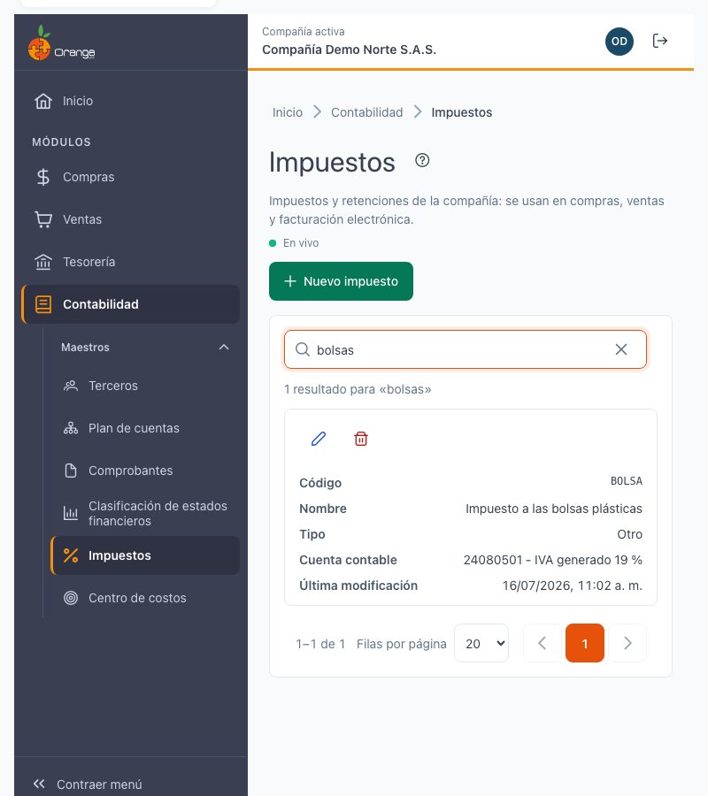
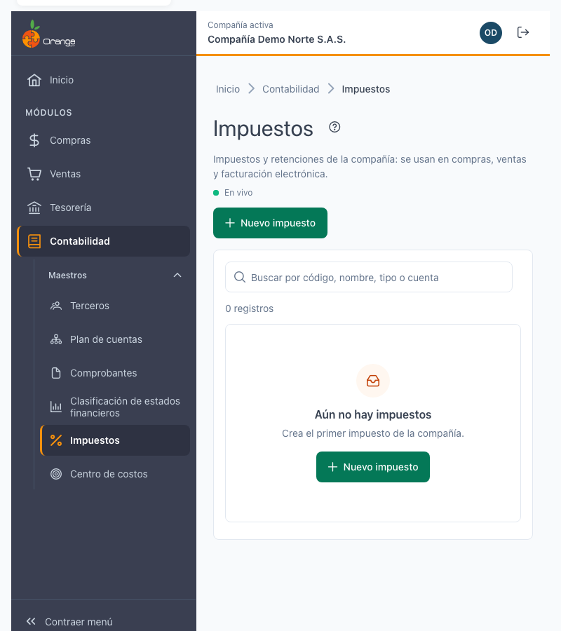
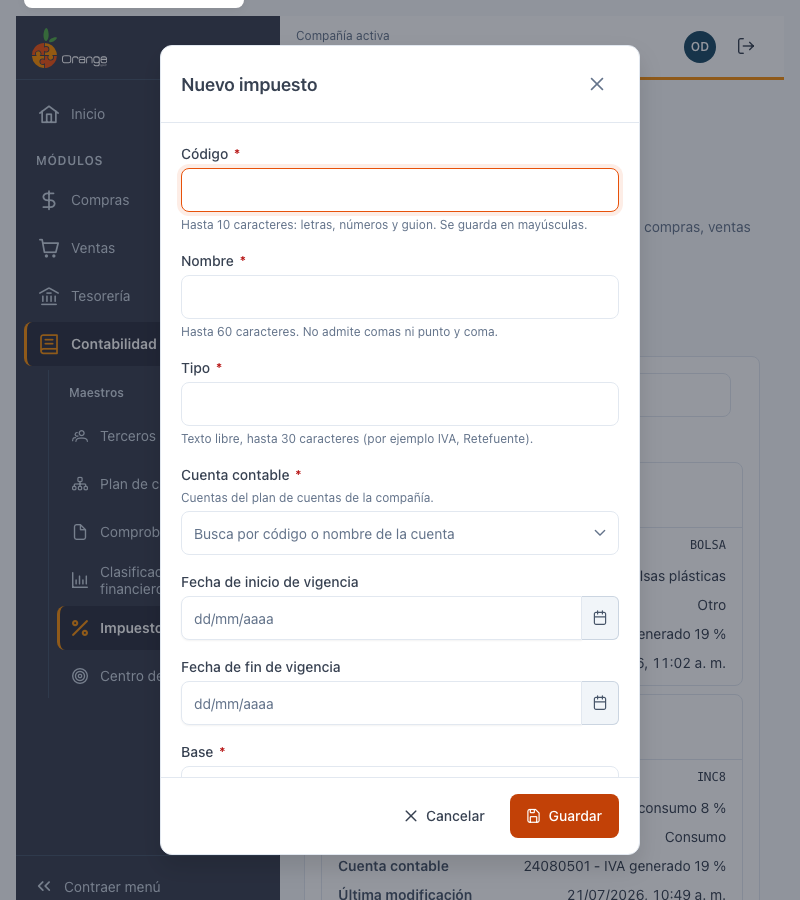
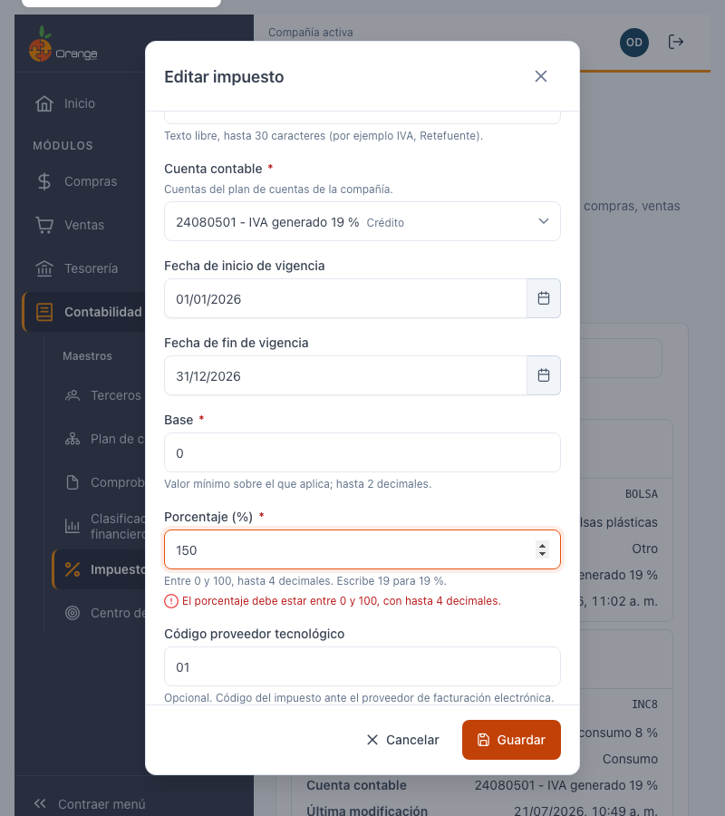
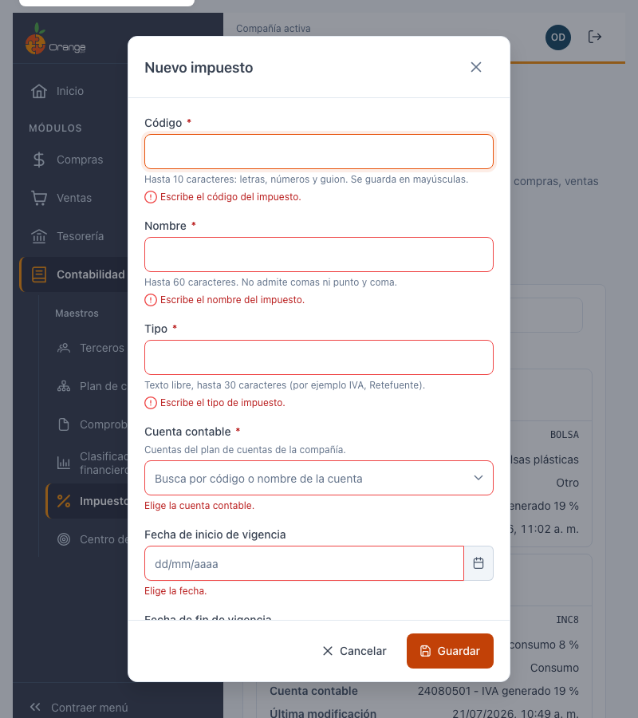
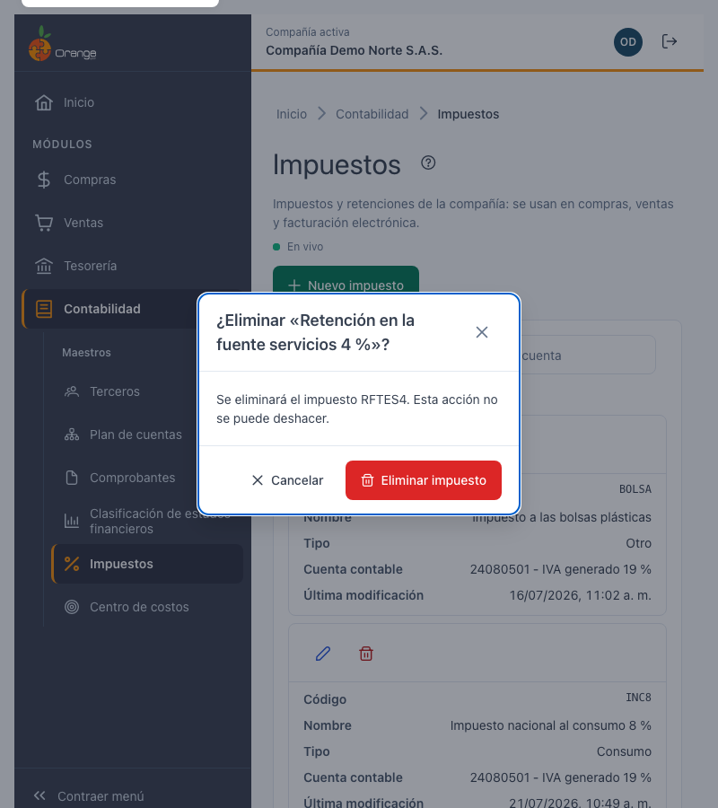
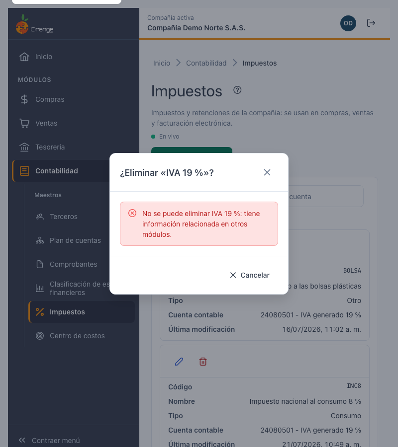

[Regresar a Contabilidad](readme.md)

---

# IMPUESTOS

## Qué es

Los **impuestos** son los impuestos y retenciones que usa la compañía en sus compras, sus ventas y su facturación electrónica. Cada impuesto tiene un código, un nombre, un tipo, una cuenta contable, una vigencia, una base y un porcentaje.

Desde aquí consulta, crea, edita y elimina los impuestos de su compañía. Los cambios se ven en los demás módulos que usan el impuesto.

## Cómo llegar

- Abra **Contabilidad** en el menú principal y luego **Maestros > Impuestos**.
- Necesita permiso de **Consultar** sobre Impuestos. Si no ve la opción, pida a su administrador que se lo asigne.

## Permisos

- **Consultar**: ve el listado y puede buscar, ordenar y paginar.
- **Crear**: ve el botón **Nuevo impuesto**.
- **Actualizar**: puede abrir un impuesto, cambiarlo y guardarlo.
- **Eliminar**: puede eliminar un impuesto.

Si solo tiene **Consultar**, no ve los botones de crear, editar ni eliminar.

## Pantalla principal

La pantalla muestra una tabla con las columnas **Código**, **Nombre**, **Tipo**, **Cuenta contable** (código y nombre) y **Última modificación**.

- **Buscar**: escriba parte del código, del nombre, del tipo o de la cuenta. No importan las mayúsculas ni las tildes.
- **Ordenar**: pulse el encabezado de una columna.
- **Páginas**: la tabla se divide en páginas, con controles de abajo.

Estados de la pantalla:

- **Cargando**: mientras se obtiene la lista.
- **Vacío**: la compañía todavía no tiene impuestos.
- **Sin resultados**: la búsqueda no encuentra nada. Cambie el texto para buscar de nuevo.
- **Error**: la lista no carga. Pulse **Reintentar**.

## Crear un impuesto

1. Pulse **Nuevo impuesto**.
2. Complete los campos del diálogo.
3. Pulse **Guardar**.

Campos:

- **Código**: obligatorio, hasta 10 caracteres. Solo admite letras, números y guion. Se guarda en mayúsculas.
- **Nombre**: obligatorio, hasta 60 caracteres. No admite comas ni punto y coma.
- **Tipo**: obligatorio, hasta 30 caracteres. Es un texto libre, por ejemplo, IVA o retención.
- **Cuenta contable**: obligatoria. Elija la cuenta con **Elegir** y busque por código o por nombre. Solo aparecen cuentas de su compañía.
- **Fecha de inicio de vigencia** y **Fecha de fin de vigencia**: obligatorias.
- **Base**: obligatoria. Es un número de 0 o más.
- **Porcentaje (%)**: obligatorio. Va de 0 a 100 y admite hasta 4 decimales. Escriba el número como se lee: **19** es 19 %.

- **Código proveedor tecnológico**: opcional. Es el código que el proveedor de facturación electrónica usa para este impuesto.

Revise que la fecha de fin de vigencia sea posterior a la de inicio: la pantalla no lo valida.

Si un campo no cumple, la pantalla lo señala y conserva lo que escribió en el diálogo.

## Editar un impuesto

1. Busque el impuesto y pulse **Editar** en su fila.
2. Cambie los datos que necesite.
3. Pulse **Guardar**.

El porcentaje se muestra como se lee (por ejemplo, **19**). Si edita un impuesto y no cambia el porcentaje, el porcentaje se conserva igual.

Si cambia el código de un impuesto que ya existía, la pantalla le avisa antes de guardar.

## Eliminar un impuesto

1. Pulse **Eliminar** en la fila del impuesto.
2. Revise los datos en el diálogo y confirme.

Si el impuesto ya se usa en movimientos, clientes, proveedores o referencias, no se elimina. La pantalla lo indica y el impuesto sigue en la lista.

## Cambios de otros usuarios en vivo

Si otro usuario crea, cambia o elimina un impuesto, la lista se actualiza sola, la fila cambiada se resalta y aparece un aviso.

## Preguntas frecuentes

**¿Por qué no veo el botón Nuevo impuesto?**
Su usuario no tiene permiso para crear. Pida a su administrador que se lo asigne.

**¿Cómo escribo un porcentaje de 19 %?**
Escriba **19**. No escriba el símbolo ni la fracción.

**¿Por qué no encuentro la cuenta contable?**
Solo aparecen cuentas de su compañía. Busque por código o por nombre. Si la cuenta aparece como **Cuenta no disponible**, elija otra.

**¿Qué pasa si cambio un impuesto que usan las compras o las ventas?**
Los cambios se verán en los módulos que usan el impuesto. Revise el porcentaje y la vigencia antes de guardar.

**¿Por qué no puedo eliminar un impuesto?**
Ya se usa en movimientos, clientes, proveedores o referencias. Mientras esté en uso, no se elimina.
