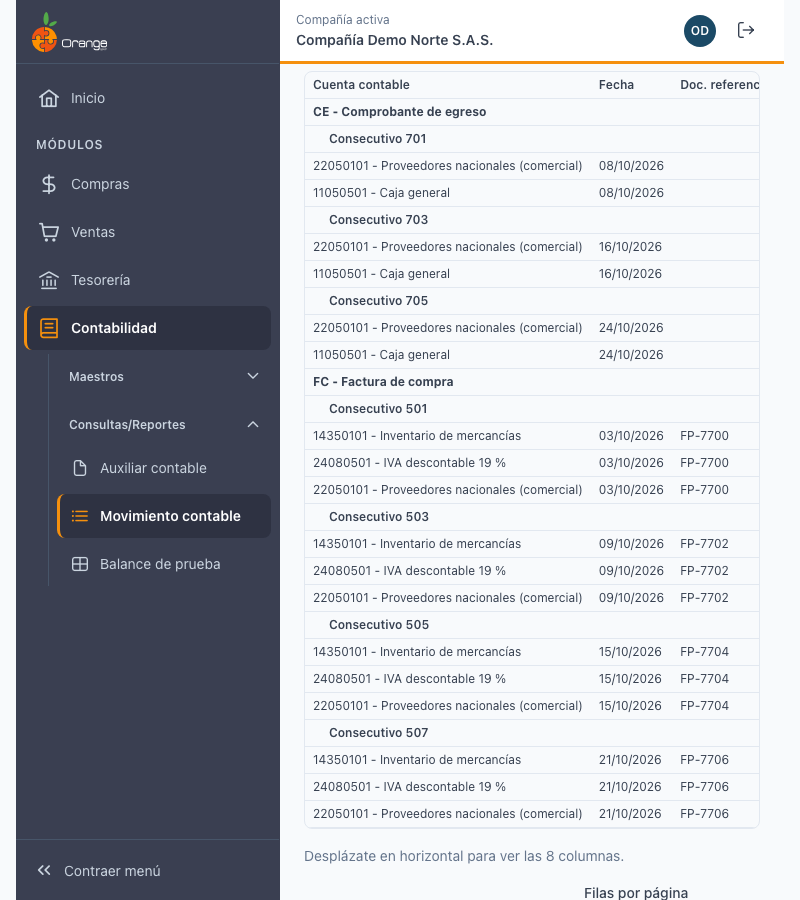
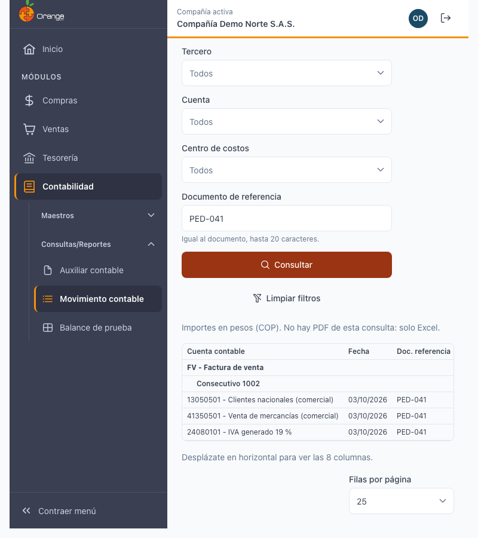
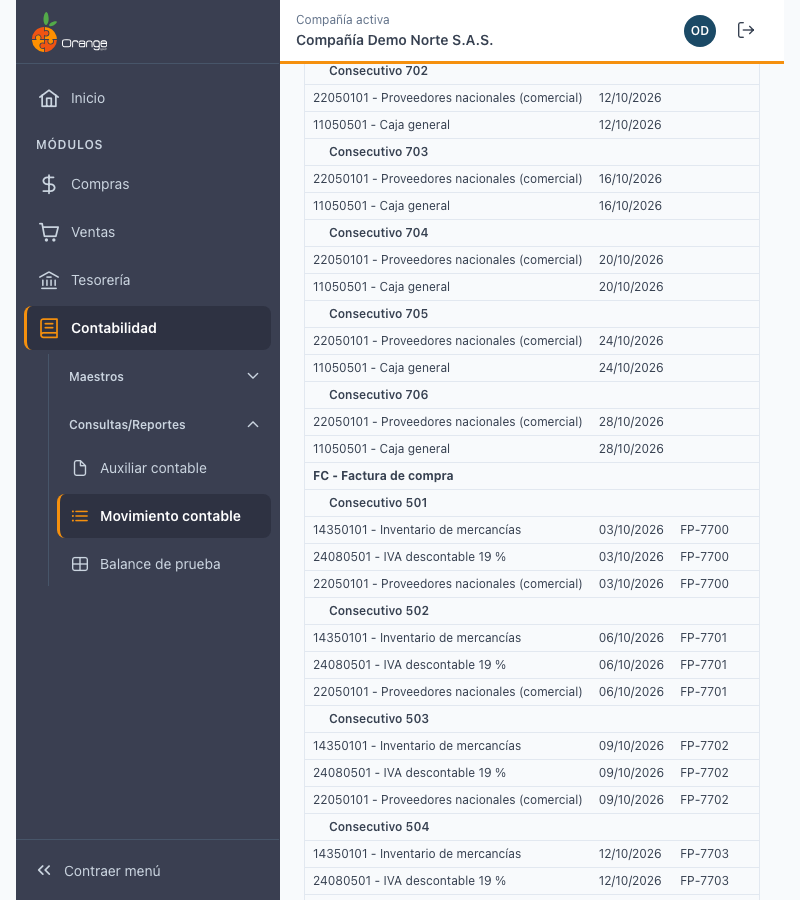

[Regresar a Contabilidad](readme.md)

---

# MOVIMIENTO CONTABLE

## Qué es

El **Movimiento contable** es el libro de las líneas contables de la compañía en un **período contable**. Dentro del período, usted elige las fechas de inicio y fin. Muestra las líneas de los movimientos contabilizados, con su cuenta, su tercero, su centro de costos, su documento de referencia y sus débitos y créditos. Puede verlas **agrupadas** por documento o **detalladas**, línea por línea.

Sirve para encontrar un movimiento concreto, por ejemplo el de un tercero, un tipo de movimiento o un documento de referencia.

La consulta no se ejecuta sola: usted elige los filtros y pulsa **Consultar**.

Para ver saldos y totales por cuenta y tercero, use el [Auxiliar contable](auxiliar-contable.md).

## Cómo llegar

- Abra **Contabilidad** en el menú principal y luego **Consultas/Reportes > Movimiento contable**.
- Necesita permiso de **Consultar** sobre el Movimiento contable. Si no ve la opción, pida a su administrador que se lo asigne.

## Permisos

- **Consultar**: puede usar los filtros, consultar y ver el resultado.
- **Exportar**: puede descargar el resultado en **Exportar Excel**.

Esta consulta **no tiene PDF**. Solo se puede exportar a Excel.

Sin **Exportar**, el botón **Exportar Excel** no está disponible. La consulta sigue funcionando.

## Filtros

El período y las fechas son obligatorios. Los demás filtros son opcionales: si se dejan vacíos, la consulta incluye todos los valores.

| Filtro | Qué hace |
|---|---|
| **Período** | Período contable de la consulta. Es obligatorio. La lista muestra cada período con su estado, **Abierto** o **Cerrado**, y tiene **Buscar período**. |
| **Fecha inicio** y **Fecha fin** | Rango de fechas dentro del período elegido. Son obligatorias y se habilitan al elegir el período. Al elegirlo, se llenan con su primer y último día, y usted puede acotarlas. Si una fecha queda fuera del período, o si la fecha inicio es posterior a la fecha fin, la pantalla lo indica y no consulta: **La fecha debe estar dentro del período ({inicio} a {fin}).** |
| **Tipo de movimiento** | Muestra solo los movimientos de ese tipo. Se elige uno. |
| **Tercero** | Muestra solo las líneas de ese tercero. Se elige uno. |
| **Cuenta** | Muestra solo las líneas de esa cuenta. Solo aparecen las cuentas de movimiento. Se elige una. |
| **Centro de costos** | Muestra solo las líneas de ese centro de costos. Se elige uno. |
| **Documento de referencia** | Texto. Muestra solo las líneas cuyo documento de referencia coincide con lo escrito, hasta 20 caracteres. |

Cuando combina filtros, la consulta muestra solo las líneas que cumplen **todos** los filtros que tiene puestos.

**Limpiar filtros** deja todos los filtros vacíos, salvo las fechas.

## Cómo se lee el resultado

La tabla muestra estas columnas:

- **Cuenta contable**: código y nombre de la cuenta.
- **Fecha**.
- **Doc. referencia**: el documento de referencia de la línea.
- **Tercero**: documento y nombre del tercero. Si la línea no tiene tercero, aparece **—**.
- **Centro de costos**: código y nombre del centro. Si la línea no tiene centro, aparece **—**.
- **Débitos** y **Créditos**.
- **Base tributaria**.

Las filas se agrupan por **tipo de movimiento** y, dentro de cada tipo, por **consecutivo**. Cada grupo tiene un encabezado con el tipo (código y nombre) o el consecutivo. Cuando la tabla cambia de página, el encabezado del grupo vuelve a aparecer al inicio de la página.

Los importes están en pesos (COP), con separador de miles y dos decimales. Un importe en cero aparece vacío.

La consulta no muestra totales en la pantalla. Si necesita sumas, use el Excel o el [Auxiliar contable](auxiliar-contable.md).

### Vista: Agrupado o Detallado

Encima de la tabla, la opción **Vista** tiene dos valores:

- **Agrupado** (es la vista por defecto): dentro de cada documento, las líneas con igual cuenta, tercero, centro de costos y documento de referencia se suman en una sola fila. La fila indica cuántas líneas se fusionaron (por ejemplo, **3 líneas**).
- **Detallado**: una fila por cada línea del asiento, tal como se registró.

Al cambiar de vista, la pantalla vuelve a consultar desde la primera página con los filtros que ya tiene aplicados. Los filtros que cambió pero no consultó no se aplican.

El **Excel usa la vista activa**: si está en **Agrupado**, el archivo trae las filas agrupadas; si está en **Detallado**, trae cada línea.

### Páginas

La tabla muestra 25 filas por página. Puede cambiar a 10, 50 o 100 filas por página, y ver el total de filas y la página en la que está.

## Qué líneas aparecen

- Solo aparecen los movimientos **contabilizados**. Los movimientos **anulados** y los que **no afectan la contabilidad** no aparecen en el resultado.
- Las líneas de un movimiento se muestran con la fecha del movimiento.

## Consultar

1. Elija el **Período**.
2. Elija las fechas de inicio y fin dentro de ese período.
3. Elija los filtros que necesite; los demás déjelos vacíos.
4. Elija la **Vista**: **Agrupado** (por defecto) o **Detallado**.
5. Pulse **Consultar**. Mientras se consulta, la pantalla muestra **Consultando…**.
6. Revise el resultado y cambie de página con los controles de abajo.

Si cambia un filtro, pulse **Consultar** otra vez para ver el resultado nuevo.

Si no hay movimientos con esos filtros, la pantalla muestra **No hay movimientos con esos filtros**. Cambie el rango de fechas o quite algún filtro.

Si la consulta falla, la pantalla muestra **No se pudo consultar** con el botón **Reintentar**. Sus filtros se conservan.

## Exportar a Excel

- Necesita permiso de **Exportar**.
- Pulse **Exportar Excel**. Se descarga una hoja de Excel con el encabezado de la compañía, el título **Movimiento contable**, la fecha y hora de la exportación y el usuario que exporta.
- La hoja tiene estas columnas: **Tipo de movimiento** (código y nombre), **Consecutivo**, **Cuenta contable** (código y nombre), **Fecha**, **Doc. referencia**, **Tercero**, **Centro de costos**, **Débitos**, **Créditos** y **Base tributaria**. Los importes se guardan como números.
- La exportación usa los filtros que tiene puestos al pulsar el botón y la **Vista** activa (Agrupado o Detallado). Si cambió algún filtro, consulte otra vez antes de exportar.
- El límite es de **50.000 filas**.

### Si el resultado es demasiado grande

Si el resultado supera las 50.000 filas, la pantalla no genera el archivo y muestra un aviso como este:

> El resultado tiene más de 50.000 filas y no se puede exportar a Excel. Acote el rango de fechas o los filtros e inténtelo de nuevo.

Acote el rango de fechas o agregue filtros, consulte otra vez y exporte de nuevo.

Mientras se genera el archivo, la pantalla muestra **Generando el archivo…**. Si la generación falla, aparece **No se pudo generar el archivo. Inténtelo de nuevo.** y no se descarga nada.

## Preguntas frecuentes

**¿Por qué no veo un movimiento que sé que se registró?**
Solo aparecen los movimientos contabilizados. Si el movimiento está anulado, o no afecta la contabilidad, no aparece. Revise también las fechas y los filtros.

**¿Por qué no hay botón PDF?**
Esta consulta no tiene PDF. Para un documento impreso, exporte a Excel o use el [Auxiliar contable](auxiliar-contable.md), que sí tiene PDF.

**¿Por qué no veo Exportar Excel?**
Su usuario no tiene el permiso de **Exportar** sobre el Movimiento contable. Pida a su administrador que lo revise.

**¿Por qué no aparece la cuenta que busco en el filtro de cuenta?**
El filtro solo muestra cuentas de movimiento, que son las que reciben registros contables. Las cuentas de mayor no aparecen en esta lista.

**¿Por qué veo menos filas que líneas en el asiento?**
Está en la vista **Agrupado**. Las líneas con igual cuenta, tercero, centro y documento de referencia dentro del mismo documento se suman en una fila. Cambie a **Detallado** para verlas una por una.

**¿Por qué el Excel tiene menos filas que la vista Detallado?**
El Excel usa la vista activa. Si exporta en **Agrupado**, el archivo trae las filas agrupadas.

**¿Por qué no puedo consultar un rango que cruza dos períodos?**
Cada consulta trabaja con un solo período. Si necesita dos períodos, consulte cada uno por separado.

**¿Por qué no encuentro un documento de referencia que escribí?**
El filtro busca el documento tal como lo escribió, hasta 20 caracteres. Revise que lo haya escrito igual que aparece en el movimiento.

**¿Dónde veo los saldos de una cuenta?**
En el [Auxiliar contable](auxiliar-contable.md), o en la ficha de la cuenta del [Plan de cuentas](plan-cuentas.md).
