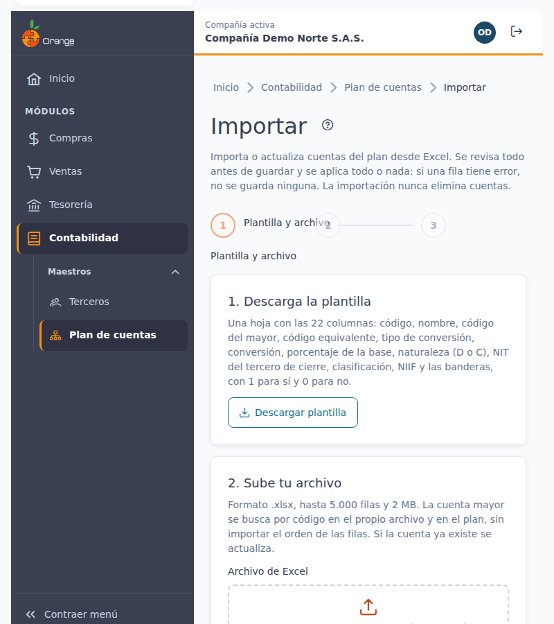
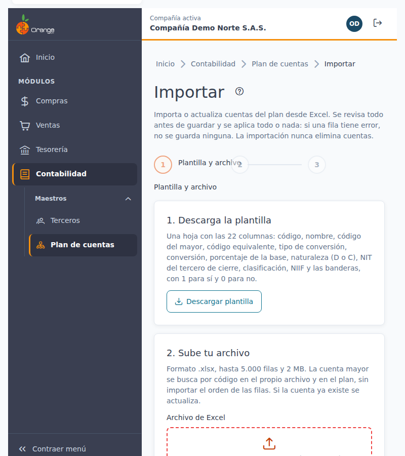
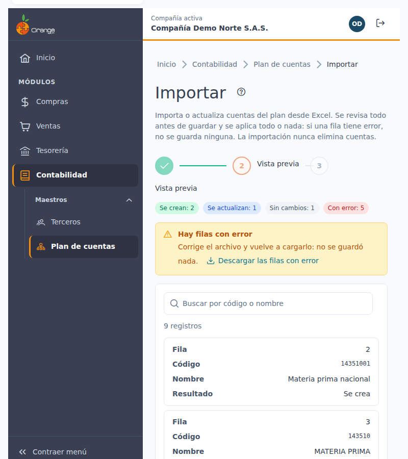
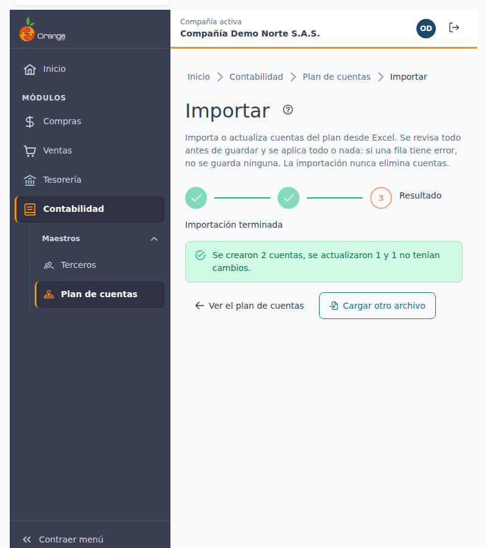

[Regresar a Contabilidad](readme.md)

---

# IMPORTAR EL PLAN DE CUENTAS

## Qué es

La importación carga muchas cuentas del Plan de cuentas desde un archivo de Excel. Sirve para crear cuentas nuevas y para actualizar cuentas que ya existen.

La importación **nunca elimina cuentas**. Tampoco cambia una columna que deje vacía (ver [Celdas vacías y ceros](#celdas-vacias-y-ceros)).

## Cómo llegar

- Abra **Contabilidad** en el menú principal y luego **Maestros > Plan de cuentas**.
- Pulse **Importar** en el listado.
- Necesita permiso de **Exportar** sobre el Plan de cuentas. Si no ve el botón **Importar**, pida a su administrador que se lo asigne.

La importación tiene tres pasos, que se ven arriba de la pantalla: **Plantilla y archivo**, **Vista previa** y **Resultado**.

## Paso 1: descargar la plantilla y cargar el archivo

1. Pulse **Descargar plantilla**. Es una hoja de Excel con las 22 columnas del plan: código, nombre, código del mayor, código equivalente, tipo de conversión, conversión, porcentaje de la base, naturaleza (D o C), NIT del tercero de cierre, clasificación, NIIF y las banderas.
2. Complete la hoja. Las banderas se escriben con **1** para sí y **0** para no.
3. Arrastre el archivo a la pantalla o elíjalo desde su equipo.

Reglas del archivo:

- Formato **.xlsx**, con hasta **5.000 filas** y **2 MB**. Si supera alguno de los dos límites, la pantalla no lo lee y le pide dividirlo en varios archivos.
- Se usa la primera hoja. La primera fila tiene los encabezados de la plantilla.
- El **código** es obligatorio, hasta 20 caracteres. El **nombre** es obligatorio, hasta 200 caracteres.
- La **cuenta mayor** se busca por código, en el propio archivo y en el plan. No importa el orden de las filas: una cuenta puede aparecer antes que su mayor.
- Si el código ya existe en la compañía, la cuenta se **actualiza**. Si no existe, se **crea**.

Si el archivo no es un Excel válido o no tiene las columnas de la plantilla, la pantalla lo dice y no lo procesa. Si no tiene filas con datos, dice **El archivo no tiene filas con datos.**

## Paso 2: revisar la vista previa

Antes de guardar, la pantalla revisa todas las filas y muestra una **vista previa** por fila, con su número de fila y su resultado:

- **Se crea**: la cuenta es nueva.
- **Se actualiza**: la cuenta ya existe y tiene cambios.
- **Sin cambios**: la cuenta ya está igual en el plan.
- **Error**: la fila tiene un problema, con el motivo al lado.

Arriba aparecen los conteos: **Se crean**, **Se actualizan**, **Sin cambios** y **Con error**. La vista previa no guarda nada.

### Filas con error

Si hay filas con error, la pantalla muestra **Hay filas con error** y el botón **Aplicar** queda deshabilitado. Para corregirlas:

1. Pulse **Descargar las filas con error**.
2. Corrija esas filas en su Excel.
3. Pulse **Cargar otro archivo** y vuelva a cargar el archivo corregido.

Los motivos más comunes:

- **El código está repetido en el archivo.**
- **La cuenta mayor no existe en el archivo ni en el plan.**
- **El código debe empezar por el código del mayor.**
- **La naturaleza debe ser D o C.**
- **Debe ser 1 o 0.** Cualquier otro valor en una bandera es un error; no se toma como no.
- **Una cuenta no puede ser su propio mayor.**
- **El código equivalente no existe en el plan.**
- **El tercero de cierre no existe.**
- **El Tercero seleccionado no está activo.**
- **El mayor es una cuenta de movimiento.**
- **El documento de referencia obligatorio exige documento de referencia.**
- **La base exige un porcentaje mayor que 0.**

Las reglas son las mismas que al crear o editar una cuenta en la pantalla (ver [Plan de cuentas](plan-cuentas.md)).

## Paso 3: aplicar la importación

Cuando no quede ninguna fila con error, pulse **Aplicar** con el número de cuentas que se van a crear o actualizar (por ejemplo, **Aplicar 40 cuentas**).

La importación es **todo o nada**: si algo falla al aplicar, no se guarda ninguna fila. Mientras se aplica, la pantalla muestra **Aplicando la importación…**.

Al terminar, la pantalla muestra el resultado, por ejemplo: **Se crearon 35 cuentas, se actualizaron 5 y 2 no tenían cambios.** Desde ahí pulse **Ver el plan de cuentas** para revisarlas.

Si no hay nada que aplicar, porque todas las filas ya están igual en el plan, la pantalla lo indica y no hay nada que guardar.

## Celdas vacías y ceros

Esta regla es importante cuando actualiza cuentas existentes:

- Una **celda vacía no cambia** el valor que la cuenta ya tiene. Así puede cargar solo las columnas que quiere modificar.
- Para **apagar** una bandera o poner un valor en cero, escriba **0** en la celda. Por ejemplo, para quitar la bandera **Maneja tercero** de una cuenta, escriba **0** en esa columna.

## Si algo sale mal

- **Otro usuario cambió el plan mientras revisaba el archivo**: la pantalla dice **La importación ya no es válida**. No se guardó nada. Pulse **Volver a cargar el archivo** para revisar otra vez.
- **Error del servidor**: la pantalla dice **No se pudo aplicar la importación** y que no se guardó nada. Pulse **Reintentar**.
- **Sin permiso**: si no tiene permiso de **Exportar**, la pantalla le indica que importar requiere ese permiso.

## Preguntas frecuentes

**¿Puedo borrar cuentas con la importación?**
No. La importación solo crea o actualiza. Para eliminar una cuenta, use **Eliminar** en el listado.

**¿Por qué no se guardó ninguna cuenta si solo había una fila mala?**
La importación es todo o nada. Si una fila tiene error, no se guarda ninguna. Corrija la fila y vuelva a cargar el archivo.

**¿Por qué el botón Aplicar está deshabilitado?**
Hay filas con error. Descargue las filas con error, corríjalas y cargue el archivo otra vez.

**¿Cómo cargo más de 5.000 cuentas?**
Divida el archivo en varios archivos de hasta 5.000 filas y 2 MB, y cargue cada uno.
