[Regresar a Contabilidad](readme.md)

---

# PLAN DE CUENTAS

## Qué es

El **Plan de cuentas** es la lista de cuentas contables de la compañía, con su código, su nombre, su naturaleza (débito o crédito) y sus reglas. Desde aquí crea, edita y organiza las cuentas, y consulta lo que cada cuenta movió por período.

Dos tipos de cuenta:

- **Cuenta de mayor**: agrupa otras cuentas. No recibe registros contables.
- **Cuenta de movimiento**: es la que recibe los registros contables. No puede tener cuentas hijas.

## Cómo llegar

- Abra **Contabilidad** en el menú principal y luego **Maestros > Plan de cuentas**.
- Necesita permiso de **consulta** sobre el Plan de cuentas. Si no ve la opción, pida a su administrador que se lo asigne.

## Pantalla principal

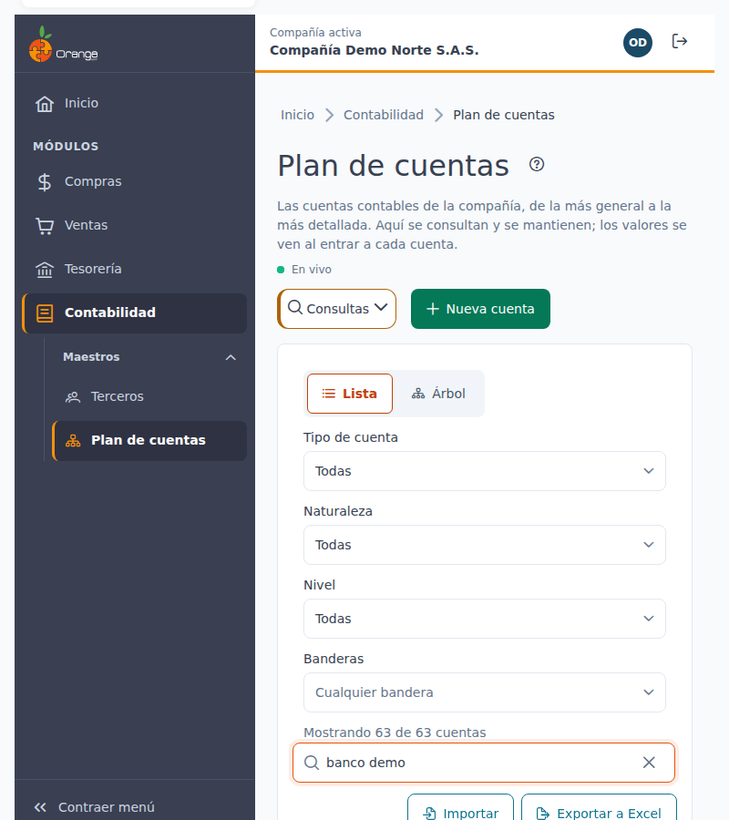

Por defecto, el plan se ve como **lista**: una fila por cuenta, con su código, nivel, nombre, naturaleza, tipo, banderas y la fecha de la última modificación. El código aparece con sangría según su nivel, para ver de un vistazo qué cuentas dependen de cuáles.

La lista muestra solo los datos de la cuenta. **No muestra saldos ni movimientos.** Así la lista carga rápido y se ve igual para todos los usuarios. Para ver los valores de una cuenta, ábrala: sus movimientos y sus saldos por tercero están en la ficha (ver [Movimientos y saldos por tercero](#movimientos-y-saldos-por-tercero)).

Lo que ve depende de sus permisos:

- **Consultar**: ve la lista, el árbol, las fichas y las consultas. No ve los botones de crear, editar, eliminar, importar ni exportar.
- **Crear**: ve el botón **Nueva cuenta**.
- **Actualizar**: puede abrir una cuenta, cambiarla y **Guardar**. Si solo tiene consulta, la ficha dice **Solo consulta: no tienes permiso para modificarla.**
- **Eliminar**: puede eliminar cuentas desde la lista o desde la ficha.
- **Exportar**: ve **Exportar a Excel** e **Importar**.
- **Imprimir**: puede imprimir en PDF el auxiliar de una cuenta (ver [Consultas](#consultas-y-exportaciones)).

Si no hay cuentas, la pantalla muestra **Aún no hay cuentas**. Si el filtro no encuentra nada, muestra **Ninguna cuenta cumple los filtros**. Si la lista no carga, aparece un aviso con **Reintentar**; sus filtros se conservan.

## Buscar y filtrar

- **Buscar**: escriba una parte del código o del nombre. No importan las mayúsculas ni las tildes.
- **Tipo de cuenta**, **Naturaleza** y **Nivel**: elija una opción para ver solo esas cuentas. Los niveles son: 1 · Clase (1 dígito), 2 · Grupo (2 dígitos), 3 · Cuenta (4 dígitos), 4 · Subcuenta (6 dígitos) y 5 · Auxiliar (8 dígitos).
- **Banderas**: elija una o más banderas (por ejemplo, **Maneja tercero**) para filtrar por su comportamiento.
- **Limpiar filtros**: quita todos los filtros.

Debajo de los filtros aparece el conteo, por ejemplo **Mostrando 25 de 240 cuentas**.

Para ordenar, pulse el título de una columna. Las cuentas se muestran por código.

## Ver el plan como árbol

Use el interruptor **Lista / Árbol** para cambiar de vista.

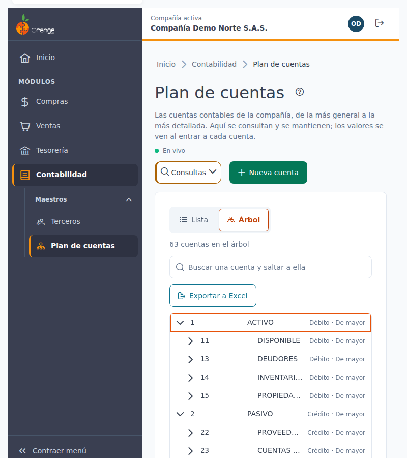

El **árbol** muestra las cuentas por niveles, de la clase a la cuenta auxiliar. Cada cuenta de mayor se puede expandir o contraer.

- **Buscar en el árbol**: escriba un código o un nombre. El árbol expande solo las ramas que tienen coincidencias. Use **Coincidencia anterior** y **Siguiente coincidencia** para moverse entre ellas.
- **Teclado**: use las flechas para moverse, y las flechas de la derecha e izquierda para expandir y contraer.
- **Sin mayor válido**: al final del árbol aparece una rama con las cuentas cuyo mayor no existe en su compañía. Conviene revisar el mayor de esas cuentas.

La vista que elija se recuerda para su usuario en este navegador.

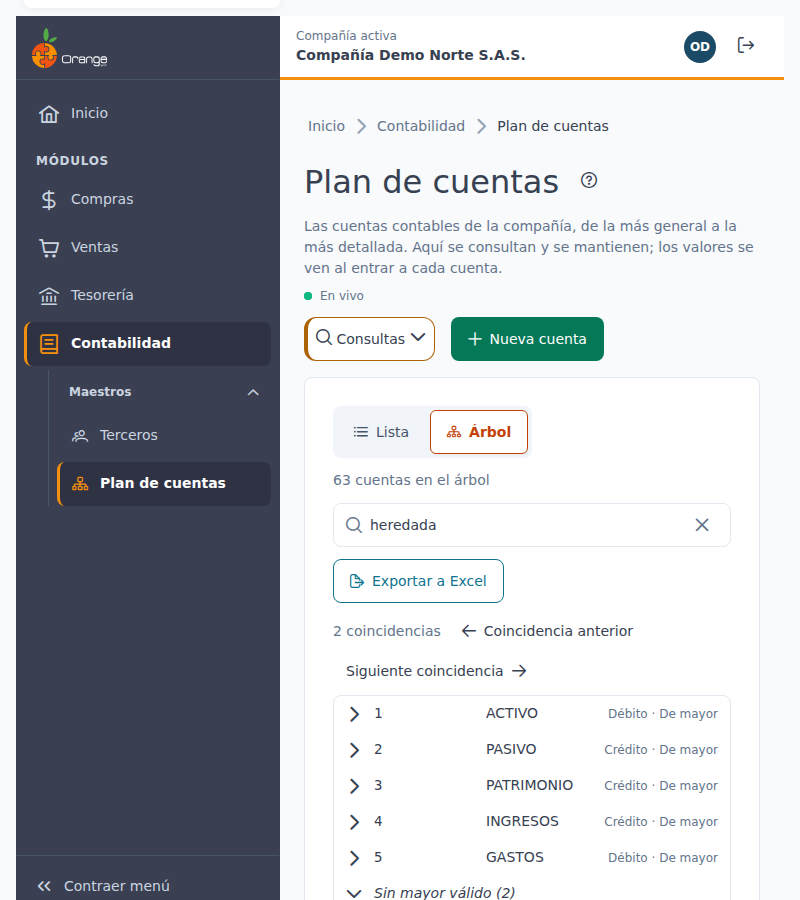

## Crear una cuenta

1. Pulse **Nueva cuenta**.
2. Elija la **Cuenta mayor** con **Elegir mayor**. Se abre el árbol: solo se pueden elegir cuentas de mayor. La cuenta que está creando y sus descendientes no aparecen como elegibles. Si es una cuenta raíz, elija **Sin mayor (cuenta raíz)**.
3. La pantalla propone un **código**, bajo el mayor elegido. Puede cambiarlo; se revisa al guardar.
4. Complete el **Nombre**, la **Naturaleza** (Débito o Crédito) y el **Tipo de cuenta** (de movimiento o de mayor).
5. Marque las banderas en la pestaña **Comportamiento**.
6. Pulse **Guardar**.

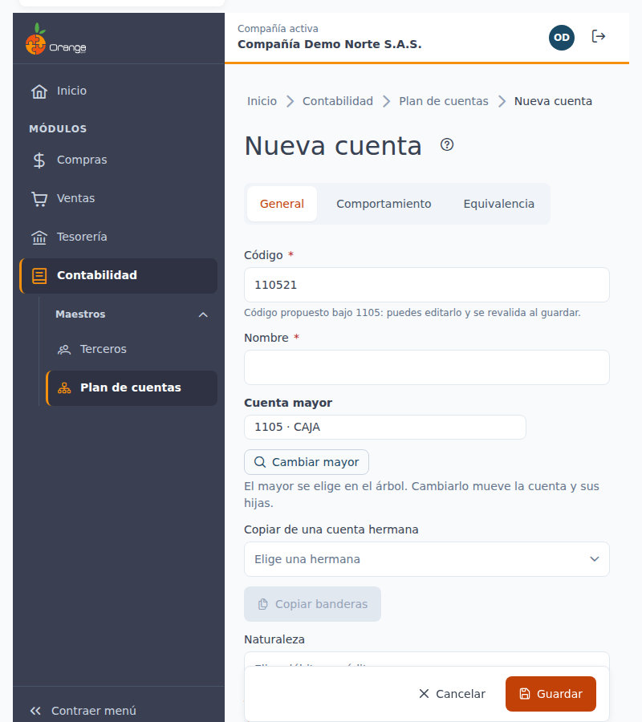

### Copiar las banderas de una cuenta hermana

Si la cuenta nueva se parece a otra del mismo nivel, use **Copiar de una cuenta hermana**: elija la cuenta y pulse **Copiar banderas**.

- Se precargan la naturaleza, la clasificación, el NIIF y las banderas de la cuenta elegida.
- No se copian el código, el nombre ni la cuenta equivalente.
- Nada se guarda hasta que pulse **Guardar**. Revise los valores antes.

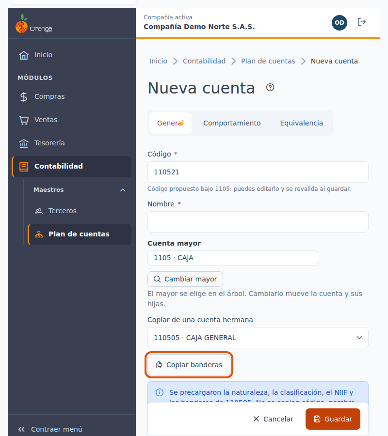

### Reglas al guardar

La pantalla le avisa antes de guardar si algo no cumple. Las reglas son:

- **Código**: hasta 20 caracteres. En una cuenta nueva debe empezar por el código de su mayor, ser más largo que él y no estar repetido en la compañía (no importan las mayúsculas).
- **Nombre**: obligatorio, hasta 200 caracteres.
- **Naturaleza**: obligatoria al crear.
- **Cuenta con hijas**: no puede ser de movimiento. Cámbiela a cuenta de mayor.
- **Documento de referencia obligatorio**: exige que la cuenta maneje documento de referencia.
- **Base tributaria**: exige un porcentaje mayor que 0. El porcentaje va de 0 a 100: escriba **19** para el 19 %. Si hay porcentaje sin base, marque la base o déjelo en 0.
- **Tercero de cierre**: solo se elige en las cuentas marcadas como **Cierre**.

Estas reglas se revisan solo cuando guarda una cuenta nueva o editada. Las cuentas que ya existían con datos que hoy no cumplen siguen funcionando. Puede revisarlas con la consulta [Cuentas con banderas incoherentes](#consultas-y-exportaciones).

## Editar una cuenta

1. Busque la cuenta en la lista o en el árbol y ábrala.
2. Cambie los datos que necesite, en la pestaña que corresponda.
3. Pulse **Guardar**.

Si cambia algo y sale sin guardar, la pantalla le pregunta **¿Salir sin guardar?**. Si sale, se pierden los cambios.

Si otro usuario cambia la misma cuenta mientras usted la edita, la pantalla le avisa. Puede seguir con sus cambios o pulsar **Recargar la cuenta**.

### Cambios que afectan los movimientos

Antes de guardar un cambio de **naturaleza**, de **tipo de cuenta** o de **mayor**, la pantalla revisa cuántos movimientos y saldos tiene la cuenta.

- **Con movimientos o saldos con valor**: la pantalla muestra cuántos hay y **Guardar** queda bloqueado con el motivo. Por ejemplo: **Afecta 12 movimientos y 3 saldos con valor. Mientras tenga uso no se puede cambiar.**
- **Sin movimientos ni saldos**: puede guardar, pero antes la pantalla le pide **Confirmar el cambio**.

Otras reglas de edición:

- **Código**: una cuenta con cuentas hijas no puede cambiar de código, porque rompería el código de sus hijas.
- **Mover a otro mayor**: solo se puede mover dentro del mismo prefijo. El código de la cuenta debe empezar por el código del nuevo mayor. Si la cuenta o sus descendientes tienen movimientos o saldos con valor, el movimiento queda bloqueado.
- **Cambiar a cuenta de mayor**: si la cuenta tiene movimientos, queda bloqueado.

El servidor vuelve a revisar estas reglas al guardar. Si un cambio queda bloqueado, la pantalla muestra el motivo y no cambia nada.

## Las pestañas de la ficha

Al crear, la ficha tiene tres pestañas: **General**, **Comportamiento** y **Equivalencia**. Al editar, aparecen también **Movimientos**, **Saldos por tercero**, **Jerarquía** e **Historial**.

### General

Aquí están el **Código**, el **Nombre**, la **Cuenta mayor**, la **Naturaleza**, el **Tipo de cuenta** y la **Clasificación de estados financieros**. La clasificación se muestra solo para consulta: se conserva al guardar.

El campo **NIIF** no se edita aquí: aparece como solo lectura y se cambia en la pestaña **Equivalencia**.

### Comportamiento

Las banderas están agrupadas por lo que controlan. Cada una tiene una ayuda corta, y al final la pantalla resume en una frase lo que la cuenta exige. Por ejemplo: **Pide tercero y documento de referencia; exige centro de costos.**

- **Terceros y documentos**: Maneja tercero · Maneja documento de referencia · Documento de referencia obligatorio.
- **Impuestos y base**: Maneja base tributaria (con el **Porcentaje de la base**) · Genera certificado de retención.
- **Banco y cartera**: Es de caja o banco · Es de cartera · Admite anticipos.
- **Cierre y activos**: Es cuenta de cierre (con el **Tercero de cierre**, si lo elige) · Es de activos fijos · Maneja centro de costos.

Una cuenta de cierre sin tercero de cierre usa el de ganancias y pérdidas.

### Equivalencia

Aquí se edita la **Cuenta equivalente** (solo cuentas de esta compañía), el **Tipo de conversión**, la **Conversión** y el **NIIF**.

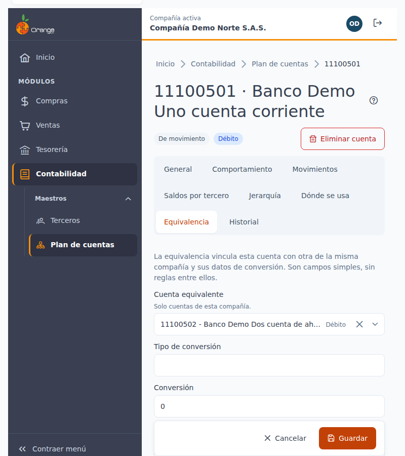

### Jerarquía

Muestra la **Cuenta mayor** de la cuenta, su nivel, sus **Hijas directas** y su lugar en el árbol. Desde aquí puede **Mover bajo otro mayor**, con las reglas de la sección anterior.

Si la cuenta tiene un mayor que no existe en su compañía, la pestaña dice **Su mayor no existe en esta compañía**.

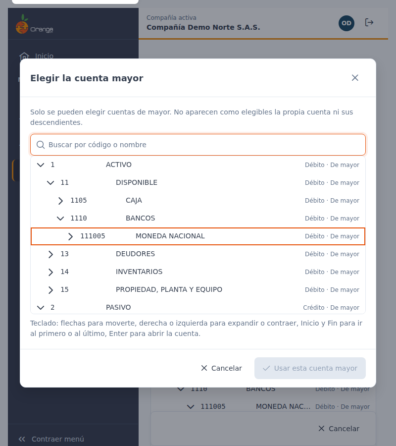

## Movimientos y saldos por tercero

Estas dos pestañas son las únicas donde se ven valores de la cuenta. Se consultan al abrirlas, no al abrir la ficha, y necesitan permiso de **consulta**.

### Movimientos

Es el libro de la cuenta por período contable.

1. Elija el **Período**. Viene seleccionado el período actual. Un período cerrado aparece marcado como **Período cerrado**.
2. Use los filtros **Tercero**, **Centro de costos** y **Tipo de movimiento** si necesita acotar.
3. Revise la tabla: fecha, tipo de movimiento, consecutivo, documento de referencia, tercero, centro de costos, descripción, débito, crédito y saldo acumulado.

Los totales de arriba son de **toda la cuenta en el período**, no de la página que ve: saldo inicial, débitos, créditos, neto (D − C) y saldo final. El saldo final es el saldo inicial, más débitos, menos créditos.

Si la cuenta es de mayor, la pestaña le recuerda que solo se ven sus movimientos directos, no los de sus cuentas hijas.

Para ver más detalle, pulse **Abrir el auxiliar completo**.

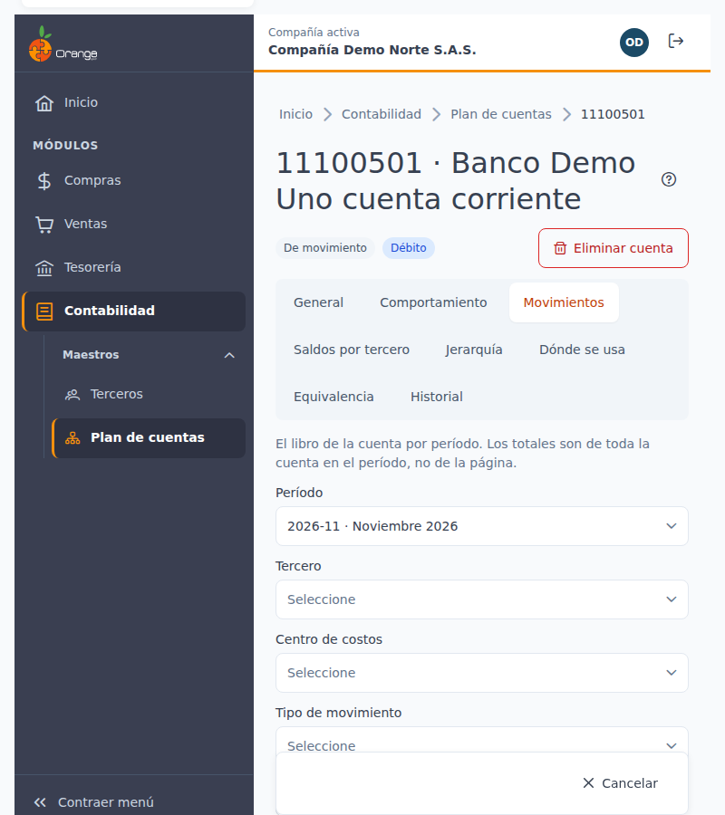

### Saldos por tercero

Muestra, para cada tercero con saldo en la cuenta, su documento, su nombre y sus valores del período. Use **Buscar un tercero** para encontrar uno.

Los saldos se leen del cierre del período; no se recalculan desde los movimientos. Por eso, si el período todavía no tiene cierre, la pantalla muestra **Todavía no hay saldos de este período** y explica que aparecerán cuando se cierre el período anterior.

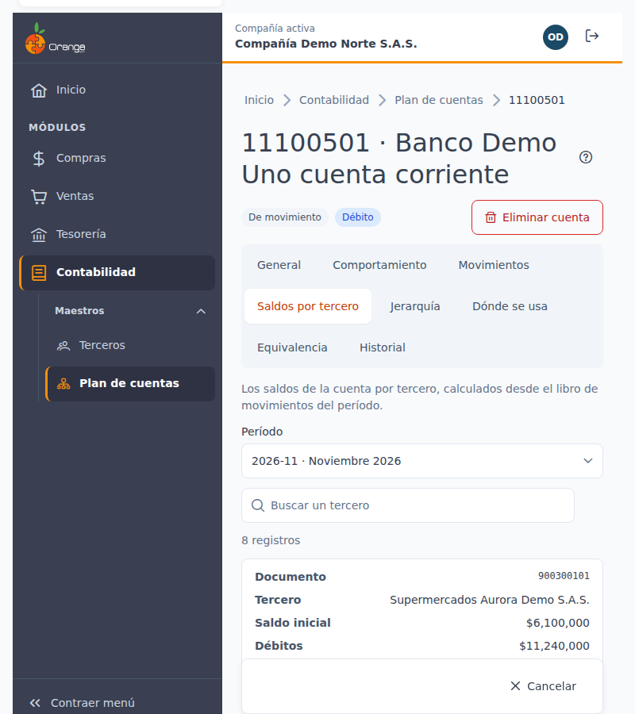

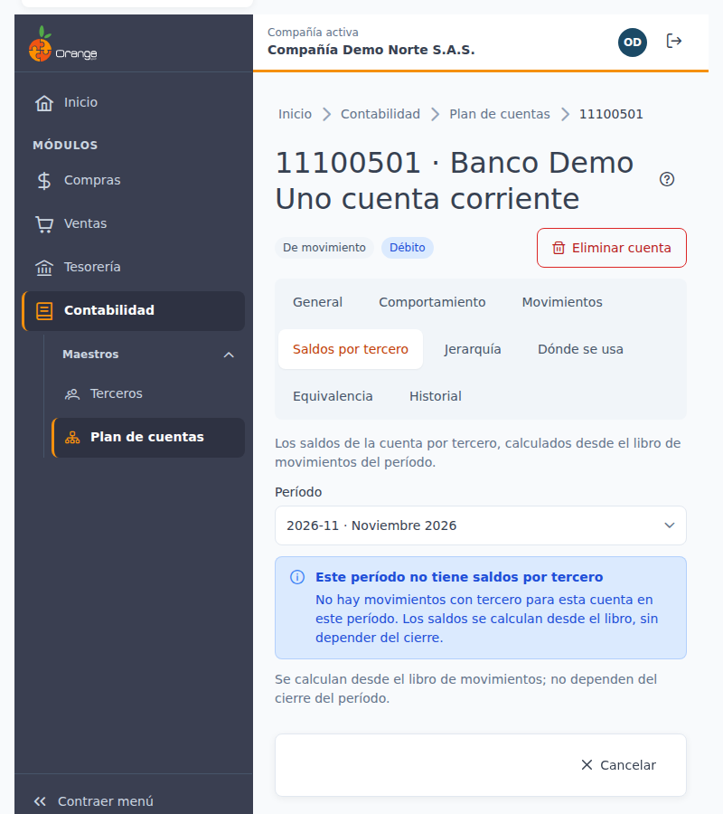

### Estados comunes

- **Sin períodos contables**: la compañía todavía no tiene períodos. Pida a Contabilidad que los cree.
- **Cuenta sin movimientos**: la tabla dice **Esta cuenta no tiene movimientos en el período.** Pruebe con otro período.
- **Error**: aparece el aviso **No se pudieron cargar los movimientos** con **Reintentar**. El período elegido se conserva.

## Historial

La pestaña **Historial** muestra **El historial aún no está disponible**. Todavía no se puede consultar la bitácora de la cuenta desde esta pantalla. Los cambios se registran igual; cuando la consulta esté lista, aparecerán aquí.

## Eliminar una cuenta

Puede eliminar una cuenta desde la lista (con **Eliminar** en su fila) o desde la ficha (con **Eliminar cuenta**).

1. Pulse **Eliminar** y confirme en el diálogo con **Eliminar cuenta**.

Si la cuenta no tiene uso, se elimina. Si la cuenta tiene filas de saldo en cero que genera el cierre de períodos, esas filas también se eliminan, porque no tienen valores ni movimientos. Esta acción no se puede deshacer.

### Cuando la cuenta está en uso

No se elimina nada. La pantalla muestra **No se puede eliminar** y, para cada tipo de uso, cuántos registros lo tienen. Por ejemplo:

- Movimientos contables y líneas de detalle de movimientos.
- Saldos con valor.
- Cuentas hijas.
- Cuentas que la tienen como mayor o como equivalente.
- Referencias, tipos de movimiento, terceros, acumulados o empleados que la usan en su configuración.
- Notas bancarias y sus conceptos.
- Otras configuraciones, como formas de pago, impuestos o grupos.

Para poder eliminarla, primero libere cada uso.

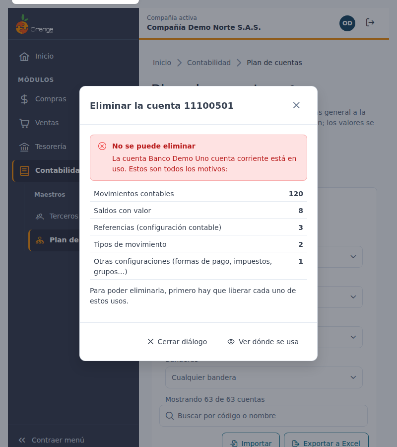

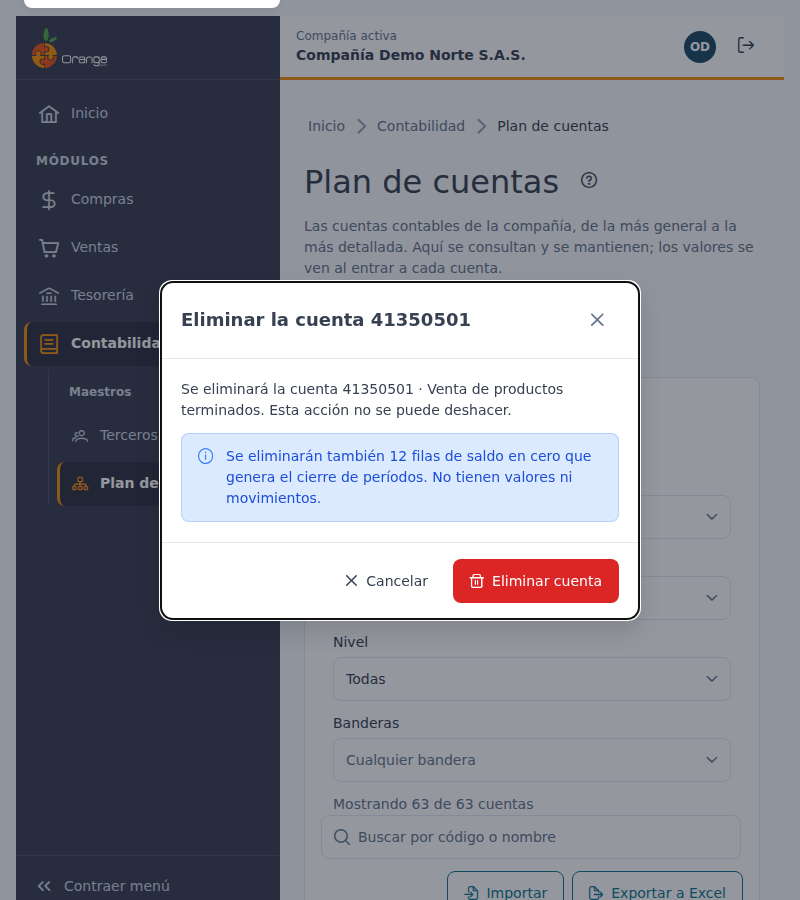

## Consultas y exportaciones

El botón **Consultas** del listado abre tres consultas. Necesita permiso de **consulta**.

- **Auxiliar de la cuenta**: el libro de una cuenta en un rango de períodos, a pantalla completa. Elija la cuenta, el **Período desde** y el **Período hasta**, y pulse **Consultar**. Si el período inicial es posterior al final, la pantalla no consulta y se lo indica.
- **Cuentas sin movimiento**: las cuentas de movimiento que no tuvieron ningún movimiento contable en el rango de períodos. Sirve para depurar el plan. No cambia nada. Pulse **Ver** para abrir la cuenta.
- **Cuentas con banderas incoherentes**: cuentas cuyas banderas se contradicen, por ejemplo, una cuenta con hijas marcada de movimiento. Se muestran en dos grupos: **Para corregir** e **Informativos**. Estas cuentas siguen funcionando. Para corregir una, ábrala y guárdela: al guardar se revisan sus reglas.

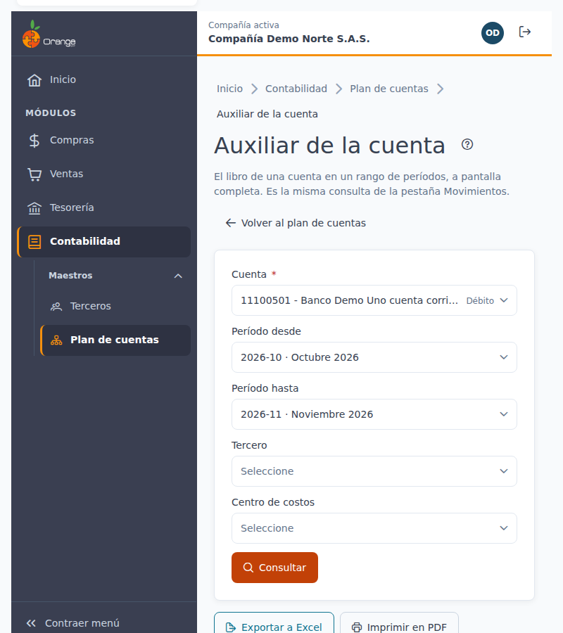

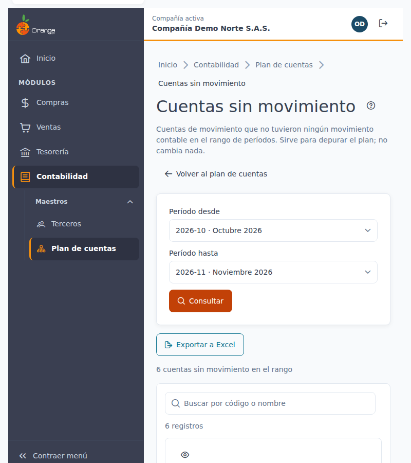

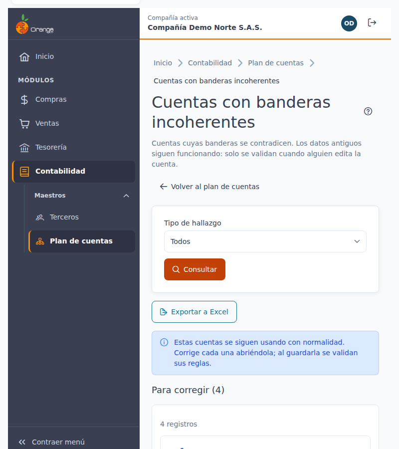

### Exportar a Excel y PDF

- **Exportar a Excel** del listado descarga el plan en el orden del árbol, con el nivel y el código con sangría. Respeta la búsqueda y los filtros que tenga puestos. Necesita permiso de **Exportar**.
- En el **auxiliar de la cuenta**, **Exportar a Excel** necesita **Exportar** e **Imprimir en PDF** necesita **Imprimir**.

Si el resultado supera el máximo de filas (50.000 en el Excel del plan y en el Excel del auxiliar, 4.000 en el PDF del auxiliar), la pantalla no genera el archivo y le pide filtrar o elegir un rango de períodos más corto. Si el PDF es muy grande, use el Excel.

Mientras se genera el archivo, la pantalla muestra **Generando el archivo de Excel…**. Si falla, dice **No se pudo generar el archivo. No se descargó nada.**

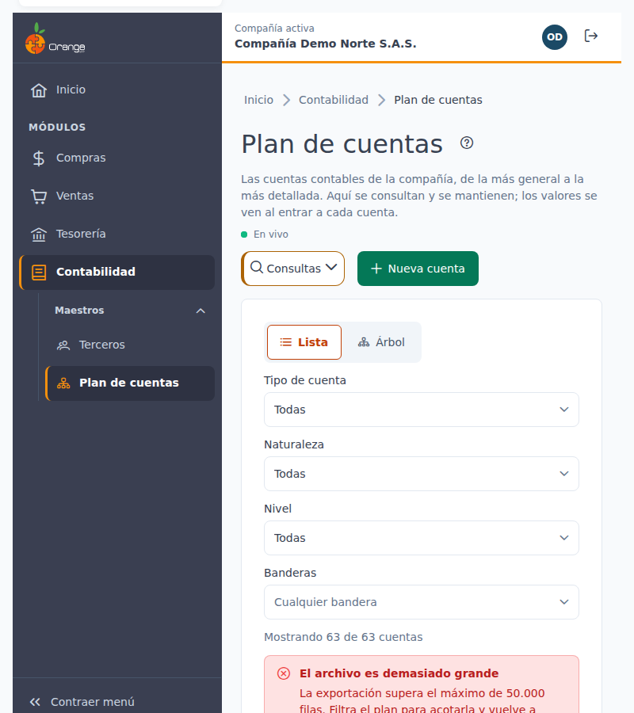

## Importar cuentas desde Excel

Desde el listado, pulse **Importar** para cargar muchas cuentas a la vez. El proceso tiene su propio manual: [Importar el plan de cuentas](plan-cuentas-importar.md).

## Cambios de otros usuarios en vivo

Si otro usuario crea, modifica, elimina o importa cuentas, la lista y el árbol se actualizan solos y conservan sus filtros. Verá un aviso como **Otro usuario creó la cuenta …**.

Si usted tiene una cuenta abierta y otro usuario la elimina, la pantalla le avisa y ya no podrá guardarla.

## Preguntas frecuentes

**¿Por qué la lista no muestra saldos?**
La lista solo muestra los datos de cada cuenta. Los valores se ven al abrir la cuenta, en las pestañas **Movimientos** y **Saldos por tercero**.

**¿Por qué no veo el botón Nueva cuenta?**
Su usuario no tiene permiso para crear cuentas. Pida a su administrador que se lo asigne.

**¿Por qué no puedo cambiar la naturaleza de una cuenta?**
La cuenta tiene movimientos o saldos con valor. La pantalla muestra cuántos. Mientras tenga uso, la naturaleza no cambia.

**¿Por qué no puedo cambiar el código de una cuenta?**
Tiene cuentas hijas, y cambiar su código rompería el de ellas.

**¿Por qué no puedo elegir una cuenta como mayor?**
Solo se pueden elegir cuentas de mayor. Tampoco aparecen la cuenta que está editando ni sus descendientes.

**¿Por qué no puedo guardar una cuenta que antes sí funcionaba?**
Las reglas se revisan cuando guarda la cuenta. Revise el mensaje: suele indicar qué bandera o qué código corregir.

**¿Por qué no veo la pestaña Movimientos?**
Solo aparece al editar una cuenta guardada. Una cuenta nueva debe guardarse primero.

**¿Por qué no veo el historial de la cuenta?**
Todavía no está disponible. La pestaña **Historial** lo indica.

**¿Por qué no puedo eliminar una cuenta?**
Tiene uso: movimientos, saldos, cuentas hijas o configuraciones que la usan. La pantalla muestra cada motivo con su cantidad.

**¿Por qué no veo Exportar a Excel ni Importar?**
Su usuario no tiene permiso de **Exportar** sobre el Plan de cuentas. Pida a su administrador que lo revise.

**¿Por qué no veo el botón PDF en el auxiliar?**
El PDF necesita permiso de **Imprimir** sobre el Plan de cuentas.
