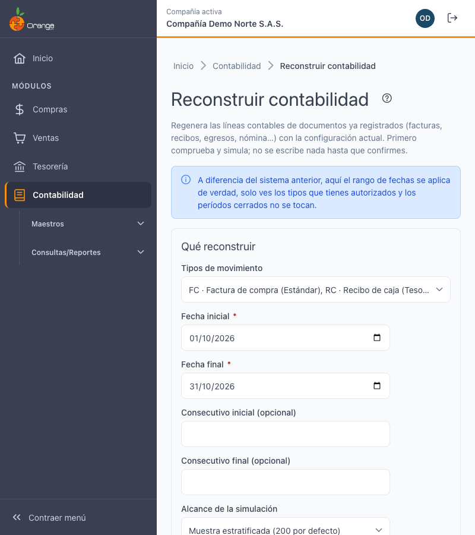
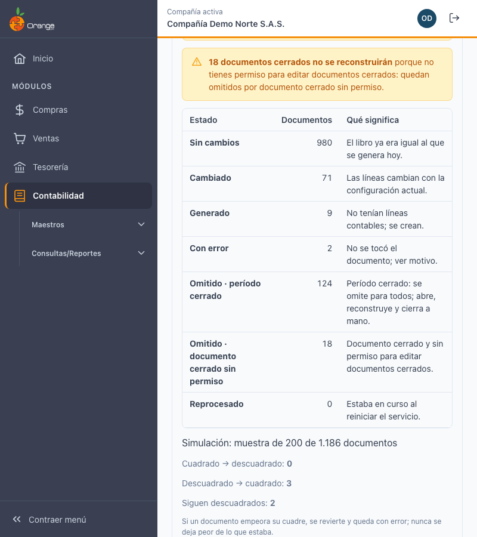
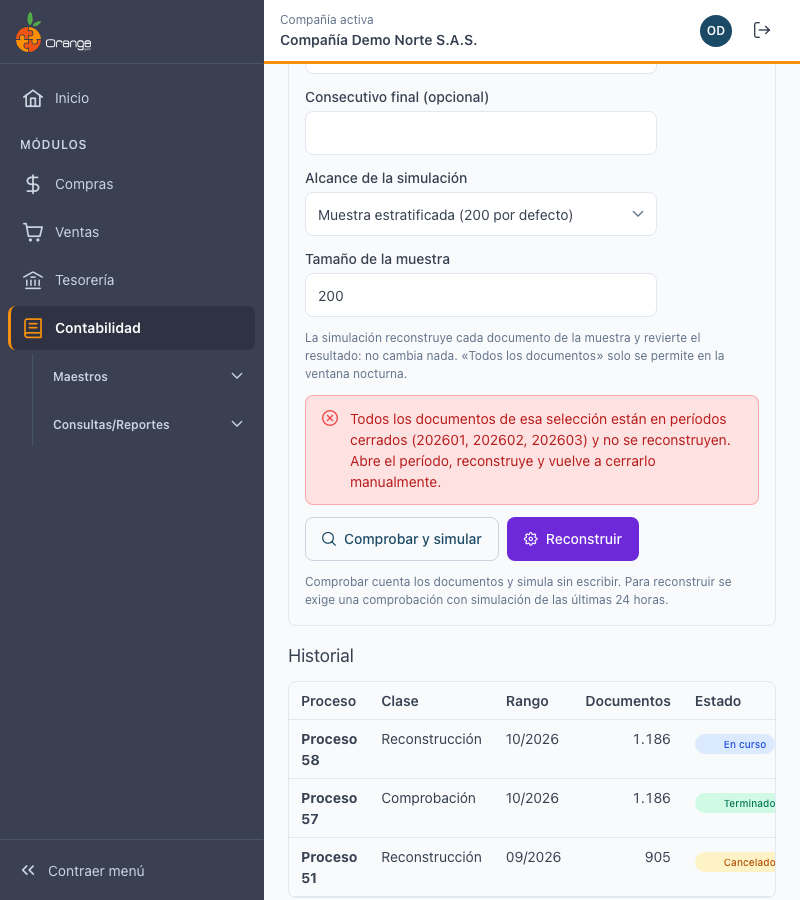
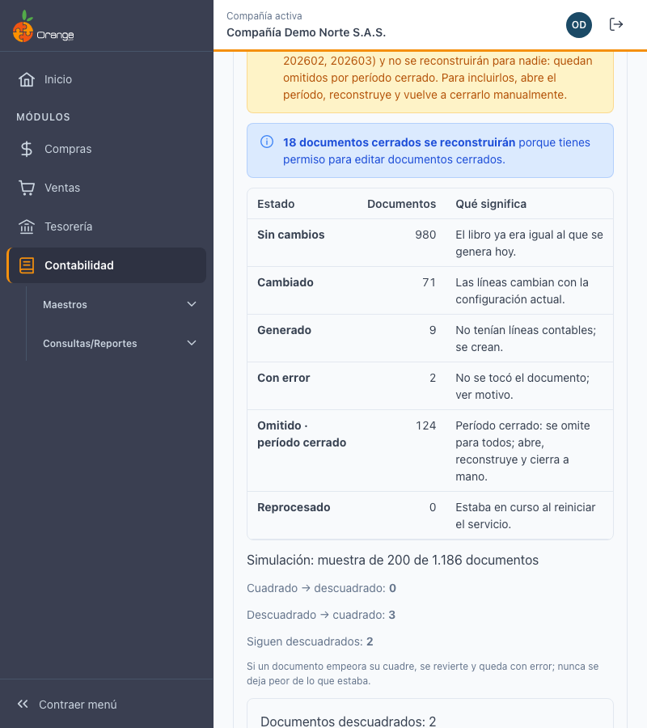
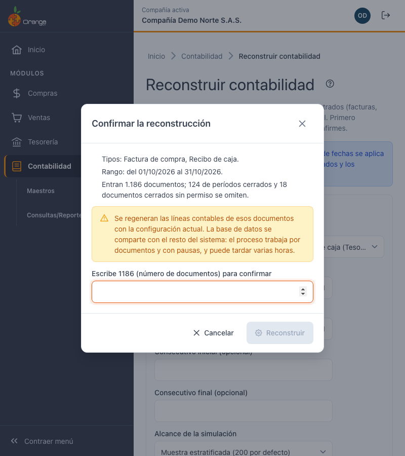
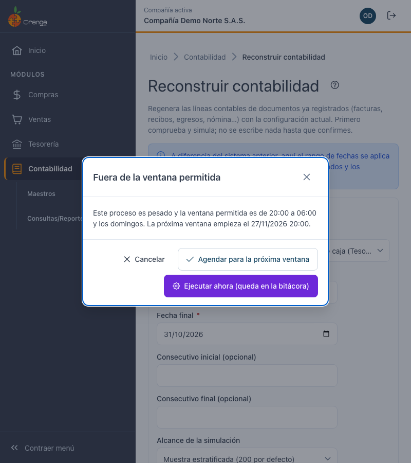
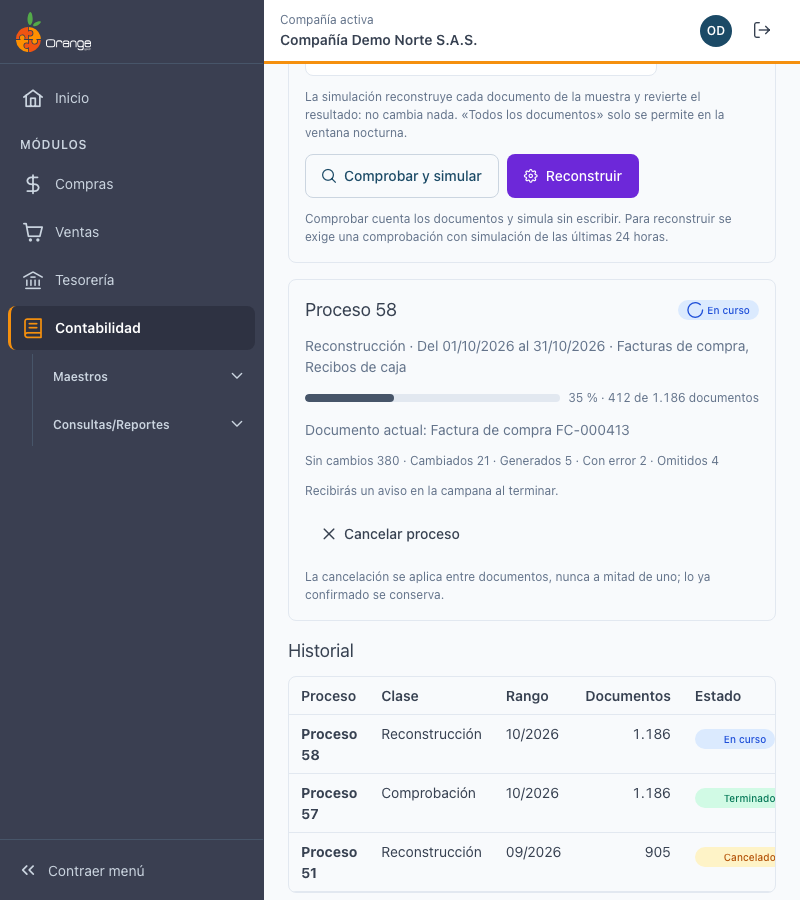
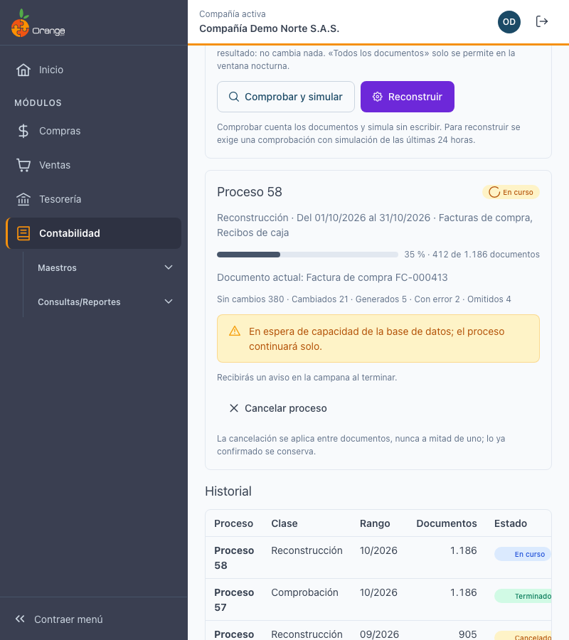
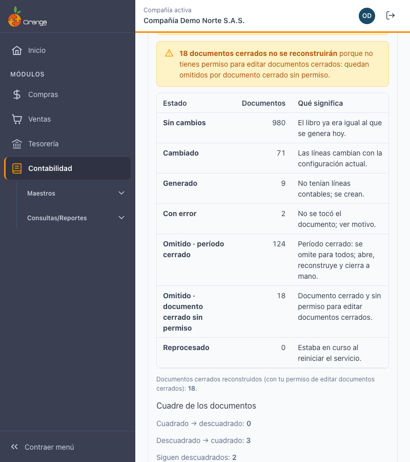

[Regresar a Contabilidad](readme.md)

---

# Reconstruir contabilidad

> **Último recurso.** Esta opción vuelve a generar la contabilidad de documentos ya registrados. La usa solo una o dos personas de la compañía, cuando el área contable lo decida, y siempre con una comprobación previa.

---

## Descripción

**Reconstruir contabilidad** vuelve a escribir las líneas contables (débitos y créditos) de los documentos que ya están registrados, para los tipos de movimiento que elija y en el rango de fechas y de consecutivos que indique. Sirve para corregir un libro de documentos que quedó mal contabilizado.

El proceso es **controlado**:

- Primero **comprueba y simula**, sin escribir nada, para ver qué documentos cambiarían y cuántos quedarían descuadrados.
- Después **confirma** escribiendo el número de documentos que van a entrar.
- Se ejecuta en **segundo plano**, documento a documento. Si un documento falla, solo ese documento queda como estaba y el proceso sigue con el resto.
- Deja un **resultado** y una **bitácora**.

> **Importante:** la base de datos la comparten varias compañías. Por eso, las reconstrucciones grandes se hacen en la ventana nocturna y por tandas.

> **Ayuda:** la pantalla tiene ayuda en el botón **?**, junto al título.

---

## Acceso

1. En el menú principal, haga clic en **Contabilidad**.
2. En **Procesos**, haga clic en **Reconstruir contabilidad**.

Si la opción no aparece en el menú, su usuario no tiene el permiso de **Consultar** de esta opción.

| Permiso | Qué permite |
|---------|-------------|
| **Consultar** | Ver la pantalla, comprobar la simulación, ver el historial, el resultado y descargar el Excel. |
| **Crear** | Botones **Comprobar y simular**, **Reconstruir** y **Reintentar**. |
| **Anular** | Botón **Cancelar proceso** mientras el proceso corre. |
| **Editar documentos cerrados** (permiso aparte, de documentos) | Permite reconstruir los documentos cerrados que estén en un período abierto. Sin este permiso, esos documentos se omiten. |

Si la compañía todavía no tiene activada la función, la pantalla muestra **Capacidad no activa** y no se puede ejecutar nada.

---

## Antes de empezar

Revise estos puntos antes de usar la opción:

- **Hable con el área contable.** Reconstruir cambia el libro de documentos. No lo use para corregir un solo documento: para eso, corríjalo en su módulo.
- **Ubique el problema.** Si el descuadre es de centavos, use **Cuadrar descuadres** (ver [Cuadrar descuadres](cuadrar-descuadres.md)); esta opción no los arregla.
- **Revise los períodos.** Los períodos cerrados se omiten siempre (ver más abajo).
- **Escoja el rango más pequeño posible.** Cada proceso admite **hasta 5.000 documentos**.

---

## Pantalla principal

| Elemento | Para qué sirve |
|----------|----------------|
| **Tipos de movimiento** | Elija uno o varios. Cada tipo muestra su clase: **Estándar**, **Tesorería** o **Nómina**. Solo aparecen los tipos que su usuario tiene autorizados. |
| **Fecha inicial** y **Fecha final** | Obligatorias. El rango se aplica a la fecha del documento. La fecha inicial no puede ser posterior a la final. |
| **Consecutivo inicial** y **Consecutivo final** | Opcionales. Acotan el rango dentro de cada tipo. |
| **Alcance de la simulación** | **Muestra** (por defecto, 200 documentos repartidos por tipo y período) o **Todos los documentos**. La opción de todos solo se ejecuta dentro de la ventana nocturna. |
| **Comprobar y simular** | Calcula qué entraría, sin escribir nada. Es el paso obligatorio antes de reconstruir. |
| **Reconstruir** | Abre la confirmación. Está deshabilitado hasta que haya una comprobación reciente. |

Si el rango no tiene documentos, la pantalla lo indica y no crea ningún proceso.

---

## Qué regenera y qué no

| Sí se regenera | No se toca |
|----------------|------------|
| Las líneas contables de los documentos de los tipos elegidos (Estándar, Tesorería y Nómina) dentro del rango. | Documentos **anulados** y tipos que **no afectan la contabilidad**. |
| Las líneas de los documentos que no tenían ninguna (aparecen como **Generado**). | Documentos de **períodos cerrados**: se omiten para todos. |
| La marca de cuadre de cada documento reconstruido. | Documentos **cerrados** en un período abierto, si su usuario no tiene el permiso de editar documentos cerrados. |
| | Los descuadres de centavos (use **Cuadrar descuadres**). |
| | Los saldos guardados. Esta opción no los recalcula. Si cambió documentos de períodos abiertos, consulte con su administrador si debe recalcularlos. |

Un documento **nunca** se queda sin contabilidad por un error: si falla, se deshace solo ese documento y conserva sus líneas anteriores.

---

## Comprobar y simular

Use **Comprobar y simular** antes de cualquier reconstrucción. No escribe nada en la contabilidad.

Al terminar, la pantalla muestra:

- **Documentos que entrarían**, separados por estándar, Tesorería y nómina.
- **Aviso de períodos cerrados**: cuántos documentos están en períodos cerrados y no se reconstruirán, con la lista de períodos (por ejemplo, 202506).
- **Aviso de documentos cerrados**: si no tiene el permiso, cuántos quedan fuera; si lo tiene, cuántos se reconstruirán.
- **Resumen por estado** (cuántos cambiarían, cuántos quedarían sin cambios, cuántos fallarían y cuántos se omitirían).
- **Cambios de cuadre**: cuántos documentos pasan de cuadrados a descuadrados, cuántos de descuadrados a cuadrados y cuántos siguen descuadrados.
- **Detalle por documento**, con débitos y créditos antes y después. Aparece marcado como **Simulación**.

> **Nota:** la comprobación vale **24 horas**. Si pasa más tiempo, vuelva a comprobar antes de reconstruir.

---

## Períodos cerrados

Un documento de un **período cerrado** se **omite para todos los usuarios**, sin excepciones. La pantalla lo cuenta y muestra la lista de períodos.

Si necesita reconstruir esos documentos, siga esta guía:

1. Abra el período en el menú **Seguridad**, opción **Períodos**.
2. Reconstruya los documentos con esta opción.
3. Cierre el período de nuevo, en la misma pantalla.

Esta opción no recalcula saldos ni cambia otros períodos.

---

## Documentos cerrados

Un documento **cerrado** está en un período abierto, pero ya fue cerrado individualmente.

- **Sin el permiso de editar documentos cerrados**: el documento se omite y la pantalla lo indica. Si necesita reconstruirlo, pida el permiso a su administrador o corrija el documento con quien lo tenga.
- **Con el permiso**: el documento entra en la reconstrucción y se cuenta aparte. La confirmación lo incluye.

---

## Nómina

Los documentos de **nómina** entran en la reconstrucción como cualquier otro tipo de la clase **Nómina**. La comprobación los cuenta por separado para que pueda revisarlos.

---

## Reconstruir

Cuando la comprobación esté lista, haga clic en **Reconstruir**. Aparece la confirmación:

1. Revise los **tipos**, el **rango** y el **número de documentos que entran**. Los documentos de períodos cerrados y los documentos cerrados sin permiso quedan fuera y se indican aparte.
2. Lea el aviso de que la base de datos es compartida.
3. **Escriba el número de documentos** que entran. El botón **Reconstruir** se habilita solo si coincide.

### Fuera de la ventana

Las reconstrucciones grandes y las simulaciones de **todos los documentos** se hacen en la **ventana nocturna**: de **20:00 a 06:00** (hora de Bogotá) y los domingos. Si quiere ejecutar fuera de ella, la pantalla le ofrece:

- **Agendar** el proceso para la ventana, o
- **Ejecutar ahora**, con confirmación. Queda registrado en la bitácora.

---

## Progreso

Mientras corre el proceso, la pantalla muestra:

- **Barra de avance**, el documento que se está procesando (tipo y consecutivo) y el número de documentos por estado.
- **En espera de capacidad**: la base de datos está ocupada y el proceso espera su turno. No es un error.
- **Cancelar proceso**: detiene el proceso al terminar el documento en curso. Lo que ya se confirmó se conserva.

Si el proceso **falla**, la pantalla muestra el motivo y el botón **Reintentar**. Solo hay un reintento manual.

---

## Resultado

Al terminar, el resultado muestra el número de documentos en cada estado:

| Estado | Qué significa |
|--------|---------------|
| **Sin cambios** | El documento ya estaba bien; no se modificó. |
| **Cambiado** | Se reconstruyeron sus líneas. Se ven los débitos y créditos antes y después. |
| **Generado** | No tenía líneas contables y se generaron. |
| **Con error** | No se pudo reconstruir. Sus líneas anteriores se conservan. Vea el motivo en el detalle. |
| **Omitido** | No se tocó, por una regla (período cerrado, documento cerrado sin permiso, documento anulado u otra). |
| **Reprocesado** | El proceso se interrumpió en ese documento y se volvió a procesar. Su importe anterior puede no ser exacto. |

### Documentos descuadrados

Si después de reconstruir quedan documentos **descuadrados**, la pantalla le recomienda qué hacer. Elija una decisión y, si quiere, escriba una nota:

- **Los ajustaré en Asientos**: corregirá cada documento en su asiento.
- **Los dejaré para el proceso de cuadre**: se ajustarán con [Cuadrar descuadres](cuadrar-descuadres.md).
- **Los dejo como están**: no se hace nada más.

Haga clic en **Registrar decisión**. La decisión queda en la bitácora.

### Detalle y Excel

- El **detalle por documento** se puede filtrar por estado. Cada fila tiene un enlace a **Asientos** para ver el documento.
- **Descargar Excel** exporta el detalle.

---

## Historial

En **Procesos recientes** aparecen los procesos de la compañía, del más reciente al más antiguo, durante **15 días**. Si el resultado ya no está disponible, la pantalla lo indica como **Resultado no disponible**.

---

## Preguntas frecuentes

**No veo el botón Reconstruir.**
Su usuario necesita el permiso de **Crear** de la opción. Si ve **Capacidad no activa**, la función todavía no está disponible en su compañía.

**¿Por qué hay documentos omitidos?**
Porque están en un período cerrado, o son documentos cerrados y su usuario no tiene el permiso. También se omiten los anulados y los de tipos que no afectan la contabilidad. El detalle indica el motivo.

**No me deja ejecutar.**
Revise si la comprobación tiene más de 24 horas, si el número escrito coincide con el número de documentos que entran, o si está fuera de la ventana.

**Un documento quedó con error. ¿Qué hago?**
El documento conserva su contabilidad anterior. Revise su motivo, corríjalo en su módulo y vuelva a comprobar.

**¿Puedo cancelar el proceso?**
Sí, con **Cancelar proceso**. Se detiene entre documentos y lo ya confirmado se conserva.

**¿Reconstruir arregla los centavos descuadrados?**
No. Para los descuadres de centavos use [Cuadrar descuadres](cuadrar-descuadres.md).

**¿Puedo reconstruir documentos de un período cerrado?**
No desde esta opción, mientras el período esté cerrado. Siga la guía de la sección **Períodos cerrados**.

---

[Regresar a Contabilidad](readme.md)
