[Regresar a Contabilidad](readme.md)

---

# TERCEROS

## Qué es

**Terceros** es la lista de personas y empresas con las que trabaja la compañía: clientes, proveedores, compradores, vendedores, empleados y contratistas. Un tercero se crea una sola vez y se le asignan sus tipos. Desde su ficha también puede consultar el movimiento contable del tercero por período.

## Cómo llegar

- Abra **Contabilidad** en el menú principal y luego **Maestros > Terceros**.
- Necesita permiso de **consulta** sobre Terceros. Si no ve la opción, pida a su administrador que se lo asigne.

## Pantalla principal

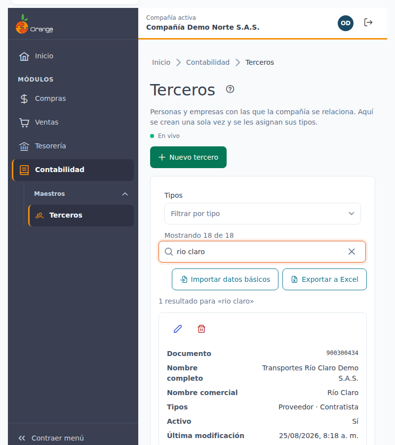

El listado muestra una fila por tercero, con su documento, nombre, nombre comercial, tipo de documento, si está activo, sus tipos y la fecha de la última modificación.

- **Buscar**: escriba una parte del documento o del nombre. La lista se actualiza sola.
- **Filtrar por tipo**: marque uno o más tipos (por ejemplo, **Proveedor** y **Cliente**). La lista muestra solo los terceros que tienen **todos** los tipos marcados. Para volver al listado completo, pulse **Limpiar filtros**.

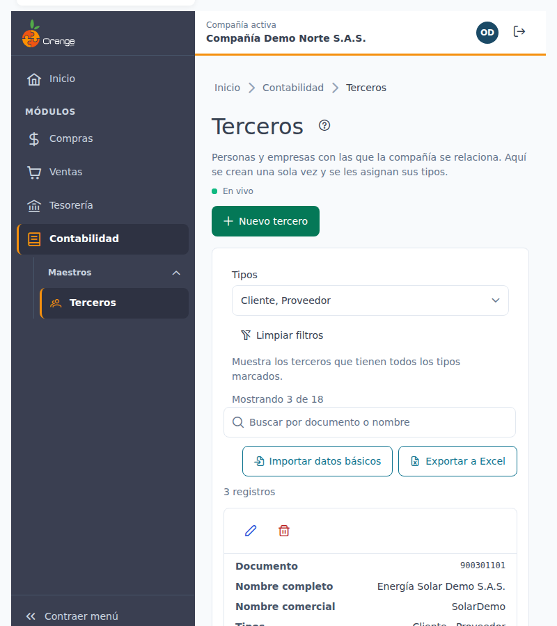

Lo que ve depende de sus permisos:

- **Consultar**: ve el listado y las fichas. No ve los botones de crear, eliminar, exportar ni importar.
- **Crear**: ve el botón **Nuevo tercero**.
- **Actualizar**: puede abrir una ficha, cambiarla y **Guardar**. Si solo tiene consulta, la ficha es de solo lectura.
- **Eliminar**: puede eliminar terceros desde el listado.
- **Exportar**: ve **Exportar a Excel** e **Importar datos básicos**.

Si no hay terceros, la pantalla muestra **Aún no hay terceros**. Si el filtro no encuentra nada, muestra **Ningún tercero cumple el filtro**. Si la lista no carga, aparece un aviso con **Reintentar**; sus filtros se conservan.

## Crear un tercero

1. Pulse **Nuevo tercero**.
2. Marque los tipos que aplican: **Cliente**, **Proveedor**, **Comprador** o **Vendedor**. Cada tipo marcado abre su pestaña con los datos propios.
3. Complete los datos en la pestaña **Tercero**. Los campos obligatorios se marcan junto al campo; no se guarda hasta corregirlos.
4. Pulse **Guardar**.

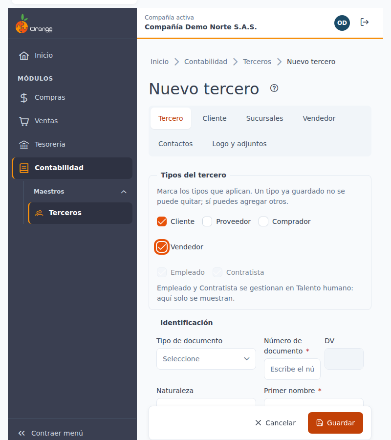

**Empleado** y **Contratista** solo se muestran en la ficha, para referencia. Estos tipos se gestionan en Talento humano.

Si el documento ya existe en la compañía, la pantalla le avisa y le ofrece **Editar ese tercero**. Así evita duplicar terceros.

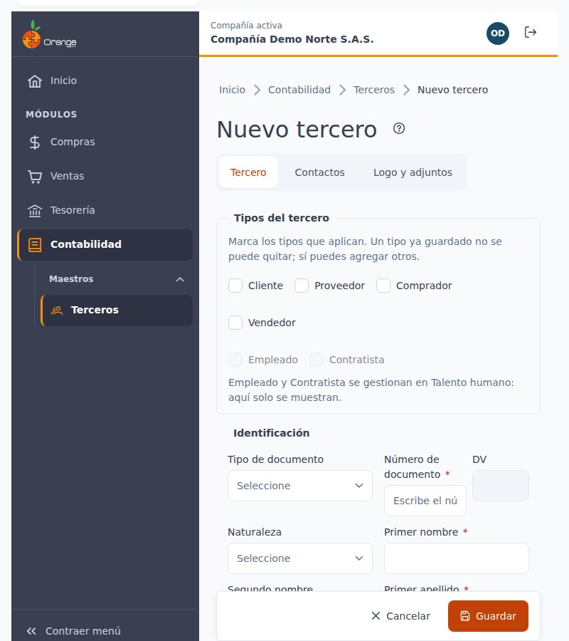

## Editar un tercero

1. Busque el tercero en el listado y ábralo.
2. Cambie los datos que necesite.
3. Pulse **Guardar**.

Los tipos ya guardados no se pueden quitar, pero sí puede marcar otros. Por ejemplo, si el tercero es **Cliente** y marca **Comprador** y guarda, queda con los dos tipos.

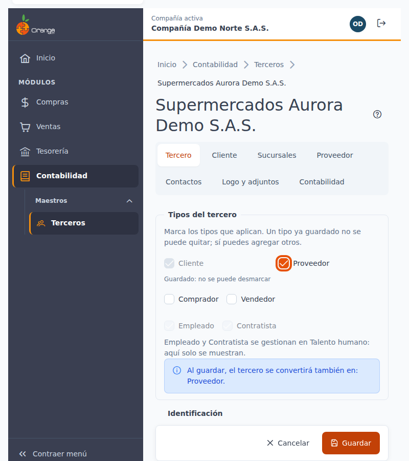

Si cambia algo y sale de la ficha sin guardar, la pantalla le pide confirmar antes de salir.

## Datos por tipo

- **Cliente**: condiciones comerciales (descuento, días de plazo, tipo de cliente, crédito, cupo, días de mora permitidos y autorizaciones a centrales de riesgo) y la lista de **Sucursales**.
- **Proveedor**: los datos bancarios para pagos (tipo y número de cuenta).
- **Comprador** y **Vendedor**: sus datos aparecen en su propia pestaña.

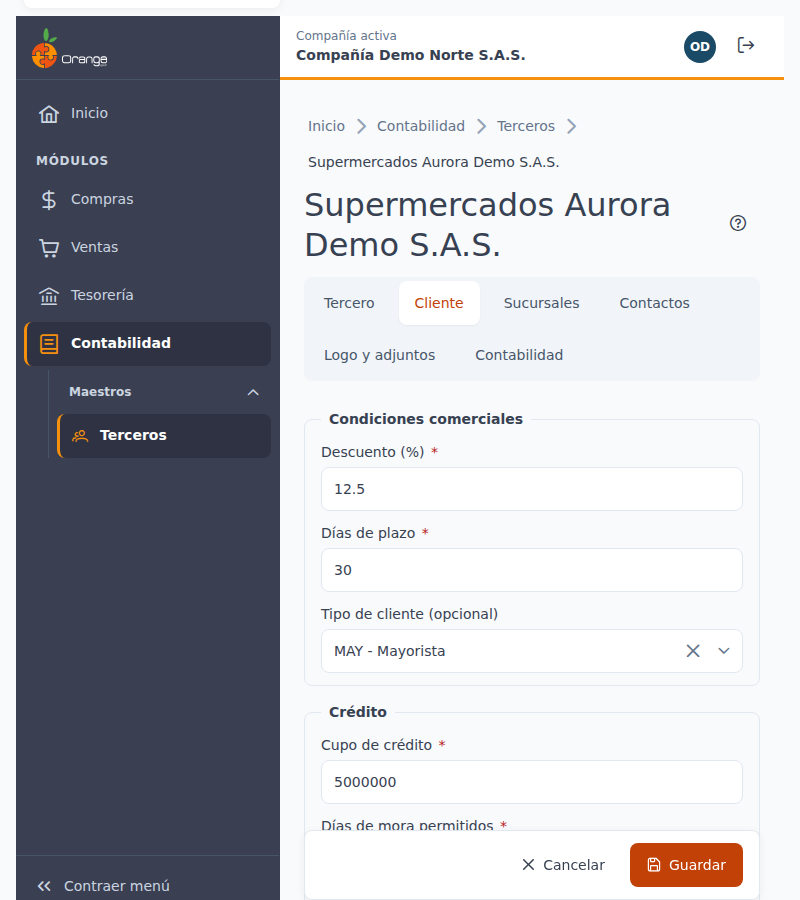

**Sucursales** (solo para clientes): pulse **Agregar sucursal**, complete código, nombre, dirección y ciudad, y **Guardar sucursal**. Las sucursales se guardan al instante, sin pulsar **Guardar** de la ficha. Una sucursal que está en uso no se puede eliminar, y la pantalla le dice por qué.

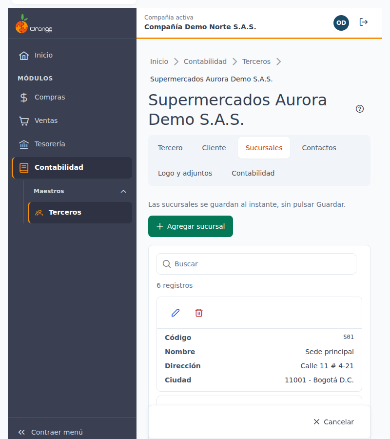

## Contactos

En la pestaña **Contactos** agregue las personas de contacto con su nombre. Los nombres se muestran en mayúsculas. Para agregar contactos primero debe guardar el tercero.

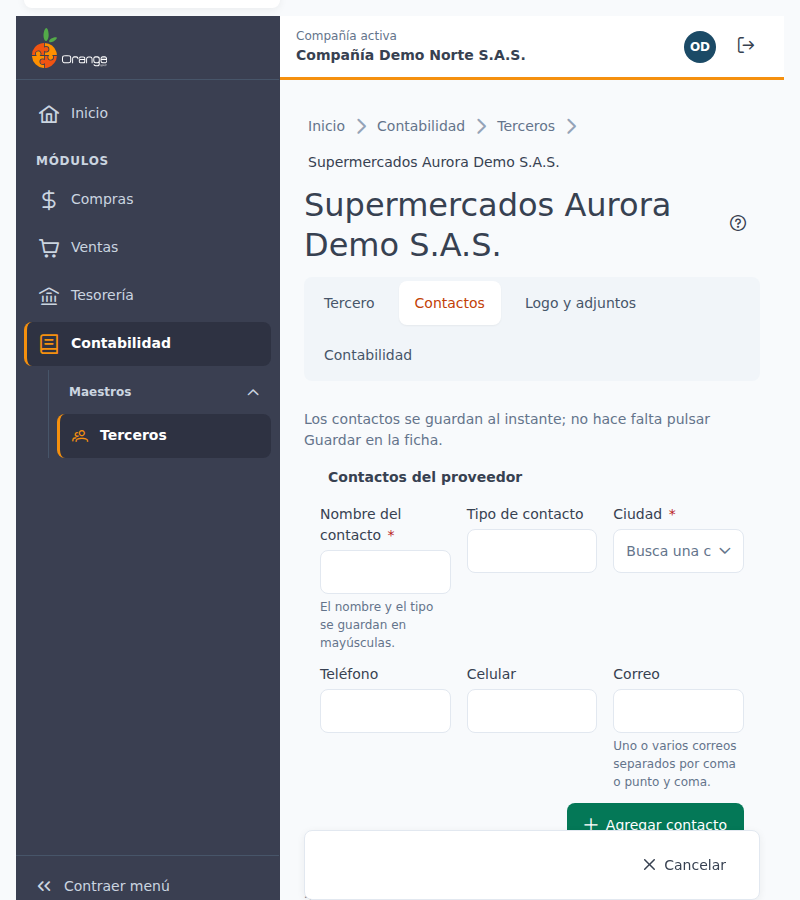

## Logo y adjuntos

En la pestaña **Logo y adjuntos** puede subir un logo en formato PNG y otros archivos del tercero, como un PDF. Cada archivo aparece con su tamaño y el espacio que ya usa el tercero. Si un archivo no tiene el formato correcto, es demasiado grande o no cabe en el espacio disponible, la pantalla le dice el motivo y no lo guarda.

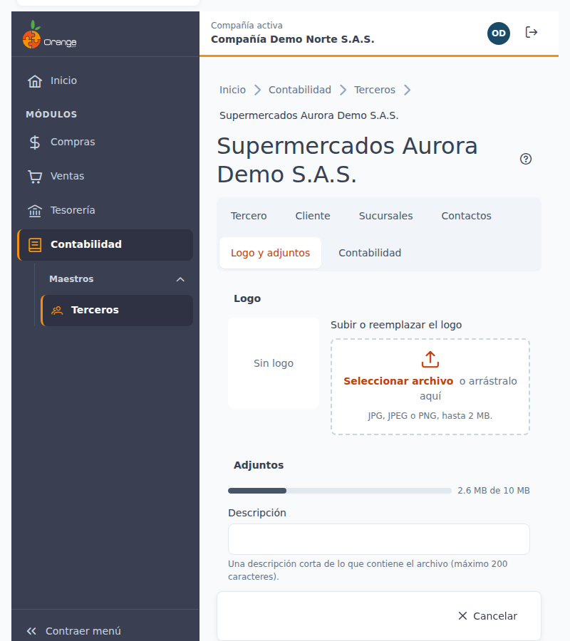

## Eliminar un tercero

1. En el listado, pulse **Eliminar** en la fila del tercero.
2. Confirme en el diálogo con **Eliminar**.

Se eliminan el tercero, sus tipos, sus contactos y sus adjuntos. Esta acción no se puede deshacer.

Un tercero con movimientos o saldos no se puede eliminar. En ese caso, la pantalla muestra el motivo (por ejemplo, **Movimientos**) y no cambia nada.

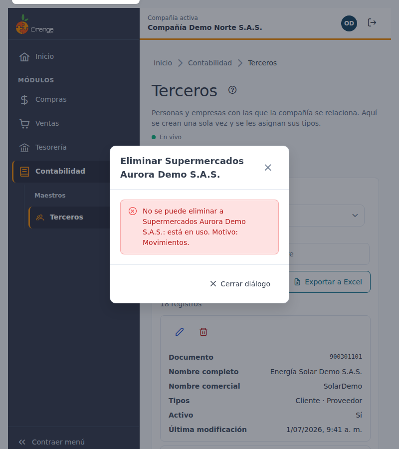

## Contabilidad: movimiento del tercero

La pestaña **Contabilidad** de la ficha consulta lo que el tercero movió en un período contable. Solo aparece en un tercero guardado y necesita permiso de consulta de Terceros.

1. Abra la pestaña **Contabilidad**.
2. Elija el **Período contable**. La lista muestra los períodos de la compañía, con su estado (abierto o cerrado). Viene seleccionado el período actual.

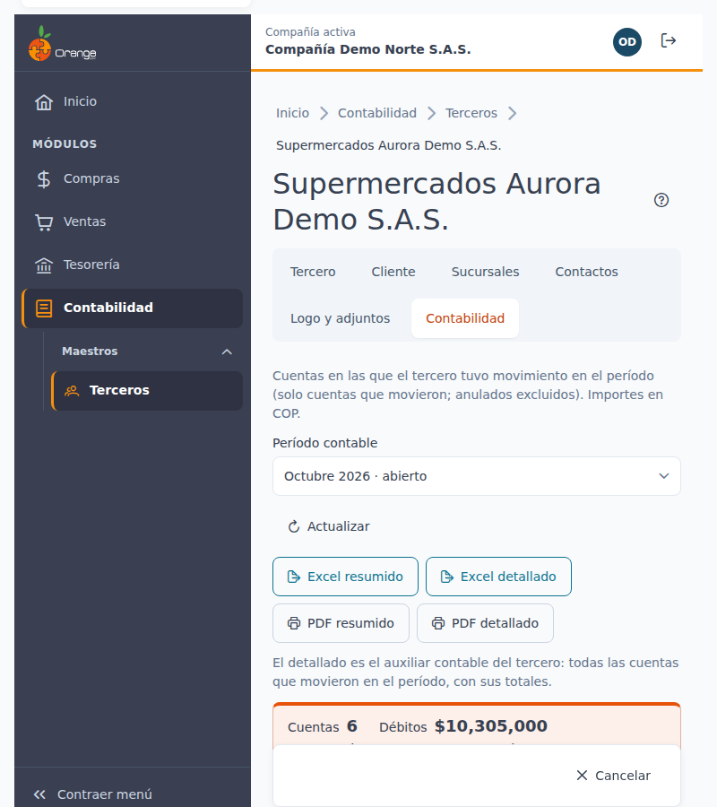

### Resumen por cuenta

El resumen muestra una fila por cuenta en la que el tercero tuvo movimiento en el período:

- **Cuenta** y **Nombre**.
- **Saldo inicial**: lo que la cuenta debía o tenía antes del período.
- **Débitos** y **Créditos** del período.
- **Neto (D − C)**: débitos menos créditos.
- **Saldo final**: saldo inicial, más débitos, menos créditos.
- **Mov.**: número de movimientos.

Al final está la fila de **Totales** del tercero en el período.

Las cuentas sin movimiento del tercero en el período no aparecen, aunque tengan saldo inicial. Los movimientos anulados tampoco se incluyen.

### Detalle de una cuenta

Pulse una cuenta del resumen (o selecciónela con las flechas y **Enter**). Debajo aparece el detalle de sus movimientos, con la fecha, el tipo de movimiento, el consecutivo, el documento de referencia, el centro de costo, la descripción, el débito, el crédito y el saldo acumulado. Si hay muchos movimientos, se muestran por páginas. Los totales del pie corresponden a toda la cuenta, no solo a la página que ve.

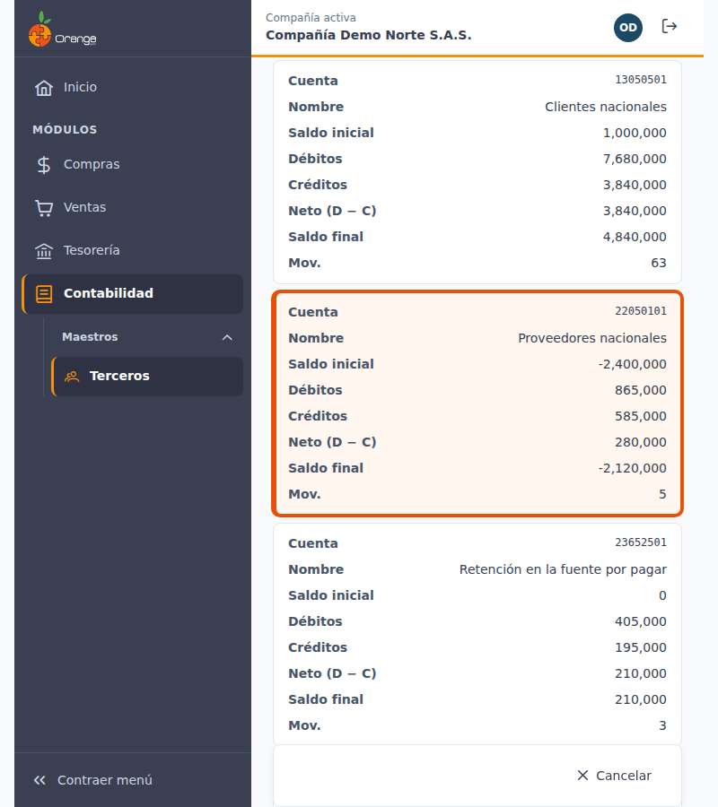

### Exportar la consulta

La barra **Exportar la consulta contable** ofrece cuatro archivos con los mismos totales de la pantalla:

- **Excel resumido** y **Excel detallado**: necesitan permiso de **Exportar**.
- **PDF resumido** y **PDF detallado**: necesitan permiso de **Imprimir**.

El archivo detallado trae todas las cuentas que tuvieron movimiento, cada una con sus movimientos y su total. Si el período tiene demasiados movimientos, el archivo no se genera y la pantalla le pide elegir un período más corto (o usar Excel, si el PDF es muy grande). Con el resumen vacío o cargando, estos botones están deshabilitados.

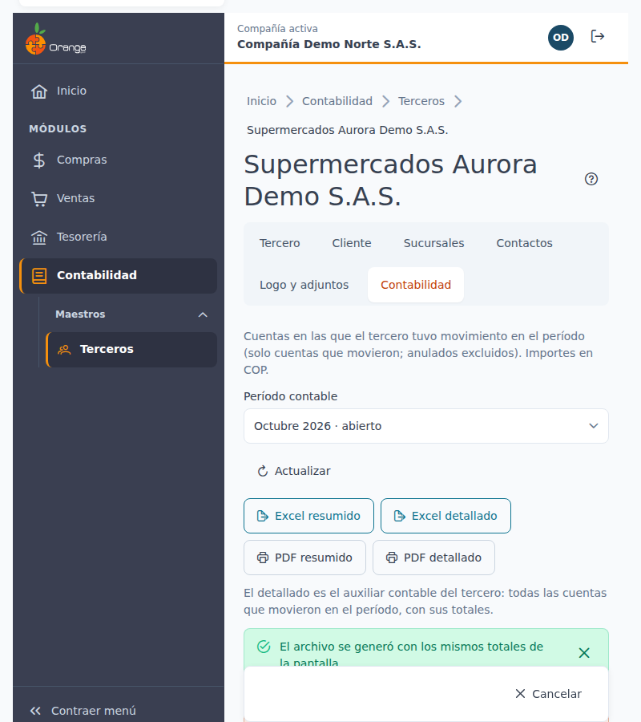

### Estados

- **Período sin movimiento**: la pantalla muestra **El tercero no tiene movimiento contable en este período**. Pruebe con otro período.
- **Sin períodos contables**: la compañía todavía no tiene períodos. Pida a Contabilidad que los cree.
- **Error**: la pantalla muestra un aviso con **Reintentar**. El período elegido se conserva.

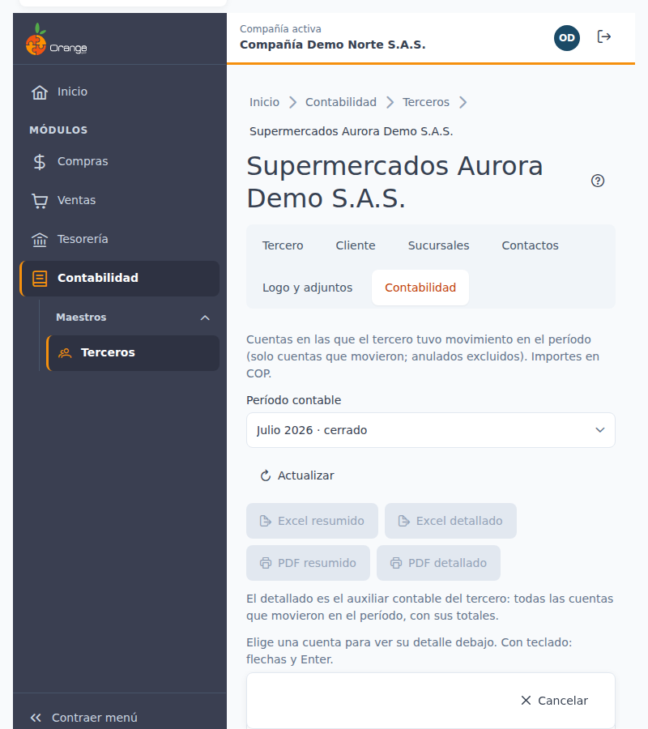

## Importar datos básicos

Use la importación para cargar muchos terceros desde Excel. Necesita permiso de **Exportar**. Solo carga los datos básicos del tercero (documento, nombre, dirección, ciudad, teléfonos y correo). Los tipos (cliente, proveedor, vendedor…) y sus condiciones se completan después, en la ficha de cada tercero.

1. En el listado, pulse **Importar datos básicos**.
2. **Descargar la plantilla** y complete una hoja de Excel con sus datos. Puede cargar hasta 1.000 filas, en un archivo de 1 MB como máximo. Solo se lee la primera hoja.
3. Cargue el archivo. Antes de guardar, la pantalla muestra una **vista previa** por fila: **Nuevos**, **Se actualizan**, **Sin cambios** y **Con error**. La vista previa no guarda nada.
4. Revise las filas con error. Puede **Descargar filas con error**, corregirlas y **Volver a validar**.
5. Pulse **Aplicar** con el número de cambios. La importación es todo o nada: si algo falla, no se guarda ninguna fila.

Un tercero que ya existe se actualiza solo en sus datos básicos. Sus tipos y condiciones no cambian.

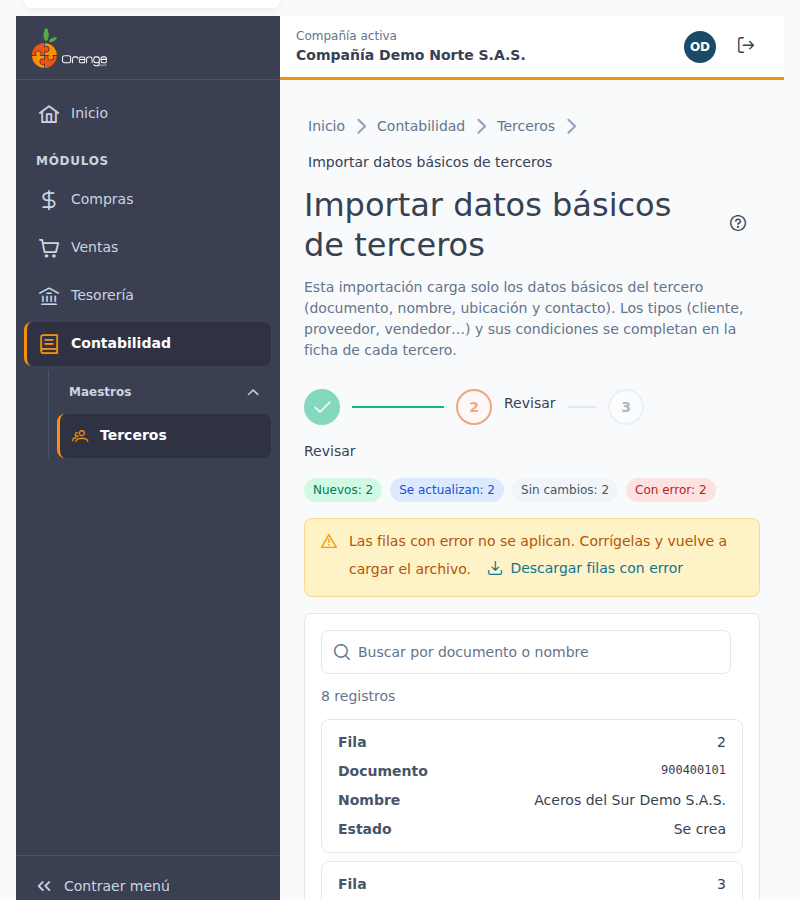

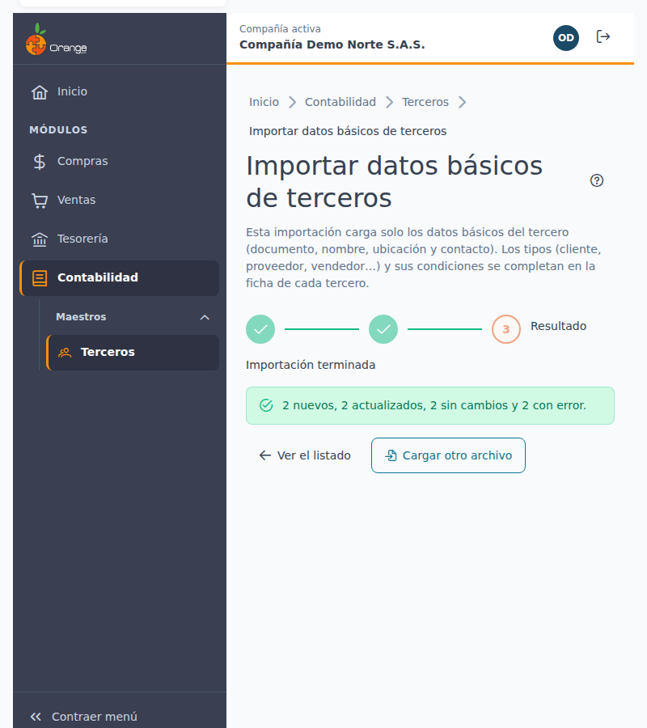

## Cambios de otros usuarios en vivo

Si otro usuario crea, modifica o elimina terceros, el listado se actualiza solo y conserva sus filtros y su página. Verá un aviso como **Otro usuario creó a …**.

Si usted está editando un tercero que otro usuario cambió, la pantalla le avisa. Puede **Cargar sus cambios** para ver la versión nueva antes de guardar.

## Preguntas frecuentes

**¿Por qué no veo el botón Nuevo tercero?**
Su usuario no tiene permiso para crear terceros. Pida a su administrador que se lo asigne.

**¿Por qué no puedo quitar un tipo?**
Los tipos ya guardados no se quitan. Sí puede agregar otros tipos.

**¿Por qué no veo la pestaña Contabilidad?**
Solo aparece en un tercero guardado. Un tercero nuevo debe guardarse primero.

**¿Por qué no puedo cambiar Empleado o Contratista?**
Esos tipos se gestionan en Talento humano. En Terceros solo se muestran.

**¿Por qué no puedo eliminar un tercero?**
Tiene movimientos o saldos. La pantalla indica el motivo.

**¿Por qué una cuenta no aparece en el resumen contable?**
La cuenta no tuvo movimiento del tercero en el período elegido. Las cuentas sin movimiento no se muestran, y tampoco los movimientos anulados.

**¿Por qué no veo los botones de PDF?**
Los PDF necesitan permiso de **Imprimir** sobre Terceros. Los de Excel necesitan permiso de **Exportar**.
