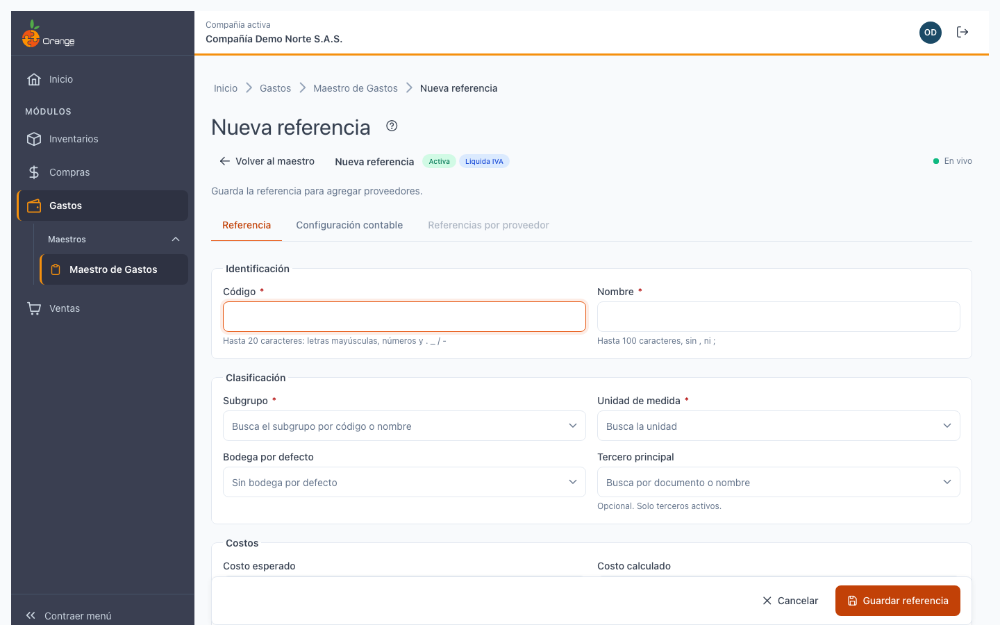
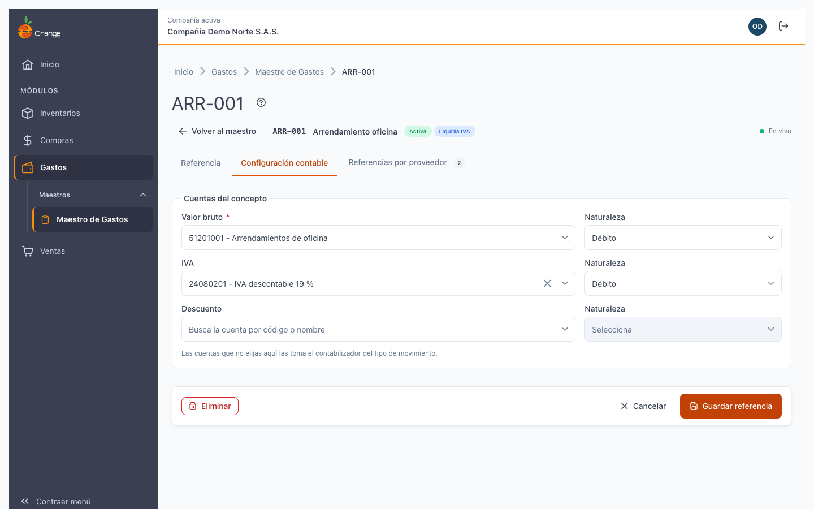
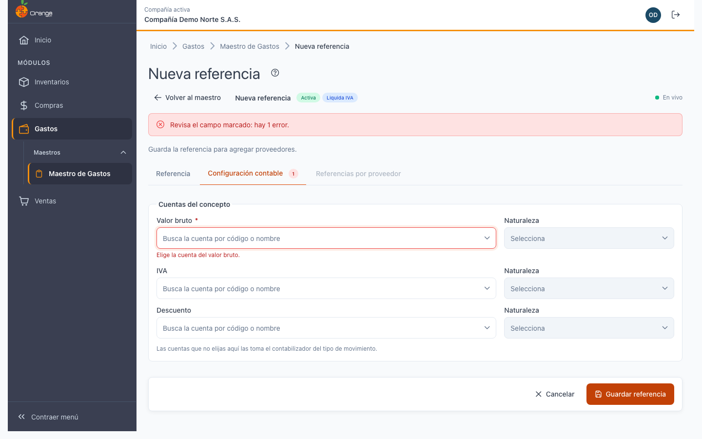
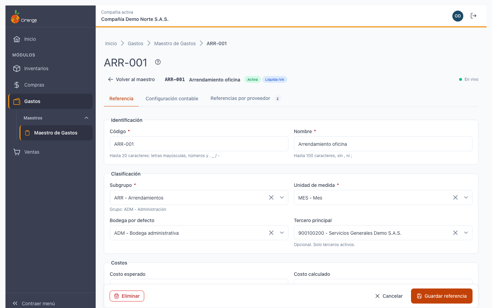
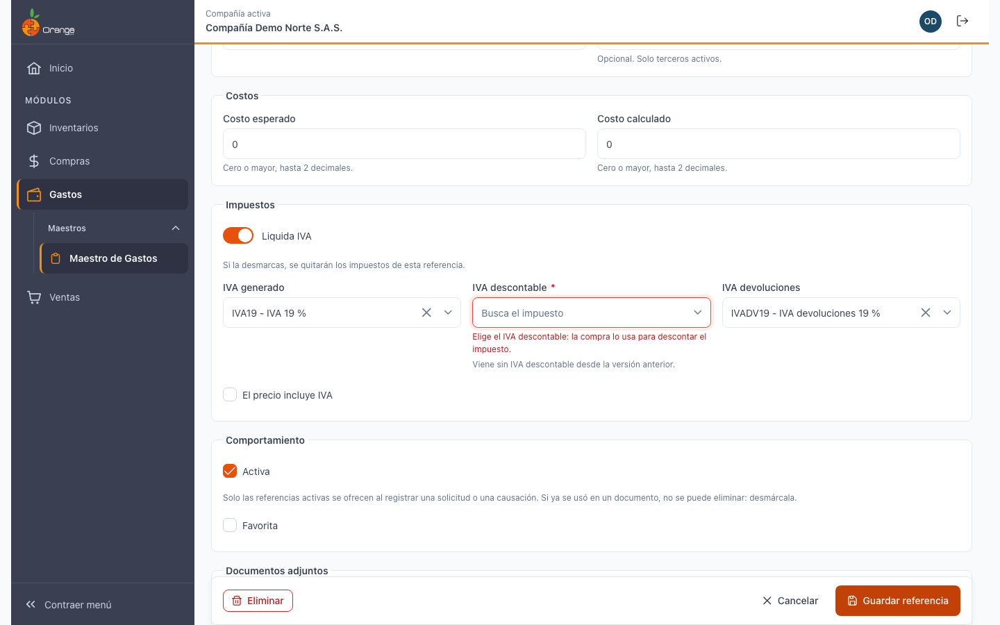
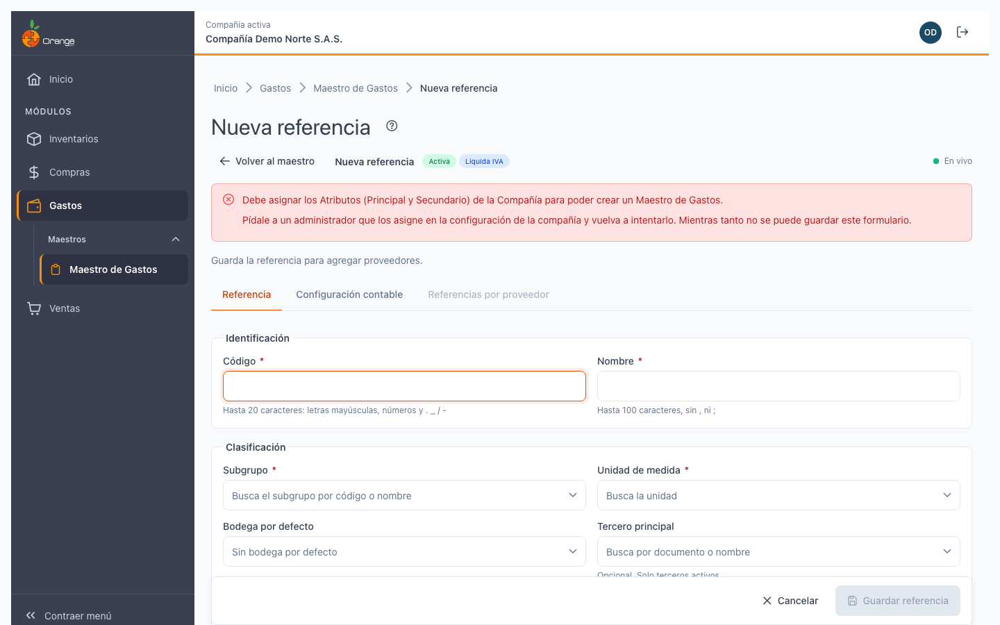
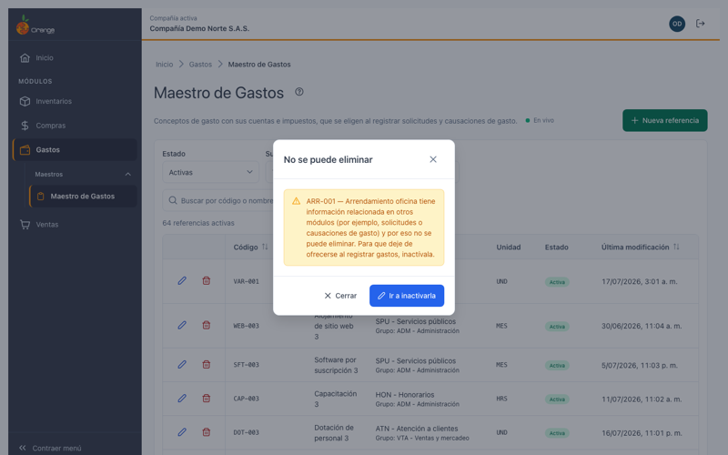
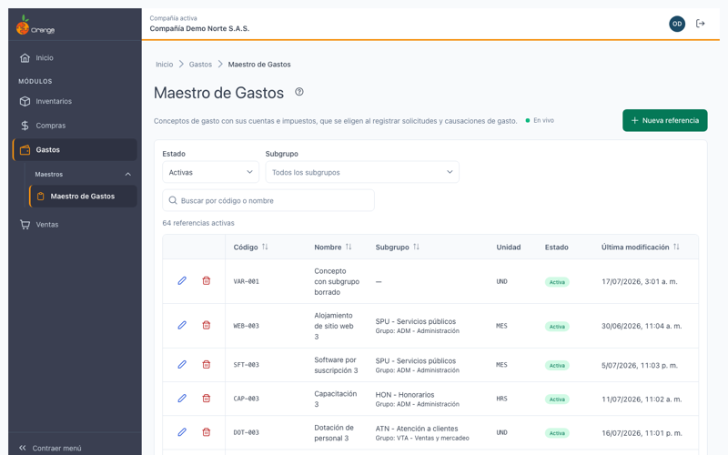
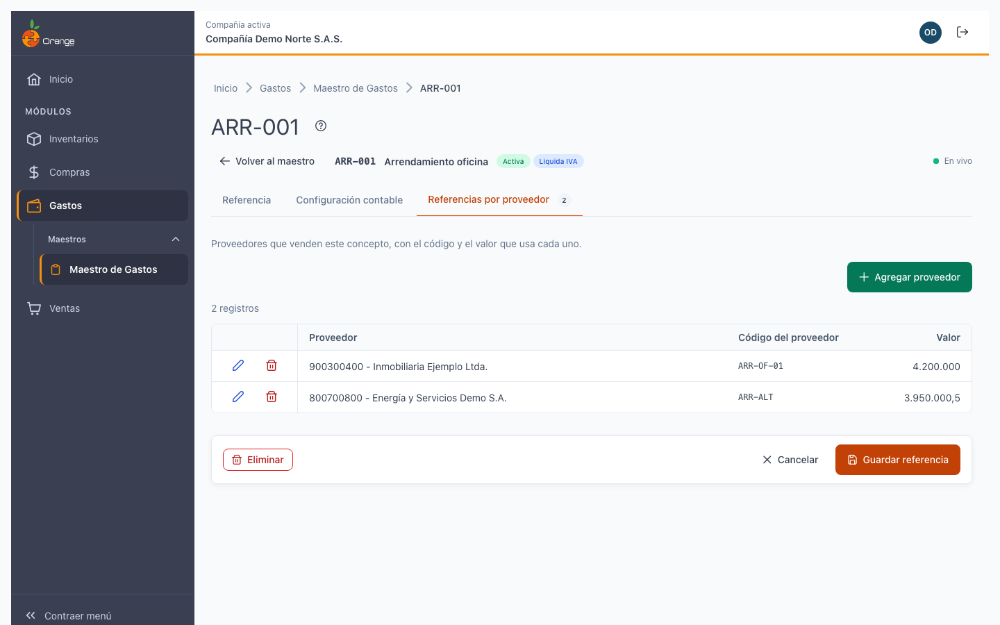
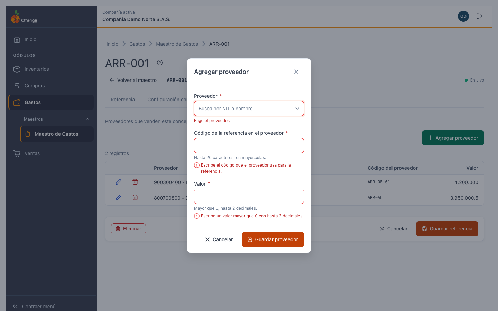

[Regresar a Maestro de Gastos](maestro-de-gastos.md)

---

# 🧾 Detalle de una referencia de gasto

---

## 📋 Descripción

La **página de detalle** es donde se crea, se consulta y se modifica una referencia de gasto. Reúne sus datos en tres pestañas:

| Pestaña | Qué contiene |
|---------|--------------|
| **Referencia** | Código, nombre, subgrupo, unidad, bodega y tercero por defecto, costos, si está activa y impuestos (IVA). |
| **Configuración contable** | Las cuentas del concepto: valor bruto, IVA y descuento, con su naturaleza (crédito o débito). |
| **Referencias por proveedor** | Los proveedores que venden este concepto, con el código que cada uno usa y su valor. |

Las pestañas **Referencia** y **Configuración contable** se guardan juntas con **Guardar referencia**. Los proveedores se guardan en su propio diálogo, en el momento.

> 📘 Para buscar o filtrar referencias, vea [Maestro de Gastos](maestro-de-gastos.md).

---

## 🎯 Acceso

- **Crear:** en [Maestro de Gastos](maestro-de-gastos.md), haga clic en **Nueva referencia**.
- **Consultar o editar:** en [Maestro de Gastos](maestro-de-gastos.md), haga clic en el **lápiz** de la referencia. Si su perfil solo permite consultar, el botón es **Ver**.

Puede guardar el enlace de la página en favoritos: el enlace incluye la pestaña que está viendo.

---

## 🖥️ Partes de la página

| Elemento | Para qué sirve |
|----------|----------------|
| **?** (junto al título) | Abre esta ayuda en un panel lateral. |
| **Volver al maestro** | Regresa al listado. |
| **Etiquetas** | Muestran **Activa** o **Inactiva** y **Liquida IVA**. Cambian en cuanto marca o desmarca las casillas. |
| **Guardar referencia** | Guarda la pestaña Referencia y la pestaña Configuración contable. |
| **Eliminar** | Elimina la referencia (ver *Eliminar una referencia de gasto* más abajo). |

**Solo consulta:** si su perfil no tiene el permiso de actualizar, la página se abre con el aviso *"Solo puedes consultar esta referencia."*: los datos se ven, pero no hay botones para cambiarlos.

---

## ➕ Crear una referencia de gasto

1. En el listado, haga clic en **Nueva referencia**.
2. En la pestaña **Referencia**, complete los campos obligatorios.
3. En **Configuración contable**, elija al menos la cuenta del valor bruto y su naturaleza.
4. Haga clic en **Guardar referencia**.

Al crear, **Activa** y **Liquida IVA** vienen marcadas. Mientras no guarde la referencia, la pestaña **Referencias por proveedor** está deshabilitada, con la indicación *"Guarda la referencia para agregar proveedores"*.

### Campos de la pestaña Referencia

| Campo | Obligatorio | Reglas | Ejemplo |
|-------|:-----------:|--------|---------|
| **Código** | ✅ | Hasta 20 caracteres: letras mayúsculas, números y **. _ / -**. Se escribe en **MAYÚSCULAS** y no puede repetirse en la compañía, ni siquiera entre referencias de inventario. | `ARR-001` |
| **Nombre** | ✅ | Hasta 100 caracteres. No admite comas (,) ni punto y coma (;). | `Arrendamiento oficina` |
| **Subgrupo** | ✅ | Busque por código o nombre. Debajo verá a qué grupo pertenece. | `ARR - Arrendamientos` |
| **Unidad de medida** | ✅ | Busque la unidad. | `UND` |
| **Bodega por defecto** | | Opcional. | |
| **Tercero principal** | | Opcional. Busque por número de documento o nombre. Solo se ofrecen terceros activos. | |
| **Costo esperado** y **Costo calculado** | | Cero o un valor mayor, con hasta 2 decimales. | `0` |
| **Activa** | | Solo las referencias activas se ofrecen al registrar una solicitud o una causación. | |
| **Favorita** | | Marque la casilla para señalar la referencia como favorita. | |

### Impuestos (IVA)

- Si **Liquida IVA** está marcada, aparecen **IVA generado**, **IVA descontable**, **IVA devoluciones** y la casilla **El precio incluye IVA**.
- **IVA descontable** es obligatorio: la compra lo usa para descontar el impuesto. **IVA generado** e **IVA devoluciones** son opcionales.
- Si desmarca **Liquida IVA**, al guardar se quitan los impuestos de la referencia.

### Configuración contable

| Cuenta | Obligatoria | Qué hacer |
|--------|:-----------:|-----------|
| **Valor bruto** | ✅ | Elija la cuenta de movimiento y su naturaleza. |
| **IVA** | | Si elige cuenta, indique también su naturaleza. |
| **Descuento** | | Si elige cuenta, indique también su naturaleza. |

La **naturaleza** puede ser **Crédito** o **Débito**. Si deja la naturaleza vacía, la pantalla propone la que corresponde a la cuenta.

> ℹ️ Las cuentas que no elija aquí las toma el contabilizador del tipo de movimiento al registrar el gasto.

---

## ✏️ Editar una referencia de gasto

1. Abra la referencia desde el listado.
2. Cambie los datos y haga clic en **Guardar referencia**.

Al guardar verá el mensaje **"Referencia {nombre} actualizada"**, y la página sigue abierta. Si no hubo cambios, el mensaje es **"No había cambios que guardar"**.

### Cambiar el código

Puede cambiar el código de una referencia que ya existe. Antes de guardar verá el aviso *"Cambiar el código afecta cómo se reconoce este concepto en solicitudes y causaciones nuevas."* El código nuevo debe seguir siendo único en la compañía.

### Si el sistema no reconoce un dato guardado

Si un subgrupo, una unidad, una bodega, un tercero, un impuesto o una cuenta que tenía la referencia ya no está disponible (por ejemplo, quedó inactivo o se eliminó), el campo aparece marcado con **"Ya no está disponible. Elige otro valor."**. Debe elegir otro valor para poder guardar.

### Si hay errores al guardar

- En el resumen de arriba verá cuántos campos hay que revisar.
- Cada pestaña con errores muestra un número rojo. Se abre la primera con errores y el cursor va a su primer campo.
- Si el código ya existe, el mensaje aparece debajo del campo **Código** y lo que escribió se conserva.
- Si el guardado no se completa, verá **"No se pudo guardar la referencia. Inténtalo de nuevo."** Lo que escribió se conserva.

---

## ⚠️ Compañía sin atributos

Para crear o editar una referencia de gasto, la compañía debe tener asignados su **Atributo principal** y su **Atributo secundario** en la configuración de la compañía. Si no los tiene, al abrir la página verá este aviso:

> Debe asignar los Atributos (Principal y Secundario) de la Compañía para poder crear un Maestro de Gastos.

**Guardar** queda deshabilitado. Pida a un administrador que asigne los atributos en la configuración de la compañía y vuelva a intentarlo. Esta pantalla no asigna atributos.

---

## 🗑️ Eliminar una referencia de gasto

1. Haga clic en **Eliminar** en el detalle, o en la **papelera** del listado.
2. Revise el código y el nombre que aparecen y confirme con **Eliminar**.

Se eliminan la referencia y sus proveedores. Esta acción no se puede deshacer.

### Referencia que ya se usó

Si la referencia ya se usó en una solicitud o en una causación de gasto, **no se puede eliminar**. El sistema no la borra, para que los gastos ya registrados no queden sin concepto. El mensaje es:

> {código} — {nombre} tiene información relacionada en otros módulos (por ejemplo, solicitudes o causaciones de gasto) y por eso no se puede eliminar. Para que deje de ofrecerse al registrar gastos, inactívala.

**Qué hacer:** haga clic en **Ir a inactivarla**. La página se abre con el campo **Activa** listo para desmarcarlo. Desmárquelo y haga clic en **Guardar referencia**.

Inactivar no borra la referencia: sigue en el listado con el estado **Inactiva** y la ve con el filtro **Inactivas** o **Todas**. Solo deja de ofrecerse al registrar nuevas solicitudes y causaciones. Para volver a usarla, marque **Activa** y guarde.

---

## 🚚 Referencias por proveedor

Esta pestaña muestra los proveedores que venden el concepto, con el **Código del proveedor** (cómo lo identifica él) y el **Valor**.

### Agregar un proveedor

1. Haga clic en **Agregar proveedor**.
2. Complete los campos y haga clic en **Guardar proveedor**.

| Campo | Obligatorio | Reglas |
|-------|:-----------:|--------|
| **Proveedor** | ✅ | Busque por NIT o nombre. |
| **Código de la referencia en el proveedor** | ✅ | Hasta 20 caracteres, en mayúsculas. |
| **Valor** | ✅ | Mayor que 0, con hasta 2 decimales. |

El proveedor se guarda de inmediato y verá el mensaje **"Proveedor {nombre} agregado"**.

Si el proveedor ya está en la referencia, verá **"Este proveedor ya está en la referencia."**

### Editar o quitar un proveedor

- **Editar** cambia el código o el valor.
- **Quitar proveedor** pide confirmación. Solo se quita la relación con esta referencia: el proveedor no se elimina.

---

## 🔄 Cambios de otros usuarios (en vivo)

Si otra persona modifica la referencia mientras usted la tiene abierta, verá un aviso:

| Qué hizo el otro usuario | Qué verá | Qué puede hacer |
|--------------------------|----------|-----------------|
| La modificó | *"Otro usuario modificó esta referencia mientras la editabas. Si guardas, reemplazarás sus cambios."* | **Ver sus cambios** para cargar lo que guardó, o **Guardar referencia** para dejar lo suyo. |
| La eliminó | *"Otro usuario eliminó esta referencia. Ya no se puede guardar."* | Guardar y las acciones quedan deshabilitados. Vuelva al listado. |

Si otro usuario cambia los proveedores, la lista se actualiza sola y resalta lo cambiado.

Junto al título verá **En vivo** mientras la conexión esté activa. Si se interrumpe, verá **Reconectando…**; al volver, la pantalla se pone al día.

---

## ❓ Preguntas frecuentes

**¿Por qué la pestaña Referencias por proveedor está deshabilitada?**
Porque la referencia todavía no está guardada. Guarde primero la pestaña Referencia.

**¿Por qué no puedo guardar la referencia?**
Revise los campos marcados en rojo y las pestañas con número. Si aparece el aviso de atributos de la compañía, pida a su administrador que los asigne.

**¿Por qué el IVA descontable es obligatorio?**
Porque es el impuesto que usa la compra para descontar. Si la referencia liquida IVA, debe elegirlo. El IVA generado y el de devoluciones son opcionales.

**¿Por qué el código se escribe en mayúsculas?**
Para que no existan dos códigos iguales escritos de distinta forma.

**¿Por qué el código dice que ya existe?**
El código es único en la compañía, aunque la otra referencia sea de inventario. Use otro código.

**¿Por qué no aparece un tercero o una cuenta que sí existe?**
Los terceros inactivos no se ofrecen, y las cuentas deben ser de movimiento. Revise que estén activas.

**¿Puedo elegir una foto para la referencia?**
No. Esta pantalla no maneja fotos.

**¿Puedo copiar o importar referencias desde Excel?**
Copiar una referencia no está disponible. Para crear o actualizar varias referencias a la vez, vea [Importar gastos desde Excel](maestro-de-gastos.md#-importar-gastos-desde-excel).

