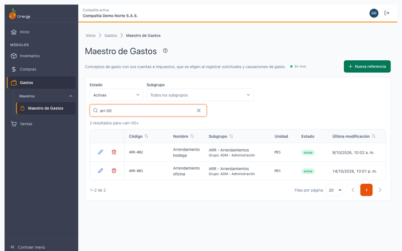
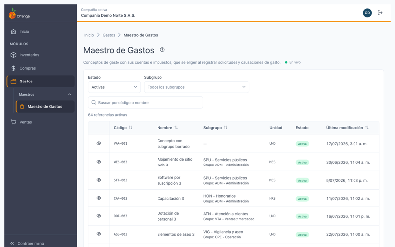
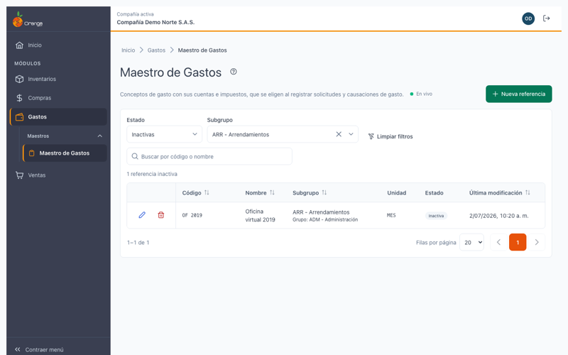
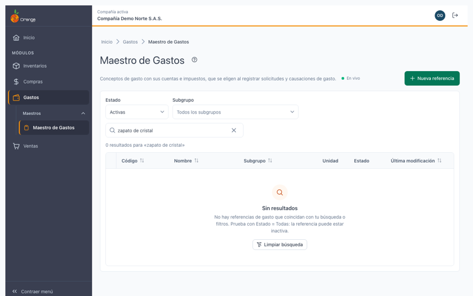
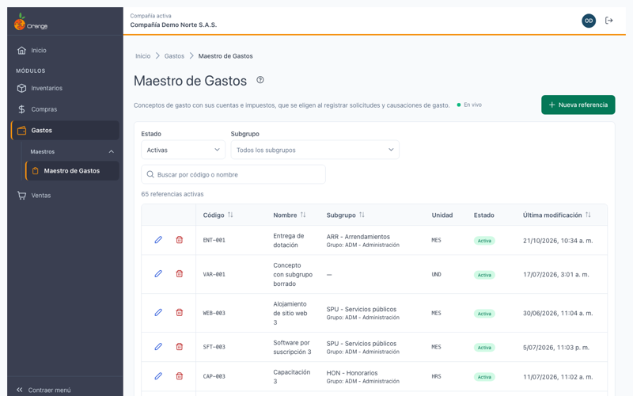

[Regresar a Gastos](../readme.md)

---

# 🧾 Maestro de Gastos

---

## 📋 Descripción

El **Maestro de Gastos** es la lista de **conceptos de gasto** de la compañía: por ejemplo, arrendamiento de oficina, energía eléctrica o servicios de mensajería. Cada concepto (una **referencia de gasto**) tiene su código, su nombre, su subgrupo, su unidad de medida, sus impuestos (IVA) y sus cuentas contables y, si lo necesita, sus proveedores.

Las referencias de gasto son las que se eligen al registrar una **solicitud** o una **causación de gasto**. Por eso conviene mantenerlas al día.

En esta pantalla puede **consultar, crear, editar y eliminar** referencias de gasto de la compañía con la que está trabajando. Si tiene el permiso correspondiente, también puede **crear y actualizar muchas referencias a la vez desde un archivo de Excel**. Vea [Importar gastos desde Excel](#-importar-gastos-desde-excel).

> 📘 La búsqueda, el orden, la paginación y la ayuda funcionan igual que en el resto de las pantallas. Para la página donde crea o modifica una referencia, vea [Detalle de una referencia de gasto](maestro-de-gastos-detalle.md).

> 💡 Cada pestaña del navegador trabaja con **una compañía**. El nombre de la compañía aparece en el título de la pestaña y en la barra superior.

---

## 🎯 Acceso

1. En el menú principal, haga clic en **Gastos**.
2. En **Maestros**, haga clic en **Maestro de Gastos**.

---

## 🖥️ Pantalla principal

| Elemento | Para qué sirve |
|----------|----------------|
| **?** (junto al título) | Abre esta ayuda en un panel lateral, sin salir de la pantalla. |
| **En vivo** | La pantalla está conectada: los cambios de otros usuarios aparecen solos. Ver *Cambios de otros usuarios* más abajo. |
| **Importar** | Abre el asistente para crear y actualizar referencias desde un archivo de Excel. Ver [Importar gastos desde Excel](#-importar-gastos-desde-excel). |
| **Nueva referencia** | Abre la página para crear una referencia de gasto. |
| **Estado** | Muestra **Activas** (predeterminado), **Inactivas** o **Todas**. |
| **Subgrupo** | Limita el listado a un subgrupo. Escriba el código o el nombre para buscarlo. |
| **Buscar por código o nombre** | Filtra el listado mientras escribe. Escriba al menos 2 letras. No distingue mayúsculas ni tildes. |
| **Limpiar filtros** | Vuelve a Estado = Activas y quita el subgrupo. Aparece solo cuando hay un filtro distinto del predeterminado. |
| **Lápiz** / **Papelera** | Editar o eliminar la referencia de esa fila. Están en la **primera columna**. |
| **Encabezados** | Un clic ordena de forma ascendente, el segundo descendente y el tercero quita el orden. |
| **Filas por página** y paginación | Cambian cuántas referencias ve por página (10, 20, 50 o 100) y la página. |

Las columnas son **Código**, **Nombre**, **Subgrupo** (con el grupo debajo), **Unidad**, **Estado** (Activa o Inactiva) y **Última modificación** (fecha y hora del último cambio). Al entrar, las referencias aparecen de la más reciente a la más antigua.

Encima de la tabla verá el resumen: **64 referencias activas** sin búsqueda, o **2 resultados para «arr-00»** mientras busca.

> 📱 En el celular cada referencia se muestra como una tarjeta, con las acciones arriba.

**¿No ve algún botón?** Cada acción depende de los permisos de su perfil sobre la opción Maestro de Gastos:

| Permiso | Qué habilita |
|---------|--------------|
| Consultar | Ver la pantalla y las referencias |
| Crear | **Nueva referencia** |
| Actualizar | **Lápiz** (editar). Sin este permiso, el lápiz se convierte en **Ver** y la referencia se abre en solo consulta. |
| Eliminar | **Papelera** (eliminar) |
| Exportar | **Importar** (importar desde Excel) |

Con solo el permiso de consulta el listado se ve completo, pero no aparecen los botones de crear, editar, eliminar ni importar.

> ℹ️ Los permisos de la opción Maestro de Gastos son independientes de los de **Referencias** de Inventarios. Tener permisos en Referencias no da acceso a esta pantalla, y al revés.

---

## 🔎 Buscar, filtrar y ordenar

- **Buscar:** escriba un código o parte de un nombre. El listado se actualiza solo, unos instantes después de dejar de escribir. Por ejemplo, *ARR* encuentra *ARR-001* y *Arrendamiento oficina*.
- **Estado:** en **Activas** solo ve las referencias que se pueden elegir al registrar un gasto. Elija **Inactivas** o **Todas** para ver también las que dejó de usar.
- **Subgrupo:** elija un subgrupo para ver solo sus referencias.
- **Orden:** haga clic en el encabezado de la columna. El orden se mantiene al cambiar de página.

Si la búsqueda o los filtros no encuentran nada, verá **Sin resultados** con el botón **Limpiar búsqueda**. Si busca una referencia que sabe que existe y no aparece, cambie **Estado** a **Todas**: puede estar inactiva.

Si todavía no hay referencias de gasto en la compañía, verá **Aún no hay referencias de gasto** y, si tiene permiso para crear, el botón **Nueva referencia**.

---

## ➕ Crear una referencia de gasto

1. Haga clic en **Nueva referencia**.
2. Complete los datos en la pestaña **Referencia** y, si lo necesita, en **Configuración contable**.
3. Haga clic en **Guardar referencia**.

Al guardar verá el mensaje **"Referencia {nombre} creada"**. La página queda abierta en la referencia recién creada, lista para agregarle proveedores.

Para los campos y sus reglas, vea [Detalle de una referencia de gasto](maestro-de-gastos-detalle.md#-crear-una-referencia-de-gasto).

---

## ✏️ Editar una referencia de gasto

1. Haga clic en el **lápiz** de la referencia.
2. Cambie los datos que necesite y haga clic en **Guardar referencia**.

Si no cambió nada, el sistema no guarda nada y le indica **"No había cambios que guardar"**.

Para los detalles de cada campo, vea [Detalle de una referencia de gasto](maestro-de-gastos-detalle.md#-editar-una-referencia-de-gasto).

---

## 🗑️ Eliminar una referencia de gasto

1. Haga clic en la **papelera** de la referencia.
2. Revise el código y el nombre que aparecen en el mensaje y confirme con **Eliminar**.

Al confirmar, la referencia desaparece del listado y verá el mensaje **"Referencia {nombre} eliminada"**. Esta acción no se puede deshacer: con la referencia se borran también sus proveedores.

### Referencia que ya se usó

Una referencia **no se puede eliminar** si ya se usó en una solicitud o en una causación de gasto. Esto protege los gastos registrados: si se borrara la referencia, esos documentos quedarían sin concepto.

En ese caso verá el aviso **"No se puede eliminar"**, con el código y el nombre de la referencia y la indicación de inactivarla:

El botón **Ir a inactivarla** lleva a la referencia con el campo **Activa** listo para desmarcarlo. Después, haga clic en **Guardar referencia**.

**Inactivar** no borra nada: la referencia sigue en el listado (con el estado **Inactiva**) y puede verla con el filtro **Inactivas** o **Todas**. Lo que cambia es que deja de ofrecerse al registrar nuevas solicitudes y causaciones de gasto. Si la necesita de nuevo, vuelva a marcar **Activa**.

> ℹ️ Una referencia que nunca se usó en un documento sí se elimina. Solo tiene que confirmar.

---

## 📥 Importar gastos desde Excel

Con la importación puede **crear** referencias nuevas y **actualizar** las que ya existen, desde un libro de Excel, sin entrarlas una por una. **Nada se guarda hasta que revise la vista previa y haga clic en Aplicar.**

### Quién puede importar

El botón **Importar** aparece en el listado solo si su perfil tiene el permiso **Exportar** sobre la opción Maestro de Gastos. Sin ese permiso no lo verá, aunque sí pueda crear o editar referencias.

Para ver el paso a paso de la pantalla, tiene tres pasos: **Cargar archivo**, **Revisar** y **Resultado**.

### Paso 1: cargar el archivo

1. En el listado, haga clic en **Importar**.

   [captura pendiente: importar-listado]

2. En **Plantilla**, haga clic en **Descargar plantilla**. Se descarga un libro de Excel con la hoja **Gastos** y solo los encabezados. Complétela y guárdela en formato **.xlsx**.
3. En **Archivo**, elija el archivo de Excel (**Archivo de Excel (.xlsx)**).

El archivo admite **hasta 5.000 filas** y **5 MB**. Si el libro tiene otras hojas, se ignoran: solo se lee la hoja **Gastos**.

[captura pendiente: importar-cargar]

#### Columnas de la hoja Gastos

La hoja tiene **21 columnas**, en este orden. La primera es la llave: el **Código** identifica cada referencia.

| # | Columna | Obligatoria | Qué escribir |
|:-:|---------|-------------|--------------|
| 1 | **Código** | Sí (llave) | Hasta 20 caracteres: letras, números y **. _ / -**, sin espacios. Si ya existe, la referencia se actualiza; si no, se crea. |
| 2 | **Nombre** | Sí, al crear | Hasta 100 caracteres, sin comas ni punto y coma. |
| 3 | **Código subgrupo** | Sí, al crear | Código del subgrupo. Debe existir en la compañía. |
| 4 | **Código unidad de medida** | Sí, al crear | Código de la unidad de medida. |
| 5 | **Código bodega por defecto** | No | Código de la bodega. |
| 6 | **Código tercero principal** | No | Número de documento del tercero. Debe estar activo. |
| 7 | **Activo** | No | Sí o No. En filas nuevas, vacía queda en **Sí**. |
| 8 | **Favorito POS** | No | Sí o No. |
| 9 | **Liquida IVA** | No | Sí o No. En filas nuevas, vacía queda en **Sí**. |
| 10 | **IVA incluido** | No | Sí o No. |
| 11 | **Código IVA generado** | No | Código del impuesto. |
| 12 | **Código IVA descontable** | Sí, si Liquida IVA es Sí | Código del impuesto. |
| 13 | **Código IVA devoluciones** | No | Código del impuesto. |
| 14 | **Cuenta bruto** | Sí, al crear | Código de la cuenta de movimiento del valor bruto. |
| 15 | **Naturaleza bruto** | Sí, al crear | **C** (crédito) o **D** (débito). |
| 16 | **Cuenta IVA** | No | Código de la cuenta. Si la indica, escriba también su naturaleza. |
| 17 | **Naturaleza IVA** | No | **C** o **D**. |
| 18 | **Cuenta descuento** | No | Código de la cuenta. Si la indica, escriba también su naturaleza. |
| 19 | **Naturaleza descuento** | No | **C** o **D**. |
| 20 | **Costo esperado** | No | Cero o un valor mayor, con hasta 2 decimales. |
| 21 | **Costo calculado** | No | Cero o un valor mayor, con hasta 2 decimales. |

#### Reglas

- **Celda vacía en una fila que actualiza:** deja el valor que la referencia ya tiene. No borra nada.
- **Filas nuevas:** deben traer Código, Nombre, Código subgrupo, Código unidad de medida, Cuenta bruto con su Naturaleza bruto. Si **Liquida IVA** es **Sí**, el **Código IVA descontable** es obligatorio.
- **Sí y No:** en Activo, Favorito POS, Liquida IVA e IVA incluido escriba **Sí** o **No** (también se aceptan **1** y **0**).
- **Subgrupo, unidad, bodega e impuestos** se escriben por su **código**. El **tercero principal** se escribe por su **número de documento**.
- **Cuentas:** se escriben por su código, y la cuenta debe ser de movimiento.
- **Código de otro tipo:** si el código ya existe como referencia de **otro tipo** (por ejemplo, una referencia de inventario), la fila tiene error y no se aplica.
- **Código repetido en el archivo:** si un código aparece en dos filas, las dos filas tienen error.
- **Filas vacías:** se omiten y la pantalla indica cuántas fueron.
- **La importación nunca borra gastos** ni cambia el código de una referencia existente.

### Paso 2: revisar la vista previa

Al cargar el archivo, la pantalla revisa cada fila **sin guardar nada**. Verá:

- El **resumen del archivo**: **Nuevas**, **Se actualizan**, **Sin cambios** y **Con error**.
- Una tabla con las columnas **Fila Excel**, **Código**, **Nombre**, **Cambios**, **Estado** y **Errores**. En **Cambios** aparece cada dato que cambiaría, como *Campo: antes → después*.
- El filtro **Filtrar por estado** para ver solo las nuevas, las que se actualizan, las sin cambios o las que tienen error.

[captura pendiente: importar-revision]

Si hay filas con error, verá el aviso *"Las filas con error no se aplican. Corrígelas en el archivo y vuelve a cargarlo, o aplica solo las válidas."* Cada motivo aparece en la columna **Errores** de su fila.

[captura pendiente: importar-errores]

- **Descargar filas con error** baja un archivo solo con las filas que tienen error, para corregirlas.
- **Cargar otro archivo** vuelve al paso 1.
- Si ninguna fila cambia nada, verá *"No hay cambios para aplicar."*

### Paso 3: aplicar

Haga clic en **Aplicar** (por ejemplo, **Aplicar 12 cambios**). Mientras se guarda verá **Aplicando…**.

- **Todo o nada:** las filas válidas se guardan todas juntas o ninguna. Si el guardado falla, no queda nada a medias.
- Las **filas con error no se aplican**: la pantalla las informa y no las cambia.

Al terminar verá **Importación aplicada**, con el número de referencias creadas y actualizadas, y cuántas filas con error no se aplicaron. Desde ahí puede hacer clic en **Ver gastos** para volver al listado o en **Importar otro archivo**.

[captura pendiente: importar-resultado]

### Si alguien cambió gastos mientras revisaba

Si otra persona crea, cambia o elimina referencias mientras usted revisa la vista previa, la pantalla se lo avisa:

- *"Otro usuario cambió gastos mientras revisabas. Vuelve a validar antes de aplicar."*
- Si al aplicar ya hubo un cambio de otro usuario, **no se guarda ningún cambio** y verá: *"Alguien cambió gastos después de la revisión. No se guardó ningún cambio: vuelve a validar el archivo."*

En ambos casos, haga clic en **Volver a validar** para revisar el archivo con los datos actuales.

[captura pendiente: importar-conflicto]

### Mensajes frecuentes de la importación

**Sobre el archivo:**

| Mensaje | Qué hacer |
|---------|-----------|
| *El archivo debe ser un libro de Excel (.xlsx).* | Guárdelo como .xlsx. |
| *El archivo no tiene la hoja Gastos.* | Ponga los datos en una hoja llamada **Gastos**. Descargue la plantilla si lo necesita. |
| *A la hoja Gastos le faltan las columnas: …* | Use la plantilla y no cambie los encabezados. |
| *La hoja Gastos no tiene filas con datos.* | Escriba al menos una referencia. |
| *La hoja Gastos tiene más de 5.000 filas. Divide el archivo.* | Divídalo en varios archivos. |
| *El archivo pesa más de 5 MB.* | Divídalo o quite lo que no necesita. |
| *El servidor no reconoció el formato del archivo. Descarga la plantilla y vuelve a intentarlo.* | Descargue la plantilla y copie sus datos en ella. |

**Sobre las filas (en la columna Errores):**

| Mensaje | Qué hacer |
|---------|-----------|
| *Código: usa hasta 20 caracteres (letras, números y . _ / -), sin espacios.* | Corrija el código. |
| *El código {código} ya existe como referencia de otro tipo.* | Ese código es de otra clase de referencia. Use otro código. |
| *El código se repite en el archivo (filas …).* | Deje un solo código por fila. |
| *Nombre: hasta 100 caracteres, sin comas ni punto y coma.* | Acorte el nombre o quite las comas y los punto y coma. |
| *Falta el nombre (obligatorio al crear).* | Escriba el nombre. |
| *Subgrupo {código}: no existe en la compañía.* | Use un código de subgrupo existente. |
| *Falta el subgrupo (obligatorio al crear).* | Escriba el código del subgrupo. |
| *Falta la unidad de medida (obligatoria al crear).* | Escriba el código de la unidad. |
| *Liquida IVA es Sí: falta el IVA descontable.* | Escriba el código del IVA descontable o cambie Liquida IVA a No. |
| *Tercero {documento}: no existe o está inactivo.* | Use un tercero activo. |
| *{columna}: la cuenta {código} no es de movimiento.* | Use una cuenta de movimiento. |
| *Falta la cuenta de valor bruto (obligatoria).* | Escriba la cuenta del valor bruto y su naturaleza. |
| *Naturaleza: escriba C (crédito) o D (débito).* | Corrija la naturaleza. |
| *{columna}: escribe Sí o No.* | Use Sí o No (o 1 y 0). |
| *{columna}: escribe un número válido.* | Revise el valor de costo. |
| *{columna}: use hasta {n} caracteres.* | Acorte el texto. |
| *{columna} {código}: no existe en la compañía.* | Use un código existente, o pida a su administrador que lo cree. |
| *La compañía no tiene configurados los atributos necesarios para crear gastos…* | Pida a un administrador que configure los atributos de la compañía. |

**Sobre el guardado:**

| Mensaje | Qué hacer |
|---------|-----------|
| *No se pudo aplicar. No se guardó ningún cambio. Inténtalo de nuevo.* | Haga clic en **Reintentar**. |
| *Tu perfil ya no permite esta acción. Recarga la página para ver tus permisos actuales.* | Recargue la página. |

---

## 🔄 Cambios de otros usuarios (en vivo)

Si otra persona crea, modifica o elimina referencias de gasto mientras usted tiene abierto el listado, **no tiene que recargar**: el listado se pone al día solo, sin perder lo que buscó, el filtro, el orden ni la página.

- Las filas nuevas o modificadas se **resaltan** unos segundos.
- Abajo a la derecha aparece un aviso, por ejemplo *"Otro usuario creó la referencia ARR-002."*
- Si otra persona importó un archivo, verá el aviso *"Otro usuario importó N gastos."*, con el número de referencias importadas.
- Junto a la descripción verá **En vivo** mientras la conexión esté activa. Si se interrumpe, verá **Reconectando…**; al volver, la pantalla se actualiza sola.

Si estaba editando una referencia que otro usuario cambió o eliminó, vea [Detalle de una referencia de gasto](maestro-de-gastos-detalle.md#-cambios-de-otros-usuarios-en-vivo).

> ℹ️ Los cambios que usted hace en esta misma pestaña no generan avisos.

---

## ❓ Preguntas frecuentes

**¿Por qué no veo una referencia que sé que existe?**
Es probable que esté inactiva. Cambie **Estado** a **Todas**. También revise que esté en la compañía correcta (título de la pestaña) y que no tenga un subgrupo elegido en el filtro.

**¿Qué significa "Inactiva"?**
La referencia no se ofrece al registrar nuevas solicitudes o causaciones de gasto. Los documentos que ya la usaron no cambian.

**¿Por qué no puedo eliminar una referencia?**
Porque ya se usó en una solicitud o en una causación de gasto. Inactívela para que deje de ofrecerse. Vea *Referencia que ya se usó* más arriba.

**¿Por qué no encuentro el botón Nueva referencia, Editar, Eliminar o Importar?**
Su perfil no tiene ese permiso sobre la opción Maestro de Gastos. Importar requiere el permiso **Exportar**. Pida a su administrador que lo revise.

**¿Por qué la importación no aplicó nada?**
Revise el aviso de la pantalla. Si dice que alguien cambió gastos, haga clic en **Volver a validar** y aplique de nuevo. Si todas las filas tienen error, corríjalas con la columna **Errores** y vuelva a cargar el archivo.

**¿Puedo exportar el listado a Excel?**
Por ahora no. Sí puede **importar** referencias desde Excel: vea [Importar gastos desde Excel](#-importar-gastos-desde-excel).

**No veo "En vivo".**
La conexión en vivo no está disponible en este momento (por ejemplo, por la red de su empresa). La pantalla funciona igual; para ver los cambios de otros usuarios, recargue la página.

**El listado no carga y aparece "No se pudieron cargar las referencias de gasto".**
Revise su conexión y haga clic en **Reintentar**. Si el problema continúa, avise a su administrador.
