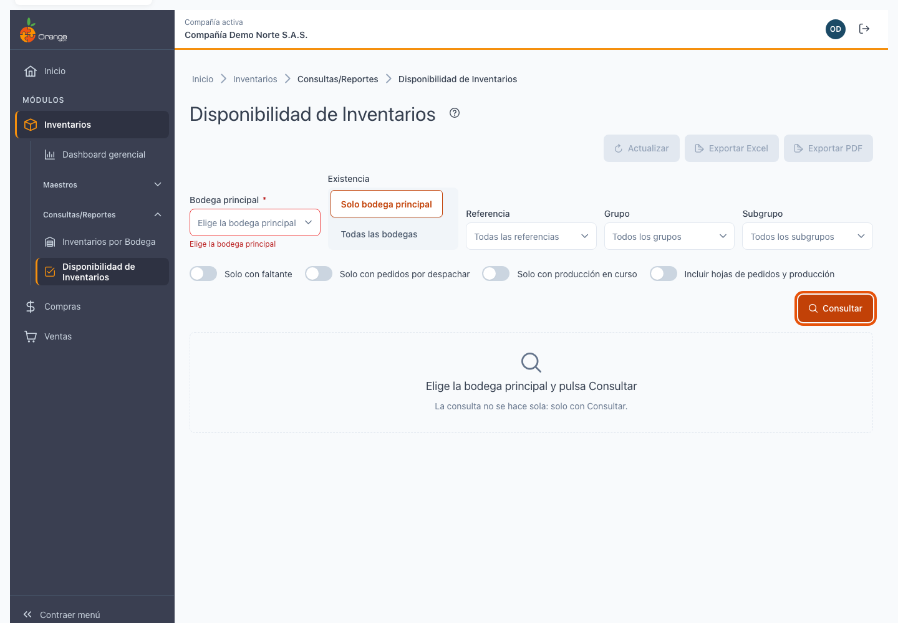
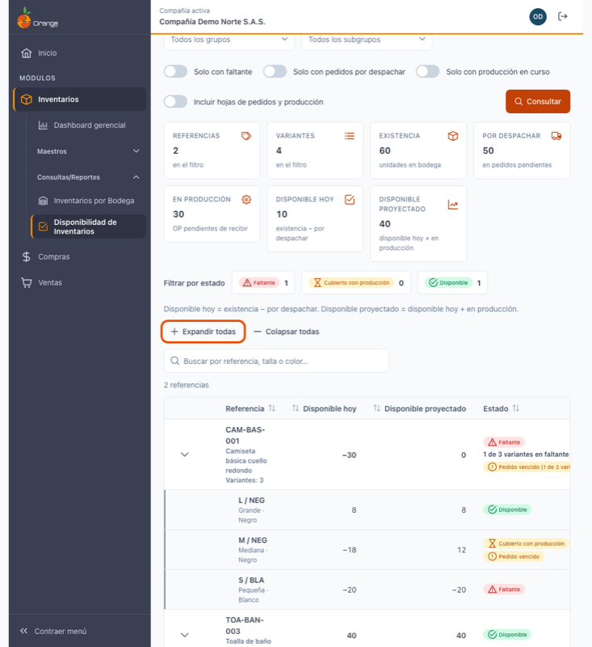
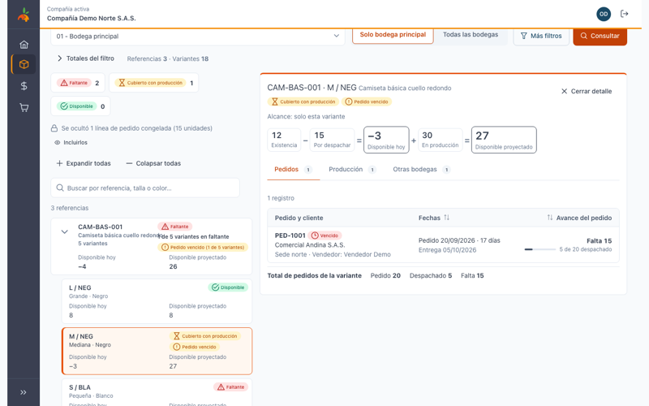
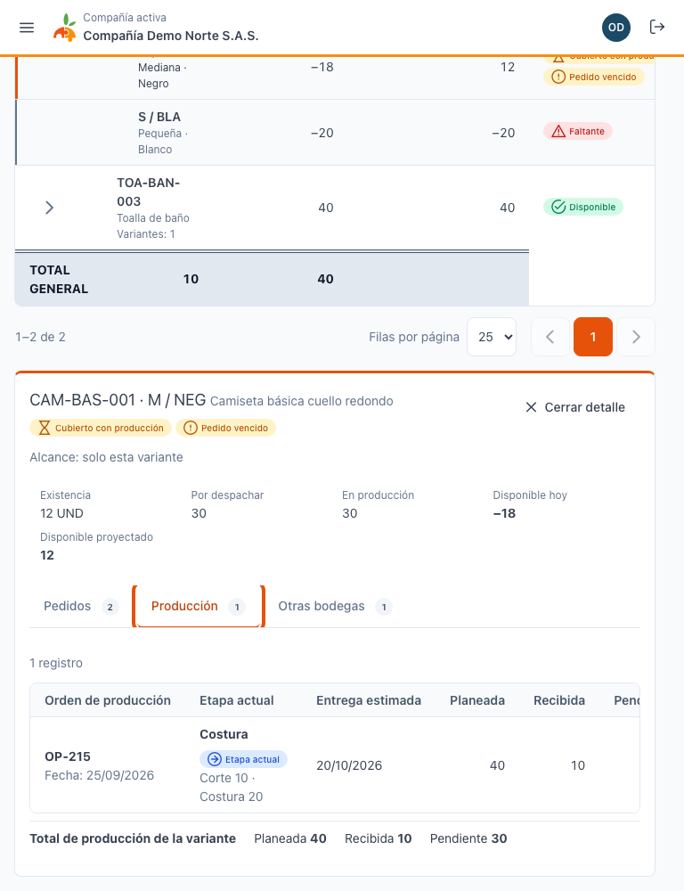
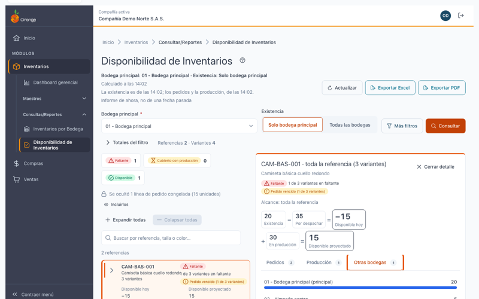
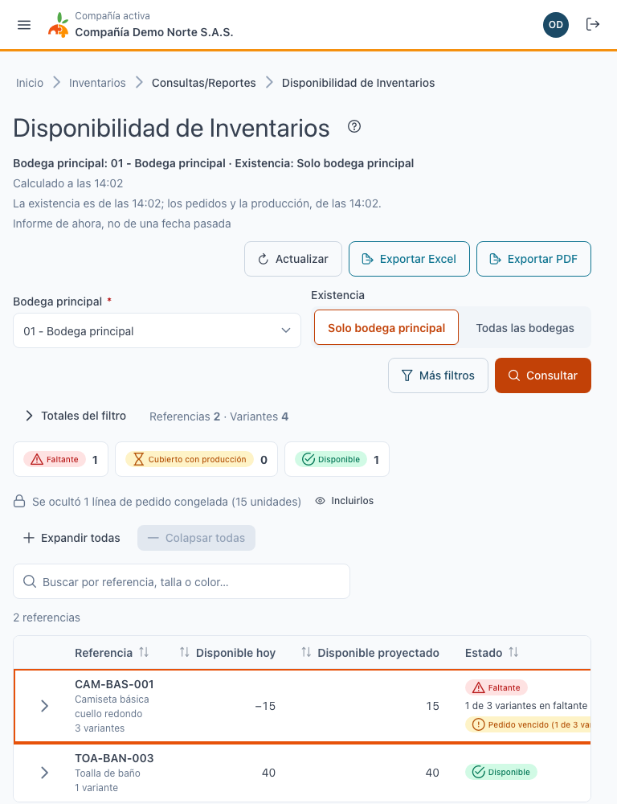
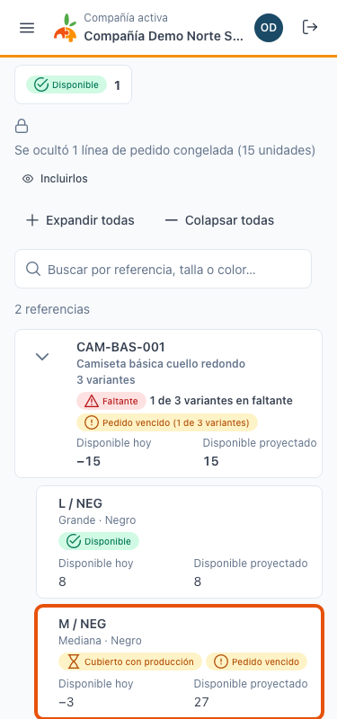
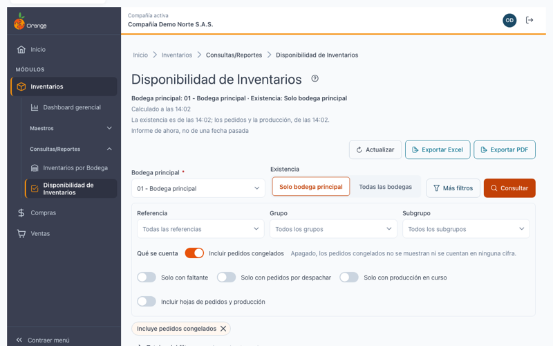

[Regresar a Inventarios](../readme.md)

---

# 📦 Disponibilidad de Inventarios

---

## 🎯 Qué es y para qué sirve

---

## 📋 Descripción

Consulta que muestra **cuánto hay de cada referencia (por talla, color, etc.) en la bodega, cuánto está comprometido con pedidos sin despachar, cuánto viene en producción y cuánto viene en órdenes de compra sin recibir**. Así sabe **qué puede ofrecer ahora y qué podrá ofrecer cuando lleguen la fabricación y las compras**. Es de **solo lectura**: no crea ni cambia información. Se puede abrir desde el maestro de **Referencias** con la acción "Ver disponibilidad", filtrada por esa referencia.

Muestra, por referencia y por variante (talla, color, etc.), **cuánto hay hoy, cuánto está comprometido en pedidos, cuánto viene en producción y cuánto se puede ofrecer**. Reúne en una sola pantalla la existencia, los pedidos pendientes de despachar y la producción en tránsito.

**Cómo se calcula:**

- **Disponible hoy** = Existencia − Por despachar
- **Disponible proyectado** = Disponible hoy + En producción

---

## ℹ️ Antes de empezar

| Requisito | Detalle |
|-----------|---------|
| **Permiso** | Opción **Disponibilidad de Inventarios**: **Consultar** (obligatorio) y **Exportar** (opcional). |
| **Bodega principal** | Es obligatoria. El sistema recuerda la última que eligió. |
| **Qué referencias aparecen** | Solo las que **manejan inventario**. |
| **Información de ahora** | El informe es de este momento, no de una fecha pasada. La pantalla indica la hora del cálculo. |

---

## 3️⃣ Cómo consultar
**Permisos:**

| Permiso | Qué permite |
|---------|-------------|
| **Consultar** (Disponibilidad) | Ver la pantalla y consultar. Sin él, "No tienes acceso a esta consulta". |
| **Exportar** (Disponibilidad) | Ver botones **Exportar Excel** y **Exportar PDF**. |
| **Consultar** (Órdenes de compra) | Ver la pestaña **Compras en tránsito** con el detalle de cada orden. Sin él, la cifra **En tránsito (compras)** sí se ve. |

---

## 🖥️ Pantalla principal

Al entrar, la pantalla no muestra datos: elija la bodega y pulse **Consultar**.

| Elemento | Para qué sirve |
|----------|----------------|
| **?** (junto al título) | Abre esta ayuda en un panel lateral. |
| **Calculado a las HH:MM** | Hora del cálculo. |
| **Actualizar** | Recalcula si han pasado 60+ segundos. Ver *El día en curso*. |
| **Exportar Excel** / **Exportar PDF** | Descargan todo lo filtrado. Deshabilitados sin resultados. |
| **Bodega principal** | **Obligatoria.** El sistema la recuerda. Es también la bodega que se usa para las compras en tránsito (ver abajo). |
| **Existencia: Solo bodega principal / Todas las bodegas** | Por defecto solo la bodega elegida. Active para incluir todas. |
| **Más filtros** | Despliega **Referencia**, **Grupo**, **Subgrupo**, el grupo **Qué se cuenta** y los interruptores de estado. |
| **Solo con faltante, Solo con pedidos, Solo con producción, Solo con compras en tránsito** | Interruptores para ver referencias que tienen ese estado. |
| **Consultar** | Trae el resultado. Cambiar un filtro no consulta solo. |

### Grupo "Qué se cuenta" (en Más filtros)

| Interruptor | Qué hace |
|-------------|----------|
| **Incluir pedidos congelados** | Apagado por defecto. Ver *Qué cuenta*. |
| **Incluir OC sin cerrar** | **Activo por defecto.** Cuenta las órdenes de compra abiertas (sin cerrar). Apagado, solo cuentan las cerradas. |

Cuando un interruptor de este grupo cambia de su valor normal, aparece un **chip** (resumen) en la pantalla. Por ejemplo, con **Incluir OC sin cerrar** apagado aparece el chip **OC sin cerrar excluidas**.

---

## 📊 Leer el resultado

### Grilla por referencia

La tabla muestra **una fila por referencia**, con cifras **sumadas de todas sus variantes**:

- **Referencia**: código y nombre.
- **Variantes**: cuántas tallas, colores, etc. ("3", o "100 de 108" con botón "Ver las 8 restantes").
- **Existencia**: total en la bodega elegida (o en todas, si lo activó).
- **Por despachar**: saldo pendiente de pedidos, sumado.
- **Disponible hoy**: Existencia − Por despachar.
- **En producción**: en fabricación, no recibido.
- **En tránsito (compras)**: órdenes de compra pendientes de recibir (ver [Compras en tránsito](#compras-en-transito)).
- **Disponible proyectado**: Disponible hoy + En producción + En tránsito (compras).
- **Estado**: el **peor** de todas las variantes + "1 de 3 variantes en faltante" (u otra cifra).

Números negativos con signo "−".

Puede ordenar la tabla por cualquier columna, incluida **En tránsito (compras)**: haga clic en el encabezado.

### Expandir variantes

Haga clic en **▶** para ver sus variantes debajo (p.ej. "M / NEG", "L / NEG"). Botones **Expandir todas** / **Colapsar todas** arriba de la grilla.

Expandir **no abre el detalle**: solo muestra las variantes.

1. Elija la **Bodega principal**.
2. Elija la **Existencia**: **Solo bodega principal** (por defecto) o **Todas las bodegas**.
3. Si lo necesita, abra **Más filtros**: referencia, grupo y subgrupo; **Solo con faltante**, **Solo con pedidos por despachar**, **Solo con producción en curso**; y **Qué se cuenta** (ver más abajo).
4. Pulse **Consultar**.

**Cálculo en segundo plano.** Si no hay un cálculo reciente, el sistema lo prepara y puede tardar unos segundos. Cuando termina, le avisa en las notificaciones.

**Actualizar.** Vuelve a leer los datos. Si otra persona cambia información mientras usted consulta, aparece el aviso **"Hay cambios desde las HH:MM"** con el botón **Actualizar**; la pantalla no se actualiza sola.

---

## 📊 Leer la lista

### Detalle con pestañas

El detalle aparece debajo con sus pestañas: **Pedidos · Producción · Compras en tránsito · Otras bodegas**. Cada una tiene un contador (p.ej. "Pedidos (3)").

La pestaña **Compras en tránsito** solo aparece si tiene el permiso de **Órdenes de compra**. Sin ese permiso, el detalle tiene las otras tres pestañas.

**Solo la pestaña activa consulta** (más rápido). Las demás consultan cuando las activa.

**Pestaña por defecto:** la primera con datos, en ese orden (Pedidos, Producción, Compras en tránsito, Otras bodegas). Se recuerda durante la sesión.

La lista tiene **una fila por referencia** con las cifras sumadas de todas sus variantes. Cada fila muestra:

| Dato | Qué significa |
|------|---------------|
| **Referencia** | Código y nombre, con el número de variantes. Pulse la flecha para ver las variantes debajo. |
| **Disponible hoy** | Existencia menos lo que falta por despachar. |
| **Disponible proyectado** | Disponible hoy más lo que viene en producción. |
| **Estado** | Ver abajo. |

**Estados** (siempre con texto e ícono):

- ✅ **Disponible**: alcanza con lo que hay hoy.
- ⏳ **Cubierto con producción**: hoy no alcanza, pero la producción en tránsito lo cubre.
- ⚠️ **Faltante**: no alcanza ni con la producción.
**Compras en tránsito:** orden y proveedor, comprador, fechas (orden y entrega), cantidades (Pedida, Recibida, Pendiente) con barra de avance. Las marcas **Vencida** y **Sin cerrar** señalan órdenes entregadas tarde o todavía abiertas. Ordenada por fecha de entrega y paginada. **No muestra valores de dinero.** Con alcance **referencia**, columna "Variante". Total en el pie.

**Otras bodegas:** bodega (la principal marcada) y existencia. Con alcance referencia, columna "Variante" (fila por variante y bodega). Totales.

El estado de una referencia es **el peor de sus variantes**, con el texto "N de M variantes en faltante": que sobre una talla no tapa el faltante de otra.

**Filtros rápidos.** Arriba de la lista, los botones **Faltante**, **Cubierto con producción** y **Disponible** muestran cuántas referencias hay en cada estado y sirven de filtro. **Totales del filtro** (plegable) resume las cifras de todo el resultado.

---

## 👁️ Ver el detalle

Haga clic en una **referencia** para ver el detalle de **toda la referencia**, o en una **variante** para ver solo esa variante. También sirve el botón **Detalle** de la fila.

- **Orden:** clic en encabezado de columna.
- **Búsqueda:** escriba (≥ 2 caracteres) para filtrar referencias. Al expandir, las que coinciden quedan resaltadas "Coincide con el filtro".
- **Cambiar filtro/página/tamaño/orden/búsqueda:** cierra detalle y colapsa referencias.
- **Actualizar:** conserva detalle, expansión y pestaña. Recarga solo la pestaña visible.
  - Si la selección desaparece: cierra con aviso "La selección ya no aparece en el resultado".

---

## 🚚 Compras en tránsito

### Qué es

**En tránsito (compras)** es la cantidad que **ya se pidió a un proveedor** en una **orden de compra** y **todavía no ha llegado** a la bodega. Viene de la pantalla de **Órdenes de compra** (Compras).

Una orden de compra **no mueve la existencia**: lo que se pidió no se puede despachar hoy. Por eso la compra solo aumenta el **disponible proyectado**, no el disponible hoy.

**Qué cuenta como tránsito, en una línea de orden:**

- Cantidad pedida − cantidad ya recibida. Nunca es menor que cero.
- Solo las órdenes **abiertas** y **cerradas** de la compañía. Las **anuladas** no cuentan.
- Las órdenes **vencidas** (la fecha de entrega ya pasó) **sí cuentan**, y se marcan como **Vencida**.
- Una orden **abierta** se marca **Sin cerrar**, porque todavía puede cambiar. Si el interruptor **Incluir OC sin cerrar** está apagado, esas órdenes no cuentan.
- Solo cuentan las líneas de la **bodega seleccionada** en la pantalla. Si elige **Todas las bodegas**, cuentan las de todas.

### Fórmula con un ejemplo

**Disponible hoy = Existencia − Por despachar**

**Disponible proyectado = Existencia − Por despachar + En producción + En tránsito (compras)**

Dicho con letras: **E − PD + T + C** (E = existencia, PD = por despachar, T = en producción, C = en tránsito de compras).

Ejemplo de la variante **S/BLA** en la bodega elegida:

| Concepto | Valor |
|----------|-------|
| Existencia (E) | 12 |
| Por despachar (PD) | 30 |
| En producción (T) | 30 |
| En tránsito de compras (C) | 20 |
| **Disponible hoy** = 12 − 30 | **−18** |
| **Disponible proyectado** = 12 − 30 + 30 + 20 | **32** |

El **disponible hoy** es −18: hoy faltan unidades, porque la compra todavía no llegó. El **disponible proyectado** es 32: con la producción y las compras que llegan, la variante queda cubierta.

El encabezado del detalle muestra la misma cuenta: "Existencia 12 − Por despachar 30 + En producción 30 + En tránsito 20 = Disponible 32".

### Bodega seleccionada

El tránsito se cuenta **en la bodega que elige** en la pantalla, aunque no sea la bodega principal de la compañía. Una orden con líneas en otra bodega **no cubre** la bodega que usted consulta.

- Bodega 3 seleccionada, con 20 unidades en la bodega 3 y 15 en la bodega 5: **En tránsito = 20**.
- Si selecciona la bodega 5 y consulta: **En tránsito = 15**.
- Con **Todas las bodegas**: **En tránsito = 35** (la suma de todas).

### Estados cubiertos por compras

Una variante **falta hoy** cuando su disponible hoy es menor que cero. Entonces el estado depende de cómo se cubre:

| Estado | Cuándo |
|--------|--------|
| **Disponible** ✓ | Disponible hoy ≥ 0. |
| **Cubierto** ⏱ | Falta hoy, pero el disponible proyectado queda ≥ 0. El texto dice con qué se cubre: |
| &nbsp;&nbsp;· **Cubierto con producción** | Hay producción y no hay compras en tránsito. |
| &nbsp;&nbsp;· **Cubierto con compras** | Hay compras en tránsito y no hay producción. |
| &nbsp;&nbsp;· **Cubierto con producción y compras** | Hay producción y compras en tránsito. |
| **Faltante** ⚠ | El disponible proyectado sigue menor que cero. Aunque haya producción y compras. |

El estado de la referencia sigue siendo el **peor** de sus variantes. Una talla cubierta por compras no cubre a otra que está en faltante.

> 💡 En el ejemplo de arriba (S/BLA), la variante tiene producción **y** compras, por eso dice "Cubierto con producción y compras". Con la producción sola ya quedaría cubierta, pero la pantalla indica que también cuentan las compras.

### Filtro "Solo con compras en tránsito"

Muestra solo las variantes (y referencias con alguna variante así) que tienen compras en tránsito mayores que cero. Por defecto está apagado. Los **faltantes nunca se ocultan**.

Una variante **sin existencia, sin pedidos y sin producción** aparece igual si tiene compras en tránsito: es información útil para saber qué se puede ofrecer.

### Pestaña "Compras en tránsito"

- Solo aparece con el permiso **Consultar** de **Órdenes de compra**.
- Muestra cada orden con saldo pendiente: tipo y número, proveedor, comprador, fecha de la orden, fecha de entrega, cantidad pedida, recibida y pendiente.
- Las órdenes **vencidas** llevan la marca **Vencida**; las **abiertas** llevan la marca **Sin cerrar**.
- Si selecciona una **referencia**, la lista trae las órdenes de todas sus variantes, con la columna **Variante**.
- La lista se lee al abrir la pestaña. Puede diferir unos minutos de la cifra **En tránsito (compras)**.

> 💡 Sin el permiso de Órdenes de compra, la pestaña no aparece y la cifra **En tránsito (compras)** sigue visible en la grilla y en el detalle.

### Advertencias

Hay dos avisos que puede ver en la pantalla:

> ⚠️ **Tránsito posiblemente sobrestimado.** Las compras aún no registran en todos los casos la orden de compra que reciben. Si la mercancía ya llegó, la orden puede seguir mostrando esa cantidad como pendiente. Antes de prometer una entrega por esa cifra, revise la orden de compra.

> ⚠️ **Tránsito de compras no disponible.** No se pudo consultar Compras. Las cifras de **En tránsito** y **Disponible proyectado** no incluyen compras (usan solo existencia, pedidos y producción). **No es un cero:** significa que no hay dato de compras. Vuelva a consultar más tarde.

Cuando **Compras** está ocupado calculando, la pantalla espera y se actualiza sola, igual que en el cálculo de la primera consulta del día.

Los avisos de **compras en tránsito** también aparecen si Compras cambia mientras tiene la pantalla abierta (ver *Cambios de otros usuarios*).

---

## 🎨 Estados: Disponible, Cubierto, Faltante

Resumen de los estados (detalle en [Compras en tránsito](#compras-en-transito)):

| Estado | Cuándo |
|--------|--------|
| **Disponible** ✓ | Todas las variantes tienen disponible hoy ≥ 0. |
| **Cubierto con producción** ⏱ | Al menos una tiene hoy < 0 y se cubre con producción (sin compras en tránsito). |
| **Cubierto con compras** ⏱ | Al menos una tiene hoy < 0 y se cubre con compras en tránsito (sin producción). |
| **Cubierto con producción y compras** ⏱ | Al menos una tiene hoy < 0 y se cubre con producción y compras en tránsito. |
| **Faltante** ⚠ | Al menos una tiene proyectado < 0 (falta incluso con producción y compras). |

**Dónde se ve el detalle:**

| Pantalla | Cómo se ve |
|----------|------------|
| **Ancha** (desde 1280 px) | Lista a la izquierda y detalle fijo a la derecha. |
| **Tableta** | Una sola vista a la vez: al abrir el detalle ocupa la pantalla con el botón **Volver a la lista**. |
| **Móvil** | Igual que en tableta, con la lista en tarjetas. |

## 🏭 Qué cuenta: Pedidos, Producción y Compras

**Encabezado del detalle.** Muestra la fórmula: Existencia − Por despachar = Disponible hoy, y Disponible hoy + En producción = Disponible proyectado.

**Tres tabs**, con el número de registros de cada una:

1. **Pedidos**: pedido y cliente, fecha y antigüedad, y una barra con lo despachado frente a lo pedido y lo que **falta**.
2. **Producción**: orden de producción, etapa actual, fecha estimada de entrega, y lo recibido frente a lo planeado y lo pendiente. Si la orden no tiene ninguna entrada registrada aparece la advertencia **"OP sin entradas registradas"**: en ese caso lo que viene en producción puede estar sobrestimado.
3. **Otras bodegas**: la existencia en cada bodega, con una barra proporcional. La bodega principal está marcada.

Se abre primero la **primera tab con datos** (Pedidos, luego Producción y luego Otras bodegas), y el sistema recuerda la última que usó durante la sesión.

**Cerrar el detalle:** botón **Cerrar detalle**, tecla **Esc**, **Volver a la lista** o el botón **Atrás** del navegador. Al volver, la lista conserva sus filtros, las referencias expandidas y la fila seleccionada.

**Compartir.** La dirección de la página incluye la referencia (y la variante) que está viendo: puede copiarla y enviarla a otra persona con permiso.

### Órdenes de compra (En tránsito)

Ver [Compras en tránsito](#compras-en-transito): abiertas y cerradas cuentan; anuladas no; pendiente = pedido − recibido, por variante y bodega.

---

## 🏭 Qué se cuenta

### Cambios de otros usuarios

Si otra persona registra una producción, un pedido o una orden de compra mientras tiene el informe abierto, aparece el aviso **"Hay cambios desde las HH:MM. Actualizar"**. La pantalla **no** se actualiza sola: pulse **Actualizar** cuando quiera ver los cambios.

---

## ⏳ Cálculo en segundo plano

| Concepto | Regla |
|----------|-------|
| **Pedidos** | Pedidos de venta no anulados, con saldo por despachar. |
| **Pedidos congelados** | **No se muestran ni se cuentan por defecto.** En **Más filtros › Qué se cuenta** puede activar **Incluir pedidos congelados**; entonces se cuentan y aparecen marcados como *Congelado*. Cuando hay pedidos ocultos, la lista avisa: **"Se ocultó N línea(s) de pedido congelada(s) (M unidades)"**, con el botón **Incluirlos**. |
| **Despachado** | Lo facturado menos las devoluciones, por pedido y variante. Las remisiones **no** cuentan como despacho. |
| **Órdenes de producción** | Activas, no canceladas y no congeladas, con cantidad pendiente de recibir. |
| **Recibido** | Las entradas registradas con esa orden de producción. |

**Diferencia con el Reporte de Pedidos.** Calcula pedidos y despachos con la misma regla, salvo por dos puntos: aquí los pedidos congelados quedan ocultos por defecto y solo aparecen las referencias que manejan inventario.

---

## 📤 Exportar a Excel y PDF

Con el permiso **Exportar** aparecen los botones **Exportar Excel** y **Exportar PDF**. Respetan los filtros, la búsqueda y el orden de la pantalla, y también la opción de pedidos congelados.

| Formato | Contenido | Máximo |
|---------|-----------|--------|
| **Excel** | Una sección por referencia, con su subtotal y sus variantes debajo. Con **Incluir hojas de pedidos y producción** agrega las hojas "Pedidos" y "Producción". | 50.000 filas (referencias y variantes) |
| **PDF** | Lo mismo en hoja oficio horizontal, sin las hojas de detalle. | 4.000 filas (referencias y variantes) |
Con permiso **Exportar**, descargar todo lo filtrado (no solo página).

- La columna **En tránsito (compras)** sale en el Excel y en el PDF, con la misma cifra de la pantalla.
- El encabezado del archivo dice si las órdenes sin cerrar están **incluidas** o **excluidas**, y repite la advertencia de *tránsito posiblemente sobrestimado* si aplica.
- **Incluir hojas de pedidos y producción:** en el Excel, agrega hojas con el detalle.

| Formato | Máximo |
|---------|--------|
| **Excel** | 50.000 (ref. + variantes) |
| **PDF** | 4.000 (ref. + variantes) |

Si excede: filtre y reexporte.

---

## 💡 Fórmula resumida

**Disponible hoy = Existencia − Por despachar**

**Disponible proyectado = Disponible hoy + En producción + En tránsito (compras)**

**Referencia CAM-BAS-001 (3 variantes), sin compras en tránsito:**

Si el resultado supera el máximo, el sistema se lo indica: filtre más y vuelva a exportar.

Para ver cómo entra una orden de compra en la cuenta, vea el ejemplo de [Compras en tránsito](#compras-en-transito).

---

## 🔗 Entrar desde Referencias

En el maestro **Referencias**, cada referencia tiene la acción **Ver disponibilidad** (solo si usted tiene permiso de consultar este informe).
- **Tableta (768 px):** columnas secundarias ocultas.
- **Móvil (≤ 640 px):** tarjetas anidadas; detalle a pantalla completa con **Volver a la lista**; pestañas en fila con scroll. La fórmula se apila en vertical.

- Con **bodega principal recordada**, el informe consulta solo y deja la referencia abierta con su detalle.
- Sin bodega recordada, le pide elegirla y luego consulta.
- Una referencia que **no maneja inventario** muestra un aviso claro.
- Para regresar use **Volver a Referencias**: vuelve al maestro donde estaba, con la fila y el foco en esa referencia.

---

## ❓ Preguntas frecuentes

**¿Cómo veo las variantes de una referencia?**
Pulse la flecha de la fila de la referencia. También puede usar **Expandir todas**.

**¿Por qué "Disponible hoy" es negativo?**
Hay más pedidos por despachar que existencia. Si "Disponible proyectado" es positivo, la producción en tránsito lo cubre y el estado es *Cubierto con producción*.
**¿Desde dónde puedo abrir esta consulta?**
Desde **Inventarios** › **Disponibilidad de Inventarios**, o desde **Referencias** con botón "Ver disponibilidad" en cada fila.

**¿Cómo funcionan las variantes?**
La tabla suma todas las variantes (tallas, colores) en una fila de referencia. Haga clic en **▶** para verlas y **clic en una variante** para ver solo esa.

**¿Qué es el estado de referencia?**
El **peor** de sus variantes: si una está "Faltante", la referencia es "Faltante". Muestra "1 de 3 variantes en faltante", etc.

**¿Qué es "En tránsito (compras)"?**
Lo que se pidió en órdenes de compra y todavía no ha llegado. Solo suma al disponible proyectado, no al disponible hoy.

**¿Por qué el disponible hoy no cambia con una orden de compra?**
Porque lo que no ha llegado no se puede despachar hoy. La orden aumenta el disponible proyectado.

**¿Las órdenes de compra anuladas cuentan?**
No. Las abiertas y las cerradas sí. Las vencidas también cuentan y se marcan.

**¿Qué pasa si apago "Incluir OC sin cerrar"?**
Las órdenes abiertas dejan de contar. Solo cuentan las cerradas. Aparece el chip "OC sin cerrar excluidas". Recuerde pulsar **Consultar**.

**¿Por qué la compra de otra bodega no cubre lo que consulto?**
Porque el tránsito se cuenta en la bodega que eligió. Con **Todas las bodegas** cuentan todas.

**¿Por qué no veo la pestaña "Compras en tránsito"?**
Necesita el permiso de **Consultar** en Órdenes de compra. Sin él, la cifra En tránsito (compras) sí aparece.

**¿Qué significa "Tránsito posiblemente sobrestimado"?**
Que la cifra de compras puede ser mayor a lo que realmente falta por llegar, porque las compras aún no registran en todos los casos la orden que reciben. Revise la orden antes de prometer una entrega.

**¿Qué significa "Tránsito de compras no disponible"?**
Que no se pudo consultar Compras. Las cifras no incluyen compras; no es un cero. Vuelva a consultar más tarde.

**¿Qué estado tiene una variante cubierta solo por compras?**
"Cubierto con compras". Si también hace falta producción, dice "Cubierto con producción y compras".

**¿Los pedidos congelados cuentan?**
Sí, siempre. Se marcan como "Congelado" en el detalle.

**¿Las remisiones cuentan como despacho?**
No. Solo facturas de venta (y devoluciones).

**¿Qué pestaña se abre por defecto?**
La primera con datos, en el orden Pedidos, Producción, Compras en tránsito, Otras bodegas. Se recuerda durante la sesión.

**¿Cómo afecta "Actualizar" a mi detalle abierto?**
Conserva: detalle, expansión, pestaña. Recarga solo la pestaña visible. Si la selección desaparece, cierra con aviso.

**¿Por qué no veo ciertos pedidos?**
Si están congelados no se muestran por defecto. Active **Incluir pedidos congelados** en **Más filtros**.

**¿Qué es "OP sin entradas registradas"?**
La orden de producción está abierta pero no tiene ninguna entrada registrada. Lo que muestra como pendiente puede ser mayor al real; conviene confirmarlo con producción.

**¿Por qué mi informe no coincide con el Reporte de Pedidos?**
Los pedidos congelados están ocultos por defecto y solo se incluyen las referencias que manejan inventario.
**¿Qué referencias aparecen?**
Solo las que **manejan inventario**. Las que no (servicios) no cuentan.

**¿Por qué no aparece una referencia?**
Solo se muestran las que manejan inventario y tienen existencia, pedidos por despachar o producción en tránsito.

---

[Regresar a Inventarios](../readme.md)
