[Regresar a Tesorería](readme.md)

---

# 📈 Resumen del módulo (Dashboard de Tesorería)

---

## 📋 Descripción

El **Resumen del módulo** es la pantalla de inicio de Tesorería y resume en una sola pantalla cómo está el dinero de la compañía: cuánto hay en caja y bancos, cuánto entró y cuánto salió en el período, de dónde viene y a dónde va, cuánto se debe cobrar y pagar, las notas bancarias y lo que quedó pendiente.

Todas las cifras salen de las mismas reglas de los reportes de Tesorería y de las carteras. Si un número del dashboard no coincide con el reporte correspondiente, avise a su administrador.

Cada bloque se carga por separado. Si un bloque falla o su perfil no tiene acceso a él, los demás siguen visibles.

> 📘 El dashboard solo consulta: no cambia ningún recibo, egreso, nota ni cuenta.

> ℹ️ El dashboard **no se actualiza solo**. Para ver los cambios de otras personas, pulse **Actualizar**.

> 💡 Los reportes de detalle están en **Consultas y reportes**. Desde los rankings puede abrir el reporte correspondiente con el período y el elemento ya elegidos. Ver [Rankings](#-rankings).

---

## 🎯 Acceso

1. En el menú principal, haga clic en **Tesorería**.
2. El resumen se abre solo: es la pantalla de inicio del módulo. No tiene una opción propia en el menú.

Para volver a él desde otra pantalla de Tesorería, haga clic en **Tesorería** en la ruta de navegación (migas de pan) o en el menú principal.

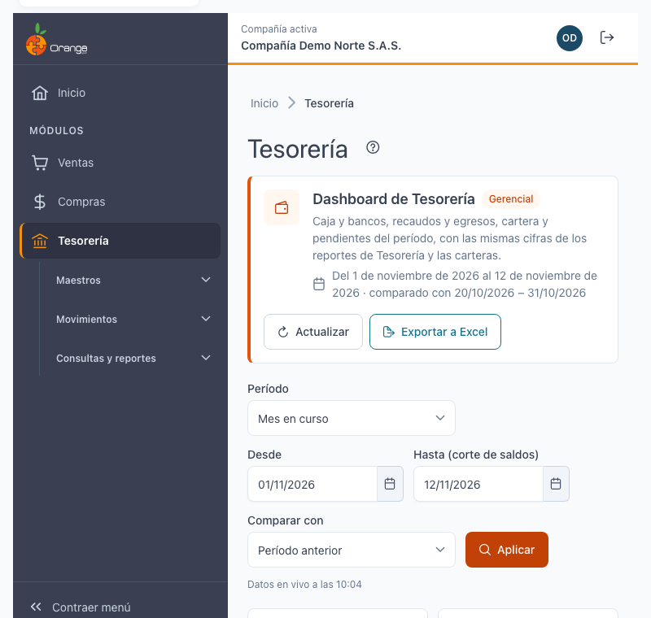

---

## 🔐 Permisos

El resumen no tiene permiso propio: lo ve cualquier usuario de la compañía que entre a Tesorería. Cada bloque exige permiso sobre la pantalla de la que sale su información.

| Permiso | Qué habilita |
|---------|--------------|
| Consultar | Ver los bloques para los que tenga **Consultar** en su pantalla de origen (tabla siguiente). |
| Exportar | El botón **Exportar a Excel**: requiere **Exportar** en **Por formas de pago**. |

Cada bloque necesita, además, uno de estos permisos:

| Bloque | Permiso que necesita |
|--------|----------------------|
| Saldos por forma de pago | Consultar en **Por formas de pago** o en **Recibos y egresos** |
| Saldos por cuenta contable | Consultar en **Por formas de pago** o en **Notas bancarias** |
| Indicadores, comparativo, tendencia y rankings de recaudos y egresos | Consultar en **Por formas de pago** o en **Recibos y egresos** |
| Cartera por cobrar | Consultar en la cartera de clientes |
| Cartera por pagar | Consultar en la cartera de proveedores |
| Notas bancarias | Consultar en **Notas bancarias** |
| Pendientes de recibos y egresos | Consultar en **Recibos y egresos** |
| Pendientes de notas en borrador | Consultar en **Notas bancarias** |
| Anticipos sin cruzar | Consultar en la cartera del lado correspondiente (clientes o proveedores) |

En los rankings, cada fila solo se puede abrir si su perfil tiene **Consultar** en el reporte al que lleva. Ver [Rankings](#-rankings).

> ℹ️ Los bloques para los que su perfil no tiene permiso muestran *Sin acceso* y los demás siguen visibles. Pida a su administrador el permiso que necesite.

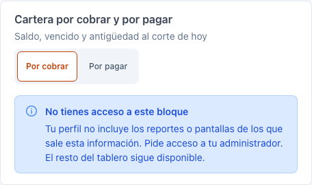

> ℹ️ Si ve el dashboard pero no el botón **Exportar a Excel**, su perfil no tiene **Exportar** en **Por formas de pago**.

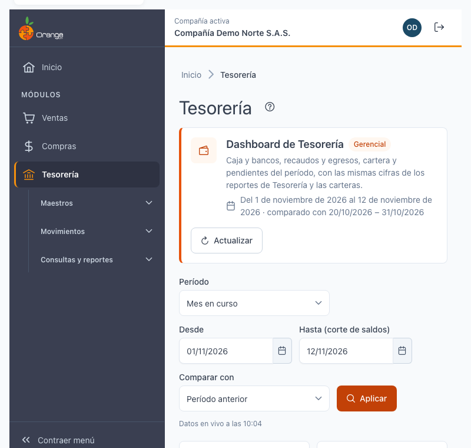

> ℹ️ Si su perfil no tiene acceso a ningún bloque, el resumen no consulta nada y verá el mensaje *No tienes acceso al dashboard de Tesorería*.

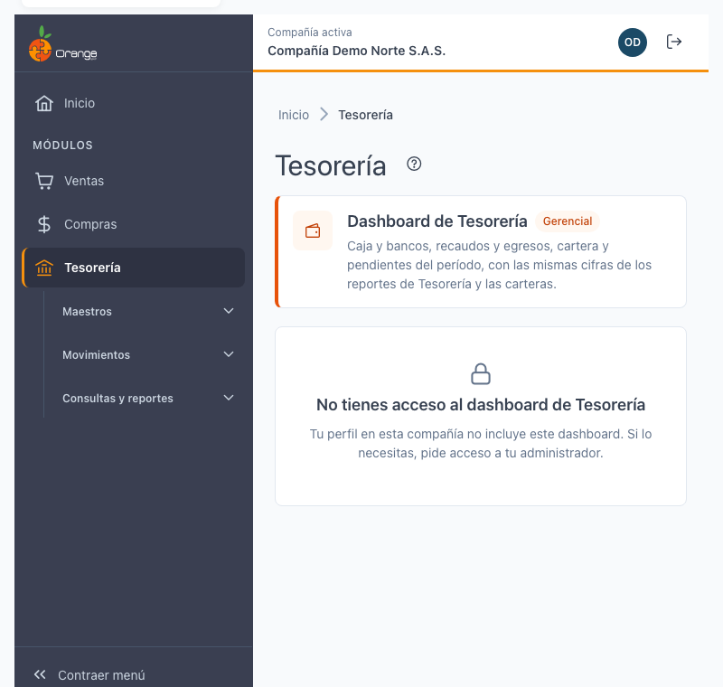

---

## 🖥️ Pantalla principal

| Elemento | Para qué sirve |
|----------|----------------|
| **?** (junto al título) | Abre esta ayuda en un panel lateral, sin salir de la pantalla. |
| Encabezado | Muestra el período aplicado, la base de comparación y la hora de los datos. |
| **Actualizar** | Vuelve a consultar todos los bloques sin usar los datos guardados. Ver [Actualizar y frescura de los datos](#-actualizar-y-frescura-de-los-datos). |
| **Exportar a Excel** | Descarga lo que ve en pantalla. Ver [Exportar a Excel](#-exportar-a-excel). |
| **Período**, **Desde**, **Hasta** y **Comparar con** | Definen las cifras del tablero. Ver [Período y comparativo](#-período-y-comparativo). |
| **Aplicar** | Aplica los cambios de período y de comparación. Mientras no lo pulse, el tablero no cambia. |
| Bloques | Saldos, comparativo, tendencia, rankings, cartera, notas bancarias y pendientes. Cada uno se explica en su sección. |

Al pulsar **?** se abre el panel de ayuda junto a la pantalla:

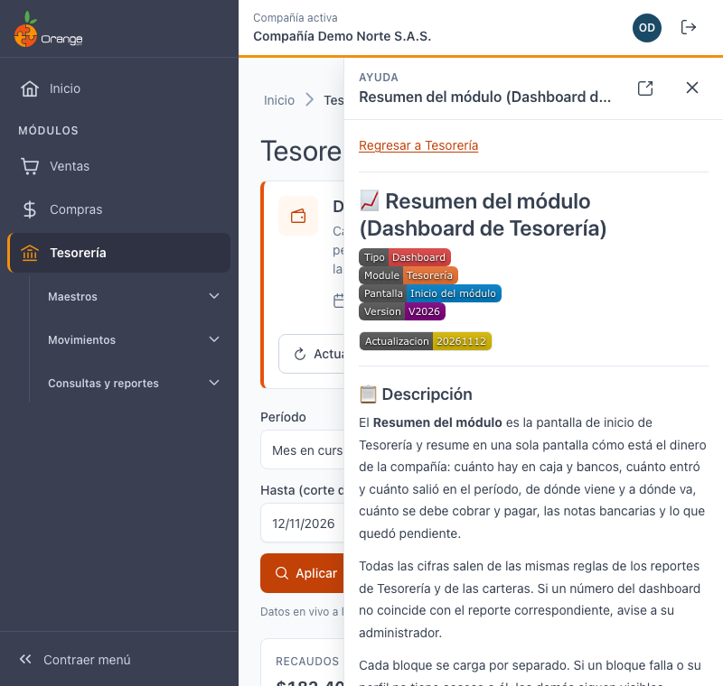

---

## 📅 Período y comparativo

### Período

| Opción | Qué toma |
|--------|----------|
| **Mes en curso** | Desde el 1 del mes hasta hoy. Es la opción al entrar. |
| **Mes anterior** | El mes calendario completo anterior. |
| **Año a la fecha** | Desde el 1 de enero hasta hoy. |
| **Últimos 30 días** | Los 30 días que terminan hoy. |
| **Personalizado** | Las fechas que escriba en **Desde** y **Hasta**. |

- **Desde** y **Hasta** son las fechas del período. Ambas son obligatorias.
- **Hasta** también es el **corte de saldos**: los saldos de caja y bancos se calculan con los movimientos hasta esa fecha.
- El período no puede superar **366 días**. Si lo supera, verá: *El período no puede superar 366 días.* Ver la imagen siguiente.
- La fecha inicial no puede ser posterior a la final. Si lo es, verá: *La fecha inicial no puede ser mayor que la final.*

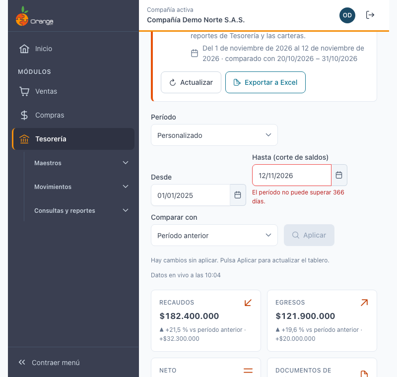

### Comparativo

| Opción | Contra qué compara |
|--------|--------------------|
| **Período anterior** | El mismo número de días inmediatamente antes del período. Es la opción por defecto. |
| **Mismo período del año anterior** | Las mismas fechas, un año atrás. Respeta los años bisiestos y los fines de mes. |
| **Sin comparar** | No muestra variaciones. |

En los bloques con comparativo, cada cifra muestra la **base** (la cifra del período de comparación) y la **variación**. Cuando la base es cero, la variación aparece como **—** y no como 0 % ni como infinito. Si en el período de comparación no hubo valor, verá *Sin valor en el período de comparación*.

> ℹ️ Cambiar el período o la comparación no recalcula nada hasta que pulse **Aplicar**. Si hay cambios sin aplicar, verá: *Hay cambios sin aplicar. Pulsa Aplicar para actualizar el tablero.*

---

## 💰 Saldos de caja y bancos

Muestra cuánto hay en caja y bancos **a la fecha de corte** (el campo **Hasta**). Tiene dos vistas que se eligen con **Ver saldos**:

| Vista | Qué suma | Para qué sirve |
|-------|----------|----------------|
| **Por forma de pago** | Los recibos y egresos de cada forma de pago (efectivo, transferencia, tarjeta, etc.). | Saber cuánto hay en cada medio de pago. Cuadra con el saldo inicial del reporte [Por formas de pago](reportes/formas-pago.md). |
| **Por cuenta contable** | Todos los asientos de las cuentas de caja y bancos del plan de cuentas. | Saber cuánto dice la contabilidad en caja y bancos. |

### ¿Por qué las dos cifras pueden ser distintas?

Las dos vistas miden el mismo dinero desde fuentes diferentes:

- **Por forma de pago** solo cuenta el dinero que pasó por un **recibo de caja** o un **egreso** y que tiene una forma de pago.
- **Por cuenta contable** cuenta **todo** lo que la contabilidad registró en las cuentas de caja y bancos, incluidos los asientos de ventas, compras y **notas bancarias** (comisiones, GMF, intereses, rendimientos).

Por eso, si hubo movimientos de caja o banco que no pasaron por un recibo o un egreso, las dos vistas no coinciden. Cada vista está rotulada y el bloque incluye esta explicación.

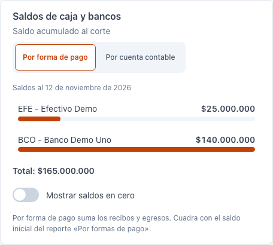

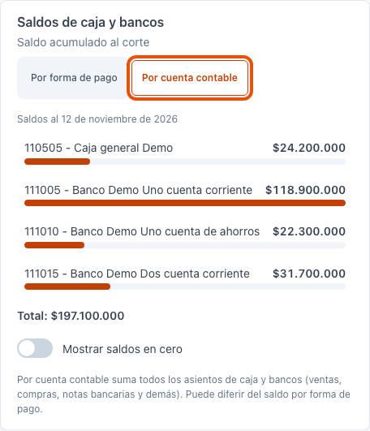

- **Mostrar saldos en cero**: si está activo, aparecen las formas de pago o cuentas sin saldo. Por defecto no aparecen.
- **Total**: la suma de las filas que se ven.

Si la compañía no tiene cuentas de caja o banco marcadas en el plan de cuentas, la vista por cuenta muestra: *La compañía no tiene cuentas contables marcadas como caja o banco.* Esa configuración la hace su administrador o contador.

---

## 📊 Recaudos, egresos y comparativo

Muestra cinco indicadores del período:

| Indicador | Qué significa |
|-----------|---------------|
| **Recaudos** | Lo que entró por recibos de caja en el período. |
| **Egresos** | Lo que salió por egresos en el período. Se muestra en positivo. |
| **Neto** | Recaudos menos egresos. |
| **Documentos de recaudo** | Cuántos recibos distintos hubo. |
| **Documentos de egreso** | Cuántos egresos distintos hubo. |

Los documentos **anulados** no suman en ninguna cifra. Las notas bancarias no se incluyen aquí: aparecen en su propio bloque.

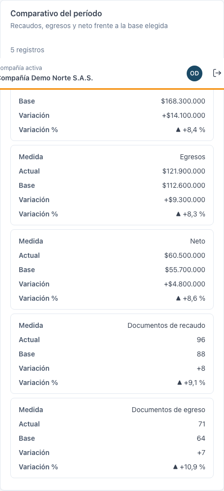

El bloque **Comparativo del período** muestra una tabla con la medida, el valor actual, la base, la variación en valor y la variación en porcentaje, para recaudos, egresos y neto.

Si el bloque no carga, verá *No se pudieron cargar los indicadores del período.* con **Reintentar**. Si no tiene acceso, verá *No tienes acceso a los indicadores de recaudos y egresos*.

### Tendencia

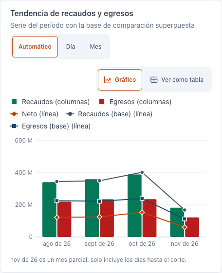

- **Agrupar por**: **Automático** (diario si el período tiene 62 días o menos, mensual si tiene más), **Día** o **Mes**.
- **Gráfico** o **Ver como tabla**: cambia la forma de ver la misma serie. La tabla tiene el mismo dato para quien usa lector de pantalla.
- La línea de la base de comparación aparece superpuesta, para ver si el recaudo mejora frente al período anterior o al año anterior.
- Si el último mes del período es parcial (porque el corte es antes de fin de mes), el dashboard lo indica: *es un mes parcial: solo incluye los días hasta el corte.*

La suma de los puntos de la tendencia es igual al indicador correspondiente del período.

---

## 🏆 Rankings

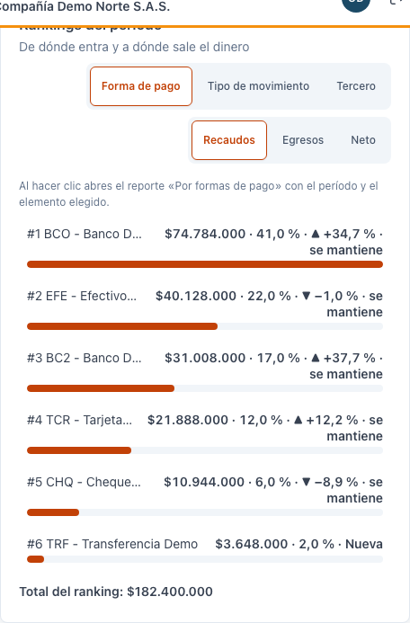

El bloque **Rankings del período** muestra de dónde entra el dinero y a dónde sale.

| Control | Opciones |
|---------|----------|
| **Agrupar por** | **Forma de pago**, **Tipo de movimiento** o **Tercero**. |
| **Medida** | **Recaudos**, **Egresos** o **Neto**. |

- Cada fila tiene el nombre, el valor, la participación en el total y, si hay comparativo, la base, la variación y el cambio de posición (*sube*, *baja*, *se mantiene* o *Nueva*).
- Se muestran los **10 primeros** y una fila **Otros** con el resto de los elementos. El total del ranking es igual al indicador de la misma medida.
- En **Tipo de movimiento** solo aparecen los tipos que su perfil tiene autorizados para los reportes de Tesorería.

### Abrir el reporte desde un ranking

Al hacer clic en una fila se abre el reporte de detalle con el período y el elemento elegidos:

| Agrupado por | Reporte que se abre |
|--------------|---------------------|
| Forma de pago | [Por formas de pago](reportes/formas-pago.md), con la forma de pago elegida. |
| Tipo de movimiento | [Por tipo de movimiento](reportes/tipo-movimiento.md), con el tipo elegido. |
| Tercero | [Por tercero](reportes/tercero.md), con el período y el tercero. El tipo de movimiento lo elige usted en el reporte. |

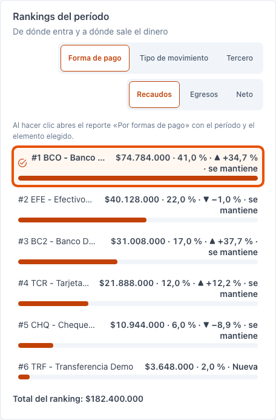

Si su perfil no tiene **Consultar** en ese reporte, la fila no se puede abrir y verá: *No tienes acceso al reporte «Por formas de pago»: las filas no se pueden abrir.*

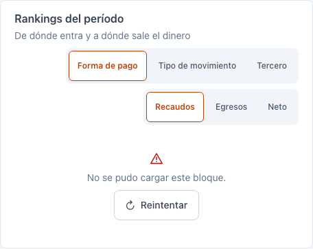

---

## 💼 Cartera por cobrar y por pagar

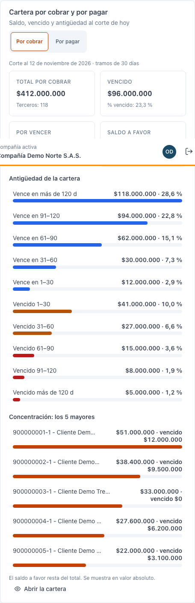

El bloque tiene dos pestañas: **Por cobrar** (clientes) y **Por pagar** (proveedores). Ambas usan la misma regla que las carteras de la compañía y se calculan **al corte de hoy**.

| Cifra | Qué muestra |
|-------|-------------|
| **Total por cobrar** o **por pagar** | El saldo pendiente de todos los terceros. |
| **Vencido** | La parte que ya pasó su fecha de vencimiento. |
| **Por vencer** | La parte que aún no vence. |
| **% vencido** | El vencido como porcentaje del total. |
| **Saldo a favor** | Anticipos y saldos a favor de los terceros. |

- **Antigüedad de la cartera**: 10 tramos de días (30 días por defecto). Cada tramo muestra cuánto hay vencido o por vencer en esa antigüedad.
- **Concentración**: los terceros con más saldo.
- El saldo a favor **resta** del total. Se muestra en valor absoluto.

Si su perfil no tiene acceso a la cartera, el bloque muestra *No tienes acceso a este bloque*. Los demás bloques siguen funcionando.

Para ver el detalle de un tercero, use su ficha de cartera en la pantalla correspondiente de [Compras](../compras/maestros/cartera-proveedores.md) o de [Ventas](../ventas/clientes/ficha-cartera.md).

---

## 🏦 Notas bancarias del período

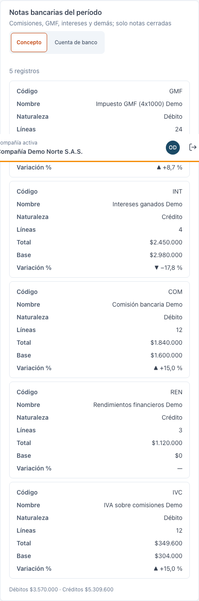

Muestra las notas bancarias **cerradas** del período (comisiones, GMF, intereses, rendimientos y otras) que no están anuladas.

- **Agrupar notas por**: **Concepto** o **Cuenta de banco**.
- Por concepto: código, nombre, naturaleza (débito o crédito), líneas, total, base y variación.
- Por cuenta de banco: débitos y créditos por cada cuenta.
- Las notas en borrador **no** suman aquí: aparecen en **Pendientes**.

Si la compañía todavía no tiene activas las notas bancarias, el bloque muestra *Las notas bancarias aún no están disponibles*. El resto del dashboard no se ve afectado.

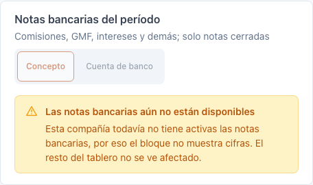

Para registrar o cerrar notas, vea [Notas bancarias](movimientos/notas-bancarias.md).

---

## ⏳ Pendientes

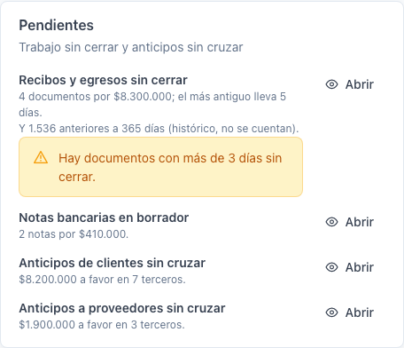

El bloque **Pendientes** avisa de trabajo sin cerrar:

| Pendiente | Qué muestra |
|-----------|-------------|
| **Recibos y egresos sin cerrar** | Cuántos documentos hay sin cerrar, su valor y la antigüedad del más viejo. Si hay documentos con más de **3 días** sin cerrar, aparece una alerta. |
| **Notas bancarias en borrador** | Cuántas notas están en borrador y su valor. |
| **Anticipos sin cruzar** | El saldo a favor de clientes (o de proveedores) que aún no se ha aplicado a facturas. Es el mismo saldo que muestra la cartera. |

- **Horizonte de 365 días**: los recibos y egresos sin cerrar se cuentan solo de los últimos **365 días**. Los más antiguos no se cuentan y se indican aparte, por ejemplo: *Y 12 anteriores a 365 días (histórico, no se cuentan).* Para revisarlos, use [Recibos y egresos](movimientos/recibos-egresos.md).
- **Abrir**: cada pendiente tiene un botón **Abrir** que lleva a su pantalla (Recibos y egresos, Notas bancarias o la cartera), si su perfil tiene acceso. Si no lo tiene, el pendiente aparece sin botón y con el texto *Sin acceso a la pantalla*.

Si no hay pendientes, verá: *Todo al día: no hay documentos sin cerrar ni anticipos sin cruzar.*

---

## 🔄 Actualizar y frescura de los datos

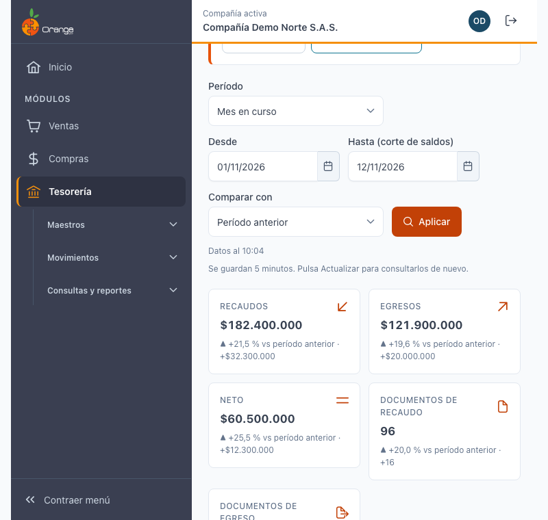

- Debajo de los filtros aparece la hora de los datos:
  - **Datos en vivo a las HH:MM**: la consulta se hizo en ese momento.
  - **Datos al HH:MM**: la respuesta viene de la memoria del dashboard. Se guarda **5 minutos**.
- **Actualizar** vuelve a consultar todos los bloques sin usar esa memoria. La hora cambia a la de la nueva consulta.
- Si **Actualizar** falla, el dashboard conserva los datos anteriores y avisa: *No se pudo actualizar. Se muestran los datos anteriores.*
- Un bloque que falla muestra *No se pudo cargar este bloque.* con **Reintentar**. Los demás bloques siguen visibles.
- El dashboard **no** se actualiza solo: si otra persona registra un recibo o una nota mientras usted lo tiene abierto, pulse **Actualizar** para verlo.

---

## 📤 Exportar a Excel

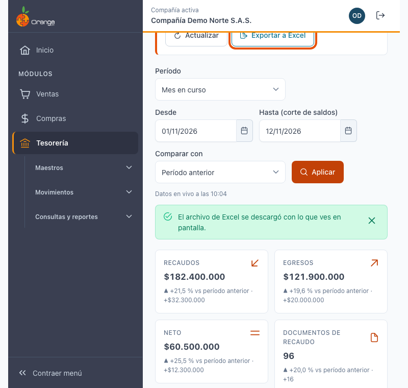

- **Exportar a Excel** descarga un archivo con lo que ve en pantalla: el resumen, los saldos, la tendencia, los rankings, la cartera, las notas, los pendientes y una hoja con los filtros usados (período, corte y comparación).
- Solo se exportan los bloques a los que tiene acceso.
- Las cifras del archivo son las mismas de la pantalla.
- El encabezado del archivo incluye el nombre de la compañía, el NIT, los filtros, el usuario y la fecha y hora de la descarga.
- Mientras se prepara el archivo verá *Preparando el archivo de Excel…*. Al terminar: *El archivo de Excel se descargó con lo que ves en pantalla.*
- Si falla, verá: *No se pudo generar el archivo. Inténtalo de nuevo.*

El dashboard no tiene exportación a PDF ni impresión.

---

## ❓ Preguntas frecuentes

**¿Por qué el saldo por forma de pago no es igual al saldo por cuenta contable?**
Porque cuentan fuentes distintas. Vea [Saldos de caja y bancos](#-saldos-de-caja-y-bancos).

**¿Por qué una fila del ranking no se puede abrir?**
Porque su perfil no tiene **Consultar** en el reporte al que llevaría. Pida el permiso a su administrador.

**¿Por qué aparece un «—» en la variación?**
Porque en el período de comparación la base es cero. No es un error.

**¿Por qué no veo un documento viejo en Pendientes?**
Porque solo se cuentan los documentos de los últimos 365 días. Los anteriores se indican aparte y se revisan en [Recibos y egresos](movimientos/recibos-egresos.md).

**¿Por qué no veo un recibo que acabo de registrar?**
El dashboard no se actualiza solo. Pulse **Actualizar**.

**¿Por qué el tablero dice «Datos al» y no «Datos en vivo»?**
Porque la respuesta viene de la memoria del dashboard (hasta 5 minutos). Pulse **Actualizar** para consultar de nuevo.

---

Los demás reportes de esta sección están en el [índice de Tesorería](readme.md#reportes): [Por formas de pago](reportes/formas-pago.md), [Por tipo de movimiento](reportes/tipo-movimiento.md), [Por tercero](reportes/tercero.md) y [Por vendedor/comprador](reportes/comprador-vendedor.md).
