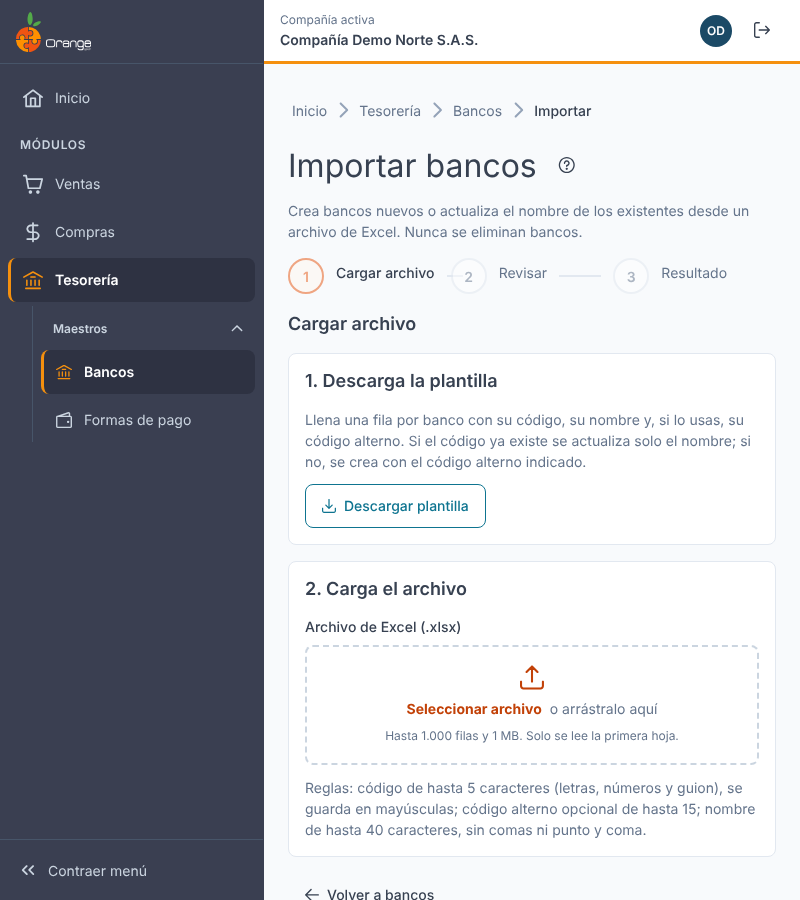
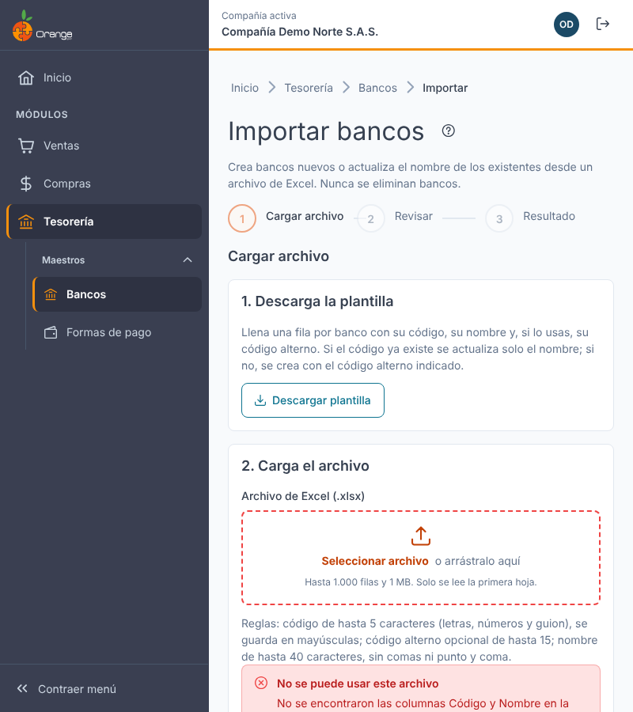
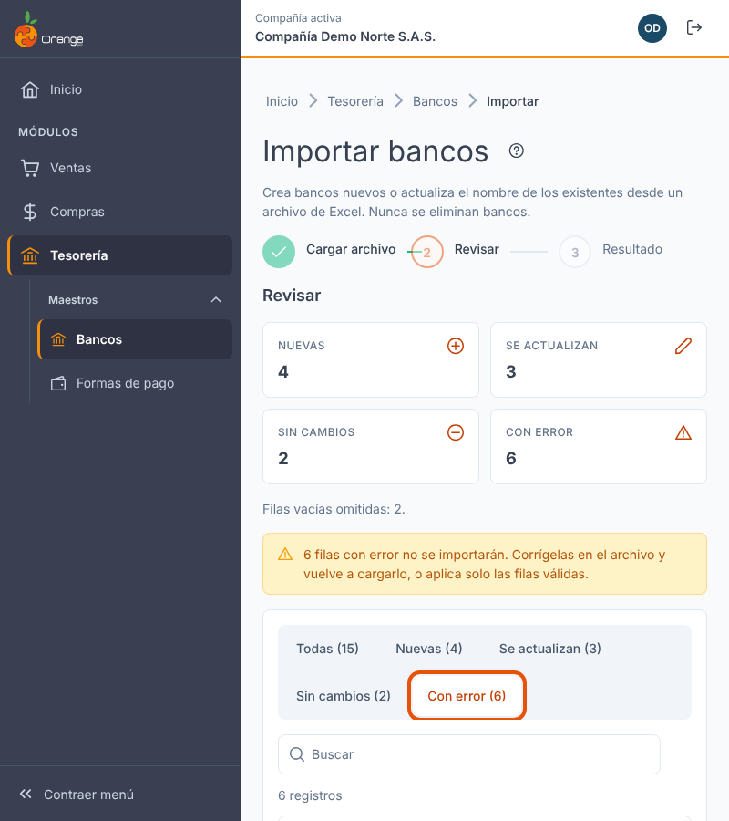
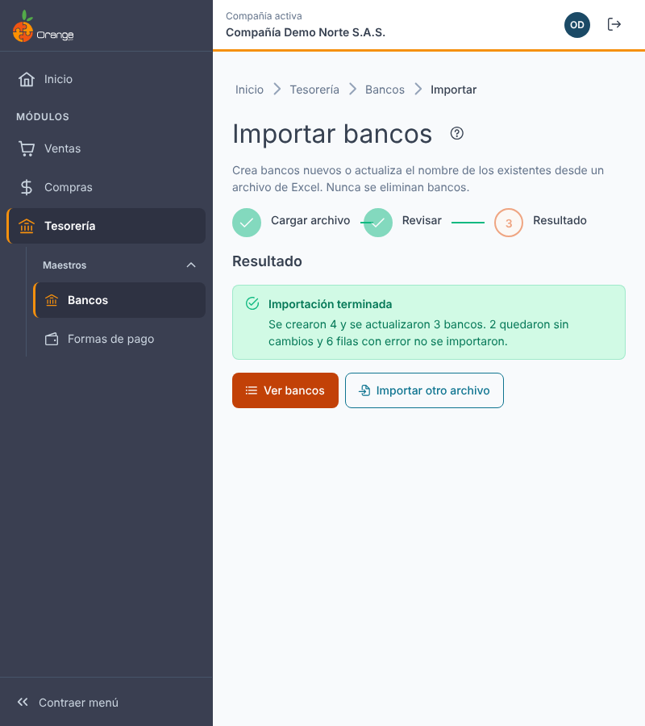
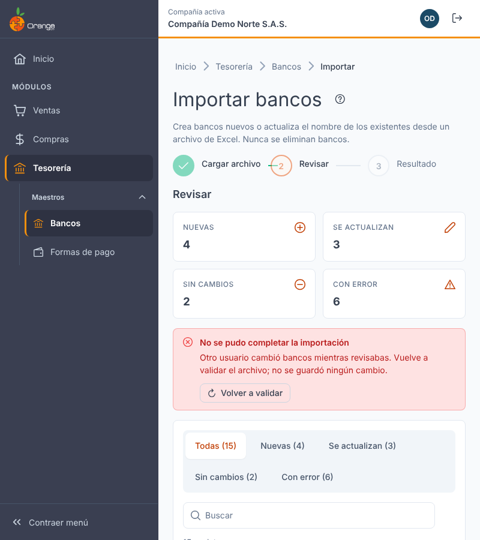

[Regresar a Bancos](bancos.md)

---

# 📥 Importar bancos desde Excel

---

## 📋 Descripción

Esta pantalla carga muchos bancos de una vez desde un archivo de Excel. Antes de guardar, el sistema **revisa** cada fila y le muestra qué se creará, qué se actualizará, qué no tiene cambios y qué tiene un error. Así puede corregir el archivo sin que quede nada a medias.

> 📘 Para el resto de la pantalla de bancos (crear, editar, eliminar) vea [Bancos](bancos.md).

> ⚠️ La importación **nunca elimina bancos**. Tampoco cambia el código de un banco existente.

---

## 🎯 Acceso

1. Abra **Bancos** (menú **Tesorería › Maestros › Bancos**).
2. Haga clic en **Importar**.

Necesita el permiso **Exportar** sobre la opción Bancos. Sin ese permiso el botón no aparece.

---

## 🧭 Pasos

La importación tiene tres pasos: **Cargar archivo**, **Revisar** y **Resultado**.

### 1. Descargue la plantilla

Haga clic en **Descargar plantilla**. La hoja **Bancos** tiene tres columnas:

| Columna | Obligatoria | Qué escribir |
|---------|:-----------:|--------------|
| **Código** | ✅ | El código del banco (llave). Si ya existe en la compañía, el banco se actualiza. |
| **Nombre** | ✅ | El nombre del banco. |
| **Código alterno** | | Opcional. Solo se escribe en bancos **nuevos**. |

Llene una fila por banco. Si el código ya existe, **solo cambia el nombre**; el código alterno de un banco existente no se modifica desde la importación.

### 2. Cargue el archivo

Haga clic en **Archivo de Excel (.xlsx)** y elija el archivo.

- Formato **.xlsx**. Se lee solo la primera hoja.
- Hasta **1.000 filas** y **1 MB**.
- Las filas vacías se omiten.

Si el archivo no se puede usar, verá el motivo y no se revisa nada:

| Mensaje | Qué hacer |
|---------|-----------|
| El archivo no es un Excel (.xlsx) válido o está dañado. Use la plantilla. | Guarde el archivo como .xlsx o use la plantilla. |
| No se encontraron las columnas Código y Nombre en la primera fila. | Copie los datos en la plantilla descargada. |
| El archivo no tiene bancos: agregue al menos una fila debajo del encabezado. | Agregue filas con datos. |
| El archivo tiene … filas; el máximo es 1.000. Divídalo en varios archivos. | Parta el archivo y cárguelos uno a uno. |
| El archivo pesa más de 1 MB. | Divídalo en varios archivos. |

### 3. Revise antes de aplicar

Después de cargar el archivo verá un resumen con cuatro cifras:

| Cifra | Significado |
|-------|-------------|
| **Nuevas** | Bancos que se crearán. |
| **Se actualizan** | Bancos existentes cuyo nombre cambiará. |
| **Sin cambios** | Bancos que ya están iguales en la compañía. |
| **Con error** | Filas que no se importarán. |

- Use el filtro **Filtrar filas por estado** para ver solo las nuevas, las que se actualizan, las sin cambios o las que tienen error.
- En las filas que se actualizan verá **Antes:** con el nombre anterior.
- En las filas con error verá el motivo en la columna **Detalle**.

| Motivo de error | Qué hacer |
|-----------------|-----------|
| Falta el código / Falta el nombre. | Complete la celda en el archivo. |
| El código tiene más de 5 caracteres. | Acórtelo. |
| El código solo puede tener letras, números y guion. | Quite espacios, tildes u otros símbolos. |
| El nombre tiene más de 40 caracteres. | Acórtelo. |
| El nombre no puede tener comas ni punto y coma. | Quite esos signos. |
| El código alterno tiene más de 15 caracteres. | Acórtelo. |
| El código se repite en el archivo (filas …). | Deje una sola fila por código. |
| La fila está vacía. | Bórrela o complétela. |

Si hay filas con error, verá un aviso: esas filas **no se importarán**. Puede:

- Haga clic en **Descargar filas con error**, corrija el archivo y vuelva a cargarlo, o
- Aplique solo las filas válidas con el botón **Aplicar … cambios**.

Si no hay nada que cambiar, verá: *"No hay cambios para aplicar: todas las filas están sin cambios o con error."*

Para cambiar de archivo, haga clic en **Cargar otro archivo**. Para salir sin importar, haga clic en **Volver a bancos**.

### Aplicar

Haga clic en **Aplicar** (por ejemplo, **Aplicar 12 cambios**). Mientras se aplica verá **Aplicando…**.

- Los cambios se guardan **todos juntos**: si algo falla, no se guarda ninguna fila.
- Cada banco creado o actualizado queda registrado en la bitácora de la compañía.

Al terminar verá **Importación terminada** con cuántos bancos se crearon, cuántos se actualizaron, cuántos quedaron sin cambios y cuántas filas con error no se importaron. Desde ahí puede **Ver bancos** o **Importar otro archivo**.

### Si otro usuario cambió bancos mientras revisaba

Si otra persona creó, cambió o importó bancos después de que usted cargó el archivo, la aplicación **no guarda nada** y verá:

> Otro usuario cambió bancos mientras revisabas. Vuelva a validar el archivo; no se guardó ningún cambio.

Haga clic en **Volver a validar** para revisar el archivo con los datos actuales.

Si ocurre un error del servidor, verá *"No se pudo completar la importación. No se guardó ningún cambio. Inténtalo de nuevo."*

---

## ❓ Preguntas frecuentes

**¿La importación puede borrar bancos?**
No. Solo crea bancos nuevos o cambia el nombre de los existentes. Para eliminar un banco use la papelera en la pantalla de [Bancos](bancos.md).

**¿Por qué una fila dice "Sin cambios" si tiene datos distintos?**
Porque el código y el nombre coinciden exactamente con lo que ya está guardado. Revise que el código sea el mismo y que el nombre esté escrito igual.

**¿Puedo cambiar el código de un banco existente desde el archivo?**
No. Si el código ya existe, la fila solo puede cambiar el nombre. Para cambiar un código, use **Editar** en la pantalla de Bancos.

**¿Por qué no se cargó el código alterno de un banco existente?**
Porque la importación solo escribe el código alterno en bancos nuevos. Para cambiarlo en un banco existente, use **Editar**.
