[Regresar a Tesorería](../readme.md)

---

# 🏦 Bancos

---

## 📋 Descripción

Los **bancos** son las entidades financieras con las que trabaja la compañía. Se usan al registrar terceros, proveedores, empleados y pagos de tesorería, así que conviene mantenerlos ordenados y con nombres claros.

En esta pantalla puede **consultar, crear, editar, eliminar, exportar e importar** los bancos de la compañía con la que está trabajando.

> 📘 La búsqueda, el orden, la paginación, la exportación y la ayuda funcionan igual en todas las tablas: ver [Manejo general de la información](../../Generales/manejo-general-informacion.md).

> 💡 Cada pestaña del navegador trabaja con **una compañía**. El nombre de la compañía se ve en el título de la pestaña y en la barra superior.

---

## 🎯 Acceso

1. En el menú principal, haga clic en **Tesorería**.
2. En **Maestros**, haga clic en **Bancos**.

---

## 🖥️ Pantalla principal

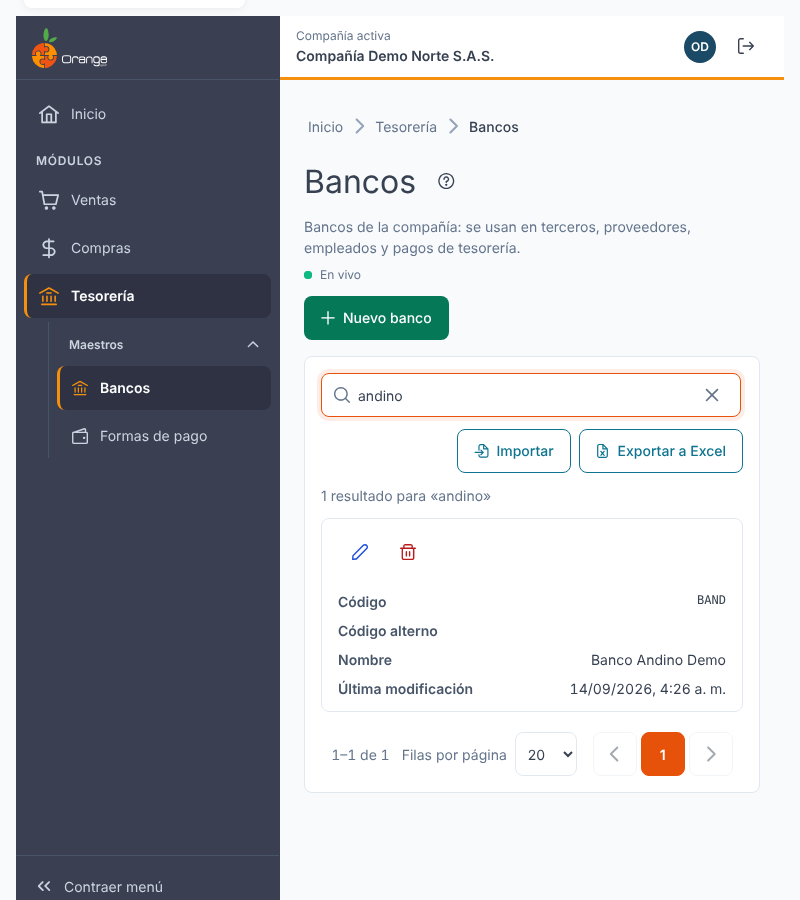

| Elemento | Para qué sirve |
|----------|----------------|
| **?** (junto al título) | Abre esta ayuda en un panel lateral, sin salir de la pantalla. |
| **En vivo** | La pantalla está conectada: los cambios de otros usuarios aparecen solos. Ver *Cambios de otros usuarios* más abajo. |
| **Nuevo banco** | Crea un banco. |
| **Buscar por código, código alterno o nombre** | Filtra el listado mientras escribe. No distingue mayúsculas ni tildes: "norte" encuentra "Banco Norte". |
| **Importar** | Crea o actualiza bancos desde un archivo de Excel. Ver [Importar bancos desde Excel](bancos-importar.md). |
| **Exportar a Excel** | Descarga el listado con el filtro y el orden que tenga en pantalla, incluidas todas sus páginas. |
| **Lápiz** / **Papelera** | Editar o eliminar el banco de esa fila. Siempre están en la **primera columna**. |
| **Columnas** | Código, Código alterno, Nombre y Última modificación. |
| **Encabezados** | Un clic ordena de forma ascendente, el segundo descendente y el tercero quita el orden. |
| **Filas por página** y paginación | Cambian cuántos bancos ve y la página. |

> 📱 En el celular, o en una ventana angosta, cada banco se muestra como una tarjeta, con las acciones visibles.

**¿No ve algún botón?** Cada acción depende de los permisos de su perfil sobre la opción Bancos:

| Permiso | Qué habilita |
|---------|--------------|
| Consultar | Ver la pantalla |
| Crear | **Nuevo banco** |
| Actualizar | **Lápiz** (editar) |
| Eliminar | **Papelera** (eliminar) |
| Exportar | **Exportar a Excel** e **Importar** |

---

## ➕ Crear un banco

1. Haga clic en **Nuevo banco**.
2. Complete los campos y haga clic en **Guardar**.

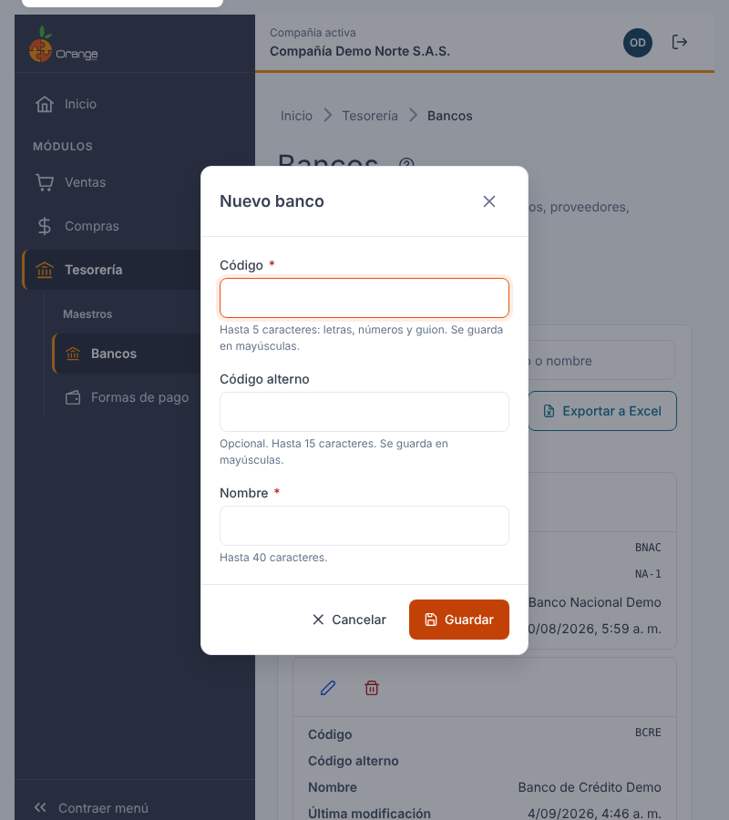

| Campo | Obligatorio | Reglas | Ejemplo |
|-------|:-----------:|--------|---------|
| **Código** | ✅ | Hasta 5 caracteres: letras, números y guion. Se guarda **siempre en MAYÚSCULAS**. No se puede repetir en la compañía. | `BNO` |
| **Código alterno** | | Opcional, hasta 15 caracteres. También se guarda en mayúsculas. | `NORTE-01` |
| **Nombre** | ✅ | Hasta 40 caracteres, sin comas ni punto y coma. | `Banco Norte` |

Al guardar verá el mensaje **"Banco … creado."** y el banco aparece en el listado.

Si deja el diálogo sin cambios, se cierra sin guardar nada.

### ¿Qué puede salir mal?

Al crear un banco, el mensaje aparece debajo del campo que debe corregir:

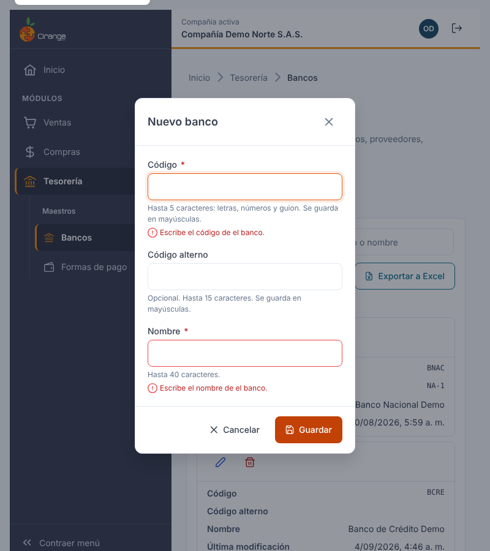

| Mensaje | Qué hacer |
|---------|-----------|
| Escribe el código del banco. | Complete el campo. |
| Usa solo letras, números y guion (máximo 5). | Quite espacios, tildes u otros símbolos del código. |
| Ya existe un banco con el código … | Use otro código. Lo que escribió se conserva en el diálogo. |
| Escribe el nombre del banco. | Complete el campo. |
| El nombre no puede tener comas ni punto y coma (máximo 40). | Corrija el nombre. |
| El código alterno admite hasta 15 caracteres. | Acórtelo o déjelo vacío. |
| No se pudo guardar el banco. Inténtalo de nuevo. | Vuelva a guardar. Si sigue igual, consulte a su administrador. |

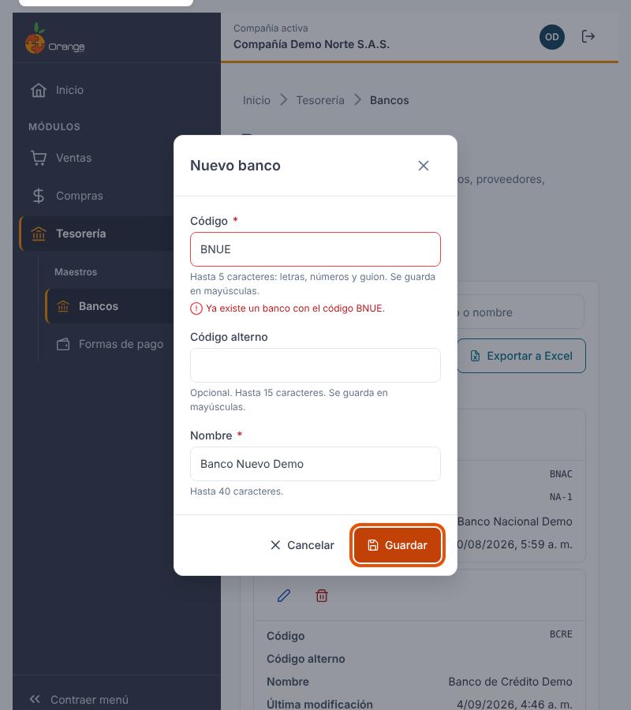

---

## ✏️ Editar un banco

1. Haga clic en el **lápiz** del banco.
2. Cambie el código, el código alterno o el nombre y haga clic en **Guardar**. Al abrir el diálogo, el cursor queda en **Nombre**.

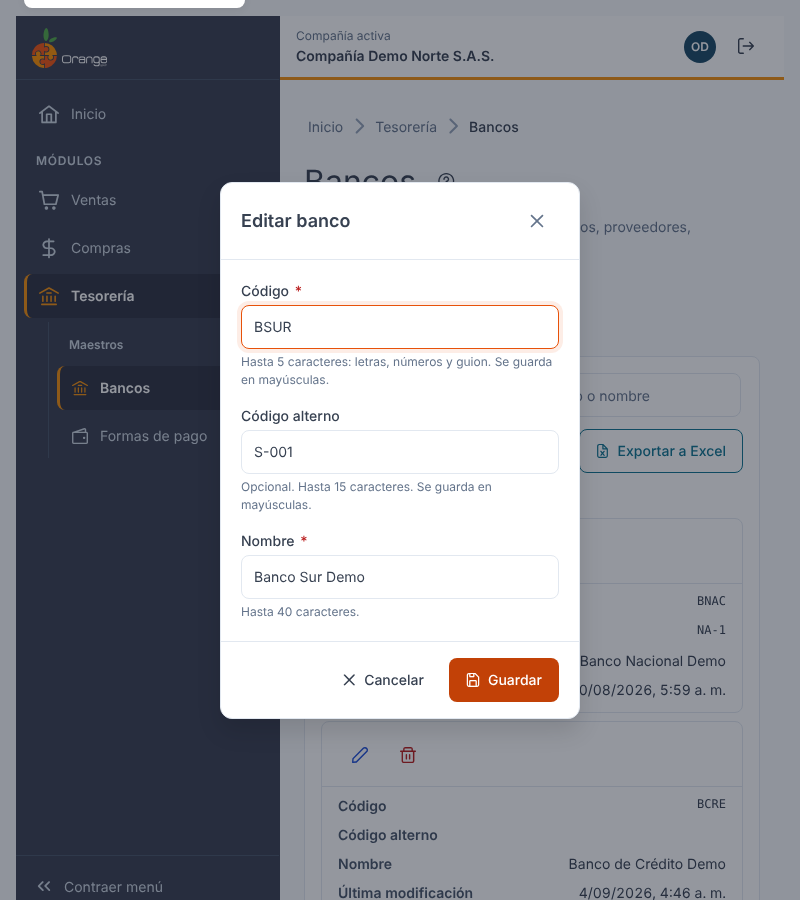

> ⚠️ **Cambiar el código** está permitido, pero verá un aviso: otros módulos (terceros, proveedores, empleados y pagos) muestran el banco por su código. El banco sigue siendo el mismo, pero conviene revisar los registros que lo usan después del cambio.

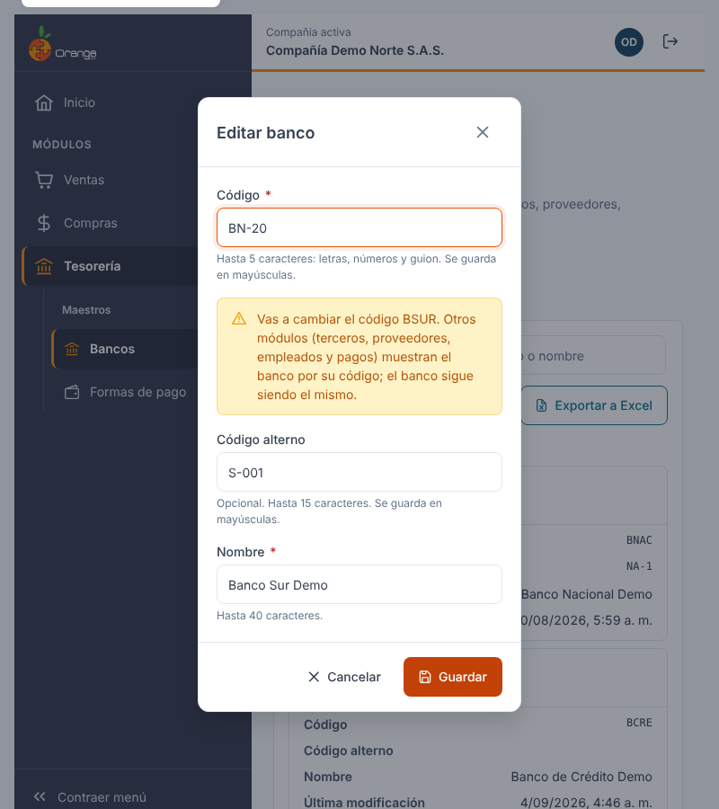

Si guarda sin haber cambiado nada, el diálogo se cierra y no se registra ningún cambio.

Si el banco viene de la versión anterior de OrangeERP con un código que hoy no cumple las reglas, puede editar su nombre o su código alterno sin bloqueo. Solo se exige que cumpla las reglas si cambia el código.

Si otro usuario eliminó el banco mientras lo editaba, al guardar aparece el aviso **"Este banco ya no existe"**, el diálogo se cierra y la fila desaparece del listado.

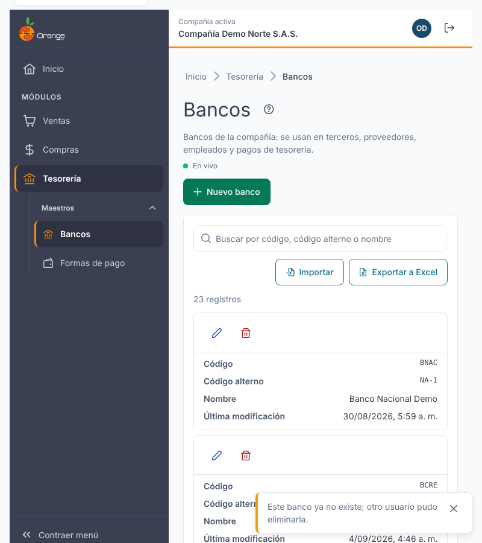

---

## 🗑️ Eliminar un banco

1. Haga clic en la **papelera** del banco.
2. Revise el nombre y el código en el diálogo y confirme con **Eliminar banco**.

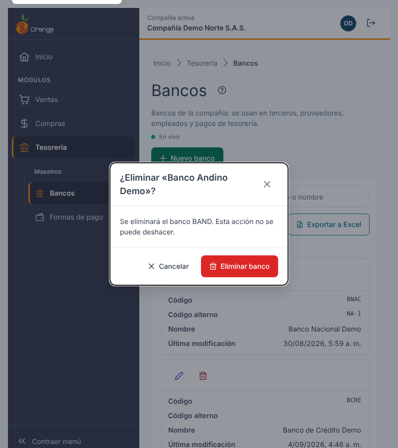

Un banco **no se puede eliminar** si tiene información relacionada en otros módulos (por ejemplo, terceros, proveedores, empleados o pagos de tesorería). En ese caso el diálogo muestra:

> No se puede eliminar … : tiene información relacionada en otros módulos.

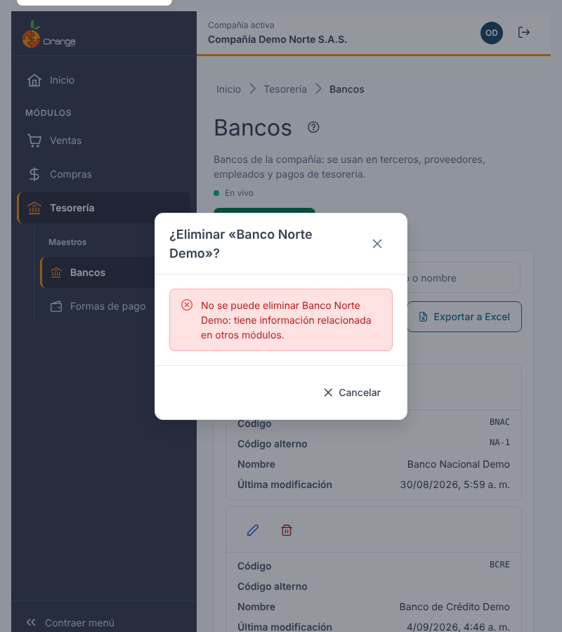

Cuando esto ocurre, el botón **Eliminar banco** no aparece. Para dejar de usarlo, cambie el banco en esos registros y vuelva a intentarlo.

---

## 📤 Exportar a Excel

Haga clic en **Exportar a Excel**. Se descarga un archivo de Excel con **todos** los bancos del filtro actual (no solo la página visible), con el encabezado fijo y filtros de Excel. Las fechas quedan como fechas de Excel.

---

## 📥 Importar desde Excel

Para crear muchos bancos o cambiar sus nombres de una vez, use **Importar**. Vea el paso a paso en [Importar bancos desde Excel](bancos-importar.md).

---

## 🔄 Cambios de otros usuarios (en vivo)

Si otra persona crea, modifica, elimina o importa bancos mientras usted tiene abierta esta pantalla, **no tiene que recargar**: el listado se pone al día solo, sin perder lo que buscó, el orden ni la página.

- Las filas nuevas o modificadas se **resaltan** unos segundos.
- Abajo a la derecha aparece un aviso, por ejemplo *"Otro usuario creó el banco Banco Norte."*
- Junto a la descripción verá **En vivo** mientras la conexión esté activa. Si se interrumpe, dice **Reconectando…**; al volver, la pantalla se actualiza sola.

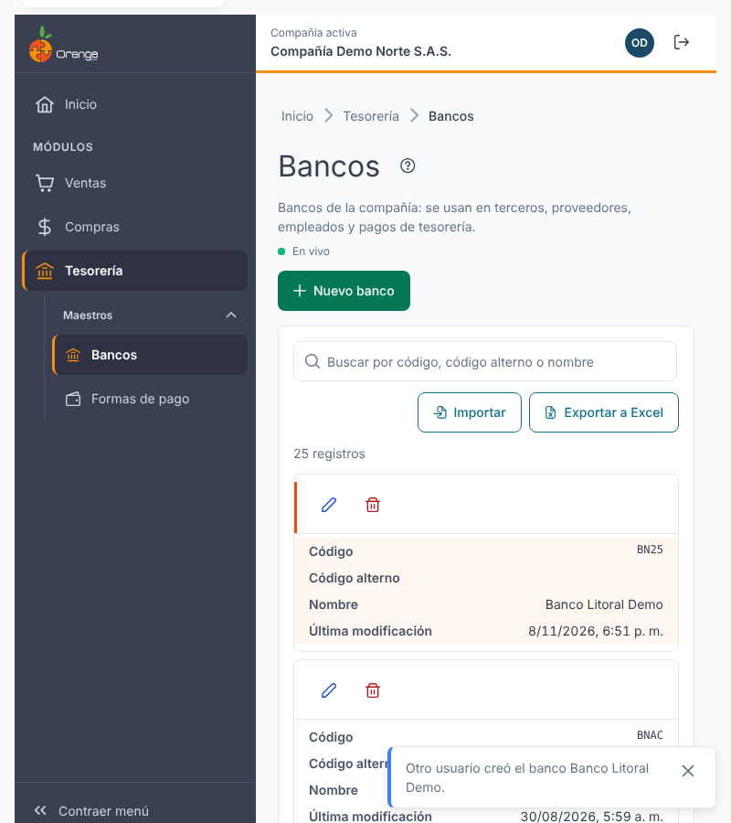

**Si estaba editando ese mismo banco:**

| Qué hizo el otro usuario | Qué verá | Qué puede hacer |
|--------------------------|----------|-----------------|
| Lo modificó | *"Otro usuario modificó este banco mientras lo editabas. Si guardas, reemplazarás sus cambios."* | **Ver sus cambios** para cargar lo que él guardó, o **Guardar** para dejar lo suyo. |
| Lo eliminó | *"Otro usuario eliminó este banco. Ya no se puede guardar."* | **Cancelar**. El botón Guardar queda deshabilitado. |

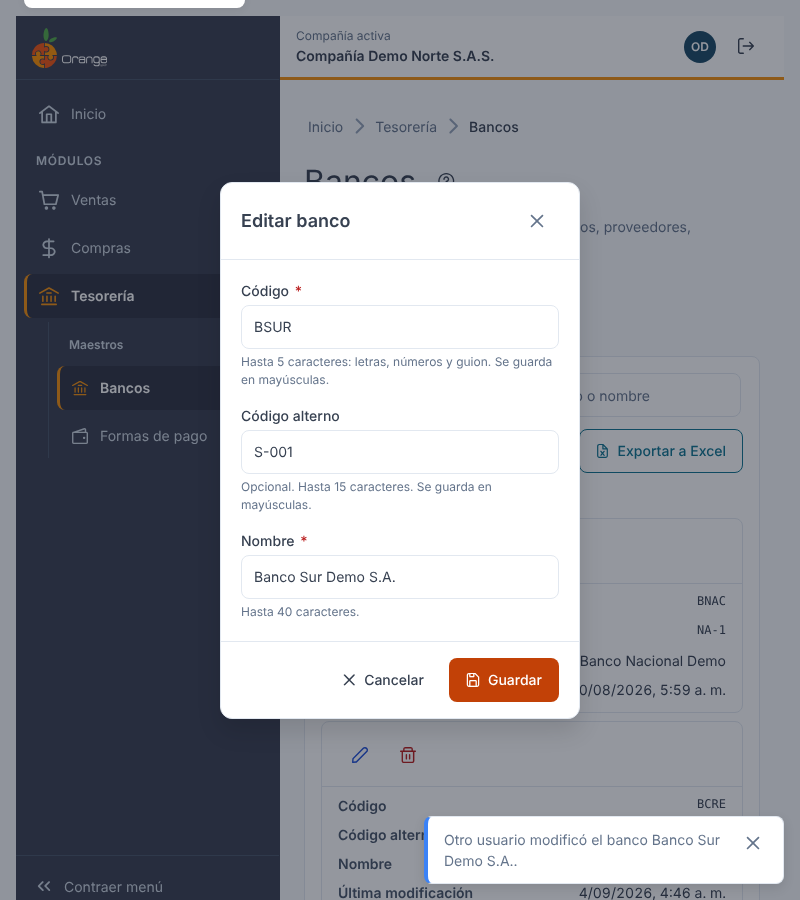

Si estaba por confirmar la eliminación de un banco que otro ya eliminó, el diálogo se cierra con el aviso *"Otro usuario ya eliminó el banco…"*.

> ℹ️ Los cambios que usted hace en esta misma pestaña no generan avisos. Los cambios hechos desde la versión anterior de OrangeERP no se avisan al instante: se reflejan al volver a esta pantalla después de un rato o al recargarla.

---

## ❓ Preguntas frecuentes

**¿Para qué sirve el código alterno?**
Es un código adicional y opcional para identificar el banco por otra referencia. No reemplaza al código principal, no es obligatorio y también se busca desde el buscador.

**¿Por qué el código quedó en mayúsculas?**
Los códigos de banco siempre se guardan en mayúsculas para que no haya dos bancos "iguales" escritos distinto.

**¿Por qué no encuentro un banco que sí existe?**
Revise que esté en la compañía correcta (título de la pestaña) y borre el texto del buscador con la **✕**. La búsqueda también revisa el código alterno.

**¿Puedo cambiar el código de un banco que ya usa?**
Sí, pero los terceros, proveedores, empleados y pagos que lo usan lo mostrarán con el código nuevo. Revise esos registros después del cambio.

**No veo "En vivo".**
La conexión en vivo no está disponible en este momento (por ejemplo, por la red de su empresa). La pantalla funciona igual; para ver cambios de otros usuarios, recargue la página.

**No veo los botones Nuevo banco, Editar o Eliminar.**
Su perfil no tiene ese permiso sobre la opción Bancos. Consulte con el administrador de OrangeERP.
