[Regresar a Tesorería](../readme.md)

---

# 🧾 Conceptos de nota bancaria

---

## 📋 Descripción

Los **conceptos de nota bancaria** son los motivos por los que se registra una nota en un banco: comisiones, impuestos, rendimientos, ajustes, etc. Cada concepto indica si el movimiento **entra dinero al banco** o **sale dinero del banco**, y a qué **cuenta contrapartida** se registra. Así, cada nota queda contabilizada con la cuenta correcta.

En esta pantalla puede **consultar, crear, editar, activar, desactivar y exportar** los conceptos de la compañía con la que está trabajando, y **importarlos desde Excel** si su perfil lo permite.

> 📘 La búsqueda, el orden, la paginación, la exportación y la ayuda funcionan igual en todas las tablas: ver [Manejo general de la información](../../Generales/manejo-general-informacion.md).

> 💡 Cada pestaña del navegador trabaja con **una compañía**. El nombre de la compañía se ve en el título de la pestaña y en la barra superior.

> ℹ️ Los conceptos **no se eliminan**. Si ya no los necesita, desactívelos: dejan de ofrecerse en las notas nuevas, pero las notas anteriores no cambian.

---

## 🎯 Acceso

1. En el menú principal, haga clic en **Tesorería**.
2. En **Maestros**, haga clic en **Conceptos de nota bancaria**.

---

## 🖥️ Pantalla principal

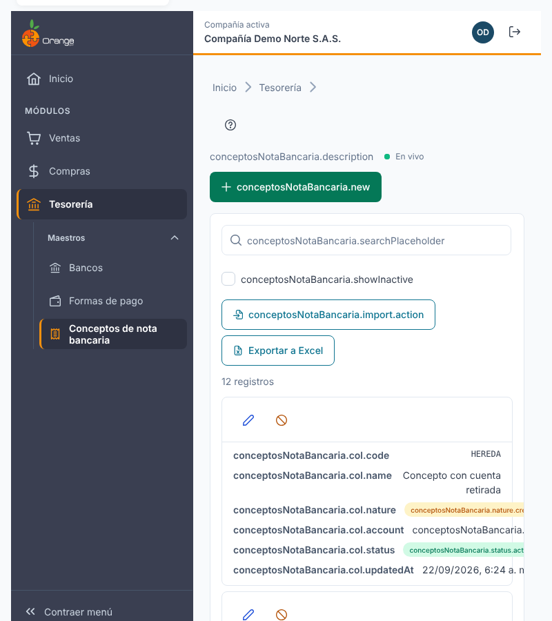

| Elemento | Para qué sirve |
|----------|----------------|
| **?** (junto al título) | Abre esta ayuda en un panel lateral, sin salir de la pantalla. |
| **En vivo** | La pantalla está conectada: los cambios de otros usuarios aparecen solos. Ver *Cambios de otros usuarios* más abajo. |
| **Nuevo concepto** | Crea un concepto. |
| **Importar** | Carga varios conceptos desde un archivo de Excel. Ver [Importar desde Excel](#-importar-desde-excel). |
| **Exportar a Excel** | Descarga el listado con el filtro y el orden que tenga en pantalla, incluidas todas sus páginas. |
| **Mostrar inactivos** | Casilla apagada por defecto. Al encenderla, también ve los conceptos desactivados. |
| **Buscar por código, nombre o cuenta** | Filtra el listado mientras escribe. No distingue mayúsculas ni tildes. |
| **Lápiz** / **Desactivar** / **Activar** | Editar el concepto, o desactivarlo o volver a activarlo. Siempre están en la **primera columna**. |
| **Encabezados** | Un clic ordena de forma ascendente, el segundo descendente y el tercero quita el orden. |
| **Filas por página** y paginación | Cambian cuántos conceptos ve y la página. |

Las columnas son:

| Columna | Qué muestra |
|---------|-------------|
| **Acciones** | Los botones de editar y de activar o desactivar. |
| **Código** y **Nombre** | Identificación del concepto. |
| **Naturaleza** | **Entra dinero al banco** o **Sale dinero del banco**. |
| **Cuenta contrapartida** | La cuenta a la que se registra el concepto, como *código - nombre*. |
| **Estado** | **Activo** o **Inactivo**. |
| **Última modificación** | Cuándo se cambió por última vez. |

> 📱 En el celular, o en una ventana angosta, cada concepto se muestra como una tarjeta, con las acciones visibles.

**¿No ve algún botón?** Cada acción depende de los permisos de su perfil sobre la opción Conceptos de nota bancaria:

| Permiso | Qué habilita |
|---------|--------------|
| Consultar | Ver la pantalla. |
| Crear | **Nuevo concepto**. |
| Actualizar | **Lápiz** (editar), **Desactivar** y **Activar**. |
| Exportar | **Exportar a Excel** e **Importar**. Sin este permiso, la pantalla de importación tampoco se abre. |

Si el listado está vacío y tiene permiso para crear, verá el botón **Nuevo concepto** en el centro de la pantalla.

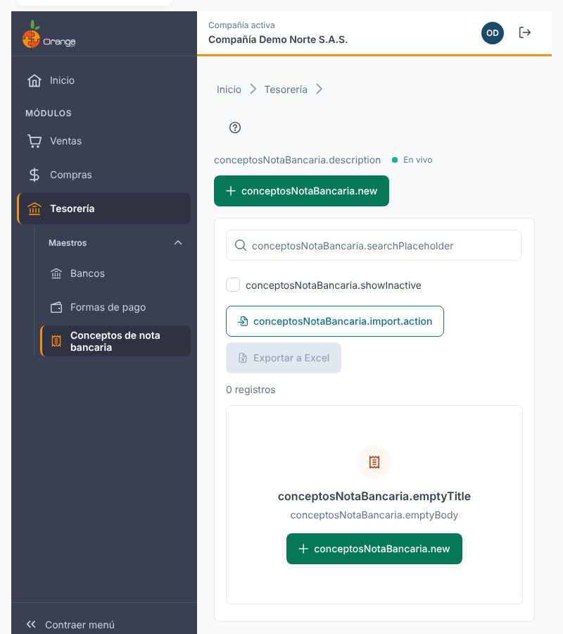

---

## ➕ Crear un concepto

1. Haga clic en **Nuevo concepto**. El cursor queda en **Código**.
2. Complete los campos y haga clic en **Guardar**.

| Campo | Obligatorio | Reglas | Ejemplo |
|-------|:-----------:|--------|---------|
| **Código** | ✅ | Hasta 10 caracteres: letras, números y guion. Se guarda **siempre en MAYÚSCULAS**. No se puede repetir en la compañía. | `GMF` |
| **Nombre** | ✅ | Hasta 60 caracteres, sin comas ni punto y coma. | `Comisión transferencia` |
| **Naturaleza** | ✅ | **Entra dinero al banco** o **Sale dinero del banco**. Indica si la nota aumenta o disminuye el saldo del banco. | Sale dinero del banco |
| **Cuenta contrapartida** | ✅ | Cuenta de movimiento de la compañía que **no sea de banco**. Se elige con el buscador (ver [Elegir una cuenta](#-elegir-una-cuenta)). | Una cuenta de gastos del plan |
| **Tercero por defecto** | | Opcional. Se propone al usar el concepto en una nota. Se elige con el buscador de terceros. | |
| **Pedir tercero al usar este concepto** | | Casilla. Si la marca, la nota no se puede guardar sin tercero. | |

Al guardar verá el mensaje **"Concepto … creado."** y el concepto aparece en el listado.

Si deja el diálogo sin cambios, se cierra sin guardar nada.

### ¿Qué puede salir mal?

Los mensajes aparecen debajo del campo que debe corregir, y lo que escribió se conserva:

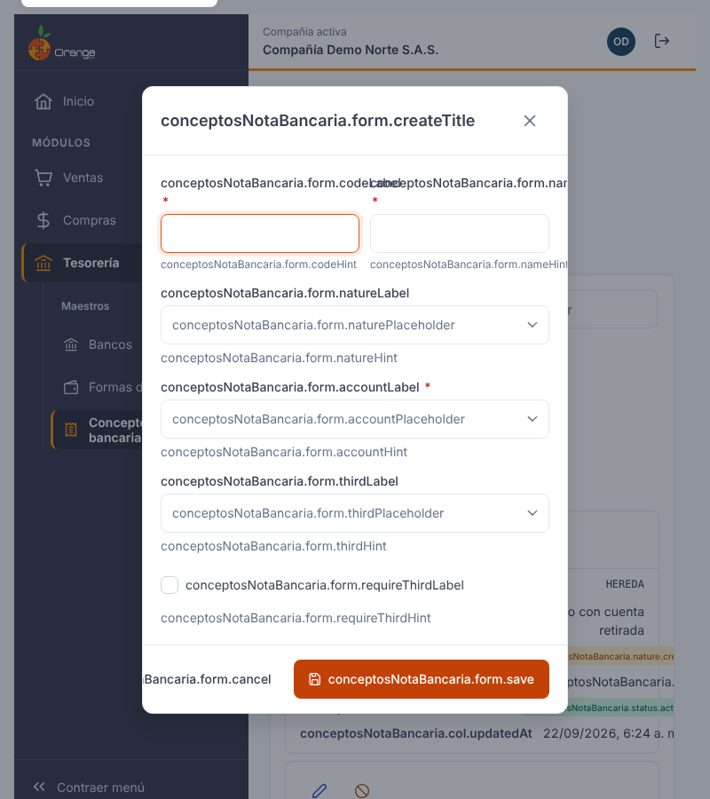

| Mensaje | Qué hacer |
|---------|-----------|
| Escribe el código del concepto. / Escribe el nombre del concepto. | Complete el campo. |
| Usa solo letras, números y guion (máximo 10). | Quite espacios, tildes u otros símbolos del código. |
| Ya existe un concepto con el código … | Use otro código. |
| El nombre no puede tener comas ni punto y coma (máximo 60). | Corrija el nombre. |
| Elige la naturaleza del concepto. | Seleccione **Entra dinero al banco** o **Sale dinero del banco**. |
| Elige la cuenta contrapartida. | Busque y seleccione la cuenta. |
| Esa cuenta no sirve: debe ser de movimiento, de esta compañía y no una cuenta de banco. | Elija otra cuenta. Las cuentas de banco no se usan aquí: el banco lo indica cada nota. |
| No se pudo guardar el concepto. Inténtalo de nuevo. | Vuelva a guardar. Si sigue igual, consulte a su administrador. |

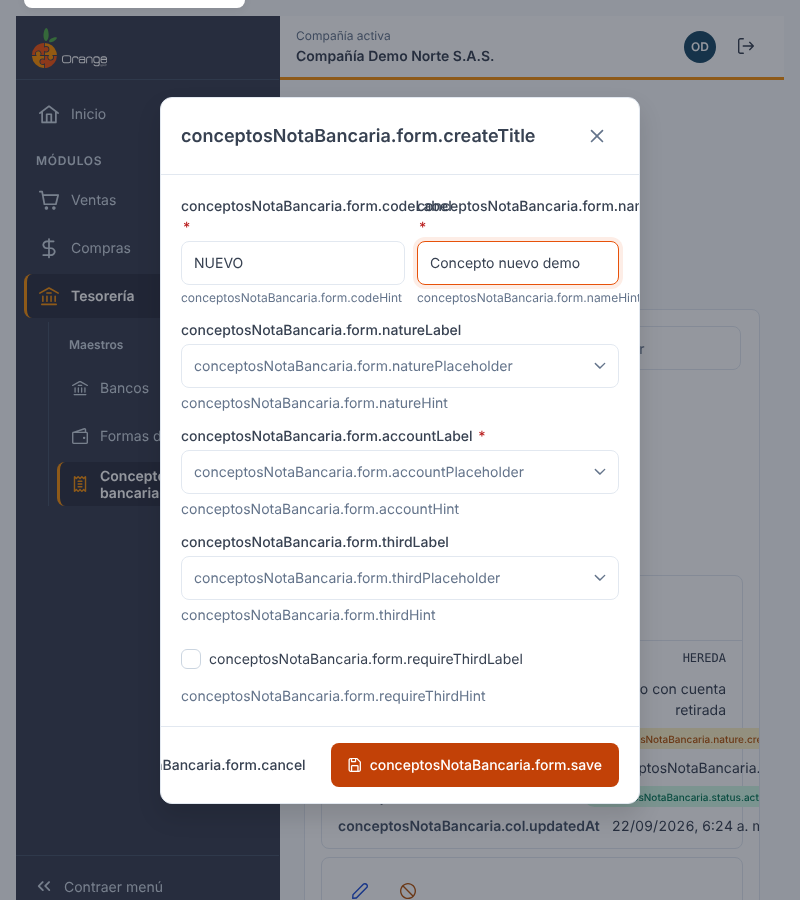

### 🔎 Elegir una cuenta

Las cuentas que se ofrecen son las **cuentas de movimiento** de la compañía, es decir, las que reciben asientos, excepto las cuentas de banco. Para elegirla:

1. Haga clic en el campo **Cuenta contrapartida**. Sin escribir nada, verá la primera página de cuentas.
2. Escriba parte del **código** o del **nombre**. La lista se filtra sola tras una breve pausa.
3. Haga clic en la cuenta. Se muestra como *código - nombre*.

Si no hay coincidencias verá **sin resultados**; si la lista no carga, verá **Reintentar**.

El campo de cuenta **no se puede dejar vacío**: no hay botón para borrar la cuenta, solo para cambiarla.

### 👤 Tercero por defecto y pedir tercero

- Si la cuenta contrapartida **maneja terceros**, la casilla **Pedir tercero al usar este concepto** queda marcada y no se puede desmarcar. El aviso dice: *La cuenta elegida maneja terceros: el tercero es obligatorio y no se puede quitar.*
- Si la cuenta **no** maneja terceros, la casilla es manual: márquela si quiere que las notas pidan tercero con este concepto.
- El **tercero por defecto** es opcional. Si lo elige, la nota lo propone, pero el usuario puede cambiarlo.

---

## ✏️ Editar un concepto

1. Haga clic en el **lápiz** del concepto.
2. Cambie los datos y haga clic en **Guardar**. Al abrir el diálogo, el cursor queda en **Nombre** y se muestran los valores guardados.

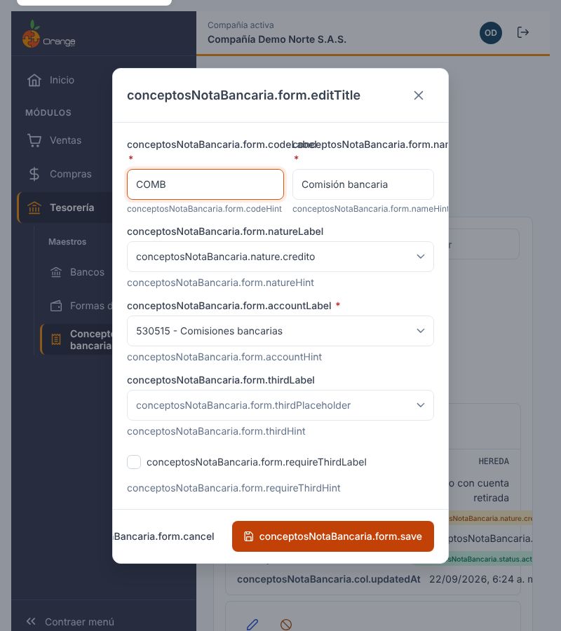

> ⚠️ **Cambiar el código** está permitido, pero verá un aviso: las notas ya registradas siguen apuntando al mismo concepto.

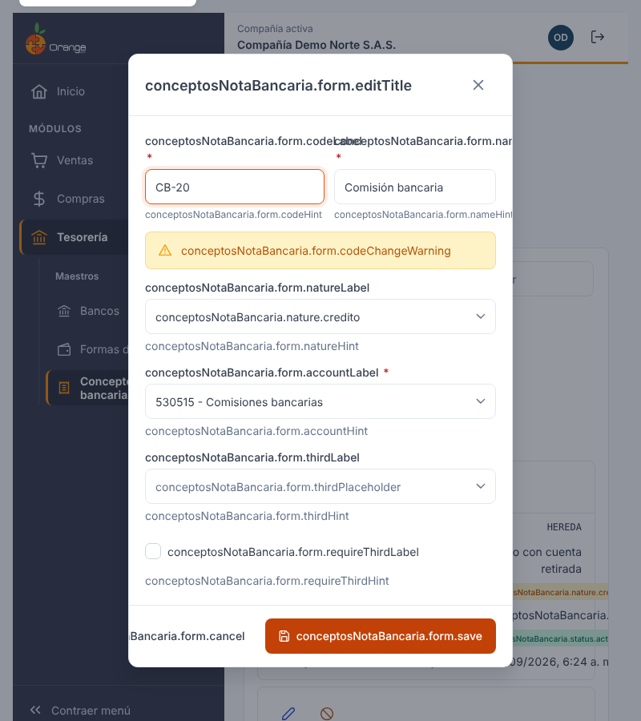

Si otro usuario modificó el concepto mientras lo edita, al guardar verá un aviso de conflicto y podrá cargar sus cambios antes de guardar (ver *Cambios de otros usuarios*).

Si no cambió nada y hace clic en **Guardar**, el diálogo se cierra sin aviso y sin modificar el concepto.

### Conceptos que ya se usaron en notas cerradas

Si el concepto ya se usó en una nota cerrada, el diálogo avisa antes de que intente cambiar algo:

> Este concepto ya se usó en notas cerradas: solo puede cambiar el nombre y el tercero por defecto. Para otra naturaleza o cuenta, cree un concepto nuevo y desactive este.

En ese caso puede cambiar solo el **nombre** y el **tercero por defecto**. La naturaleza y la cuenta contrapartida quedan bloqueadas para proteger el histórico.

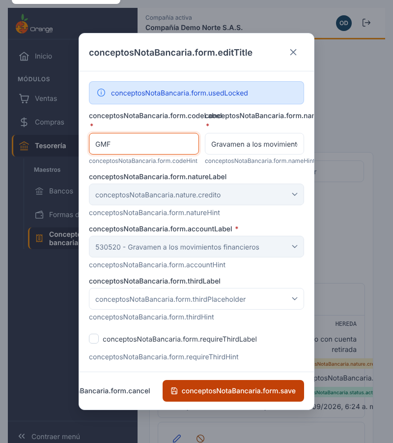

---

## 🔌 Activar y desactivar

Los conceptos no se eliminan. Para retirar uno de la lista de uso:

1. Haga clic en **Desactivar** en la fila del concepto.
2. Confirme con **Desactivar concepto**.

Al desactivarlo, verá el aviso **Concepto … desactivado.** El concepto deja de ofrecerse al registrar notas nuevas. Las notas ya registradas no cambian.

**Para volver a usarlo:**

1. Marque **Mostrar inactivos**.

2. Haga clic en **Activar** en la fila del concepto. Se activa de inmediato, sin confirmación, y verá **Concepto … activado.**

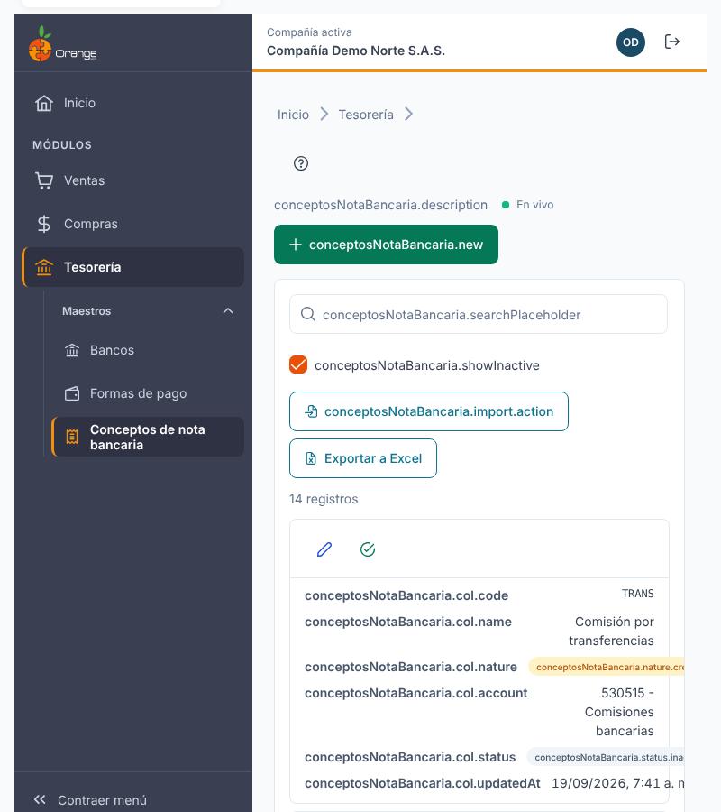

### No se puede desactivar

Si una **nota abierta** (todavía sin cerrar) usa el concepto, no se puede desactivar. Verá:

> No se puede desactivar … : hay notas abiertas que lo usan. Ciérralas o cámbiales el concepto primero.

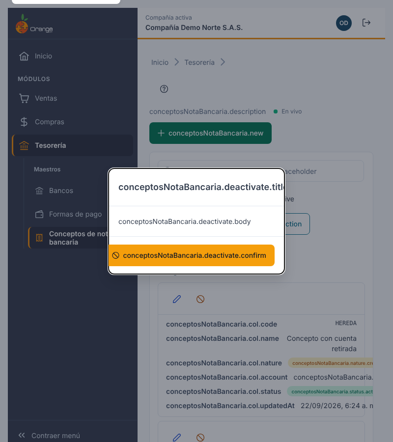

Cierre o cambie esas notas y vuelva a intentarlo.

> ℹ️ Desactivar un concepto que ya está inactivo, o activar uno que ya está activo, no cambia nada y no muestra aviso.

---

## 📤 Exportar a Excel

Haga clic en **Exportar a Excel**. Se descarga un archivo de Excel con **todos** los conceptos del filtro actual (no solo la página visible). Si tiene encendida **Mostrar inactivos**, también se incluyen los inactivos.

---

## 📥 Importar desde Excel

Use **Importar** para crear conceptos nuevos o actualizar varios a la vez. Necesita el permiso **Exportar**; sin él, el botón no aparece.

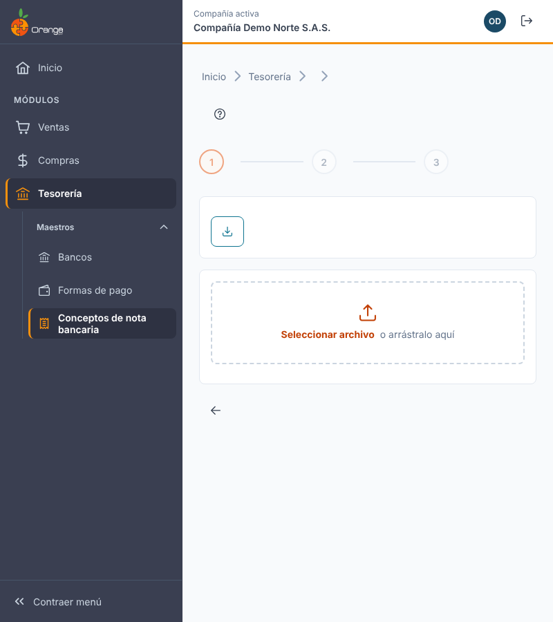

**Paso 1. Descargue la plantilla.** Llene una fila por concepto con su código, nombre, naturaleza y el código de la cuenta contrapartida. La plantilla trae ejemplos comunes (comisión, GMF, rendimientos) **sin cuentas**: complételas antes de cargarla.

**Paso 2. Cargue el archivo** (Excel `.xlsx`). Reglas:

- Hasta **1.000 filas** y **1 MB**. Solo se lee la primera hoja.
- Código: hasta 10 caracteres (letras, números y guion).
- Nombre: hasta 60 caracteres, sin comas ni punto y coma.
- Naturaleza: **Entra dinero al banco** o **Sale dinero del banco**.
- Cuenta contrapartida: por su código, de movimiento y que no sea de banco.

Si el archivo no es un Excel válido, le faltan columnas o no tiene conceptos, verá el motivo y no se cargará nada. Use la plantilla.

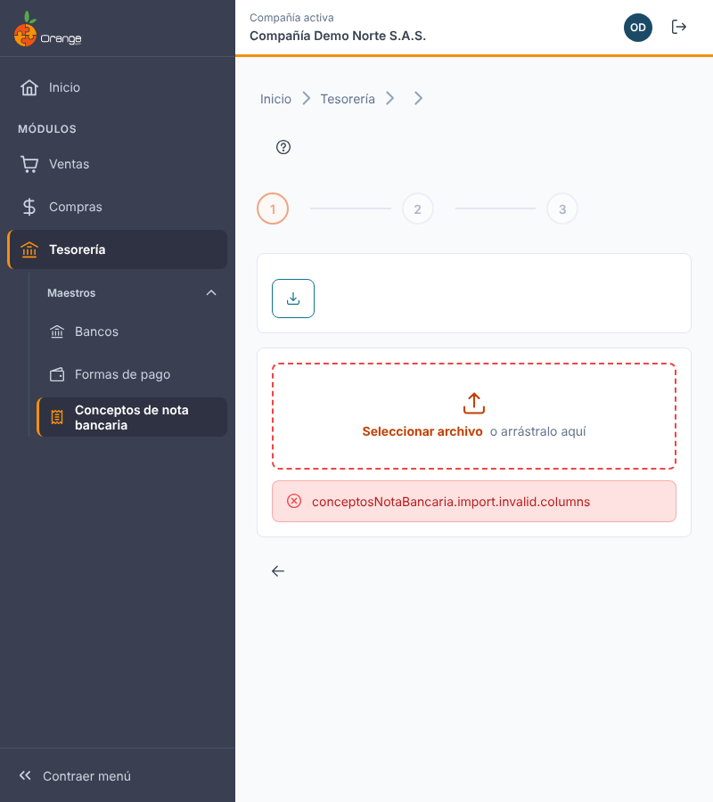

**Paso 3. Revise.** Antes de guardar, verá la revisión con cada fila clasificada:

| Estado | Qué significa |
|--------|---------------|
| **Nuevo** | Se creará. |
| **Se actualiza** | El código ya existe: **solo se cambia el nombre**. La naturaleza y la cuenta del archivo se ignoran. |
| **Sin cambios** | Ya está igual en la compañía. |
| **Error** | La fila tiene un problema. Se muestra el detalle para corregirla. |

Puede filtrar las filas por estado. Nada se guarda todavía.

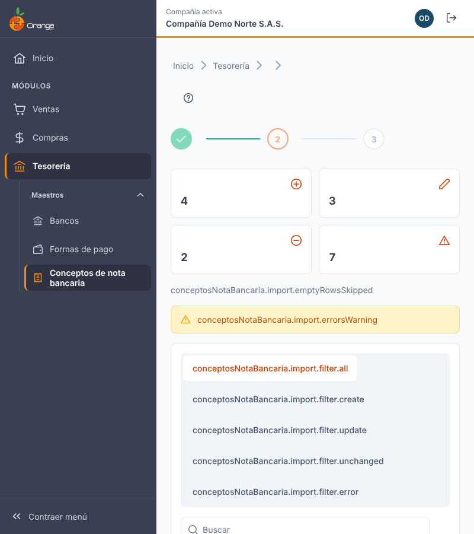

**Paso 4. Aplique.** Si hay filas con error, el botón **Aplicar** está deshabilitado: corrija el archivo y vuelva a cargarlo. La importación se aplica **todo o nada**: si una fila falla, no se guarda ninguna.

Al terminar verá el resultado, por ejemplo *"{n} conceptos importados ({c} nuevos, {u} actualizados)"*.

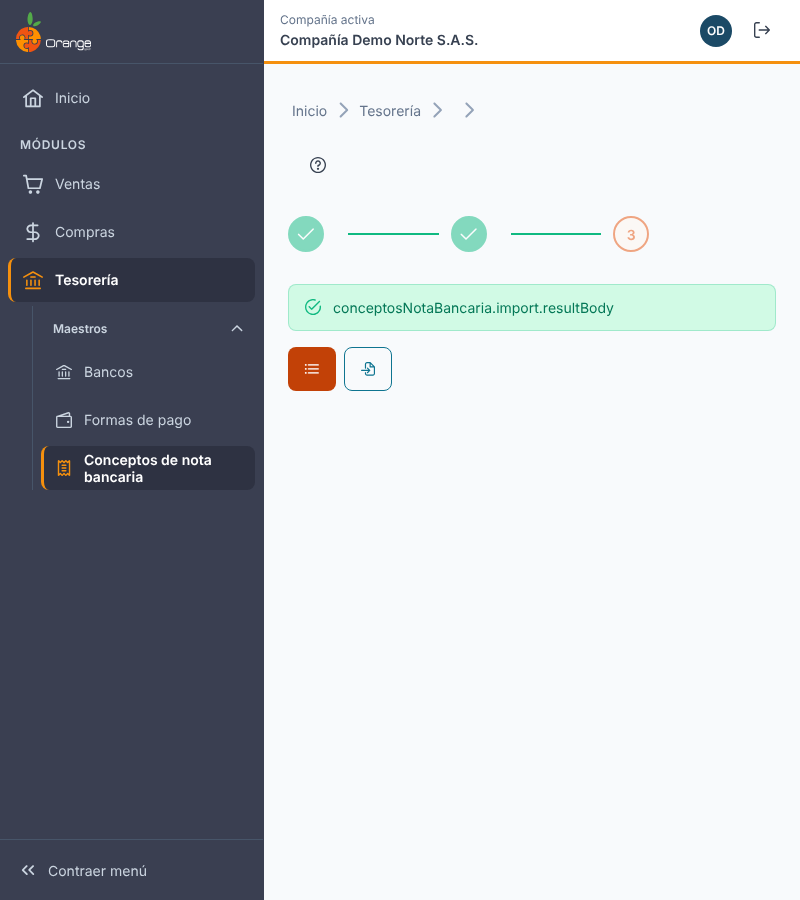

Si mientras importaba otro usuario cambió los conceptos, verá: *"Los datos cambiaron mientras importabas. Revisa el archivo de nuevo."* Vuelva a cargar el archivo para ver la revisión actualizada.

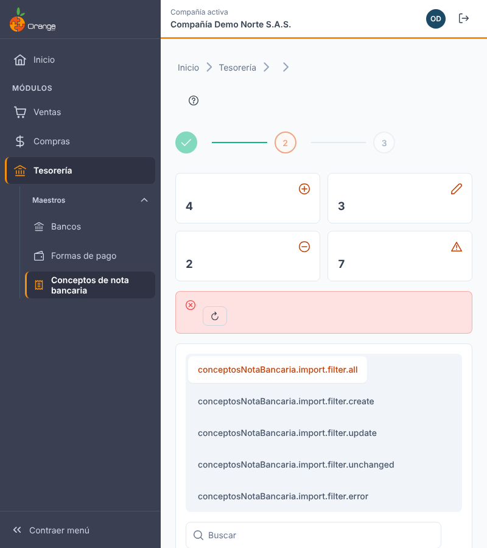

---

## 🔄 Cambios de otros usuarios (en vivo)

Si otra persona crea, modifica, desactiva o importa conceptos mientras usted tiene abierta esta pantalla, **no tiene que recargar**: el listado se pone al día solo, sin perder lo que buscó, el orden ni la página.

- Las filas nuevas o modificadas se **resaltan** unos segundos.
- Abajo a la derecha aparece un aviso, por ejemplo *"Otro usuario creó el concepto GMF."*
- Junto a la descripción verá **En vivo** mientras la conexión esté activa. Si se interrumpe, dice **Reconectando…**; al volver, la pantalla se actualiza sola.

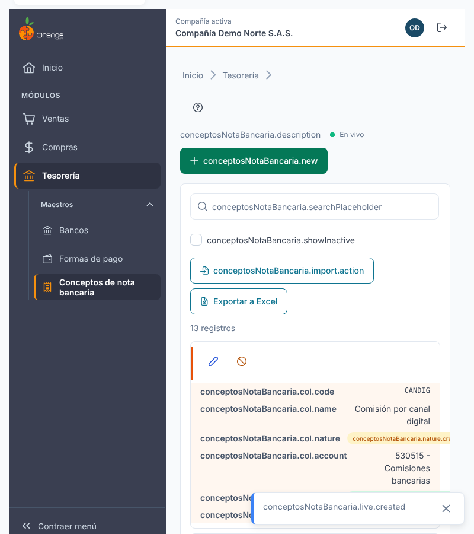

**Si estaba editando ese mismo concepto:**

| Qué hizo el otro usuario | Qué verá | Qué puede hacer |
|--------------------------|----------|-----------------|
| Lo modificó | *"Otro usuario modificó este concepto mientras lo editabas. Si guardas, reemplazarás sus cambios."* | **Ver sus cambios** para cargar lo que él guardó, o **Guardar** para dejar lo suyo. |
| Lo desactivó | *"Otro usuario ya desactivó el concepto …"* | **Cancelar**. |

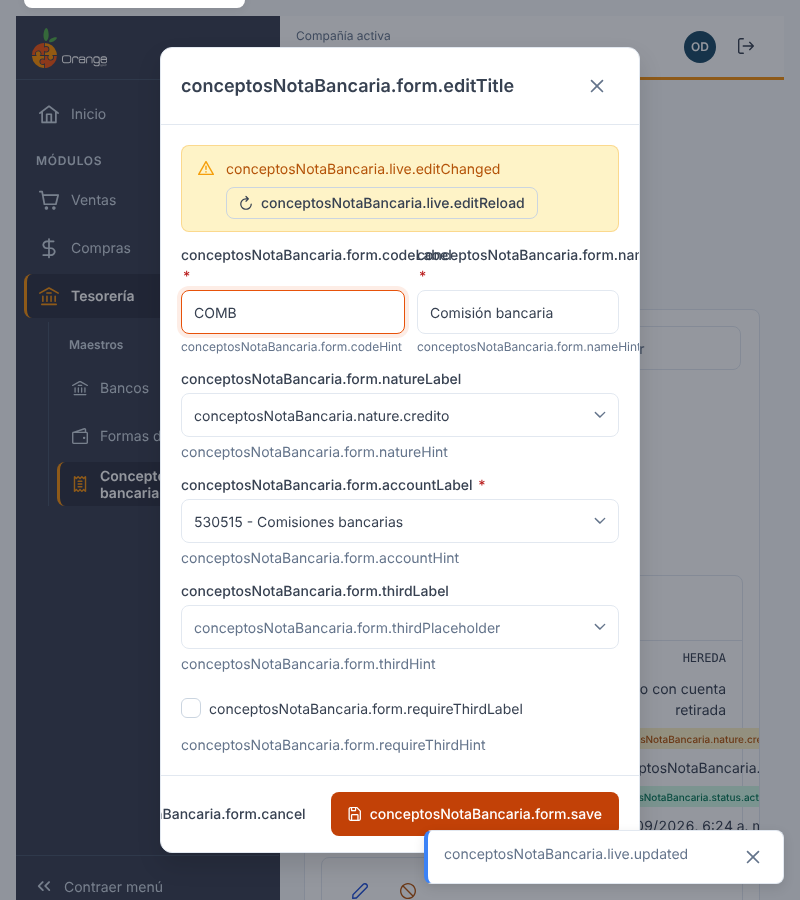

> ℹ️ Los cambios que usted hace en esta misma pestaña no generan avisos.

---

## ❔ Ayuda en pantalla

El botón **?** abre este manual en un panel a la derecha. Puede dejarlo abierto mientras trabaja en el listado o en la importación.

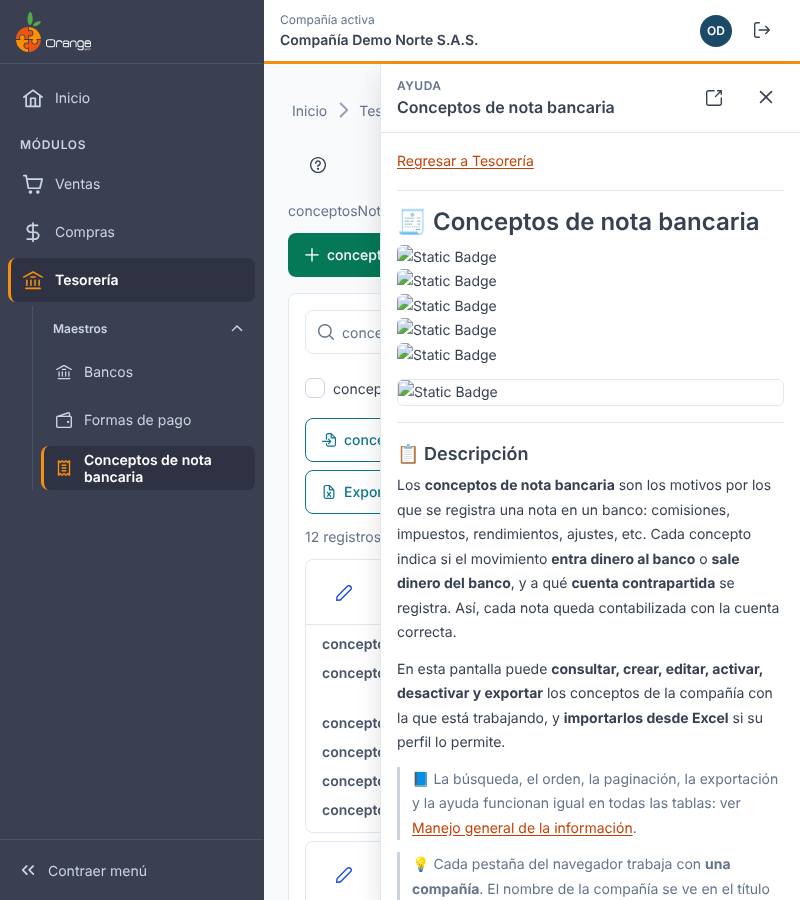

En un celular, la ayuda ocupa toda la pantalla y se cierra con la **✕**.

---

## ❓ Preguntas frecuentes

**¿Puedo eliminar un concepto?**
No. Desactívelo: deja de ofrecerse en las notas nuevas y las notas anteriores no cambian. Si lo necesita de nuevo, actívelo desde **Mostrar inactivos**.

**¿Por qué no puedo elegir una cuenta de banco como contrapartida?**
Porque el banco ya se elige en cada nota. La contrapartida de un concepto es la otra cuenta del movimiento (por ejemplo, una cuenta de gastos o de ingresos).

**¿Por qué no puedo cambiar la naturaleza o la cuenta de un concepto?**
Porque ya se usó en notas cerradas. Puede cambiar el nombre y el tercero por defecto. Para otra naturaleza o cuenta, cree un concepto nuevo y desactive el anterior.

**¿Qué pasa con las notas que ya registré si desactivo un concepto?**
Nada: no cambian. Solo deja de ofrecerse en las notas nuevas.

**¿Por qué la casilla de tercero está marcada y no la puedo quitar?**
La cuenta contrapartida maneja terceros, así que el tercero es obligatorio. Para quitarlo, elija otra cuenta que no maneje terceros.

**¿Por qué el código quedó en mayúsculas?**
Los códigos de concepto siempre se guardan en mayúsculas para que no haya dos conceptos "iguales" escritos distinto.

**¿Por qué no veo Importar o Exportar a Excel?**
Su perfil no tiene el permiso **Exportar** sobre la opción Conceptos de nota bancaria. Consulte con el administrador de OrangeERP.

**¿Por qué no encuentro un concepto que sí existe?**
Revise que esté en la compañía correcta (título de la pestaña), que la casilla **Mostrar inactivos** esté encendida si el concepto está desactivado, y borre el texto del buscador.

**No veo "En vivo".**
La conexión en vivo no está disponible en este momento (por ejemplo, por la red de su empresa). La pantalla funciona igual; para ver cambios de otros usuarios, recargue la página.

**No veo los botones Nuevo concepto, Editar o Desactivar.**
Su perfil no tiene ese permiso sobre la opción Conceptos de nota bancaria. Consulte con el administrador de OrangeERP.
