[Regresar a Tesorería](../readme.md)

---

# 💳 Formas de pago

---

## 📋 Descripción

Las **formas de pago** son las maneras en que la compañía recibe o paga dinero: efectivo, tarjeta, transferencia, bono, plataforma de pagos, etc. Cada forma de pago indica **con qué cuentas contables** se registran los recibos y los pagos. Por eso, una forma de pago bien configurada evita asientos mal contabilizados.

En esta pantalla puede **consultar, crear, editar, eliminar y exportar** las formas de pago de la compañía con la que está trabajando.

> 📘 La búsqueda, el orden, la paginación, la exportación y la ayuda funcionan igual en todas las tablas: ver [Manejo general de la información](../../Generales/manejo-general-informacion.md).

> 💡 Cada pestaña del navegador trabaja con **una compañía**. El nombre de la compañía se ve en el título de la pestaña y en la barra superior.

---

## 🎯 Acceso

1. En el menú principal, haga clic en **Tesorería**.
2. En **Maestros**, haga clic en **Formas de pago**.

---

## 🖥️ Pantalla principal

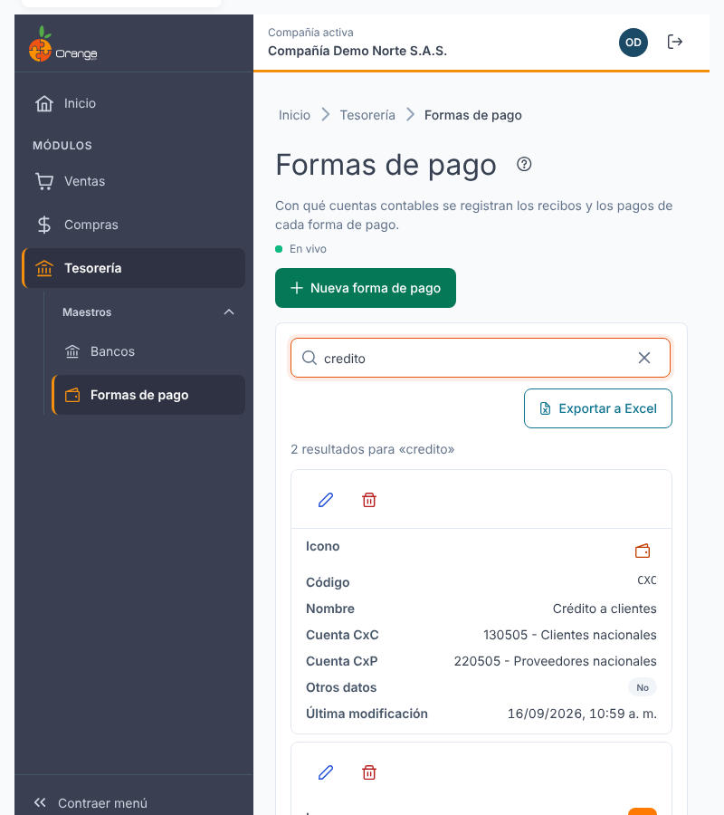

| Elemento | Para qué sirve |
|----------|----------------|
| **?** (junto al título) | Abre esta ayuda en un panel lateral, sin salir de la pantalla. |
| **En vivo** | La pantalla está conectada: los cambios de otros usuarios aparecen solos. Ver *Cambios de otros usuarios* más abajo. |
| **Nueva forma de pago** | Crea una forma de pago. |
| **Buscar por código, nombre o cuenta** | Filtra el listado mientras escribe. No distingue mayúsculas ni tildes. |
| **Exportar a Excel** | Descarga el listado con el filtro y el orden que tenga en pantalla, incluidas todas sus páginas. |
| **Lápiz** / **Papelera** | Editar o eliminar la forma de pago de esa fila. Siempre están en la **primera columna**. |
| **Encabezados** | Un clic ordena de forma ascendente, el segundo descendente y el tercero quita el orden. |
| **Filas por página** y paginación | Cambian cuántas formas de pago ve y la página. |

Las columnas son:

| Columna | Qué muestra |
|---------|-------------|
| **Icono** | La imagen de la forma de pago o, si no tiene, un icono según su tipo. Ver [Imagen e icono](#-imagen-e-icono). |
| **Código** y **Nombre** | Identificación de la forma de pago. |
| **Cuenta** (opcional) | Los últimos 4 dígitos de la cuenta bancaria de la empresa, si la tiene. Se activa desde el selector de columnas. Ver [Cuenta bancaria de la empresa](#-cuenta-bancaria-de-la-empresa). |
| **Cuenta CxC** | La cuenta por cobrar, como *código - nombre*. |
| **Cuenta CxP** | La cuenta por pagar, como *código - nombre*. |
| **Otros datos** | **Sí** si la forma pide banco y documento de referencia al pagar; **No** si no. |
| **Última modificación** | Cuándo se cambió por última vez. |

> 📱 En el celular, o en una ventana angosta, cada forma de pago se muestra como una tarjeta, con las acciones visibles.

**¿No ve algún botón?** Cada acción depende de los permisos de su perfil sobre la opción Formas de pago:

| Permiso | Qué habilita |
|---------|--------------|
| Consultar | Ver la pantalla |
| Crear | **Nueva forma de pago** |
| Actualizar | **Lápiz** (editar, incluida la imagen) |
| Eliminar | **Papelera** (eliminar) |
| Exportar | **Exportar a Excel** |

---

## ➕ Crear una forma de pago

1. Haga clic en **Nueva forma de pago**. El cursor queda en **Código**.
2. Complete los campos y haga clic en **Guardar**.

| Campo | Obligatorio | Reglas | Ejemplo |
|-------|:-----------:|--------|---------|
| **Código** | ✅ | Hasta 5 caracteres: letras, números y guion. Se guarda **siempre en MAYÚSCULAS**. No se puede repetir en la compañía. | `EFE` |
| **Nombre** | ✅ | Hasta 50 caracteres, sin comas ni punto y coma. | `Efectivo` |
| **Cuenta CxC** | ✅ | Cuenta por cobrar. Se elige con el buscador (ver [Elegir una cuenta](#-elegir-una-cuenta)). | Una cuenta de caja del plan |
| **Naturaleza CxC** | ✅ | **Débito** o **Crédito**. | Débito |
| **Cuenta CxP** | ✅ | Cuenta por pagar. Se elige con el buscador. | Una cuenta por pagar del plan |
| **Naturaleza CxP** | ✅ | **Débito** o **Crédito**. | Crédito |
| **Pide banco y documento de referencia al pagar** | | Casilla. Viene desmarcada. Si la marca, las pantallas de pago piden el banco (opcional) y el documento de referencia. | |
| **Imagen (opcional)** | | JPG o PNG de hasta 100 KB. | |

Al guardar verá el mensaje **"Forma de pago … creada."** y la forma de pago aparece en el listado.

Si deja el diálogo sin cambios, se cierra sin guardar nada.

### ¿Qué puede salir mal?

Los mensajes aparecen debajo del campo que debe corregir:

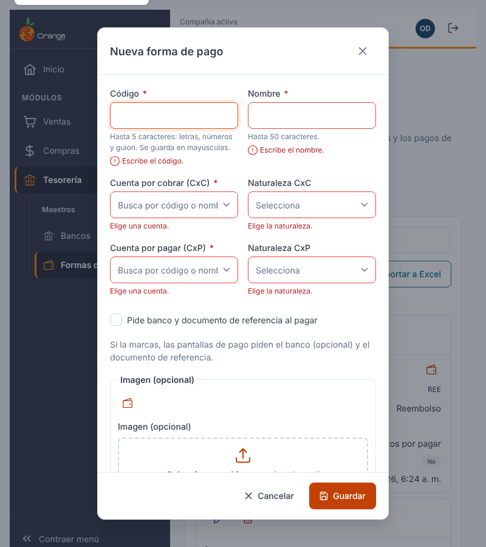

| Mensaje | Qué hacer |
|---------|-----------|
| Escribe el código. / Escribe el nombre. | Complete el campo. |
| Usa solo letras, números y guion (máximo 5). | Quite espacios, tildes u otros símbolos del código. |
| Ya existe una forma de pago con el código … | Use otro código. Lo que escribió se conserva en el diálogo. |
| El nombre no puede tener comas ni punto y coma (máximo 50). | Corrija el nombre. |
| Elige una cuenta. | Busque y seleccione la cuenta. |
| Elige la naturaleza. | Seleccione Débito o Crédito. |
| No se pudo guardar la forma de pago. Inténtalo de nuevo. | Vuelva a guardar. Si sigue igual, consulte a su administrador. |

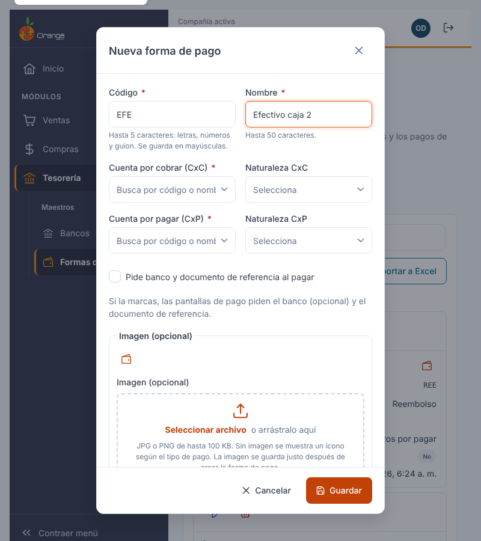

### 🔎 Elegir una cuenta

Las cuentas que se ofrecen son las **cuentas de movimiento** de la compañía (las que reciben asientos). Para elegirla:

1. Haga clic en el campo de la cuenta. Sin escribir nada, verá la primera página de cuentas.
2. Escriba parte del **código** o del **nombre**. La lista se filtra sola tras una breve pausa.
3. Haga clic en la cuenta. Se muestra como *código - nombre*.

La lista se muestra de a 20 cuentas; al bajar se cargan más. Si no hay coincidencias verá **sin resultados**; si la lista no carga, verá **Reintentar**.

El campo de cuenta **no se puede dejar vacío**: no hay botón para borrar la cuenta, solo para cambiarla.

---

## ✏️ Editar una forma de pago

1. Haga clic en el **lápiz** de la forma de pago.
2. Cambie los datos y haga clic en **Guardar**. Al abrir el diálogo, el cursor queda en **Nombre** y se muestran los valores guardados y la imagen actual, si tiene.

> ⚠️ **Cambiar el código** está permitido, pero verá un aviso: otros módulos muestran la forma de pago por su código. La forma de pago sigue siendo la misma.

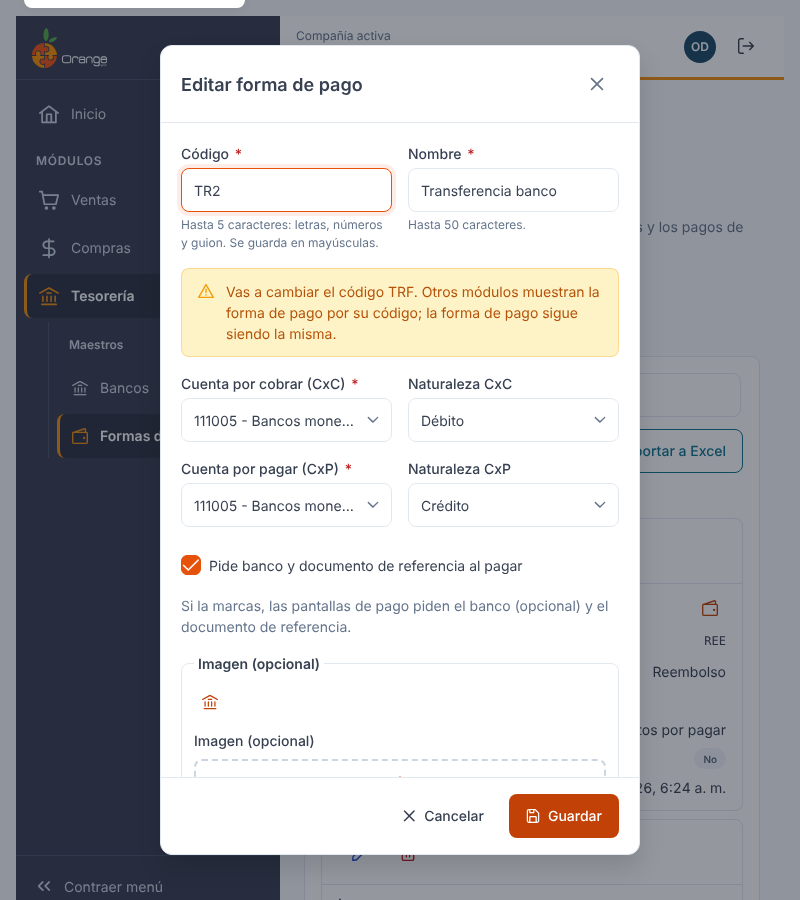

### Cambiar cuentas de una forma de pago que ya se usa

Si la forma de pago ya tiene pagos registrados y cambia una cuenta o su naturaleza, antes de guardar verá este aviso:

> Esta forma de pago ya tiene pagos registrados. Solo afecta a los asientos futuros; los documentos existentes no se recontabilizan.

Puede **Cancelar** para revisar el cambio o **Guardar de todos modos**.

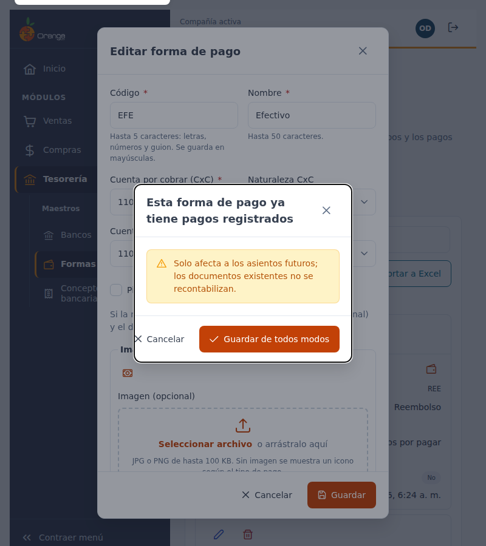

### Cuenta guardada que ya no está disponible

Si la cuenta guardada ya no existe o ya no es de movimiento, el campo muestra **Cuenta · no disponible**. Para guardar, elija otra cuenta.

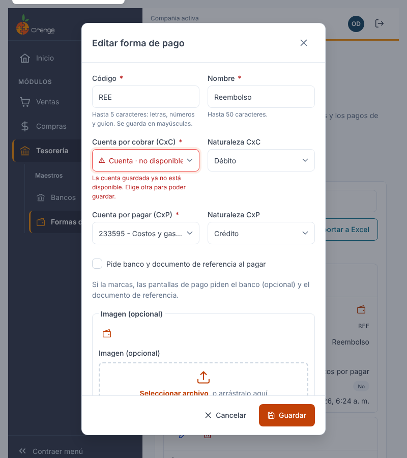

Si guarda sin haber cambiado nada, el diálogo se cierra y no se registra ningún cambio.

Si otro usuario eliminó la forma de pago mientras la editaba, al guardar aparece el aviso **"Esta forma de pago ya no existe"**, el diálogo se cierra y la fila desaparece del listado.

---

## 🖼️ Imagen e icono

Cada forma de pago se reconoce en el listado y en las pantallas de pago por su **imagen** o por su **icono**.

- **Con imagen:** si la forma de pago tiene una imagen JPG o PNG de hasta 100 KB, el listado la muestra.
- **Sin imagen:** se muestra un icono según el tipo de pago que indica el nombre (dinero, edificio de banco, tarjeta, regalo, carrito de compras o billetera). El icono lo asigna el sistema; no se puede elegir a mano.

**Para agregar o cambiar la imagen** (necesita el permiso **Actualizar**):

1. Haga clic en el **lápiz** de la forma de pago.
2. En **Imagen (opcional)**, elija el archivo JPG o PNG de hasta 100 KB.
3. Haga clic en **Guardar**.

Para quitarla, haga clic en **Quitar imagen** y luego en **Guardar**.

> ℹ️ Al **crear** una forma de pago, la imagen se guarda justo después de crearla. Si la imagen no se puede guardar, la forma de pago **sí queda creada**, verá el aviso *"La forma de pago se guardó, pero no se pudo guardar la imagen. Inténtalo de nuevo desde Editar."* y puede subirla después desde **Editar**.

| Mensaje | Qué hacer |
|---------|-----------|
| La imagen debe ser .jpg, .jpeg o .png de hasta 100 KB. | Elija otro archivo con ese formato y tamaño. |

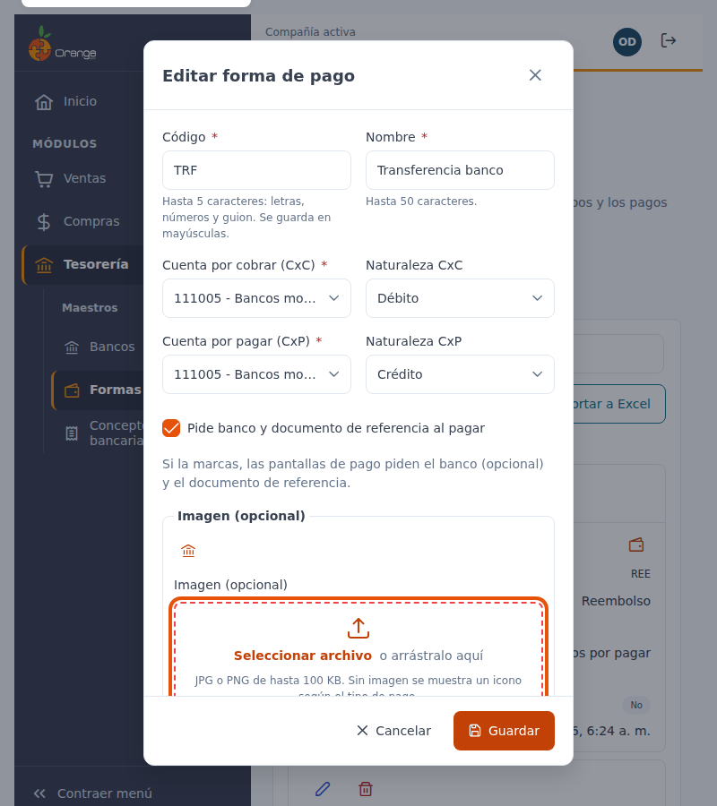

Si la imagen registrada no está disponible, el listado muestra el icono y **no aparece ningún mensaje de error**.

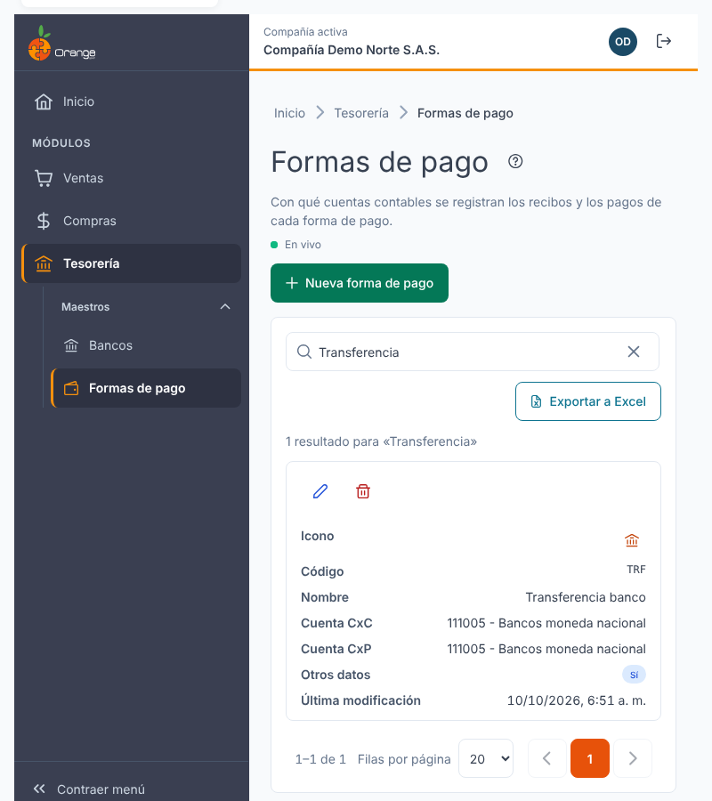

---

## 🏦 Cuenta bancaria de la empresa

La cuenta bancaria de la empresa es la cuenta desde la que sale el dinero de esta forma de pago. La usa el **archivo de pagos a banco** (ver [Archivo de pagos a banco](../movimientos/archivo-banco.md)) para generar el archivo que se sube a la banca virtual. Es **opcional** para el resto de usos.

Al crear o editar, al final del formulario, encontrará la sección **Cuenta bancaria de la empresa** con tres campos:

| Campo | Reglas |
|-------|--------|
| **Número de cuenta** | Solo dígitos, hasta 11. No acepta letras ni espacios. |
| **Tipo de cuenta** | **Sin definir**, **Ahorros** o **Corriente**. |
| **Banco de la cuenta** | El banco de la compañía donde está la cuenta. Busque por nombre o código. Es obligatorio para generar el archivo, pero no para guardar la forma de pago. |

- Los tres campos van **juntos o ninguno**. Si completa solo uno, verá *Completa número y tipo de cuenta, o déjalos vacíos*.
- Al editar, el número se muestra **enmascarado** (por ejemplo, `****1234`). Para cambiarlo, escriba el número completo.
- La cuenta completa no aparece en el listado ni en el Excel.

### ¿Qué puede salir mal?

| Mensaje | Qué hacer |
|---------|-----------|
| *Solo dígitos, hasta 11* | Quite letras, espacios o guiones del número de cuenta. |
| *Completa número y tipo de cuenta, o déjalos vacíos* | Complete los dos campos, o deje los dos vacíos. |
| *El banco elegido no existe en esta compañía* | Busque el banco de nuevo y elija uno de la lista. |
| *Banco no disponible* | Reintente la búsqueda. Si sigue igual, consulte a su administrador. |

En el listado, la columna **Cuenta** muestra los últimos 4 dígitos:

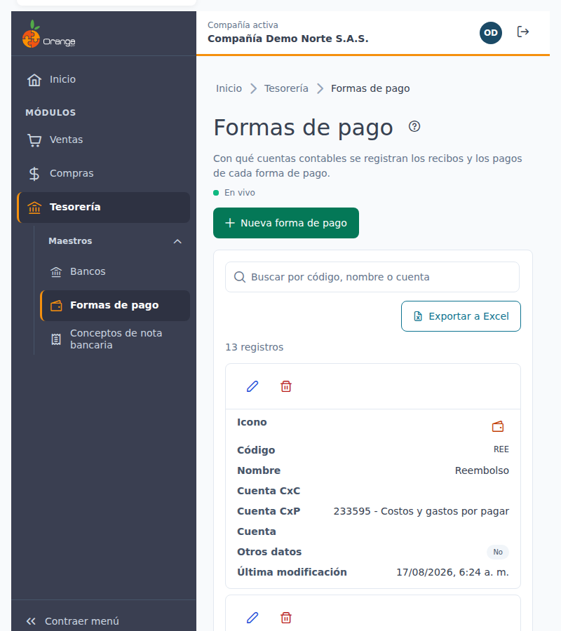

---

## 🗑️ Eliminar una forma de pago

1. Haga clic en la **papelera** de la forma de pago.
2. Revise el nombre y el código en el diálogo y confirme con **Eliminar forma de pago**.

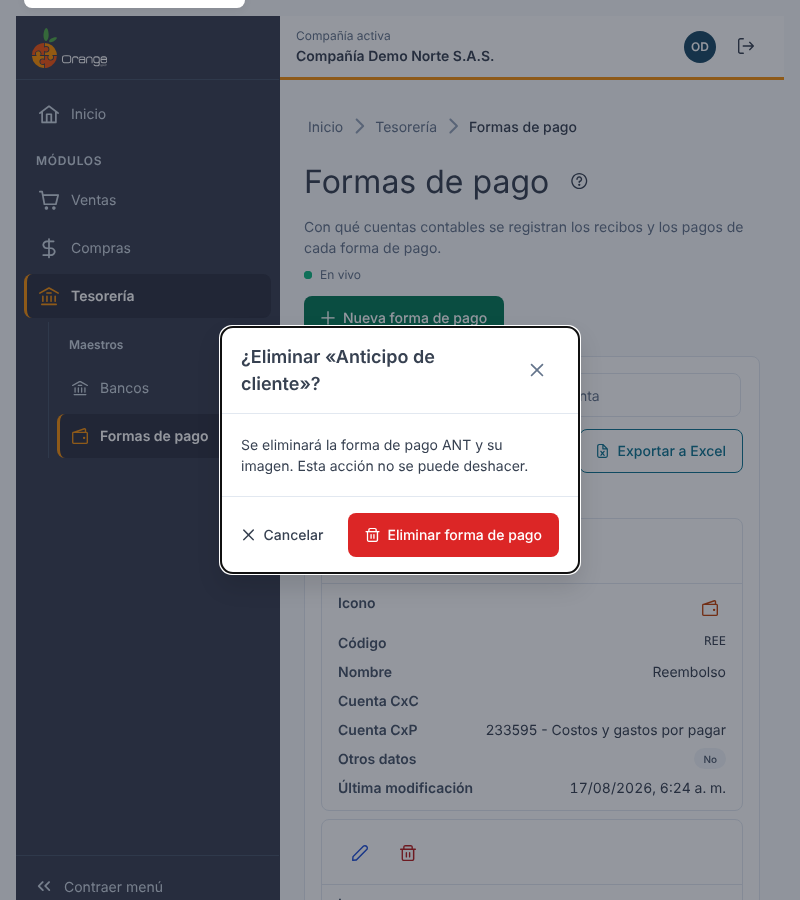

Al eliminar, la imagen también se borra.

Una forma de pago **no se puede eliminar** si tiene información relacionada en otros módulos (por ejemplo, pagos de tesorería, cajeros o movimientos). En ese caso el diálogo muestra:

> No se puede eliminar … : tiene información relacionada en otros módulos.

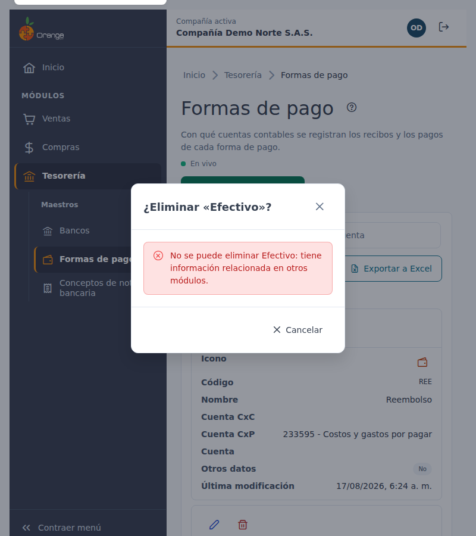

Cuando esto ocurre, el botón **Eliminar forma de pago** no aparece.

---

## 📤 Exportar a Excel

Haga clic en **Exportar a Excel**. Se descarga un archivo de Excel con **todas** las formas de pago del filtro actual (no solo la página visible), con el encabezado fijo y filtros de Excel. Las cuentas bancarias salen **enmascaradas** (solo los últimos 4 dígitos).

> ℹ️ Esta pantalla no tiene importación desde Excel: cree o cambie las formas de pago una por una.

---

## 🔄 Cambios de otros usuarios (en vivo)

Si otra persona crea, modifica o elimina formas de pago mientras usted tiene abierta esta pantalla, **no tiene que recargar**: el listado se pone al día solo, sin perder lo que buscó, el orden ni la página.

- Las filas nuevas o modificadas se **resaltan** unos segundos.
- Abajo a la derecha aparece un aviso, por ejemplo *"Otro usuario creó la forma de pago Efectivo."*
- Junto a la descripción verá **En vivo** mientras la conexión esté activa. Si se interrumpe, dice **Reconectando…**; al volver, la pantalla se actualiza sola.

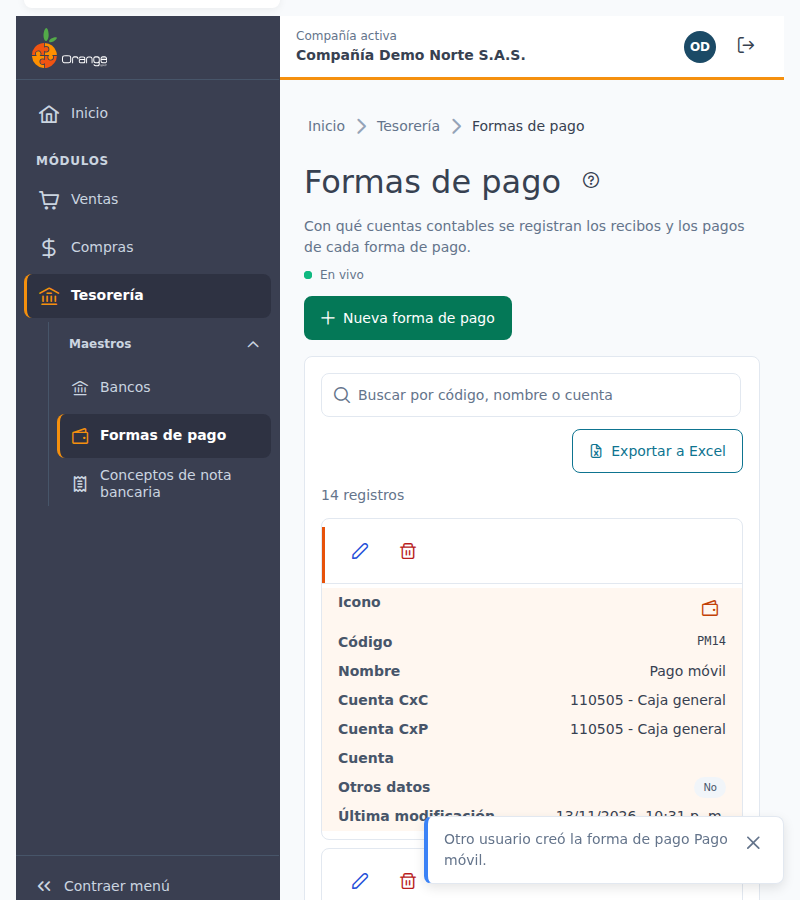

**Si estaba editando esa misma forma de pago:**

| Qué hizo el otro usuario | Qué verá | Qué puede hacer |
|--------------------------|----------|-----------------|
| La modificó (datos o imagen) | *"Otro usuario modificó esta forma de pago mientras la editabas. Si guardas, reemplazarás sus cambios."* | **Ver sus cambios** para cargar lo que él guardó, o **Guardar** para dejar lo suyo. |
| La eliminó | *"Otro usuario eliminó esta forma de pago. Ya no se puede guardar."* | **Cancelar**. El botón Guardar queda deshabilitado. |

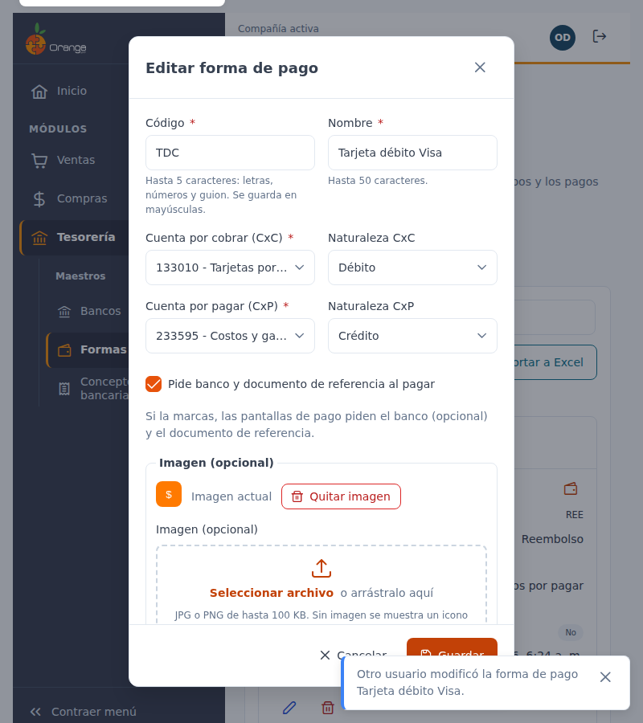

Si estaba por confirmar la eliminación de una forma de pago que otro ya eliminó, el diálogo se cierra con el aviso *"Otro usuario ya eliminó la forma de pago…"*.

> ℹ️ Los cambios que usted hace en esta misma pestaña no generan avisos. Los cambios hechos desde la versión anterior de OrangeERP no se avisan al instante: se reflejan al volver a esta pantalla después de un rato o al recargarla.

---

## ❓ Preguntas frecuentes

**¿Para qué sirve la cuenta bancaria de la empresa?**
Solo para generar el archivo de pagos a banco. Si no la completa, la forma de pago sigue funcionando en todo lo demás, pero el archivo no se puede generar con ella.

**¿Qué cambia si marco "Pide banco y documento de referencia al pagar"?**
Las pantallas donde se registra un pago con esa forma piden el banco (opcional) y el documento de referencia. Marcarla o desmarcarla no cambia los pagos que ya están registrados.

**¿Por qué el código quedó en mayúsculas?**
Los códigos de forma de pago siempre se guardan en mayúsculas para que no haya dos formas "iguales" escritas distinto.

**¿Qué pasa con los pagos ya registrados si cambio una cuenta?**
El cambio **solo afecta a los asientos futuros**. Los documentos existentes no se vuelven a contabilizar. Por eso el sistema le pide confirmar cuando la forma ya tiene pagos.

**¿Por qué la forma de pago tiene icono y no imagen?**
Porque no tiene imagen guardada, o porque la imagen registrada no está disponible. En ambos casos el listado muestra el icono del tipo de pago.

**¿Por qué no encuentro una forma de pago que sí existe?**
Revise que esté en la compañía correcta (título de la pestaña) y borre el texto del buscador con la **✕**.

**¿Por qué no encuentro una cuenta en el buscador?**
Solo se ofrecen cuentas de movimiento de su compañía. Pruebe con otra parte del código o del nombre.

**No veo "En vivo".**
La conexión en vivo no está disponible en este momento (por ejemplo, por la red de su empresa). La pantalla funciona igual; para ver cambios de otros usuarios, recargue la página.

**No veo los botones Nueva forma de pago, Editar o Eliminar.**
Su perfil no tiene ese permiso sobre la opción Formas de pago. Consulte con el administrador de OrangeERP.
